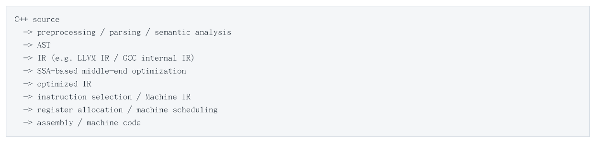
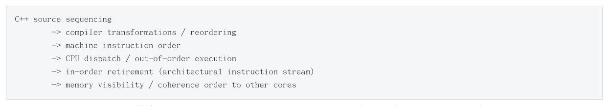
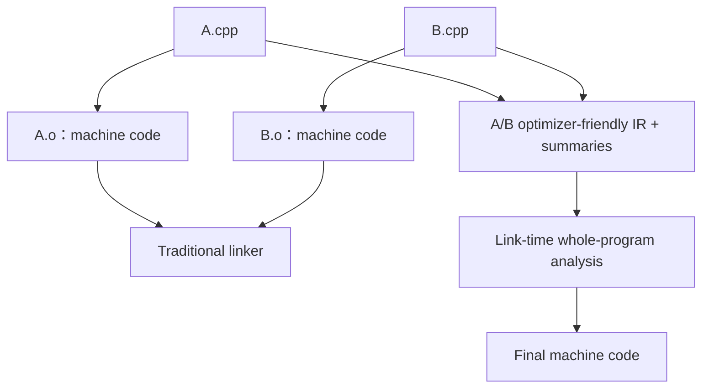
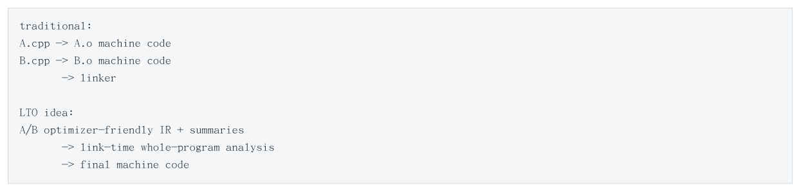
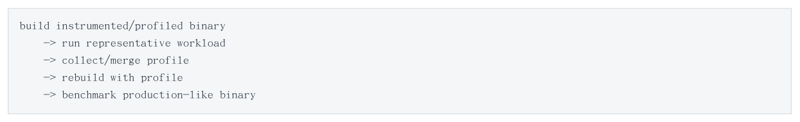
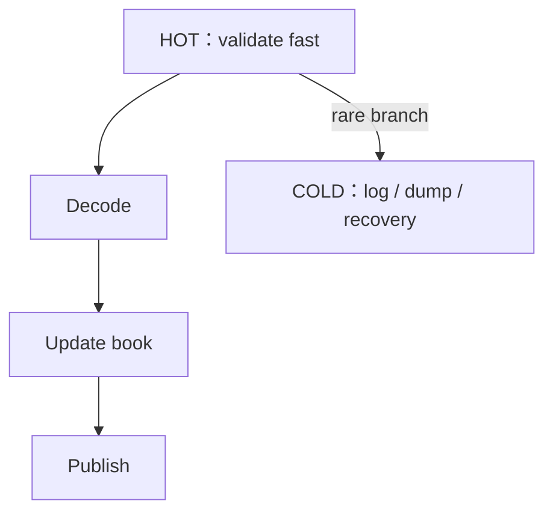
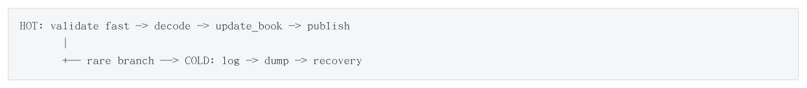
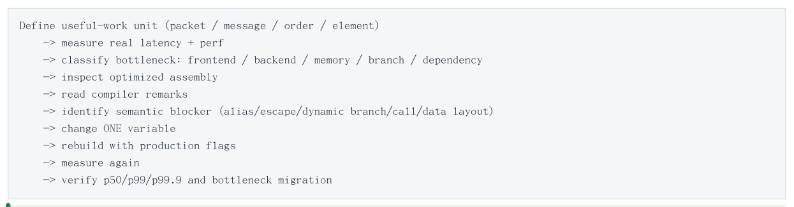
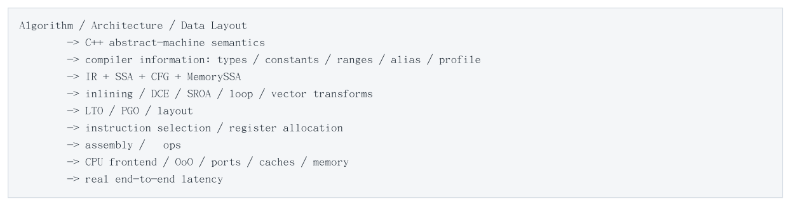

# Compiler Optimization

> 来源：[Level10_Compiler_Optimization_CN.pdf](./Level10_Compiler_Optimization_CN.pdf)（39 页）。本文件按原文逐页转写；转换补充与勘误单独标明。

> 图示优先转为 Mermaid、表格或步骤；每图附原图和文字以便核对。代码保留原文逻辑与缩进，跨页片段及概念示例未宣称可以独立编译。

[返回目录](README.md) · [转换说明与校验](CONVERSION_NOTES.md) · [本文补充与勘误](#conversion-errata)

[原文目录](#pdf-page-003) · [第一章正文](#pdf-page-010)

<a id="pdf-page-001"></a>

<!-- source-pdf-page: 1 -->

*[原 PDF 第 1 页](./Level10_Compiler_Optimization_CN.pdf#page=1)*

## Compiler Optimization

### C++ / CPU 深度学习 - 第十层完整讲义

As-if Rule · Observable Behavior · UB · Inlining · Devirtualization · Loop Optimization · SIMD · Alias · SSA · GVN · SROA · LTO · PGO · Code Layout · Low-Latency Compiler Engineering

全书目标 目标：从 C++ 语言语义出发，理解优化器为什么“有权”变换代码、为什么“能够”证明某些事实、为什么有时又必须保守；最终把 Compiler -&gt; IR/SSA -&gt; Assembly -&gt; µops -&gt; CPU execution 串成一个可验证的低延迟性能模型。

2026-08 · 详尽版 · Level 10

<a id="pdf-page-002"></a>

<!-- source-pdf-page: 2 -->

*[原 PDF 第 2 页](./Level10_Compiler_Optimization_CN.pdf#page=2)*

## 如何使用这份讲义

这份 PDF 不是八次 Session 的聊天记录拼接，而是按照“语言语义 -&gt; 编译器证明 -&gt; IR/SSA -&gt; 函数与循环变换 -&gt; 全程序优化 -&gt; 机器代码与测量”的顺序重新组织。阅读时始终区分三件事：什么变换在 C++ 语义上合法；编译器是否有足够信息证明它合法；即使合法且可证明，cost model 是否认为值得做。

方法论 每次看到一段 hot C++，先问“它的语义约束是什么、哪些事实对优化器可见”，再看 optimized assembly；最后用 llvm-mca / perf / VTune 和真实 latency distribution 验证。不要从源码外观直接推断 CPU 工作量。

### 阅读路线

| 章节 | 主题 | 最终要回答的问题 |
| --- | --- | --- |
| 第 1 章 | Compiler Mental Model | 编译器到底被允许做什么？source order 为什么不是 machine order？ |
| 第 2 章 | Inlining / Devirtualization | 函数抽象什么时候消失？dynamic dispatch 为什么会阻断优化链？ |
| 第 3 章 | Loop Optimization | 编译器怎样改变 iteration 结构，暴露 ILP 并减少 loop overhead？ |
| 第 4 章 | Auto Vectorization / SIMD | 什么时候多个 scalar iterations 能安全映射到 SIMD lanes？ |
| 第 5 章 | Alias / Pointer Semantics | 为什么“两个 pointer 可能指向同一对象”会让优化器大幅保守？ |
| 第 6 章 | IR / SSA / Data Flow | 优化器内部如何表示 value dependency、phi、range 与 memory state？ |
| 第 7 章 | LTO / PGO / Code Layout | 怎样扩大 visibility、引入真实 hotness，并改善 CPU frontend？ |
| 第 8 章 | Low-Latency Compiler Engineering | 怎样把 compiler knowledge 落到 HFT production hot path？ |
| 附录 | 面试 / 命令 / 实验 / Checklist | 怎样快速复习、验证与面试表达？ |

### 贯穿全书的六个问题

- 这个源代码操作是否具有 observable behavior，还是可以完全消失？

- 这个 transformation 在 C++ abstract machine 下合法吗？

- 编译器目前能证明哪些 constants、ranges、types、no-alias、callee targets？

- 优化后真正留下的是哪些 loads/stores/branches/calls/dependency chains？

- 最后的机器代码是 frontend-bound、dependency-bound、resource-bound 还是 memory-bound？

- 怎样设计一个 controlled experiment 去证伪当前 hypothesis？

<a id="pdf-page-003"></a>

<!-- source-pdf-page: 3 -->

*[原 PDF 第 3 页](./Level10_Compiler_Optimization_CN.pdf#page=3)*

## 原文目录

- [如何使用这份讲义 2 阅读路线 2 贯穿全书的六个问题](#pdf-page-002)（原页码 2）
- [第 1 章 Compiler Mental Model：As-if Rule、Observable Behavior 与 UB](#pdf-page-010)（原页码 10）
- [1.1 C++ Abstract Machine 与真实机器](#pdf-page-010)（原页码 10）
- [1.2 As-if Rule：优化器的法律基础](#pdf-page-010)（原页码 10）
- [1.3 Observable Behavior：什么会约束优化器](#pdf-page-010)（原页码 10）
- [1.4 Dead Code、Dead Store 与 Benchmark 消失](#pdf-page-011)（原页码 11）
- [1.5 Compiler Pipeline：Frontend、Middle-End、Backend](#pdf-page-011)（原页码 11）
- [1.6 Optimizer 是证明器，不是“聪明的人类直觉”](#pdf-page-011)（原页码 11）
- [1.7 Undefined Behavior 是 Optimizer Assumption](#pdf-page-011)（原页码 11）
- [1.8 UB、Unspecified 与 Implementation-Defined](#pdf-page-012)（原页码 12）
- [1.9 Signed Overflow 与 CPU Wraparound 不是一个层次](#pdf-page-012)（原页码 12）
- [1.10 volatile、atomic 与 barrier](#pdf-page-012)（原页码 12）
- [1.11 Source Order、Assembly Order、Execute Order、Visibility Order](#pdf-page-012)（原页码 12）
- [1.12 -O0 / -O2 / -O3 / -Ofast / -march / -mtune](#pdf-page-013)（原页码 13）
- [1.13 本章总结](#pdf-page-013)（原页码 13）
- [第 2 章 Inlining、Devirtualization 与 Function Optimization](#pdf-page-013)（原页码 13）
- [2.1 Direct Call 的成本与误区](#pdf-page-013)（原页码 13）
- [2.2 `inline` Keyword != Inlining Decision](#pdf-page-013)（原页码 13）
- [2.3 Inlining 是 Optimization Enabler](#pdf-page-013)（原页码 13）
- [2.4 Call-Site Specific Inlining](#pdf-page-014)（原页码 14）
- [2.5 ABI Boundary 与 Register Allocation](#pdf-page-014)（原页码 14）
- [2.6 Indirect Call：CPU 与 Compiler 两层成本](#pdf-page-014)（原页码 14）
- [2.7 Virtual Dispatch 与 Devirtualization](#pdf-page-014)（原页码 14）

<a id="pdf-page-004"></a>

<!-- source-pdf-page: 4 -->

*[原 PDF 第 4 页](./Level10_Compiler_Optimization_CN.pdf#page=4)*

- [2.8 Function Pointer、Lambda、Template Callback、std::function](#pdf-page-014)（原页码 14）
- [2.9 Static Polymorphism 与 CRTP](#pdf-page-014)（原页码 14）
- [2.10 Runtime Dispatch Once：把 Dynamism 移出 Hot Loop](#pdf-page-015)（原页码 15）
- [2.11 `always_inline`、`noinline`、`cold`、`hot`、`flatten`](#pdf-page-015)（原页码 15）
- [2.12 Code Bloat、I-cache 与 uop Cache](#pdf-page-015)（原页码 15）
- [2.13 Register Pressure 与 Spill](#pdf-page-015)（原页码 15）
- [2.14 Inlining 与 Alias / Escape / Vectorization](#pdf-page-015)（原页码 15）
- [2.15 Tail Call 与 Tail Recursion](#pdf-page-015)（原页码 15）
- [2.16 `std::variant` 与 `switch` / Function Table](#pdf-page-015)（原页码 15）
- [2.17 本章总结](#pdf-page-015)（原页码 15）
- [第 3 章 Loop Optimization：Unrolling、LICM、Unswitching 与 Dependency](#pdf-page-016)（原页码 16）
- [3.1 Source Loop != Machine Loop](#pdf-page-016)（原页码 16）
- [3.2 Loop-Carried RAW Dependency](#pdf-page-016)（原页码 16）
- [3.3 Loop Unrolling 的三类收益](#pdf-page-016)（原页码 16）
- [3.4 Multiple Accumulators：从 1 条 Chain 变成 N 条](#pdf-page-016)（原页码 16）
- [3.5 LICM：Loop-Invariant Code Motion](#pdf-page-017)（原页码 17）
- [3.6 Induction Variable Simplification 与 Strength Reduction](#pdf-page-017)（原页码 17）
- [3.7 Loop Unswitching](#pdf-page-017)（原页码 17）
- [3.8 Loop Peeling、Versioning 与 Runtime Guards](#pdf-page-017)（原页码 17）
- [3.9 Fusion / Fission / Distribution](#pdf-page-017)（原页码 17）
- [3.10 Interchange、Tiling 与 Unroll-and-Jam](#pdf-page-017)（原页码 17）
- [3.11 Floating-Point Reduction 与 Reassociation](#pdf-page-018)（原页码 18）
- [3.12 Software Pipelining 与 OoO](#pdf-page-018)（原页码 18）
- [3.13 Memory-Bound、Resource-Bound、Dependency-Bound](#pdf-page-018)（原页码 18）
- [3.14 Linked List：即使全部 L1 Hit 也可能慢](#pdf-page-018)（原页码 18）
- [3.15 Loop Optimization Report](#pdf-page-018)（原页码 18）
- [3.16 本章总结](#pdf-page-018)（原页码 18）

<a id="pdf-page-005"></a>

<!-- source-pdf-page: 5 -->

*[原 PDF 第 5 页](./Level10_Compiler_Optimization_CN.pdf#page=5)*

- [第 4 章 Auto Vectorization / SIMD：从 Scalar Iterations 到 Vector Lanes](#pdf-page-018)（原页码 18）
- [4.1 SIMD 与 OoO 是两层并行](#pdf-page-019)（原页码 19）
- [4.2 Legal? Compiler 必须证明 Iteration Independence](#pdf-page-019)（原页码 19）
- [4.3 Profitable? SIMD 也有 Setup 成本](#pdf-page-019)（原页码 19）
- [4.4 Vector Width：SSE / AVX2 / AVX-512](#pdf-page-019)（原页码 19）
- [4.5 Main Vector Loop 与 Scalar/Masked Tail](#pdf-page-019)（原页码 19）
- [4.6 Reduction Vectorization 与 Multiple Vector Accumulators](#pdf-page-019)（原页码 19）
- [4.7 Floating-Point Semantics 与 FMA](#pdf-page-020)（原页码 20）
- [4.8 Alias 与 Runtime Versioning](#pdf-page-020)（原页码 20）
- [4.9 Alignment：现代 x86 的正确理解](#pdf-page-020)（原页码 20）
- [4.10 AoS、SoA 与 AoSoA](#pdf-page-020)（原页码 20）
- [4.11 Gather / Scatter：一条指令不等于一次 Memory Access](#pdf-page-020)（原页码 20）
- [4.12 Branch、Mask 与 If-Conversion](#pdf-page-020)（原页码 20）
- [4.13 Function Call 是 Vectorizer 的经典 Barrier](#pdf-page-020)（原页码 20）
- [4.14 STL Abstraction 与 Auto-Vectorization](#pdf-page-020)（原页码 20）
- [4.15 Intrinsics vs Auto-Vectorization](#pdf-page-021)（原页码 21）
- [4.16 Arithmetic Intensity 与 Roofline Thinking](#pdf-page-021)（原页码 21）
- [4.17 AVX Frequency / Power Effects](#pdf-page-021)（原页码 21）
- [4.18 HFT 场景：自然 Batch 与 Parser SIMD](#pdf-page-021)（原页码 21）
- [4.19 本章总结](#pdf-page-021)（原页码 21）
- [第 5 章 Alias Analysis、Strict Aliasing、Lifetime 与 Pointer Semantics](#pdf-page-021)（原页码 21）
- [5.1 Alias：不同 Access Paths 可能访问同一对象](#pdf-page-022)（原页码 22）
- [5.2 Pointer 的“隐藏成本”经常是 Information Loss](#pdf-page-022)（原页码 22）
- [5.3 `__restrict`：No-Alias Contract](#pdf-page-022)（原页码 22）
- [5.4 memcpy vs memmove：语义越强，自由越小](#pdf-page-022)（原页码 22）
- [5.5 Strict Aliasing 与 TBAA](#pdf-page-022)（原页码 22）
- [5.6 Type Punning：`reinterpret_cast` 不等于合法访问](#pdf-page-022)（原页码 22）

<a id="pdf-page-006"></a>

<!-- source-pdf-page: 6 -->

*[原 PDF 第 6 页](./Level10_Compiler_Optimization_CN.pdf#page=6)*

- [5.7 Character / Byte View 与 Object Representation](#pdf-page-023)（原页码 23）
- [5.8 Alignment：Hardware 能做 != C++ Expression 合法](#pdf-page-023)（原页码 23）
- [5.9 Storage != Object Lifetime](#pdf-page-023)（原页码 23）
- [5.10 Pointer Provenance：不要只把 Pointer 看成 uint64_t](#pdf-page-023)（原页码 23）
- [5.11 `std::launder` 的正确定位](#pdf-page-023)（原页码 23）
- [5.12 `const`、Reference 与 `this` 都不等于 NoAlias](#pdf-page-023)（原页码 23）
- [5.13 Mod/Ref 与 Unknown Calls](#pdf-page-023)（原页码 23）
- [5.14 Escape Analysis 与 SROA](#pdf-page-023)（原页码 23）
- [5.15 Compiler Alias vs CPU Memory Disambiguation](#pdf-page-024)（原页码 24）
- [5.16 Data Race 与 Seqlock：C++ Memory Model 先于 x86](#pdf-page-024)（原页码 24）
- [5.17 API Design：By-Value Small Immutable Values](#pdf-page-024)（原页码 24）
- [5.18 Object Pool、Reallocation、Stable Address](#pdf-page-024)（原页码 24）
- [5.19 本章总结](#pdf-page-024)（原页码 24）
- [第 6 章 IR、SSA 与 Data-Flow Optimization](#pdf-page-024)（原页码 24）
- [6.1 SSA：Static Single Assignment](#pdf-page-024)（原页码 24）
- [6.2 Phi Node：Control-Flow Merge](#pdf-page-025)（原页码 25）
- [6.3 Basic Block、CFG 与 Dominance](#pdf-page-025)（原页码 25）
- [6.4 mem2reg：Local Variable 不等于 Stack Slot](#pdf-page-025)（原页码 25）
- [6.5 SROA：Scalar Replacement of Aggregates](#pdf-page-025)（原页码 25）
- [6.6 Constant Folding、Propagation 与 Copy Propagation](#pdf-page-025)（原页码 25）
- [6.7 DCE 与 Dead Store Elimination](#pdf-page-025)（原页码 25）
- [6.8 CSE 与 GVN](#pdf-page-025)（原页码 25）
- [6.9 SCCP：Sparse Conditional Constant Propagation](#pdf-page-026)（原页码 26）
- [6.10 Range Analysis 与 Known Bits](#pdf-page-026)（原页码 26）
- [6.11 MemorySSA：Memory State 的 Def-Use](#pdf-page-026)（原页码 26）
- [6.12 Compile-Time Store-to-Load Forwarding](#pdf-page-026)（原页码 26）
- [6.13 PRE 与 Speculative Code Motion](#pdf-page-026)（原页码 26）

<a id="pdf-page-007"></a>

<!-- source-pdf-page: 7 -->

*[原 PDF 第 7 页](./Level10_Compiler_Optimization_CN.pdf#page=7)*

- [6.14 Loop Phi 与 Recurrence Cycle](#pdf-page-026)（原页码 26）
- [6.15 ScalarEvolution / SCEV](#pdf-page-026)（原页码 26）
- [6.16 Vector IR](#pdf-page-027)（原页码 27）
- [6.17 Register Pressure：SSA 的无限 Virtual Values 终会撞到有限 Hardware](#pdf-page-027)（原页码 27）
- [6.18 Phase Ordering 与 Repeated Cleanup](#pdf-page-027)（原页码 27）
- [6.19 Legal / Provable / Profitable](#pdf-page-027)（原页码 27）
- [6.20 本章总结](#pdf-page-027)（原页码 27）
- [第 7 章 LTO、PGO 与 Code Layout：从单函数优化到 Production Binary](#pdf-page-027)（原页码 27）
- [7.1 Translation Unit 是 Information Boundary](#pdf-page-027)（原页码 27）
- [7.2 LTO：在 Link-Time 保留/恢复 IR Visibility](#pdf-page-028)（原页码 28）
- [7.3 Full LTO vs ThinLTO](#pdf-page-028)（原页码 28）
- [7.4 Symbol Visibility 与 Semantic Interposition](#pdf-page-028)（原页码 28）
- [7.5 PGO：给 Compiler Runtime Frequency](#pdf-page-028)（原页码 28）
- [7.6 PGO 不等于 CPU Branch Predictor Training](#pdf-page-028)（原页码 28）
- [7.7 Instrumentation PGO vs Sample PGO](#pdf-page-028)（原页码 28）
- [7.8 PGO 对 Inlining / Devirtualization / Specialization](#pdf-page-029)（原页码 29）
- [7.9 Profile Quality：Representative 是第一原则](#pdf-page-029)（原页码 29）
- [7.10 Frequent != Critical](#pdf-page-029)（原页码 29）
- [7.11 Code Layout：Same Logic, Different Frontend Cost](#pdf-page-029)（原页码 29）
- [7.12 Hot / Cold Splitting](#pdf-page-029)（原页码 29）
- [7.13 Fall-Through 与 Branch Inversion](#pdf-page-029)（原页码 29）
- [7.14 Function Layout、iTLB 与 Alignment](#pdf-page-029)（原页码 29）
- [7.15 Link Order 与 Performance Instability](#pdf-page-029)（原页码 29）
- [7.16 BOLT 与 Post-Link Optimization](#pdf-page-029)（原页码 29）
- [7.17 LTO + PGO 的联合价值](#pdf-page-030)（原页码 30）
- [7.18 Production Validation](#pdf-page-030)（原页码 30）
- [7.19 本章总结](#pdf-page-030)（原页码 30）

<a id="pdf-page-008"></a>

<!-- source-pdf-page: 8 -->

*[原 PDF 第 8 页](./Level10_Compiler_Optimization_CN.pdf#page=8)*

- [第 8 章 Low-Latency Compiler Engineering：从 C++ Hot Path 到 Production Validation](#pdf-page-030)（原页码 30）
- [8.1 总原则：Architecture First, Compiler Second](#pdf-page-030)（原页码 30）
- [8.2 Optimizer-Friendly Hot Path Shape](#pdf-page-030)（原页码 30）
- [8.3 Compile-Time Specialization 的边界](#pdf-page-030)（原页码 30）
- [8.4 Hot/Cold Pattern](#pdf-page-031)（原页码 31）
- [8.5 Production Compiler Flags：不要形成“宗教”](#pdf-page-031)（原页码 31）
- [8.6 Fast-Math：先定义业务语义](#pdf-page-031)（原页码 31）
- [8.7 Exceptions 与 RTTI](#pdf-page-031)（原页码 31）
- [8.8 volatile、Compiler Barrier、CPU Fence、Atomic](#pdf-page-031)（原页码 31）
- [8.9 Benchmark：防止 Compiler 测到“零工作”](#pdf-page-031)（原页码 31）
- [8.10 Assembly Inspection：先看结构，再数 Cycles](#pdf-page-032)（原页码 32）
- [8.11 Compiler Optimization Remarks](#pdf-page-032)（原页码 32）
- [8.12 llvm-mca：静态 Core Model](#pdf-page-032)（原页码 32）
- [8.13 perf / VTune：真实 Silicon Ground Truth](#pdf-page-032)（原页码 32）
- [8.14 Warm-Up、Dynamic Linking 与 First-Hit Latency](#pdf-page-032)（原页码 32）
- [8.15 Static / Dynamic Linking、PLT/GOT 与 Visibility](#pdf-page-032)（原页码 32）
- [8.16 Sanitizers：Correctness Build 与 Performance Build 分离](#pdf-page-032)（原页码 32）
- [8.17 Compiler-Aware vs Compiler-Dependent](#pdf-page-032)（原页码 32）
- [8.18 Low-Latency Data Layout](#pdf-page-033)（原页码 33）
- [8.19 Compiler-Friendly Concurrency](#pdf-page-033)（原页码 33）
- [8.20 一条 Hot Path 的标准诊断流程](#pdf-page-033)（原页码 33）
- [8.21 常见反模式](#pdf-page-033)（原页码 33）
- [8.22 第十层最终 Mental Model](#pdf-page-034)（原页码 34）
- [附录 A：命令、面试问答、实验与复习 Checklist](#pdf-page-034)（原页码 34）
- [A.1 常用编译与 Assembly 检查](#pdf-page-034)（原页码 34）
- [A.2 Clang / GCC Optimization Reports](#pdf-page-034)（原页码 34）
- [A.3 perf / llvm-mca 实验框架](#pdf-page-035)（原页码 35）

<a id="pdf-page-009"></a>

<!-- source-pdf-page: 9 -->

*[原 PDF 第 9 页](./Level10_Compiler_Optimization_CN.pdf#page=9)*

- [A.4 面试快问快答](#pdf-page-035)（原页码 35）
- [A.5 Compiler Optimization 诊断 Checklist](#pdf-page-037)（原页码 37）
- [A.6 推荐 Controlled Experiments](#pdf-page-037)（原页码 37）
- [A.7 术语速查](#pdf-page-038)（原页码 38）
- [A.8 最终复习清单](#pdf-page-038)（原页码 38）
- [A.9 全层一句话](#pdf-page-038)（原页码 38）

<a id="pdf-page-010"></a>

<!-- source-pdf-page: 10 -->

*[原 PDF 第 10 页](./Level10_Compiler_Optimization_CN.pdf#page=10)*

## 第 1 章 Compiler Mental Model：As-if Rule、Observable Behavior 与 UB

本章目标 建立最重要的边界：C++ source 描述语义，不描述 CPU 必须逐条执行的步骤。理解 optimizer 的“法律依据”、信息来源和 UB 推理。

### 1.1 C++ Abstract Machine 与真实机器

C++ 标准首先定义的是 abstract machine。局部变量、临时对象、表达式求值与 sequencing 都属于语言语义；编译器的职责不是忠实翻译每一条 source statement，而是生成一个对所有有定义的程序执行都满足标准要求的实现。于是 source variable 可能没有 storage，函数可能没有 call，loop 可能没有 loop，甚至整个计算可能在编译期消失。

```cpp
int f() {
    int x = 10;
    int y = 20;
    return x + y;
}

// optimized machine-level idea:
mov eax, 30
ret
```

核心思维 Source operation != machine operation。性能分析必须经过“optimized machine code”这一层，不能直接从 C++ statement 数量估算 CPU 工作。

### 1.2 As-if Rule：优化器的法律基础

As-if rule 可以概括为：实现可以进行任意变换，只要程序的 observable behavior 与标准要求一致。于是常量折叠、dead-code elimination、load/store 合并、函数内联、loop 变形等都不是“偷偷改变代码”，而是在保持语义等价的前提下选择更便宜的实现。

“保持语义”等价的对象不是 source execution trace，而是语言规定允许外部观察到的结果。普通局部变量被写了几次、某个临时对象是否真的占用 stack、某个纯运算执行了几遍，通常都不是必须保留的独立事实。

### 1.3 Observable Behavior：什么会约束优化器

实际工程里，I/O、volatile access、atomic/synchronization 语义、异常与终止行为、以及能够被外部代码观察的副作用都会约束变换。普通 non-volatile local store 如果后续无人读取，可以被消除；而 volatile access 本身具有特殊可观察性，compiler 不能像普通 dead store 一样随意抹掉。

| 操作 | 优化自由度直觉 | 常见误区 |
| --- | --- | --- |
| 普通局部计算 | 高；若结果无用可整棵删除 | “我写了循环，所以 CPU 一定跑循环” |
| 普通内存读写 | 依赖 alias / escape / 外部可观察性 | “每个 source load 都对应机器 load” |
| volatile access | 受 volatile 语义约束 | “volatile = atomic / fence” |
| std::atomic | 受 C++ memory model 约束 | “x86 上 release 是 mov，所以 release 没作用” |
| I/O / system-visible effect | 通常必须保持允许观察的效果 | “unused return value =&gt; call 一定可删” |

<a id="pdf-page-011"></a>

<!-- source-pdf-page: 11 -->

*[原 PDF 第 11 页](./Level10_Compiler_Optimization_CN.pdf#page=11)*

### 1.4 Dead Code、Dead Store 与 Benchmark 消失

```cpp
int f() {
    int x = 10;
    x = 20;
    return x;
}
// x=10 is a dead store; result can become return 20.
```

如果一次计算没有 observable use，并且计算本身没有必须保留的 side effect，整个 dependency subtree 都可能被删除。因此 microbenchmark 最常见的错误不是 timer 精度，而是“你以为测到的工作根本没进入 machine code”。同样，如果 measured loop 的输入是 compile-time constant，整个计算可能被 constant-fold；如果 loop 内工作与 iteration 无关，可能被 LICM hoist 到计时区间之外。

### 1.5 Compiler Pipeline：Frontend、Middle-End、Backend

**图示转写**

1. ` C++ source `
2. ` → preprocessing / parsing / semantic analysis `
3. ` → AST `
4. ` → IR (e.g. LLVM IR / GCC internal IR) `
5. ` → SSA-based middle-end optimization `
6. ` → optimized IR `
7. ` → instruction selection / Machine IR `
8. ` → register allocation / machine scheduling `
9. ` → assembly / machine code `

<details>
<summary>查看原图与完整文字转写</summary>



- ` C++ source `
- ` → preprocessing / parsing / semantic analysis `
- ` → AST `
- ` → IR (e.g. LLVM IR / GCC internal IR) `
- ` → SSA-based middle-end optimization `
- ` → optimized IR `
- ` → instruction selection / Machine IR `
- ` → register allocation / machine scheduling `
- ` → assembly / machine code `

</details>

Frontend 负责理解 C++ 语义：模板、overload、lifetime、RAII、类型系统等。Middle-end 大量运行 target-independent 或半 target-aware 的优化，如 constant propagation、DCE、SROA、GVN、loop transforms。 Backend 把优化后的 IR 映射到具体 ISA，决定 instruction selection、register allocation、scheduling 等。

核心思维 问“这个优化发生在哪里”非常重要：source/IR transformation、backend instruction selection、以及 CPU runtime OoO 是三件不同的事。

### 1.6 Optimizer 是证明器，不是“聪明的人类直觉”

Optimizer 必须对所有有定义的输入证明变换正确，而不是接受“production 里通常不会这样”的经验。若两个 pointer 可能 alias、callee implementation 不可见、virtual target 不明确、某个函数可能修改 memory，优化器就必须保守。反之 constants、known types、no-alias、profile、whole-program visibility 都会增加可证明事实。

可以用一个简化公式理解：Optimization quality ≈ semantic freedom × available information × cost model quality。即使 transformation 合法且可证明，compiler 仍可能因为 code size、register pressure、 trip count、target throughput 等判断“不值得”。

### 1.7 Undefined Behavior 是 Optimizer Assumption

UB 最危险的地方不只是“可能 crash”，而是标准对发生 UB 的执行不再提出要求，因此 compiler 可以假设一个有定义的程序不会进入这些路径。这个假设会直接参与 range analysis、branch elimination 和 pointer reasoning。

```text
bool greater(int x) {
    return x + 1 > x;
}
// Signed overflow is UB. For all defined executions, x+1 does not overflow,
// therefore the optimizer may fold the result to true.
```

<a id="pdf-page-012"></a>

<!-- source-pdf-page: 12 -->

*[原 PDF 第 12 页](./Level10_Compiler_Optimization_CN.pdf#page=12)*

```cpp
int f(int* p) {
    int x = *p;
    if (p == nullptr) return 0;
    return x;
}
// A defined execution of *p already requires p to be valid.
// The later null check is too late and may be removed.
```

### 1.8 UB、Unspecified 与 Implementation-Defined

| 类别 | 含义 | 工程含义 |
| --- | --- | --- |
| Undefined Behavior | 标准对该执行不做要求 | optimizer 可假设有定义执行不会发生；不能从硬件wrap/fault 行为推导 C++ 保证 |
| Unspecified Behavior | 标准允许多个结果，implementation 不必固定选择哪个 | 程序必须接受允许集合内的任一结果 |
| Implementation-defined | implementation 选择并文档化 | 可在绑定 toolchain/platform 后依赖，但不是跨平台普遍语义 |

### 1.9 Signed Overflow 与 CPU Wraparound 不是一个层次

x86 ADD 对 bit pattern 有确定的 modulo hardware behavior，但 C++ signed integer overflow 的语言语义是 UB。Compiler 往往在 instruction selection 之前已经基于“overflow 不会出现在有定义执行中”简化了控制流， 因此“CPU 最后会 wrap”并不能挽救 source-level UB。Unsigned integer arithmetic 则定义为 modulo arithmetic，优化器必须保留其 wrap 语义。

### 1.10 volatile、atomic 与 barrier

volatile 不是 thread synchronization，也不是 atomic，更不是 CPU fence。它主要约束某些 access 的可观察性，常见于 MMIO 等低层场景。std::atomic 则进入 C++ memory model，compiler 必须保持规定的 inter-thread ordering/atomicity。一个 release store 在 x86 上通常只需要普通 store instruction，并不代表 release 没作用：compiler transformation 也已经被 release semantics 约束。

```text
// compiler barrier (GCC/Clang style):
asm volatile("" ::: "memory");

// CPU fence instruction example on x86:
mfence
```

Compiler barrier 主要阻止 compiler 在相应边界跨越移动 memory operations；mfence 是真实 runtime hardware instruction。二者解决的层次不同。

### 1.11 Source Order、Assembly Order、Execute Order、Visibility Order

**图示转写**

1. ` C++ source sequencing `
2. ` → compiler transformations / reordering `
3. ` → machine instruction order `
4. ` → CPU dispatch / out-of-order execution `
5. ` → in-order retirement (architectural instruction stream) `
6. ` → memory visibility / coherence order to other cores `

<details>
<summary>查看原图与完整文字转写</summary>



- ` C++ source sequencing `
- ` → compiler transformations / reordering `
- ` → machine instruction order `
- ` → CPU dispatch / out-of-order execution `
- ` → in-order retirement (architectural instruction stream) `
- ` → memory visibility / coherence order to other cores `

</details>

Retire in order 不能“恢复 C++ source order”，因为 compiler 在此之前已经可能删除、折叠和重排 source operations。跨核 memory visibility 又是另一层。讨论 concurrency 时必须先证明 C++ 程序 well-defined，再分析 compiler mapping，最后分析 x86/ARM hardware ordering。

<a id="pdf-page-013"></a>

<!-- source-pdf-page: 13 -->

*[原 PDF 第 13 页](./Level10_Compiler_Optimization_CN.pdf#page=13)*

### 1.12 -O0 / -O2 / -O3 / -Ofast / -march / -mtune

-O 等级不是“优化百分比”，而是 pass 集合与 aggressiveness 的配置。-O0 也不是逐句解释器，只是大幅减少优化，常保留 stack traffic 以改善 debug 对应。-O2 常作为生产基线；-O3 更 aggressive 地 inline/unroll/vectorize 等，但可能带来 code bloat、I-cache 与 register pressure。-Ofast 会进一步放宽部分标准/FP 语义，必须理解后再用。

-march 控制允许使用哪些 ISA/features；-mtune 更多改变 cost model、scheduling 和 instruction preference。 固定 server fleet 应明确绑定 production CPU，避免 build machine 的 -march=native 意外使用 production 不支持的 ISA。具体 pass 集合和 flag 行为会随 GCC/Clang 版本变化，不能把某一版本经验当永恒事实。

### 1.13 本章总结

- C++ source 是语义，不是机器步骤；as-if rule 允许任何保持 observable behavior 的变换。

- Optimizer 的核心问题是 Legal? Provable? Profitable? 而不是“人类觉得应该优化”。

- UB 会成为 optimizer 的推理前提；x86 硬件行为不能替代合法 C++ 语义。

- Compiler reorder、CPU OoO、retirement 与跨核 visibility 必须分层讨论。

- Microbenchmark 必须主动防止 DCE、constant folding、hoisting 与 dead stores。

## 第 2 章 Inlining、Devirtualization 与 Function Optimization

本章目标 理解 function boundary 的真实代价：不仅是 call/ret，更重要的是它是否阻断 constant propagation、alias reasoning、SROA、loop/vector optimization；同时掌握 code size 与 register pressure 的反作用。

### 2.1 Direct Call 的成本与误区

预测良好的 direct call/ret 在现代 CPU 上通常远小于一次 cache miss；return 还有 return-address predictor / RAS 类机制。低延迟代码看到 function call 不应条件反射地强制 inline。真正要问：call target 是否已知、callee body 是否可见、函数边界是否阻碍更大的优化链。

### 2.2 `inline` Keyword != Inlining Decision

C++ `inline` 关键字首先具有 ODR / multiple-definition 相关语言意义，尤其允许 header 中的定义出现在多个 translation units。Optimizer 可以 inline 没写 `inline` 的函数，也可以拒绝 inline 一个写了 `inline` 的函数。真正 machine inlining 是 cost-model decision。

### 2.3 Inlining 是 Optimization Enabler

```cpp
int calculate(int x, bool fast) {
    if (fast) return x * 2;
    return expensive_slow_path(x);
}

int f(int x) {
    return calculate(x, true);
}

// after inline:
// fast is known true -> branch disappears -> slow path becomes dead code.
```

省掉 call/ret 往往只是最小收益。Inline 把 caller facts 与 callee implementation 放进同一个优化区域，使 constants、known ranges、alias facts 穿过边界传播；callee local objects 可以被 SROA，循环内 helper 可以暴露给 vectorizer。一次成功 inlining 往往触发第二轮、第三轮优化。

> **转换补充**：`-Ofast` 可能放宽标准与浮点语义，不是可无条件替代 `-O3` 的“更快档”。具体 flags 以所用 GCC/Clang 版本文档为准；PGO/LTO 的收益也应以代表性 workload 和 production flags 验证。参见 [GCC Optimize Options](https://gcc.gnu.org/onlinedocs/gcc/Optimize-Options.html)。

<a id="pdf-page-014"></a>

<!-- source-pdf-page: 14 -->

*[原 PDF 第 14 页](./Level10_Compiler_Optimization_CN.pdf#page=14)*

### 2.4 Call-Site Specific Inlining

同一个函数在不同 call site 可以得到不同决策。`foo(42)` 可能因为 argument constant 使大量 branch/DCE 机会出现而被 inline；`foo(runtime_value)` 则可能保留 call。PGO 进一步告诉 compiler 哪个 call edge 真正 hot，避免平均主义。

### 2.5 ABI Boundary 与 Register Allocation

未内联的函数必须遵守 calling convention：parameter/return registers、caller-saved/callee-saved registers、stack alignment 等。Inline 后 ABI boundary 消失，register allocator 可以在整个区域统一分配 live values，有机会消除 save/restore 和 redundant loads；但也可能因为 caller + callee live ranges 同时存在而显著提高 register pressure。

### 2.6 Indirect Call：CPU 与 Compiler 两层成本

Function pointer、virtual dispatch、type-erased callback 经常形成 indirect branch。CPU 层面依赖 BTB/indirect-target prediction；compiler 层面更大的问题是 target unknown，导致不能 inline，也不能继续在 callee 内做 constant propagation、DCE、loop optimization。某些平台启用 Spectre mitigation 后 indirect calls 的实际成本还可能受 retpoline/IBRS 等部署配置影响。

### 2.7 Virtual Dispatch 与 Devirtualization

```cpp
struct Base { virtual int f() = 0; };
struct Derived final : Base { int f() override { return 42; } };

int g() {
    Derived d;
    Base* p = &d;
    return p->f();
}
// compiler may prove dynamic type Derived -> devirtualize -> inline -> return 42.
```

`virtual` 不是“必然慢”。如果 compiler 能从 local data flow、`final`、whole-program class hierarchy 或 profile 证明 concrete target，virtual call 可以 devirtualize 成 direct call，再继续 inline。`final` 的作用是增加语义约束，让“不会有进一步 override”更容易被证明，而不是某种固定的性能开关。

### 2.8 Function Pointer、Lambda、Template Callback、std::function

| 机制 | Compiler 可见性 | 典型 hot-path 影响 |
| --- | --- | --- |
| Direct function | target known；body visibility 依 TU/LTO | 容易 direct call；可 inline |
| Function pointer | 运行时 target 可能 unknown | indirect branch；callee 通常 opaque |
| Concrete lambda + template | exact closure type known | 高度 inline-friendly；常变成零成本 callback |
| std::function | type erasure；runtime dispatch | possible allocation + indirect call + lost optimization visibility |
| virtual interface | dynamic type runtime determined | 可能 devirtualize；否则 vtable load + indirect call |

std::function 不应被简单归类为“坏”。在 cold/control plane，flexibility 通常更重要；在极热路径，如果 callable type 本来可以静态已知，type erasure 相当于主动丢弃 optimizer information。

### 2.9 Static Polymorphism 与 CRTP

Template policy / CRTP 把具体 Strategy type 保留到 compile time，通常没有 vtable，callee target 明确， 容易内联和 specialization。但 static polymorphism 的真实代价包括 template instantiation、compile time、 binary bloat、I-cache footprint，以及 runtime reconfiguration 灵活性下降。

<a id="pdf-page-015"></a>

<!-- source-pdf-page: 15 -->

*[原 PDF 第 15 页](./Level10_Compiler_Optimization_CN.pdf#page=15)*

### 2.10 Runtime Dispatch Once：把 Dynamism 移出 Hot Loop

```text
if (config.validate)
    run_loop<true>();
else
    run_loop<false>();

// per-message loop is now specialized; no repeated mode branch.
```

如果某个 mode 在进程生命周期或 session 内固定，最强策略通常不是每条消息都 `if(mode)`，也不是每条消息 indirect-call 一个 selected function pointer，而是在更高层 dispatch 一次，进入一个 specialized long-running loop。这相当于 architecture-level loop unswitching。

### 2.11 `always_inline`、`noinline`、`cold`、`hot`、`flatten`

这些 compiler-specific attributes 都应理解为 optimizer contract/hint，而不是装饰。`always_inline` 强制/ 强烈要求内联可能导致 code bloat；`noinline` 可以有意把 logging/recovery 等 bulky cold path 留在外部； `cold`/`hot` 影响 layout 与 optimization intensity；`flatten` 尝试更 aggressive 地展开调用链，尤其容易膨胀。具体支持和语法必须绑定 toolchain。

### 2.12 Code Bloat、I-cache 与 uop Cache

Inlining 是典型的 backend opportunity 与 frontend footprint trade-off。一个 200-byte helper 若在 100 个 call sites 全部复制，可能制造约 20KB 的额外 text；这会影响 L1I、decoded-uop cache、iTLB 和 BTB。低延迟系统更关注“关键路径 instruction working set”而不是单纯减少 call count。

### 2.13 Register Pressure 与 Spill

Inline 后 caller 与 callee 的 SSA live ranges 重叠，可能让 physical register 不足而 spill 到 stack。一次被省掉的 direct call 很可能不值几个额外 load/store。Unrolling、SIMD multiple accumulators 和 aggressive inlining都会在这一点相遇。

### 2.14 Inlining 与 Alias / Escape / Vectorization

Opaque helper 可能被视为“会修改任何可见 memory”，迫使 caller reload；callee 接收 `&local` 时若不透明，会使 local escape、阻止 SROA；循环里的 opaque scalar transform 会阻止 vectorizer。Inline 让这些内存关系重新可见，因此有时一次 inline 会减少 memory operations 或解锁 SIMD。

### 2.15 Tail Call 与 Tail Recursion

如果函数的最后动作是直接返回另一函数结果，且 ABI/语义允许，backend 可用 jump 替代 call+ret，形成 tail call。某些尾递归也可变为 loop，但 C++ 没有普遍保证 tail-call optimization，correctness 不应依赖它。

### 2.16 `std::variant` 与 `switch` / Function Table

`std::variant` 仍有 runtime tag dispatch，但每个 alternative 内 concrete type 已知，常比完全 type-erased virtual/interface 更容易 inline。Message dispatcher 中 `switch(type)` 也可能生成 jump table，并且每个 case handler可以 inline；相比 `unordered_map<int,std::function<...>>`，前者常具有更好的 locality 与 compiler visibility。Function pointer table则更紧凑、配置灵活，但保留 indirect branch。

### 2.17 本章总结

- Inlining 的最大价值常是打开后续优化，而不是省 call/ret 本身。

- Virtual / indirect call 的代价包含 CPU prediction 与 compiler visibility 两层。

- Template/lambda 的优势来自 concrete type information；std::function 的主要代价之一是 type erasure。

- Inline 太多会伤害 code layout 和 register allocation；cold/noinline 本身也可以是性能工具。

<a id="pdf-page-016"></a>

<!-- source-pdf-page: 16 -->

*[原 PDF 第 16 页](./Level10_Compiler_Optimization_CN.pdf#page=16)*

- 把长期不变的 dynamic choice 提升到 hot loop 外层，是低延迟架构的重要 pattern。

## 第 3 章 Loop Optimization：Unrolling、LICM、Unswitching 与 Dependency

本章目标 看到一个 source loop 时，不再默认“一次 iteration = 固定几条指令”，而是从 loop-carried dependency、trip count、memory access、alias 与 cost model 预测编译器可能的结构变换。

### 3.1 Source Loop != Machine Loop

一个普通 `for` 最终可能变成 prologue + runtime checks + vector main loop + unrolled accumulators + scalar tail；也可能因为 result 无用或 trip count可推导而完全消失。Loop optimizer关注的是 induction variables、recurrences、alias、invariants、control flow 与 trip count，而不是 `for`/`while` 的源语法。

### 3.2 Loop-Carried RAW Dependency

```cpp
double s = 0;
for (size_t i=0; i<n; ++i)
    s += a[i];

// recurrence:
s_i -> ADD -> s_{i+1} -> ADD -> ...
```

这是一个真实 RAW chain。CPU register renaming只能消除 WAR/WAW name dependencies，不能消除 `s_{i+1}` 真实依赖 `s_i` 的事实。即使 loads 可以提前，scalar FP accumulation 仍可能暴露 add latency。

### 3.3 Loop Unrolling 的三类收益

- 减少 increment/compare/back-edge branch 等 loop-control overhead。

- 在独立 iteration 中同时暴露更多 loads/arithmetic，增加 ILP。

- 为 vectorization、scheduling、multiple accumulators 等后续优化创造更大局部窗口。

机械地把 `s += a[i]` 连续复制四次并不会消除单 accumulator chain。真正打破 reduction latency 的是多个 independent accumulators。

### 3.4 Multiple Accumulators：从 1 条 Chain 变成 N 条

```cpp
double s0=0, s1=0, s2=0, s3=0;
for (size_t i=0; i+3<n; i+=4) {
    s0 += a[i];
    s1 += a[i+1];
    s2 += a[i+2];
    s3 += a[i+3];
}
return (s0+s1) + (s2+s3);
```

若 operation latency 为 L cycles、稳态 throughput 可做到约 1 op/cycle，那么需要大致 L 条 independent chains 才能覆盖 latency。Accumulator 也不能无限增加：更多 live values 会造成 register pressure、spill、 code size 与 scheduler/ROB demand。

<a id="pdf-page-017"></a>

<!-- source-pdf-page: 17 -->

*[原 PDF 第 17 页](./Level10_Compiler_Optimization_CN.pdf#page=17)*

### 3.5 LICM：Loop-Invariant Code Motion

```cpp
for (...) {
    double m = config.multiplier();
    out[i] = in[i] * m;
}

// if compiler can prove call/value invariant and side-effect safe:
double m = config.multiplier();
for (...) out[i] = in[i] * m;
```

关键不是程序员知道 `multiplier` 不变，而是 compiler 是否能证明：callee没有 side effects、loop stores不会通过 alias修改 config、异常/可观察行为允许移动。Inlining、no-alias 与 by-value config 都会帮助 LICM。

### 3.6 Induction Variable Simplification 与 Strength Reduction

`a[i]` 不意味着每次都显式做 multiply。Optimizer可把 index recurrence转成 pointer recurrence，或把 `i*8` 变成每次 `addr += 8`。x86 addressing mode还可以把 `base + index*scale + displacement` 直接交给 AGU，因此 source arithmetic 到 machine address generation 并非一一对应。

### 3.7 Loop Unswitching

```cpp
for (size_t i=0; i<n; ++i) {
    if (mode == FAST) fast(a[i]);
    else slow(a[i]);
}

// possible transform:
if (mode == FAST) { for (...) fast(a[i]); }
else { for (...) slow(a[i]); }
```

即使 loop-invariant branch 高度 predictable，移出 loop 仍可以减少 branch µops、简化 CFG 并帮助 vectorization。但每个 invariant condition都可能复制 loop body，过多 unswitching 会造成 code-size combinatorial explosion。

### 3.8 Loop Peeling、Versioning 与 Runtime Guards

Peeling 把特殊的第一轮/前几轮移出 main loop，让主体更规则。Versioning 则在编译期无法证明某条件时，运行时检查一次：例如 buffers 是否 overlap、pointer是否 alignment满足，然后走 vector fast loop或safe fallback。这是“入口一次检查换取每 iteration 自由”的重要模式。

### 3.9 Fusion / Fission / Distribution

Fusion 把多个 traversal 合并，减少 loop overhead、提高 temporal locality，并可能让 intermediate value停留 register；Fission/Distribution 将阻碍 vectorization 的 side-effectful statement 拆出去，使其中一个 loop变得 regular。二者的 trade-off 是 locality、register pressure、vectorizability 与 memory traffic。

### 3.10 Interchange、Tiling 与 Unroll-and-Jam

多维数组中 loop interchange改变内外层顺序以匹配 row-major/column-major locality；tiling/blocking把 working set切成 cache-friendly block；unroll-and-jam在 nested loops中展开外层并合并内层以提高 reuse/ILP。 这些更常见于 HPC/numerical kernels，但它们体现相同本质：改变 iteration schedule 以适应 memory hierarchy 与 execution resources。

<a id="pdf-page-018"></a>

<!-- source-pdf-page: 18 -->

*[原 PDF 第 18 页](./Level10_Compiler_Optimization_CN.pdf#page=18)*

### 3.11 Floating-Point Reduction 与 Reassociation

FP addition不是严格结合律：`(a+b)+c` 与 `a+(b+c)` 可能因 rounding不同。Multiple accumulators / tree reduction 会改变 operation order，因此 strict FP semantics会限制 aggressive reassociation。 `-ffast-math` 等模式可能放宽这些约束，带来 vector reduction，但同时改变 NaN、Inf、signed zero、rounding 等假设，金融计算必须谨慎。

### 3.12 Software Pipelining 与 OoO

Compiler可以通过 unrolling/scheduling让 iteration i 的 store、i+1 的 compute、i+2 的 load重叠。现代 OoO x86很多 overlap由硬件 scheduler动态完成，但 compiler必须先提供足够 independent operations。 Compiler 负责“暴露并行性”，CPU负责“消费并行性”。

### 3.13 Memory-Bound、Resource-Bound、Dependency-Bound

| Loop 模式 | 典型瓶颈 | Compiler 优化重点 |
| --- | --- | --- |
| single accumulator hot L1 | loop-carried arithmetic latency | multiple accumulators / reassociation |
| 多个 independent arrays | load/store ports、AGU、L1 bandwidth | unroll/schedule；减少 memory ops |
| 大 streaming array | cache/DRAM bandwidth | SIMD后常快速迁移到 bandwidth bound |
| pointer chasing | serialized load-to-use dependency | data layout / algorithm；unroll很难救 |
| 巨大 unrolled body | frontend / register pressure | 降低 unroll，hot/cold split |

### 3.14 Linked List：即使全部 L1 Hit 也可能慢

`p=p->next` 的下一次地址依赖前一次 load结果，MLP近似 1，形成 serialized load-to-use chain。L1 hit并不等于 zero latency；compiler也无法像连续 array一样预先生成多个 independent addresses。Packed/index-based storage的优势同时来自 locality、prefetchability和dependency graph。

### 3.15 Loop Optimization Report

Clang 的 loop/vector optimization remarks、GCC 的 `-fopt-info-loop` / `-fopt-info-vec` 类报告可以回答“为什么没做”。先区分 legality blocker（dependency/alias/semantics）与 profitability blocker（trip count、 setup、code size），再决定是否重构。

### 3.16 本章总结

- Loop-carried true dependency 是优化并行度的硬边界；unrolling 不能凭空消除 RAW。

- LICM/unswitching/peeling 的共同思想是把重复 dynamic work 移出 main loop。

- Multiple accumulators 用 O(1) final reduction 换主循环 O(N) 的更高 ILP。

- Loop transformation 的上限常由 alias、opaque calls、FP semantics 和 data layout决定。

- Unroll/vectorize越 aggressive，越要防 code size、frontend 与 register pressure 的反噬。

## 第 4 章 Auto Vectorization / SIMD：从 Scalar Iterations 到 Vector Lanes

本章目标 理解 auto-vectorization 的 Legal/Profitable 两阶段：如何证明 iteration independence，如何处理 alias、tail、branch、reduction 和 FP semantics，并把 SIMD 与 CPU ports / memory bandwidth 连接。

<a id="pdf-page-019"></a>

<!-- source-pdf-page: 19 -->

*[原 PDF 第 19 页](./Level10_Compiler_Optimization_CN.pdf#page=19)*

### 4.1 SIMD 与 OoO 是两层并行

SIMD 是一条 instruction 处理多个 data lanes；superscalar/OoO 是一个 core 同时让多条 instructions处于执行管线。一个 AVX vector loop里仍然可以有多个 independent vector loads/adds同时 in flight，因此真实并行度可理解为 data-level parallelism × instruction-level parallelism。

### 4.2 Legal? Compiler 必须证明 Iteration Independence

```cpp
for (size_t i=0; i<n; ++i)
    c[i] = a[i] + b[i];
// good candidate: different iterations are independent if ranges do not overlap.
for (size_t i=1; i<n; ++i)
    a[i] = a[i-1] + 1;
// loop-carried memory dependency: not a simple lane-wise transform.
```

最实用的 mental test 是：如果把 body(0)、body(1)、body(2)...同时执行，语义是否仍正确？如果 lane1 需要 lane0刚产生的结果，就有 recurrence；如果只是 compiler“不知道两个 pointer是否 overlap”，则可能通过更强 contract或runtime versioning解决。

### 4.3 Profitable? SIMD 也有 Setup 成本

即使 legality成立，compiler还会估算 loop trip count、runtime alias/alignment checks、tail handling、 gather/shuffle成本、target vector throughput和code size。n常为2-3的loop可能不值得建立wide vector path； n很大时 prologue/tail成本可忽略。

### 4.4 Vector Width：SSE / AVX2 / AVX-512

| ISA family | register width | float32 lanes | double lanes |
| --- | --- | --- | --- |
| SSE | 128-bit | 4 | 2 |
| AVX/AVX2 | 256-bit | 8 | 4 |
| AVX-512 | 512-bit | 16 | 8 |

更宽不等于线性更快。Memory bandwidth、load/store ports、execution ports、frequency/power行为、register pressure和shuffle/gather成本都可能先成为瓶颈。Compiler即使允许AVX-512，也可能基于cost model选择256-bit vectorization。

### 4.5 Main Vector Loop 与 Scalar/Masked Tail

传统 AVX2 loop 常由 runtime checks + vector main loop + scalar remainder组成；AVX-512的mask registers允许masked load/store/computation，在很多情况下可用mask处理尾部。Compiler不能为了省tail无条件越过 object/page boundary读取无效内存；如果程序明确提供safe padding，则可以设计更宽松的 parser/buffer contract。

### 4.6 Reduction Vectorization 与 Multiple Vector Accumulators

Scalar `sum += a[i]` 具有 recurrence。若 operation允许reassociation，vectorizer可以让每个 lane形成 partial sum，最后horizontal reduction；为了覆盖 `vadd` 本身的 latency，又常使用多个 vector accumulators。 于是高性能 reduction经常同时出现 SIMD + unroll + N accumulators + tree reduction。

<a id="pdf-page-020"></a>

<!-- source-pdf-page: 20 -->

*[原 PDF 第 20 页](./Level10_Compiler_Optimization_CN.pdf#page=20)*

### 4.7 Floating-Point Semantics 与 FMA

Vector reduction会改变加法顺序；FMA把 multiply+add合并为一次 rounding，也可能与两条独立FP operations得到不同末位结果。因此 compiler是否使用 reassociation/FMA contraction受 FP model与flags约束。金融 pricing/risk代码必须先定义可接受数值语义，再谈 fast-math。

### 4.8 Alias 与 Runtime Versioning

`c[i]=a[i]+b[i]` 若 output与input部分 overlap，vector stores可能改写未来 input。Compiler可以通过 pointer range runtime check生成“non-overlap vector fast path + overlap-safe scalar path”。 `__restrict` 则是更强的 source-level no-alias contract，可消除这类检查，但违反contract是correctness问题。

### 4.9 Alignment：现代 x86 的正确理解

现代 x86 对普通 unaligned vector load的基本吞吐通常远好于早期代际，“没有32-byte alignment就很慢”过度简化。真正值得关注的是 cache-line crossing、page crossing、compiler alignment knowledge与tail safety。 AVX-512 64-byte access若未64-byte aligned更容易跨两条cache line，因此更宽向量也放大边界问题。

### 4.10 AoS、SoA 与 AoSoA

```cpp
// AoS
struct Level { float price; float qty; };
Level levels[N];

// SoA
float price[N];
float qty[N];
```

SoA 把同字段连续排列，vector load直接获得多个 price或qty；AoS处理单个object时可能有更好的局部 locality，若需要同时使用多个字段也未必差。AoSoA以一个vector-width左右为小块组织 `price[W], qty[W]`，在SIMD friendliness与local grouping之间折中。

### 4.11 Gather / Scatter：一条指令不等于一次 Memory Access

Gather根据多个index访问多个地址。ISA上可能是一条instruction，但硬件仍然面对多个cache lines、TLB translation和load requests。它不能消除random-memory-access的本质成本；若地址本身依赖前一次load（pointer chasing），甚至连多个independent gather addresses都无法提前形成。

### 4.12 Branch、Mask 与 If-Conversion

Data-dependent branch可以转换为compare -&gt; mask -&gt; blend/masked store。随机branch下可显著减少 misprediction；但若branch 99.99% predictable且另一分支计算昂贵，predication可能因为“始终计算额外工作” 反而更慢。Branchless不是目标，降低实际critical-path/expected cost才是目标。

### 4.13 Function Call 是 Vectorizer 的经典 Barrier

循环中未知 scalar `transform()` 无法自然变成8-lane call。Inlining后若transform只是 `x*x+1`，vectorizer 即可widen scalar IR。数学库函数如 sin/exp 是否能vectorize还依赖 vector math library、compiler flags与 accuracy semantics。

### 4.14 STL Abstraction 与 Auto-Vectorization

`std::transform`、contiguous iterators、`std::span`、lambda本身并不阻止SIMD。若它们全部 inline/canonicalize，middle-end最终仍看到regular load/arithmetic/store。真正的标准是“optimized IR是否规则”，而不是source是否看起来low-level。

<a id="pdf-page-021"></a>

<!-- source-pdf-page: 21 -->

*[原 PDF 第 21 页](./Level10_Compiler_Optimization_CN.pdf#page=21)*

### 4.15 Intrinsics vs Auto-Vectorization

| 路线 | 优势 | 风险 |
| --- | --- | --- |
| Auto-vectorization | portable source；tail/scheduling由compiler处理 | 复杂shuffle/byte tricks可能识别不到；cost model不可完全控制 |
| Intrinsics | 可直接表达shuffle/mask/special ISA | ISA-specific；更难维护；手工可能制造reg pressure或更差code |

Intrinsics仍然不是assembly：compiler继续负责register allocation、instruction scheduling、load folding和 CSE。通常先写 optimizer-friendly scalar code，看 vectorization report与assembly；只有compiler无法表达目标pattern且收益明确时再进入intrinsics。

### 4.16 Arithmetic Intensity 与 Roofline Thinking

例如 `c=a+b` 每8个float需要64B load + 32B store，却只有1个vector add，往往更容易被memory/load-store subsystem限制。性能上限可以粗略看作 min(compute capacity, memory capacity)。当SIMD已经把compute成本压到 memory feed rate以下，继续加宽vector不会再线性加速。

### 4.17 AVX Frequency / Power Effects

一些 x86 generation 在重AVX2/AVX-512 workload下存在不同程度的频率/功耗管理效应，具体取决于CPU代际、 instruction mix、active cores和power limits。不能用一条固定规则概括所有现代Intel/AMD；因此wide SIMD必须在目标机器上测wall-clock latency，而不是只看每条instruction的lanes。

### 4.18 HFT 场景：自然 Batch 与 Parser SIMD

SIMD最适合“数据本来就是batch”的场景，如一组price levels、risk arrays、scenario calculations、byte scanning、checksum、normalization。为了凑8个orders而等待batch可能增加single-message latency，不一定值得；而FIX/SBE parser的delimiter/byte-class scan可以一次比较32/64 bytes，不需要人为等待，是典型自然SIMD。

```text
// delimiter scan idea:
load 32 bytes
compare each byte with SOH (0x01)
create bit mask
use tzcnt / bit operations to locate matches
```

### 4.19 本章总结

- Auto-vectorization先问 Legal，再问 Profitable；“CPU支持AVX”远远不够。

- Alias、loop-carried dependency、opaque calls和FP ordering是最常见的legal blockers。

- SoA/regular contiguous access比“手工写SIMD”更基础；data layout经常决定上限。

- Gather/scatter与wide vectors不能消除cache/TLB/random-access本质成本。

- SIMD成功后瓶颈常迁移到memory bandwidth、ports、frequency或register pressure。

## 第 5 章 Alias Analysis、Strict Aliasing、Lifetime 与Pointer Semantics

本章目标 建立“pointer != 纯整数地址”的 compiler mental model。理解 MayAlias 为什么让 load/store optimization 失效，以及 restrict、TBAA、lifetime、alignment、provenance 如何影响合法性和优化自由度。

<a id="pdf-page-022"></a>

<!-- source-pdf-page: 22 -->

*[原 PDF 第 22 页](./Level10_Compiler_Optimization_CN.pdf#page=22)*

### 5.1 Alias：不同 Access Paths 可能访问同一对象

```cpp
void f(int* a, int* b) {
    int x = *a;
    *b = 5;
    return use(x + *a);
}

// if a and b may alias, *a must be reloaded after *b=5.
```

Alias analysis常可概括为 MustAlias / MayAlias / NoAlias。MayAlias是性能上最麻烦的状态：compiler必须假设 store through one pointer可能invalidates value loaded through another，因此不能随意hoist、reuse、 reorder或vectorize。

### 5.2 Pointer 的“隐藏成本”经常是 Information Loss

Runtime dereference只是一条地址相关load；compiler层更大的问题是多个mutable pointers让memory dependencies不明确。NoAlias后，值可长时间留在register、loop invariant可hoist、stores可重排、SIMD无需 runtime range guards。

### 5.3 `__restrict`：No-Alias Contract

C++ 标准目前没有标准 `restrict` keyword，GCC/Clang通常提供 `__restrict` 扩展。它不生成特殊CPU instruction，而是让optimizer基于更强access-path约束推理。`restrict` 不是简单 `a != b`，而是关于相关作用域内通过restricted access paths访问被修改对象的契约。

危险边界 任何 `restrict`/assume/alignment annotation 都应被当作 correctness contract：如果 runtime 实际违反，后果不是“优化失效回到慢路径”，而是程序不再满足编译器假设。

### 5.4 memcpy vs memmove：语义越强，自由越小

`memcpy` 要求source/destination不overlap，因此implementation可做aggressive block/vector copy； `memmove` 必须支持overlap，可能需要方向判断。二者展示了一个普遍规律：API contract越精确， compiler/library可获得的optimization freedom越大。

### 5.5 Strict Aliasing 与 TBAA

C++ 类型系统允许optimizer推理：通过某些不兼容typed lvalue访问的objects通常不会合法alias。这类 Type-Based Alias Analysis让 `float*` store通常不必让 `int*` load失效。若任意typed pointer都可别名任意对象，几乎所有memory operation都只能保守处理。

### 5.6 Type Punning：`reinterpret_cast` 不等于合法访问

```cpp
float f = 1.0f;
uint32_t bits = *reinterpret_cast<uint32_t*>(&f);  // problematic C++ type-punning pattern

// C++20 intent is clearer:
auto bits2 = std::bit_cast<uint32_t>(f);
```

Pointer conversion本身并不总是UB；危险通常发生在通过cast后的不兼容typed pointer真正dereference时，还要同时考虑alignment与object lifetime。做“同一bits的另一value representation”时，`std::bit_cast`或固定小 `memcpy`通常语义更清晰，并且optimizer常把它们降成单个register move/load。

<a id="pdf-page-023"></a>

<!-- source-pdf-page: 23 -->

*[原 PDF 第 23 页](./Level10_Compiler_Optimization_CN.pdf#page=23)*

### 5.7 Character / Byte View 与 Object Representation

Character-like byte访问对观察object representation有特殊地位。现代C++还提供`std::byte`。但object representation包括padding，两个value相等的struct不保证所有padding bytes相同，因此对任意struct做 `memcmp(sizeof(S))`不一定等价于value equality。Native object layout也不应自动当wire protocol：还涉及 padding、endianness、ABI与layout guarantees。

### 5.8 Alignment：Hardware 能做 != C++ Expression 合法

```cpp
uint32_t x = *reinterpret_cast<const uint32_t*>(p + 1);
// x86 can execute unaligned MOV, but the C++ typed dereference may violate alignment/object rules.

uint32_t y;
std::memcpy(&y, p + 1, sizeof(y));
// optimizer can still emit one unaligned load on x86 with valid source semantics.
```

这是层次分离的经典例子：ISA是否支持unaligned load，与C++ typed access是否合法不是同一问题。Parser里小固定size memcpy往往既安全又能产生理想machine code。

### 5.9 Storage != Object Lifetime

一块 `sizeof(T)` bytes 的storage并不自动意味着其中存在一个T object。Placement new、destruction、object replacement等决定lifetime开始/结束。同一个numeric address可以先承载Foo，再承载Bar；对optimizer来说 object identity与lifetime改变了，即使地址值没变。

### 5.10 Pointer Provenance：不要只把 Pointer 看成 uint64_t

现代语言/optimizer reasoning会追踪pointer与其originating object/storage的关联，而不仅是裸地址位模式。 C++标准在provenance相关细节上仍持续演进，但高置信原则是：复杂的integer-pointer round trip、随意构造地址和越界arithmetic不应基于“在x86上最后地址一样”来证明合法性。

### 5.11 `std::launder` 的正确定位

`std::launder` 用于某些复杂object replacement/lifetime场景，让程序获得对新object identity的正确access path。它不是“修复任意strict aliasing”的工具，也不能把随意`reinterpret_cast`变成合法访问。日常代码极少需要。

### 5.12 `const`、Reference 与 `this` 都不等于 NoAlias

`const T*` 只表示不能通过该access path修改对象，另一个non-const pointer仍可能修改同一object；两个 references完全可以绑定同一object；成员函数中的external pointer也可能指向`this->field`。因此 `const` correctness与no-alias是不同维度。`const` member function也不等于pure，它可以修改mutable成员、global或做 I/O。

### 5.13 Mod/Ref 与 Unknown Calls

Compiler还会分析function到底Reads memory、Modifies memory还是NoMemory。Opaque call通常迫使optimizer假设它可能修改可达memory，于是前后重复load不能合并。Inlining、LTO和函数属性可以改善Mod/Ref information。

### 5.14 Escape Analysis 与 SROA

Local aggregate不escape时可以拆成SSA scalars，完全无需stack object。把`&local`交给opaque function则意味着unknown code可能读写它，必须materialize memory并invalidate很多facts。注意“source写了&amp;”不等于一定 escape：如果callee inline可见，pointer abstraction仍可完全消失。

<a id="pdf-page-024"></a>

<!-- source-pdf-page: 24 -->

*[原 PDF 第 24 页](./Level10_Compiler_Optimization_CN.pdf#page=24)*

### 5.15 Compiler Alias vs CPU Memory Disambiguation

Compiler在compile time决定是否重排/删除memory ops和是否vectorize；CPU在runtime对已经生成的load/store通过load/store queues、memory disambiguation、store-to-load forwarding等机制猜测/确认地址关系。CPU可以隐藏部分runtime uncertainty，但无法重新发明compiler已经错过的SIMD、LICM或DCE。

### 5.16 Data Race 与 Seqlock：C++ Memory Model 先于 x86

经典seqlock若writer修改普通payload字段、reader同时普通读取，会形成C++ data race，即使外层sequence counter是atomic、x86 assembly看起来“按预期工作”。Acquire/release ordering与data-race freedom是两个问题。必须先让C++程序well-defined，再讨论x86 store buffer/cache coherence；否则optimizer可以利用UB assumptions。

### 5.17 API Design：By-Value Small Immutable Values

```cpp
// harder memory reasoning
void update(const double* prices, const double* scale, double* out, size_t n);

// if scale is conceptually one immutable value per call:
void update(const double* prices, double scale, double* out, size_t n);
```

小scalar by-value天然成为SSA value，不会被另一个pointer store修改；相比反复从mutable config object读取，更有利于hoisting、broadcast与register reuse。一个好的hot API应尽量准确表达ownership、mutability、 lifetime、range overlap和bounded sizes。

### 5.18 Object Pool、Reallocation、Stable Address

Preallocated pool + placement new可避免allocator与地址抖动，但必须正确管理lifetime、alignment、stale pointers和reuse identity。`std::vector` reallocation会使旧pointer/reference失效；“地址稳定”仍不意味着 “NoAlias”。Lock-free里的ABA又是另一层logical identity问题，不能和language lifetime混成一个概念。

### 5.19 本章总结

- MayAlias 会阻止load elimination、LICM、store reordering和SIMD；pointer成本常是compiler uncertainty。

- `restrict`、alignment、assume都是语义contract，不是“试试看会不会快”的hint。

- `std::bit_cast`/小memcpy常比type-punning cast更安全，而且machine code同样好。

- Object lifetime、alignment、type accessibility与provenance属于C++ object model，不可用x86地址直觉替代。

- CPU memory disambiguation不能补回compiler因alias uncertainty错失的高层优化。

## 第 6 章 IR、SSA 与 Data-Flow Optimization

本章目标 真正站到 optimizer 视角：把 mutable source variables 转成 single-definition values；理解 phi、CFG、def-use、SROA、GVN、SCCP、range、MemorySSA，以及这些 analysis 如何驱动前面所有优化。

### 6.1 SSA：Static Single Assignment

```text
// source
y = x + 1;
y = y * 2;
y = y + 3;

// SSA idea
y1 = x + 1
y2 = y1 * 2
y3 = y2 + 3
```

<a id="pdf-page-025"></a>

<!-- source-pdf-page: 25 -->

*[原 PDF 第 25 页](./Level10_Compiler_Optimization_CN.pdf#page=25)*

SSA中每个value只定义一次，因此definition和uses构成明确的dataflow graph。Compiler无需反复追踪“现在这个 source变量来自第几次赋值”，constant propagation、dead-value detection和range reasoning都更直接。

### 6.2 Phi Node：Control-Flow Merge

```text
x1 = 1
if cond:
    x2 = 2
x3 = phi(x1 from false edge, x2 from true edge)
return x3
```

Phi表示根据control-flow predecessor选择对应value，它是IR abstraction而非CPU instruction。Lowering后可能成为register coalescing/moves/cmov或完全消失。Phi把“控制流来自哪里”编码成后续可继续分析的数据值。

### 6.3 Basic Block、CFG 与 Dominance

Basic block是straight-line IR区域；多个blocks通过edges形成Control Flow Graph。若所有从entry到B的路径都经过A，则A dominates B。Dominance让compiler知道某个definition/check在后续point必然已经发生，也是SSA construction、hoisting与redundant-check elimination的重要基础。

### 6.4 mem2reg：Local Variable 不等于 Stack Slot

未优化IR可能把local当alloca + load/store；mem2reg把不escape的stack-like locals提升为SSA values。所谓 “promote to register”在此更多指从mutable memory model转成virtual SSA value，最终是否进入physical register仍由backend allocator决定。

### 6.5 SROA：Scalar Replacement of Aggregates

```cpp
struct Point { int x; int y; };
int f(int a, int b) {
    Point p{a,b};
    return p.x + p.y;
}
// p can disappear; fields become independent SSA scalars.
```

SROA把struct/array fragments/temporary aggregate拆成scalars。一旦object变成SSA，不仅load/store消失，很多alias/lifetime问题也不再存在。Zero-cost abstraction最强的一种形式就是“source-level object根本未被 materialize”。

### 6.6 Constant Folding、Propagation 与 Copy Propagation

Constant folding直接计算常量expression；constant propagation把已知constant沿def-use edges传播；copy propagation删除无意义value aliases。它们经常形成cascade：一个parameter变constant -&gt; branch变constant -&gt; block unreachable -&gt; phi简化 -&gt;更多values变constant。

### 6.7 DCE 与 Dead Store Elimination

SSA value没有任何use且definition没有必须保留side effect时可删除；删除后它的producers可能也失去last use，形成整棵subgraph级联DCE。Dead store则需要memory data-flow：某store在被任何read观察之前就被覆盖，可以消除。

### 6.8 CSE 与 GVN

Common Subexpression Elimination是消除重复等价expression的总称。Global Value Numbering进一步给等价 values建立equivalence classes，可跨basic blocks识别“不一定语法完全相同但value相同”的计算。Memory expression的GVN必须与alias/MemorySSA合作，确保中间没有可能修改location的store。

<a id="pdf-page-026"></a>

<!-- source-pdf-page: 26 -->

*[原 PDF 第 26 页](./Level10_Compiler_Optimization_CN.pdf#page=26)*

### 6.9 SCCP：Sparse Conditional Constant Propagation

SCCP同时追踪value lattice与CFG edge reachability。发现condition constant后，可标记一条edge不可达、删除 block、简化phi，进而暴露更多constant。它很好地展示了“value analysis与control-flow simplification互相促进”。

### 6.10 Range Analysis 与 Known Bits

Optimizer不只知道exact constant，还可知道`0 <= x < 16`、某pointer对齐32 bytes、某integer高24bits必为0。 Branch进入true edge后产生的facts也会沿dominated region传播。例如外层已知 `x>10`，内层 `x>5` 可删除。 Signed overflow UB等语言规则也直接参与range reasoning。

### 6.11 MemorySSA：Memory State 的 Def-Use

```text
x = *p;
*q = 1;
y = *p;

// NoAlias(p,q): store does not define the memory location read by *p -> second load redundant.
// MayAlias(p,q): store may invalidate *p -> reload required.
```

普通SSA对scalar values很漂亮，但memory是共享state。MemorySSA类analysis记录哪个MemoryDef可能到达哪个 MemoryUse，并与alias分析合作支持load elimination、DSE、LICM等。

### 6.12 Compile-Time Store-to-Load Forwarding

`*p=10; x=*p;` 若中间无可能alias修改，compiler可以直接令x=10，根本不生成第二次load。这与CPU store-buffer的runtime store-to-load forwarding是不同层：最佳情况是在编译期就让load不存在。

### 6.13 PRE 与 Speculative Code Motion

Partial Redundancy Elimination处理“某些路径已计算、另一些路径没计算”的部分冗余，可通过hoist/placement 减少expected work。但把operation提前到原本可能不执行的路径必须保证speculation safe：不能新增可观察side effect、异常或非法memory access。Compiler speculative motion与CPU runtime speculation必须严格区分。

### 6.14 Loop Phi 与 Recurrence Cycle

```text
sum0 = 0
loop:
    sum_phi = phi(sum0, sum_next)
    x = load a[i]
    sum_next = sum_phi + x
    ... backedge -> loop
```

Loop-carried dependency在SSA里表现为phi -&gt; operation -&gt; backedge -&gt; phi的cycle。Multiple accumulators本质上是把一条recurrence cycle变成多条independent cycles，这正是为什么CPU能获得更高ILP。

### 6.15 ScalarEvolution / SCEV

Loop analysis可把 `i` 表达为类似 `{0,+,1}` 的affine recurrence，推导trip count、pointer strides、bounds、 dependence distance，并支持strength reduction、vectorization与induction simplification。Pointer loop与 index loop最终可canonicalize成相似recurrence。

<a id="pdf-page-027"></a>

<!-- source-pdf-page: 27 -->

*[原 PDF 第 27 页](./Level10_Compiler_Optimization_CN.pdf#page=27)*

### 6.16 Vector IR

```text
// scalar IR idea
a = load float
b = load float
c = fadd a, b

// widened IR idea
A = load <8 x float>
B = load <8 x float>
C = fadd <8 x float> A, B
```

Middle-end可以先表达target-independent vector type，backend再结合target cost model选择XMM/YMM/ZMM和具体 instructions。Auto-vectorization本质上是把一段scalar SSA graph合法地widen。

### 6.17 Register Pressure：SSA 的无限 Virtual Values 终会撞到有限 Hardware

高层IR可以有大量virtual SSA values，但machine拥有有限physical registers。Inlining、unrolling、multiple accumulators、SIMD都会扩大同时live的value集合；backend register allocator不够时spill。于是“更多可见 ILP”与“更高register pressure”天然对立。

### 6.18 Phase Ordering 与 Repeated Cleanup

Inlining可能暴露constant；constant propagation让branch不可达；DCE删除block；SROA又让更多loads消失。因此 compiler会在pipeline中多次运行simplification/DCE等passes。不同pass顺序会影响最终机会，称为 phase-ordering problem。Compiler不可能无限穷举所有transform sequence，只能用可扩展analysis与heuristics。

### 6.19 Legal / Provable / Profitable

| 问题 | 含义 | 失败例子 |
| --- | --- | --- |
| Legal? | 标准语义允许该变换吗？ | FP reassociation改变严格结果；speculative load可能新增fault |
| Provable? | 当前analysis能证明条件吗？ | 两个pointer真实不重叠，但compiler不知道 |
| Profitable? | cost model认为值得吗？ | n很小，vector setup或inline code-size不划算 |

### 6.20 本章总结

- SSA把mutable source state转换成single-definition values，显式化def-use与true dependencies。

- Phi连接control-flow paths；CFG/dominance让facts沿可达区域传播。

- mem2reg/SROA让local memory objects变成SSA，很多alias与load/store问题随之消失。

- GVN/SCCP/range/MemorySSA构成optimizer“证明”的核心工具箱。

- 最终仍要经过有限physical registers与backend cost model，因此IR看起来更漂亮不等于机器一定更快。

## 第 7 章 LTO、PGO 与 Code Layout：从单函数优化到Production Binary

本章目标 理解 information boundary 与 runtime hotness：LTO 扩大“看得到什么”，PGO 告诉compiler“什么真正频繁”，code layout 把这些知识变成更适合 L1I/uop cache/iTLB/BTB 的机器代码。

### 7.1 Translation Unit 是 Information Boundary

Separate compilation时，A.cpp编译往往只能看到B.cpp函数声明，无法跨TU inline、传播constants或分析callee memory effects。即使程序员“知道实现非常简单”，optimizer也必须面对不可见body。

<a id="pdf-page-028"></a>

<!-- source-pdf-page: 28 -->

*[原 PDF 第 28 页](./Level10_Compiler_Optimization_CN.pdf#page=28)*

### 7.2 LTO：在 Link-Time 保留/恢复 IR Visibility

**图示转写**



<details>
<summary>查看原图与完整文字转写</summary>



- ` traditional: `
- ` A.cpp → A.o machine code `
- ` B.cpp → B.o machine code `
- ` → linker `
- ` LTO idea: `
- ` A/B optimizer-friendly IR + summaries `
- ` → link-time whole-program analysis `
- ` → final machine code `

</details>

LTO最直观的是cross-TU inlining，但更大的价值是随后出现的devirtualization、constant propagation、DCE、 SROA与Mod/Ref reasoning。它本质上扩大optimization scope。

### 7.3 Full LTO vs ThinLTO

| 模式 | 思想 | 主要 trade-off |
| --- | --- | --- |
| Full LTO | 更单体地对combined program做whole-program optimization | visibility强；link RAM/time较高 |
| ThinLTO | global summaries + selective importing + parallel backend | 保留大量跨TU收益；更适合大型build/CI |

### 7.4 Symbol Visibility 与 Semantic Interposition

ELF shared-library环境下，可外部interpose的symbol限制compiler把local implementation当唯一target。 `-fvisibility=hidden`、`-fno-semantic-interposition` 等可增加优化自由，但同时改变动态链接/override语义，应作为build contract而非随意性能flag。Shared-library ABI稳定性与maximum cross-boundary optimization天然存在trade-off。

### 7.5 PGO：给 Compiler Runtime Frequency

**图示转写**

1. ` build instrumented/profiled binary `
2. ` → run representative workload `
3. ` → collect/merge profile `
4. ` → rebuild with profile `
5. ` → benchmark production-like binary `

<details>
<summary>查看原图与完整文字转写</summary>



- ` build instrumented/profiled binary `
- ` → run representative workload `
- ` → collect/merge profile `
- ` → rebuild with profile `
- ` → benchmark production-like binary `

</details>

PGO可提供basic block counts、branch frequencies、call edge hotness、indirect-call targets、loop behavior等。它解决的不是“代码是什么”，而是“production真正走什么”。

### 7.6 PGO 不等于 CPU Branch Predictor Training

PGO是compile-time information：它改变branch direction、fallthrough、inlining、specialization、function layout等；CPU启动后仍由runtime predictor根据真实history学习。Profile说99.999% true也不是semantic guarantee，compiler必须保留合法rare fallback，除非另有assume/UB语义。

### 7.7 Instrumentation PGO vs Sample PGO

Instrumentation在binary中插入counters，profile精确但training binary有额外开销；sample-based PGO使用 PMU/perf类样本，运行扰动更小，但存在sample noise、address mapping和skid等问题。AutoFDO、LLVM sample profiles等属于后一路线。

<a id="pdf-page-029"></a>

<!-- source-pdf-page: 29 -->

*[原 PDF 第 29 页](./Level10_Compiler_Optimization_CN.pdf#page=29)*

### 7.8 PGO 对 Inlining / Devirtualization / Specialization

同一个helper在A call site执行10^9次、在B只20次，PGO会倾向只inline A。Virtual target若99.8%是 FastStrategy，可生成guarded devirtualization：先做一个高度predictable type guard，common case direct+inline，rare cases仍走generic virtual fallback。参数常取某value时，也可能形成specialized clone。

### 7.9 Profile Quality：Representative 是第一原则

Quiet-market replay训练出的branch/call分布不一定代表open burst、volatile market、recovery或新venue。 Bad training data会指导compiler形成错误inlining/layout。Profile还会stale：code变化、message mix变化、 feature rollout都可能让旧profile失真。

### 7.10 Frequent != Critical

PGO主要优化频繁路径，但HFT有些rare path仍有硬deadline，例如risk reject、kill switch、gap recovery。把它们极端cold-split可能改善mean却恶化首次执行的I-cache/tail。因此frequency与business criticality要分别建模。

### 7.11 Code Layout：Same Logic, Different Frontend Cost

机器代码的物理排列影响 L1 instruction cache、decoded-uop cache、iTLB、BTB与fetch/decode continuity。 Compiler可重排basic blocks，让common path成为fall-through，把rare block放远；也可cluster经常互相调用的 functions减少code-page working set。

### 7.12 Hot / Cold Splitting

**图示转写**



<details>
<summary>查看原图与完整文字转写</summary>



- ` HOT: validate fast → decode → update_book → publish `
- ` -- rare branch → COLD: log → dump → recovery `

</details>

Cold code即使几乎不执行，如果physically混在hot function附近，仍可能扩大instruction footprint、占 cache/uop-cache/branch structures。Outlining bulky error handling可以改善hot path的frontend locality。

### 7.13 Fall-Through 与 Branch Inversion

Source里 `if(good) fast(); else slow();` 并不规定true path一定是taken branch。Compiler可以invert condition，把99.9%的fast path顺序放置为fall-through，只让rare error跳走。即使branch预测正确，减少taken control-flow redirection仍可能帮助frontend。

### 7.14 Function Layout、iTLB 与 Alignment

Hot functions聚集在较少code pages可减少iTLB pressure。Function/loop/basic-block alignment有时可避免不利 fetch boundary，但过度padding会增加text size。Huge pages for code、ASLR控制等属于更系统级tuning，需要同时考虑安全与部署，不是默认最佳实践。

### 7.15 Link Order 与 Performance Instability

仅增加一个不执行的function也可能移动其他function address，从而改变cache set mapping、alignment、 BTB/predictor aliasing，造成可测性能变化。因此microbenchmark的A/B差异有时混入layout noise；需要重复测量、 perf counters与binary inspection。

### 7.16 BOLT 与 Post-Link Optimization

BOLT类工具在最终linked binary上结合runtime profile重排basic blocks/functions、hot/cold split，特别适合 large binary和frontend-bound workload。它与PGO不是替代：PGO能改变IR/inlining/specialization，BOLT更接近最终machine layout。LBR类branch trace可以给layout optimizer提供真实edge frequencies。

<a id="pdf-page-030"></a>

<!-- source-pdf-page: 30 -->

*[原 PDF 第 30 页](./Level10_Compiler_Optimization_CN.pdf#page=30)*

### 7.17 LTO + PGO 的联合价值

LTO回答“哪些实现/类型我能看到”；PGO回答“哪些edge/target最重要”。二者结合时，compiler既能知道virtual 可能有哪些targets，又知道哪一个占99.9%，于是guarded devirtualize + inline + constant propagation + cold split形成完整cascade。

### 7.18 Production Validation

LTO/PGO都可能通过更多inline/clone提高code size与register pressure，因此必须看cycles/request、 instructions/request、frontend-bound、branch misses、I-cache/iTLB symptoms以及p99/p99.9/p99.99。优化器通常优化expected execution cost，并不知道你的业务tail SLA。

### 7.19 本章总结

- LTO提供visibility；ThinLTO在大型工程中用summary/importing换取可扩展性。

- PGO提供runtime frequency而非semantic guarantee；bad profile是最大风险。

- Code layout会直接影响CPU frontend，即使instruction semantics几乎没变。

- Hot/cold split和function clustering关注的是关键path instruction working set，而非total binary size。

- PGO/LTO/BOLT之后必须重新profile，因为bottleneck会迁移。

## 第 8 章 Low-Latency Compiler Engineering：从 C++ Hot Path 到 Production Validation

本章目标 把前七章落地成一套低延迟工程方法：设计 optimizer-friendly hot path、选择 build flags、处理 barriers/atomics/exceptions、构造正确 benchmark，并用 assembly + compiler remarks + perf 形成闭环。

### 8.1 总原则：Architecture First, Compiler Second

Compiler不能把随机pointer chasing、共享mutable state、动态allocation、锁竞争或算法级serial dependency魔法般消除。优化顺序通常应是 Algorithm -&gt; Architecture -&gt; Data Layout -&gt; Concurrency -&gt; Allocation/Syscall -&gt; Compiler Visibility -&gt; Flags -&gt; Instruction-level tuning。若还在 unordered_map/string/pointer graph上花大量hot-path时间，先讨论`lea`还是`imul`通常优先级错误。

### 8.2 Optimizer-Friendly Hot Path Shape

- bounded work：每条消息最大工作量可预测。

- concrete types：长期固定strategy/protocol尽量在hot loop外选择。

- simple ownership：single owner / SPSC等减少共享mutable alias。

- packed/contiguous data：compact IDs、precomputed metadata、必要的denormalization。

- small visible helpers：让compiler能inline并继续propagate facts。

- cold side effects out-of-line：logging/recovery/formatting不要污染hot text。

### 8.3 Compile-Time Specialization 的边界

`if constexpr`/template policy可把feature branch完全从runtime path删除，非常适合变体少、长期不变、每条消息重复检查且后续优化机会大的维度。不要把client/symbol/venue等高基数runtime domain全部模板化，否则变体数呈乘法爆炸，binary与I-cache反噬。

<a id="pdf-page-031"></a>

<!-- source-pdf-page: 31 -->

*[原 PDF 第 31 页](./Level10_Compiler_Optimization_CN.pdf#page=31)*

### 8.4 Hot/Cold Pattern

```cpp
inline void on_packet(Packet& p) {
    if (UNLIKELY(!valid_header(p)))
        return bad_packet(p);
    decode_fast(p);
    update_book(p);
}

[[gnu::cold, gnu::noinline]]
void bad_packet(Packet& p) {
    log(...); dump(...); recover(...);
}
```

这里`noinline`不是“放弃性能”，而是保护L1I/uop-cache和避免把异常路径的live ranges带进fast function。 PGO可自动做部分splitting，但source结构本身清楚通常更可预测。

### 8.5 Production Compiler Flags：不要形成“宗教”

常见baseline包括`-O2`/`-O3`、明确`-march`/`-mtune`、可选ThinLTO/LTO、可选PGO。-O3并不保证low latency， 因为更多inline/unroll/vectorization会膨胀code；-march=native不适合build CPU与production fleet不一致的部署。Compiler版本变化会改变pass pipeline和cost model，升级toolchain必须做性能regression。

### 8.6 Fast-Math：先定义业务语义

不要为了vector reduction全局开启fast-math。先明确pricing/risk中NaN、Inf、signed zero、reassociation、 FMA contraction和rounding是否允许改变；如果某个isolated numerical kernel可以接受放宽语义，可局部实验并加入numerical regression。

### 8.7 Exceptions 与 RTTI

常见C++ zero-cost exception model表示normal path没有每次try都显式检查，但unwind tables、landing pads和 code-size/layout仍有成本，真正throw非常昂贵。Hot path不应把exception当普通control flow。 `-fno-exceptions`/`-fno-rtti`是system-wide兼容性选择，不应只看“听说HFT都关”。

### 8.8 volatile、Compiler Barrier、CPU Fence、Atomic

| 机制 | 主要约束层 | 不能替代 |
| --- | --- | --- |
| volatile access | compiler / language observable access | atomic、inter-thread synchronization、CPU fence |
| compiler barrier | compiler memory motion | hardware ordering |
| mfence/lfence/sfence | CPU runtime ordering/speculation语义 | C++ data-race freedom |
| std::atomic memory_order | C++ memory model + compiler mapping + hardware requirements | architecture ownership/design |

Concurrency分析固定顺序：C++ program well-defined? -&gt; memory_order semantics -&gt; compiler mapping -&gt; x86/ARM behavior。不要从“x86 store order很强”反推普通non-atomic data race安全。

### 8.9 Benchmark：防止 Compiler 测到“零工作”

- 结果必须以optimizer无法合法删除的方式被消费。

- 输入不要全部compile-time constant，否则可能constant-fold。

- 防止loop-invariant work被hoist到计时区间外。

- 防止重复store只剩最后一次。

- 使用representative -O/target flags，而不是-O0 debug build。

<a id="pdf-page-032"></a>

<!-- source-pdf-page: 32 -->

*[原 PDF 第 32 页](./Level10_Compiler_Optimization_CN.pdf#page=32)*

- 优先成熟benchmark framework的DoNotOptimize/ClobberMemory类primitive，避免用volatile改变真实memory traffic。

### 8.10 Assembly Inspection：先看结构，再数 Cycles

Compiler Explorer或本地`-S`先确认：call/virtual还在吗？branch是否被fold/unswitch？loop是否 unroll/vectorize？stack frame多大？有没有spill/reload？重复load是否因alias保留？cold code是否混进hot function？不要只数instructions，因为dependency、µop decomposition、ports、frontend和memory cost不同。

### 8.11 Compiler Optimization Remarks

Clang的`-Rpass`/`-Rpass-missed`/`-Rpass-analysis`与GCC `-fopt-info...`系列是高杠杆工具：它们把 “compiler为什么没inline/vectorize”从猜测变成analysis。看到missed optimization后先判断是语义/证明问题还是cost-model问题，再决定改API、data layout还是仅做hint。

### 8.12 llvm-mca：静态 Core Model

对L1-resident tight arithmetic kernel，llvm-mca可分析latency chains、block reciprocal throughput、 port/resource pressure。它不能可靠模拟真实cache misses、branch predictor、OS、TLB、coherence和interrupt，因此是hypothesis tool而非performance oracle。

### 8.13 perf / VTune：真实 Silicon Ground Truth

最终用cycles、instructions、branches/misses、cache/TLB与Top-Down frontend/backend metrics验证。 `instructions/request`、`cycles/message`等per-useful-work指标常比总体CPU%更可解释。IPC只是诊断信号：高 IPC可能是在高效执行大量无用工作，低IPC也可能是算法不可避免的serial chain。

### 8.14 Warm-Up、Dynamic Linking 与 First-Hit Latency

AOT C++仍有I-cache/D-cache/TLB/branch predictor warm-up、page fault与lazy symbol binding。Low-latency service通常在startup/warm-up阶段完成DB/static state、subscription、symbol resolution和hot-code warming，不希望第一条真实订单触发lazy PLT resolution或cold page faults。

### 8.15 Static / Dynamic Linking、PLT/GOT 与 Visibility

Static/LTO-visible linking常有更强cross-boundary optimization和更direct calls；dynamic libraries提供独立部署、ABI与plugin flexibility。`-fno-plt`、hidden visibility等只能在理解link model后tune，不应从“少一跳”直接推导系统必然更快。

### 8.16 Sanitizers：Correctness Build 与 Performance Build 分离

ASan/UBSan/TSan插入大量checks/runtime calls，不能代表production latency，但对手工lifetime、raw pointer、 alignment、bounds、concurrency代码非常重要。大量“debug正常、release奇怪”的问题根源是UB而非compiler bug。性能优化前先确保source语义合法。

### 8.17 Compiler-Aware vs Compiler-Dependent

Compiler-aware：写语义明确的valid C++，理解optimizer需要哪些facts，并验证generated code。 Compiler-dependent：依赖当前某版Clang偶然没有reload/某个undefined trick恰好生成理想assembly。前者可维护；后者toolchain升级时极易崩溃。

<a id="pdf-page-033"></a>

<!-- source-pdf-page: 33 -->

*[原 PDF 第 33 页](./Level10_Compiler_Optimization_CN.pdf#page=33)*

### 8.18 Low-Latency Data Layout

```cpp
// generic/cold-friendly representation
std::string symbol;
std::shared_ptr<Config> cfg;
std::vector<Tag> tags;

// hot-state idea
uint16_t symbol_id;
int32_t qty;
int64_t price_ticks;
uint32_t flags;
```

Compact IDs、precomputed multipliers/tick scale、必要denormalization让data更小、更连续、alias更简单，也让compiler更容易形成SSA scalars、indexed arrays与SIMD。Data layout通常比intrinsics更值得优先投入。

### 8.19 Compiler-Friendly Concurrency

Single-owner mutable state + message passing/SPSC不仅减少locks/coherence，也让ownership、alias和memory 访问模式简单。不要因为“lock-free”就假设low latency：CAS retry loop可能branchy、coherence-heavy、 serialization-heavy。首先优化ownership，随后只在必要边界使用最小同步。

### 8.20 一条 Hot Path 的标准诊断流程

**图示转写**

1. ` Define useful-work unit (packet / message / order / element) `
2. ` → measure real latency + perf `
3. ` → classify bottleneck: frontend / backend / memory / branch / dependency `
4. ` → inspect optimized assembly `
5. ` → read compiler remarks `
6. ` → identify semantic blocker (alias/escape/dynamic branch/call/data layout) `
7. ` → change ONE variable `
8. ` → rebuild with production flags `
9. ` → measure again `
10. ` → verify p50/p99/p99.9 and bottleneck migration `

<details>
<summary>查看原图与完整文字转写</summary>



- ` Define useful-work unit (packet / message / order / element) `
- ` → measure real latency + perf `
- ` → classify bottleneck: frontend / backend / memory / branch / dependency `
- ` → inspect optimized assembly `
- ` → read compiler remarks `
- ` → identify semantic blocker (alias/escape/dynamic branch/call/data layout) `
- ` → change ONE variable `
- ` → rebuild with production flags `
- ` → measure again `
- ` → verify p50/p99/p99.9 and bottleneck migration `

</details>

Hypothesis-driven Performance Engineering 性能工程必须提出可证伪的prediction。例如：若认为scalar reduction是FP-add latency-bound，那么增加4个independent accumulators应显著降低cycles/element；若无改善，hypothesis很可能错了。

### 8.21 常见反模式

- 从C++源码外观直接判断“这个函数/对象/loop有成本”。

- 看到call就always_inline，看到loop就pragma unroll，看到SIMD失败就乱加restrict。

- 用volatile做线程同步或benchmark万能防优化。

- 认为-O3、AVX-512、branchless、intrinsics天然更快。

- 只看mean/throughput，不测p99.9与rare critical path。

- 手写invalid pointer/type-punning trick，理由是“x86实际就是这个地址”。

<a id="pdf-page-034"></a>

<!-- source-pdf-page: 34 -->

*[原 PDF 第 34 页](./Level10_Compiler_Optimization_CN.pdf#page=34)*

### 8.22 第十层最终 Mental Model

**图示转写**

1. ` Algorithm / Architecture / Data Layout `
2. ` → C++ abstract-machine semantics `
3. ` → compiler information: types / constants / ranges / alias / profile `
4. ` → IR + SSA + CFG + MemorySSA `
5. ` → inlining / DCE / SROA / loop / vector transforms `
6. ` → LTO / PGO / layout `
7. ` → instruction selection / register allocation `
8. ` → assembly / µops `
9. ` → CPU frontend / OoO / ports / caches / memory `
10. ` → real end-to-end latency `

<details>
<summary>查看原图与完整文字转写</summary>



- ` Algorithm / Architecture / Data Layout `
- ` → C++ abstract-machine semantics `
- ` → compiler information: types / constants / ranges / alias / profile `
- ` → IR + SSA + CFG + MemorySSA `
- ` → inlining / DCE / SROA / loop / vector transforms `
- ` → LTO / PGO / layout `
- ` → instruction selection / register allocation `
- ` → assembly / µops `
- ` → CPU frontend / OoO / ports / caches / memory `
- ` → real end-to-end latency `

</details>

最成熟的performance question不是“这行C++快不快”，而是：“它在当前语义与build条件下会变成什么machine dependency graph；那个graph在这台CPU和真实working set上受什么限制；我的实验如何证明这一点？”

## 附录 A：命令、面试问答、实验与复习 Checklist

本章目标 把全书压缩成可快速使用的工具卡。具体flag与PMU event会随compiler/CPU版本变化，使用时以目标 toolchain文档和实际输出为准。

### A.1 常用编译与 Assembly 检查

```bash
# GCC / Clang optimized assembly (example)
g++     -O3 -march=<target> -S -masm=intel test.cpp
clang++ -O3 -march=<target> -S -masm=intel test.cpp

# binary disassembly
objdump -d -Mintel ./app

# symbols / sections
nm -S ./app
readelf -S ./app
size ./app
```

### A.2 Clang / GCC Optimization Reports

```text
# Clang examples
-Rpass=inline
-Rpass-missed=inline
-Rpass-analysis=inline
-Rpass=loop-vectorize
-Rpass-missed=loop-vectorize
-Rpass-analysis=loop-vectorize

# GCC examples
-fopt-info
-fopt-info-loop
-fopt-info-vec
-fopt-info-vec-missed
```

不同版本的具体flag集合/remark名字会变化。目标不是死背flag，而是养成“compiler说为什么missed”的习惯。

<a id="pdf-page-035"></a>

<!-- source-pdf-page: 35 -->

*[原 PDF 第 35 页](./Level10_Compiler_Optimization_CN.pdf#page=35)*

### A.3 perf / llvm-mca 实验框架

```bash
# static machine model
llvm-mca -mcpu=<target> kernel.s

# real machine examples
perf stat ./benchmark
perf record -g ./benchmark
perf report
perf annotate
```

PMU event名字与含义依CPU generation；Top-Down frontend/backend分析尤其应绑定具体处理器。

### A.4 面试快问快答

`inline` keyword保证inline吗？

不保证。关键字主要有ODR语言语义；machine inlining由optimizer根据call site和cost model决定。

Inlining为什么可能有巨大收益？

因为它暴露callee body，让constants/alias/ranges穿过函数边界，触发DCE、SROA、LICM、vectorization等。

为什么inline太多会慢？

code size、L1I/uop-cache、BTB、register pressure和spill都可能变差。

Virtual一定慢吗？

不一定；若dynamic type可证明，可devirtualize甚至inline。否则才保留vtable/indirect branch并丢失 visibility。

为什么std::function在hot path可能更贵？

type erasure、possible allocation、indirect dispatch，以及更关键的lost inlining/downstream optimization。

Loop unrolling为什么快？

减少loop control，并暴露更多independent work；reduction中需配合multiple accumulators才真正打破single RAW chain。

Register renaming能解决sum += a[i]吗？

不能。它能消除WAR/WAW，不能消除真实RAW recurrence。

Compiler为什么不能把*b移出loop？

可能存在alias：loop store也许会修改*b。只有证明NoAlias后才安全LICM。

SIMD和OoO有什么区别？

SIMD是一条instruction处理多lanes；OoO同时执行多instructions。两层可叠加。

为什么loop没vectorize？

先分legality：dependency/alias/side effects/FP semantics；再分profitability：trip count、tail、gather、 setup、code size。

Alignment现在还重要吗？

重要，但现代x86普通unaligned load不天然很慢；重点是cache-line/page crossing、tail safety和compiler assumptions。

AoS vs SoA？

SoA更易vector load同字段；AoS可能更适合单对象locality。选择取决于真实access pattern。

<a id="pdf-page-036"></a>

<!-- source-pdf-page: 36 -->

*[原 PDF 第 36 页](./Level10_Compiler_Optimization_CN.pdf#page=36)*

什么是alias？

不同access paths可能访问同一object/location；store through one may invalidate values loaded through another。

restrict为什么能加速？

给compiler更强no-alias contract，使load hoisting/reuse/reordering/vectorization更自由；违反contract是 correctness bug。

const pointer意味着对象不变吗？

不意味着。只是不能通过该access path修改；另一个pointer仍可能修改同一object。

reinterpret_cast为什么危险？

cast本身不一定错；后续typed access可能违反alignment、lifetime和alias/object model。bit reinterpretation 优先bit_cast/memcpy。

x86支持unaligned load，为什么C++还可能UB？

ISA legality与C++ typed dereference alignment/object semantics是不同层次。

什么是SSA？

每个IR value只定义一次，def-use明确；control-flow merge通过phi连接。

Phi是CPU指令吗？

不是，是IR层根据predecessor选择value的抽象，lowering后成为moves/register allocation/cmov或消失。

什么是SROA？

把aggregate拆成独立scalar values，可能让整个struct/temporary object消失。

GVN和CSE区别？

CSE是消除重复表达式的总概念；GVN用value equivalence跨更大CFG识别冗余。

LTO做什么？

扩大跨translation-unit visibility，支持cross-TU inline、devirt、constant prop、DCE等。

ThinLTO为什么重要？

用global summaries和selective importing保留大量跨TU优化，同时改善大型工程build scalability。

PGO做什么？

用真实runtime frequency指导inlining、layout、specialization、devirtualization等。

PGO最大风险？

training workload不代表production，或profile已经stale。

PGO等于训练CPU predictor吗？

不是；PGO在编译期改变binary，runtime predictor仍自己学习。

Cold path不执行为何影响hot path？

它仍可能扩大hot function instruction footprint，挤L1I/uop-cache/BTB。

Compiler barrier和CPU fence区别？

前者限制compiler code motion，后者是真实hardware ordering/speculation instruction。

为什么release store在x86常是mov仍有意义？

release首先约束C++/compiler reordering；x86普通store的硬件ordering已经足够满足所需语义。

<a id="pdf-page-037"></a>

<!-- source-pdf-page: 37 -->

*[原 PDF 第 37 页](./Level10_Compiler_Optimization_CN.pdf#page=37)*

Assembly更短一定更快？

不一定；还要看dependency chain、µops、ports、spills、memory、branch和frontend。

### A.5 Compiler Optimization 诊断 Checklist

| 层次 | 检查问题 |
| --- | --- |
| Semantics | 程序是否well-defined？有没有signed overflow、OOB、misaligned typed access、invalid lifetime、data race？ |
| Visibility | callee body可见吗？concrete type known吗？LTO/ThinLTO是否适用？ |
| Value facts | constants/ranges/immutable config是否能被compiler看见？dynamic choice可否移出hot loop？ |
| Memory | pointer是否MayAlias？object是否escape？data contiguous吗？是否pointer chasing？ |
| Loop | trip count、recurrence、LICM、unswitch、unroll、SIMD、tail与FP semantics？ |
| Backend | calls、branches、spills、register pressure、dependency chain、ports/AGU？ |
| Frontend | hot function size、cold code mixing、I-cache/uop cache/iTLB/BTB？ |
| Runtime | cache/TLB misses、coherence、OS/interrupt、NUMA、tail distribution？ |

### A.6 推荐 Controlled Experiments

| 实验 | 要验证的假设 |
| --- | --- |
| Single vs 4 accumulators | 保持数据L1-hot，比较cycles/element；验证是否由reduction latency迁移到throughput/resource bound。 |
| O2 vs O3 | 记录function size、spills、vectorization与p99.9；验证更aggressive优化是否伤frontend。 |
| Opaque call vs inline-visible helper | 观察reload/SROA/vectorization是否变化。 |
| MayAlias vs restrict/runtime versioning | 检查是否出现pointer range guard、SIMD宽度与load elimination变化。 |
| AoS vs SoA | 同一计算比较bytes/element、vector instructions与cache behavior。 |
| Virtual vs template/known concrete type | 检查是否devirtualize；不要只计indirect call成本，要看callee内后续优化。 |
| LTO off/on | 比较cross-TU calls、binary/hot function size和cycles/message。 |
| PGO off/on | 使用production replay，比较hot/cold layout、branch misses、p50与tail。 |
| Cold error path inline vs noinline | 制造rare error并同时测normal path与error first-hit latency。 |
| bit_cast/memcpy vs unsafe punning | 确认合法写法生成同等或更好assembly，配合UBSan验证correctness。 |

<a id="pdf-page-038"></a>

<!-- source-pdf-page: 38 -->

*[原 PDF 第 38 页](./Level10_Compiler_Optimization_CN.pdf#page=38)*

### A.7 术语速查

| 术语 | 定义 |
| --- | --- |
| As-if rule | 只要保持observable behavior，implementation可采用任意等价实现。 |
| Observable behavior | 语言规定外部可观察、从而约束compiler的行为集合。 |
| UB | 标准不要求结果的执行；optimizer可假设well-defined executions不进入该路径。 |
| Inlining | 把callee body并入call site，常用于解锁后续优化。 |
| Devirtualization | 把runtime virtual/indirect target缩小到direct target。 |
| LICM | 把loop invariant work移出循环。 |
| Unswitching | 把loop-invariant condition移到循环外，复制specialized loop。 |
| Vectorization | 把多个scalar iterations widen为vector lanes。 |
| Alias | 不同access paths可能访问同一object/location。 |
| TBAA | 利用type information进行alias推理。 |
| SROA | 把aggregate object拆成scalar values。 |
| SSA | 每个value只赋值一次的IR形式。 |
| Phi | 在CFG merge处根据predecessor选择value。 |
| GVN | 基于value equivalence识别冗余计算。 |
| MemorySSA | 追踪memory definitions/uses的SSA-like analysis。 |
| SCEV | 分析loop induction/recurrence/trip count的scalar-evolution模型。 |
| LTO | link-time跨module优化。 |
| ThinLTO | summary + selective import的可扩展LTO。 |
| PGO | 由runtime profile指导compiler决策。 |
| Hot/cold splitting | 把rare blocks从hot instruction working set中分离。 |
| BOLT | 基于profile的post-link binary/layout optimization。 |

### A.8 最终复习清单

- 我能解释为什么C++ source order、assembly order、execute order、retire order、visibility order不同。

- 我不会把inline keyword、volatile、likely、restrict当成“性能魔法关键字”。

- 我能从dependency/alias/FP semantics解释为什么某个loop不能vectorize。

- 我能解释SSA/phi/SROA/GVN如何让source objects和temporaries消失。

- 我能说明LTO提供visibility、PGO提供frequency、code layout改善frontend。

- 我会先用compiler remarks和optimized assembly确认“compiler到底做了什么”。

- 我能设计controlled experiment，而不是从perf counter出发编故事。

- 我知道任何low-level优化都必须先满足合法C++ semantics，尤其lifetime、alignment、data race和alias contract。

### A.9 全层一句话

Level 10 核心 不要试图写“看起来像 assembly 的 C++”。写语义明确、信息充分、数据布局合理、hot path 简单的 C++；让 compiler 把抽象转成 SSA/value graph，再验证最终 assembly 和真实 CPU latency。

<a id="pdf-page-039"></a>

<!-- source-pdf-page: 39 -->

*[原 PDF 第 39 页](./Level10_Compiler_Optimization_CN.pdf#page=39)*

第十层结束。下一步在实际性能分析中，把本讲义与 CPU Execution Model、Memory Hierarchy、Profiling、Linux/Runtime、 NIC/Kernel Bypass、Concurrency Architecture 共同使用：Compiler 决定 CPU 收到怎样的 workload；CPU/Memory/OS 决定这个 workload 在真实机器上怎样完成。

<a id="conversion-errata"></a>

## 转换补充与勘误

本节及正文中“转换补充 / 转换勘误”均为 2026-11-06 转换时新增；原 PDF 仍是原始内容与版式的对照。

- [原 PDF 第 13 页处的补充](#pdf-page-013)：`-Ofast` 可能放宽标准与浮点语义，不是可无条件替代 `-O3` 的“更快档”。

### 适用边界

原文中的时延、cache/ROB 大小、PMU event、kernel 参数及 compiler lowering 均需要绑定具体平台。转写结构的覆盖校验不等同于对全部技术命题的逐条实测；复杂图的精确布局以随附原图为准。
