# CPU Execution Model

> 来源：[Level1_CPU_Execution_Model_CN.pdf](./Level1_CPU_Execution_Model_CN.pdf)（38 页）。本文件按原文逐页转写；转换补充与勘误单独标明。

> 图示优先转为 Mermaid、表格或步骤；每图附原图和文字以便核对。代码保留原文逻辑与缩进，跨页片段及概念示例未宣称可以独立编译。

[返回目录](README.md) · [转换说明与校验](CONVERSION_NOTES.md) · [本文补充与勘误](#conversion-errata)

[原文目录](#pdf-page-003) · [第一章正文](#pdf-page-005)

<a id="pdf-page-001"></a>

<!-- source-pdf-page: 1 -->

*[原 PDF 第 1 页](./Level1_CPU_Execution_Model_CN.pdf#page=1)*

## CPU Execution Model

## C++ / CPU 深度学习 - 第一层完整讲义

Pipeline · Superscalar · µops · Rename · OoO · ROB · Latency · Throughput · ILP/MLP · Ports · Branch Prediction · perf / llvm-mca

### 目标：建立可以解释、预测并验证低延迟 C++ 性能的现代 OoO CPU 心智模型

2026-08 · 详尽版

<a id="pdf-page-002"></a>

<!-- source-pdf-page: 2 -->

*[原 PDF 第 2 页](./Level1_CPU_Execution_Model_CN.pdf#page=2)*

## 如何使用这份讲义

这份 PDF 不是微架构名词表，也不是聊天记录的拼接。它按照“程序如何进入 CPU、CPU 如何发现并行、什么限制性能、如何用工具验证”的顺序重新组织了第一层全部内容。读完后，你应该能从一段 C++ 或汇编出发，画出关键 dependency graph，区分 latency-bound 与 resource-bound，并形成可证伪的性能假设。

最核心的方法  先从语义与依赖关系提出 hypothesis，再看 optimized assembly，最后用 llvm-mca 和 perf 验证。不要从 counter 出发编故事。

本文主要描述现代高性能 superscalar out-of-order CPU 的通用原则。Intel 与 AMD、以及不同 generation 在 ROB 大小、scheduler 组织、execution port 映射、decode/retire width、cache latency 等实现细节上会不同。凡涉及具体数字，必须绑定“具体 instruction + operand form + microarchitecture”。

### 阅读路线

| 章节 | 主题 | 你最终要回答的问题 |
| --- | --- | --- |
| 第 1 章 | Pipeline / Superscalar / µops | 一条 instruction 从 fetch 到 retire 到底经历什么？ |
| 第 2 章 | Rename / OoO / ROB | 为什么 execute 可以乱序，但 retire 必须有序？ |
| 第 3 章 | Latency / Throughput / ILP / MLP | 为什么同一条 ADD 既可能 3-cycle latency，又能做到多条/周期？ |
| 第 4 章 | Scheduler / Execution Ports / Resource Contention | 没有依赖以后，为什么仍然会被硬件资源吞吐限制？ |
| 第 5 章 | Branch Prediction / Speculation | CPU 为什么必须猜分支？branchless 为什么不一定更快？ |
| 第 6 章 | Assembly / llvm-mca / perf | 怎样从 C++ 建立假设并在真实 CPU 上验证？ |

### 贯穿全书的四个问题

- 这段代码的 true dependency / critical path 是什么？

- CPU 当前有没有足够 independent ready work？

- 如果有，哪个 execution / memory / frontend resource 会先饱和？

- 怎样设计一个 controlled experiment 去证伪我的判断？

<a id="pdf-page-003"></a>

<!-- source-pdf-page: 3 -->

*[原 PDF 第 3 页](./Level1_CPU_Execution_Model_CN.pdf#page=3)*

## 原文目录

- [1. Pipeline、Superscalar 与 µops](#pdf-page-005)
- [1.1 现代 CPU 总体模型](#pdf-page-005)
- [1.2 一条 instruction 的生命周期](#pdf-page-006)
- [1.3 Frontend 与宽流水线](#pdf-page-006)
- [1.4 Instruction 与 µop](#pdf-page-006)
- [1.5 µop Cache](#pdf-page-007)
- [1.6 Superscalar、IPC 与 CPI](#pdf-page-007)
- [1.7 Pipeline depth vs width](#pdf-page-008)
- 1.8 第一章总结
- [2. Register Renaming、OoO 与 ROB](#pdf-page-009)
- [2.1 为什么需要 OoO](#pdf-page-009)
- [2.2 RAW / WAR / WAW](#pdf-page-009)
- [2.3 Architectural vs Physical Register](#pdf-page-010)
- [2.4 Rename 的逐步过程](#pdf-page-010)
- [2.5 Scheduler：Wakeup + Select](#pdf-page-011)
- [2.6 OoO Window](#pdf-page-011)
- [2.7 ROB 与 Retirement](#pdf-page-011)
- [2.8 Precise Exception](#pdf-page-012)
- [2.9 Speculation 与 Rollback](#pdf-page-012)
- [2.10 有限资源与 ROB Full](#pdf-page-013)
- [2.11 Memory dependency 边界](#pdf-page-013)
- 2.12 第二章总结
- [3. Latency、Throughput、Dependency 与 ILP/MLP](#pdf-page-014)
- [3.1 Latency vs Throughput](#pdf-page-014)
- [3.2 Dependency chain 与 critical path](#pdf-page-014)
- [3.3 Latency-bound vs Throughput-bound](#pdf-page-014)
- [3.4 ILP](#pdf-page-015)
- [3.5 Loop-carried dependency](#pdf-page-015)
- [3.6 Multiple accumulators](#pdf-page-015)
- [3.7 MLP 与 dependent loads](#pdf-page-016)
- [3.8 Bandwidth vs latency](#pdf-page-016)
- [3.9 SIMD / DLP](#pdf-page-017)
- [3.10 Bottleneck migration](#pdf-page-017)
- [3.11 Little's Law 直觉](#pdf-page-017)
- [3.12 第三章总结](#pdf-page-018)
- [4. Scheduler、Execution Ports 与资源争用](#pdf-page-019)
- [4.1 Execution Port 模型](#pdf-page-019)
- [4.2 Ready 不等于能执行](#pdf-page-019)
- [4.3 Port contention](#pdf-page-019)
- [4.4 Load / Store / AGU](#pdf-page-020)
- [4.5 L1 latency vs throughput](#pdf-page-020)
- [4.6 Resource pressure](#pdf-page-021)
- [4.7 有限 backend structures](#pdf-page-021)
- [4.8 SMT 与资源利用](#pdf-page-021)
- [4.9 Port analysis 的适用边界](#pdf-page-022)
- [4.10 第四章总结](#pdf-page-022)
- [5. Branch Prediction 与 Speculation](#pdf-page-023)
- [5.1 为什么必须预测分支](#pdf-page-023)
- [5.2 Direction 与 Target](#pdf-page-023)
- [5.3 BTB / History / RAS](#pdf-page-023)
- [5.4 Misprediction recovery](#pdf-page-024)
- [5.5 Branchless trade-off](#pdf-page-024)
- [5.6 Indirect branch / virtual call / switch](#pdf-page-025)
- [5.7 Hot/Cold path 与 code locality](#pdf-page-025)
- [5.8 Speculation 的广义含义](#pdf-page-025)
- [5.9 Microarchitectural traces](#pdf-page-025)

<a id="pdf-page-004"></a>

<!-- source-pdf-page: 4 -->

*[原 PDF 第 4 页](./Level1_CPU_Execution_Model_CN.pdf#page=4)*

- [5.10 Tail latency 与 determinism](#pdf-page-026)
- [5.11 第五章总结](#pdf-page-026)
- [6. 从 C++ 到 Assembly：llvm-mca 与 perf 实战](#pdf-page-027)
- [6.1 分析流程](#pdf-page-027)
- [6.2 单 accumulator](#pdf-page-027)
- [6.3 Multiple accumulators](#pdf-page-028)
- [6.4 Pointer chasing](#pdf-page-028)
- [6.5 Branch benchmark](#pdf-page-029)
- [6.6 Microbenchmark 方法](#pdf-page-029)
- [6.7 perf stat / record / annotate](#pdf-page-029)
- [6.8 Top-Down 思维](#pdf-page-030)
- [6.9 可证伪的 diagnosis](#pdf-page-030)
- [6.10 第一层最终诊断算法](#pdf-page-031)
- [A. 附录](#pdf-page-033)
- [A.1 术语表](#pdf-page-033)
- [A.2 对照表](#pdf-page-034)
- [A.3 面试问答](#pdf-page-035)
- [A.4 推荐实验](#pdf-page-036)
- [A.5 复习清单](#pdf-page-036)

<a id="pdf-page-005"></a>

<!-- source-pdf-page: 5 -->

*[原 PDF 第 5 页](./Level1_CPU_Execution_Model_CN.pdf#page=5)*

## 第 1 章  Pipeline、Superscalar 与 µops

本章目标  建立“Frontend 产生 µops，Backend 根据依赖与资源执行，最后按顺序 retire”的总模型。

### 1.1 现代 CPU 总体模型

经典五级流水线 Fetch → Decode → Execute → Memory → Writeback 适合教学，但不足以解释现代 x86/高性能 ARM 的真实性能。更实用的抽象是 Frontend、Rename/Allocate、Out-of-Order Engine、Execution Backend、Retirement。

**图示转写**

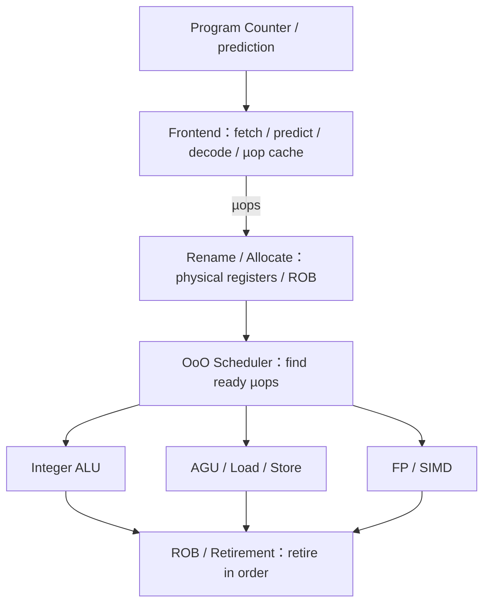

<details>
<summary>查看原图与完整文字转写</summary>

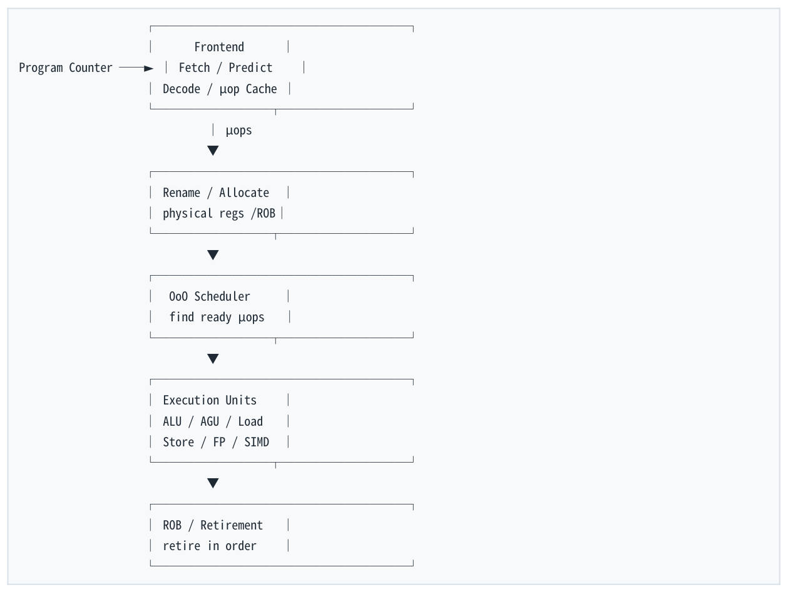

- ` Frontend `
- ` Program Counter Fetch / Predict ► `
- ` Decode / µop Cache `
- ` µops `
- ` Rename / Allocate `
- ` physical regs /ROB `
- ` OoO Scheduler `
- ` find ready µops `
- ` Execution Units `
- ` ALU / AGU / Load `
- ` Store / FP / SIMD `
- ` ROB / Retirement `
- ` retire in order `

</details>

Frontend 的核心任务不是“计算”，而是持续找到正确的 instruction stream，并把 ISA 指令转换为 backend 可以处理的内部工作单元。Backend 的核心任务也不是“执行下一条 instruction”，而是从窗口中寻找 operands 已 ready 且资源可用的 µops。

核心思维转换  现代 CPU backend 主要问“现在有哪些 µops ready？”而不是“程序的下一条 instruction 是什么？”

<a id="pdf-page-006"></a>

<!-- source-pdf-page: 6 -->

*[原 PDF 第 6 页](./Level1_CPU_Execution_Model_CN.pdf#page=6)*

### 1.2 一条 instruction 的生命周期

以简单的 add rax, rbx 为例，从概念上它可能经历以下阶段。真实处理器会有更多内部 stage，而且不同 generation 会不同，但这条逻辑链足以用于性能分析。

- Fetch：取到 instruction bytes

- Decode：解释 x86/ISA 指令并产生 µops

- Rename：将 architectural register 映射到 physical register

- Allocate：分配 ROB、scheduler 等 in-flight 资源

- Wait：在 scheduler 等待 operands ready

- Issue：被选中并送到兼容 execution resource

- Execute：ALU/Load/Store 等实际工作

- Complete：结果 ready，唤醒 consumers

- Retire：按 program order 正式提交 architectural effect 因此 execute 只是 instruction 生命周期的一个阶段。“已经算完”与“已经 architecturally committed”是两个不同概念。

### 1.3 Frontend：Fetch、Branch Prediction 与宽流水线

Frontend 面临的首要问题是：下一段 instruction bytes 在哪里？顺序代码很简单，但 conditional branch、 call、return、indirect jump 会改变控制流。现代 CPU 如果每次都等 branch 真正执行完才继续 fetch，宽而深的流水线会经常断粮。因此 branch prediction 从 frontend 一开始就介入。

现代 core 每个 cycle 不只 fetch/decode 一条 instruction，而是尝试并行处理多个 instruction/µop。由此引出“width”：fetch width、decode width、rename width、issue width、retire width。具体数字依微架构，不应该跨 generation 死背。

| 概念 | 含义 | 性能后果 |
| --- | --- | --- |
| Pipeline depth | 一条 instruction 穿过多少 stage | 更深有利于高频，但错误 speculation的恢复成本可能更高 |
| Pipeline width | 一个 cycle 能同时处理多少工作 | 决定 superscalar 峰值吞吐的一部分 |
| Frontend supply | 每 cycle 持续提供多少 µops | 供应不足会让 backend execution resources 空闲 |

### 1.4 Instruction ≠ µop

x86 instruction 是 ISA 层面的程序员接口；µop（micro-operation）更接近 CPU backend 的内部执行语言。复杂的 memory operand、地址生成、算术等工作可能在内部拆解成多个 backend activities。

<a id="pdf-page-007"></a>

<!-- source-pdf-page: 7 -->

*[原 PDF 第 7 页](./Level1_CPU_Execution_Model_CN.pdf#page=7)*

```asm
x86:
    add rax, [rbx + rcx*4 + 16]

概念上的 backend 工作：
    address = rbx + rcx*4 + 16      ← address generation
    tmp = load [address]            ← load
    rax = rax + tmp                 ← ALU
```

因此不能用“C++ statement 数量”或“assembly instruction 数量”直接推导 CPU 工作量。更进一步， macro-fusion、micro-fusion 会使“µop 数量”本身也依 stage 与具体微架构而变化。正确习惯是：先理解 backend demand，再用 uops.info、llvm-mca、厂商文档等绑定具体 CPU 验证。

#### 1.4.1 Macro-fusion 与 micro-fusion 的定位

Macro-fusion 常指某些相邻 architectural instructions（例如特定 compare/test + conditional branch）可以在 frontend 以融合形式处理。Micro-fusion 常指单条带 memory operand 的 instruction 在 frontend/rename 某些阶段以融合形式占更少资源，但执行时仍可能产生 load-side 与 ALU-side 的资源需求。细节依微架构。

避免误区  不要问“这条 x86 指令固定等于几个 µops？”而要问“在这台 CPU 上，这种 operand form 在 frontend、scheduler、execution resources 上分别造成什么 demand？”

### 1.5 µop Cache / Decoded-op Cache

小而热的 loop 会反复执行同一段 x86 instruction bytes。重复经过复杂 decode 浪费 frontend bandwidth，因此现代高性能 CPU 通常存在某种 decoded-op/µop cache。命中时可以绕过传统 decode 路径，直接供应内部 operations。

**图示转写**

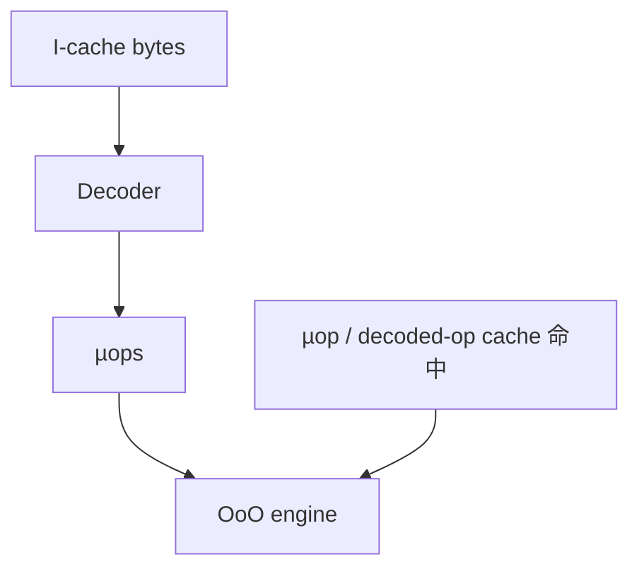

<details>
<summary>查看原图与完整文字转写</summary>

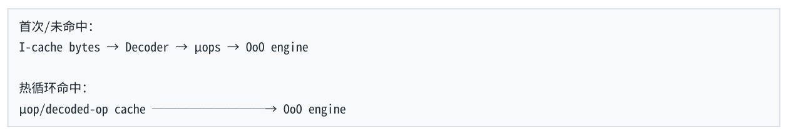

- ` 首次/未命中： `
- ` I-cache bytes → Decoder → µops → OoO engine `
- ` 热循环命中： `
- ` µop/decoded-op cache → OoO engine `

</details>

这也是 hot loop 的“代码足迹”重要的原因之一：不仅是 I-cache，还可能涉及 µop cache/decoded instruction cache 的容量与组织。

### 1.6 Superscalar、IPC 与 CPI

Superscalar 的关键不是“CPU 有流水线”，而是一个 core 在同一 cycle 可以处理、issue、execute 或 retire 多个 operations（具体阶段宽度不同）。因此 4 GHz 并不等于最多 40 亿条 instruction/s。

| 指标 | 定义 | 正确解释 |
| --- | --- | --- |
| IPC | Instructions Per Cycle | 长期平均每 cycle retire/完成多少architectural instructions（具体工具定义要看事件） |

<a id="pdf-page-008"></a>

<!-- source-pdf-page: 8 -->

*[原 PDF 第 8 页](./Level1_CPU_Execution_Model_CN.pdf#page=8)*

| 指标 | 定义 | 正确解释 |
| --- | --- | --- |
| CPI | Cycles Per Instruction | 长期平均每条 instruction 消耗多少cycles；在 superscalar CPU 上可以 &lt; 1 |
| GHz | cycles per second | 频率，不直接等于单 instruction latency 或总吞吐 |

如果 IPC=4，不是说每条 instruction “0.25 cycle 完成”；而是说稳态下，多个 instruction 的生命周期 overlap，平均每 cycle 可以完成/退休约 4 条。Latency 与 throughput 的区分会在第 3 章展开。

### 1.7 Pipeline depth vs width

更深 pipeline 把复杂逻辑切成更短 stage，有助于缩短 clock period、提高频率；更宽 pipeline 增加每 cycle 可处理的 work。二者都有面积、功耗、复杂度、wakeup/select timing、misprediction recovery 等 trade-off。 现代高性能 core 通常既 deep 又 wide。

本章一句话  Frontend 按预测 control flow 供应 µops；Rename 把逻辑寄存器转换为物理值版本；OoO backend 按 ready 状态与资源执行；ROB 最终按 program order retire。

本节结论  • Instruction、µop、C++ statement 不是一一对应关系。

- Superscalar 表示一个 cycle 可并行处理多个 operations；IPC 可以大于 1。

- Pipeline depth 与 width 是不同维度。

- Frontend 的最终产品是可供 backend 调度的 µops，而不是程序结果。

- 现代 CPU 的性能分析必须同时考虑 instruction supply、dependency 和 execution resources。

<a id="pdf-page-009"></a>

<!-- source-pdf-page: 9 -->

*[原 PDF 第 9 页](./Level1_CPU_Execution_Model_CN.pdf#page=9)*

## 第 2 章  Register Renaming、OoO 与 ROB

本章目标  理解 RAW/WAR/WAW → Register Renaming → Scheduler → OoO Execution → ROB → In-order Retirement → Precise State 的完整逻辑链。

### 2.1 为什么需要 Out-of-Order Execution

如果处理器 strictly in-order，一条较慢 load 会把后面完全 independent 的算术操作全部堵住。OoO 的目标不是降低那条 load 本身的 latency，而是利用 younger independent instructions 去覆盖等待时间。

**图示转写**

| 执行模型 | slow load 期间的独立工作 |
| --- | --- |
| 源程序 | `x = *p; y = a + b; z = c + d;` |
| In-order | LOAD 等待完成后再执行 ADD y、ADD z |
| OoO | 在 LOAD 等待期间可执行独立的 ADD y、ADD z；load 自身延迟不变 |

<details>
<summary>查看原图与完整文字转写</summary>

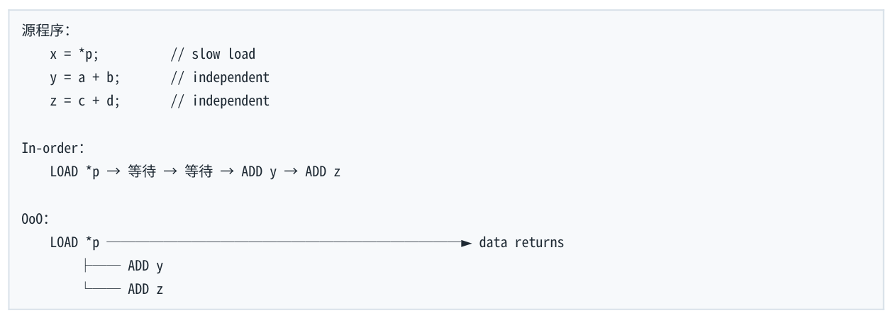

- ` 源程序： `
- ` x = *p; // slow load `
- ` y = a + b; // independent `
- ` z = c + d; // independent `
- ` In-order： `
- ` LOAD *p → 等待 → 等待 → ADD y → ADD z `
- ` OoO： `
- ` LOAD *p data returns► `
- ` ADD y `
- ` ADD z `

</details>

Latency hiding  OoO execution does not reduce the cache-miss latency. It hides part of that latency by executing independent younger work.

### 2.2 RAW、WAR、WAW

| 依赖 | 模式 | 本质 | Rename 能否消除 |
| --- | --- | --- | --- |
| RAW - Read After Write | I1 writes X; I2 reads X | True data dependency | 不能 |
| WAR - Write After Read | I1 reads X; I2 writes X | Name / false dependency | 可以 |
| WAW - Write After Write | I1 writes X; I2 writes X | Name / false dependency | 可以 |

<a id="pdf-page-010"></a>

<!-- source-pdf-page: 10 -->

*[原 PDF 第 10 页](./Level1_CPU_Execution_Model_CN.pdf#page=10)*

```text
RAW:
    x = a + b;
    y = x + c;       // y 真的需要 x 的新值

WAR:
    y = x + 1;       // 读旧 x
    x = a + b;       // 写新 x；冲突只是“都叫 x”

WAW:
    x = a + b;
    x = c + d;       // 两个不同版本的 x 复用了同一名字
```

RAW 是数学/数据流上的真实依赖；WAR/WAW 主要来自有限 architectural register names 的重用。现代 CPU 通过 physical registers 将不同“值版本”拆开。

### 2.3 Architectural Register vs Physical Register

RAX/RBX/XMM0 等是 ISA 暴露的 architectural registers。现代 OoO core 内部通常拥有更多 physical registers，并维护 rename mapping。Architectural RAX 不是永远对应某个固定 storage cell，而是随着每次 write 映射到新的 physical register。

**图示转写**

| 场景 / 部分 | 路径、状态或说明 |
| --- | --- |
| 某时刻 | ` architectural RAX → P37 ` |
| later write RAX | ` allocate P92 `；` architectural RAX → P92 ` |
| 部分 3 | ` 更早的 P37 仍可被已经 rename 的 consumers 使用。 ` |

<details>
<summary>查看原图与完整文字转写</summary>

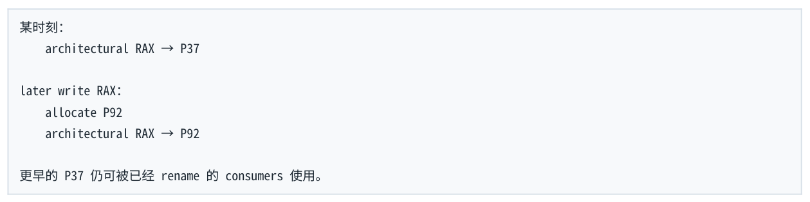

- ` 某时刻： `
- ` architectural RAX → P37 `
- ` later write RAX： `
- ` allocate P92 `
- ` architectural RAX → P92 `
- ` 更早的 P37 仍可被已经 rename 的 consumers 使用。 `

</details>

### 2.4 Register Rename 的逐步过程

考虑以下代码：

```text
1: mov rax, 1
2: add rbx, rax
3: mov rax, 2
4: add rcx, rax
```

假设初始 RAX→P10、RBX→P11、RCX→P12。

- Instruction 1 写 RAX：分配 P20，建立 RAX→P20，P20=1。

- Instruction 2 读取当前 RAX=P20；写 RBX 时分配 P21：P21=P11+P20。

- Instruction 3 再写 RAX：分配 P30，建立新的 RAX→P30，P30=2。

- Instruction 4 读取当前 RAX=P30；写 RCX 时分配 P31：P31=P12+P30。

<a id="pdf-page-011"></a>

<!-- source-pdf-page: 11 -->

*[原 PDF 第 11 页](./Level1_CPU_Execution_Model_CN.pdf#page=11)*

**图示转写**

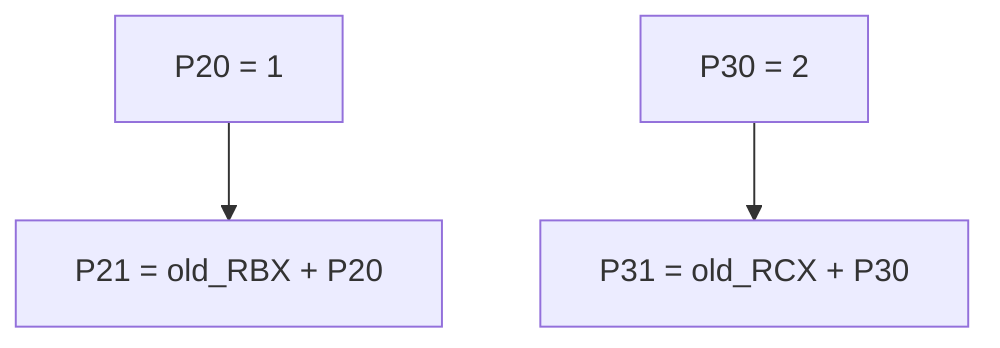

<details>
<summary>查看原图与完整文字转写</summary>

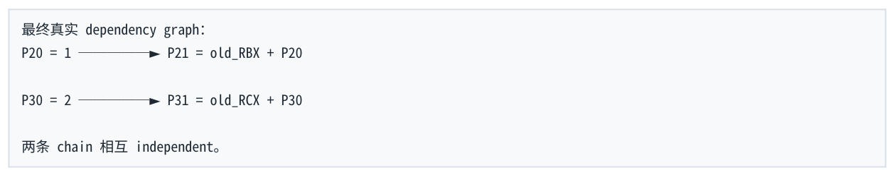

- ` 最终真实 dependency graph： `
- ` P20 = 1 P21 = old_RBX + P20► `
- ` P30 = 2 P31 = old_RCX + P30► `
- ` 两条 chain 相互 independent。 `

</details>

这与 compiler SSA “x1、x2、x3” 的思维相似：给不同 value version 不同名字。但 SSA 是编译器 IR 技术， register renaming 是 CPU 微架构机制，二者不能混为同一实现。

### 2.5 Scheduler：Wakeup + Select

Rename 以后，CPU 已经知道真正的 producer-consumer relationships。Scheduler 的核心任务是维护哪些 operands ready，并在 compatible execution resources 可用时选择 µops issue。

**图示转写**

| 场景 / 部分 | 路径、状态或说明 |
| --- | --- |
| µop A: waiting for P20 | ` µop B: ready `；` µop C: waiting for load `；` µop D: ready ` |
| 某 producer 完成：P20 ready | ` Wakeup：通知所有等待 P20 的 consumers `；` Select：从 ready µops 中选择本 cycle 可 issue 的集合 ` |

<details>
<summary>查看原图与完整文字转写</summary>

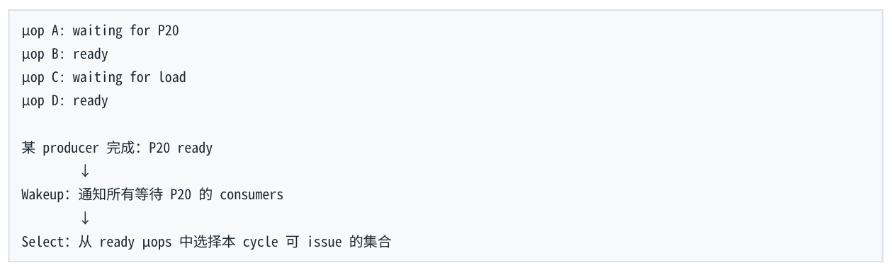

- ` µop A: waiting for P20 `
- ` µop B: ready `
- ` µop C: waiting for load `
- ` µop D: ready `
- ` 某 producer 完成：P20 ready `
- ` Wakeup：通知所有等待 P20 的 consumers `
- ` Select：从 ready µops 中选择本 cycle 可 issue 的集合 `

</details>

因此 OoO 最明显发生在 issue/execute：后进入 scheduler 的 younger instruction，只要 operands 更早 ready，就可能比 older instruction 更早执行。

### 2.6 OoO Window

CPU 只能在有限 in-flight window 内寻找 independent work，不能无限向未来看。Window 的大小受 ROB、 scheduler、physical registers、load/store queues 等多种资源限制。更大的 window 有利于 latency hiding，但硬件面积、功耗和 wakeup/select 复杂度也更高。

不变量  OoO exploits ILP; it does not invent ILP. 如果算法本身只有一条 true-dependency chain，窗口再大也不能并行那条链。

### 2.7 ROB：Reorder Buffer 与 Retirement

ROB 负责按 program order 跟踪 in-flight instructions 的顺序、完成状态、exception/misprediction 信息及 retirement 条件。它不是 scheduler。具体实现中 result 可能主要存在 physical register file，而不是“全部存在 ROB”。

<a id="pdf-page-012"></a>

<!-- source-pdf-page: 12 -->

*[原 PDF 第 12 页](./Level1_CPU_Execution_Model_CN.pdf#page=12)*

| 结构 | 主要关注的问题 |
| --- | --- |
| Scheduler / Reservation Stations | 哪些 µops operands ready？哪个 execution resource 可用？现在谁应该 issue？ |
| ROB | 谁 older/younger？完成了吗？有异常吗？能否按序retire？ |

**图示转写**

| ROB 顺序 | 状态 | 对 retire 的影响 |
| --- | --- | --- |
| head → 100 | done | 可按顺序 retire |
| 101 | done | 可按顺序 retire |
| 102 | waiting | 阻止自身及更年轻项 retire |
| 103 / 104 | done | 完成也必须等待 102 |
| 105 ← tail | executing | 仍在执行 |

<details>
<summary>查看原图与完整文字转写</summary>

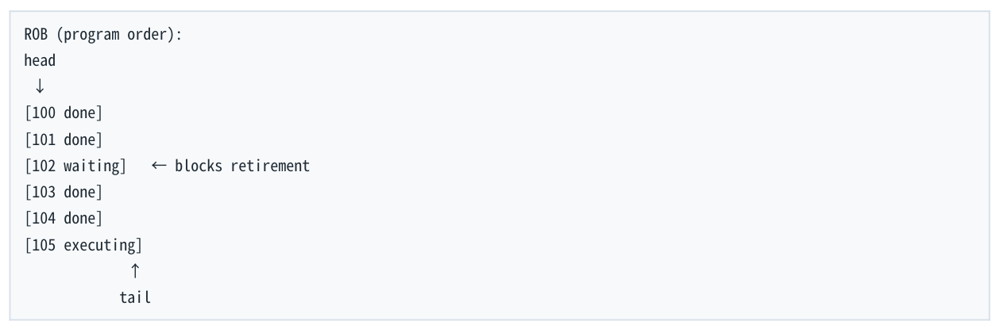

- ` ROB (program order): `
- ` head `
- ` [100 done] `
- ` [101 done] `
- ` [102 waiting] ← blocks retirement `
- ` [103 done] `
- ` [104 done] `
- ` [105 executing] `
- ` tail `

</details>

103/104 即使早已 complete，也不能越过 102 architecturally retire。Completion order 可以乱，retirement order 不乱。

### 2.8 为什么必须 In-order Retirement：Precise Exception

```text
A: a = 10;
B: b = *bad_ptr;    // page fault
C: c = 20;
D: d = 30;
```

内部 execution 可能 C/D 先于 B 完成。但如果 B fault，程序必须看起来恰好像：A 已提交；B 在精确边界上发生异常；C/D 从未 architecturally 发生。ROB 允许处理器只 retire B 之前的 older work，并 squash B 及之后的 younger speculative state。

Precise architectural state  对于 faulting instruction N，architectural state 必须等价于：所有 &lt;N 的指令已发生；N 发生异常；所有 &gt;N 的指令没有发生。

### 2.9 Speculative Execution 与 Rollback

Branch prediction 是最典型的 speculation：branch 尚未 resolve，CPU 就沿预测路径继续 fetch/decode/rename/execute。若预测错误，wrong-path younger instructions 会被 squash，rename/checkpoint state 恢复，再从正确 target 重新取指。

Speculation 的范围更广：memory disambiguation、indirect branch target、return target 等都可能包含预测。其共同原则是：在不确定性尚未 resolve 时先做工作，错误则 rollback。

<a id="pdf-page-013"></a>

<!-- source-pdf-page: 13 -->

*[原 PDF 第 13 页](./Level1_CPU_Execution_Model_CN.pdf#page=13)*

### 2.10 ROB Full：OoO 为什么不能无限隐藏 latency

**图示转写**

1. ` 最老的 LOAD A `
2. ` 长 latency miss `
3. ` B done `
4. ` C done `
5. ` D done `
6. ` N done `
7. ` A 仍然不能 retire `
8. ` B...N 也不能 retire `
9. ` ROB entries 无法释放 `
10. ` ROB full `
11. ` Rename/Allocate stall `
12. ` Frontend 最终停下 `

<details>
<summary>查看原图与完整文字转写</summary>

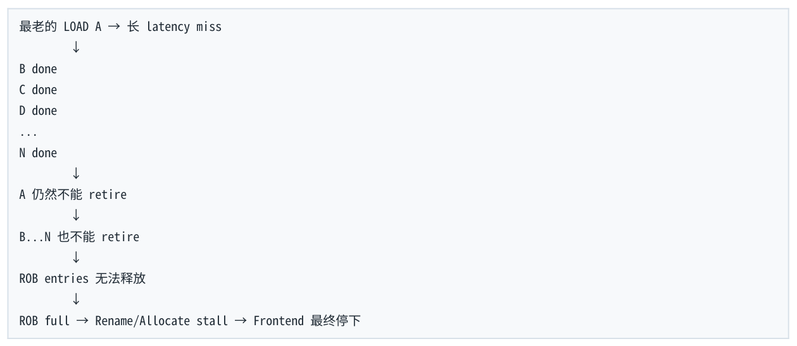

- ` 最老的 LOAD A → 长 latency miss `
- ` B done `
- ` C done `
- ` D done `
- ` N done `
- ` A 仍然不能 retire `
- ` B...N 也不能 retire `
- ` ROB entries 无法释放 `
- ` ROB full → Rename/Allocate stall → Frontend 最终停下 `

</details>

因此 cache miss 不一定“立刻让 core 停住”，但也不是免费。OoO 会尽量用 independent younger work 覆盖 latency，直到 independent work 或有限 OoO resources 被耗尽。

### 2.11 Memory Dependency：Register Rename 的边界

```text
*p = 10;
x = *q;
```

Register renaming 无法直接解决 p 与 q 是否 alias 的问题。若 p==q，load 依赖 older store；若 p!=q，则可以更早执行。现代 CPU 使用 Load Queue、Store Queue、Memory Disambiguation、Store-to-Load Forwarding 等机制，并可能 speculate “probably no alias”。猜错则 replay/squash 相关工作。

重要边界  Instruction execute out-of-order 与“memory effects 被其他 core 以什么顺序观察”不是同一个问题。Retire in order 也不意味着跨 core memory visibility 按同一顺序发生。C++ memory_order / fence 属于后续 memory model 层。

本节结论  • RAW 是 true dependency，WAR/WAW 是 name dependency；rename 主要消除后两者。

- Architectural register 是逻辑名字，physical register 保存不同 value versions。

- Scheduler 决定 execution order；ROB 维护 program order 与 retirement。

- Execute complete 不等于 retire；retire 表示 architectural commit。

- OoO 用 independent work 隐藏 latency，但受 OoO window 与有限资源限制。

- Precise exception 与 branch rollback 都依赖“older/younger + in-order retirement”的统一机制。

<a id="pdf-page-014"></a>

<!-- source-pdf-page: 14 -->

*[原 PDF 第 14 页](./Level1_CPU_Execution_Model_CN.pdf#page=14)*

## 第 3 章  Latency、Throughput、Dependency 与 ILP/MLP

本章目标  看到一段代码时，先判断最长 dependency chain 与资源吞吐下界，而不是只数 instructions。

### 3.1 Latency vs Throughput

| 概念 | 问题 | 示例解释 |
| --- | --- | --- |
| Latency | 一个 operation 的结果多久可被依赖者使用？ | ADD latency=3 cycles：dependent consumer 最早约 3 cycles 后使用结果 |
| Reciprocal Throughput | 稳态下平均多久可以启动一个independent operation？ | 0.5 cycle/op：长期约 2 ops/cycle |

关键  latency=3 cycles 与 throughput=2 ops/cycle 完全不矛盾。多条 independent operations 可以像流水线产品一样重叠。

### 3.2 Dependency Chain 与 Critical Path

```text
x = x + a;
x = x + b;
x = x + c;
x = x + d;

x0 → ADD1 → x1 → ADD2 → x2 → ADD3 → x3 → ADD4
```

如果纯教学假设 ADD latency=3 cycles，4 个 serial dependent ADD 的 critical path 下界接近 12 cycles。即使有很多 ALU，也不能让 ADD2 在 ADD1 result ready 之前正确执行。

更一般地说，一段代码的 runtime 至少受 dependency DAG 最长路径限制。

```text
Runtime ≥ Dependency Critical Path
```

### 3.3 Latency-bound vs Throughput/Resource-bound

| 类型 | 典型状态 | 限制 |
| --- | --- | --- |
| Latency / dependency-bound | execution units 可能空闲，但没有足够 ready consumers | true dependency / load-to-use latency |

> **转换补充**：文中的 ADD 3 cycles / 2 ops per cycle 是教学假设，不是所有 x86 整数 ADD 的固定指标。具体数字应绑定指令 operand form 与 CPU。

<a id="pdf-page-015"></a>

<!-- source-pdf-page: 15 -->

*[原 PDF 第 15 页](./Level1_CPU_Execution_Model_CN.pdf#page=15)*

| 类型 | 典型状态 | 限制 |
| --- | --- | --- |
| Throughput / resource-bound | ready work 很多，但某类 resource 已经饱和 | ALU/FP ports、load/store、AGU、frontend、retire、bandwidth |

同一种 instruction 在不同 dependency graph 中可以落到完全不同的瓶颈。四个 independent ADD 可能受 throughput 限制；四个串行 ADD 则受 latency 限制。

### 3.4 ILP：Instruction-Level Parallelism

```text
高 ILP：
a = b + c;
d = e + f;
g = h + i;

低 ILP：
a = b + c;
d = a + e;
g = d + i;
```

OoO engine 的价值来自“发现并利用已有 ILP”。如果多个 operations 没有 true dependency，scheduler 可以把它们送往不同 execution resources。若算法本身是 serial chain，OoO 不能凭空制造 independent work。

### 3.5 Loop-carried Dependency

```cpp
double s = 0;
for (size_t i = 0; i < n; ++i)
    s += a[i];
```

每个 iteration 都消费上一 iteration 的 s：s_i → ADD → s_{i+1}。这种跨 iteration 的依赖称为 loop-carried dependency。即使 a[i] 的 loads 可以提前，accumulation chain 仍可能暴露 FP ADD latency。

### 3.6 Multiple Accumulators：为什么有效

```cpp
for (size_t i = 0; i < n; i += 4) {
    s0 += a[i];
    s1 += a[i+1];
    s2 += a[i+2];
    s3 += a[i+3];
}
return s0 + s1 + s2 + s3;
```

优化的本质不是“unrolling 神奇”，而是从 1 条长 dependency chain 变成 4 条 independent chains。最终 O(1) 的合并成本换来了整个 O(N) 主循环更高 ILP。

<a id="pdf-page-016"></a>

<!-- source-pdf-page: 16 -->

*[原 PDF 第 16 页](./Level1_CPU_Execution_Model_CN.pdf#page=16)*

**图示转写**

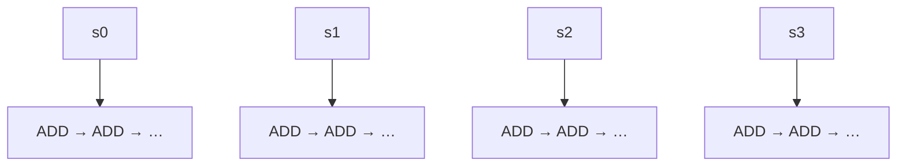

单 accumulator 的各次运算形成一条串行依赖链；重构后，图中四条 chain 相互独立。

<details>
<summary>查看原图与完整文字转写</summary>

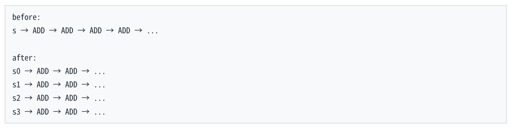

- ` before: `
- ` s → ADD → ADD → ADD → ADD → ... `
- ` after: `
- ` s0 → ADD → ADD → ... `
- ` s1 → ADD → ADD → ... `
- ` s2 → ADD → ADD → ... `
- ` s3 → ADD → ADD → ... `

</details>

准确表述  Loop unrolling 本身不保证增加 ILP。若只是 x=f(x) 连续展开，true dependency 仍存在。真正的收益可能来自减少 loop-control、帮助 vectorization、扩大 optimization window 或拆分 dependency chains。

#### 3.6.1 为什么 accumulator 数量不是越多越好

增加 independent chains 会提高 ILP，但也提高 register pressure、code size、scheduler/ROB demand。过多 live values 可能导致 compiler spill 到 stack，反而增加 load/store traffic。最佳数量依 latency、 throughput、SIMD width、register file、compiler 与目标微架构。

### 3.7 MLP：Memory-Level Parallelism

ILP 是 independent instructions；MLP 是 independent memory requests 能否同时 outstanding。二者相关但不同。

```text
高 MLP：
x = a[i];
y = b[i];
z = c[i];

低 MLP / pointer chasing：
p = p->next;
p = p->next;
p = p->next;
```

Pointer chasing 的关键问题不仅是 cache locality 差，还包括 serialized load-to-use dependency：前一次 load 返回的 pointer 是下一次 load 的地址。即使所有 Node 都在 L1，下一 load 仍必须等待前一 load 的结果。

### 3.8 Bandwidth vs Latency

内存系统和 execution pipeline 一样：单 request latency 很高，不代表 sustained bandwidth 低。大量 independent requests 可以 pipeline/overlap，形成很高 bandwidth。反过来，pointer chain 即使数据都 hit，也可能因为 MLP≈1 暴露每一级 load latency。

| 代码模式 | 更关心什么 |
| --- | --- |
| p=p-&gt;next; | load-to-use latency、cache level latency、低 MLP |

<a id="pdf-page-017"></a>

<!-- source-pdf-page: 17 -->

*[原 PDF 第 17 页](./Level1_CPU_Execution_Model_CN.pdf#page=17)*

| 代码模式 | 更关心什么 |
| --- | --- |
| 连续遍历大 array | load/store bandwidth、prefetch、MLP、memory bandwidth |
| 多个 independent arrays | load-port throughput + MLP |

### 3.9 ILP、DLP、MLP 三个并行维度

| 维度 | 全称 | 典型手段 |
| --- | --- | --- |
| ILP | Instruction-Level Parallelism | OoO + independent instruction chains |
| DLP | Data-Level Parallelism | SIMD / vectorization，一条instruction 多个 lanes |
| MLP | Memory-Level Parallelism | 多个 independent cache/memory requests 同时 outstanding |

一个 vector loop 可以同时利用三者：SIMD 提高 work/instruction，unrolling/OoO overlap 多个 vector operations，多个 loads/cache lines 又形成 MLP。最终 bottleneck 可能迁移到 load/store/cache/DRAM bandwidth。

### 3.10 Bottleneck Migration

**图示转写**

1. ` 最初： `
2. ` dependency / latency bound `
3. ` ↓ 拆 independent chains `
4. ` execution-port throughput bound `
5. ` ↓ SIMD / instruction mix `
6. ` load/store throughput bound `
7. ` ↓ 改数据访问 `
8. ` cache / memory bandwidth bound `

<details>
<summary>查看原图与完整文字转写</summary>

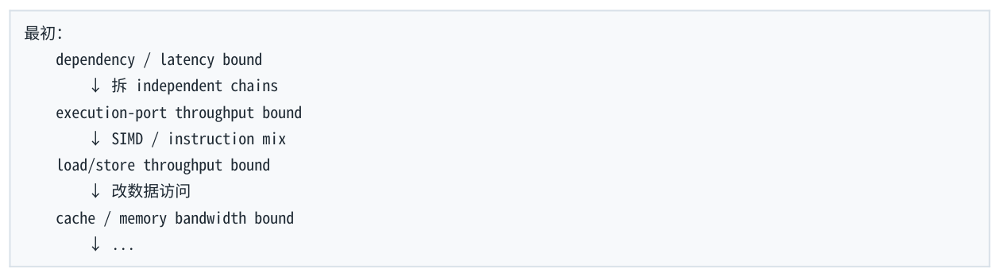

- ` 最初： `
- ` dependency / latency bound `
- ` ↓ 拆 independent chains `
- ` execution-port throughput bound `
- ` ↓ SIMD / instruction mix `
- ` load/store throughput bound `
- ` ↓ 改数据访问 `
- ` cache / memory bandwidth bound `

</details>

性能优化不是把“瓶颈这个概念”消灭，而是把主导约束推到下一个资源。总会存在当前 limiting factor；所谓“优化完成”通常意味着下一瓶颈继续优化的成本已经高于收益，或目标指标已经达成。

### 3.11 Little's Law 的直觉：需要多少 independent work 才能吃满 throughput

```text
Concurrency ≈ Throughput × Latency
```

<a id="pdf-page-018"></a>

<!-- source-pdf-page: 18 -->

*[原 PDF 第 18 页](./Level1_CPU_Execution_Model_CN.pdf#page=18)*

纯教学例子：某 FP ADD latency=4 cycles，峰值 throughput=2 ADD/cycle。要持续达到 2 ADD/cycle，大约需要 4×2=8 个 independent operations/chains in flight。只有 4 个 accumulators 时，平均最多可能只提供约 1 ADD/cycle，尚不足以完全隐藏 latency。

这不是精确的硬件公式，而是非常有用的一阶 capacity intuition。

### 3.12 Source semantics 也会限制 ILP：Floating-point reduction

对 double sum += a[i]，compiler 是否能 reassociate reduction 取决于 floating-point 语义。严格 FP semantics 下，改变求和结合顺序可能改变 rounding，因此 compiler 不一定能自由拆成多 accumulators/SIMD tree reduction。fast-math 允许更激进变换，但改变数值语义，不能为了性能机械开启。

工程原则  语言语义约束可以直接变成微架构 dependency 约束。性能讨论必须同时理解 C++ semantics 与 generated assembly。

本节结论  • Latency 限制 dependent consumer；throughput 限制 independent work 的持续吞吐。

- Critical path 是 dependency 下界；resource capacity 是另一个吞吐下界。

- Runtime 粗略受 max(dependency critical path, resource-throughput limit) 控制。

- Multiple accumulators 的核心是增加 ILP，不是 unrolling 名字本身。

- Pointer chasing 即使 L1 hit 也可能慢，因为 dependent loads 暴露 load-to-use latency。

- ILP、DLP、MLP 是三个不同但可叠加的并行维度。

<a id="pdf-page-019"></a>

<!-- source-pdf-page: 19 -->

*[原 PDF 第 19 页](./Level1_CPU_Execution_Model_CN.pdf#page=19)*

## 第 4 章  Scheduler、Execution Ports 与 Resource Contention

本章目标  当依赖不再主导时，继续回答：ready work 为什么仍然不能无限执行？哪个有限 backend resource 最先饱和？

### 4.1 Execution Port / Functional Unit 模型

现代 backend 有多类 execution resources：integer ALU、FP/SIMD、load、store、branch、address generation 等。Scheduler 只能把一个 ready µop 送往它兼容的 resource/port。具体 port 编号和映射是 microarchitecture-specific implementation detail。

**图示转写**

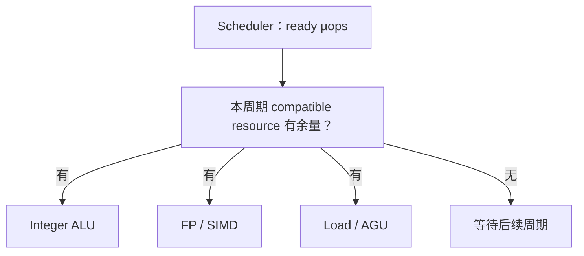

<details>
<summary>查看原图与完整文字转写</summary>

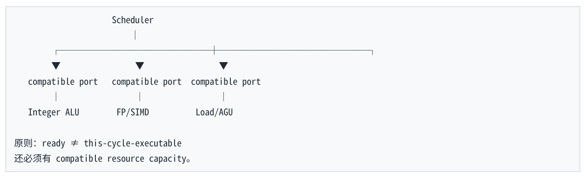

- ` Scheduler `
- ` compatible port compatible port compatible port `
- ` Integer ALU FP/SIMD Load/AGU `
- ` 原则：ready ≠ this-cycle-executable `
- ` 还必须有 compatible resource capacity。 `

</details>

### 4.2 Dependency waiting vs Resource waiting

| 情况 | 资源状态 | µop 状态 | 结论 |
| --- | --- | --- | --- |
| Dependency-bound | ALU/port 可能空闲 | operand 未 ready | 没有足够可执行工作 |
| Resource-bound | port/functional unit 已满 | 很多 µops 已 ready | 硬件吞吐吃不下 |

这两个现象都可能被上层工具归为 backend bound，但优化方向相反：dependency-bound 应增加/暴露 independent work；resource-bound 应减少该资源 demand、改变 instruction mix、vectorize 或重构数据访问。

### 4.3 Port Contention

假设纯教学 CPU 只有 1 个 MUL execution resource。4 个 MUL 完全 independent，因此 critical path 只有 1 个 MUL latency；但 sustained resource throughput 仍至少需要约 4 cycles 才能 issue 4 个 MUL。这里 bottleneck 是 resource capacity，不是 dependency。

<a id="pdf-page-020"></a>

<!-- source-pdf-page: 20 -->

*[原 PDF 第 20 页](./Level1_CPU_Execution_Model_CN.pdf#page=20)*

**图示转写**

1. ` Independent MULs: `
2. ` M1 M2 M3 M4 (all ready) `
3. ` only 1 MUL slot/cycle `
4. ` 4 cycles minimum `

<details>
<summary>查看原图与完整文字转写</summary>

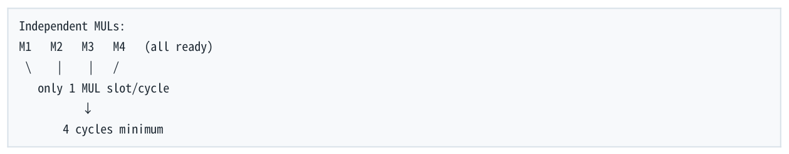

- ` Independent MULs: `
- ` M1 M2 M3 M4 (all ready) `
- ` only 1 MUL slot/cycle `
- ` 4 cycles minimum `

</details>

某些 µop 可以去多个 ports，scheduler 会尽量平衡；某些特殊 operations eligible ports 很少，则更容易形成 contention。因此“µop 总数相同”也不意味着 throughput 相同。

### 4.4 Load、Store 与 AGU

load/store 不是“访问内存”四个字就结束。至少要有有效地址计算、load/store queue bookkeeping、L1D/cache access 等步骤。AGU（Address Generation Unit）负责 effective address，例如 base + index*scale + displacement。

**图示转写**

1. ` a[i] 的概念路径： `
2. ` base(a) + i*sizeof(T) ← AGU / address generation `
3. ` Load Queue `
4. ` L1D lookup `
5. ` data ready `

<details>
<summary>查看原图与完整文字转写</summary>

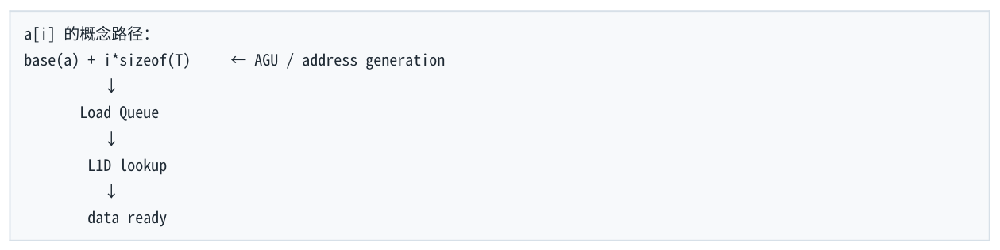

- ` a[i] 的概念路径： `
- ` base(a) + i*sizeof(T) ← AGU / address generation `
- ` Load Queue `
- ` L1D lookup `
- ` data ready `

</details>

地址生成也有 throughput。即使 L1 hit，load/store/AGU resources 仍是有限的。Store 还可能拆成 store-address 与 store-data 等不同 resource demand。

### 4.5 L1 Hit ≠ Free：Latency 与 Throughput 两种限制

如果 CPU 每 cycle 最多接受若干 independent loads，那么四个 independent L1 loads 仍可能需要多个 cycles 发出；这是 load throughput/bandwidth limit。反过来 pointer chasing 每次只有一个关键 load ready，则暴露 L1 load-to-use latency。

| 模式 | 即使全部 L1 hit，仍可能受什么限制 |
| --- | --- |
| p=p-&gt;next | serialized load-to-use latency |
| x=a[i]; y=b[i]; z=c[i]; | load port / AGU throughput |
| c[i]=a[i]+b[i] | 2 loads + 1 store 的 load/store/AGU demand，ADD 可能反而不是瓶颈 |

<a id="pdf-page-021"></a>

<!-- source-pdf-page: 21 -->

*[原 PDF 第 21 页](./Level1_CPU_Execution_Model_CN.pdf#page=21)*

### 4.6 Resource Pressure 与 Block Throughput

假设一个 loop iteration 对不同资源的最低 demand 分别是：ALU 2 cycles、MUL 1 cycle、Load 4 cycles、 Store 2 cycles。在没有更长 dependency critical path 的情况下，load-side 约 4 cycles/iteration 成为理论吞吐下界。

```text
Runtime ≥ max(
    DependencyCriticalPath,
    ALU_demand / ALU_capacity,
    Load_demand / Load_capacity,
    Store_demand / Store_capacity,
    Frontend demand / Frontend capacity,
    ...
)
```

llvm-mca 的 Resource Pressure / Block RThroughput 正是帮助估算这类 steady-state backend 约束。但它是模型，不是实际 silicon 的 production cache/OS 仿真。

### 4.7 Backend 的有限 structures 不只有 ports

| 资源 | 为什么会限制 |
| --- | --- |
| ROB entries | oldest work 长期不 retire 时，entries 无法释放，最终阻塞rename/allocate |
| Physical registers | 大量 live speculative values 占用物理寄存器，free list 耗尽可造成 stall |
| Scheduler entries | 大量 waiting µops 占住 reservation stations，减少可观察的independent work |
| Load Queue | outstanding loads 数量、ordering/replay bookkeeping 有限 |
| Store Queue / Store Buffer | store address/data/ordering 与 ownership 等状态需要有限entries |
| Frontend/Retire width | 即使 backend 很强，供应或提交宽度也可能成为上限 |

因此 resource-bound 比“port-bound”更广。性能分析要避免只盯 execution ports。

### 4.8 SMT / Hyper-Threading 与资源利用

SMT 的目标之一是：当一个 hardware thread 因 cache miss/dependency 暂时用不满 core 时，另一个 thread 可以利用闲置 execution/frontend resources，提高总体 throughput。但 low-latency 线程常担心 sibling 带来的 port、cache、TLB、frontend、scheduler 等共享资源 contention 与 jitter，因此是否启用 SMT 是 workload-specific engineering choice。

<a id="pdf-page-022"></a>

<!-- source-pdf-page: 22 -->

*[原 PDF 第 22 页](./Level1_CPU_Execution_Model_CN.pdf#page=22)*

### 4.9 Port Analysis 的适用边界

Port/resource analysis 对 small, hot, predictable, in-cache kernels 特别有价值，例如 parser inner loop、 checksum、numeric pricing kernel、encoder/decoder、small order-book scan。

如果主要问题明显是 DRAM miss、pointer chasing、branch misprediction、syscall、lock contention、 NUMA remote access，那么先研究 Port 0 vs Port 1 往往是优化错层级。

优化层级  通常先处理算法与 data structure、locality、dependency/ILP、branches，再深入到 port/instruction tuning。一个 100ns miss 面前，省 1 个 ALU uop 常常没有意义。

### 4.10 Read-Modify-Write、atomic 与 port 模型的边界

a[i]++ 在 machine level 至少涉及 load-modify-store；std::atomic 的 locked/RMW 还可能涉及 cache-line ownership、coherence、serialization、memory ordering 等远超普通 ALU port 的机制。因此“atomic 慢是多一条指令”是错误解释。后续 memory hierarchy/memory model 层才适合完整讨论。

本节结论  • Ready µop 还需要 compatible execution resource；ready 不等于立刻执行。

- Dependency-bound 是“资源有空但 operand 不 ready”；resource-bound 是“ready work 很多但资源饱和”。

- Load/store 即使 L1 hit 也消耗 AGU、load/store ports/queues，并存在 finite throughput。

- Port contention 只是 resource contention 的一个子集；ROB、scheduler、registers、queues、 frontend/retire width 都有限。

- Port analysis 最适合 hot in-cache core kernels；对明显的 memory/OS/lock 问题不要过早下沉到 port 级。

<a id="pdf-page-023"></a>

<!-- source-pdf-page: 23 -->

*[原 PDF 第 23 页](./Level1_CPU_Execution_Model_CN.pdf#page=23)*

## 第 5 章  Branch Prediction 与 Speculation

本章目标  理解 CPU 为什么必须预测 control flow、misprediction 为什么贵，以及 branchless 代码的真实 trade-off。

### 5.1 为什么 CPU 必须预测 branch

深而宽的 frontend 必须持续知道下一段 fetch address。若每个 conditional branch 都等 compare/branch 真正 execute 后才继续 fetch，instruction supply 会频繁断裂。因此 CPU 在 branch resolve 前预测下一条 control-flow path，并沿预测路径 speculative fetch/decode/rename/execute。

**图示转写**

| 场景 / 部分 | 路径、状态或说明 |
| --- | --- |
| 部分 1 | ` if (x > 0) foo(); else bar(); ` |
| branch 尚未 resolve | ` Predict direction/target `；` Fetch predicted path `；` Decode / Rename / Execute speculatively `；` Branch eventually resolves ` |

<details>
<summary>查看原图与完整文字转写</summary>

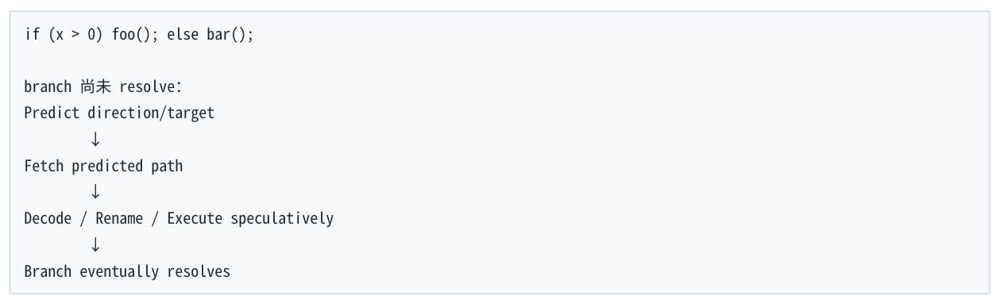

- ` if (x > 0) foo(); else bar(); `
- ` branch 尚未 resolve： `
- ` Predict direction/target `
- ` Fetch predicted path `
- ` Decode / Rename / Execute speculatively `
- ` Branch eventually resolves `

</details>

### 5.2 Direction Prediction 与 Target Prediction

| 问题 | 要预测什么 | 典型结构/概念 |
| --- | --- | --- |
| Direction | conditional branch taken / not taken | history-based direction predictor |
| Target | taken 后去哪个 address | BTB / indirect target structures |
| Return | ret 应回到哪个 call site | RAS - Return Address Stack |

一条 branch 即使方向知道“taken”，如果 target 地址无法及时预测，frontend 仍无法从正确目的地供给 instructions。Direction failure 与 target-supply failure 是不同问题。

### 5.3 BTB、Local/Global History 与 RAS

BTB 可以粗略理解为 branch-PC → predicted target。方向预测器会利用 local branch history、global history、path correlation 等信息。现代实现远比简单 1-bit/2-bit predictor 复杂，不应该用“交替 TNTN 一定 50% mispredict”之类教科书结论直接推 production。

普通 call/return 有明显栈式结构，因此 RAS 专门跟踪 call/ret 嵌套并预测 return target。Function call 不等于一定产生 branch misprediction。

<a id="pdf-page-024"></a>

<!-- source-pdf-page: 24 -->

*[原 PDF 第 24 页](./Level1_CPU_Execution_Model_CN.pdf#page=24)*

### 5.4 Misprediction Recovery：真正昂贵的是什么

**图示转写**

1. ` 预测 taken `
2. ` Fetch / Decode / Rename wrong path `
3. ` 部分 younger operations 已 execute `
4. ` Branch resolve: actually not taken `
5. ` Squash wrong-path younger work `
6. ` Restore speculative rename/checkpoint state `
7. ` Redirect frontend to correct PC `
8. ` Refill pipeline `

<details>
<summary>查看原图与完整文字转写</summary>

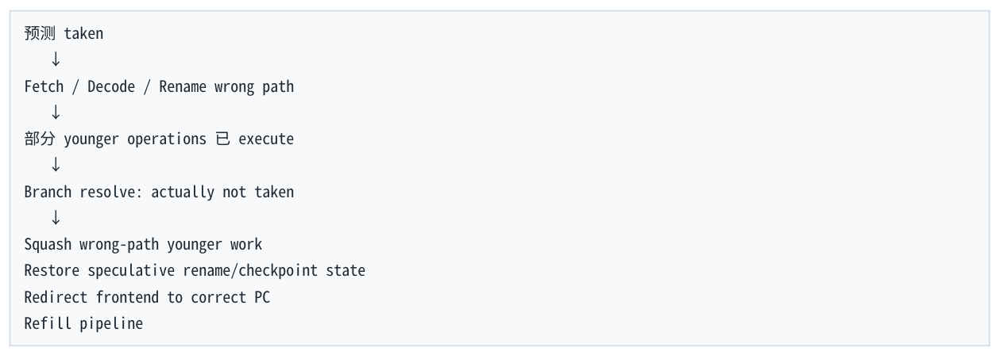

- ` 预测 taken `
- ` Fetch / Decode / Rename wrong path `
- ` 部分 younger operations 已 execute `
- ` Branch resolve: actually not taken `
- ` Squash wrong-path younger work `
- ` Restore speculative rename/checkpoint state `
- ` Redirect frontend to correct PC `
- ` Refill pipeline `

</details>

因此昂贵的不是“branch instruction 自身算得慢”，而是 wrong-path speculative work 被浪费，加上 redirect/refill。具体 penalty 依 microarchitecture 与 branch resolve context，不应死背固定 15 cycles。

准确说法  Predictable branch can be cheap; mispredicted branch is expensive. “Branch 很贵”是过度泛化。

### 5.5 Branchless：把 Control Dependency 转为 Dataflow

```asm
Branch:
if (cond) y=a; else y=b;

Possible branchless:
cmp ...
cmov / select / setcc / mask
```

Branchless 消除了 control-flow misprediction 风险，但可能增加 extra instructions、data dependency、 execution-port pressure，并且某些写法需要两边都计算。

| 场景 | 通常更有希望的方向 | 原因 |
| --- | --- | --- |
| 99.999% common fast path，rare error | 保留 branch + cold slow path | 预测极准；不应为了 branchless 执行rare expensive work |
| 近似随机 tiny condition，branchless 只多 1-2 cheap ops | branchless / setcc / mask | 避免高 mispredict，extra work 很小 |
| 两边计算都很 expensive | predictable branch | branchless 若两边都算会浪费大量 work |

```text
概念成本模型：
Expected branch penalty ≈ mispredict_probability × mispredict_cost
与 branchless_extra_cost 比较，而不是只比较“有 branch / 无 branch”。
```

<a id="pdf-page-025"></a>

<!-- source-pdf-page: 25 -->

*[原 PDF 第 25 页](./Level1_CPU_Execution_Model_CN.pdf#page=25)*

### 5.6 Indirect Branch、Virtual Call 与 switch

Indirect branch 的 target 运行时变化，因此不仅 direction，还要预测具体 target。Virtual call 的潜在成本不只是 vptr/function-pointer loads，还包括 indirect target predictability 与 instruction locality。若同一 call site target 极稳定，predictor 可能很准；若高度 polymorphic/random，则更困难。

switch 可能被 compiler 生成 branch chain 或 jump table；jump table 又可能涉及 indirect branch。因此不能机械说 switch 比 if 快或慢。

### 5.7 Hot/Cold Path、Code Layout 与 I-cache

```text
if (unlikely(error)) {
    cold_error_handler();
}
// common hot path remains small and contiguous
```

Rare slow/error paths 分离的价值包括：常见 branch 高度 predictable、hot code footprint 更小、I-cache/ITLB/µop-cache 更稳定。[[likely]] / [[unlikely]] 主要是 compiler hint，影响 code layout 与 optimization decisions，并不是每次运行时直接命令 CPU predictor。

Inlining 也有两面：减少 abstraction、打开 constant propagation/devirtualization 等优化，但过度 inline 增大 code size，可能伤害 I-cache/µop-cache。

### 5.8 Speculation 的广义含义

Speculation 不仅是 branch。Memory disambiguation 可以在 older store address 尚未确定时预测 younger load 不 alias；indirect target、return target 也需要预测。其统一哲学是：对不确定性先做合理预测，利用 OoO 做有用工作，错了再 rollback。

现代 CPU 的一句话  Find independence + predict uncertainty + execute aggressively + commit conservatively.

### 5.9 Architectural State vs Microarchitectural Traces

Wrong-path speculative instruction 被 squash 后不能留下不允许的 architectural effect；但 speculative load 可能已经影响 cache、TLB、predictor 等 microarchitectural state。这解释了为什么“没 retire = 什么都没发生”是错误的，也构成 Spectre 类 side-channel 的基础背景。

| 层次 | 示例 | Squash 后要求 |
| --- | --- | --- |
| Architectural state | register state、architectural memory semantics、exceptions/control flow | 错误路径结果必须被撤销/不可见 |

<a id="pdf-page-026"></a>

<!-- source-pdf-page: 26 -->

*[原 PDF 第 26 页](./Level1_CPU_Execution_Model_CN.pdf#page=26)*

| 层次 | 示例 | Squash 后要求 |
| --- | --- | --- |
| Microarchitectural state | cache contents、predictor state、TLB/internal buffers | 可能留下实现层痕迹 |

### 5.10 Tail Latency 与 Deterministic Hot Path

Low-latency 系统不只关心 average。一个 branch 版本可能绝大多数 2 cycles、偶尔 miss 20 cycles； branchless 版本可能稳定 5 cycles。若 tail determinism 更重要，可能愿意用略差 average 换更小 variance。 但 rare predictable branch 则通常没有必要 branchless。

长期 pin thread 到同一 core 还可以维持更稳定的 I-cache、TLB、predictor 等 microarchitectural state。频繁 migration、context switches、SMT sibling workload 可能造成共享结构污染或 contention，因此 CPU affinity 的意义不只在 data cache。

### 5.11 Branch Diagnosis

- 确认 generated assembly 里是否真的还有 branch；compiler 可能用 setcc/cmov/SIMD 消掉。

- 测 branch-misses/branches，但同时看 absolute misses 与 cycles/useful-work。

- 使用代表 production distribution 的数据；不要用 rand() 人造极端分布代表真实 workload。

- 做 controlled experiment：same code + predictable input vs random input；或 branch vs branchless。

- 如果 branch misses 变化巨大但 cycles/item 不变，说明它可能不是主 bottleneck。

本节结论  • CPU 必须预测 branch 才能持续给深/宽 frontend 供指令。

- 预测包含 direction 与 target；BTB、history predictor、RAS 分别解决不同问题。

- 真正昂贵的是 misprediction recovery，而不是 branch 这个语法结构本身。

- Branchless 常把 control dependency 转为 data dependency/extra work，不保证更快。

- Speculative work 不 retire 仍可能留下 microarchitectural traces。

- Low-latency 工程更关注 control-flow stability 与 tail variance，而不仅是 average branch-miss rate。

<a id="pdf-page-027"></a>

<!-- source-pdf-page: 27 -->

*[原 PDF 第 27 页](./Level1_CPU_Execution_Model_CN.pdf#page=27)*

## 第 6 章  从 C++ 到 Assembly：llvm-mca 与 perf 实战

本章目标  建立固定诊断流程：先预测 → 看 optimized assembly → 画 dependency DAG → 静态资源模型 → 真实 CPU counters → controlled experiment。

### 6.1 分析流程：Hypothesis-driven Performance Engineering

```bash
C++ hot code
   ↓
Define useful-work unit (message/order/element)
   ↓
Inspect optimized assembly
   ↓
Build dependency DAG
   ↓
Estimate resource demand
   ↓
Predict bottleneck
   ↓
llvm-mca (static core model)
   ↓
perf / benchmark (real CPU)
   ↓
Change ONE variable
   ↓
Does the result support the prediction?
```

最重要的习惯是提出可证伪预测。例如：若我认为是 accumulator dependency-bound，那么增加 independent chains 应显著降低 cycles/element；若完全无效，我的 hypothesis 很可能错了。

### 6.2 编译与 Assembly：先确认 compiler 真做了什么

```bash
g++ -O3 -march=native -S -masm=intel test.cpp
clang++ -O3 -march=native -S -masm=intel test.cpp
objdump -d -Mintel ./a.out
```

不要分析 -O0 debug assembly：大量 stack traffic、缺少 vectorization/inlining，通常与 production hot path 不同。Compiler Explorer/Godbolt 适合快速对比优化结果，本地 perf/llvm-mca 用于后续验证。

特别注意 compiler 可能自动 unroll/vectorize、把 branch 变成 cmov/setcc、把 reduction reassociate、把 virtual call devirtualize。因此“我写的 C++ 看起来是什么”不能替代 optimized assembly。

<a id="pdf-page-028"></a>

<!-- source-pdf-page: 28 -->

*[原 PDF 第 28 页](./Level1_CPU_Execution_Model_CN.pdf#page=28)*

### 6.3 Case 1：Single Accumulator Reduction

```cpp
double sum(const double* a, size_t n) {
    double s = 0;
    for (size_t i=0; i<n; ++i)
        s += a[i];
    return s;
}
```

若 compiler 保留 scalar reduction，概念汇编类似：

```asm
.Lloop:
    addsd xmm0, [rdi]
    add   rdi, 8
    cmp   rdi, rsi
    jne   .Lloop
```

关键不是 loop branch，而是 xmm0 跨 iteration 的 true dependency。Memory operand 包含 load + FP add resource demand；loads 的地址可预测，OoO 可以提前处理，但下一 dependent FP ADD 仍等待 previous xmm0。

Hypothesis  如果数据 hot in L1 且 scalar FP reduction 保留，主瓶颈可能是 loop-carried FP ADD latency，而不是 L1 bandwidth。

#### 6.3.1 Floating-point semantics 的实验

严格 FP 与 fast-math 可能产生不同 assembly。允许 reassociation 时，compiler 更可能使用 multiple vector accumulators / tree reduction，从而改变 dependency graph。fast-math 会改变数值语义，实验可以用于理解机制，但 production 是否启用必须由精度/业务约束决定。

### 6.4 Case 2：Multiple Accumulators

```cpp
for (size_t i=0; i+3<n; i+=4) {
    s0 += a[i];
    s1 += a[i+1];
    s2 += a[i+2];
    s3 += a[i+3];
}
```

这把一条 reduction chain 变成多条 independent chains。若 cycles/element 明显下降，同时 port/load pressure 变得更突出，说明 bottleneck 从 dependency latency 向 throughput/resource 迁移。继续增加 accumulators 的收益会因 latency×throughput requirement 与 register pressure 等因素趋于饱和。

<a id="pdf-page-029"></a>

<!-- source-pdf-page: 29 -->

*[原 PDF 第 29 页](./Level1_CPU_Execution_Model_CN.pdf#page=29)*

### 6.5 llvm-mca：静态 core 模型

```bash
llvm-mca -mcpu=<target-cpu> loop.s
llvm-mca -timeline -iterations=8 -mcpu=<target-cpu> loop.s
llvm-mca -mcpu=help
```

重点关注：Instruction Info 中的 uOps / Latency / RThroughput，整体的 IPC / Block RThroughput，以及 Resource Pressure。Timeline 可以帮助观察 dependency 等待。

不要误读 Block RThroughput  它更接近 steady-state resource throughput；若 iteration 之间存在 loopcarried dependency，实际速度还可能被 critical-path latency 限制。

llvm-mca 很适合 small hot in-cache kernels，但不能精确模拟 production cache-miss distribution、OS、 NUMA、真实 branch predictor、NIC/locks 等。

### 6.6 Case 3：Pointer Chasing

```cpp
struct Node { Node* next; uint64_t value; };

uint64_t walk(Node* p) {
    uint64_t sum=0;
    while (p) {
        sum += p->value;
        p = p->next;
    }
    return sum;
}
```

关键 dependency：load p-&gt;next → new p → next iteration load。若 Node random spread，问题再叠加 poor locality / prefetchability；即使全部 fit L1，serialized load-to-use latency 仍然存在。

推荐实验：contiguous nodes vs random permutation；working set 分别 fit L1/L2/LLC/超出 LLC；比较 cycles/node。顺序 array 可以利用 hardware prefetch + MLP，而随机 pointer chain 通常表现出明显的 latency 台阶。

llvm-mca 的边界  它可以看到 mov rax,[rax] 的 dependency，但不知道真实 Node 在本次运行是 L1/L2/L3/DRAM hit。这个问题必须用真实 benchmark/perf。

### 6.7 Case 4：Branch Benchmark

```cpp
for (size_t i=0; i<n; ++i) {
    if (a[i] > 0)
        ++count;
}
```

> **转换补充**：`llvm-mca` 的 Block RThroughput 估算不计 loop-carried dependency 的约束，也不自行模拟真实 cache hierarchy；不能直接用它代替端到端 latency。参见 [LLVM 文档](https://llvm.org/docs/CommandGuide/llvm-mca.html)。

<a id="pdf-page-030"></a>

<!-- source-pdf-page: 30 -->

*[原 PDF 第 30 页](./Level1_CPU_Execution_Model_CN.pdf#page=30)*

第一步先看 assembly：compiler 可能把它变成 compare+setcc+add 或 SIMD mask，导致根本没有 data-dependent branch。若要研究 predictor，必须构造 compiler 无法轻易消 branch 的测试，或确认 generated code。

输入建议：all-positive（高度 predictable）、有规律 pattern、pseudo-random 50/50。现代 predictor 能学复杂 pattern，因此 alternating 不能被简单假设为 50% miss。最终比较 cycles/element，而不是只比较 branch-miss rate。

### 6.8 Microbenchmark 方法：避免测到假象

| 风险 | 为什么会错 | 对策 |
| --- | --- | --- |
| Dead-code elimination | 结果无 observable effect，compiler 删掉整个 loop | return/use result；使用成熟 benchmark framework 的 DoNotOptimize |
| 滥用 volatile | 改变 register allocation/vectorization/memory semantics | 只在语义需要时使用，不当作万能 antioptimization |
| Cold start 混入 hot path | I-cache/TLB/page fault/predictor cold | 区分 cold latency 与 steady-state latency |
| Thread migration / SMT noise | 微架构 state 与资源竞争变化 | pin thread；必要时隔离 CPU/sibling |
| DVFS/Turbo/Thermal | ns 与 cycles 的关系变化 | 同时看 cycles 与 wall-clock；控制测试环境 |
| 一次改多个变量 | 无法建立因果 | controlled experiment，一次改变一个核心因素 |
| Counter 太多 | PMU slots 有限，perf multiplex 影响精度 | 根据 hypothesis 选择少量 events |

### 6.9 perf stat、record、annotate

```bash
perf stat -e cycles,instructions,branches,branch-misses ./benchmark

perf record ./benchmark
perf report
perf annotate
```

| 工具 | 核心问题 |
| --- | --- |
| perf stat | 总体发生了多少？例如 cycles、instructions、branches、branch-misses |
| perf record/report | 时间/sample 主要落在哪些 functions / instructions？ |
| perf annotate | 把热点 sample 映射回 assembly，观察具体 instructions周围的执行路径 |

<a id="pdf-page-031"></a>

<!-- source-pdf-page: 31 -->

*[原 PDF 第 31 页](./Level1_CPU_Execution_Model_CN.pdf#page=31)*

IPC = instructions/cycles 是现象而不是根因。低 IPC 可能来自 dependency、cache miss、branch misprediction、frontend starvation 等。高 IPC 也不意味着 single-message latency 低。

#### 6.9.1 Skid：sample attribution 不是完美根因定位

硬件采样事件触发到 sample IP 被记录之间可能存在延迟，OoO execution 也使“造成 stall 的 instruction”与“sample 落点”不总是重合。这类归因偏差常被称为 skid。高级机制如 PEBS 可以提高部分事件的精确归因，但仍应结合 dependency/assembly 模型解释，而不是机械把最高 sample instruction 当作根因。

### 6.10 Top-Down 思维

**图示转写**

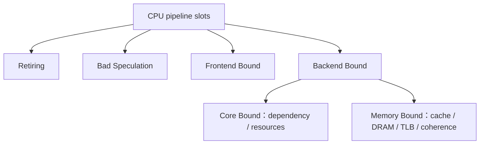

<details>
<summary>查看原图与完整文字转写</summary>

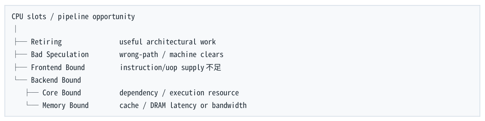

- ` CPU slots / pipeline opportunity `
- ` Retiring useful architectural work `
- ` Bad Speculation wrong-path / machine clears `
- ` Frontend Bound instruction/uop supply 不足 `
- ` Backend Bound `
- ` Core Bound dependency / execution resource `
- ` Memory Bound cache / DRAM latency or bandwidth `

</details>

Intel Top-Down 的具体 counter 定义随 microarchitecture 变化，但分类思维非常有用：CPU 为什么没有在有效 retire useful work？是 frontend 没喂够、speculation 浪费、backend core resource，还是 memory？

Retiring 比例高也不等于算法优秀：100 条无意义但成功 retire 的 instructions 仍然可能比 5 条更差。Top- Down 是诊断 pipeline 利用率，不替代算法设计。

### 6.11 可证伪的 Diagnosis 示例

| 观察/代码 | Hypothesis | 预测性实验 |
| --- | --- | --- |
| single accumulator；data L1；low branch miss | FP dependency latency-bound | 改 4/8 accumulators，cycles/element应下降 |
| random linked list；IPC低；cycles/node 高 | dependent load + memory latency / low MLP | 改 contiguous/小 working set，cycles/node 应明显下降 |
| random branch；branch-miss 高 | misprediction 主导 | 改 predictable input 或 cheap branchless，cycles/item 应下降 |
| dependency graph 很宽；llvm-mca 某load resource 满 | load throughput/resource-bound | 减少一个 load/改变 data layout，比继续拆 dependency 更有效 |

Performance engineering 的分水岭  不要在结果出来以后编一个“cache 更好所以更快”的故事。先预测：如果机制 Y 是根因，那么改变 Z 应该改善 metric M。实验不符合就更新模型。

<a id="pdf-page-032"></a>

<!-- source-pdf-page: 32 -->

*[原 PDF 第 32 页](./Level1_CPU_Execution_Model_CN.pdf#page=32)*

### 6.12 第一层最终诊断算法

**图示转写**

- ` Hot code `
- ` 1. Define useful-work metric: cycles/message, cycles/order, cycles/element `
- ` 2. Inspect optimized assembly `
- ` 3. Build true-dependency DAG `
  - ` Long serial chain? → latency/dependency hypothesis `
  - ` Enough ILP? `
    ` 4. Estimate resource demand `
    ` ALU / FP / Load / Store / AGU / Frontend / Retire `
    ` 5. Inspect control flow `
    ` predictable? indirect? mispredict risk? `
    ` 6. Inspect memory access pattern `
    ` contiguous? dependent loads? MLP? prefetchable? `
    ` 7. llvm-mca for static core-side validation `
    ` 8. perf + representative controlled benchmark `
    ` 9. Change one variable, test predicted effect `
    ` 10. Bottleneck migrated? Repeat at the new limiting resource. `

<details>
<summary>查看原图与完整文字转写</summary>

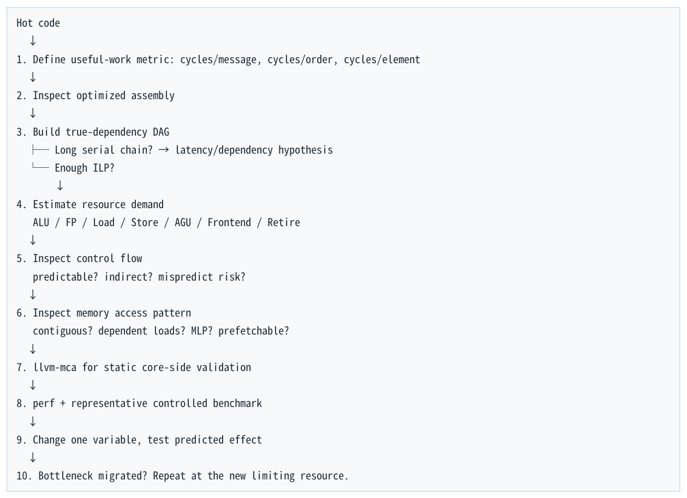

- ` Hot code `
- ` 1. Define useful-work metric: cycles/message, cycles/order, cycles/element `
- ` 2. Inspect optimized assembly `
- ` 3. Build true-dependency DAG `
- ` Long serial chain? → latency/dependency hypothesis `
- ` Enough ILP? `
- ` 4. Estimate resource demand `
- ` ALU / FP / Load / Store / AGU / Frontend / Retire `
- ` 5. Inspect control flow `
- ` predictable? indirect? mispredict risk? `
- ` 6. Inspect memory access pattern `
- ` contiguous? dependent loads? MLP? prefetchable? `
- ` 7. llvm-mca for static core-side validation `
- ` 8. perf + representative controlled benchmark `
- ` 9. Change one variable, test predicted effect `
- ` 10. Bottleneck migrated? Repeat at the new limiting resource. `

</details>

本节结论  • 分析生产代码先看 optimized assembly，而不是凭 source 猜 compiler。

- llvm-mca 用于静态 dependency/resource 模型；perf 用于真实 workload/counters；二者互补。

- cycles/useful-work 比单一 IPC、branch-miss rate 或 cache-miss count 更接近最终目标。

- Microbenchmark 要防 dead-code elimination、volatile distortion、cold start、migration、 frequency、multiplexing 等问题。

- 专业诊断的核心是可证伪 hypothesis + controlled experiment。

<a id="pdf-page-033"></a>

<!-- source-pdf-page: 33 -->

*[原 PDF 第 33 页](./Level1_CPU_Execution_Model_CN.pdf#page=33)*

## 附录 A  第一层复习工具箱

### A.1 关键术语表

| 术语 | 定义 |
| --- | --- |
| Architectural Register | ISA 对程序可见的逻辑寄存器名字，例如 RAX/XMM0。 |
| Physical Register | CPU 内部保存不同 value versions 的物理寄存器资源。 |
| µop / uop | CPU 内部较细粒度的执行工作单元；与 x86 instruction 不是固定一一对应。 |
| Rename | architectural register → physical register 的动态映射，消除WAR/WAW name dependencies。 |
| ROB | Reorder Buffer；按 program order 跟踪 in-flight instructions，支持 in-order retirement 与 precise state。 |
| Scheduler / RS | 等待 operands ready，并从 ready µops 中选择可 issue 的work。 |
| RAW | Read After Write；true data dependency。 |
| WAR / WAW | name/false dependencies；通常可由 register renaming 消除。 |
| Latency | producer result 何时能被 dependent consumer 使用。 |
| Reciprocal Throughput | steady-state 下平均多少 cycles 可以启动一个 independent operation。 |
| ILP | Instruction-Level Parallelism；independent instructions 的并行度。 |
| MLP | Memory-Level Parallelism；independent memory requests的并发度。 |
| DLP | Data-Level Parallelism；SIMD/vector lanes 层面的并行。 |
| Critical Path | dependency DAG 最长依赖路径；形成 latency lower bound。 |
| AGU | Address Generation Unit；计算 load/store effective address。 |
| Port Contention | 多个 ready µops 竞争有限 compatible execution resources。 |

<a id="pdf-page-034"></a>

<!-- source-pdf-page: 34 -->

*[原 PDF 第 34 页](./Level1_CPU_Execution_Model_CN.pdf#page=34)*

| 术语 | 定义 |
| --- | --- |
| BTB | Branch Target Buffer；帮助预测 branch target。 |
| RAS | Return Address Stack；帮助预测 return target。 |
| Speculation | 在不确定性 resolve 前基于预测提前执行，错了 rollback。 |
| Retire / Commit | instruction 正式成为 architectural history 的阶段；execution completion 不等于 retirement。 |
| Skid | 硬件事件与 sample IP 之间的采样归因偏移。 |

### A.2 最容易混淆的对照表

| A | B | 不要混淆的原因 |
| --- | --- | --- |
| Execution order | Retirement order | 执行可乱序，architectural commit 按序 |
| Latency | Throughput | 一个 dependent result 多久 ready vs independent work 稳态吞吐 |
| Dependency-bound | Resource-bound | 没有 ready work vs ready work 太多资源吃不下 |
| L1 hit latency | L1 bandwidth/throughput | dependent load 暴露 latency；independent loads 可受 bandwidth 限制 |
| ILP | MLP | instruction independence vs memory request independence |
| Branch | Branch misprediction | predictable branch 可很便宜；真正昂贵的是错路 speculation/recovery |
| Architectural state | Microarchitectural state | squash 撤销 architectural effect，但cache/predictor 等痕迹可能存在 |
| ROB | Scheduler | program-order bookkeeping vs execution-order selection |
| Instruction count | CPU throughput | 还取决于 µops、dependency、port mapping、memory、frontend |
| IPC | Latency | IPC 是整体吞吐现象，不等于单请求critical-path latency |

<a id="pdf-page-035"></a>

<!-- source-pdf-page: 35 -->

*[原 PDF 第 35 页](./Level1_CPU_Execution_Model_CN.pdf#page=35)*

### A.3 面试级简答

### Why can a CPU execute out of order?

Register renaming exposes true dependencies and removes false WAR/WAW dependencies; the scheduler can issue ready independent µops to available execution resources.

### Why retire in order?

To preserve precise architectural state so exceptions and speculation recovery appear as if the program executed in program order.

### Why do multiple accumulators help?

They replace one long loop-carried dependency chain with multiple independent chains, increasing ILP and letting the OoO engine approach throughput limits.

### Why can pointer chasing be slow even in L1?

Each load produces the address of the next load, creating a serialized load-to-use dependency and very low MLP.

### Why can an L1 hit still be expensive?

L1 loads have finite load-to-use latency and finite load/AGU throughput; dependent vs independent loads expose different limits.

### Why is branchless not always faster?

It avoids misprediction but can add instructions, data dependencies, port pressure, or compute both sides. A predictable branch can be cheaper.

### What is ROB?

A program-order structure that tracks in-flight instructions and enables in-order retirement, precise exceptions, and speculation recovery.

### What is register renaming?

Mapping architectural registers to a larger physical register set to remove name dependencies while preserving true RAW dependencies.

### What is latency hiding?

Overlapping the wait for a long-latency operation with independent work; it does not reduce the original operation latency.

### What is port contention?

Ready µops compete for a finite subset of compatible execution resources, limiting sustained throughput even without data dependencies.

<a id="pdf-page-036"></a>

<!-- source-pdf-page: 36 -->

*[原 PDF 第 36 页](./Level1_CPU_Execution_Model_CN.pdf#page=36)*

### A.4 推荐做的 4 组实验

| Lab | 实验 | 控制变量 | 核心指标 |
| --- | --- | --- | --- |
| 1 | 1 vs 2/4/8 accumulators | same data, same compiler flags | cycles/element；assembly；llvm-mca dependency/resource pressure |
| 2 | contiguous array vs random linked list | same working-set sizes: L1/L2/LLC/DRAM | cycles/node；cache behavior；IPC |
| 3 | predictable vs pseudorandom branch vs cheap branchless | same useful work | cycles/item；branches；branch-misses |
| 4 | 1/2/4 independent arrays | same cache residency | cycles/element；load pressure；MLP/throughput behavior |

### A.5 第一层复习清单

- [ ] 我能解释 instruction、µop、C++ statement 为什么不是一一对应。

- [ ] 我能解释 superscalar、pipeline depth/width、IPC/CPI。

- [ ] 我能区分 RAW 与 WAR/WAW，并说明 rename 为什么只消除后两者。

- [ ] 我能解释 scheduler 与 ROB 的职责区别。

- [ ] 我能解释 execute complete 与 retire 的区别，以及 precise exception。

- [ ] 我能画出 dependency graph，并识别 critical path。

- [ ] 我能解释 latency 与 reciprocal throughput 为什么可以同时“3 cycles”和“2 ops/cycle”。

- [ ] 我能解释 multiple accumulators 的收益来自 ILP，不是 unrolling 这个名字。

- [ ] 我能区分 ILP / MLP / DLP。

- [ ] 我能解释 pointer chasing 即使 L1 hit 也可能慢。

- [ ] 我能区分 dependency-bound 与 resource-bound。

- [ ] 我能解释 AGU、load/store throughput 和 L1 load-to-use latency。

- [ ] 我能解释 branch prediction 的 direction/target，以及 BTB/RAS 的定位。

- [ ] 我能解释 misprediction 的真正成本和 branchless trade-off。

- [ ] 我知道 speculative work 不 retire 仍可能留下 microarchitectural traces。

- [ ] 我能从 optimized assembly 开始，而不是猜 compiler。

- [ ] 我能正确理解 llvm-mca 的 Block RThroughput 与 dependency latency 的区别。

- [ ] 我能使用 perf stat / record / annotate，并知道 IPC 与 sampled hotspot 都不是根因本身。

- [ ] 我会为性能问题提出可证伪 hypothesis，再设计 controlled experiment。

- [ ] 我理解性能优化通常是 bottleneck migration，而不是“彻底消灭瓶颈”。

<a id="pdf-page-037"></a>

<!-- source-pdf-page: 37 -->

*[原 PDF 第 37 页](./Level1_CPU_Execution_Model_CN.pdf#page=37)*

### A.6 最终心智模型

**图示转写**

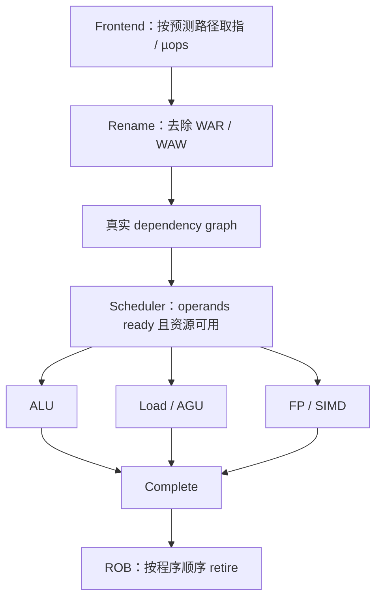

<details>
<summary>查看原图与完整文字转写</summary>

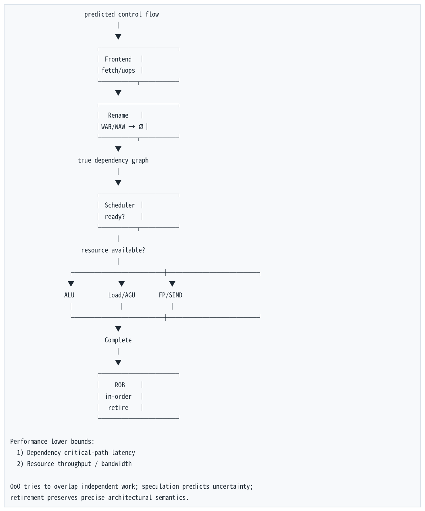

- ` predicted control flow `
- ` Frontend `
- ` fetch/uops `
- ` Rename `
- ` WAR/WAW → Ø `
- ` true dependency graph `
- ` Scheduler `
- ` ready? `
- ` resource available? `
- ` ALU Load/AGU FP/SIMD `
- ` Complete `
- ` ROB `
- ` in-order `
- ` retire `
- ` Performance lower bounds: `
- ` 1) Dependency critical-path latency `
- ` 2) Resource throughput / bandwidth `
- ` OoO tries to overlap independent work; speculation predicts uncertainty; `
- ` retirement preserves precise architectural semantics. `

</details>

第一层最终一句话  Latency 决定 dependency chain 跑多快；throughput 决定 independent work 能吞多快；ILP/MLP 决定 CPU 有多少机会 overlap；有限 frontend/backend resources 决定最终 ceiling；ROB 与 in-order retirement 保证 aggressive execution 仍然保持 precise architectural semantics。

<a id="pdf-page-038"></a>

<!-- source-pdf-page: 38 -->

*[原 PDF 第 38 页](./Level1_CPU_Execution_Model_CN.pdf#page=38)*

## 结语：第一层学完之后，你应该怎样看 C++

看到一段 hot C++，不要先问“有没有 vector”“是不是 O(logN)”或“cache hit 吗”。先把它翻译成 CPU 会面对的约束：哪些值依赖哪些值？下一地址是否依赖前一 load？控制流可预测吗？有多少 ready operations？ 哪个 resource 最可能饱和？

**图示转写**

1. ` 看到 x = x + a `
2. ` RAW / dependency chain / latency `
3. ` 看到 a+=x; b+=y `
4. ` ILP / throughput / ports `
5. ` 看到 p = p->next `
6. ` dependent load / load-to-use latency / low MLP `
7. ` 看到 a[i],a[i+1] `
8. ` predictable addresses / prefetch / MLP `
9. ` 看到 random if `
10. ` predictor / speculation / misprediction `
11. ` 看到 L1 hit `
12. ` 继续问 latency 还是 throughput，不要停止分析 `
13. ` 看到 low IPC `
14. ` 把它当“症状”，继续找 dependency/frontend/memory 根因 `

<details>
<summary>查看原图与完整文字转写</summary>

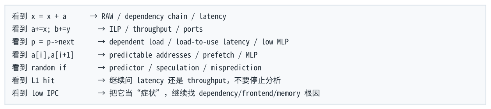

- ` 看到 x = x + a → RAW / dependency chain / latency `
- ` 看到 a+=x; b+=y → ILP / throughput / ports `
- ` 看到 p = p->next → dependent load / load-to-use latency / low MLP `
- ` 看到 a[i],a[i+1] → predictable addresses / prefetch / MLP `
- ` 看到 random if → predictor / speculation / misprediction `
- ` 看到 L1 hit → 继续问 latency 还是 throughput，不要停止分析 `
- ` 看到 low IPC → 把它当“症状”，继续找 dependency/frontend/memory 根因 `

</details>

这就是第一层 CPU Execution Model 真正要建立的能力：不是记住几个微架构名词，而是能够从 first principles 对性能做结构化预测，再用 assembly、llvm-mca、perf 与 controlled benchmark 验证。

<a id="conversion-errata"></a>

## 转换补充与勘误

本节及正文中“转换补充 / 转换勘误”均为 2026-11-06 转换时新增；原 PDF 仍是原始内容与版式的对照。

- [原 PDF 第 14 页处的补充](#pdf-page-014)：文中的 ADD 3 cycles / 2 ops per cycle 是教学假设，不是所有 x86 整数 ADD 的固定指标。

- [原 PDF 第 29 页处的补充](#pdf-page-029)：`llvm-mca` 的 Block RThroughput 估算不计 loop-carried dependency 的约束，也不自行模拟真实 cache hierarchy；不能直接用它代替端到端。

### 适用边界

原文中的时延、cache/ROB 大小、PMU event、kernel 参数及 compiler lowering 均需要绑定具体平台。转写结构的覆盖校验不等同于对全部技术命题的逐条实测；复杂图的精确布局以随附原图为准。
