# C++ → Assembly → CPU

> 来源：[Level2_CPP_Assembly_CPU_CN.pdf](./Level2_CPP_Assembly_CPU_CN.pdf)（33 页）。本文件按原文逐页转写；转换补充与勘误单独标明。

> 图示优先转为 Mermaid、表格或步骤；每图附原图和文字以便核对。代码保留原文逻辑与缩进，跨页片段及概念示例未宣称可以独立编译。

[返回目录](README.md) · [转换说明与校验](CONVERSION_NOTES.md) · [本文补充与勘误](#conversion-errata)

[原文目录](#pdf-page-003) · [第一章正文](#pdf-page-005)

<a id="pdf-page-001"></a>

<!-- source-pdf-page: 1 -->

*[原 PDF 第 1 页](./Level2_CPP_Assembly_CPU_CN.pdf#page=1)*

## C++ -&gt; Assembly -&gt; CPU

### C++ / CPU 深度学习 - 第二层完整讲义

Compiler · Assembly · ABI · Memory Layout · Branch · Loops · Dependency · SIMD · Real C+ + Cases

目标  建立从 C++ 语义到 optimized assembly，再到 dependency graph、CPU execution resources 与最终 cycles 的稳定因果链。读完后，你应该能解释一段真实 C++ 为什么快/慢，而不是只凭 Big-O、指令条数或经验口号判断。

2026-08 · 详尽版

<a id="pdf-page-002"></a>

<!-- source-pdf-page: 2 -->

*[原 PDF 第 2 页](./Level2_CPP_Assembly_CPU_CN.pdf#page=2)*

## 如何使用这份讲义

这份 PDF 不是 x86 指令表，也不是 Session 1-8 聊天记录的直接拼接。它按照“C++ 语义 -&gt; 编译器变换 -&gt; assembly 形态 -&gt; dependency / resource 模型 -&gt; CPU 性能”的顺序重组第二层知识。

最核心的方法  先判断 C++ 语义允许编译器做什么，再看 optimized assembly；随后画出 true dependency / address dependency / control dependency，最后判断是 latency、resource、frontend、branch 还是 memory 限制。不要从某条 C++ 语法直接推断性能。

本文主要以 Linux x86-64 System V ABI 与现代 superscalar out-of-order CPU 为例。Windows x64 ABI、Intel/AMD 不同 generation、不同 instruction operand form 的细节会不同。文中凡出现“可能生成”“典型上”“概念上”等表述，表示这是分析模型而不是跨平台固定事实。具体 latency、throughput、µop decomposition 必须绑定目标 CPU 验证。

### 阅读路线

| 章节 | 主题 | 你最终要回答的问题 |
| --- | --- | --- |
| 第 1 章 | C++ -&gt; Compiler -&gt; Assembly | 为什么源码中的变量、函数、表达式可能在机器码中完全消失或重组？ |
| 第 2 章 | Registers / Operands / Addressing | rdi、[rdi+rsi*4+8]、lea 到底表示值、地址还是 memory access？ |
| 第 3 章 | Object Layout / Data-Oriented Design | sizeof、padding、AoS/SoA、pointer/index如何改变 cache 与 dependency？ |
| 第 4 章 | Function / ABI / Stack / Inline | call/ret、参数寄存器、spill、inline 的真正成本与收益是什么？ |
| 第 5 章 | Branch / cmov / setcc | 为什么 branchless 不一定更快？control dependency 与 data dependency 如何互换？ |
| 第 6 章 | Loop / Dependency / Compiler Optimization | 为什么 multiple accumulators 有效？unroll、LICM、alias 如何影响 ILP？ |
| 第 7 章 | SIMD / Auto-vectorization | SIMD、ILP、MLP 有何区别？更宽 vector 为什么不保证等比例加速？ |
| 第 8 章 | Real C++ Performance Cases | vector/list/hash/virtual/shared_ptr/order book 应怎样从 CPU 层分析？ |
| 附录 | Cheat Sheets / 面试 / 实验 | 怎样把知识压缩成可复习、可验证、可面试表达的工具？ |

### 贯穿全书的五个问题

- 这段 C++ 的 observable semantics 是什么？编译器有多大自由度？

- optimized assembly 中真正的 load/store/branch/call/SIMD 是什么？

- 最长 true dependency / address dependency / control dependency 在哪里？

- 如果 independent work 足够，哪个 execution / frontend / memory resource 先饱和？

- 怎样用 Godbolt、llvm-mca、perf 或 controlled benchmark 证伪自己的判断？

<a id="pdf-page-003"></a>

<!-- source-pdf-page: 3 -->

*[原 PDF 第 3 页](./Level2_CPP_Assembly_CPU_CN.pdf#page=3)*

## 原文目录

- [1. C++ -&gt; Compiler -&gt; Assembly：从语义到机器执行](#pdf-page-005)
- [1.1 完整编译链路与 As-If Rule](#pdf-page-005)
- [1.2 C++ statement / variable / function 为什么会消失](#pdf-page-005)
- [1.3 -O0 vs -O2/-O3：为什么性能分析必须看优化代码](#pdf-page-005)
- [1.4 Constant Folding / Propagation / DCE / Inlining](#pdf-page-006)
- [1.5 mov / lea / xor zero idiom 与“ISA 语义 != 微架构成本”](#pdf-page-006)
- [1.6 Instruction != µop：分析层次不要混](#pdf-page-006)
- [2. Registers、Operands 与 Effective Address](#pdf-page-007)
- [2.1 GPR 宽度：RAX/EAX/AX/AL](#pdf-page-007)
- [2.2 Register / Immediate / Memory Operand](#pdf-page-008)
- [2.3 base + index*scale + displacement](#pdf-page-008)
- [2.4 Array / Pointer / Reference 的机器形态](#pdf-page-008)
- [2.5 Load / Store / AGU / Address Dependency](#pdf-page-008)
- [2.6 RIP / RSP / RBP / FLAGS 与关键特殊寄存器](#pdf-page-008)
- [3. Object / Struct / Class -&gt; Memory Layout](#pdf-page-009)
- [3.1 sizeof / alignof / padding / field offset](#pdf-page-009)
- [3.2 Member Order、cache-line crossing 与 object density](#pdf-page-010)
- [3.3 AoS / SoA / AoSoA](#pdf-page-010)
- [3.4 Hot/Cold Split 与 Working Set](#pdf-page-010)
- [3.5 vector&lt;T&gt; / vector&lt;T*&gt; / heap / stack](#pdf-page-010)
- [3.6 this / static / virtual / inheritance / EBO](#pdf-page-010)
- [3.7 False Sharing / alignas(64)](#pdf-page-011)
- [3.8 Pointer vs Index-Based Packed Storage](#pdf-page-011)
- [4. Function Call、ABI、Stack 与 Inlining](#pdf-page-012)
- [4.1 System V AMD64 参数与返回值](#pdf-page-012)
- [4.2 hidden this / sret / small struct](#pdf-page-013)
- [4.3 call / ret / stack frame / red zone](#pdf-page-013)
- [4.4 caller-saved / callee-saved / spill](#pdf-page-013)
- [4.5 direct / indirect / virtual call](#pdf-page-013)
- [4.6 inline 的真正价值与风险](#pdf-page-014)
- [4.7 pass-by-value vs const&amp; / templates / lambda / std::function](#pdf-page-014)
- [4.8 LTO / PGO / hot-cold code split](#pdf-page-014)
- [5. Branch、FLAGS、cmov、setcc 与 Control Flow](#pdf-page-015)
- [5.1 cmp / test / FLAGS](#pdf-page-016)
- [5.2 signed vs unsigned conditional codes](#pdf-page-016)
- [5.3 branch prediction 与 speculation](#pdf-page-016)

<a id="pdf-page-004"></a>

<!-- source-pdf-page: 4 -->

*[原 PDF 第 4 页](./Level2_CPP_Assembly_CPU_CN.pdf#page=4)*

- [5.4 cmov / setcc：control dependency -&gt; data dependency](#pdf-page-016)
- [5.5 short-circuit / switch / jump table / indirect target](#pdf-page-016)
- [5.6 likely/unlikely、code layout 与 HFT fast/cold path](#pdf-page-017)
- [6. Loop、Dependency Chains 与 Compiler Optimizations](#pdf-page-018)
- [6.1 loop-carried dependency / critical path](#pdf-page-018)
- [6.2 latency vs throughput / dependency-bound vs resource-bound](#pdf-page-019)
- [6.3 multiple accumulators 与正确的 unrolling](#pdf-page-019)
- [6.4 induction variable / strength reduction / LICM](#pdf-page-019)
- [6.5 alias / __restrict__ / runtime versioning](#pdf-page-019)
- [6.6 reduction / recurrence / prefix sum](#pdf-page-019)
- [6.7 pointer chasing / multiple lists / MLP](#pdf-page-020)
- [6.8 cycles per element / bottleneck migration](#pdf-page-020)
- [7. SIMD、Auto-vectorization 与 DLP](#pdf-page-022)
- [7.1 XMM/YMM/ZMM 与 lanes](#pdf-page-022)
- [7.2 scalar vs packed / SSE vs AVX / AVX2 / AVX-512](#pdf-page-023)
- [7.3 Auto-vectorizer 的安全性与 cost model](#pdf-page-023)
- [7.4 SIMD reduction / multiple vector accumulators](#pdf-page-023)
- [7.5 mask / predication / branch in vector loop](#pdf-page-023)
- [7.6 gather / scatter 与 irregular memory](#pdf-page-023)
- [7.7 FMA / FP semantics / fast-math](#pdf-page-024)
- [7.8 wider vector、bandwidth、frequency 与 HFT latency trade-off](#pdf-page-024)
- [7.9 Intrinsics / SLP / HFT SIMD use cases](#pdf-page-024)
- [8. Real C++ Performance Case Studies](#pdf-page-026)
- [8.1 vector vs list vs deque](#pdf-page-026)
- [8.2 vector&lt;T&gt; vs vector&lt;T*&gt;](#pdf-page-026)
- [8.3 intrusive list vs packed index](#pdf-page-026)
- [8.4 unordered_map / flat hash / map / sorted vector](#pdf-page-027)
- [8.5 virtual / std::function / shared_ptr](#pdf-page-027)
- [8.6 optional / variant / string / memcpy / iterator / lambda](#pdf-page-027)
- [8.7 L3 order book 综合分析](#pdf-page-027)
- [8.8 parser / pricing / hash recurrence 综合分析](#pdf-page-027)
- [8.9 第二层最终诊断算法](#pdf-page-027)
- [A. 附录：指令速查 / ABI / Pattern / 面试 / 实验 / 复习清单](#pdf-page-030)

<a id="pdf-page-005"></a>

<!-- source-pdf-page: 5 -->

*[原 PDF 第 5 页](./Level2_CPP_Assembly_CPU_CN.pdf#page=5)*

## 第 1 章 C++ -&gt; Compiler -&gt; Assembly：从语义到机器执行

本章目标  建立最基本的因果链：C++ 只是语义输入；compiler 可以重组实现；CPU 最终执行 machine code。学会区分源码、IR、ISA instruction、µop 和 CPU execution。

### 1.1 完整编译链路与 As-If Rule

**图示转写**

1. ` C++ source `
2. ` AST / semantic analysis `
3. ` Compiler IR (SSA-like values) `
4. ` optimization `
5. ` Target instructions / machine code `
6. ` decode / rename `
7. ` µops / backend work `
8. ` CPU execution `

<details>
<summary>查看原图与完整文字转写</summary>

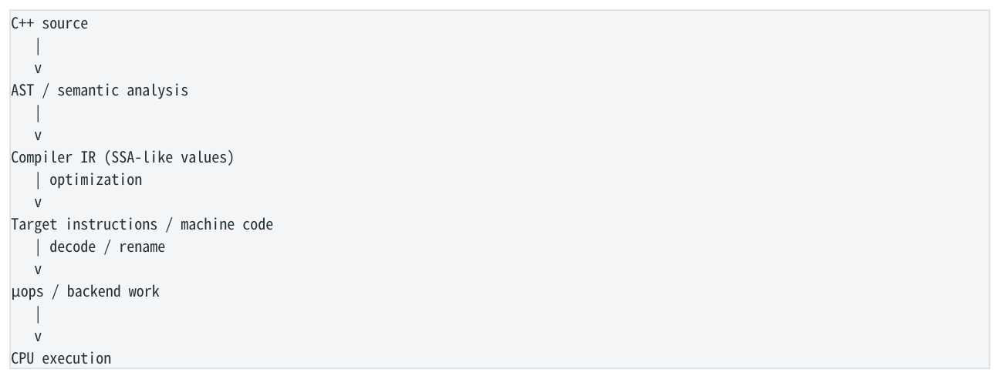

- ` C++ source `
- ` AST / semantic analysis `
- ` Compiler IR (SSA-like values) `
- ` optimization `
- ` Target instructions / machine code `
- ` decode / rename `
- ` µops / backend work `
- ` CPU execution `

</details>

CPU 不执行 C++，也不执行“汇编文本”。CPU 执行的是 machine-code bytes；assembly 是 machine code 的人类可读表示。 更关键的是，C++ source 与 machine instruction 不是一一映射。Compiler 的任务是保持语言要求的 observable behavior，而不是保存源码的写法。

As-If Rule  只要程序的可观察行为保持不变，compiler 可以消除变量、合并表达式、移动计算、inline 函数、删除死代码、改变控制流，甚至让源码中的完整对象在 runtime 从未真正存在。

### 1.2 最简单函数：参数、结果与变量消失“ ”

```cpp
int add(int a, int b) {
    return a + b;
}

// Linux x86-64 SysV 可能：
add:
    lea eax, [rdi + rsi]
    ret
```

这里 a/b 没有各自的“变量槽位”。ABI 已把它们放在 edi/esi；返回 int 放 eax。compiler 只需要让返回值等于 a+b。`lea` 虽名为 Load Effective Address，但在这种形式下只是整数地址算术，不读取 memory。

### 1.3 C++ Variable != Register；Local Variable != Stack Slot

```cpp
int f(int x) {
    int a = x + 1;
    int b = a + 1;
    int c = b + 1;
    return c;
}

// optimized 可能只剩：
```

<a id="pdf-page-006"></a>

<!-- source-pdf-page: 6 -->

*[原 PDF 第 6 页](./Level2_CPP_Assembly_CPU_CN.pdf#page=6)*

```asm
lea eax, [rdi + 3]
ret
```

a、b、c 可以完全不存在。Compiler IR 中它们可能只是 SSA value；优化后被 constant folding、copy propagation、algebraic simplification 合并。只有在需要真实 address、volatile semantics、spill 或其他约束时，某个局部对象才更可能 materialize 到 memory。

### 1.4 -O0 vs -O2/-O3

| 模式 | 主要目标 | 常见机器形态 | 性能分析价值 |
| --- | --- | --- | --- |
| -O0 | 调试友好 | 大量 stack slot、load/store、固定变量位置、少 inline/vectorize | 低：通常不能代表生产 hot path |
| -O2 | 通用优化 | DCE、inline、LICM、合理 loop优化、register allocation | 高：常见生产基线 |
| -O3 | 更激进 throughput 优化 | 更多 unroll/vectorization/ifconversion，可能 code-size 上升 | 高，但必须 benchmark |

分析规则  不要拿 -O0 汇编解释生产性能。必须使用与 production 一致或至少接近的 optimization、target ISA、 LTO/PGO 配置。

### 1.5 Constant Folding / Propagation / Dead Code Elimination

```cpp
int f() {
    int x = 10;
    int y = 20;
    return x + y;
}
// -> mov eax, 30; ret

int g(int x) {
    int a = x * 100;
    int b = a + 500;
    return x;
}
// a/b 与乘法都可能完全删除
```

这也是 microbenchmark 最常见错误之一：计算结果没有 observable use，compiler 把整个 loop 删除，然后 benchmark 得出“几乎 0 ns”。性能实验的第一步永远是确认 generated assembly 中目标工作真的存在。

### 1.6 Inlining 只是优化入口，不只是省 call

源码中的 function boundary 不一定成为机器码中的 function boundary。Compiler 可以 inline 没有 `inline` 关键字的函数，也可以拒绝 inline 标记过的函数。Inlining 的大价值是让 constant propagation、DCE、devirtualization、alias analysis、 vectorization 和 register allocation 跨越原函数边界继续进行；其代价是 code size 与 register pressure。第 4 章会系统展开。

### 1.7 `mov`、`lea` 与 zero idiom

| 形式 | 概念语义 | 是否访问 memory |
| --- | --- | --- |
| mov eax, edi | eax = edi（寄存器值复制） | 否 |
| mov eax, [rdi] | 从 rdi 指向地址读取 4B 到 eax | 是 |
| lea eax, [rdi+rdi*2] | eax = 3*rdi（地址算术） | 否 |
| xor eax, eax | eax = 0；现代 CPU 常识别为 zero idiom | 否 |

> **转换补充**：优化开关的默认集合随 GCC 版本和 target 改变；可用 `g++ -Q -O2 --help=optimizers` 检查当前工具链，不应把讲义中的等级概括当作固定 pass 清单。参见 [GCC Optimize Options](https://gcc.gnu.org/onlinedocs/gcc/Optimize-Options.html)。

<a id="pdf-page-007"></a>

<!-- source-pdf-page: 7 -->

*[原 PDF 第 7 页](./Level2_CPP_Assembly_CPU_CN.pdf#page=7)*

`xor eax,eax` 在 ISA 语义上看似读取旧 eax 再 XOR，但现代 OoO CPU 通常识别 zero idiom，在 rename 阶段切断旧值依赖。这是一个典型提醒：ISA 语义、compiler 选择和微架构实现是三个层次。

### 1.8 Instruction != µop

```asm
add eax, [rdi + rsi*4]

概念 backend work：
  effective_address = rdi + rsi*4
  value = load [effective_address]
  eax = eax + value
```

一条 x86 instruction 可以对 backend 产生多类工作；反过来 macro-fusion/micro-fusion 又让 frontend 中的“条数”与 execution-side demand 不完全一致。因此不要把 C++ 行数、assembly instruction 数量或甚至某个固定 µop 数当作跨 CPU 的性能真相。

### 1.9 `volatile`、Global 与 Observable Access

`volatile` 会要求相关读写成为 observable side effects，因此 compiler 通常不能像普通 local 一样把访问完全缓存到 register 或删除；但 `volatile` 不是多线程同步工具，不能替代 atomic/fence/memory_order。Global/static data 常通过 RIP-relative addressing 访问，例如 `[rip+offset]`。是否真的每次 load 仍取决于语言可见性与 optimizer 能否证明值不变。

### 1.10 Undefined Behavior 与优化假设

Compiler 的优化自由建立在 C++ abstract machine 规则之上。Signed overflow、越界访问、违反 alias/restrict contract 等 UB 允许 optimizer 假设“这种情况不会发生”，因此源码层看似保守的判断可能被重写。性能代码必须先 correctness，再谈 assembly；不能通过依赖 UB 获得所谓“更快”。

### 1.11 读 Assembly 的固定三问

1. 输入来自 register、immediate 还是 memory？

2. 输出写 register、memory 还是 FLAGS？

3. 这个结果是否成为下一条 instruction 的 data/address/control dependency？

本章结论  • C++ source 与 machine code 不是一一对应。 • As-If Rule 给 compiler 很大的优化自由。 • 变量、对象、函数边界都可能在 runtime 消失。 • 性能分析必须看 production-like optimized assembly。 • ISA instruction 只是 CPU backend 工作的入口，不等于固定成本。

## 第 2 章 Registers、Operands 与 Effective Address

本章目标  看到一条 assembly 时，首先判断数据在哪里：register、immediate 还是 memory；如果是 memory，立即拆出 effective address，并检查是否存在 address dependency。

### 2.1 GPR 宽度：RAX / EAX / AX / AL

```text
RAX  : 64 bit
EAX  : low 32 bit of RAX
AX   : low 16 bit
AL   : low 8 bit

RDI / EDI / DI / DIL 同理
```

<a id="pdf-page-008"></a>

<!-- source-pdf-page: 8 -->

*[原 PDF 第 8 页](./Level2_CPP_Assembly_CPU_CN.pdf#page=8)*

x86-64 有一个极重要规则：写 32-bit GPR（例如 EAX）会把对应 64-bit register 的高 32 位清零；写 AX/AL 则只修改低位，不自动清高位。因此 `mov eax, edi` 不只是 32-bit copy，还得到一个 zero-extended RAX。

### 2.2 三类 Operand

| 类型 | 示例 | 核心问题 |
| --- | --- | --- |
| Register | add eax, esi | 输入/输出是否形成 RAW dependency？ |
| Immediate | add eax, 5 | 常数直接编码在 instruction 中，不需要先装入 register |
| Memory | mov eax, [rdi+8] | 需要 address generation + load/store machinery + cache/TLB |

Intel syntax 常写 `instruction destination, source`。最重要的条件反射是区分 `rdi` 与 `[rdi]`：前者是 pointer value，后者是 pointer 指向的 memory content。

### 2.3 Effective Address：base + index*scale + displacement

```text
[rdi + rsi*4 + 16]

base         = rdi
index        = rsi
scale        = 4  (x86 常见 1/2/4/8)
displacement = 16
EA           = base + index*scale + displacement
```

这个 addressing mode 与 C/C++ 数组和 struct 成员天然匹配。`a[i]` 的地址本质是 `base(a) + i*sizeof(T)`；`obj.field` 再加 field offset。scale 只支持 1/2/4/8，因此 sizeof(T)=24 等 stride 可能需要额外 `lea`/shift/add 组合。

### 2.4 Size Qualifier 与 Array

| Memory qualifier | 字节数 | 典型 C++ |
| --- | --- | --- |
| BYTE PTR | 1 | char / uint8_t |
| WORD PTR | 2 | uint16_t |
| DWORD PTR | 4 | int / uint32_t |
| QWORD PTR | 8 | uint64_t / pointer / double 的 storage size |

```asm
uint64_t get(const uint64_t* a, size_t i) { return a[i]; }
// 核心地址：
mov rax, QWORD PTR [rdi + rsi*8]
```

### 2.5 Pointer Arithmetic 与 Reference

`int* p; p+1` 是地址加 sizeof(int)，不是加 1 byte。`const int&` 在主流 ABI 中通常通过地址传递，因此一个简单 reference access 在机器层常与 pointer dereference 类似。但 C++ 语言标准并不要求“reference 就是 pointer”；这里只是常见 ABI 实现。

```cpp
int f(const int& x) { return x + 1; }
// 常见：rdi = &x
mov eax, DWORD PTR [rdi]
add eax, 1
```

### 2.6 Load / Store 与 AGU

```text
load:  mov eax, [rdi]
store: mov [rdi], eax

Memory operation 概念路径：
Effective Address -> AGU / address generation
```

<a id="pdf-page-009"></a>

<!-- source-pdf-page: 9 -->

*[原 PDF 第 9 页](./Level2_CPP_Assembly_CPU_CN.pdf#page=9)*

**图示转写**

1. ` → Load/Store Queue bookkeeping `
2. ` → L1D / lower cache / memory `

<details>
<summary>查看原图与完整文字转写</summary>


- ` → Load/Store Queue bookkeeping `
- ` → L1D / lower cache / memory `

</details>

`[]` 本身不是性能结论；必须看 instruction。`lea rax,[...]` 不访问 memory。真正的 load/store 还会消耗有限 load/store queue、AGU、cache bandwidth 等资源。Store 执行后通常先进入 store buffer；“store instruction executed/retired”与“其他 core 已观察到新值”不是同一概念。

### 2.7 Address Dependency：Pointer Chasing 的根

```cpp
struct Node { Node* next; int value; };
int f(Node* p) { return p->next->value; }

mov rax, QWORD PTR [rdi]      ; rax = p->next
mov eax, DWORD PTR [rax + 8]  ; value

Dependency:
load next -> rax -> next load address
```

核心  第二个 load 不是“又一次 memory access”这么简单；它的地址依赖第一个 load 的结果。即使两个节点都在 L1，第二个 load 也要暴露第一个 load 的 load-to-use latency。若第一个 miss，后续地址根本无法提前发出。

### 2.8 Data Dependency vs Address Dependency

| 类型 | 例子 | 为什么重要 |
| --- | --- | --- |
| Data dependency | add eax,ebx; imul ecx,eax,3 | consumer 的值要等 producer result |
| Address dependency | mov rax,[rdi]; mov ecx,[rax] | consumer 连 memory request 地址都不知道，MLP 更难建立 |

### 2.9 特殊寄存器：RSP / RBP / RIP / FLAGS

- RSP：stack pointer；`sub rsp,N` 常表示为当前函数分配 stack space。

- RBP：传统 frame pointer，但优化代码常省略 frame pointer，让 RBP 可作为普通 GPR。

- RIP：instruction pointer；`[rip+offset]` 常用于 position-independent global/static data access。

- RFLAGS：ZF/SF/CF/OF 等 condition flags；cmp/test/add/sub 等会写 flags，jcc/cmovcc/setcc 消费它们。

本章结论  • 先分清 value、address 与 memory content。 • `[base+index*scale+disp]` 是理解 array/struct 的关键。 • `lea` 是地址算术，不是 memory load。 • Pointer chasing 的根问题是 address dependency，而不只是“locality 不好”。 • Load/store 还受 AGU、queue、cache 和 store buffer 等资源限制。

## 第 3 章 Object / Struct / Class -&gt; Memory Layout

本章目标  把 C++ 对象抽象压到 byte offset、cache line 与访问模式；理解 object size、field placement、AoS/SoA、pointer/index 为什么会改变 working set、MLP、SIMD 与 false sharing。

### 3.1 sizeof / alignof / padding / offset

```cpp
struct Order {
    uint64_t id;   // offset 0, 8B
    double price;  // offset 8, 8B
```

<a id="pdf-page-010"></a>

<!-- source-pdf-page: 10 -->

*[原 PDF 第 10 页](./Level2_CPP_Assembly_CPU_CN.pdf#page=10)*

```text
    int qty;       // offset 16, 4B
    // tail padding 4B
};
// typical: sizeof(Order)=24, alignof(Order)=8
```

`o->qty` 到机器层只是 `base(o)+16` 的 4-byte load。CPU 不知道成员名、类名或“这是一个 Order”；它只看到 address 和 byte width。Padding 存在是为了满足成员与整个类型的 alignment 要求。

### 3.2 Member Order 改变 size 与 density

```cpp
struct A { char a; uint64_t b; char c; }; // often 24B
struct B { uint64_t b; char a; char c; }; // often 16B
```

减少 padding 的价值不只是“省内存”，而是提高 cache-line density 与缩小 working set。但字段排序的目标不应只有最小 sizeof：经常一起访问的 hot fields 应尽量靠近；由不同 core 独立写的字段有时反而要故意分开以避免 false sharing。

### 3.3 Alignment：真正重要的是 split access 与 layout trade-off

现代 x86 对普通 unaligned load 支持很好，因此“非对齐一定很慢”是不准确的。更值得关注的是 load 是否跨 cache-line 或 page boundary，以及是否因此需要更多底层访问。盲目 `alignas(64)` 会把 8-byte object 膨胀到 64B，可能严重降低 cache/TLB density。

### 3.4 AoS vs SoA

| 布局 | 内存形态 | 适合的访问 | 主要优点 |
| --- | --- | --- | --- |
| AoS | [price0 qty0 flag0][price1 qty1 flag1]... | 按对象处理多个字段 | 同一对象相关数据靠近 |
| SoA | price0 price1... \| qty0 qty1... | 跨对象批量处理单字段 | cache-line utilization、SIMD、prefetch 更好 |
| AoSoA | 每组 N 个 price/qty/flag | 既需要局部对象关系又要 SIMD | 折中 locality 与 vector width |

决定因素不是“哪种模式更现代”，而是 access pattern。若 hot loop 只读 price，一个 24B AoS 每次只用 8B，有效 cache-line utilization 低；SoA 的 `double prices[]` 一条 64B line 可提供 8 个连续 price。若每次处理完整 order，AoS 反而自然。

### 3.5 Hot / Cold Split

```cpp
struct OrderHot {
  uint64_t id;
  double price;
  int qty;
  State state;
};

struct OrderCold {
  std::string clientName;
  std::string auditText;
  Timestamp created;
};
```

如果 128B object 中 hot path 每次只用 24B，那么微调 4B padding 的价值远小于 hot/cold split。把冷日志、描述、审计字段移出 hot object，可以同时缩小 L1/L2 working set、TLB footprint、cache bandwidth，并改善 SIMD/scan。

### 3.6 `vector<T>`、`vector<T*>` 与真实 topology

**图示转写**

| 容器 | 连续存储的内容 |
| --- | --- |
| `vector<Order>` | Order 对象本身连续 |
| `vector<Order*>` | 只有 pointer 连续；对象位置另定 |

<details>
<summary>查看原图与完整文字转写</summary>

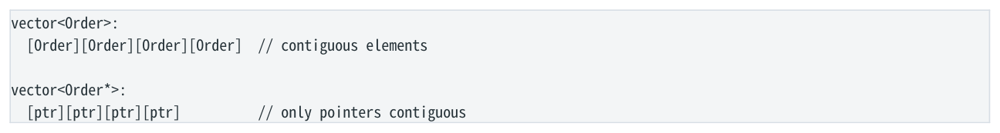

- ` vector<Order>: `
- ` [Order][Order][Order][Order] // contiguous elements `
- ` vector<Order*>: `
- ` [ptr][ptr][ptr][ptr] // only pointers contiguous `

</details>

<a id="pdf-page-011"></a>

<!-- source-pdf-page: 11 -->

*[原 PDF 第 11 页](./Level2_CPP_Assembly_CPU_CN.pdf#page=11)*

```text
    |    |    |
  objects may be elsewhere
```

`vector<Order*>` 访问 `orders[i]->qty` 常形成 pointer load -&gt; dependent object load。`vector<Order>` 可以直接通过 base+i*sizeof(Order)+offset 得到地址。可是若 pointee 都来自 contiguous arena，pointer version 未必灾难；因此性能分析必须看 pointee allocation topology，而不只看 container 名字。

### 3.7 Heap vs Stack：CPU 不认识这些标签

Heap allocation 可能涉及 allocator metadata、fragmentation、locks/thread cache 和 page management；stack allocation 常只是 RSP 调整。但对象一旦已分配并 hot in L1，CPU 访问某个 virtual address 时并不会因为“它来自 heap”自动更慢。真正差异来自 locality、indirection、TLB、allocation/reclamation 与 working set。

### 3.8 Class / this / static / function member

- `class` 与 `struct` 在 layout 上没有“class 天然更重”的区别；主要语言差异是默认访问/继承权限。

- 普通成员函数不存进每个 object；机器层常把 `this` 当隐藏 pointer 参数。

- static data member 不属于每个 object storage。

- 空类通常 sizeof&gt;=1 以支持 distinct object addresses；Empty Base Optimization / `[[no_unique_address]]` 可消除某些空对象空间。

### 3.9 Virtual function 与 object layout

```cpp
struct Base {
    virtual void f();
    int x;
};

Typical implementation:
object -> [vptr][x][padding]
call   -> load vptr -> load target -> indirect call
```

C++ 标准不要求 vtable/vptr，但主流 ABI 这样实现。Virtual 的成本不仅是一个 pointer：还包括 object size、indirect target prediction、失去 inline/constant propagation/vectorization 的机会。若 compiler 能证明 dynamic type，则可 devirtualize， 甚至让整个 dispatch 消失。

### 3.10 Inheritance 与 pointer adjustment

简单单继承通常只是 base subobject + derived members。多继承下 `Derived* -> SecondaryBase*` 可能需要 pointer adjustment；virtual inheritance 还可能需要 runtime offset metadata。低延迟代码不是因为“OO 一定慢”而避免复杂继承，而是复杂 layout/control flow 更难保持透明、紧凑与可预测。

### 3.11 False Sharing 与 `alignas(64)`

**图示转写**

| 场景 / 部分 | 路径、状态或说明 |
| --- | --- |
| cache line 64B | ` [counter0][counter1][counter2]... `；` Core0 W Core1 W ` |
| 部分 2 | ` 不同变量、同一 cache line → ownership ping-pong → false sharing ` |

<details>
<summary>查看原图与完整文字转写</summary>

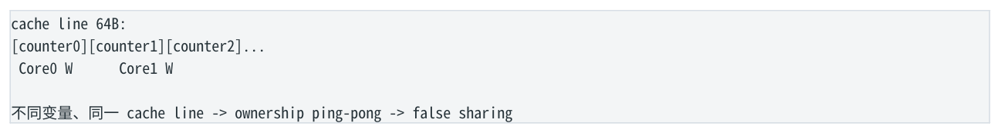

- ` cache line 64B: `
- ` [counter0][counter1][counter2]... `
- ` Core0 W Core1 W `
- ` 不同变量、同一 cache line → ownership ping-pong → false sharing `

</details>

False sharing 是 coherence 粒度与程序逻辑变量粒度不一致。对 per-core mutable state，故意 padding/align 到独立 cache line 可能显著降低 jitter；但对单线程 scan，这会把 density 摧毁。因此 alignment 是 ownership/access-pattern 问题，不是统一“越大越快”。

<a id="pdf-page-012"></a>

<!-- source-pdf-page: 12 -->

*[原 PDF 第 12 页](./Level2_CPP_Assembly_CPU_CN.pdf#page=12)*

### 3.12 Pointer -&gt; Index：改善什么，不改善什么

把 64-bit pointer 链改成 32-bit index 常能缩小 node、让 pool contiguous、降低 fragmentation 与 TLB footprint。但如果 traversal 仍是 `i = pool[i].next`，下一地址依赖 `nextIndex` load 的 true address dependency 仍在。真正把 linked traversal 改成 dense sequential iteration 才会从 dependency graph 上根本改变 MLP/prefetch/SIMD 条件。

### 3.13 `std::array` 与 `std::vector` 对象本身

`std::array<T,N>` 通常接近内嵌的 `T[N]`：元素就在 object 内且连续，没有 hidden heap allocation。`std::vector<T>` object 自身典型只保存 begin/end/capacity-end 一类 pointers，真正元素在另一块 contiguous buffer。性能上要区分“vector control object”与“vector element storage”。

### 3.14 Packed Struct / Bit-field：密度换访问复杂度

`#pragma pack(1)` 可压缩 wire-format object，却可能让 8-byte field 落在任意 byte offset，增加 split access 风险与 portability 问题。Bit-field 能压缩 flags，但更新常涉及 mask/shift/read-modify-write，layout 也更 implementationdependent。协议 wire layout 与内部 hot layout 不必相同：边界 decode 后使用 CPU-friendly representation 往往更合理。

### 3.15 Endianness 与 Layout 是两件事

Field offset 回答“字段在哪里”；endianness 回答“多字节值在 memory 中 byte 顺序如何”。x86 通常 little-endian，例如 uint32_t 0x12345678 在内存字节顺序为 78 56 34 12。内部 register 的逻辑值仍是 0x12345678。协议解析时这与 alignment/layout 必须分别处理。

### 3.16 TLB / Prefetch / Working-Set 放大

Object 从 32B 膨胀到 128B 不只影响 cache：同样 100 万对象会从约 32MB 变 128MB，占更多 pages，增加 TLB 与 page-walk pressure。Contiguous stride stream 也更容易被 hardware prefetcher 学习；随机 heap nodes 则同时破坏 cache locality、TLB locality 与 prefetchability。

### 3.17 Escape / Scalar Replacement

源码中创建 struct 不代表 runtime 一定有一整块 struct memory。如果 object address 不 escape，compiler 可以把 fields 拆成独立 SSA values/registers（scalar replacement），甚至让整个 object 消失。取地址、opaque call、volatile 与复杂 aliasing 会增加 object materialization 的可能。

本章结论  • Object layout 最终落到 byte offset 与 cache line，不是 C++ 名字。 • 最小 sizeof 不是唯一目标；hot-field grouping、ownership 与 working set 更重要。 • AoS/SoA 应由 access pattern 决定。 • Pointer-&gt;index 主要改善 density/locality，不自动消除 link dependency。 • False sharing 说明有时“更大 object”反而更快。

## 第 4 章 Function Call、ABI、Stack 与 Inlining

本章目标  理解函数调用的真实机器边界：参数/返回值位置、call/ret、stack frame、register preservation、spill， 以及 inlining 如何消除 ABI boundary 并打开跨函数优化。

### 4.1 ABI：二进制组件之间的约定

ABI 规定参数放哪里、返回值放哪里、哪些 register 要保留、stack alignment、object layout、异常/unwind、name mangling 等。C++ 标准并不规定“第一个参数在 RDI”；这是 System V AMD64 ABI 的选择。

<a id="pdf-page-013"></a>

<!-- source-pdf-page: 13 -->

*[原 PDF 第 13 页](./Level2_CPP_Assembly_CPU_CN.pdf#page=13)*

| 整数/指针参数 | SysV x86-64 常见位置 |
| --- | --- |
| 第 1 个 | RDI / EDI |
| 第 2 个 | RSI / ESI |
| 第 3 个 | RDX / EDX |
| 第 4 个 | RCX / ECX |
| 第 5 个 | R8 / R8D |
| 第 6 个 | R9 / R9D |
| 之后 | stack |

Floating-point 参数通常走 XMM registers。Mixed 参数不是简单按“第 N 个参数-&gt;第 N 个 GPR”排，而是按 ABI classification 分配。Windows x64 则常用 RCX/RDX/R8/R9，并有 shadow space 等不同规则。

### 4.2 Return / this / sret

- 整数/pointer 返回通常在 RAX/EAX；float/double 通常在 XMM0。

- 成员函数的 `this` 是隐藏参数；SysV 下通常占用第一个 integer/pointer argument register。

- 小 trivial struct 可能拆到多个 registers 返回；大 object 常用 hidden return buffer（sret），机器签名会比源码多一个隐藏 pointer。

### 4.3 `call` / `ret`

```asm
call foo  ≈ push return_address + jump foo
ret       ≈ load return_address from [rsp] + rsp+=8 + jump

CPU 通常用 Return Stack Buffer / Return Address Predictor
预测嵌套 call/ret 的返回目标。
```

Direct call target 通常固定，容易预测；`ret` 对正常嵌套也通常很好预测。因此“函数调用很贵”是过度概括。真正可能昂贵的是 register save/restore、spill、stack args、indirect target、不透明优化边界与 I-cache footprint。

### 4.4 Stack Frame / Red Zone

```asm
典型 prologue：
push rbp
mov  rbp, rsp
push rbx
sub  rsp, 32

典型 epilogue：
add rsp, 32
pop rbx
pop rbp
ret
```

Stack frame 可用于 local storage、spills、saved registers、temporary buffers、outgoing stack args 和 alignment padding。 但优化 leaf function 可以完全 stackless。System V x86-64 还定义 128B red zone，某些 leaf function 可在不移动 RSP 的情况下临时使用；Windows x64 规则不同。

### 4.5 Caller-saved / Callee-saved

| 类别 | SysV 常见 GPR | 含义 |
| --- | --- | --- |
| Caller-saved | RAX,RCX,RDX,RSI,RDI,R8-R11 | caller 若需旧值跨 call 存活，自己负责保存 |
| Callee-saved | RBX,RBP,R12-R15 | callee 若要修改，返回前必须恢复 |

<a id="pdf-page-014"></a>

<!-- source-pdf-page: 14 -->

*[原 PDF 第 14 页](./Level2_CPP_Assembly_CPU_CN.pdf#page=14)*

### 4.6 Spill 与 Register Pressure

当同时 live 的值太多，compiler 可能把 register value store 到 stack，再 later reload。即使 stack line 在 L1，spill 仍增加 instruction/µop、AGU/load-store pressure、dependency 与 scheduler/ROB demand。过度 unroll、过度 inline、太多 SIMD temporaries 都可能提升 register pressure。

### 4.7 Direct / Indirect / Virtual Call

| 调用 | 典型控制流 | 主要风险 |
| --- | --- | --- |
| direct call | call foo | target 稳定；主要是 ABI/优化边界 |
| function pointer | call rax | indirect target prediction；通常难 inline |
| virtual | load vptr -&gt; call [slot] | 额外 load + indirect target + 失去 inline 的可能 |

Indirect call 不等于必然 mispredict；target 长期稳定时 predictor 可以学得很好。Virtual hot loop 更大的工程风险往往是 per-element dispatch 阻止 specialization/vectorization。若 strategy 在整个 loop 固定，dispatch once outside loop 再执行 specialized loop 往往更好。

### 4.8 `inline` keyword != Guaranteed Inlining

C++ `inline` 的语言层主要涉及 ODR/multiple definitions；真正 inlining 是 optimizer 的 call-site decision。Compiler 可以 inline 普通函数，也可以不 inline 标记过的函数。

### 4.9 Inlining 的真正价值

| 机会 | 为什么来自 inline |
| --- | --- |
| Constant propagation | callee 的参数值在 caller 上下文可能变成 compile-time constant |
| DCE / branch elimination | 某些 path 因 constant 参数完全不可达 |
| Devirtualization | 更完整 type/context 信息让 target 变 direct |
| Alias analysis | caller 可能证明两个 pointer 来自不同对象 |
| Register allocation | ABI 指定寄存器与 caller-clobber 边界消失 |
| Vectorization / scheduling | callee body 进入 loop/kernel 后可与周围工作一起优化 |

```cpp
int inc(int x) { return x+1; }
int f(int a,int b) { return inc(a)+inc(b); }

inline 后可能直接：
lea eax, [rdi + rsi + 2]
ret
```

### 4.10 Inlining 的代价

- Code size / I-cache / iTLB / µop-cache footprint 上升。

- Caller 与 callee live ranges 合并，register pressure 上升，可能 spill。

- 大函数被很多 call sites 复制，会带来 binary bloat。

- 因此 low-latency 常用“tiny hot inline + cold noinline slow path”，而不是“所有函数强制 inline”。

### 4.11 Pass-by-value vs const&amp;

对 int、pointer、small trivial object，pass-by-value 往往自然地走 registers；`const int&` 反而传 address 并需要 dereference。对大/non-trivial object，const&amp; 通常避免真实 copy/storage。Inline 后两种写法可能被优化成完全相同，所以规则是 heuristic 而不是绝对律。

<a id="pdf-page-015"></a>

<!-- source-pdf-page: 15 -->

*[原 PDF 第 15 页](./Level2_CPP_Assembly_CPU_CN.pdf#page=15)*

### 4.12 Template / Lambda / std::function

Template + concrete lambda type 属于 static polymorphism：compiler 知道 callable type，容易 inline 和 specialize。 `std::function` 做 type erasure，调用通常经 invoke pointer 间接 dispatch，且大 callable 可能 heap allocate；小 callable 常有 SBO，因此“std::function 一定分配”也不准确。热 per-message/per-order 路径要谨慎，cold control plane 通常无需纠结。

### 4.13 LTO / PGO

LTO 让 compiler 跨 translation units 看函数体，从而做 cross-TU inline、DCE、devirtualization。PGO 用真实 profile 告诉 compiler 哪些 call/branch hot，影响 inline 和 code layout。两者本质都是给 optimizer 更多上下文，而不是独立“魔法指令”。

### 4.14 Tail Call Optimization

```cpp
int f(int x) { return g(x); }
若条件满足，compiler 可能：
jmp g        // instead of call g; ret
```

Tail call 复用当前返回路径，减少额外 return-address nesting 与 frame 工作。但 C++ 不保证一定做； ABI、destructor/cleanup、exception/unwind 等条件都可能阻止。

### 4.15 Recursion / Stack Growth

每层普通 recursion 至少需要保存 return path，并可能保存 live state/frame。深递归或大 stack-local array 会增加 stack pages、TLB/cache pressure，最终可能 stack overflow。Low-latency 路径通常避免 unbounded recursion，不是因为一次 call 本身特别慢，而是 work 与 memory growth 难以 bounded。

### 4.16 Move / `noexcept` / Exception

Move 不是“零成本”的语言保证：`vector` move 常只是转移 pointers，很便宜；带 SBO、自定义成员或 allocator 语义的类型可能做更多工作。`noexcept` 首先是 semantic contract，有时能让 containers 更积极地 move，但不会让每个普通 call 自动变快。C++ exception 支持不意味着每个调用都 runtime 检查异常；更多成本可能体现在 unwind metadata、cold landing pads 与 code layout。

### 4.17 很多 Scalar 参数 vs `Context&`

把 10 个参数塞进一个 `Context&` 可减少表面 ABI 参数数量，但会把独立 values 变成多次 field loads，并可能扩大 aliasing/working-set。反过来 10 个 scalar args 的后几项可能上 stack。若函数 inline，ABI 问题又可能完全消失。正确接口要同时考虑 semantic clarity、inline likelihood、memory access 与 register pressure。

本章结论  • ABI boundary 只有在真实 out-of-line call 存在时才直接约束参数位置。 • Function call 成本不能只数 call/ret。 • Inlining 最大价值是打开跨边界优化，而不是省两条指令。 • 过度 inline 会转成 frontend 与 registerpressure 问题。 • Hot/cold function split 是低延迟常用的代码布局工具。

## 第 5 章 Branch、FLAGS、cmov、setcc 与 Control Flow

本章目标  理解 C++ `if` 可以被 lower 成 branch、cmov、setcc、mask 或 arithmetic；建立 branch prediction 与 branchless data-dependency 的第一性原理 trade-off。

<a id="pdf-page-016"></a>

<!-- source-pdf-page: 16 -->

*[原 PDF 第 16 页](./Level2_CPP_Assembly_CPU_CN.pdf#page=16)*

### 5.1 `cmp` / `test` 与 FLAGS

```asm
cmp edi, esi   // conceptually edi-esi; result discarded, flags kept
test edi, edi  // conceptually edi&edi; useful for zero/sign tests

FLAGS commonly used:
ZF zero, SF sign, CF carry, OF overflow
```

`je/jne/jg/jl/...`、`cmovcc` 和 `setcc` 读取 condition flags。因此 flags 自己也是 dependency carrier：`cmp -> flags -> cmov` 与普通 register RAW chain 一样有 producer-consumer 关系。

### 5.2 Signed vs Unsigned

| 语义 | 常见条件码 | 记忆 |
| --- | --- | --- |
| signed | jg/jge/jl/jle | greater/less |
| unsigned | ja/jae/jb/jbe | above/below |
| equal | je/jne | 主要看 ZF |

同一 bit pattern 按 signed/unsigned 解释可以完全不同，因此 compiler 会使用不同 flag conditions。看到 `ja/jb` 时，立即想到 unsigned compare。

### 5.3 C++ `if` != Machine Branch

```asm
bool positive(int x) { return x > 0; }

可能：
test edi, edi
setg al
ret

没有 jcc，也就没有这条条件对应的 branch prediction。
```

### 5.4 Branch Prediction：用预测换 speculative progress

**图示转写**

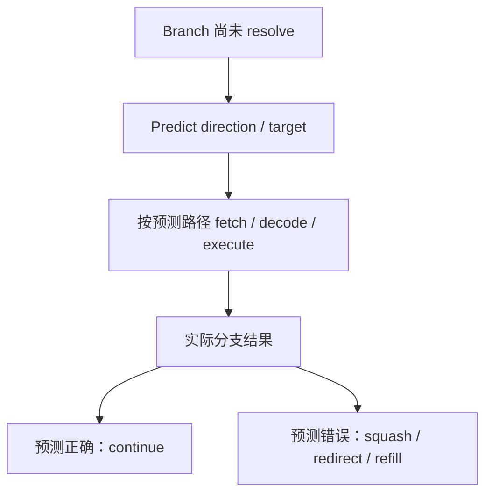

<details>
<summary>查看原图与完整文字转写</summary>

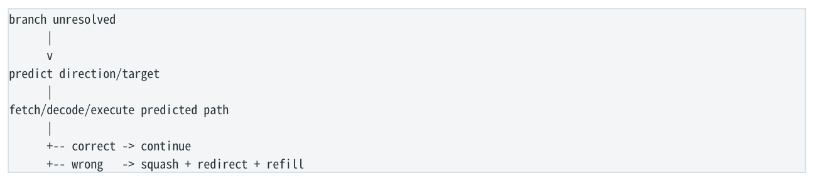

- ` branch unresolved `
- ` predict direction/target `
- ` fetch/decode/execute predicted path `
- ` -- correct → continue `
- ` -- wrong → squash + redirect + refill `

</details>

真正昂贵的是 misprediction recovery，而不是 `cmp`/`jcc` 语法本身。Loop branch `T T T ... N`、rare error branch 99.99% false 等通常高度可预测；接近随机、高 entropy、target 经常变化的 control flow 才真正困难。50/50 true/false 也不等于 50% miss，因为 predictor 可以学习 TNTN 等模式。

### 5.5 `cmov`：Control Dependency -&gt; Data Dependency

```cpp
int max2(int a,int b) { return a>b ? a : b; }

cmp edi, esi
mov eax, esi
cmovg eax, edi
ret
```

<a id="pdf-page-017"></a>

<!-- source-pdf-page: 17 -->

*[原 PDF 第 17 页](./Level2_CPP_Assembly_CPU_CN.pdf#page=17)*

`cmov` 消除了 control-flow redirect，因此没有该 branch 的 mispredict；但 selected value 通常依赖 flags 与候选输入。后续消费者必须等 cmov 结果，形成更“硬”的 data dependency。Branch 则可以在 condition 尚未 resolve 时沿预测 path 继续 speculative execution。

| 选择 | 优势 | 风险/代价 |
| --- | --- | --- |
| Predictable branch | 只做实际路径；CPU 可沿预测路径提前执行 | 预测错时 recovery 成本高 |
| cmov / branchless | 无 control-flow mispredict | 两边值/工作可能都需准备；增加 data dependency |

第一性原理  Branch 用 prediction 换 speculative progress；cmov 用确定的数据依赖换掉 misprediction risk。哪种快取决于 predictability、两边计算成本、critical path 与真实数据分布。

### 5.6 `setcc`：把条件 materialize 成 0/1

```asm
cmp edi, esi
setg al
movzx eax, al

// eax = (edi > esi) ? 1 : 0
```

`count += (x>threshold)`、bool return、mask construction 都适合 setcc。注意 setcc 写的是 byte；后续若需要完整整数常会 zero-extend。Mask tricks 可能把 branch 变成 cmp-&gt;setcc-&gt;movzx-&gt;neg-&gt;and 的 serial chain；若原 branch 99.9% 可预测，手写 branchless 反而可能更慢。

### 5.7 Short-Circuit：`&&` / `||` 带求值语义

`a() && b()` 要求当 a 为 false 时 b 不执行；`a() || b()` 要求当 a 为 true 时 b 不执行。只要 b 有 observable side effect，compiler 不能简单把两边都算。Bitwise `&`/`|` 则没有 short-circuit。

### 5.8 `switch`：branch chain / tree / jump table

Dense case 可能 lower 成 bounds check + jump table + indirect jump；sparse case 可能变比较树。Jump table 虽 O(1) dispatch，但 target 是 indirect control flow，预测难度取决于 runtime case distribution。`switch` 源码不等于固定机器形态。

### 5.9 likely/unlikely 与 code layout

C++20 `[[likely]]/[[unlikely]]` 或 compiler hints 主要帮助 block ordering 与 optimization heuristics，不是直接替 CPU 动态 predictor 决策。Low-latency 常见模式是 fast path fall-through，rare error/recovery path 放远并 noinline，使 I-cache/µopcache 保持热且紧凑。

### 5.10 HFT 场景

| 代码模式 | 典型分布 | 初始判断 |
| --- | --- | --- |
| `if (msgType=='D')` | 90% NewOrder | branch 很可能很好预测；不要为了branchless 做无谓工作 |
| `if (seq==expected)` | 正常几乎总成立 | rare recovery path 应 cold/out-of-line |
| `if (price<=0) reject` | 极少触发 | predictable fast path；branch 本身通常不是主瓶颈 |
| random threshold filter | 接近无规律 50/50 | 考虑 cmov/mask/SIMD，但先 benchmark |

<a id="pdf-page-018"></a>

<!-- source-pdf-page: 18 -->

*[原 PDF 第 18 页](./Level2_CPP_Assembly_CPU_CN.pdf#page=18)*

### 5.11 Load-dependent Branch

**图示转写**

1. ` if (*p > 0) ... `
2. ` load *p `
3. ` cmp `
4. ` branch resolve `

<details>
<summary>查看原图与完整文字转写</summary>

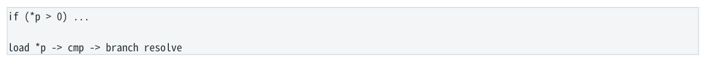

- ` if (*p > 0) ... `
- ` load *p → cmp → branch resolve `

</details>

若 load miss，branch 很久不能 resolve；predictor 仍可让 CPU 沿预测 path 继续。改成 cmov 后后续 data consumer 可能必须等 load -&gt; cmp -&gt; cmov 整条 chain。因此“branchless 可以隐藏 cache miss”并不成立。

### 5.12 Macro-Fusion：为什么不能只数 `cmp+jcc` 两条

某些微架构能把特定 `cmp/test + conditional branch` 在 frontend 以融合形式处理，因此两条 ISA instructions 的 frontend demand 可能低于“普通两条指令”的直觉。支持组合与具体行为依 CPU 而异；这再次说明 instruction count 不是固定成本模型。

### 5.13 Speculation 的 Microarchitectural Traces

Wrong-path instructions 最终不会 retire，但 speculative loads 等仍可能改变 cache/predictor 等 microarchitectural state。 Spectre 类问题正建立在“architectural rollback 不等于所有微架构痕迹都消失”上。这里的性能意义是：严重 mispredict 不只浪费算术，也可能带入 wrong-path data/code footprint。

### 5.14 Data Partitioning：从结构上减少 branch

比手写 bit trick 更根本的做法是按状态组织数据。例如维护 `activeOrders[]`，让 hot loop 直接遍历 active items，而不是遍历所有对象再 `if(active)`。这会同时改善 branch predictability、cache density，甚至 SIMD suitability。

### 5.15 Branch Profiling 的正确问题

`branch-misses/branches` 只是信号。应同时看 absolute misses、cycles/useful-work、hot instruction attribution 与真实数据分布。Controlled experiment 可以固定代码，分别输入 predictable 与 high-entropy data；若 branch misses 巨变而 cycles/item 几乎不动，branch 不是当前主 bottleneck。

本章结论  • C++ if 不等于 jcc。 • Predictability 比“有没有 branch”更重要。 • Branchless 常把 control dependency 转成 data dependency/extra work。 • Rare branch 往往高度可预测，而不是天然糟糕。 • HFT 更关注 control-flow stability、hot/cold layout 与 tail variance。

## 第 6 章 Loop、Dependency Chains 与 Compiler Optimizations

本章目标  把 loop 从“for 语法”还原成 dependency graph。学会判断 latency-bound vs resource-bound，理解 multiple accumulators、unrolling、LICM、alias、MLP 与 cycles/element。

### 6.1 Loop-Carried Dependency

```cpp
for (size_t i=0; i<n; ++i)
    sum += a[i];
s0 -> ADD -> s1 -> ADD -> s2 -> ADD -> ...
```

每个 iteration 都消费上一 iteration 的 sum，这是 loop-carried RAW true dependency。a[i] 的地址可以提前计算、loads 也可能提前，但 accumulator chain 仍限制下一 dependent ADD 的启动时间。OoO 只能利用 independent work，不能违反 true dependency。

<a id="pdf-page-019"></a>

<!-- source-pdf-page: 19 -->

*[原 PDF 第 19 页](./Level2_CPP_Assembly_CPU_CN.pdf#page=19)*

### 6.2 Latency vs Throughput

| 概念 | 问题 | 例子 |
| --- | --- | --- |
| Latency | producer result 何时可被 dependent consumer 使用？ | ADD latency=3c -&gt; 同一 accumulator 下一ADD 约需等 3c |
| Reciprocal Throughput | 有无限 independent work 时多久可启动一条？ | 0.5c/op -&gt; 稳态约 2 ops/cycle |

Latency=3 cycles 与 throughput=2 ops/cycle 完全不冲突。Serial chain 看 latency；大量 independent operations 看 execution capacity。

### 6.3 Dependency-Bound vs Resource-Bound

**图示转写**

| 场景 / 部分 | 路径、状态或说明 |
| --- | --- |
| Dependency-bound | ` A → B → C → D // units may idle, no ready consumer ` |
| Resource-bound | ` A B C D E F // all ready, but only N execution slots/cycle ` |

<details>
<summary>查看原图与完整文字转写</summary>

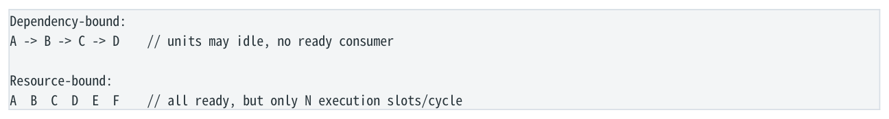

- ` Dependency-bound: `
- ` A → B → C → D // units may idle, no ready consumer `
- ` Resource-bound: `
- ` A B C D E F // all ready, but only N execution slots/cycle `

</details>

诊断第一问  先问 Dependency 还是 Resource。如果是 true dependency，优化目标是缩短/拆分 critical path 或增加独立 chains；如果 ready work 已充足，再看 ALU/FP/load/store/AGU/frontend/bandwidth capacity。

### 6.4 Multiple Accumulators：为什么有效

**图示转写**

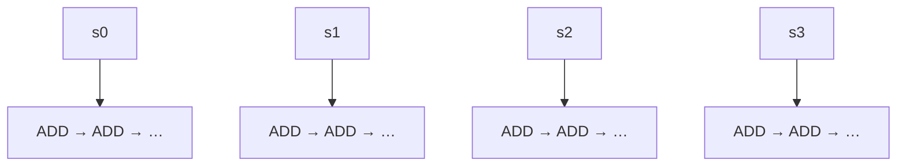

单 accumulator 的各次运算形成一条串行依赖链；重构后，图中四条 chain 相互独立。

<details>
<summary>查看原图与完整文字转写</summary>

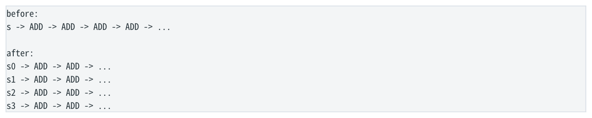

- ` before: `
- ` s → ADD → ADD → ADD → ADD → ... `
- ` after: `
- ` s0 → ADD → ADD → ... `
- ` s1 → ADD → ADD → ... `
- ` s2 → ADD → ADD → ... `
- ` s3 → ADD → ADD → ... `

</details>

真正收益不是“unrolling 神奇”，而是从 1 条 dependency chain 变成多条 independent chains，给 OoO scheduler 更多 ready work。粗略需要的 independent chain 数量约为 `latency × operations-per-cycle`，但实际还受 load/store、register pressure 与 instruction mix 限制。

### 6.5 单纯 Unroll 与 Multi-Accumulator Unroll

| 写法 | Dependency | 主要收益 |
| --- | --- | --- |
| sum+=a[i]; sum+=a[i+1]; ... | 仍是一个 sum chain | 减少 loop-control；可能帮助scheduling/vectorization |
| s0+=a[i]; s1+=a[i+1]; ... | 多条独立 chain | 真正隐藏 add latency、提高 ILP |

过度 unroll 会增加 code size、register pressure、scheduler/ROB demand，最终可能 spill。最佳 unroll/accumulator 数量不是越多越好。

### 6.6 为什么 Register Renaming 不能自动拆 `sum`

Renaming 能消除 WAR/WAW name dependency，但 `new sum` 真的依赖 `old sum`，属于 RAW。CPU 可以给每个版本分配不同 physical register，却必须保留 P1-&gt;P2-&gt;P3 的数据链。只有 compiler/algorithm 改写成 s0/s1/s2/s3 才真正改变 dependency graph。

<a id="pdf-page-020"></a>

<!-- source-pdf-page: 20 -->

*[原 PDF 第 20 页](./Level2_CPP_Assembly_CPU_CN.pdf#page=20)*

### 6.7 Induction Variable 与 Strength Reduction

```text
a[i] conceptual: base + i*4

compiler may transform into:
ptr = base
loop:
  load [ptr]
  ptr += 4
```

Canonical loops 是 compiler 最擅长优化的形态之一。不要为了“避免乘法”手工把所有 `a[i]` 改成晦涩 pointer arithmetic； compiler 会使用 addressing mode、LEA、pointer induction 等方式降低成本。

### 6.8 Loop-Invariant Code Motion (LICM)

若某表达式在 loop 内不变且 compiler 能证明没有被 aliasing/side effect 修改，它可移出 loop。Alias 是关键限制：`a[i] += *p` 中若 p 可能指向 a 的某元素，每次 store 都可能改变 *p，compiler 就不能随意 hoist。

### 6.9 `__restrict__` 与 Alias

标准 C++ 没有 C 的 `restrict` 关键字，但 GCC/Clang 有 `__restrict__` 扩展。它向 compiler 承诺相关对象不会通过其他 alias 路径访问，从而帮助 load hoist、reordering、vectorization。违反 contract 不是“可能慢”，而是 correctness/UB 风险。

### 6.10 Runtime Loop Versioning

Compiler 若无法静态证明 arrays 不 overlap，可以生成 runtime pointer-range checks：no-overlap 走 SIMD loop，可能- overlap 走 scalar fallback。你在 assembly 里看到的额外 pointer comparisons 可能不是业务逻辑，而是 vectorization guard。

### 6.11 Reduction vs Recurrence

| 模式 | 例子 | 可并行性 |
| --- | --- | --- |
| Reduction | sum += a[i] | 最终只需 aggregate；若语义允许可 multiple partial sums + final reduce |
| Recurrence | x = x*31 + a[i] | 下一状态严格依赖上一状态；不能简单拆成独立 accumulators |
| Prefix sum | a[i] += a[i-1] | 每个中间输出都要保留；需专门 parallelscan 算法 |

### 6.12 Floating-Point Semantics

IEEE FP 加法通常不满足严格 associativity，因此 `sum += a[i]` 改成多个 partial sums 会改变加法顺序与最后 bit。`-ffast-math` 允许更激进 reassociation/vectorization，但同时放宽 NaN/Inf/signed-zero 等语义。金融定价中应把它当 semantics decision， 而不是简单 performance flag。

### 6.13 Pointer Chasing 与 MLP

**图示转写**

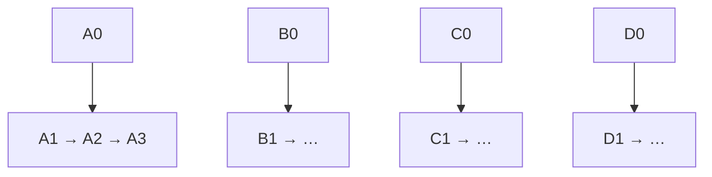

每条 chain 内 next address 依赖前一次 load；四条 chain 之间独立，可增加 outstanding loads。

<details>
<summary>查看原图与完整文字转写</summary>

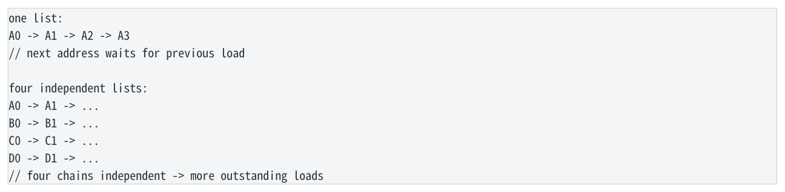

- ` one list: `
- ` A0 → A1 → A2 → A3 `
- ` next address waits for previous load `
- ` four independent lists: `
- ` A0 → A1 → ... `
- ` B0 → B1 → ... `
- ` C0 → C1 → ... `
- ` D0 → D1 → ... `
- ` four chains independent → more outstanding loads `

</details>

<a id="pdf-page-021"></a>

<!-- source-pdf-page: 21 -->

*[原 PDF 第 21 页](./Level2_CPP_Assembly_CPU_CN.pdf#page=21)*

单 linked list 的问题不仅是 cache miss，还包括 MLP 低：未来地址逐级依赖。即使全部 L1 hit，也暴露 load-to-use latency。多个 independent lists 不能消除每条内部依赖，但可以让 CPU 同时等待多条链，提高 MLP。这与 multiple accumulators 是同一思想：增加 independent chains。

### 6.14 ILP / MLP / Batching

Batching 多个 independent messages/orders 可能给 CPU 更多 ILP/MLP、摊薄 branch/loop overhead、提高 cache reuse；代价是 queueing latency 与 fairness。Low-latency 系统因此经常在 throughput 与 per-message latency 之间做明确 trade-off。

### 6.15 Loop Transformations

| 优化 | 核心变换 | 可能收益 / 风险 |
| --- | --- | --- |
| Peeling | 先处理少数 iterations | 建立 alignment/known state；增加前导代码 |
| Unswitching | 把 loop-invariant branch 移到 loop 外 | 减少 per-iteration branch；复制代码 |
| Fusion | 多个 loop 合并 | cache reuse、消除临时数组；register pressure ↑ |
| Fission | 一个 loop 拆开 | 更易 vectorize、working set/pressure ↓；多遍 traversal |

### 6.16 Cycles per Element

```text
cycles_per_element = total_core_cycles / useful_elements
例如：2,000,000 cycles / 1,000,000 elements = 2.0 cycles/element
```

CPE 比源码 instruction count 更接近 kernel efficiency；标量 loop 也可以 &lt;1 cycle/element，因为多个 iterations overlap。测量时要区分 TSC/reference/core cycles 与 Turbo/frequency scaling。真实 microbenchmark 还必须匹配 production trip count、cache residency 与 data distribution。

### 6.17 Bottleneck Migration

**图示转写**

1. ` single accumulator dependency `
2. ` → multiple accumulators `
3. ` load throughput becomes bottleneck `
4. ` → SIMD / better layout `
5. ` cache bandwidth becomes bottleneck `
6. ` → larger data set `
7. ` DRAM bandwidth becomes bottleneck `

<details>
<summary>查看原图与完整文字转写</summary>

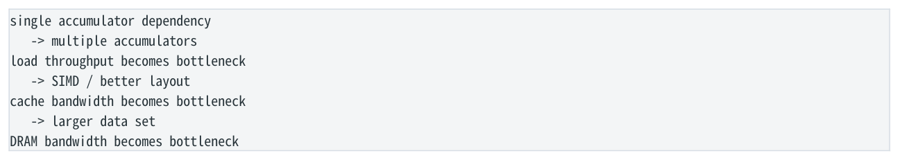

- ` single accumulator dependency `
- ` → multiple accumulators `
- ` load throughput becomes bottleneck `
- ` → SIMD / better layout `
- ` cache bandwidth becomes bottleneck `
- ` → larger data set `
- ` DRAM bandwidth becomes bottleneck `

</details>

优化不是让“瓶颈消失”，而是把最紧约束推到下一层。性能上限可粗略写成：runtime &gt;= max(dependency critical path, frontend demand/capacity, execution-resource demand/capacity, memory constraints...)。

### 6.18 Software Pipelining 与 OoO Window

```text
load i
load i+1
compute i
load i+2
compute i+1
store i
...
```

Compiler 可以跨 iterations 交错不同阶段，让 producer-consumer 之间插入 independent work。CPU OoO 运行时也会重排，但只能在有限 ROB/scheduler/load-store queue window 内工作。更大 window 能隐藏更多 latency，却不能解决真正未知的 future address，例如单 pointer chain。

<a id="pdf-page-022"></a>

<!-- source-pdf-page: 22 -->

*[原 PDF 第 22 页](./Level2_CPP_Assembly_CPU_CN.pdf#page=22)*

### 6.19 State Machine：同一实体串行，不同实体可并行

`state = transition(state,event[i])` 对同一个 order 是 recurrence，不能随意并行 events。但 Order A 与 Order B 的 state machines 可能独立。若架构允许一次处理多个独立 orders，CPU 可获得 cross-order ILP/MLP；是否 batching 则必须权衡 queueing latency 与 fairness。

### 6.20 Trip Count、Full Unroll 与 Small-N

Compile-time fixed `N=4/8` 可能被 fully unroll，完全删除 loop control；runtime N 则常有 main unrolled/vector loop + remainder tail。Compiler cost model 会考虑 trip count，因此用百万元素 benchmark 推断真实平均 6 个 price levels 的行为可能完全错误。

### 6.21 Roofline 式约束思维

```text
actual throughput <= min(
  dependency ceiling,
  frontend ceiling,
  ALU/FP/load/store/AGU ceiling,
  cache bandwidth ceiling,
  DRAM bandwidth ceiling
)
```

如果 array streaming 已经达到 memory bandwidth，继续增加 accumulators/SIMD width 不会再提高吞吐；若 pointer chain MLP≈1，则问题更接近 latency 而非 bandwidth。必须先辨认哪条 ceiling 当前最低。

本章结论  • Loop 性能首先看跨 iteration 的 true dependency。 • Multiple accumulators 的本质是改变 dependency graph，而非单纯少 branch。 • Alias 信息决定 compiler 能否 hoist/reorder/vectorize。 • Pointer chain 主要是 low-MLP latency 问题；多独立链可增加 MLP。 • CPE 与 controlled experiment 比“数指令”更有诊断价值。

## 第 7 章 SIMD、Auto-vectorization 与 Data-Level Parallelism

本章目标  区分 DLP/ILP/MLP；理解 XMM/YMM/ZMM、vector lanes、auto-vectorizer、mask、gather/scatter、 SIMD reduction，以及为何更宽 vector 不保证同比加速。

### 7.1 三种 Parallelism

| 并行性 | 含义 | 典型例子 |
| --- | --- | --- |
| ILP | 多条 independent instructions 同时执行 | 四个 scalar accumulators / independent ALU ops |
| MLP | 多个 independent memory requests 同时outstanding | 四条 independent linked lists |
| DLP / SIMD | 一条 instruction 对多个 homogeneous data lanes 做同类操作 | 8 个 float 一次 AVX2 add |

SIMD 与 OoO 不是同一个东西，且可以叠加：一条 YMM instruction 处理 8 个 float，同时 CPU 又可能每 cycle 发多条 independent vector instructions。

<a id="pdf-page-023"></a>

<!-- source-pdf-page: 23 -->

*[原 PDF 第 23 页](./Level2_CPP_Assembly_CPU_CN.pdf#page=23)*

### 7.2 XMM / YMM / ZMM

| Register | 宽度 | float32 | double64 |
| --- | --- | --- | --- |
| XMM | 128 bit | 4 lanes | 2 lanes |
| YMM | 256 bit | 8 lanes | 4 lanes |
| ZMM | 512 bit | 16 lanes | 8 lanes |

出现 XMM 不一定表示 SIMD：`addsd` 是 scalar double；`addpd` 才是 packed doubles。关键看 instruction semantics，而不是寄存器名字。

### 7.3 Scalar vs Packed

```text
scalar: vaddsd xmm0, xmm1, xmm2   // 1 double
packed: vaddpd ymm0, ymm1, ymm2  // 4 doubles

AVX 3-operand form:
dst = src1 op src2
比 legacy SSE 的 dst=dst op src 更利于 register allocation。
```

### 7.4 最典型 Vectorizable Loop

```cpp
for (size_t i=0; i<n; ++i)
    c[i] = a[i] + b[i];

AVX2 concept:
load 8 floats from a
load 8 floats from b
vaddps 8 lanes
store 8 floats to c
```

多个 iterations 独立、地址连续、操作相同，是 auto-vectorizer 最舒服的条件。Compiler 还会检查 aliasing、control flow、 target ISA、trip count、tail cost 和 vectorization 是否“值得”。

### 7.5 Auto-vectorizer 的安全性判断

- 是否有 loop-carried dependency？

- Pointer/array 是否可能 alias 或 overlap？

- Memory access 是 contiguous/regular 还是 gather-like irregular？

- Branch 是否能转换成 mask/select？

- Operation 是否存在目标 ISA vector mapping？

- FP semantics 是否允许 reassociation/FMA？

- Trip count 是否足以 amortize setup/tail？

### 7.6 SIMD Reduction 仍有 Dependency

**图示转写**

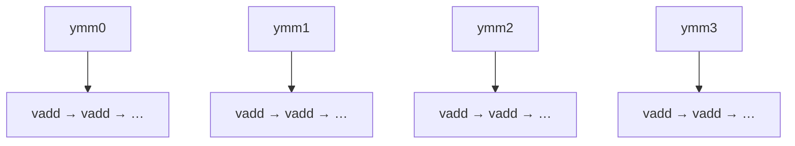

单 accumulator 的各次运算形成一条串行依赖链；重构后，图中四条 chain 相互独立。

<details>
<summary>查看原图与完整文字转写</summary>

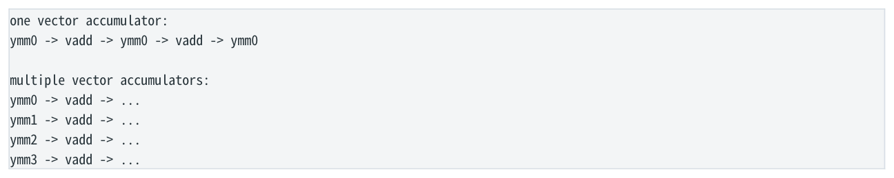

- ` one vector accumulator: `
- ` ymm0 → vadd → ymm0 → vadd → ymm0 `
- ` multiple vector accumulators: `
- ` ymm0 → vadd → ... `
- ` ymm1 → vadd → ... `
- ` ymm2 → vadd → ... `
- ` ymm3 → vadd → ... `

</details>

SIMD 只是让每个 dependency node 一次处理多 lanes，并不会自动消除 accumulator RAW chain。高性能 dot product/reduction 通常组合 SIMD + unroll + multiple vector accumulators，最后再做 horizontal reduction。

<a id="pdf-page-024"></a>

<!-- source-pdf-page: 24 -->

*[原 PDF 第 24 页](./Level2_CPP_Assembly_CPU_CN.pdf#page=24)*

### 7.7 Vertical vs Horizontal

普通 vector add 是 lane-wise vertical operation：a0+b0、a1+b1...；reduction 要跨 lane horizontal combine，常涉及 shuffle/permute/add tree。Horizontal work 往往比简单 vertical arithmetic 更复杂，因此高性能算法尽量让数据长期保持 lanewise parallel，最后才归约。

### 7.8 Branch -&gt; Mask / Predication

**图示转写**

| 场景 / 部分 | 路径、状态或说明 |
| --- | --- |
| scalar | ` if (a[i] > 0) b[i] = a[i]; ` |
| vector | ` load vector a `；` vector compare → mask `；` masked store / blend / select ` |

<details>
<summary>查看原图与完整文字转写</summary>

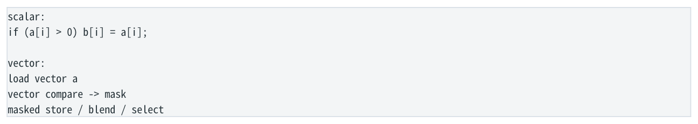

- ` scalar: `
- ` if (a[i] > 0) b[i] = a[i]; `
- ` vector: `
- ` load vector a `
- ` vector compare → mask `
- ` masked store / blend / select `

</details>

AVX2 常用 compare + blend/bitwise mask；AVX-512 有专门 k mask registers 与更完整 masked operations。Mask 并不意味着 inactive lane“零成本”；若 16 lanes 只有 1 lane 有效，SIMD utilization 仍很低。

### 7.9 Gather / Scatter

Gather 可以用一条 vector instruction 表达多个不同地址 load，但底层仍可能触碰多个 cache lines/TLB entries，随机 memory latency 并没有消失。它是 vectorized addressing abstraction，不是 locality magic。四条 independent scalar loads 有时反而比 gather 更灵活、更快，必须绑定目标 CPU benchmark。

### 7.10 SoA 与 SIMD

**图示转写**

| 场景 / 部分 | 路径、状态或说明 |
| --- | --- |
| AoS | ` [price0 qty0 flags0][price1 qty1 flags1]... ` |
| SoA | ` price0 price1 price2 price3 ... `；` qty0 qty1 qty2 qty3 ... ` |

<details>
<summary>查看原图与完整文字转写</summary>

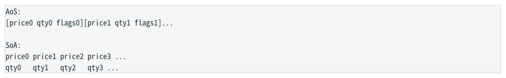

- ` AoS: `
- ` [price0 qty0 flags0][price1 qty1 flags1]... `
- ` SoA: `
- ` price0 price1 price2 price3 ... `
- ` qty0 qty1 qty2 qty3 ... `

</details>

如果 kernel 批量处理 price，SoA 能直接 wide-load homogeneous data，避免 gather/shuffle，并提高 cache-line useful-byte ratio。最好的 shuffle/gather 通常是“不需要 shuffle/gather”，因此 data layout 往往比更聪明的 intrinsic 更根本。

### 7.11 FMA 与 FP Semantics

FMA 把 multiply+add 融为一次 operation，并只做一次 rounding；因此它不只是“少一条 instruction”，还可能改变最后 bit。 Compiler 是否允许 contraction/reassociation 取决于语言与 flags。需要 bitwise reproducibility 的金融计算必须明确数值语义边界。

### 7.12 AVX-512 为什么不保证 2x AVX2

- Load/store bandwidth 未必同比翻倍。

- Execution datapath/ports 未必原生 512-bit 或资源数量未翻倍。

- Kernel 可能已经 memory-bound。

- Small N、tail、mask、horizontal reduction 会稀释宽度收益。

- 部分微架构重 AVX/AVX-512 workload 可能影响 core frequency；程度必须绑定 CPU generation 测量。

### 7.13 `vzeroupper` 与 AVX/SSE transition

某些旧微架构混用 256-bit AVX 与 legacy SSE 时存在 transition penalty，compiler 常在 ABI/function boundary 插入 `vzeroupper`。现代工具链通常自动处理；看到它时不要误以为是业务逻辑。

<a id="pdf-page-025"></a>

<!-- source-pdf-page: 25 -->

*[原 PDF 第 25 页](./Level2_CPP_Assembly_CPU_CN.pdf#page=25)*

### 7.14 Intrinsics vs Auto-vectorization

| 方式 | 优势 | 代价 |
| --- | --- | --- |
| 清晰 scalar C++ + auto-vectorizer | 可读、portable、optimizer 自由度高 | compiler 可能因 alias/control/semantics 放弃 |
| Intrinsics | 明确表达 vector semantics；仍由 compiler分配 register/schedule | ISA-specific、可维护性下降 |
| Inline asm | 控制最强 | 最差 portability，容易阻碍optimizer/clobber 管理复杂 |

推荐路径：先写清晰 C++ -&gt; 看 vectorization report / assembly -&gt; benchmark -&gt; 只有确有缺口时再用 intrinsics。

### 7.15 SLP Vectorization

除了跨 loop iterations 的 loop vectorization，compiler 还可在同一 basic block 中把多个相似独立 scalar operations 合成 SIMD，这叫 SLP。手工 unroll 有时能暴露 SLP pattern，但也可能增加 code size/register pressure。

### 7.16 HFT 中适合 SIMD 的场景

| 场景 | 为什么适合 |
| --- | --- |
| FIX/文本 delimiter scan | 一次 compare 16/32/64 bytes，生成 bitmask 再找 SOH/= /comma |
| ASCII digit validation/conversion kernel | 多个 bytes 做相同 subtract/compare/multiply-add |
| L2 price-level scan | packed prices 可 wide compare，mask 找第一匹配 |
| Risk / pricing vectors | homogeneous numeric arrays，适合 FMA/packed arithmetic |
| Checksum / byte classification | 高 DLP、规则 memory |

### 7.17 HFT 中不适合直接 SIMD 的场景

单条 L3 intrusive list、serial state machine、每元素逻辑高度不同、随机 pointer graph、小且不自然 batching 的 per-order path，更适合先优化 data layout、MLP、branch stability 与 scalar ILP。为了 SIMD 人为等待 8 条消息会引入 queueing latency，可能违背低延迟目标。

### 7.18 Small N / Fixed-Size SIMD

SIMD 有 setup、tail、mask/reduction 成本，因此 N=3 不一定值得 8-wide AVX2。但 `std::array<double,8>` 这类 compile-time fixed size 反而可能非常理想：compiler 能 exact vectorize/full unroll，无动态 loop/尾部。HFT 中 N 常很小，必须以真实大小评估。

### 7.19 Vector Spill 与 Register File

复杂 SIMD kernel 可能让很多 32B/64B vector temporaries 同时 live，最终 spill 到 stack；一次 vector spill 的 memory traffic 比 scalar spill 更大。AVX-512 更大的 architectural vector register set 在某些场景可减少 spill，这有时与 512-bit 宽度本身一样重要。

### 7.20 Non-Temporal Store

对大量顺序写且数据很快不会再读的 streaming output，可考虑 non-temporal/streaming stores，以降低 cache pollution 与部分 write-allocate traffic。但 hot order/risk state 很快会再次访问时通常不合适。它是 cache residency policy 选择，不是“更快 store”通用替代。

### 7.21 SIMD 仍受 TLB 与 Page Locality 限制

Wide load 一次搬更多 bytes，并不会绕过 address translation。Gather 若跨很多 pages 仍可能触发多个 TLB misses/page walks；SIMD 无法修复 poor page locality。Huge page、pool locality 等属于 memory-layout 层的问题。

<a id="pdf-page-026"></a>

<!-- source-pdf-page: 26 -->

*[原 PDF 第 26 页](./Level2_CPP_Assembly_CPU_CN.pdf#page=26)*

### 7.22 Determinism、Reproducibility 与 Kahan

SIMD 本身不等于 nondeterministic；固定 instruction/order 可以 deterministic。真正改变 bitwise result 的通常是 reassociation、different reduction tree、FMA contraction 等。Kahan summation 以额外 arithmetic/dependency 换更好数值误差，通常更难 vectorize。Bitwise reproducibility 与 numerical accuracy 是不同目标。

### 7.23 STL/Ranges/Expression Abstraction

`std::transform`、range-for、expression templates 并不天然慢；若 iterator contiguous、lambda inline、alias 清晰， compiler 可以 fuse/vectorize 到与手写 loop 接近。Expression template 的价值之一是避免 materialize temporary arrays，让多步表达式在一个 vector kernel 中完成；代价是 compile time、code size 与复杂度。

本章结论  • SIMD=DLP，OoO=ILP，independent memory=MLP，三者不同但可叠加。 • 更宽 vector 只提高某一 compute ceiling，不会自动提高 memory ceiling。 • SIMD reduction 仍要处理 accumulator dependency 与 horizontal reduce。 • Gather 不等于 random memory 免费。 • 在低延迟系统里，天然批内 SIMD 比人为 batching 更理想。

## 第 8 章 Real C++ Performance Case Studies

本章目标  不再按单条指令学习，而是对真实 C++ container、polymorphism、ownership 与 HFT 数据结构做完整链路分析：layout -&gt; assembly shape -&gt; dependency -&gt; CPU bottleneck。

### 8.1 `std::vector<T>` vs `std::list<T>`

| 维度 | vector&lt;T&gt; | list&lt;T&gt; |
| --- | --- | --- |
| 地址生成 | base + known stride | next pointer load 决定下一地址 |
| Locality | contiguous | node allocation 可能分散 |
| MLP/prefetch | 未来地址可提前知道，强 | pointer chain 序列化，弱 |
| Mutation | middle insert/erase 可能 memmove | 已定位 node 后 link/unlink O(1) |
| SIMD | 较容易 | 通常很难 |

即使 list 全在 L1，pointer-chain load-to-use latency 仍在；vector 更容易同时发出多个 loads。另一方面，如果主要操作是 stable-address splice/unlink，intrusive list 仍可能合理。Dominant access pattern 比 Big-O 口号重要。

### 8.2 `vector<Order>` vs `vector<Order*>`

**图示转写**

| 场景 / 部分 | 路径、状态或说明 |
| --- | --- |
| vector&lt;Order*&gt; access | ` load ptr[i] → object address → load object.qty ` |
| vector&lt;Order&gt; access | ` base + i*sizeof(Order) + qty_offset → load ` |

<details>
<summary>查看原图与完整文字转写</summary>

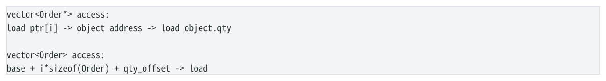

- ` vector<Order*> access: `
- ` load ptr[i] → object address → load object.qty `
- ` vector<Order> access: `
- ` base + i*sizeof(Order) + qty_offset → load `

</details>

Pointer array 额外引入 dependent load，但可提供 address stability、polymorphism 或独立 ownership。若 pointers 指向 contiguous arena，locality 可能仍很好；所以要分析真实 allocation topology。

### 8.3 Intrusive List vs Index-Based Packed Storage

Intrusive list 避免额外 container node 与 allocation，是 node-based 方案中相对高效的选择；但 `p=p->next` 仍是 serialized address dependency。Index pool 用 32-bit links 可缩小 node、改善 cache/TLB/locality，但 `i=pool[i].next` 依赖仍在。若能维护 dense active segment，让 traversal 变 `i++`，才是真正从 dependency graph 上改变问题。

<a id="pdf-page-027"></a>

<!-- source-pdf-page: 27 -->

*[原 PDF 第 27 页](./Level2_CPP_Assembly_CPU_CN.pdf#page=27)*

### 8.4 `unordered_map`：Expected O(1) 的机器路径

**图示转写**

1. ` hash(key) `
2. ` → bucket index `
3. ` → load bucket/node pointer `
4. ` → load node key `
5. ` → compare `
6. ` → maybe next node `

<details>
<summary>查看原图与完整文字转写</summary>

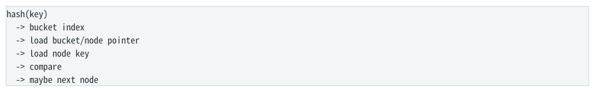

- ` hash(key) `
- ` → bucket index `
- ` → load bucket/node pointer `
- ` → load node key `
- ` → compare `
- ` → maybe next node `

</details>

Node-based hash 的 O(1) 可以包含多个 dependent loads、随机 cache/TLB miss 和 allocator fragmentation。Flat/open-addressing/Swiss-table 风格通过 compact metadata + packed entries，减少 pointer indirection，甚至用 SIMD 批量比较 control bytes。Load factor 会直接改变 probe length 与 cache touches。

### 8.5 `std::map` vs Sorted Vector

红黑树每层是 pointer load + compare + branch；O(log N) 仍可能有多个 serial cache misses。Sorted vector 的 binary search 也是 O(log N)，但 element packed、无需 child-pointer load；小 N 时 linear scan 甚至可以借连续 memory、prefetch 和 SIMD 胜过 binary search/tree。Big-O 与 CPU critical path 是两个维度。

### 8.6 `std::deque`

Deque 常是 map-of-blocks：block 内连续、全局不连续。它提供 cheap front/back growth 与更稳定的 element placement，但 traversal 需要 block handling，SIMD/prefetch 不如 vector 简洁。它不是“差 vector”，而是 locality 与 relocation/stability 的不同 trade-off。

### 8.7 Virtual / `std::function` / Function Pointer

| 抽象 | 机器形态 | 热路径主要关注 |
| --- | --- | --- |
| virtual | vptr load + indirect target | target stability、devirtualization、inline/vectorization lost opportunity |
| function pointer | indirect call | target distribution、无法普遍 inline |
| std::function | type erasure + indirect invoke，可能SBO/heap | per-call dispatch + lifetime/allocation semantics |
| template/lambda | static concrete type | 通常最容易 inline/specialize |

### 8.8 `shared_ptr`

Copy/drop shared_ptr 通常要 atomic reference-count RMW。单线程且 control block L1-hot 时成本可控；多 cores 高频操作同一 control block 时 cache-line ownership bouncing 会形成 coherence serialization。Low-latency 热路径还担心最后一次 release 触发 destruction/deallocation，导致 work 不 bounded。替代方案取决于 lifetime：unique owner、arena、epoch、 intrusive reclamation、single-owner raw observers 等各有复杂度。

### 8.9 `optional<T>` / `variant`

`optional<T>` 通常是 payload + engaged flag + padding；数组中可能显著降低 density，并引入 validity branch。若大规模 columnar data，可考虑 validity bitmap + packed values。`variant` size 通常接近最大 alternative + tag；一个 rare 256B alternative 可能让所有 variant 都变大。Dispatch 性能取决于 tag distribution 与 compiler 是否能 inline visitor。

### 8.10 `std::string` 与 ID Normalization

短 string 常借 SSO 避免 heap allocation，但 string compare/hash 仍涉及 length、bytes 与 variable work。交易 hot path 常把外部 symbol（例如 EURUSD）在系统边界一次性转成 integer InstrumentId；内部 lookup/compare 用 fixed-width integer，从 representation 上降低 variable-length work。

<a id="pdf-page-028"></a>

<!-- source-pdf-page: 28 -->

*[原 PDF 第 28 页](./Level2_CPP_Assembly_CPU_CN.pdf#page=28)*

### 8.11 `memcpy` / Struct Copy

Small constant-size memcpy 往往被 compiler inline 成 wide load/store；trivially-copyable object copy 也可能完全在 registers 中完成，甚至因 scalar replacement 被彻底消除。大 memcpy 可能由 libc、`rep movsb` 或 vectorized routine 处理。 不要因为源码出现“copy”就断言昂贵。

### 8.12 Bounds Check / Iterator / Lambda

- `vector::at()` 语义要求 bounds check，但如果 compiler 能证明 loop index range，check 可能被消除；否则通常是 highly predictable branch + cold throw path。

- `vector` iterator/range-for 在优化后通常退化成 pointer arithmetic，是典型 zero-cost abstraction。

- Concrete lambda closure 可以被 inline、constant-propagate、vectorize；只有通过 type erasure/opaque boundary 后才更容易留下 runtime dispatch。

### 8.13 L3 Order Book 合案例

```cpp
struct Order {
  Order* next;
  uint64_t id;
  double price;
  int qty;
  bool active;
};

int total(Order* head) {
  int sum=0;
  for (Order* p=head; p; p=p->next)
    if (p->active) sum += p->qty;
  return sum;
}
```

1. `p=p->next` 是 loop-carried address dependency；下一节点地址必须等待当前 node 的 next load。

2. 因此单链 MLP 低，随机 L2/L3/DRAM miss 很难通过 OoO 隐藏；即使全 L1 仍有 load-to-use latency。

3. `sum += qty` 还有 accumulator RAW chain，但在随机 pointer chain 场景可能是次要瓶颈。

4. `active` 是 branch；重要性由 runtime distribution 决定。若 99% active，branch 大概率便宜。

5. Node size、allocation topology 决定 cache-line density 与 TLB footprint；intrusive link 本身也占 hot bytes。

6. 把 pointer 改 32-bit index 可改善 density/locality，但不自动消除 next dependency。

7. 若业务允许把 active orders 放 dense array/slot sequence，能从根上把 traversal 从 link recurrence 改成 predictable stride。

8. 同时处理多个 independent price-level/order queues 可增加 MLP；这与 SIMD 是不同层面的优化。

9. 正确优化顺序应由 profiling 假设驱动：cache miss/low MLP -&gt; layout；若全 L1 -&gt; 看 load-use dependency；branch miss 真高才考虑 control-flow change。

### 8.14 HFT Parser 综合案例

```cpp
for (;;) {
  tag = parseTag(p);
  if (tag==35) parseMsgType();
  else if (tag==55) parseSymbol();
  else if (tag==44) parsePrice();
  p = nextField(p);
}
```

<a id="pdf-page-029"></a>

<!-- source-pdf-page: 29 -->

*[原 PDF 第 29 页](./Level2_CPP_Assembly_CPU_CN.pdf#page=29)*

可分成三个不同性能问题：lexical scan（找 SOH/=、数字验证）适合 SIMD；tag dispatch 取决于 tag distribution 与 branch/jump-table predictor；decimal conversion 与 downstream lookup 可能才是 arithmetic/memory bottleneck。不要因为源码里 if/else 很显眼就先优化 branch。

### 8.15 Pricing Kernel 综合案例

```cpp
for (size_t i=0;i<n;++i)
    out[i] = base[i]*skew + spread[i];
```

Iterations 独立、连续、homogeneous：典型 SIMD/FMA candidate。优化后很可能从 compute-bound 迁移到 load/store/cache bandwidth bound。若 n 很小且 single-message latency 更重要，则 fixed-size specialization/full unroll 可能比追求最大吞吐更重要。

### 8.16 Hash Recurrence 综合案例

```text
for (byte x : data)
    hash = hash * 31 + x;
```

这里 hash state 是 true recurrence。即使 data 全在 L1、SIMD units 空闲，下一 iteration 仍依赖前一 hash。若要大幅提升，通常需要算法层 reformulation、并行多 stream 或专用 hash/CRC 数学技巧；单纯 unroll 不会自动消除 dependency。

### 8.17 第二层最终诊断算法

**图示转写**

1. ` 1. Define useful work: message / order / element / lookup `
2. ` 2. Read C++ semantics: what transformations are legal? `
3. ` 3. Inspect optimized assembly: actual loads/stores/branches/calls/SIMD `
4. ` 4. Draw dependency DAG: RAW / address / control `
5. ` 5. Ask: enough independent ready work? `
6. ` 6. If NO `
7. ` dependency / memory-latency hypothesis `
8. ` 7. If YES `
9. ` resource / frontend / bandwidth hypothesis `
10. ` 8. Check layout: cache-line useful bytes, TLB, pointer topology `
11. ` 9. Check branch predictability and indirect target stability `
12. ` 10. Design ONE controlled change that should move cycles/useful-work `
13. ` 11. Verify with benchmark/perf/llvm-mca; reject hypothesis if prediction fails `

<details>
<summary>查看原图与完整文字转写</summary>

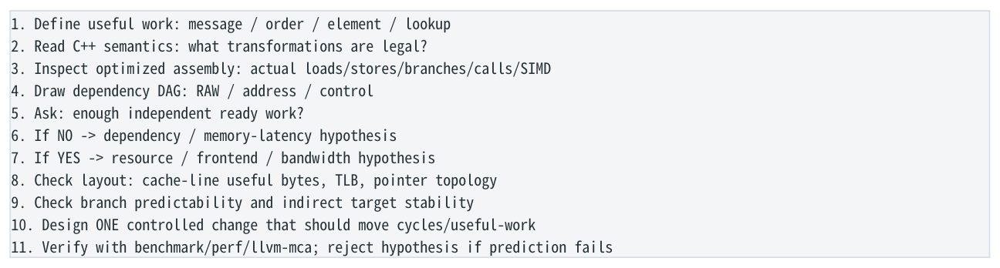

- ` 1. Define useful work: message / order / element / lookup `
- ` 2. Read C++ semantics: what transformations are legal? `
- ` 3. Inspect optimized assembly: actual loads/stores/branches/calls/SIMD `
- ` 4. Draw dependency DAG: RAW / address / control `
- ` 5. Ask: enough independent ready work? `
- ` 6. If NO → dependency / memory-latency hypothesis `
- ` 7. If YES → resource / frontend / bandwidth hypothesis `
- ` 8. Check layout: cache-line useful bytes, TLB, pointer topology `
- ` 9. Check branch predictability and indirect target stability `
- ` 10. Design ONE controlled change that should move cycles/useful-work `
- ` 11. Verify with benchmark/perf/llvm-mca; reject hypothesis if prediction fails `

</details>

第二层最终思维  不要从“vector 比 list 快”“branchless 快”“inline 快”“SIMD 快”这些结论出发。先从 dependency、addressability、resource capacity 和 data layout 推导，再用工具验证。

本章结论  • Big-O 不描述 cache/MLP/critical path。 • Contiguous storage 是 locality、prefetch、MLP、SIMD、 TLB 多维收益。 • Node-based / ownership abstractions 的成本高度依赖真实 topology 与 sharing pattern。 • 最明显的源码结构不一定是主 bottleneck。 • 第二层的成熟能力是：看到 C++ 能推导机器形态，并提出可证伪性能假设。

<a id="pdf-page-030"></a>

<!-- source-pdf-page: 30 -->

*[原 PDF 第 30 页](./Level2_CPP_Assembly_CPU_CN.pdf#page=30)*

## 附录 A 速查、面试问答与推荐实验

本章目标  把第二层压缩成现场可用的 cheat sheet，并给出最小实验帮助把“理解”变成可验证的直觉。

### A.1 x86-64 常用 Instruction 速查

| 类别 | 常见指令 | 读法重点 |
| --- | --- | --- |
| Data movement | mov / movzx / movsx | register vs memory；width/extension |
| Address arithmetic | lea | 计算 EA，不访问 memory |
| Integer arithmetic | add/sub/imul/shl/sal | 看 RAW chain、latency/throughput |
| Logic | and/or/xor/test | xor reg,reg 常是 zero idiom；test 常做zero/sign check |
| Compare/control | cmp/jcc/cmovcc/setcc | FLAGS dependency；branch vs data select |
| Function | call/ret | direct/indirect target；ABI/register preservation |
| SIMD | vaddps/pd, vmovups, vfmadd*, vperm* | scalar/packed、lanes、shuffle/resource |

### A.2 SysV AMD64 ABI 速查

| 项目 | 常见规则 |
| --- | --- |
| Integer/pointer args | RDI, RSI, RDX, RCX, R8, R9；之后 stack |
| Integer/pointer return | RAX/EAX |
| FP args/return | XMM registers / XMM0 return |
| Caller-saved | RAX,RCX,RDX,RSI,RDI,R8-R11 等 |
| Callee-saved | RBX,RBP,R12-R15 |
| Stack alignment | call boundary 按 ABI 保持规定 alignment；常见 16B 规则 |
| Special | this 为隐藏 pointer；大 struct return 可能 sret hidden pointer；SysV 有 red zone |

### A.3 常见 Assembly Pattern -&gt; C++ 直觉

| Pattern | 优先想到 |
| --- | --- |
| [base + index*4] | int array indexing / scaled address |
| [base + 16] | struct field offset / fixed displacement |
| mov rax,[rdi]; mov ..., [rax+...] | pointer chasing / address dependency |
| cmp/test + jcc | runtime branch；问 predictability |
| cmp + cmov | branchless select；问 data dependency |
| setcc + movzx | boolean materialization 0/1 |
| xor eax,eax | zero idiom，通常切断旧值 dependency |
| many stack loads/stores in optimized code | 可能 spill / address-taken local / ABI pressure |
| vaddps/vaddpd | packed SIMD；看 lanes 与 memory bandwidth |
| call rax / jmp [table+idx*8] | indirect target；function pointer/virtual/jump table |

### A.4 一句面答案

| 问题 | 高质量回答核心 |
| --- | --- |
| 为什么 multiple accumulators 快？ | 把一个 loop-carried RAW chain 拆成多个独立 chains，让 OoO 隐藏operation latency；不是 unroll 本身有魔法。 |
| Renaming 为什么不能自动解决 sum chain？ | Renaming 消除 WAR/WAW false dependencies；sum 是 true RAW dependency，必须保持 producer-consumer。 |

<a id="pdf-page-031"></a>

<!-- source-pdf-page: 31 -->

*[原 PDF 第 31 页](./Level2_CPP_Assembly_CPU_CN.pdf#page=31)*

| 问题 | 高质量回答核心 |
| --- | --- |
| 为什么 linked list 即使 L1 hit 也可能慢？ | 下一地址依赖前一 pointer load，MLP 低，暴露 serialized load-to-use latency。 |
| Branchless 为什么不一定快？ | 通常把 control dependency/mispredict risk 换成 data dependency、额外 work；predictable branch 可沿预测路径speculative execute。 |
| SIMD vs 同时处理四条 list？ | SIMD 是 DLP；四条 list 主要增加 MLP/ILP。后者仍是四条 serial pointer chains，但彼此独立。 |
| virtual 真正的成本？ | 不仅 vptr load；更重要是 indirect target + 可能阻止 inline、specialization、vectorization。 |
| heap 为什么不一定访问慢？ | CPU 只看到 virtual address/cache/TLB；heap 的主要代价是allocation、fragmentation、indirection 和 locality。 |
| index storage 消除 pointer chasing 吗？ | 不一定。若 nextIndex 仍要 load，address dependency 仍在；主要收益是 density/locality/smaller links。 |

### A.5 推荐 Godbolt / llvm-mca 实验

1. 同一小函数用 -O0/-O2/-O3 对比，观察 stack variables 如何消失。

2. `x*3+5` 对比 compiler 使用 imul/lea/shift 的可能形式。

3. `a[i]` 对不同 element size (4/8/24B) 观察 addressing mode。

4. `vector<T>` 与 `vector<T*>` 的 field scan，画 dependent-load DAG。

5. 单 accumulator FP sum vs 4 accumulators；用严格 FP 与 fast-math 对比 assembly。

6. Predictable vs pseudo-random branch；对比 branch/cmov 并测 cycles/item。

7. `c[i]=a[i]+b[i]` 加/去 `__restrict__`，观察 runtime alias guard 与 vectorization report。

8. AoS price scan vs SoA price scan，比较 SIMD 与 cache-line utilization。

9. 一条 linked list vs 四条 independent lists，测 MLP/cycles/node。

10. Virtual loop vs template/static dispatch，观察 inline/vectorization 是否发生。

### A.6 实验时必须控制的变量

- 目标 CPU 与 `-march`；不要把一台 CPU 的 latency/port mapping 外推到另一代。

- 数据是否 L1/L2/L3/DRAM resident；cache state 是实验的一部分。

- 真实 trip count；n=8 与 n=1,000,000 是不同 workload。

- 真实 branch distribution；不要用与生产毫无关系的 `rand()` 代替。

- Compiler 没有删除/constant-fold benchmark body。

- Frequency/Turbo/SMT/core pinning 对 cycles 与 wall time 的影响。

- 一次只改变一个关键变量，实验结果才能证伪 hypothesis。

### A.7 第二层复习 Checklist

- 我能解释 C++ variable 为什么不等于 register/stack slot。

- 我看到 `[rdi+rsi*4+8]` 能立刻拆成 base/index/scale/offset。

- 我能从 struct layout 推导 member load address 与 cache-line density。

- 我能解释 call/ret、caller/callee saved、spill 与 inline trade-off。

- 我能解释 branch 与 cmov 的预测 vs data-dependency trade-off。

- 我能识别 loop-carried RAW、reduction、recurrence 与 pointer-chain address dependency。

<a id="pdf-page-032"></a>

<!-- source-pdf-page: 32 -->

*[原 PDF 第 32 页](./Level2_CPP_Assembly_CPU_CN.pdf#page=32)*

- 我能解释 multiple accumulators 为什么不是 register renaming 能自动完成的。

- 我能区分 ILP / MLP / DLP(SIMD)。

- 我能说明 gather 为什么不能解决 random-memory latency。

- 我能从 vector/list/hash/virtual/shared_ptr 的机器路径而不是抽象标签判断性能。

- 我会用 cycles/useful-work 与 controlled experiment 验证，而不是只看 IPC/指令数。

### A.8 第二层 -&gt; 第三层的接口

**图示转写**

| 场景 / 部分 | 路径、状态或说明 |
| --- | --- |
| 第二层：我根据 C++ / assembly 推断 bottleneck | ` 第三层：用 PMU / perf / VTune / Top-Down 验证 ` |
| 例如 | ` Hypothesis: pointer chain is memory-latency bound `；` -> perf: cache/TLB + stalled cycles + annotated hot load `；` -> controlled change: packed pool / 4 independent chains `；` -> cycles/node 是否按预测下降？ ` |

<details>
<summary>查看原图与完整文字转写</summary>

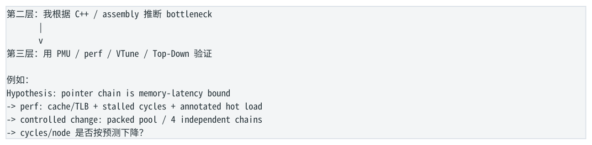

- ` 第二层：我根据 C++ / assembly 推断 bottleneck `
- ` 第三层：用 PMU / perf / VTune / Top-Down 验证 `
- ` 例如： `
- ` Hypothesis: pointer chain is memory-latency bound `
- ` -> perf: cache/TLB + stalled cycles + annotated hot load `
- ` -> controlled change: packed pool / 4 independent chains `
- ` -> cycles/node 是否按预测下降？ `

</details>

下一阶段  第三层不是重新背 counters，而是把第二层的 hypothesis-driven 思维接到真实 PMU 数据：先预测，再测量，再改变一个变量。

<a id="pdf-page-033"></a>

<!-- source-pdf-page: 33 -->

*[原 PDF 第 33 页](./Level2_CPP_Assembly_CPU_CN.pdf#page=33)*

第二层完成

### C++ semantics -&gt; Compiler -&gt; Assembly -&gt; Dependency -&gt; CPU

最终能力  看到一段真实 C++，先问“它会形成什么 dependency / address / branch / layout”，再看 optimized assembly 验证。只有这样，performance engineering 才从技巧集合变成可解释、可预测、可证伪的方法。

<a id="conversion-errata"></a>

## 转换补充与勘误

本节及正文中“转换补充 / 转换勘误”均为 2026-11-06 转换时新增；原 PDF 仍是原始内容与版式的对照。

- [原 PDF 第 6 页处的补充](#pdf-page-006)：优化开关的默认集合随 GCC 版本和 target 改变；可用 `g++ -Q -O2 --help=optimizers` 检查当前工具链，不应把讲义中的等级概括当作固定 pass 清单。

### 适用边界

原文中的时延、cache/ROB 大小、PMU event、kernel 参数及 compiler lowering 均需要绑定具体平台。转写结构的覆盖校验不等同于对全部技术命题的逐条实测；复杂图的精确布局以随附原图为准。
