# Memory Hierarchy

> 来源：[Level3_Memory_Hierarchy_CN.pdf](./Level3_Memory_Hierarchy_CN.pdf)（33 页）。本文件按原文逐页转写；转换补充与勘误单独标明。

> 图示优先转为 Mermaid、表格或步骤；每图附原图和文字以便核对。代码保留原文逻辑与缩进，跨页片段及概念示例未宣称可以独立编译。

[返回目录](README.md) · [转换说明与校验](CONVERSION_NOTES.md) · [本文补充与勘误](#conversion-errata)

[原文目录](#pdf-page-003) · [第一章正文](#pdf-page-005)

<a id="pdf-page-001"></a>

<!-- source-pdf-page: 1 -->

*[原 PDF 第 1 页](./Level3_Memory_Hierarchy_CN.pdf#page=1)*

## Memory Hierarchy

### C++ / CPU 深度学习 - 第三层完整讲义

Cache Line · Locality · Associativity · Prefetch · MLP · TLB · Huge Pages · Load/Store Buffer · Memory Ordering · MESI · False Sharing · DRAM · NUMA

目标  建立从“一条 load/store”出发，能够解释数据布局、cache/TLB、memory-level parallelism、coherence 与 NUMA 如何共同决定低延迟 C++ 性能的完整心智模型。

2026-08 · 详尽版

<a id="pdf-page-002"></a>

<!-- source-pdf-page: 2 -->

*[原 PDF 第 2 页](./Level3_Memory_Hierarchy_CN.pdf#page=2)*

## 如何使用这份讲义

这份 PDF 不是把 8 个 Session 原样拼接，而是按照“数据在哪里 -&gt; 以什么粒度搬运 -&gt; 为什么 miss -&gt; 能否隐藏 latency -&gt; 地址如何翻译 -&gt; 多核如何共享 -&gt; 最终如何到达 DRAM/NUMA”的顺序重新组织。读完后，你应该能从一段 hot C++ 出发，判断它更可能是 cache-capacity、conflict、TLB、latency、bandwidth、coherence 还是 NUMA 问题，并设计可证伪的实验。

最核心的方法  先定义 useful-work unit（message/order/element），再问数据访问路径与 dependency；用 layout/stride/affinity 等单变量 perturbation 验证假设。不要看到 “cache miss high” 就直接下结论。

本文主要描述现代高性能 superscalar out-of-order CPU 的通用原则。Intel、AMD、ARM 以及不同 generation 在 cache 大小/associativity、TLB entries、prefetcher、LLC topology、memory controller、NUMA 暴露方式等细节上不同。凡涉及具体数字，只把它们当典型量级；生产分析必须绑定目标 CPU。

### 阅读路线

| 章节 | 主题 | 你最终要回答的问题 |
| --- | --- | --- |
| 第 1 章 | Memory Hierarchy 总体模型 | 同一条 load 为什么可能从几 cycle 到几百 cycle？ |
| 第 2 章 | Cache Line / Locality / Data Layout | CPU 实际搬了多少 useful bytes？AoS/SoA/stride 如何影响locality？ |
| 第 3 章 | Mapping / Associativity / Conflict | Working set 明明很小，为什么仍会 L1 thrash？ |
| 第 4 章 | Prefetch / MLP / Latency Hiding | 相同 miss 数量，为什么性能可能差几倍？ |
| 第 5 章 | Virtual Memory / TLB / Huge Pages | 地址翻译为什么也会成为 memory bottleneck？ |
| 第 6 章 | Load/Store Buffer / Memory Ordering | execute、retire、memory visibility 为什么是三个概念？ |
| 第 7 章 | Coherence / MESI / False Sharing | 谁拥有这条 cache line？为什么 relaxed atomic 仍可能很慢？ |
| 第 8 章 | DRAM / Memory Controller / NUMA | 数据在本地还是远端？bandwidth 和 topology 如何影响 tail？ |
| 第 9 章 | HFT 综合诊断与实验 | 怎样把理论映射到 order book、SPSC、pricing、NIC/NUMA 部署？ |

### 贯穿全书的五个问题

- 这次访问触碰的是哪个 cache line / page？useful bytes 与 transferred bytes 比例是多少？

- 下一地址能否提前计算？hardware/software prefetch 是否可能；有多少 independent misses 可以 outstanding？

- 瓶颈是 raw latency、bandwidth、capacity/conflict、translation、coherence 还是 topology？

- 谁在写这条 line？谁在读？ownership 是否在 cores/sockets 间频繁移动？

- 怎样改变一个变量（layout、stride、padding、huge page、CPU/memory binding）来证伪判断？

<a id="pdf-page-003"></a>

<!-- source-pdf-page: 3 -->

*[原 PDF 第 3 页](./Level3_Memory_Hierarchy_CN.pdf#page=3)*

## 原文目录

- [1. Memory Hierarchy 基础模型](#pdf-page-005)
- [1.1 为什么需要层级](#pdf-page-005)
- [1.2 Registers / L1 / L2 / LLC / DRAM](#pdf-page-005)
- [1.3 Latency vs Bandwidth](#pdf-page-005)
- [1.4 Working Set](#pdf-page-006)
- [1.5 MLP 初步](#pdf-page-006)
- [1.6 一条 load 的完整问题清单](#pdf-page-006)
- [2. Cache Line、Locality 与 Data Layout](#pdf-page-007)
- [2.1 64B cache line](#pdf-page-007)
- [2.2 Spatial / Temporal locality](#pdf-page-007)
- [2.3 Cache-line utilization](#pdf-page-007)
- [2.4 Stride](#pdf-page-007)
- [2.5 AoS vs SoA](#pdf-page-007)
- [2.6 Hot/Cold split](#pdf-page-008)
- [2.7 Alignment / padding / split load](#pdf-page-008)
- [2.8 Flat / pointer / index storage](#pdf-page-008)
- [3. Cache Mapping、Associativity 与 Conflict Miss](#pdf-page-010)
- [3.1 Set / Way / Tag / Offset](#pdf-page-010)
- [3.2 3C miss model](#pdf-page-010)
- [3.3 4KB stride 与 set conflict](#pdf-page-010)
- [3.4 Replacement / thrashing](#pdf-page-010)
- [3.5 Power-of-two cliff](#pdf-page-011)
- [3.6 如何验证 conflict hypothesis](#pdf-page-011)
- [4. Hardware Prefetcher 与 Memory-Level Parallelism](#pdf-page-012)
- [4.1 Demand vs Prefetch](#pdf-page-012)
- [4.2 Sequential / stride prefetch](#pdf-page-012)
- [4.3 Pointer chasing](#pdf-page-012)
- [4.4 Random independent lookup](#pdf-page-012)
- [4.5 OoO window / load buffers / miss tracking](#pdf-page-013)
- [4.6 Software prefetch](#pdf-page-013)
- [4.7 Latency-bound vs bandwidth-bound](#pdf-page-013)
- [5. Virtual Memory、TLB 与 Huge Pages](#pdf-page-015)
- [5.1 Virtual -&gt; Physical](#pdf-page-015)
- [5.2 Page table / TLB hierarchy](#pdf-page-015)
- [5.3 Page walk](#pdf-page-015)
- [5.4 TLB reach](#pdf-page-015)
- [5.5 Huge pages](#pdf-page-016)
- [5.6 Page fault vs TLB miss](#pdf-page-016)
- [5.7 Pretouch / mlock / first touch](#pdf-page-016)
- [5.8 Translation-aware allocators](#pdf-page-016)
- [6. Load/Store Buffer 与 Memory Ordering](#pdf-page-018)
- [6.1 Store lifecycle](#pdf-page-018)
- [6.2 Store-to-load forwarding](#pdf-page-018)
- [6.3 Memory disambiguation / replay](#pdf-page-018)
- [6.4 Execute vs Retire vs Visibility](#pdf-page-018)
- [6.5 x86 TSO mental model](#pdf-page-018)
- [6.6 C++ memory model mapping](#pdf-page-019)
- [6.7 Fence / atomic RMW / non-temporal store](#pdf-page-019)
- [7. Cache Coherence、MESI 与 False Sharing](#pdf-page-021)
- [7.1 MESI states](#pdf-page-021)

<a id="pdf-page-004"></a>

<!-- source-pdf-page: 4 -->

*[原 PDF 第 4 页](./Level3_Memory_Hierarchy_CN.pdf#page=4)*

- [7.2 RFO / ownership / cache-to-cache](#pdf-page-021)
- [7.3 True vs False sharing](#pdf-page-021)
- [7.4 Atomic contention](#pdf-page-021)
- [7.5 SPSC / sequence counters](#pdf-page-022)
- [7.6 Lock-free != contention-free](#pdf-page-022)
- [7.7 Ownership-oriented layout](#pdf-page-022)
- [7.8 perf c2c / diagnosis](#pdf-page-022)
- [8. DRAM、Memory Controller 与 NUMA](#pdf-page-025)
- [8.1 Channel / rank / bank / row buffer](#pdf-page-025)
- [8.2 Row hit / row conflict](#pdf-page-025)
- [8.3 DRAM bandwidth saturation](#pdf-page-025)
- [8.4 NUMA local vs remote](#pdf-page-025)
- [8.5 First touch / membind / interleave](#pdf-page-026)
- [8.6 NIC / DMA / device affinity](#pdf-page-026)
- [8.7 Huge pages + NUMA](#pdf-page-026)
- [8.8 Noisy-neighbor / tail latency](#pdf-page-026)
- [9. HFT 综合案例与诊断框架](#pdf-page-028)
- [9.1 L3 order book](#pdf-page-028)
- [9.2 SPSC / queue metadata](#pdf-page-028)
- [9.3 Pricing / risk / read-mostly state](#pdf-page-028)
- [9.4 NIC -&gt; parser -&gt; pricing topology](#pdf-page-028)
- [9.5 Diagnosis tree](#pdf-page-029)
- [9.6 Controlled experiments](#pdf-page-029)
- [9.7 面试级表达](#pdf-page-029)
- [A. 附录](#pdf-page-031)
- [A.1 术语表](#pdf-page-031)
- [A.2 常见误区对照](#pdf-page-031)
- [A.3 典型量级](#pdf-page-032)
- [A.4 推荐 microbenchmarks](#pdf-page-032)
- [A.5 复习清单](#pdf-page-032)

<a id="pdf-page-005"></a>

<!-- source-pdf-page: 5 -->

*[原 PDF 第 5 页](./Level3_Memory_Hierarchy_CN.pdf#page=5)*

## 第 1 章 Memory Hierarchy 基础模型

本章目标  建立从寄存器到 DRAM 的整体地图；把 latency、bandwidth、working set、MLP 作为后续所有 memory 分析的基础。

### 1.1 为什么需要 Memory Hierarchy

根本矛盾是 CPU core 的计算速度远快于主存的随机访问延迟。以几 GHz 的 core 为例，一个 cycle 约为零点几纳秒，而一次真正到 DRAM 的依赖 load 往往是几十到上百纳秒量级，即几百个 CPU cycles。若每次计算都直接等待 DRAM，现代宽 OoO core 的大部分执行能力都会闲置。

**图示转写**

| 原图层级顺序 | 层次 / 位置 |
| --- | --- |
| 1 | Registers |
| 2 | L1 Data Cache |
| 3 | L2 Cache |
| 4 | LLC / L3 |
| 5 | Memory Controller |
| 6 | DRAM |
| 7 | 可能访问 Remote NUMA memory |

> **转换补充**：这是层次与拓扑示意；remote DRAM 访问通过互连和远端 memory controller，不表示先访问本地 DRAM 再去访问远端。

<details>
<summary>查看原图与完整文字转写</summary>

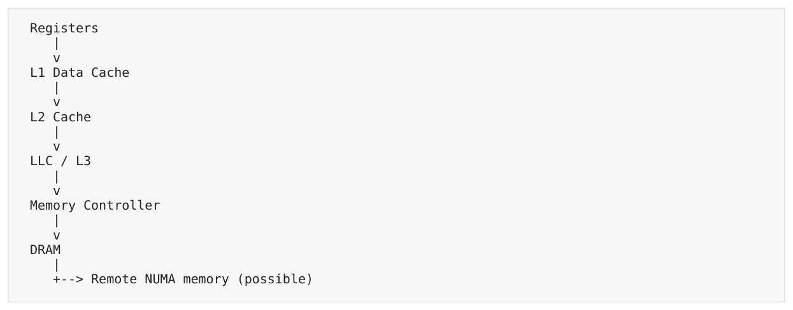

- ` Registers `
- ` L1 Data Cache `
- ` L2 Cache `
- ` LLC / L3 `
- ` Memory Controller `
- ` DRAM `
- ` → Remote NUMA memory (possible) `

</details>

核心不变量  越靠近 core：容量通常更小、latency 更低、单位 bit 成本更高；越远：容量更大、latency 更高，但可以提供更高聚合带宽。

### 1.2 Registers、L1、L2、LLC、DRAM 的角色

| 层级 | 典型角色 | 性能思维 |
| --- | --- | --- |
| Registers | 执行单元直接消费/产生的 operand storage | 真正算术通常在寄存器值上发生；spill 会把问题重新变成load/store。 |
| L1D | 每 core 最快的数据 cache | 几 cycles 量级；但 load ports/AGU/forwarding 仍有限，L1 hit 不等于 free。 |
| L2 | 更大但更慢的 private/near-core cache | 十几 cycles 量级常见；对中等 working set 很重要。 |
| LLC/L3 | 大容量 last-level cache，常跨 cores 共享/分布 | 几十 cycles 量级；还可能参与 coherence directory/home 逻辑。 |
| DRAM | 大容量主存 | 单 request latency 高；但 channels/banks 可提供很高aggregate bandwidth。 |

具体容量、latency、inclusive/non-inclusive 关系随 CPU 变化。不要死背 “L1=32KB、L2=某数、L3=某数”；正确习惯是先记量级与作用，再对目标 CPU 查手册/测量。

### 1.3 Latency vs Bandwidth

Latency 问的是“一次 request 发出到数据可被 dependent consumer 使用要多久”；Bandwidth 问的是“稳态下一秒能搬多少数据”。DRAM 可以同时有很高 latency 和很高 bandwidth，两者完全不冲突。

| 模式 | 主要限制 | 典型症状 |
| --- | --- | --- |

<a id="pdf-page-006"></a>

<!-- source-pdf-page: 6 -->

*[原 PDF 第 6 页](./Level3_Memory_Hierarchy_CN.pdf#page=6)*

| 模式 | 主要限制 | 典型症状 |
| --- | --- | --- |
| 单链 pointer chasing | Latency | MLP 低、bandwidth 利用率不高但 cycles/node 很高。 |
| 大数组 streaming | Bandwidth（当prefetch/MLP 足够） | 很多 outstanding misses，memory channels 接近饱和。 |
| 小 hot loop | Core / L1 throughput | 数据不去 DRAM，AGU/load-port/dependency 可能主导。 |

关键  低 memory bandwidth utilization 不代表 memory 不是瓶颈。一个 pointer chain 可以只用很少 GB/s，却被每次 serial miss 的 latency 完全卡住。

### 1.4 Working Set

Working set 是某个时间窗口内频繁访问的数据集合。性能关心的不是进程总内存，而是 hot-path data/cache-line/page working set。20GB 进程如果关键循环只反复访问 100KB，可能大多停在 L2；反之 500MB 进程若随机访问 200MB 热状态，可能频繁走 LLC/DRAM。

- Data working set：真正有语义价值的 hot bytes。

- Cache-line working set：实际被 cache hierarchy 搬运和驻留的 lines。

- Page / translation working set：活跃 virtual pages，需要多少 TLB entries。

- Coherence working set：哪些 lines 在多个 cores 之间共享/迁移 ownership。

### 1.5 MLP 初步：Miss 不等于 Stall

**图示转写**

| 模式 | 路径 / 重叠关系 |
| --- | --- |
| Independent loads | A、B、C 的 load 可同时 outstanding，分别等待 return |
| Dependent chain | load A → wait → B 地址已知 → load B → wait → … |

<details>
<summary>查看原图与完整文字转写</summary>

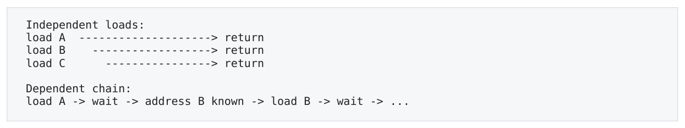

- ` Independent loads: `
- ` load A → return `
- ` load B → return `
- ` load C → return `
- ` Dependent chain: `
- ` load A → wait → address B known → load B → wait → ... `

</details>

OoO engine 可以在 miss 期间执行 younger independent work，并维持多个 outstanding misses。Memory-Level Parallelism（MLP）就是同时存在多个独立 memory requests 的程度。单 request raw latency 不变，但 latency 能被 overlap 后，每个 useful operation 的 exposed cost 会显著下降。

粗略心智公式  effective miss throughput cost ~ raw latency / exploitable MLP。它不是精确公式，但能帮助区分 serial latency 与 parallel throughput。

### 1.6 一条 Load 的完整问题清单

```text
x = *p;
```

1) p 如何得到？是否依赖前一次 load？

```text
2) translation 在 TLB 吗？
3) 对应 cache line 在 L1 / L2 / LLC / DRAM？
4) miss 是否在 critical path？
5) future addresses 可预测吗？prefetch 能帮吗？
6) 有多少 independent misses / MLP？
```

7) 这条 line 被其它 core 持有/修改吗？

```text
8) physical page 是 local NUMA 还是 remote？
```

本章一句话  Memory hierarchy 的性能不是“cache hit/miss”二元问题，而是 latency、bandwidth、parallelism、 translation、sharing 与 topology 的组合。

<a id="pdf-page-007"></a>

<!-- source-pdf-page: 7 -->

*[原 PDF 第 7 页](./Level3_Memory_Hierarchy_CN.pdf#page=7)*

## 第 2 章 Cache Line、Locality 与 Data Layout

本章目标  从 C++ object 转换到 physical cache-line layout；能够用 useful-bytes-per-line、 stride、AoS/SoA、hot/cold split 解释数据布局的性能后果。

### 2.1 Cache 的基本传输单位：Cache Line

主流 x86 通常使用 64B cache line。读取一个 4B int 发生 miss 时，memory hierarchy 通常带回包含它的整条 line，而不是只搬 4B。因此性能设计的自然单位不是“变量”，而是“包含变量的 line”。

**图示转写**

| 64 B line 的解释 | 容量（不含额外 metadata） |
| --- | --- |
| Byte range | 0–63 |
| int = 4 B | 最多 16 个 int |
| double = 8 B | 最多 8 个 double |

<details>
<summary>查看原图与完整文字转写</summary>

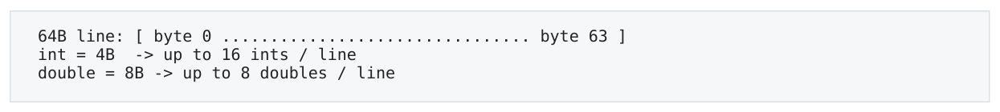

- ` 64B line: [ byte 0 ................................ byte 63 ] `
- ` int = 4B → up to 16 ints / line `
- ` double = 8B → up to 8 doubles / line `

</details>

如果顺序读取 int a[ ]，第一元素把整条 line 带入后，其余同 line 元素通常成为 L1 hits。由此产生 spatial locality。

### 2.2 Spatial Locality 与 Temporal Locality

| Locality | 含义 | 例子 |
| --- | --- | --- |
| Spatial | 访问某地址后很快访问附近地址 | a[i], a[i+1], a[i+2]；row-major matrix traversal。 |
| Temporal | 最近访问过的数据很快再次被访问 | 每个 tick 都读 bestBid/bestAsk/config；循环反复读同一 hot state。 |

两者相互独立。超大数组单次顺序扫描有很强 spatial locality 但弱 temporal locality；反复访问 a[0] 则 temporal 极强。

### 2.3 Cache-Line Utilization 与 Traffic Amplification

优化时一个极有价值的问题是：每处理一个 useful element，CPU 实际搬了多少 bytes？

```text
cache-line utilization = useful bytes / transferred cache-line bytes
traffic amplification = transferred bytes / useful bytes
```

例如 64B struct 中 hot loop 只读 8B price，若每个对象恰好独占一条 line，则 line utilization 只有 12.5%，traffic amplification 可视为约 8x。运行时间未必慢 8x，因为可能有 prefetch/MLP/其他瓶颈，但这是明显的 memory-efficiency 信号。

### 2.4 Stride：物理地址之间的距离

| 访问模式 | Stride（以 int=4B） | Line 利用率直觉 |
| --- | --- | --- |
| a[i] | 4B | 同一 line 连续利用，接近 100%。 |
| a[i*2] | 8B | 约一半元素被使用。 |
| a[i*16] | 64B | 每 line 只用一个 int，约 6.25%。 |
| matrix[i][0], N=1024 | 4096B | 每次跨 page；cache/TLB/set mapping 都可能不友好。 |

大 stride 的问题不只是“跳得远”：它可能降低 line utilization、增加 page footprint、削弱 prefetch、放大 TLB pressure，并在 power-of-two 情况触发 cache set conflict。

### 2.5 AoS vs SoA：选择依据是 Access Pattern

```text
AoS:
```

<a id="pdf-page-008"></a>

<!-- source-pdf-page: 8 -->

*[原 PDF 第 8 页](./Level3_Memory_Hierarchy_CN.pdf#page=8)*

```cpp
struct Order { uint64_t id; double price; double qty; uint64_t ts; };
Order orders[N];
layout: id0 price0 qty0 ts0 | id1 price1 qty1 ts1 | ...

SoA:
struct Orders { uint64_t id[N]; double price[N]; double qty[N]; uint64_t ts[N]; };
layout: price0 price1 price2 ... (separate column)
```

如果 loop 只处理 price across many orders，SoA 提高 line utilization，并更容易 SIMD/vectorize；如果每个 event 都会同时使用一个 Order 的大多数字段，AoS 往往 locality 更自然。

不要记错  SoA 不是“高级版 AoS”，AoS 也不是“低性能 OOP”。正确问题是：哪些字段在同一时刻、由同一线程一起访问？

### 2.6 Hot / Cold Split

低延迟对象经常同时包含 hot state 与 audit/debug/string metadata。把它们放一个大 struct 会放大 hot working set。

```cpp
struct HotOrder {
    uint64_t id;
    double price;
    double qty;
    uint32_t state;
};

struct ColdOrder {
    std::string client;
    std::string audit;
    std::string comment;
};
```

收益包括：cache-line utilization 提高、更多 hot objects fit L1/L2、page footprint 和 TLB pressure 下降，也避免 cold-path scan 污染 hot lines。

### 2.7 Alignment、Padding 与 Split Load

自然 alignment 通常让 scalar load/store 更简单。若一个 8B value 从 cache-line offset 60 开始，它横跨两条 line；任一侧 miss 都可能让整个 load 等待。

```text
Line A: offsets 0 ............. 60 61 62 63 |
Line B:                                  | 64 65 66 67 ...
8B load starting at 60 crosses two cache lines
```

但 `alignas(64)` 也不是通用加速器。把 16B object 强制 64B alignment 后，array stride 可能变成 64B：每 line 只放一个 object，footprint 反而扩大 4x。Alignment 常用于隔离共享写热点或满足特定 SIMD/ABI 要求。

### 2.8 Flat Storage、Pointer Storage 与 Index-Based Storage

| 布局 | 访问路径 | 典型后果 |
| --- | --- | --- |
| vector&lt;Level&gt; | base + i*sizeof(Level) | 连续、地址可直接计算、prefetch/TLB 友好。 |
| vector&lt;Level*&gt; | load pointer -&gt; load Level | 额外 indirection；nodes 若 heap scattered，cache/TLB locality 差。 |
| packed array + 32-bit index | load index -&gt; base + index*size | 仍可能有 next dependency，但 density、page locality、pointer size 通常更好。 |

<a id="pdf-page-009"></a>

<!-- source-pdf-page: 9 -->

*[原 PDF 第 9 页](./Level3_Memory_Hierarchy_CN.pdf#page=9)*

### 2.9 Matrix Traversal：Row-Major vs Column-Major

C/C++ 二维数组是 row-major。`a[i][j]` 以 j 为内层循环时地址连续；若交换循环、按 column 访问一个 1024x1024 的 int matrix，内层 stride 变成 4096B。这个单一改动同时降低 cache-line utilization、增加 page churn，也可能触发第 3 章的 set conflict。

```text
row-major:    a[0][0], a[0][1], a[0][2] ...  stride = 4B
column-major: a[0][0], a[1][0], a[2][0] ...  stride = 4096B (N=1024)
```

### 2.10 Field Reordering 与 False Locality

Field ordering 一方面影响 padding/sizeof，另一方面决定 hot fields 是否集中在少数 lines。仅追求最小 sizeof 不一定最优：如果 hot path 总是访问 price/qty/state，就应优先让它们集中；large audit/string fields 即使“逻辑属于同一对象”，也可能是 hot loop 的 false locality。

```text
Logical cohesion != physical locality requirement.
A field belongs to the same C++ object does not mean it belongs in the same hot cache line.
```

### 2.11 Cache Pollution 与 Cold Path Disturbance

一个偶尔执行的 cold scan 也可能破坏 hot path：扫描几十/几百 MB 会把大量 lines 流入 L1/L2/LLC，挤出真正 hot state。scan 完成后的短时间内，关键数据重新 warm-up，形成 tail spike。 因此 low-latency design 经常同时做 hot/cold data separation 与 hot/cold execution separation：rare recovery、 audit、monitoring 不仅要少执行，还应避免扫描/修改 hot cache lines。

### 2.12 Cache Warm-up 的正确理解

启动阶段 touch hot data 有帮助，但 cache residency 很短暂，不能保证“以后永远 L1 hit”。Pretouch 更可靠的价值包括避免 page fault、建立 page tables、初始化 allocator/code paths；真正长期决定 cache 命中的是 working-set 大小与持续 access pattern。

### 2.13 本章检查点

- 能把一个 struct/array 画成 64B cache lines，并估算 useful bytes / line。

- 能解释 stride 为什么同时影响 cache line、prefetch、TLB 与 set mapping。

- 能根据真实 hot loop 选择 AoS、SoA 或 hybrid，而不是套规则。

- 能识别 hot/cold split、field reordering、padding/alignment 的目标可能互相冲突。

本章一句话  Data structure 的逻辑形态与 physical layout 是两回事。高性能设计的核心是让真实访问模式以尽可能少的 cache lines/pages 完成 useful work。

<a id="pdf-page-010"></a>

<!-- source-pdf-page: 10 -->

*[原 PDF 第 10 页](./Level3_Memory_Hierarchy_CN.pdf#page=10)*

## 第 3 章 Cache Mapping、Associativity 与 Conflict Miss

本章目标  理解 cache 不是“32KB 任意放”，而是 sets x ways；能解释 working set 小于 cache 仍然 thrash 的原因。

### 3.1 Set、Way、Tag、Offset

假设教学模型：32KB L1D、64B line、8-way set associative。总 line 数 32KB/64B=512；每 set 8 ways，因此有 64 sets。

**图示转写**

| 地址字段 / 位置 | 作用 |
| --- | --- |
| Tag | 与目标 set 内各 way 的 tag 比较 |
| Set Index | 选择 set |
| Line Offset | 选择 line 中的 byte；64 B line 对应 byte 0–63 |
| Set N：way0 … way7 | 原图为 8-way 教学示意 |

<details>
<summary>查看原图与完整文字转写</summary>

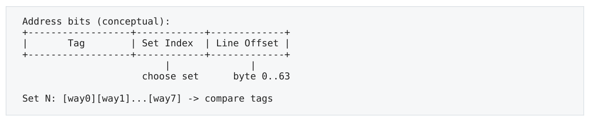

- ` Address bits (conceptual): `
- ` Tag | Set Index | Line Offset `
- ` choose set byte 0..63 `
- ` Set N: [way0][way1]...[way7] → compare tags `

</details>

64B line 需要 6 个 offset bits；64 sets 需要 6 个 set-index bits。在这个简化 L1 模型中，bits 6..11 选择 set。某 line 只能去一个 set，但可占该 set 任一 way。

### 3.2 3C Miss Model

| Miss 类型 | 根因 | 典型例子 |
| --- | --- | --- |
| Compulsory / Cold | 第一次触碰该 line | 第一次扫描数组。 |
| Capacity | 总体 working set 超过 cache capacity | 10MB 热数据无法放进 32KB L1。 |
| Conflict | 多个 active lines 映射同一 set，超过 ways | 9 条 line 全映射到一个 8-way set。 |

并发系统还常讨论 coherence-related invalidation，可视为经典 3C 之外的第四类 miss source。

### 3.3 为什么 4KB Stride 是经典冲突模式

在上述 64 sets x 64B 模型中，set pattern 每 4096B（64*64）循环一次。因此地址相差 4KB 可能拥有相同 set index、 不同 tag。

**图示转写**

1. ` 0x0000 `
2. ` Set 0 `
3. ` 0x1000 `
4. ` Set 0 `
5. ` 0x2000 `
6. ` Set 0 `
7. ` 0x3000 `
8. ` Set 0 `
9. ` 8-way: 8 lines coexist; the 9th forces eviction `

<details>
<summary>查看原图与完整文字转写</summary>

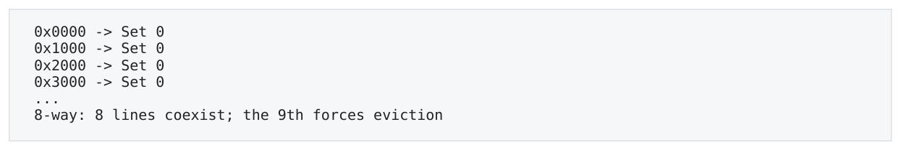

- ` 0x0000 → Set 0 `
- ` 0x1000 → Set 0 `
- ` 0x2000 → Set 0 `
- ` 0x3000 → Set 0 `
- ` 8-way: 8 lines coexist; the 9th forces eviction `

</details>

9 条 line 总共只有 576B，远小于 32KB L1，却可能持续 conflict。也就是说 total capacity 够，不代表 per-set capacity 够。

### 3.4 Replacement 与 Thrashing

当 set 满时必须选择 victim。真实 CPU 通常不是 perfect LRU，而是 pseudo-LRU/adaptive heuristic 等实现。工程上不应精确预测某条 line 一定何时被踢；更重要的是识别 access pattern 是否让一个 set 长期 oversubscribed。

**图示转写**

1. ` A B C D E F G H fit in one 8-way set `
2. ` I arrives `
3. ` one victim evicted `
4. ` Repeated A..I cycle `
5. ` possible thrashing `

<details>
<summary>查看原图与完整文字转写</summary>

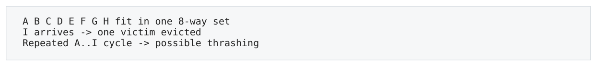

- ` A B C D E F G H fit in one 8-way set `
- ` I arrives → one victim evicted `
- ` Repeated A..I cycle → possible thrashing `

</details>

<a id="pdf-page-011"></a>

<!-- source-pdf-page: 11 -->

*[原 PDF 第 11 页](./Level3_Memory_Hierarchy_CN.pdf#page=11)*

### 3.5 Power-of-Two Performance Cliff

Cache indexing、page size、ring size、matrix dimensions 都大量使用 2^n。Power-of-two stride 容易让某些 address bits 固定，从而形成 pathological mapping。典型现象：N=8191 正常，8192 突然变慢，8193 又恢复。 同理，一个 4096B object 每次只访问 offset 0，所有 objects 可能集中到同一个 L1 set；若把 stride 改成 4160B （+64B），set index 每对象向前移动一个，性能可能突然改善。

### 3.6 Alignment 有时反而制造 Conflict

多个大数组全部 4KB aligned，并以相同 offset 同步访问，可能产生高度相关 set mapping。Alignment 的目的必须明确：满足 ABI/SIMD、避免 split、隔离 false sharing，还是改善 mapping。不是“越整齐越快”。

### 3.7 如何验证 Conflict Hypothesis

1. 固定 useful work 与数据量，记录 cycles/access 与 L1/L2 miss 行为。

2. 只改变 stride、object size 或 base offset；例如 4096 -&gt; 4160。

3. 若微小 layout 改动在 working-set 大小不变时消除巨大 performance cliff，强烈支持 conflict hypothesis。

4. 结合 PMU counters；但 generic L1 miss 只说明症状，不自动区分 capacity/conflict/coherence。

### 3.8 VIPT L1 与 4KB Page 的经典约束

现代 L1 常使用 VIPT（Virtually Indexed, Physically Tagged）思路：用 virtual address 低位尽早选 set，同时 TLB 并行产生 physical tag。4KB page 的低 12 bits 在 VA/PA 中相同；64B line 占 6 bits，若 set index 再占 6 bits，就正好使用 bits 6..11。

**图示转写**

1. ` 4KB page `
2. ` 12 page-offset bits `
3. ` 64B line `
4. ` 6 line-offset bits `
5. ` remaining 6 bits `
6. ` 64 L1 sets `
7. ` 64 sets * 8 ways * 64B = 32KB `

<details>
<summary>查看原图与完整文字转写</summary>

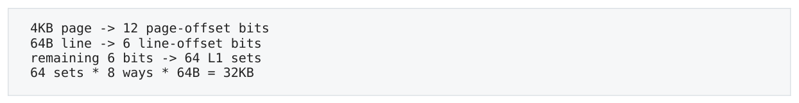

- ` 4KB page → 12 page-offset bits `
- ` 64B line → 6 line-offset bits `
- ` remaining 6 bits → 64 L1 sets `
- ` 64 sets * 8 ways * 64B = 32KB `

</details>

这解释了为什么 32KB/8-way/64B 是经典 L1D 设计点。更大的 L1 可以通过增加 ways、banking 或更复杂的 alias handling 实现，因此这不是所有 CPU 的硬规则。

### 3.9 Cache Coloring 与 Physical Placement

更低层 cache 往往使用 physical-address bits，OS page placement 因此会影响 set/slice distribution。Cache coloring 的思想就是利用 physical page bits 控制/分散 cache placement。普通应用很少直接做 coloring，但它提醒我们：virtual 连续不等于 LLC placement 完全无关。

### 3.10 Random Access 不一定 Conflict，Pathological Stride 才更危险

真正随机且分布均匀的 addresses 可能自然铺开到很多 sets；它的主要问题通常是 locality/prefetch/TLB，而不是 set conflict。反而规则的 +4096/+8192 power-of-two stride 更容易固定 set-index bits，形成 pathological conflict。

### 3.11 Store / Dirty-Line Conflict

Conflict 不只影响 loads。多个映射同 set 的 dirty lines 反复 eviction 时，victim 不能简单丢弃，还要 write back 到 lower hierarchy；因此 write-heavy conflict 可能比 clean read-only conflict 更昂贵。

### 3.12 本章检查点

- 能从 capacity/line-size/ways 推出 set 数。

- 能区分 compulsory、capacity、conflict 与 coherence-related misses。

- 看到 4KB/power-of-two cliff 时会同时怀疑 cache mapping 与 TLB，而不会一口咬定。

- 会用 padding/stride perturbation 加 counters 来验证，而不是凭地址图猜结论。

本章一句话  Cache capacity 必须同时看 total capacity 与 set distribution。遇到周期性 performance cliff， mapping/associativity 是重要候选，而不是只说“cache 不够大”。

<a id="pdf-page-012"></a>

<!-- source-pdf-page: 12 -->

*[原 PDF 第 12 页](./Level3_Memory_Hierarchy_CN.pdf#page=12)*

## 第 4 章 Hardware Prefetcher 与 Memory-Level Parallelism

本章目标  理解相同 cache-miss 数量为什么能有完全不同的 runtime；区分 address predictability、prefetch 与 MLP。

### 4.1 Demand Load vs Prefetch

Demand load 是程序当前真正需要数据时发出的访问；prefetch 是在需求发生前先把 line 向 core 拉近。Prefetch 不降低 DRAM raw latency，它只是让那段 latency 提前发生，从 critical path 上隐藏。

**图示转写**

1. ` prefetch line X 300 cycles `
2. ` X arrives `
3. ` later demand load `
4. ` hit/near-hit `

<details>
<summary>查看原图与完整文字转写</summary>

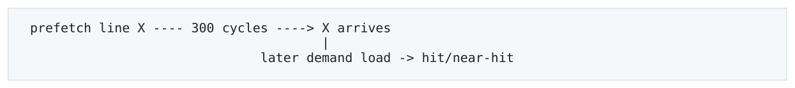

- ` prefetch line X 300 cycles → X arrives `
- ` later demand load → hit/near-hit `

</details>

### 4.2 Hardware Prefetcher 喜欢什么

| 模式 | Prefetchability | 原因 |
| --- | --- | --- |
| Sequential +64B | 高 | 稳定 stream，很容易识别。 |
| Fixed stride +128B | 通常较高 | 很多 CPU 有 stride/stream prefetcher。 |
| Random indexed lookup | 低 | table address 无规则，但若 indices 已知，MLP 仍可能高。 |
| Pointer chasing | 低 | 下一地址存放在当前 node 内，必须先完成当前 load。 |

Prefetcher 不是魔法。它要消耗 bandwidth、fill/miss resources 和 cache capacity；错误预取会污染 hot cache。因此 coverage 与 accuracy 都重要。

### 4.3 Pointer Chasing：Load-to-Load Dependency

**图示转写**

1. ` Node A --load next→ address of B `
2. ` Node B --load next→ address of C `
3. ` Node C ... `

<details>
<summary>查看原图与完整文字转写</summary>

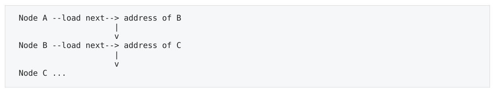

- ` Node A --load next→ address of B `
- ` Node B --load next→ address of C `
- ` Node C ... `

</details>

核心问题不是 “pointer 语法慢”，而是下一 request 的地址本身依赖前一 memory result。OoO window 再大也不能凭空知道 B 的地址。随机 list 因此常有 MLP≈1，暴露 L2/L3/DRAM 的 load-to-use latency。

### 4.4 Random Access 不等于 Low MLP

```text
sum += table[index[i]];

If index[i], index[i+1], index[i+2] are already known:
  load random A
  load random B
  load random C
can be outstanding together.
```

因此 random array lookup 与 random linked list 要严格区分：两者 locality 都可能差，但前者 future addresses 可以 independently compute，后者不行。

<a id="pdf-page-013"></a>

<!-- source-pdf-page: 13 -->

*[原 PDF 第 13 页](./Level3_Memory_Hierarchy_CN.pdf#page=13)*

### 4.5 多条 Independent Chains

同时遍历多个独立 list，可以把单链 MLP≈1 提高到 2/4/...：每条链内部仍 serial，但不同链互相独立。这与 multiple accumulators 拆 arithmetic dependency 的思想高度一致。

**图示转写**

| 独立 chain | 内部依赖 |
| --- | --- |
| A | A0 → A1 → A2 → … |
| B | B0 → B1 → B2 → … |
| C | C0 → C1 → C2 → … |

CPU 可以重叠 A/B/C 当前的 misses。

<details>
<summary>查看原图与完整文字转写</summary>

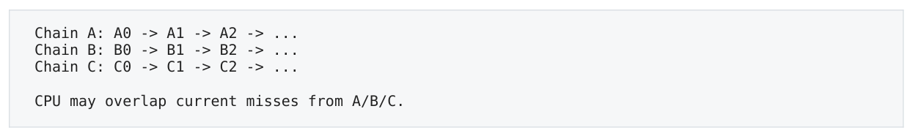

- ` Chain A: A0 → A1 → A2 → ... `
- ` Chain B: B0 → B1 → B2 → ... `
- ` Chain C: C0 → C1 → C2 → ... `
- ` CPU may overlap current misses from A/B/C. `

</details>

### 4.6 OoO Window、Load Buffers 与 Miss Tracking

CPU 要发现 future independent loads，必须在有限 in-flight window 内“看得到”它们；同时需要 Load Buffer、 line-fill/miss-tracking resources、ROB 等记录未完成工作。这些结构有限，因此 MLP 有 saturation point。

Little's Law 直觉  Concurrency ≈ Bandwidth × Latency。高 bandwidth + 高 latency 的 memory system 要想跑满，必须维持很多 cache lines in flight。一个单 pointer chain 根本产生不了足够并行请求。

### 4.7 Software Prefetch

软件 prefetch 适合“程序能提前知道 future address，但硬件 prefetcher 看不懂 pattern”的场景，例如 random index array。它难调：distance 太短则来不及，太长则 line 可能先被 eviction、还会污染 cache。

```cpp
for (size_t i=0; i<N; ++i) {
    __builtin_prefetch(&table[index[i + D]]);
    use(table[index[i]]);
}
```

对简单 sequential loop，hardware prefetch 通常已经很好；对 strict singly-linked pointer chain 又缺少足够 lookahead。因此手工 prefetch 不是低延迟 hot path 的第一优化手段。

### 4.8 Latency-Bound vs Bandwidth-Bound

| 类型 | 典型特征 | 优化方向 |
| --- | --- | --- |
| Latency-bound | MLP 低、bandwidth 利用率不高、dependent miss 在 critical path | 减少 dependency depth；提高 locality；并行多条 independent chains；避免 remote NUMA。 |
| Bandwidth-bound | MLP 高、streaming、prefetch 有效、memory channels 接近 saturation | 减少 transferred bytes；SoA/hot-cold split；non-temporal stores；更多 channel/合理NUMA。 |

### 4.9 Prefetch Distance：太晚与太早都不对

Prefetch distance 要覆盖未来需求之前的 raw latency。太短会在 demand 到来时数据尚未返回；太长则 line 可能先被 eviction，还会提前占据 cache/miss resources。最佳距离取决于 loop work、frequency、cache hierarchy、dataset 与 target CPU。

### 4.10 Coverage、Accuracy 与 Pollution

| 指标 | 问题 | 失败模式 |
| --- | --- | --- |
| Coverage | 真正 demand misses 中多少被提前覆盖？ | 太保守 -&gt; latency 仍暴露。 |
| Accuracy | prefetched lines 中多少最终真的使用？ | 太激进 -&gt; bandwidth/cache pollution。 |

<a id="pdf-page-014"></a>

<!-- source-pdf-page: 14 -->

*[原 PDF 第 14 页](./Level3_Memory_Hierarchy_CN.pdf#page=14)*

Aggressive prefetch 在 throughput benchmark 可能漂亮，却可能挤掉 HFT 小而重要的 hot state，造成 tail jitter。 因此 “更多 prefetch” 不是单调更好。

### 4.11 Multiple Streams、SoA 与 Prefetcher Capacity

`a[i]+b[i]+c[i]` 产生多个 regular streams，现代 prefetcher 通常能同时跟踪若干 streams；但 SoA 若一次 hot loop 同时读取几十个 columns，会把 stream 数和 load pressure 推高。AoS/SoA 选择因此还要考虑“同时活跃的 memory streams 数量”。

### 4.12 Batching / Independent Lookups

对 hash table、tree、graph 等单 lookup 内有 dependency 的结构，同时 interleave 多个 independent lookups 可以提高 MLP。Batching 的性能价值是让多个 latency chains overlap；但在 HFT 中 batch accumulation 本身增加 per-event waiting，必须平衡 latency 与 throughput。

### 4.13 Aliasing、Compiler Scheduling 与 Hardware MLP

Compiler 若无法证明 pointers 不 alias，可能不敢 aggressive vectorize/reorder；`restrict` 等契约能帮助编译器暴露 independent memory ops。它不会直接改变 CPU 的 MLP 上限，但可能让生成代码更容易让 OoO engine 看见并行 loads。

### 4.14 Speculative Loads 也会影响 Cache

Branch prediction 或 memory dependence prediction 让 wrong-path/speculative loads 提前发出。若 speculation 被 squash，architectural result 会撤销，但 cache fill 等 microarchitectural effect 通常不会回滚。这能偶尔“顺便 warm cache”，也可能制造 useless traffic；程序不能依赖这种行为。

### 4.15 本章检查点

- 能区分 predictable address、independent address 与 contiguous address 三个概念。

- 能解释 pointer chain 为什么 OoO window 再大也无法凭空增加 MLP。

- 能用 bandwidth 利用率 + MLP/critical path 区分 latency-bound 与 bandwidth-bound。

- 知道 software prefetch 是 CPU-specific implementation choice，不是 universal best practice。

本章一句话  Prefetch 回答“能不能提前”，MLP 回答“能不能并行”。两者决定 raw memory latency 有多少真正暴露给程序。

<a id="pdf-page-015"></a>

<!-- source-pdf-page: 15 -->

*[原 PDF 第 15 页](./Level3_Memory_Hierarchy_CN.pdf#page=15)*

## 第 5 章 Virtual Memory、TLB 与 Huge Pages

本章目标  把地址翻译加入 memory path；区分 TLB miss、page walk 与 page fault，理解 huge pages/pretouch/allocator 的真正作用。

### 5.1 Virtual Address -&gt; Physical Address

C++ pointer 通常是 virtual address。OS 以 page 为单位维护 virtual-page-number（VPN）到 physical-frame-number（PFN）的映射。对于 4KB page，最低 12 bits 是 page offset，translation 只改变更高的 page number。

**图示转写**

| 虚拟地址字段 | 转换 |
| --- | --- |
| Virtual Page Number | 由 page table / TLB 映射到 Physical Frame |
| Page Offset | 保持不变；4 KiB page 的 offset 为 12 bits |
| Physical Address | Physical Frame + 原 Page Offset |

<details>
<summary>查看原图与完整文字转写</summary>

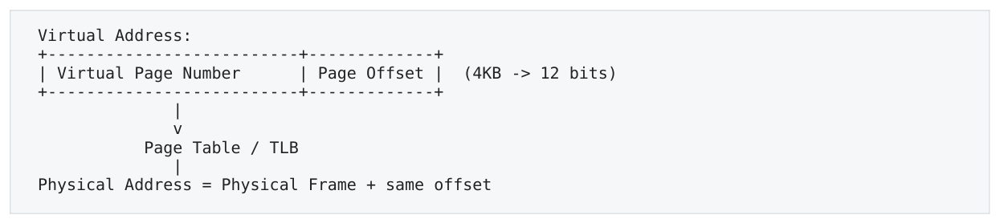

- ` Virtual Address: `
- ` Virtual Page Number | Page Offset | (4KB → 12 bits) `
- ` Page Table / TLB `
- ` Physical Address = Physical Frame + same offset `

</details>

### 5.2 TLB 是 Translation Cache

TLB（Translation Lookaside Buffer）缓存 VPN-&gt;PFN 映射。它缓存的不是 data，而是 translation。常见结构包括 L1 DTLB / ITLB 与更大 STLB；L1 miss 后若 STLB 也 miss，hardware page walker 需要遍历多级 page table。

| 组合 | 含义 |
| --- | --- |
| TLB hit + L1 hit | translation 与 data 都热，最理想。 |
| TLB hit + DRAM miss | translation 便宜，但数据本身远。 |
| TLB miss + data cache hit | data 可能近，但必须先完成 translation。 |
| TLB miss + DRAM miss | translation 和 data 两边都可能昂贵。 |

### 5.3 Page Walk 本身也是 Memory Dependency Chain

**图示转写**

1. ` VA `
2. ` Page-table level N `
3. ` (entry tells next-level address) `
4. ` Page-table level N-1 `
5. ` PTE `
6. ` physical page `
7. ` actual data access `

<details>
<summary>查看原图与完整文字转写</summary>

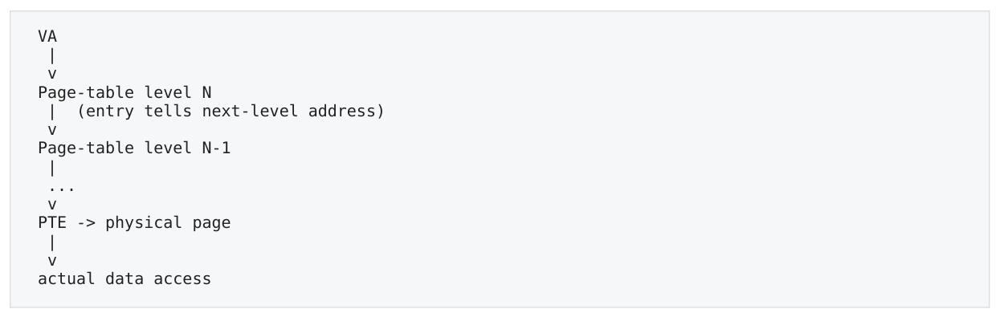

- ` VA `
- ` Page-table level N `
- ` (entry tells next-level address) `
- ` Page-table level N-1 `
- ` PTE → physical page `
- ` actual data access `

</details>

Page-table entries 自己也存放在 cache/memory 中，因此 page walk 可能涉及多次 dependent memory accesses。 现实中 paging-structure caches 与普通 data caches 会缓存很多上层 entries，所以 TLB miss cost 不是固定 cycle 数。

### 5.4 TLB Reach

```text
TLB reach = number of cached translations × page size
```

<a id="pdf-page-016"></a>

<!-- source-pdf-page: 16 -->

*[原 PDF 第 16 页](./Level3_Memory_Hierarchy_CN.pdf#page=16)*

假设某级 TLB 有 64 entries：4KB pages 只能直接覆盖约 256KB active virtual range；2MB pages 则覆盖约 128MB， 扩大 512 倍。这就是 huge page 最核心的性能价值。

### 5.5 Huge Pages：4KB / 2MB / 1GB

| Page Size | 优势 | 代价/风险 |
| --- | --- | --- |
| 4KB | 细粒度、fragmentation 小、NUMA placement 灵活 | TLB reach 小，page table/translation footprint大。 |
| 2MB | TLB reach 显著提高；大型 arena/hash/ring 很常见 | 内存浪费/placement granularity 增大；初始化更需 discipline。 |
| 1GB | 超大静态 region 的 translation footprint 极小 | reservation/fragmentation/NUMA 粒度/运维复杂。 |

Huge pages 不会让 L1/L2/L3 更大，也不会把 100ns DRAM 直接变成 50ns。它主要减少 translation misses/page walks，并可能让 latency distribution 更稳定。

### 5.6 TLB Miss vs Page Fault

| 事件 | 发生什么 | 是否通常进入 Kernel |
| --- | --- | --- |
| TLB miss | mapping 已存在，只是不在 CPU translation cache；hardware page walk refill | 通常否。 |
| Minor page fault | 需要建立/修改 mapping，例如 lazy physical allocation、COW | 是；可达 thousands+ cycles。 |
| Major page fault | 需要从 storage/swap/file 取数据 | 是；可能微秒到毫秒甚至更久。 |

低延迟要求  Hot path 不应发生 page fault。TLB miss 是优化问题；page fault 往往是系统设计/初始化纪律问题。

### 5.7 Pretouch、mlock 与 First Touch

`new`/`malloc` 成功并不等于所有 physical pages 已 ready。Linux 常采用 lazy allocation；第一次写 page 可能触发 minor fault、zeroing、page-table update。低延迟程序常在启动阶段按 page stride touch 全部 hot buffers。

**图示转写**

1. ` allocate / mmap `
2. ` → bind CPU / memory policy `
3. ` → touch every required page `
4. ` → initialize pools / rare paths `
5. ` → enter hot loop `

<details>
<summary>查看原图与完整文字转写</summary>

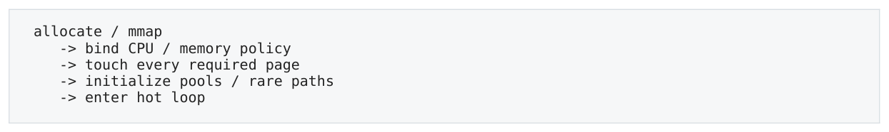

- ` allocate / mmap `
- ` → bind CPU / memory policy `
- ` → touch every required page `
- ` → initialize pools / rare paths `
- ` → enter hot loop `

</details>

`mlock`/`mlockall` 可用于防止关键 memory 被 swap，但不会把 TLB entry 永久 pin 住。First touch 还与 NUMA placement 相关，后续第 8 章展开。

### 5.8 Arena / Pool 为什么也改善 TLB

对象池价值不只在于 “malloc 更快”。把 10 万个小 Node dense 地放进少数 pages，可减少 active page count、提高 TLB hit probability、改善 cache density，也让 lifetime/ownership 更可预测。

### 5.9 THP vs Explicit HugeTLB

| 机制 | 优点 | 低延迟关注点 |
| --- | --- | --- |
| Transparent Huge Pages | OS 自动尝试 promotion/collapse，应用改 | compaction/collapse/split 等内核活动可能带来 |

> **转换补充**：THP 不应一概等同于 2 MiB PMD huge page；现代 Linux 还支持 multi-size THP。是否使用、是否后台 collapse、fault/compaction 成本均依具体 kernel 与配置；需按 tail latency 验证。参见 [Linux THP 文档](https://docs.kernel.org/admin-guide/mm/transhuge.html)。

<a id="pdf-page-017"></a>

<!-- source-pdf-page: 17 -->

*[原 PDF 第 17 页](./Level3_Memory_Hierarchy_CN.pdf#page=17)*

| 机制 | 优点 | 低延迟关注点 |
| --- | --- | --- |
| (THP) | 动少 | jitter；行为随 Linux 配置版本变化。 |
| Explicit HugeTLB | 预留/显式映射，placement 更可控 | 运维与容量管理复杂，但 predictability 通常更好。 |

严格 low-latency 环境往往更重视可预测性而不是“自动最好”，因此会明确核实 THP policy 或使用预留 huge pages。

### 5.10 TLB Associativity 与 Translation Conflict

TLB 也有有限 entries/associativity，因此除了总 page count 之外也可能发生 translation conflicts。一般应用先关注 active page footprint；只有 benchmark 出现特定 page-stride cliff 时才需要深入 TLB set mapping。

### 5.11 Context Switch、PCID 与 Core Migration

不同进程使用不同 page tables。现代 x86 的 PCID 等机制可以避免每次 context switch 都完整 flush TLB，但 thread migration 到另一 core 仍会失去该 core 私有的 L1 TLB/cache/predictor warmth。CPU pinning 的价值因此不仅是 data cache，也包含 translation/frontend state。

### 5.12 TLB Shootdown、mmap/munmap/mprotect

修改 shared page tables 或 permissions 时，其他 cores 可能缓存旧 translation，需要 TLB invalidation/shootdown，可能涉及跨核同步/IPI。`mmap`/`munmap`/`mprotect` 还涉及 VMA/page-table/kernel work，因此不适合作为 hot-path 频繁操作。

### 5.13 Page Utilization 与 Sparse Object Graph

类似 useful bytes/cache-line，也可以问 useful bytes/page。若每个 4KB page 只触碰 64B，page utilization 仅约

1.56%，translation footprint 被放大 64x。Sparse tree/map/individually-allocated nodes 常同时浪费 cache line 与 page/TLB coverage。

### 5.14 本章检查点

- 能区分 TLB hit/miss、STLB hit、page walk 与 page fault。

- 知道 huge page 的主要收益是 TLB reach/page-table overhead，不是 data-cache capacity。

- 知道 pretouch、mlock、huge pages、CPU pinning 各自解决不同问题。

- 能解释 dense arena/pool 为什么同时改善 allocation、cache 与 translation locality。

本章一句话  Memory performance 有两份 working set：cache-line working set 与 translation/page working set。 Huge pages 和 dense allocation 解决的是后者，不能替代良好 data layout。

<a id="pdf-page-018"></a>

<!-- source-pdf-page: 18 -->

*[原 PDF 第 18 页](./Level3_Memory_Hierarchy_CN.pdf#page=18)*

## 第 6 章 Load/Store Buffer 与 Memory Ordering

本章目标  把 OoO execution 与 memory system 接起来；彻底区分 store execute、retire 与 global visibility，并理解 forwarding/disambiguation/atomic 的性能来源。

### 6.1 Store 为什么需要 Buffer

Speculative store 不能一执行就把共享 cache state 永久改变，否则前面若发生 branch mispredict/fault 就无法回滚。Store Buffer 让 address/data 先准备，指令随后可以 retire，而 store 对 coherence/cache 的最终可见效果在更晚时机完成。

**图示转写**

1. ` store instruction `
2. ` → address/data ready `
3. ` → Store Buffer `
4. ` → retire (architectural commit) `
5. ` → obtain line ownership / drain `
6. ` → visible through coherence `
7. ` → much later dirty line may write back `

<details>
<summary>查看原图与完整文字转写</summary>

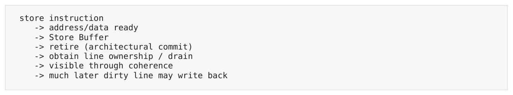

- ` store instruction `
- ` → address/data ready `
- ` → Store Buffer `
- ` → retire (architectural commit) `
- ` → obtain line ownership / drain `
- ` → visible through coherence `
- ` → much later dirty line may write back `

</details>

关键  execute != retire != globally visible。In-order retirement 维护 precise architectural state，但不等于跨 core memory visibility 已完成。

### 6.2 Store-to-Load Forwarding

若同 core 先 `x=42`、随后 `r=x`，store 可能仍在 Store Buffer。CPU 可以直接从 older pending store 向 younger load forward 新值，无需等 store drain 到 L1。 最容易 forward 的是相同 address/size/alignment。Partial overlap、store 4B 后 load 8B、misalignment 等可能造成 forwarding penalty/replay。Hot path 应避免不必要的 partial-width overlap。

### 6.3 Memory Disambiguation 与 Load Replay

```text
*p = 1;   // older store
x = *q;   // younger load
If p/q addresses not resolved yet, CPU predicts whether they alias.
```

永远保守等待 older stores 会严重损失 performance，因此 OoO CPU 运行时预测“likely independent”，允许 load speculative 提前。若后来发现 p==q 且 load 读错旧值，相关 load/consumer 必须 replay/recover。 Compiler alias analysis（含 restrict）与 hardware memory disambiguation 是不同层：前者决定编译期 scheduling/vectorization，后者处理运行时实际 addresses。

### 6.4 Load/Store Queue 与有限资源

Load Buffer/Queue、Store Buffer/Queue、miss tracking、ROB 都是有限结构。长 latency loads 会长时间占住 entries；store ownership/coherence 很慢时 Store Buffer drain 也会积压。最终 buffer full 会让 rename/issue 停滞。

### 6.5 x86 TSO 的实用 Mental Model

| Program-order pair | x86 常见 architectural 直觉 |
| --- | --- |
| Load -&gt; Load | 强保序。 |
| Load -&gt; Store | 强保序。 |

<a id="pdf-page-019"></a>

<!-- source-pdf-page: 19 -->

*[原 PDF 第 19 页](./Level3_Memory_Hierarchy_CN.pdf#page=19)*

| Program-order pair | x86 常见 architectural 直觉 |
| --- | --- |
| Store -&gt; Store | 强保序。 |
| Store -&gt; Load (different addresses) | 允许表现为重排：store 仍在 buffer，later load 已完成。 |

经典 store-buffer litmus：Core0: x=1; r1=y; Core1: y=1; r2=x; 在 x86 上 r1=r2=0 可以发生，因为双方 store 尚未 globally visible 时，各自 later load 已读到旧值。

### 6.6 C++ Memory Model 与 Hardware 是不同层

**图示转写**

1. ` C++ memory model `
2. ` → compiler transformations / codegen `
3. ` → ISA memory model (x86 TSO, ARM weaker...) `
4. ` → microarchitecture (buffers, speculation, coherence) `

<details>
<summary>查看原图与完整文字转写</summary>

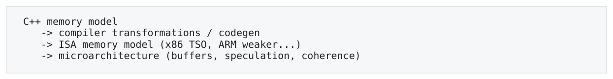

- ` C++ memory model `
- ` → compiler transformations / codegen `
- ` → ISA memory model (x86 TSO, ARM weaker...) `
- ` → microarchitecture (buffers, speculation, coherence) `

</details>

普通 non-atomic data race 在 C++ 中是 UB，不能用“x86 顺序强所以没事”来证明正确。Release/acquire 建立 happens-before；在 x86 上常无需额外 fence，因为 ISA 已提供足够的 Store-&gt;Store、Load-&gt;Load/Store ordering， 但 compiler 仍必须禁止不合法的重排。

### 6.7 Fence、Atomic RMW 与 Contention

Fence 不是简单“关闭 OoO”。它对特定 memory operations 的 ordering/completion 施加更强约束，成本取决于当前 outstanding operations/store-buffer state。 Atomic RMW（如 `fetch_add`/CAS）必须获取 cache-line exclusive ownership。多个 cores 竞争同一 atomic 时， 真正成本往往是 coherence ownership serialization，而不是 ADD 指令本身。`memory_order_relaxed` 只减少 ordering 约束，不消除 atomicity/ownership。

### 6.8 Write Allocate、RFO 与 Non-Temporal Store

普通 cached store 对 cold line 常需要取得 ownership（RFO/write allocate），并最终产生 dirty writeback。大规模一次性 streaming writes 可能因此带来 cache pollution 与额外 traffic；non-temporal stores 可在适合场景减少 write-allocate/cache pollution，但不是 hot small state 的默认选择。

### 6.9 Compiler Barrier vs Hardware Fence

Compiler barrier 只约束编译器不要跨某点重排；hardware fence 才对 CPU/ISA memory ordering 施加约束。C++ atomics 让 compiler 根据 language semantics 与目标 ISA 生成正确组合。除非清楚 contract，否则不要用裸 inlineasm barrier 代替标准原语。

### 6.10 Acquire/Release 与 Seq-Cst 的成本层次

x86 本身是较强 memory model，release store / acquire load 常可用普通 `mov` 加 compiler-ordering 实现； seq_cst 要求更强的单一全局顺序，尤其 seq_cst store 可能需要 locked instruction/fence strategy。具体 codegen 要看 compiler/ISA，而不是凭 enum 猜成本。

### 6.11 LOCK Prefix 不等于每次锁住整条 Memory Bus

现代 x86 对正常 cacheable aligned memory 的 locked RMW 通常依靠 cache coherence 与 exclusive ownership 实现 atomicity，而不是每次锁整个外部总线。特殊 uncacheable/cross-boundary 情况才可能触发更重的 bus-lock-like 行为。

### 6.12 Write Combining 与 Streaming Stores

多个 sequential stores 可以通过 write-combining/buffering 形成更大的 burst，提高 bandwidth efficiency。Non-temporal stores 常利用这类机制，适合 large one-pass writes；若随后马上读取同一数据，绕开/弱化 cache reuse 反而可能更差。

<a id="pdf-page-020"></a>

<!-- source-pdf-page: 20 -->

*[原 PDF 第 20 页](./Level3_Memory_Hierarchy_CN.pdf#page=20)*

### 6.13 Store 不是“写 DRAM”

普通 store 通常先进入 Store Buffer，取得 line ownership 后修改 L1 dirty line；真正 DRAM write 可能到很久以后该 dirty line eviction/writeback 时发生。其它 core 看到新值不需要等待 DRAM 更新，cache coherence 已能提供最新 data。

### 6.14 Memory Dependence Predictor 与 Warm-up

除了 branch predictor，现代 CPU 也可能学习某些 load 与 older store 的 dependence pattern：经常 alias 的 pair 更保守，总是不 alias 的 pair 更激进。Warm-up 后 performance 变化可能来自 cache/branch predictor，也可能包含 memory-dependence predictor state，但通常不是第一诊断目标。

### 6.15 本章检查点

- 能解释为什么 in-order retire 仍不足以保证 inter-core visibility。

- 能描述 forwarding failure 与 memory-disambiguation replay 的区别。

- 能从 Store Buffer 推导 x86 Store-&gt;Load litmus。

- 能区分 C++ correctness、compiler ordering、ISA ordering 与 coherence 四层。

本章一句话  Memory ordering 的正确 mental model 是：CPU 用 buffer/speculation 提高吞吐，再由 LSQ、 retirement、ISA ordering 与 coherence 把外部可见行为限制在合法范围内。

<a id="pdf-page-021"></a>

<!-- source-pdf-page: 21 -->

*[原 PDF 第 21 页](./Level3_Memory_Hierarchy_CN.pdf#page=21)*

## 第 7 章 Cache Coherence、MESI 与 False Sharing

本章目标  从“每 core 私有 cache”推导共享内存如何正确工作；把多线程性能问题转换成 cache-line ownership topology。

### 7.1 MESI：四个核心状态

| 状态 | 含义 | 写入条件 |
| --- | --- | --- |
| M - Modified | 本 core 拥有唯一有效 dirty copy；lower level 可能旧 | 已经有 write ownership，可继续本地写。 |
| E - Exclusive | 仅本 core 有 clean copy | 可本地 E-&gt;M，无需 invalidating sharers。 |
| S - Shared | 多个 cores 可同时持有 clean copy | 要写必须先 invalidate 其它sharers。 |
| I - Invalid | 本地 copy 不可用 | 读/写前需要重新获取line/ownership。 |

真实 CPU 可能使用 MESIF/MOESI 等扩展，但分析性能时最重要的是三件事：谁持有 readable copy、谁拥有 writable ownership、ownership 如何移动。

### 7.2 RFO、Invalidation 与 Cache-to-Cache

**图示转写**

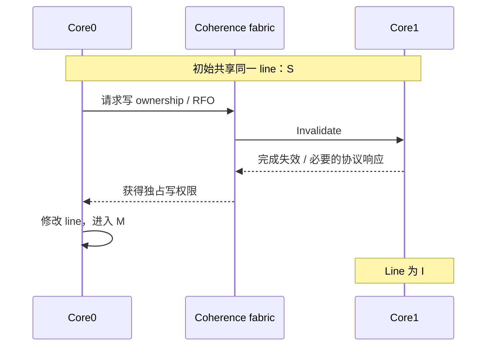

<details>
<summary>查看原图与完整文字转写</summary>

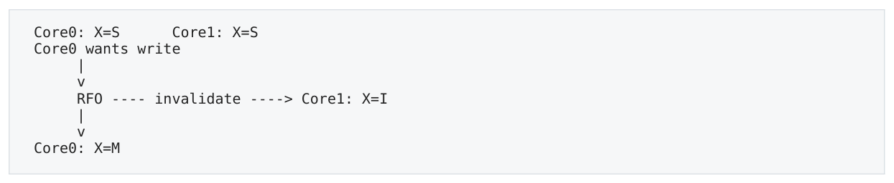

- ` Core0: X=S Core1: X=S `
- ` Core0 wants write `
- ` RFO invalidate → Core1: X=I `
- ` Core0: X=M `

</details>

若某 core 持有 M 状态的最新数据，另一个 core 读取时不能去 DRAM 拿旧值；coherence fabric 会从 owner/cache/home 路径取得最新 line。逻辑上这是 cache-to-cache transfer，真实路径可经过 LLC/home agent/interconnect。

### 7.3 True Sharing vs False Sharing

| 类型 | 定义 | 例子 |
| --- | --- | --- |
| True sharing | 多个 threads 真正访问/修改同一 logical variable | global atomic counter / CAS head。 |
| False sharing | 不同变量恰好在同一 coherence line，且不同cores 高频写 | producerIndex 和 consumerIndex 放同一个 64B line。 |

CPU coherence 不理解 C++ object boundaries，只看 cache line。因此两个完全无 data race 的独立 fields 仍可产生严重 ownership ping-pong。

### 7.4 Contended Atomic 的真正成本

**图示转写**

1. ` Core0 owns M `
2. ` Core1 requests ownership `
3. ` Core1 M `
4. ` Core2 `
5. ` ... `
6. ` All atomic RMW operations serialize around one writable cache line. `

<details>
<summary>查看原图与完整文字转写</summary>

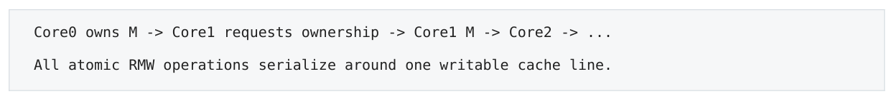

- ` Core0 owns M → Core1 requests ownership → Core1 M → Core2 → ... `
- ` All atomic RMW operations serialize around one writable cache line. `

</details>

<a id="pdf-page-022"></a>

<!-- source-pdf-page: 22 -->

*[原 PDF 第 22 页](./Level3_Memory_Hierarchy_CN.pdf#page=22)*

Relaxed atomic 仍然要保持 atomic RMW；所以 contention 主要由 ownership transfer 与 coherence serialization 决定。随着 core 数增多，throughput 甚至可能 negative scaling。

重要  lock-free 是 progress guarantee，不是性能保证；lock-free algorithm 仍可以在一个 shared CAS line 上制造严重 coherence storm。

### 7.5 SPSC Ring 的 Cache-Line 视角

理想 SPSC 通常让 producer 独写 write index、consumer 独写 read index。若两者同 line，就会发生 false sharing； 分开 line 后，每条 metadata line 是 one-writer/one-reader coherence stream。Payload 从 producer core 到 consumer core 的 line handoff 是必要通信，metadata false sharing 则是 accidental communication。

```text
Producer-owned line:   writeIndex
Consumer-owned line:   readIndex
Ring payload lines:     ownership transfers only when messages are handed off
```

### 7.6 Polling 为什么仍能很快

Consumer `while(seq.load()==old)` 在 producer 不更新时可以反复从自己的 Shared line 读取，几乎都是 local hits；真正跨核 coherence 通常发生在 producer 更新并 invalidates reader copy 的那一刻。因此 spin polling 的 idle loop 不等于每次 load 都访问远端 core。

### 7.7 Ownership-Oriented Layout

实用规则  Fields with the same frequent writer can usually share a line; fields with different frequent writers should usually not. Read-mostly/immutable fields 也应避免与高频 writer metadata 混在同 line。

这会与第 2 章的 compactness 产生 trade-off：单线程希望 pack hot fields；多线程希望隔离 different writers。正确 layout 必须同时考虑 access locality 与 thread ownership。

### 7.8 常见架构模式

| 模式 | Coherence 特征 | 适用方向 |
| --- | --- | --- |
| Per-thread counters + low-frequency aggregate | worker 长期保持本地 M；aggregator 偶尔读取 | metrics/stats。 |
| Immutable snapshot + publish pointer/version | readers mostly Shared，writer 构造新版本 | read-mostly config/reference/risk snapshot。 |
| Instrument sharding / single owner | mutable state 长期由单 core 拥有 | order book/pricing/OMS partition。 |
| Global MPMC metadata / CAS hot spot | ownership 在所有 cores 间跳 | 高 contention，常需要 redesign。 |

### 7.9 Diagnosis：perf c2c / HITM / Padding Experiment

`perf c2c` 与平台相关 PMU 事件可帮助发现 cache-to-cache/HITM traffic。最强的工程证据仍是 controlled layout experiment：把 independently written fields 分到不同 cache lines，若 cycles/tail 与 cache-to-cache traffic 同时下降，就强烈支持 false-sharing hypothesis。

<a id="pdf-page-023"></a>

<!-- source-pdf-page: 23 -->

*[原 PDF 第 23 页](./Level3_Memory_Hierarchy_CN.pdf#page=23)*

### 7.10 MESIF / MOESI：为什么 MESI 只是 Mental Model

Intel 一些实现增加 F（Forward）状态，在多个 Shared copies 中指定 responder；AMD 等常见 MOESI 增加 O （Owned），允许 dirty owner 与 Shared readers 共存。细节不必死记，核心仍是 readable copies、dirty owner 与 ownership transfer。

### 7.11 Spinlock：Test-and-Set vs Test-and-Test-and-Set

Naive `while(lock.exchange(true))` 让所有 waiters 每轮都做 RMW，cache line 在 cores 间疯狂 bouncing。Testand-test-and-set 先用 shared loads 自旋，只有看到可能 unlocked 才尝试 exchange，大幅减少 ownership traffic。 `PAUSE` 能改善 spin pipeline/SMT 行为，但不能消除 coherence 本身。

### 7.12 Ticket Lock 与 MCS Lock 的 Cache-Line 视角

Ticket lock 提供 fairness，但大量 waiters polling 同一 serving line，writer 更新会 invalidate many sharers；MCS lock 让每个 waiter spin 自己的 queue node，只在 predecessor/successor 间 handoff，many-core coherence scalability 通常更好。Lock algorithm 本质上也是 cache-line ownership algorithm。

### 7.13 Seqlock、RCU 与 Immutable Snapshot

| 模式 | Read Path | Coherence Trade-off |
| --- | --- | --- |
| Seqlock | read version -&gt; payload -&gt; version；reader 不写 | writer 每次更新 version/payload 会 invalidate readers；适合 read-heavy/few writers。 |
| RCU / immutable publish | reader 只读稳定版本 | read path coherence-friendly；代价是reclamation/version/memory footprint。 |
| Mutable shared object | 直接读写同一 object | 简单但高频 writer 会让 readers 反复invalidated。 |

### 7.14 Replication：用 Memory 换 Coherence

Read-mostly config/reference state 可以给每个 worker local copy，低频版本更新时广播；这样 hot reads 永远 local/Shared。代价是 duplication、update coordination 与一致性 semantics。对于 small state，这种 trade-off 常很划算。

### 7.15 Zero-Copy 不等于 Zero Cache-Line Transfer

Producer 与 consumer 共享同一 message buffer 虽避免 software memcpy，但 payload line 仍要从 producer cache/home 移到 consumer。对于后续会被 consumer 反复使用的数据，小 copy 到 consumer-local structure 有时反而更利于 locality。是否 zero-copy 要看后续 reuse，而非口号。

### 7.16 Per-Thread Array 的经典 False-Sharing 坑

```text
uint64_t counters[MAX_THREADS];
// counters[0..7] may share one 64B line
// each thread writes a different element -> false sharing
```

正确做法通常是按“owner”分组：同一 thread 独写的多个 fields 可以 pack 在一起；不同 frequent writers 应隔开。 不要把每个字段都盲目 64B align，否则单线程 footprint/scan locality 会爆炸。

### 7.17 Thread Hop 与 Ownership Migration

Network -&gt; parser -&gt; risk -&gt; pricing -&gt; writer 每多一个 core hop，都可能带来 queue metadata handoff 与 payload line migration。Hand off ownership 一次通常可接受，A/B cores 反复修改同一 object graph 才最糟。Latency-first architecture 常通过减少 hops 或 partition/single-owner 来稳定 ownership。

<a id="pdf-page-024"></a>

<!-- source-pdf-page: 24 -->

*[原 PDF 第 24 页](./Level3_Memory_Hierarchy_CN.pdf#page=24)*

### 7.18 本章检查点

- 能区分 necessary payload handoff 与 accidental metadata false sharing。

- 能说明 relaxed/CAS/lock-free 为什么都无法绕过 ownership。

- 能从 writer/readers topology 判断 field 是应该 pack 还是 isolate。

- 能解释 per-thread stats 为什么 aggregator 不能高频 polling。

本章一句话  多线程 memory 性能的第一问题往往不是 “用了哪个 memory_order”，而是“谁拥有这条 64B line，它多久换一次 owner”。

<a id="pdf-page-025"></a>

<!-- source-pdf-page: 25 -->

*[原 PDF 第 25 页](./Level3_Memory_Hierarchy_CN.pdf#page=25)*

## 第 8 章 DRAM、Memory Controller 与 NUMA

本章目标  完成从 LLC 到物理内存/设备的最后一段路径；理解 channel/bank/row、bandwidth saturation、NUMA placement 与 NIC topology。

### 8.1 DRAM 不是一个巨大慢数组

**图示转写**

- ` LLC `
- ` Memory Controller `
  - ` Channel 0 → DIMM → Rank → Bank → Row Buffer → Cells `
  - ` Channel 1 → DIMM → Rank → Bank → Row Buffer → Cells `

<details>
<summary>查看原图与完整文字转写</summary>

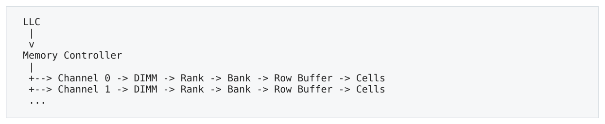

- ` LLC `
- ` Memory Controller `
- ` → Channel 0 → DIMM → Rank → Bank → Row Buffer → Cells `
- ` → Channel 1 → DIMM → Rank → Bank → Row Buffer → Cells `

</details>

Memory controller 汇总来自多个 cores/DMA 的 requests，选择 channel/bank，并根据 row locality、ready state、 fairness 等调度 DRAM commands。更多 channels 主要提高 aggregate bandwidth，而不是让一个 serial dependent load 的 raw latency 按比例下降。

### 8.2 Bank-Level Parallelism 与 Row Buffer

每个 DRAM bank 在某时刻会有一个 active/open row。若下一请求仍落在同 row，是 row hit；若同 bank 需要另一 row，必须 precharge/activate，成为 row conflict/miss。

| 情况 | 大致行为 | Latency 直觉 |
| --- | --- | --- |
| Row hit | 目标 row 已打开，直接 column access | 较低。 |
| Row closed | 需要 activate row | 更高。 |
| Row conflict | 先关闭旧 row 再打开新 row | 更高。 |
| Bank/controller queue busy | 还要排队 | 可能形成 tail。 |

多个 independent outstanding requests 不仅能隐藏 latency，也给 memory controller 更多机会选择不同 banks/row hits；这是 MLP 带来的第二层收益。

### 8.3 Bandwidth Saturation

Streaming workload 随 cores 增加通常先扩展，最终 memory channels 饱和：8 cores 已达 85GB/s，16 cores 仍约 86GB/s。继续加 core 只是在分固定 bandwidth，per-thread throughput 下降。 HFT 单事件 hot path 通常不是 DRAM-bandwidth-first 的问题，但 snapshot/replay/memcpy/large vector calculation 可能明显 bandwidth-bound。

### 8.4 NUMA：Memory Cost Depends on Topology

**图示转写**

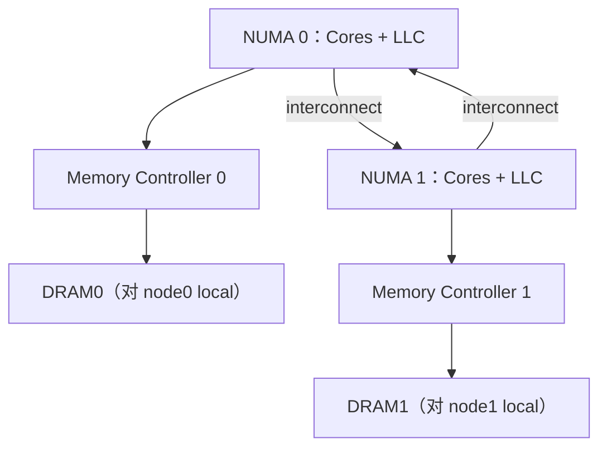

<details>
<summary>查看原图与完整文字转写</summary>

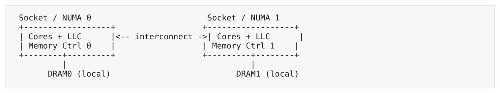

- ` Socket / NUMA 0 Socket / NUMA 1 `
- ` Cores + LLC |← interconnect → | Cores + LLC `
- ` Memory Ctrl 0 | | Memory Ctrl 1 `
- ` DRAM0 (local) DRAM1 (local) `

</details>

Core0 访问 DRAM0 是 local memory；访问 DRAM1 必须跨 interconnect，因此通常 latency 更高、可用 bandwidth/queueing 特征也不同。NUMA 是 “non-uniform cost”，不是 “远端不可访问”。

<a id="pdf-page-026"></a>

<!-- source-pdf-page: 26 -->

*[原 PDF 第 26 页](./Level3_Memory_Hierarchy_CN.pdf#page=26)*

### 8.5 First Touch：CPU Pinning 不是全部

Linux 常见默认策略是物理 page 在首次 fault/write 时偏向分配到执行该 touch 的 NUMA node。因此 main thread 若在 node0 预先触碰所有 buffer，之后 pinned 到 node1 的 worker 可能长期 remote access。

**图示转写**

| 场景 / 部分 | 路径、状态或说明 |
| --- | --- |
| Wrong | ` main thread on node0 → allocate + touch ALL `；` workers later pin node0/node1 `；` => node1 workers may access remote pages ` |
| Better | ` pin worker0 → touch its partition on node0 `；` pin worker1 → touch its partition on node1 ` |

<details>
<summary>查看原图与完整文字转写</summary>

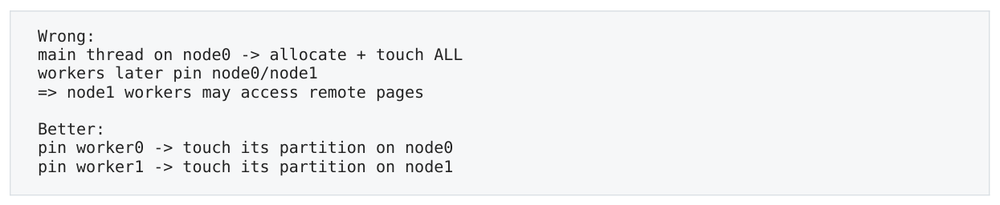

- ` Wrong: `
- ` main thread on node0 → allocate + touch ALL `
- ` workers later pin node0/node1 `
- ` => node1 workers may access remote pages `
- ` Better: `
- ` pin worker0 → touch its partition on node0 `
- ` pin worker1 → touch its partition on node1 `

</details>

First touch 是重要 mental model，但具体行为还受 memory policy、cpuset、THP/HugeTLB、automatic NUMA balancing 与可用内存影响。

### 8.6 Bind vs Interleave

| 策略 | 目标 | 适用场景 |
| --- | --- | --- |
| membind / local allocation | 把 latency-critical data 固定在 worker 附近 | HFT hot partition、small/medium state。 |
| interleave across nodes | 利用多个 memory controllers/channels，提高 aggregate bandwidth | 大规模 bandwidth-oriented scans/HPC。 |

Interleave 会让单个 node 上执行的 thread 有一部分 remote pages；它是 throughput 优先策略，不应盲目用于 single-event low-latency path。

### 8.7 NIC、DMA 与 Device Affinity

PCIe NIC 通常更靠近某个 socket/NUMA domain。Kernel bypass（Onload/DPDK/RDMA/AF_XDP）减少软件栈成本，但不能绕过 topology。RX queue/polling core、packet buffers、pricing thread 与 NIC 若跨 socket，packet data/ownership 仍要过 interconnect。

**图示转写**

1. ` Best-effort low-latency placement: `
2. ` NIC local NUMA node `
3. ` → RX/polling core `
4. ` → parser / pricing core(s) `
5. ` → hot buffers / book / order state `
6. ` → TX path `
7. ` Keep critical handoffs within the same NUMA region when possible. `

<details>
<summary>查看原图与完整文字转写</summary>

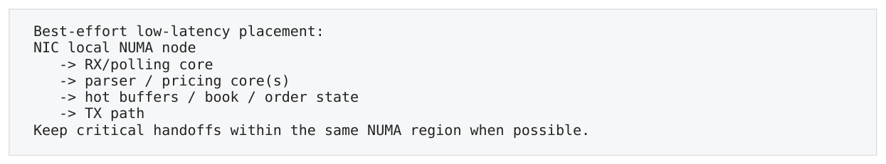

- ` Best-effort low-latency placement: `
- ` NIC local NUMA node `
- ` → RX/polling core `
- ` → parser / pricing core(s) `
- ` → hot buffers / book / order state `
- ` → TX path `
- ` Keep critical handoffs within the same NUMA region when possible. `

</details>

Intel 某些 server 平台的 DDIO 可让 PCIe I/O 与 LLC 更直接交互，但具体行为依平台；即使 packet 已在 LLC，也不等于已在目标 core 的 L1/L2。

### 8.8 Huge Pages + NUMA

2MB huge page 把 translation footprint 降低，但也让 physical placement 粒度变粗。若一个 huge page 由 node0 first-touch，而 node1 worker 使用其中一半，那部分仍可能 remote。因此 huge-page arena 初始化应与 ownership/partition topology 一起设计。

### 8.9 Noisy Neighbor：Bandwidth Contention 变成 Tail Latency

即使 hot thread 本身 DRAM traffic 很低，同 NUMA node 上另一个 `memcpy(10GB)`/大数组 scan 会占 memory-controller queues 和 channels，还可能污染 shared LLC。hot thread 偶尔发生 LLC miss 时会排队更久，于是 bandwidth interference 转化为 tail-latency jitter。

<a id="pdf-page-027"></a>

<!-- source-pdf-page: 27 -->

*[原 PDF 第 27 页](./Level3_Memory_Hierarchy_CN.pdf#page=27)*

### 8.10 DRAM Refresh、ECC 与 Latency Distribution

DRAM cells 需要周期性 refresh；某些时段 bank/rank resources 会被 refresh 占用。再叠加 row hit/conflict、 controller queueing，DRAM latency 天然是 distribution 而不是常数。Server memory 通常启用 ECC；可靠性是生产约束，ECC 不是通常应为少量 latency 而关闭的优化开关。

### 8.11 DDR Data Rate：主要是 Bandwidth，不是 Pointer Latency

更高 DDR data rate 显著提高 transfer bandwidth，但随机 single-request latency 未必同比下降。因此 “DDR5-xxxx 更高” 不能直接推导 pointer chasing 快多少；必须先确定 workload 是 bandwidth-bound 还是 latency-bound。

### 8.12 Automatic NUMA Balancing 与 Page Migration

Linux 可以通过 access sampling/fault-like tracking 把 pages 迁移靠近使用 CPU。对通用 workload 很有价值，但 migration 涉及 allocate/copy/page-table update/TLB invalidation，严格 latency-sensitive workload 往往更愿意显式 placement，减少 runtime topology 变化。

### 8.13 NUMA Inspection：numactl / numastat / numa_maps

实践中除了 pin core，还应检查 OS 看到的 topology 与实际 page placement：`numactl --hardware` 看 nodes/distances，`numastat` 看 local/remote allocation 统计，`/proc/<pid>/numa_maps` 可观察 mappings 落在哪些 nodes。PMU/VTune/PCM 再补充 local/remote DRAM 与 interconnect traffic。

### 8.14 Same Socket 也不代表 Uniform

现代 Intel mesh/tile 与 AMD chiplet/CCD 架构中，同 socket 内不同 cores 到 LLC slice/IO die/neighbor core 的距离也可能不同；一个 socket 还可能暴露多个 NUMA domains。生产部署应以 `lscpu`/hwloc/平台文档的真实 topology 为准，而不是只用 socket number。

### 8.15 Memory QoS 与 Noisy Neighbor

共享 LLC/memory-controller 的背景 scan 会提高 hot request queueing。部分 server 平台提供 cache/memory-bandwidth QoS（如 Intel RDT 类机制），可用于限制 noisy neighbor；这属于平台级高级调优，前提仍是先用 counters 证明 interference。

### 8.16 Remote Cache-to-Cache vs Remote DRAM

跨 socket 访问不总是去 remote DRAM：若最新 dirty line 在远端 core cache，coherence 可以跨 interconnect transfer 最新 data。两者都受 NUMA topology 影响，但诊断事件/优化方向不同：一个是 shared ownership，一个是 physical page placement。

### 8.17 本章检查点

- 能解释 channel/bank/row 如何分别影响 bandwidth、parallelism 与 latency variance。

- 能说明 first touch 为什么会让“pin 对了 CPU”仍然 remote memory。

- 能把 NIC/RX core/buffer/application thread 放到同一 topology 图中分析。

- 能区分 remote DRAM、remote cache-to-cache 与 memory-bandwidth interference。

本章一句话  CPU affinity、memory affinity 与 device/NIC affinity 是一个整体。低延迟部署的目标不是“所有线程都 pin 了”，而是让关键 data/ownership path 尽可能短且稳定。

<a id="pdf-page-028"></a>

<!-- source-pdf-page: 28 -->

*[原 PDF 第 28 页](./Level3_Memory_Hierarchy_CN.pdf#page=28)*

## 第 9 章 HFT 综合案例与 Memory Diagnosis

本章目标  把前 8 章应用到 order book、SPSC、pricing/risk、network pipeline，并建立固定 diagnosis tree。

### 9.1 Case：L3 Order Book / Intrusive List

```cpp
struct Order {
    Order* next;
    uint64_t id;
    double price;
    int qty;
    bool active;
};

for (Order* p=head; p; p=p->next)
    if (p->active) sum += p->qty;
```

5. `p=p->next` 是 loop-carried address dependency；下一 node 地址必须等当前 node load。

6. Node 若 heap scattered，cache-line utilization 与 page/TLB locality 都差。

7. 硬件 prefetch 对 random pointer chain 帮助有限，MLP 通常低；L2/L3/DRAM latency 更容易直接暴露。

8. `active` branch 是否重要取决于真实分布；99% predictable branch 通常不是第一瓶颈。

9. 把 pointer 改 32-bit index 可改善 density/page footprint，但 next dependency 仍在。

10. 若业务允许改成 dense slots/arrays，才从根上把 address recurrence 变成 predictable arithmetic addressing。

11. 同时处理多个 independent lists 可以增加 MLP；这是与 SIMD 不同的优化维度。

### 9.2 Case：SPSC Queue Metadata

```text
Bad layout:
[ writeIndex | readIndex | ... ]  // same cache line
 producer writes   consumer writes -> false sharing

Better:
[ writeIndex ............ 64B line ]
[ readIndex  ............ 64B line ]
```

Release/acquire 保证 correctness；cache-line separation 决定很多 performance。不要把 “用了 relaxed/acquire 所以很快” 与 “ownership topology 很好” 混为同一层。

### 9.3 Case：Pricing / Risk / Read-Mostly State

若 pricing threads 每 event 都读 config/risk limits，而 update 极少，immutable/versioned snapshot 很 coherence-friendly：所有 readers 维持 Shared copies，只有 publish 新版本时发生一次同步。反之若每 order 都对一个 global risk counter 做 atomic RMW，cache-line ownership 会成为 hotspot。 可选架构包括 per-thread deltas + low-frequency aggregate、instrument/account sharding、single-owner reducer、versioned snapshot。正确方案由一致性语义决定，不应只为性能牺牲业务 correctness。

### 9.4 Case：NIC -&gt; Parser -&gt; Pricing -&gt; Gateway

**图示转写**

| 场景 / 部分 | 路径、状态或说明 |
| --- | --- |
| Bad topology example | ` NIC socket0 → RX socket0 → Parser socket1 → Pricing state socket0 → Writer socket0 `；` ^ cross-socket line/page movement every event ` |
| Better direction | ` keep the latency-critical communicating cluster on one NUMA region, `；` and move logging/analytics/monitoring to colder resources. ` |

<details>
<summary>查看原图与完整文字转写</summary>

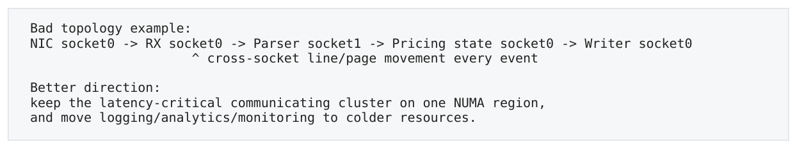

- ` Bad topology example: `
- ` NIC socket0 → RX socket0 → Parser socket1 → Pricing state socket0 → Writer socket0 `
- ` ^ cross-socket line/page movement every event `
- ` Better direction: `
- ` keep the latency-critical communicating cluster on one NUMA region, `
- ` and move logging/analytics/monitoring to colder resources. `

</details>

<a id="pdf-page-029"></a>

<!-- source-pdf-page: 29 -->

*[原 PDF 第 29 页](./Level3_Memory_Hierarchy_CN.pdf#page=29)*

每增加一个 thread hop，都可能需要 queue metadata handoff + payload cache-line migration。Latency-first pipeline 有时宁愿一个 pinned thread 做更多 stage，也不愿为了 theoretical throughput 把每一步拆成跨 core pipeline。

### 9.5 Memory Diagnosis Tree

**图示转写**

- ` Backend Memory Bound? `
  - ` L1 / core-side? → load/store ports, AGU, forwarding `
  - ` L2 / LLC? → capacity, conflict, access pattern `
  - ` DRAM? `
    - ` latency-bound → low MLP / pointer dependency `
    - ` bandwidth-bound → channels saturated / too many bytes `
  - ` TLB? → active pages, page walks, huge pages `
  - ` Coherence? → true sharing, false sharing, HITM `
  - ` Store-side? → store buffer / RFO / write allocate `
  - ` NUMA? → remote DRAM, remote cache-to-cache, NIC topology `

<details>
<summary>查看原图与完整文字转写</summary>

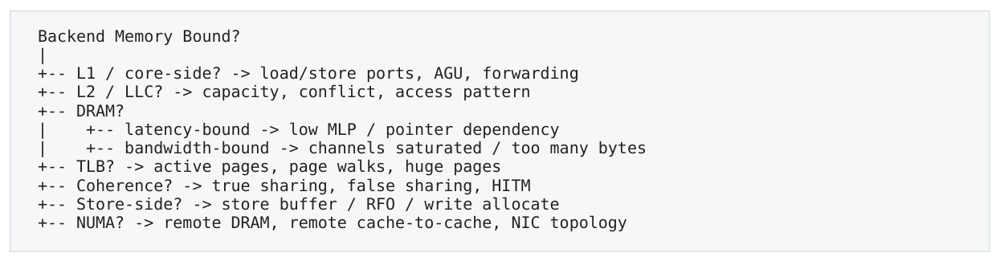

- ` Backend Memory Bound? `
- ` -- L1 / core-side? → load/store ports, AGU, forwarding `
- ` -- L2 / LLC? → capacity, conflict, access pattern `
- ` -- DRAM? `
- ` -- latency-bound → low MLP / pointer dependency `
- ` -- bandwidth-bound → channels saturated / too many bytes `
- ` -- TLB? → active pages, page walks, huge pages `
- ` -- Coherence? → true sharing, false sharing, HITM `
- ` -- Store-side? → store buffer / RFO / write allocate `
- ` -- NUMA? → remote DRAM, remote cache-to-cache, NIC topology `

</details>

诊断原则  “Memory Bound” 只是分类入口，不是根因。必须继续向下拆到具体 cache level / translation / coherence / topology，并用 controlled experiment 验证。

### 9.6 Controlled Experiments

| Hypothesis | 只改变什么 | 预期证据 |
| --- | --- | --- |
| Conflict miss | 4096 stride -&gt; 4160；或改变 padding/base offset | cycles/access 与 L1 miss 同步下降，而working set 不变。 |
| TLB pressure | 4KB vs explicit/THP 2MB；或 compact allocator | dTLB/page-walk counters 下降，random large-set latency 改善。 |
| False sharing | 把两个 writers 的 fields 分不同 line | cache-to-cache/HITM 与 tail 明显下降。 |
| NUMA remote | 固定 CPU，membind local vs remote | local/remote cycles/access 呈稳定差异。 |
| Latency vs bandwidth | 增加 independent chains/MLP vs 减少 bytes | 前者只对 latency-bound 明显；后者对bandwidth-bound 明显。 |

### 9.7 Perf / VTune / PMU：Counters 是证据，不是故事起点

常用信号包括 cycles/instructions、L1/L2/LLC demand misses、dTLB misses/page walks、memory bandwidth、 load latency samples、HITM/cache-to-cache、local/remote DRAM。事件名和语义高度 CPU-specific，尤其 offcore/PEBS 事件必须按目标 PMU 文档解释。 推荐流程：先从代码/布局提出 hypothesis -&gt; 预测哪些 counters 应变化 -&gt; 再测量。若 counter 改变但 cycles/usefulwork 不变，它可能只是相关现象而非主 bottleneck。

**图示转写**

1. ` Hypothesis-driven example: `
2. ` "This is false sharing" `
3. ` → predict high cache-to-cache/HITM and poor scaling `
4. ` → separate the fields into different lines `
5. ` → expect both traffic and cycles/message to drop `

<details>
<summary>查看原图与完整文字转写</summary>

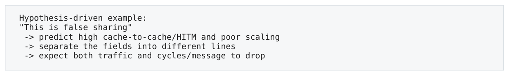

- ` Hypothesis-driven example: `
- ` "This is false sharing" `
- ` → predict high cache-to-cache/HITM and poor scaling `
- ` → separate the fields into different lines `
- ` → expect both traffic and cycles/message to drop `

</details>

### 9.8 Memory 优化的优先级

12. 先改错误的 algorithm/data structure：减少 pointer dependency 和无谓 hot state。

13. 让 hot working set compact，改善 cache-line/page utilization。

14. 再看 prefetch/MLP：能否让 independent misses overlap。

15. 再处理 TLB/huge pages、coherence ownership、NUMA/device topology。

<a id="pdf-page-030"></a>

<!-- source-pdf-page: 30 -->

*[原 PDF 第 30 页](./Level3_Memory_Hierarchy_CN.pdf#page=30)*

16. 最后才考虑 DRAM bank mapping 等高度平台相关 micro-details。

### 9.9 面表：“Cache Friendly”升级到机制解释

低质量回答：“array 比 linked list 快，因为 cache friendly。”

更好的回答  Array addresses are arithmetic and predictable, so spatial locality, hardware prefetch and MLP are strong; many elements share the same lines/pages. A linked list introduces a load-to-load dependency because the next address is only known after the current node returns, so MLP is low and cache/DRAM latency is exposed. If nodes are scattered, TLB locality is also worse.

低质量回答：“atomic 慢，因为有 lock。”

更好的回答  A contended atomic RMW needs exclusive ownership of the cache line. Multiple cores repeatedly transfer that ownership through the coherence protocol, so the main cost is cache-line serialization and intercore traffic, not the integer add itself. Relaxed ordering does not remove this ownership cost.

### 9.10 第三层最终心智模型

**图示转写**

| 场景 / 部分 | 路径、状态或说明 |
| --- | --- |
| C++ load/store | ` Address generation + dependency `；` TLB / translation `；` L1 → L2 → LLC `；` → another core owns line? → coherence/cache-to-cache `；` Local or remote memory controller `；` Channel → Bank → Row Buffer → DRAM ` |
| Performance depends on | ` locality + MLP/prefetch + translation + ownership + topology ` |

<details>
<summary>查看原图与完整文字转写</summary>

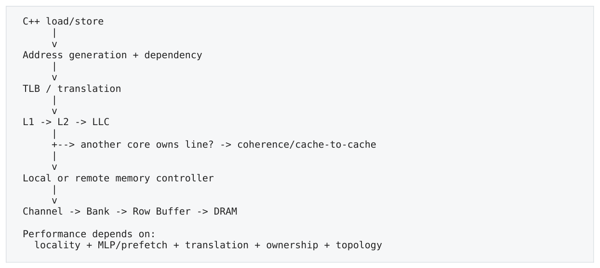

- ` C++ load/store `
- ` Address generation + dependency `
- ` TLB / translation `
- ` L1 → L2 → LLC `
- ` → another core owns line? → coherence/cache-to-cache `
- ` Local or remote memory controller `
- ` Channel → Bank → Row Buffer → DRAM `
- ` Performance depends on: `
- ` locality + MLP/prefetch + translation + ownership + topology `

</details>

第三层最终一句话  Latency 决定 serial dependency miss 有多痛；bandwidth 决定大量 independent traffic 能吞多快；layout 决定你到底搬多少 line/page；MLP/prefetch 决定能隐藏多少；coherence/NUMA 决定共享数据要跨多远。

<a id="pdf-page-031"></a>

<!-- source-pdf-page: 31 -->

*[原 PDF 第 31 页](./Level3_Memory_Hierarchy_CN.pdf#page=31)*

## 附录 A 术语、误区、实验与复习清单

### A.1 核心术语表

| 术语 | 定义 |
| --- | --- |
| Cache line | cache/coherence 的基本数据粒度，主流 x86 常见 64B。 |
| Working set | 某时间窗口内频繁访问的 hot data/lines/pages 集合。 |
| Spatial locality | 访问附近地址的倾向。 |
| Temporal locality | 短时间内重复访问同一数据。 |
| Associativity | 同一个 set 可同时容纳多少不同 lines。 |
| Conflict miss | 同一 set 活跃 lines 超过 ways 导致的 eviction。 |
| MLP | Memory-Level Parallelism；多个独立 memory requests 同时 outstanding。 |
| Prefetch | 在 demand 前提前拉近未来 line，以隐藏 latency。 |
| TLB | Virtual page -&gt; physical page translation cache。 |
| TLB reach | TLB entries x page size，可直接覆盖的 translation working set。 |
| Page walk | TLB miss 后遍历多级 page table 的 hardware process。 |
| Store Buffer | 暂存 pending stores，使 core 不必等全局可见后才继续。 |
| Store forwarding | younger load 直接读取 older pending store 的数据。 |
| Memory disambiguation | 预测 younger load 是否依赖 older unresolved store。 |
| RFO | Request/Read For Ownership；取得 cache-line 可写 ownership。 |
| False sharing | 不同变量因共享同一 cache line 而发生 coherence ping-pong。 |
| HITM | 请求命中另一 core/cache 的 Modified data，常用于识别共享热点。 |
| NUMA | Memory access cost 随 CPU/physical memory topology 而变化。 |
| First touch | 首次触碰 page 影响 physical allocation/NUMA placement 的常见 Linux 行为。 |
| Row hit | DRAM bank 当前 active row 正是目标 row。 |

### A.2 常见误区对照

| 错误直觉 | 更准确的解释 |
| --- | --- |
| “L1 hit 所以免费” | L1 仍有 load-use latency、load/store ports、AGU、LSQ resource 与dependency。 |
| “Working set &lt; L1 就全 hit” | Set associativity/conflict、coherence invalidation、其他 active data 都会破坏。 |
| “Cache miss 多就一定慢” | Miss 可以 prefetch/overlap；critical-path miss 与 independent streaming miss 完全不同。 |
| “Random access = low MLP” | 若 future random addresses 已知，MLP 可高；pointer chase 才是典型 serial。 |
| “Huge page 让 cache 更大” | Huge page 主要改善 TLB reach/page walk，不改变 cache line/容量。 |
| “TLB miss 会进 kernel” | 普通 TLB miss 通常由 hardware page walk；page fault 才进入 kernel。 |
| “Store retire 后大家已经看到” | Retired store 仍可能在 Store Buffer；visibility 是后续阶段。 |
| “Relaxed atomic 就没有开销” | Atomicity/ownership contention 仍在；relaxed 只减少 ordering。 |
| “Lock-free = 快” | Progress guarantee 不等于 contention-free；CAS hot line 可极慢。 |
| “Pin CPU 就解决 NUMA” | Memory pages/NIC/device 也必须与 CPU topology 对齐。 |
| “更高 DDR 频率让 pointer chase 按比例变 | 高 data rate 主要改善 bandwidth，serial latency 未必同比改善。 |

<a id="pdf-page-032"></a>

<!-- source-pdf-page: 32 -->

*[原 PDF 第 32 页](./Level3_Memory_Hierarchy_CN.pdf#page=32)*

快”

### A.3 典型量级（只用于建立数量级）

| 层级/事件 | 典型量级直觉 | 注意 |
| --- | --- | --- |
| L1 hit | 几 cycles | 不同 CPU/operand form 不同；L1 hit 仍可能dependency/resource-bound。 |
| L2 hit | 十几 cycles | 代际/架构差异明显。 |
| LLC hit | 几十 cycles | 还与 LLC slice/topology 相关。 |
| DRAM | 几十到 100ns+；几百 cycles 常见 | row state、queueing、frequency、NUMA 都改变distribution。 |
| TLB miss/page walk | tens to hundreds cycles 甚至更高 | 取决于 STLB/page-table cache hit。 |
| Minor page fault | thousands+ cycles | 涉及 kernel、allocation/zeroing/page table。 |
| Remote NUMA | 通常明显慢于 local | 差值平台相关，不要死背倍数。 |

### A.4 推荐 Microbenchmarks

17. Stride benchmark：固定大数组，stride 从 1 line 到 8KB，观察 cycles/access、4KB 等 performance cliffs。

18. Pointer chain vs random independent indices：控制相同 data set，比较低 MLP 与高 MLP 的差异。

19. AoS vs SoA：只读取一个 field across many objects，测 bytes/useful element 与 bandwidth。

20. TLB reach：one word per page，逐步增加 active pages；比较 4KB 与 2MB pages。

21. False sharing：两线程分别更新同一 line 的不同 counters，再用 padding 分离。

22. NUMA local/remote：固定 core，分别绑定 data 到 local/remote node，测 random load latency 与 streaming bandwidth。

23. Store forwarding：matched-width aligned store+load vs partial-overlap/mismatched width。

24. SPSC topology：same socket vs cross socket，比较 one-way message handoff 与 metadata placement。 Microbenchmark 必须固定 frequency/pinning、预热/pretouch、避免 compiler dead-code elimination，并用 cycles/useful-work 作为核心指标。生产结论还要在真实 traffic distribution 下复核。

### A.5 高频面试问答

| 问题 | 回答要点 |
| --- | --- |
| Why can a linked list be slow even if all nodes fit L3? | Because each next address depends on the previous node load. Even with L3 hits, the load-to-load dependency limits MLP and exposes LLC latency; scattered layout also hurts line/page locality. |
| Why can a small working set miss in L1? | Set associativity: several active lines may map to the same set and exceed the available ways, causing conflict evictions even while other sets are empty. |
| Why do huge pages help? | They increase TLB reach and reduce page walks/page-table overhead; they do not enlarge data caches or remove DRAM latency. |
| Does in-order retirement guarantee memory ordering? | No. A retired store may still be buffered and not globally visible. ISA ordering, store buffers, coherence and fences determine cross-core visibility. |
| Why is false sharing expensive? | Coherence operates at cache-line granularity. Independent writers on different fields still transfer/invalidate the same line repeatedly. |
| Why is memory_order_relaxed not enough for a contended counter? | Relaxed removes ordering constraints, not atomicity or exclusive cache-line ownership; the RMW still serializes through coherence. |
| Why is CPU pinning not enough for NUMA? | Pinning places execution, not necessarily physical pages or devices. First touch/memory policy and NIC PCIe locality also matter. |
| How do you distinguish memory latency- | Latency-bound shows low useful MLP and exposed dependent stalls even with |

<a id="pdf-page-033"></a>

<!-- source-pdf-page: 33 -->

*[原 PDF 第 33 页](./Level3_Memory_Hierarchy_CN.pdf#page=33)*

modest GB/s; bandwidth-bound has many independent requests and traffic near bound vs bandwidth-bound? sustainable channel limits.

### A.6 第三层复习清单

- [ ] 1. 能解释为什么 array 与 linked list 即使 miss rate 类似仍可能差几倍。

- [ ] 2. 能从 64B line 推导 cache-line utilization 与 traffic amplification。

- [ ] 3. 能解释 32KB/8-way/64B L1 中 4KB stride 为什么可能映射同 set。

- [ ] 4. 能区分 prefetch 与 MLP；知道 random access 不自动等于低 MLP。

- [ ] 5. 能解释 TLB、TLB reach、page walk、huge page、page fault 的区别。

- [ ] 6. 能解释 store execute / retire / visibility 三个阶段。

- [ ] 7. 能解释 x86 Store-&gt;Load reordering mental model 与 store-buffer litmus。

- [ ] 8. 能解释 false sharing、true sharing、RFO、cache-to-cache transfer。

- [ ] 9. 能说明 relaxed atomic 仍可能被 coherence contention 卡住。

- [ ] 10. 能说明 single-writer / sharding 为什么同时改善 locks、coherence 与 NUMA。

- [ ] 11. 能解释 memory channel 提升主要是 bandwidth，不直接消除 serial DRAM latency。

- [ ] 12. 能说明 first touch、membind/interleave 与 CPU/NIC affinity 的关系。

- [ ] 13. 看到 Backend Memory Bound 时能继续拆成 cache/TLB/DRAM/coherence/NUMA。

- [ ] 14. 能提出一个只改变一个变量的实验去验证 memory hypothesis。

### A.7 最终诊断算法

**图示转写**

- ` Hot C++ / assembly `
- ` Define useful-work unit: message / order / element `
- ` What addresses/lines/pages are touched? `
  - ` Layout: useful bytes per line/page? `
  - ` Dependency: next address known early? `
  - ` Prefetch / MLP? `
  - ` Cache level / conflict / capacity? `
  - ` TLB/page walk? `
  - ` Store forwarding / buffers? `
  - ` Shared writable line / coherence? `
  - ` Local or remote NUMA / NIC topology? `
    ` Predict dominant bottleneck `
    ` Change ONE variable + measure counters/latency `
    ` Does evidence support the hypothesis? `

<details>
<summary>查看原图与完整文字转写</summary>

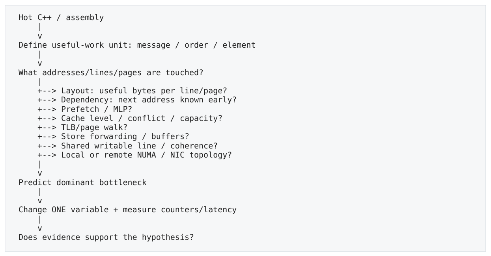

- ` Hot C++ / assembly `
- ` Define useful-work unit: message / order / element `
- ` What addresses/lines/pages are touched? `
- ` → Layout: useful bytes per line/page? `
- ` → Dependency: next address known early? `
- ` → Prefetch / MLP? `
- ` → Cache level / conflict / capacity? `
- ` → TLB/page walk? `
- ` → Store forwarding / buffers? `
- ` → Shared writable line / coherence? `
- ` → Local or remote NUMA / NIC topology? `
- ` Predict dominant bottleneck `
- ` Change ONE variable + measure counters/latency `
- ` Does evidence support the hypothesis? `

</details>

第三层学完之后，看到一段 hot C++，不要停在“cache friendly / cache miss”这种描述。把代码翻译成 cache-line/page footprint、address dependency、MLP、translation、ownership 与 physical topology；再用 perf/VTune/NUMA/c2c 与 controlled benchmark 验证。

<a id="conversion-errata"></a>

## 转换补充与勘误

本节及正文中“转换补充 / 转换勘误”均为 2026-11-06 转换时新增；原 PDF 仍是原始内容与版式的对照。

- [原 PDF 第 16 页处的补充](#pdf-page-016)：THP 不应一概等同于 2 MiB PMD huge page；现代 Linux 还支持 multi-size THP。

### 适用边界

原文中的时延、cache/ROB 大小、PMU event、kernel 参数及 compiler lowering 均需要绑定具体平台。转写结构的覆盖校验不等同于对全部技术命题的逐条实测；复杂图的精确布局以随附原图为准。
