# CPU Latency Pathology

> 来源：[Level4_CPU_Latency_Pathology_CN.pdf](./Level4_CPU_Latency_Pathology_CN.pdf)（31 页）。本文件按原文逐页转写；转换补充与勘误单独标明。

> 图示优先转为 Mermaid、表格或步骤；每图附原图和文字以便核对。代码保留原文逻辑与缩进，跨页片段及概念示例未宣称可以独立编译。

[返回目录](README.md) · [转换说明与校验](CONVERSION_NOTES.md) · [本文补充与勘误](#conversion-errata)

[原文目录](#pdf-page-003) · [第一章正文](#pdf-page-005)

<a id="pdf-page-001"></a>

<!-- source-pdf-page: 1 -->

*[原 PDF 第 1 页](./Level4_CPU_Latency_Pathology_CN.pdf#page=1)*

## Latency Pathology

### C++ / CPU 深度学习 - 第四层完整讲义

Diagnosis Framework · Frontend · Dependency · Memory · Coherence · Scheduler/IRQ · NUMA/Paging · Tail Latency · perf/VTune/BPF 目标：从“系统变慢”出发，建立 symptom → hypothesis → evidence → controlled experiment → causality 的完整低延迟诊断方法。 2026-08 · 详尽版

第四层的核心转变  前三层主要回答“机器如何工作”；第四层回答“机器为什么在这一刻没有让关键请求继续 forward progress，以及如何证明原因”。

<a id="pdf-page-002"></a>

<!-- source-pdf-page: 2 -->

*[原 PDF 第 2 页](./Level4_CPU_Latency_Pathology_CN.pdf#page=2)*

## 如何使用这份讲义

这份 PDF 不是 Session 1-8 的聊天记录拼接，而是按真实性能诊断顺序重新组织。你应该先用第 1 章建立统一分类框架， 然后依次学习 Frontend、Backend、Memory、Coherence、OS、NUMA/Paging，最后用第 8 章把所有证据串成 production RCA。

最核心的方法  不要从 counter 出发编故事。先描述 symptom，提出可证伪 hypothesis，明确它应产生什么 observable evidence，再通过一次只改变一个变量的 experiment 去验证。 本文讨论现代高性能 superscalar out-of-order CPU 与 Linux server 的通用性能原则。Intel/AMD、不同 generation、 kernel、BIOS、NUMA topology、PMU event 名称都会变化。任何具体 cycle/ns 数字都应绑定具体硬件与配置。

### 阅读路线

| 章节 | 主题 | 最终要回答的问题 |
| --- | --- | --- |
| 第 1 章 | 统一诊断框架 | 慢的是 queueing、service、on-CPU 还是off-CPU？ |
| 第 2 章 | Frontend Pathology | Backend 为什么吃不饱？branch/I-cache/ITLB/µop supply 哪一环断粮？ |
| 第 3 章 | Backend / Dependency | 是 operand 没 ready，还是 execution resource 不够？ |
| 第 4 章 | Memory Latency | 是 latency 还是bandwidth？MLP/Prefetch/working set 如何决定暴露程度？ |
| 第 5 章 | Coherence | 谁在写这条 cache line？ownership 为什么在core 间 bounce？ |
| 第 6 章 | OS / Scheduler / IRQ | 线程是否根本没在运行？谁抢走了 CPU 时间？ |
| 第 7 章 | NUMA / Allocation / Paging | 线程绑核后，page 到底在哪里？TLB/fault/allocator 如何制造 tail？ |
| 第 8 章 | Tail &amp; Production RCA | 如何把 slow request、OS trace、PMU 与controlled experiment 对齐？ |

### 贯穿全书的五个问题

- 关键 request 现在为什么不能继续 forward progress？

- 它是在 queue 里等待、在 CPU 上等待 operand/resource，还是根本没有执行？

- 当前 slow event 是否位于 business critical path？

- 哪个 observable evidence 能区分竞争的 hypotheses？

- 怎样只改变一个变量，让问题消失或稳定复现？

<a id="pdf-page-003"></a>

<!-- source-pdf-page: 3 -->

*[原 PDF 第 3 页](./Level4_CPU_Latency_Pathology_CN.pdf#page=3)*

## 原文目录

- [1. Latency Pathology 的统一诊断框架](#pdf-page-005)
- [1.1 什么是 Latency Pathology](#pdf-page-005)
- [1.2 Throughput / Latency / Utilization](#pdf-page-005)
- [1.3 Persistent vs Intermittent](#pdf-page-006)
- [1.4 On-CPU vs Off-CPU](#pdf-page-006)
- [1.5 Critical Path 与 Queueing](#pdf-page-006)
- [1.6 Top-Down 的位置与边界](#pdf-page-006)
- [1.7 Hypothesis-driven diagnosis](#pdf-page-007)
- [1.8 Measurement discipline](#pdf-page-007)
- [2. Frontend Pathology](#pdf-page-008)
- [2.1 Instruction-supply chain](#pdf-page-008)
- [2.2 Branch prediction / misprediction](#pdf-page-008)
- [2.3 Indirect branch / virtual dispatch](#pdf-page-008)
- [2.4 L1I / instruction working set](#pdf-page-008)
- [2.5 ITLB / µop cache / decode](#pdf-page-009)
- [2.6 Inlining / switch / branchless trade-off](#pdf-page-009)
- [2.7 Hot/cold layout / PGO](#pdf-page-009)
- [2.8 Frontend diagnosis](#pdf-page-009)
- [3. Backend / Dependency Pathology](#pdf-page-011)
- [3.1 Backend 的三种等待](#pdf-page-011)
- [3.2 RAW 与 critical dependency chain](#pdf-page-011)
- [3.3 Latency vs throughput](#pdf-page-011)
- [3.4 Multiple accumulators / ILP](#pdf-page-011)
- [3.5 Port/resource pressure](#pdf-page-012)
- [3.6 AGU / load-store resources](#pdf-page-012)
- [3.7 Memory disambiguation / forwarding](#pdf-page-012)
- [3.8 Spill / unroll trade-off](#pdf-page-012)
- [3.9 Backend diagnosis](#pdf-page-012)
- [4. Memory Latency Pathology](#pdf-page-014)
- [4.1 Memory latency hierarchy](#pdf-page-014)
- [4.2 MLP](#pdf-page-014)
- [4.3 Latency-bound vs bandwidth-bound](#pdf-page-014)
- [4.4 Prefetch](#pdf-page-014)
- [4.5 Working set / locality](#pdf-page-015)
- [4.6 AoS/SoA / cache density](#pdf-page-015)
- [4.7 Pointer chasing / hash/tree](#pdf-page-015)
- [4.8 TLB-aware memory thinking](#pdf-page-015)
- [4.9 Memory diagnosis](#pdf-page-015)
- [5. Coherence Pathology](#pdf-page-017)
- [5.1 Coherence operates on cache lines](#pdf-page-017)
- [5.2 MESI / ownership / RFO](#pdf-page-017)
- [5.3 False vs true sharing](#pdf-page-017)
- [5.4 Atomic hotspot / CAS](#pdf-page-017)
- [5.5 Locks / MCS / distributed waiting](#pdf-page-018)
- [5.6 Reader-writer fan-out](#pdf-page-018)
- [5.7 SPSC / message passing](#pdf-page-018)
- [5.8 Sharding / single owner](#pdf-page-018)
- [5.9 perf c2c / HITM diagnosis](#pdf-page-018)
- [6. OS / Scheduler / Interrupt Pathology](#pdf-page-020)
- [6.1 Wall time vs CPU time](#pdf-page-020)
- [6.2 Preemption / blocking / runqueue](#pdf-page-020)
- [6.3 CPU migration / affinity / isolation](#pdf-page-020)
- [6.4 IRQ / softirq](#pdf-page-020)
- [6.5 nohz_full / rcu_nocbs](#pdf-page-020)
- [6.6 Page fault / syscall / allocation slow path](#pdf-page-021)

<a id="pdf-page-004"></a>

<!-- source-pdf-page: 4 -->

*[原 PDF 第 4 页](./Level4_CPU_Latency_Pathology_CN.pdf#page=4)*

- [6.7 Busy spin / RT scheduling](#pdf-page-021)
- [6.8 SMI / frequency / SMT](#pdf-page-021)
- [6.9 OS diagnosis](#pdf-page-021)
- [7. NUMA / Allocation / Paging Pathology](#pdf-page-023)
- [7.1 NUMA topology](#pdf-page-023)
- [7.2 First-touch](#pdf-page-023)
- [7.3 Local vs remote latency](#pdf-page-023)
- [7.4 NUMA-aware sharding](#pdf-page-023)
- [7.5 TLB / page walk](#pdf-page-023)
- [7.6 Huge pages / THP](#pdf-page-023)
- [7.7 Allocator / arena / object pool](#pdf-page-024)
- [7.8 TLB shootdown](#pdf-page-024)
- [7.9 NUMA/paging diagnosis](#pdf-page-024)
- [8. Tail Latency &amp; Production Diagnosis](#pdf-page-025)
- [8.1 Characterize distribution](#pdf-page-025)
- [8.2 Service vs queueing](#pdf-page-025)
- [8.3 Time correlation](#pdf-page-025)
- [8.4 Tail-aware observability](#pdf-page-025)
- [8.5 Case studies](#pdf-page-025)
- [8.6 Coordinated omission / replay](#pdf-page-026)
- [8.7 Scope &amp; topology analysis](#pdf-page-026)
- [8.8 Production RCA methodology](#pdf-page-027)
- [A. 附录](#pdf-page-028)
- [A.1 Symptom → Hypothesis → Evidence 矩阵](#pdf-page-028)
- [A.2 工具选择地图](#pdf-page-028)
- [A.3 面试问答](#pdf-page-029)
- [A.4 推荐实验](#pdf-page-029)
- [A.5 Production checklist](#pdf-page-030)
- [A.6 术语表](#pdf-page-030)
- [A.7 最终心智模型](#pdf-page-031)

<a id="pdf-page-005"></a>

<!-- source-pdf-page: 5 -->

*[原 PDF 第 5 页](./Level4_CPU_Latency_Pathology_CN.pdf#page=5)*

## 第 1 章 Latency Pathology 的统一诊断框架

本章目标  把“程序慢”拆成可诊断的问题：distribution 形状、queueing/service、on-CPU/off-CPU、critical path、 system scope，并建立 hypothesis → evidence → experiment 的固定流程。

### 1.1 什么是 Latency Pathology

Latency pathology 指导致 latency 异常、恶化、抖动或长尾的机制。它既可以是稳定的每次都慢，也可以是绝大多数请求正常、极少数突然慢几十微秒甚至毫秒。第四层的对象不是某条指令，而是关键业务请求为何没有按预期速度 forward progress。

```text
normally:   2 us
occasionally: 35 us
```

或者：

```text
1 thread : 5 ns/op
8 threads: 40 ns/op
```

核心转换  “CPU bound”太粗。必须继续拆成 frontend、dependency/resource、memory、coherence、 scheduler/IRQ、runtime、NUMA/paging 等机制。

### 1.2 Throughput、Latency 与 Utilization

吞吐回答单位时间完成多少工作；latency 回答一个请求从进入到完成花多久；utilization 只说明某资源多忙。三者相关但不能互相替代。一个 batch 系统可以吞吐很高但单请求等待很久；一个线程可以 100% CPU 只是 spin；一台 64-core 机器整体 CPU 20%，但关键 single-owner core 已经 100%。

| 指标 | 回答的问题 | 常见误判 |
| --- | --- | --- |
| Latency | 一个请求多久完成？ | 平均值好看就认为系统好 |
| Throughput | 单位时间处理多少？ | 吞吐高就推导单请求快 |
| CPU Utilization | CPU 时间被占用多少？ | 100% 就是 computation-bound |
| IPC | 每 cycle 完成多少 instructions | 把高 IPC 当成业务性能目标 |
| Queue Depth | 积压了多少 work？ | 不结合 arrival/service rate 解读 |

Percentile 与 tail

低延迟系统通常需要 p50、p90、p99、p99.9、p99.99 与 max 一起看。p50 基本不动但 p99.9 爆炸，常提示 rare disturbance；整个 distribution 平移，则更像 persistent cost。

```text
p50      2.1 us
p90      2.4 us
p99      3.0 us
p99.9   18.0 us
p99.99  90.0 us
max      4 ms
```

重要  极端 percentile 必须配合样本量。p99.99 是 1/10,000 级别；只有几千样本时不能稳定估计。

<a id="pdf-page-006"></a>

<!-- source-pdf-page: 6 -->

*[原 PDF 第 6 页](./Level4_CPU_Latency_Pathology_CN.pdf#page=6)*

### 1.3 Persistent vs Intermittent

| 类型 | 典型 histogram | 优先方向 |
| --- | --- | --- |
| Persistent | p50/p99/p99.9 整体移动 | extra work、dependency、frontend、working set、NUMA、持续 contention |
| Intermittent | p50 稳定，仅长尾突起 | preemption、IRQ、fault、allocation slow path、rare miss/rare path、coherence collision |

这只是 hypothesis prior，而不是定律。rare input 也可以触发 backend slow path；持续 coherence contention 也可以让整个分布都变差。

### 1.4 On-CPU vs Off-CPU

这是最有杠杆的第一分叉。Wall-clock 50us 并不意味着函数执行了 50us：线程可能只做了 4us work，中间被切走 46us。

**图示转写**

- ` wall latency = useful CPU work + unhidden stalls + queueing + off-CPU/interruption time `
- ` Slow request `
  - ` thread running? → CPU/memory/coherence `
  - ` not progressing → scheduler/blocking/IRQ/fault/SMI `

<details>
<summary>查看原图与完整文字转写</summary>

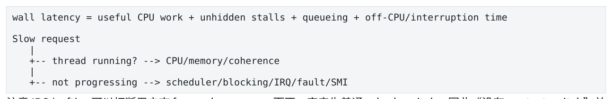

- ` wall latency = useful CPU work + unhidden stalls + queueing + off-CPU/interruption time `
- ` Slow request `
- ` -- thread running? → CPU/memory/coherence `
- ` -- not progressing → scheduler/blocking/IRQ/fault/SMI `

</details>

注意 IRQ/softirq 可以打断用户态 forward progress，而不一定产生普通 sched_switch，因此“没有 context switch”并不能直接证明线程连续执行。

### 1.5 Critical Path 与 Queueing

不是所有慢 operation 都影响 latency。两个 100-cycle independent loads 可以 overlap；十个 serial dependent loads 可能比更多 independent misses 更糟。性能分析要问“这个事件是否位于 critical path”。

**图示转写**

| 模式 | 数据依赖 |
| --- | --- |
| Independent | A、B、C 彼此独立，最后一起 use |
| Dependent | A → result → B → result → C → result |

<details>
<summary>查看原图与完整文字转写</summary>

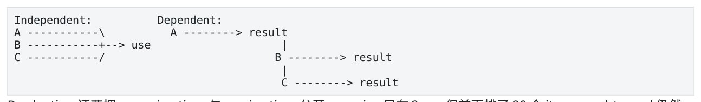

- ` Independent: Dependent: `
- ` A \ A → result `
- ` B +→ use `
- ` C / B → result `
- ` C → result `

</details>

Production 还要把 queueing time 与 service time 分开。service 只有 2us，但前面排了 20 个 item，end-to-end 仍然可以几十微秒。

统一 mental model  Observed latency ≈ critical-path execution + unhidden stalls + queueing + off-CPU time + external interference。它不是严格数学公式，但非常适合诊断。

### 1.6 Top-Down 的位置与边界

Intel Top-Down 常把 pipeline slots 分为 Retiring、Bad Speculation、Frontend Bound、Backend Bound。它非常适合 on-core 分类，但不是完整 tail-latency framework：scheduler、IRQ、blocking、page fault、queueing、NUMA placement 等不能仅靠 Top-Down 解释。Backend Bound 也不等价于 Memory Bound。

| Top-Down 类别 | 高层含义 |
| --- | --- |
| Retiring | CPU 在完成有用/至少可退休的 architectural work |

<a id="pdf-page-007"></a>

<!-- source-pdf-page: 7 -->

*[原 PDF 第 7 页](./Level4_CPU_Latency_Pathology_CN.pdf#page=7)*

| Top-Down 类别 | 高层含义 |
| --- | --- |
| Bad Speculation | wrong-path/machine-clear 等工作被浪费 |
| Frontend Bound | 正确 µops 供应不足 |
| Backend Bound | µops 已进入 backend，但 operand/data/resource 阻止执行 |

### 1.7 Hypothesis-driven diagnosis

1. 精确定义 symptom：哪条 path、何时开始、哪些 percentiles、什么 load。

2. 区分整个 distribution 平移还是仅 tail。

3. 区分 queueing 与 service time。

4. 判断 worker 是否持续 forward progress。

5. 建立多个竞争 hypotheses，而不是只选最顺眼的一个。

6. 为每个 hypothesis 写出可观察 prediction。

7. 用最小成本工具收集 distinguishing evidence。

8. 一次只改一个变量做 controlled experiment。

9. 重新测相同 workload，确认 causality，而不是只看 correlation。

10. 检查旧 bottleneck 被移除后是否暴露新 bottleneck。

Correlation ≠ Causality

例如 L3 misses 上升可能是 root cause，也可能只是 CPU migration 后 cold cache 的结果。Counter 通常回答“发生了什么”，不自动回答“为什么发生”。最强的证据是 intervention：如果移动 IRQ、分离 cache line、绑定 NUMA 后 tail 稳定消失，因果链才真正变强。

### 1.8 Bimodal Distribution、Scope 与 Little's Law

Latency histogram 出现两个或多个峰，常说明系统存在不同 execution modes：hot/cold cache、local/remote NUMA、fast/slow path、不同 message classes。此时不要用一个平均值把 populations 混在一起，应按 workload、 CPU、instrument、path tag 分组。

另一个强线索是影响 scope：只一个 request、一个 thread、一个 logical CPU、一个 socket，还是全机同时发生？ Scope 能快速缩小 hypothesis，例如 only-CPU7 更像 IRQ/sibling/topology，同 socket 多 worker 同步慢可看 LLC/memory-controller/socket-level power，全机同步 mysterious gap 才考虑 firmware/SMI。

Queueing 中可用 Little's Law `L = λW` 做 sanity check：arrival rate 近似不变时，average queue depth 上升通常意味着 time-in-system 上升。它不是 tail 模型，但能帮助判断 dashboard 上的 queue/latency 是否自洽。

### 1.9 Measurement discipline

- 定义事件边界：NIC/app receive、enqueue、dequeue、stage complete、publish。

- 记录 distribution 而不是只记 average；注明 sample count 与 load regime。

- 控制 warm-up、CPU/NUMA、频率、IRQ、SMT、输入分布。

- 尽量使用 per-thread preallocated trace buffer，避免 logging/allocator observer effect。

- 对 slow sample 记录 CPU ID、queue depth、message type、instrument/client 等 context。

- 对比 baseline 比孤立的绝对 counter 更有意义。

<a id="pdf-page-008"></a>

<!-- source-pdf-page: 8 -->

*[原 PDF 第 8 页](./Level4_CPU_Latency_Pathology_CN.pdf#page=8)*

## 第 2 章 Frontend Pathology

本章目标  理解 Backend 为什么会“吃不饱”：control-flow prediction、instruction fetch、ITLB、µop cache、 decode 与 code footprint 如何共同决定正确 µops 的供应。

### 2.1 Instruction-supply chain

**图示转写**

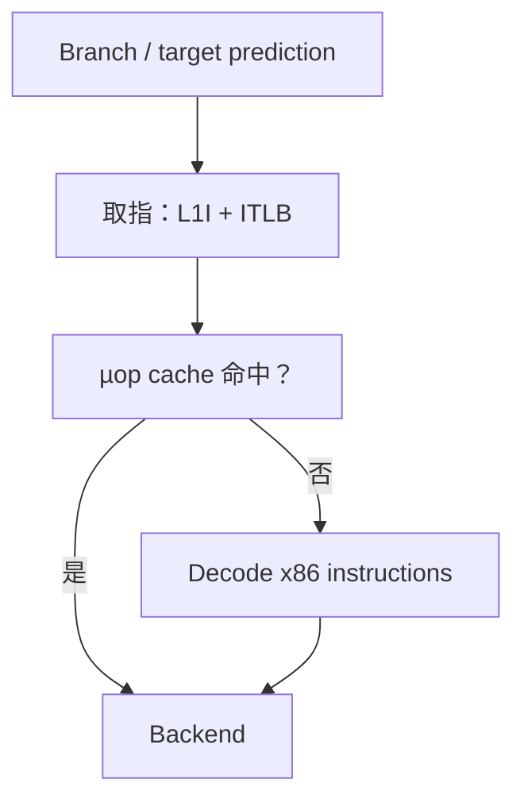

<details>
<summary>查看原图与完整文字转写</summary>

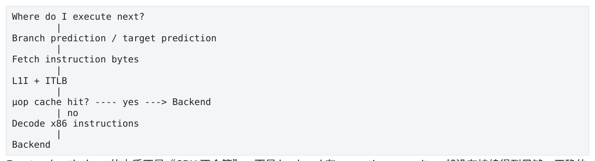

- ` Where do I execute next? `
- ` Branch prediction / target prediction `
- ` Fetch instruction bytes `
- ` L1I + ITLB `
- ` µop cache hit? yes → Backend `
- ` no `
- ` Decode x86 instructions `
- ` Backend `

</details>

Frontend pathology 的本质不是“CPU 不会算”，而是 backend 有 execution capacity，却没有持续得到足够、正确的 µops。Frontend 问题可以粗分为 wrong path、missing code、insufficient delivery bandwidth。

### 2.2 Branch Prediction 与 Misprediction

现代深流水线不能等 branch 真正执行完成后再取下一条，因此必须先预测 direction 与 target。预测错误会丢弃 younger wrong-path work、redirect fetch，并重新建立正确 instruction stream。Mispredict penalty 不是跨微架构固定的“15 cycles”，真正代价取决于 branch resolve、target availability、frontend state、pipeline depth 等。

**图示转写**

1. ` predict wrong path `
2. ` fetch / decode / rename / maybe execute `
3. ` branch resolves wrong `
4. ` squash younger work `
5. ` redirect + refill `

<details>
<summary>查看原图与完整文字转写</summary>

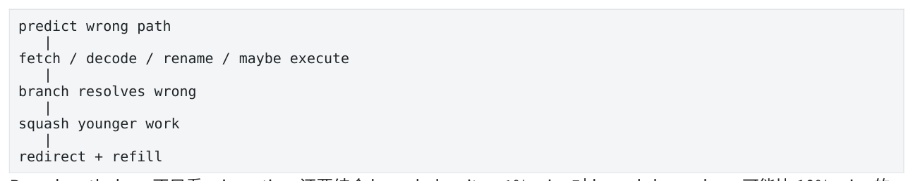

- ` predict wrong path `
- ` fetch / decode / rename / maybe execute `
- ` branch resolves wrong `
- ` squash younger work `
- ` redirect + refill `

</details>

Branch pathology 不只看 miss ratio，还要结合 branch density。1% miss 对 branch-heavy loop 可能比 10% miss 的极低频 cold branch 更重要。

### 2.3 Indirect Branch、Virtual Dispatch 与 Return

Direct branch 的 target 静态已知，主要预测 taken/not-taken；virtual call、function pointer、jump table 等 indirect branch 的 target 取决于运行时数据。Target 如果长期稳定，预测可能很好；target entropy 高时则容易产生 targetprediction pressure。

不要机械说 virtual 慢  真正成本可能来自 indirect target prediction、额外 pointer load dependency、无法 inline、 以及 scattered code footprint。是否重要要看 hotness 与 target distribution。

### 2.4 L1I 与 Instruction Working Set

数据有 working set，代码同样有 instruction working set。Hot path 过度膨胀会让 L1I 容量/冲突压力增加；rare code 被 inline 进 hot function，即使 branch 几乎不执行，也可能扩大 instruction footprint。

<a id="pdf-page-009"></a>

<!-- source-pdf-page: 9 -->

*[原 PDF 第 9 页](./Level4_CPU_Latency_Pathology_CN.pdf#page=9)*

**图示转写**

1. ` small stable hot path `
2. ` L1I / µop cache friendly `
3. ` large feature-accumulated path `
4. ` more lines/pages/targets `
5. ` frontend bubbles `

<details>
<summary>查看原图与完整文字转写</summary>

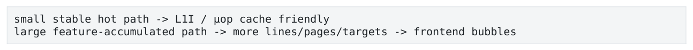

- ` small stable hot path → L1I / µop cache friendly `
- ` large feature-accumulated path → more lines/pages/targets → frontend bubbles `

</details>

Aggressive inlining 的 trade-off

| Inlining 收益 | Inlining 风险 |
| --- | --- |
| 去掉 call/ret | code size 增加 |
| constant propagation / DCE | L1I pressure |
| devirtualization / specialization | ITLB pressure |
| 更大 optimization scope | µop-cache pressure、BTB/branch footprint |

所以 low-latency 目标不是“所有函数都 inline”，而是 small, predictable, stable hot instruction working set。

### 2.5 ITLB、µop Cache 与 Decode

Instruction fetch 同样需要 virtual→physical translation。代码跨越更多 4KB pages 时 ITLB working set 增大；ITLB miss 会触发更深层 translation lookup/page walk。µop cache 则缓存 decoded operations，hot loop 命中时可绕过传统 decode。Code bloat 会同时伤害 instruction bytes、instruction pages 与 decoded µops 三个维度。

三个 footprint  Instruction bytes 主要影响 L1I；instruction pages 影响 ITLB；decoded µops 影响 µop/decodedop cache。 当 µop cache 未命中时需要传统 decode。复杂 x86 instruction 可能产生多个 µops 或走 microcode sequencer。这里关注的是 sustained frontend delivery，而不是 C++ statement 数量。

### 2.6 Switch、Branchless 与 CMOV

大型 switch 最终可能被编译成 compare chain、decision tree 或 jump table，取决于 case density 与 compiler。问题不只是“很多 if”，而可能是 target diversity、indirect prediction 与 large/scattered code footprint。把 switch 机械改成 function-pointer table 可能把问题换成 indirect branch。

Branchless 也不是普适优化：高度 predictable branch 可能几乎免费，而 cmov/算术形式可能形成更长 dependency chain 或执行本来可以跳过的工作。Branchless 主要在 misprediction cost 真正 dominant 时有价值。

### 2.7 Hot/Cold Layout 与 PGO

Rare error、logging、recovery、compliance path 应尽量 out-of-line，保持主路径 linear/fall-through。PGO 能利用真实 profile 决定 selective inlining、hot block placement 与 cold splitting，从而改善 L1I/branch/frontend locality。 LTO 同样扩大优化范围，但也可能进一步 code bloat，因此仍要测。

### 2.8 BTB、RAS、Fusion 与 Cold Start

Branch predictor 不只预测 direction，还需要 target。BTB 类结构缓存 branch target，return 常有 Return Address Stack；大量 branches/calls、scattered code 与 target diversity 都可能形成 frontend pressure。某些 compare/test + conditional branch 可 macro-fuse，某些带 memory operand 的工作在 frontend/backend 资源计数上还涉及 microfusion，因此不要用“assembly 指令条数”直接估算 frontend demand。

Cold start 还包括 predictor state、L1I、ITLB、µop cache、data cache 与 page state。Warm-up 不只是“把数据读一遍”，而是让整个 execution environment 进入接近 production steady state。

<a id="pdf-page-010"></a>

<!-- source-pdf-page: 10 -->

*[原 PDF 第 10 页](./Level4_CPU_Latency_Pathology_CN.pdf#page=10)*

Instruction alignment/fetch-boundary 也可能影响极端 tuning，但属于有证据后的高级优化。盲目给所有 functions 64B alignment 可能增加 padding 与 code footprint，反而更差。

### 2.9 Frontend Diagnosis

**图示转写**

- ` Frontend Bound high `
  - ` branch / target misses increased? `
  - ` L1I behavior worse? code footprint changed? `
  - ` ITLB / code pages? `
  - ` µop-cache / decode bandwidth? `
  - ` workload distribution / indirect targets changed? `

<details>
<summary>查看原图与完整文字转写</summary>

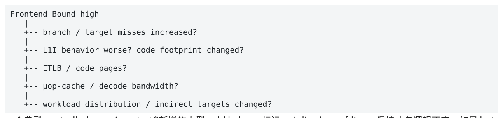

- ` Frontend Bound high `
- ` -- branch / target misses increased? `
- ` -- L1I behavior worse? code footprint changed? `
- ` -- ITLB / code pages? `
- ` -- µop-cache / decode bandwidth? `
- ` -- workload distribution / indirect targets changed? `

</details>

一个典型 controlled experiment：将新增的大型 cold helpers 标记 noinline/out-of-line，保持业务逻辑不变。如果 hot code size、L1I/Frontend Bound 与 latency 同时恢复，instruction-footprint hypothesis 得到强支持。

本章结论  Frontend 的最终产品是正确 µops；mispredict 的核心代价是 wrong-path work + redirect/refill；Inlining/branchless/switch 都是 workload-specific trade-off；small predictable hot code 是低延迟 frontend 的核心。

<a id="pdf-page-011"></a>

<!-- source-pdf-page: 11 -->

*[原 PDF 第 11 页](./Level4_CPU_Latency_Pathology_CN.pdf#page=11)*

## 第 3 章 Backend / Dependency Pathology

本章目标  区分 operand not ready 与 execution resource unavailable：dependency-bound、port/resourcebound、memory-bound 需要不同的实验和优化。

### 3.1 Backend 的三种等待

**图示转写**

- ` µop in backend `
  - ` operand not ready → dependency bound `
  - ` data not returned → memory-related dependency `
  - ` resource busy → port/resource throughput bound `

<details>
<summary>查看原图与完整文字转写</summary>

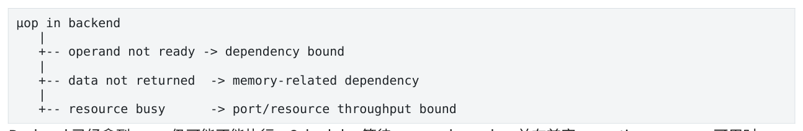

- ` µop in backend `
- ` -- operand not ready → dependency bound `
- ` -- data not returned → memory-related dependency `
- ` -- resource busy → port/resource throughput bound `

</details>

Backend 已经拿到 µops 仍可能不能执行。Scheduler 等待 operands ready，并在兼容 execution resource 可用时 issue。核心诊断问题不是“CPU 有没有 ALU”，而是“这个 ready µop 为什么现在不能 issue”。

### 3.2 RAW 与 Critical Dependency Chain

Register renaming 能消除 WAR/WAW name dependencies，但不能消除真实 RAW dependency。OoO 可以在有限 window 内寻找独立 work，却不能创造不存在的 data independence。

```text
double sum = 0;
for (...)
    sum += a[i];

s0 -> ADD -> s1 -> ADD -> s2 -> ADD -> ...
```

如果 FP ADD latency 为若干 cycles，即使 execution unit 每 cycle 能接受新的 independent ADD，单 accumulator 仍然只能按 result-ready 顺序推进。

### 3.3 Instruction Latency vs Throughput

| 概念 | 问题 | 典型限制 |
| --- | --- | --- |
| Latency | dependent consumer 多久能用结果？ | critical dependency chain |
| Reciprocal throughput | 独立 operations 多久能持续启动一次？ | execution-resource capacity |

同一 instruction 可以 latency=3 cycles、throughput=1/cycle，同时完全成立。Serial chain 看 latency；足够多 independent operations 看 resource throughput。

### 3.4 Multiple Accumulators 与 ILP

**图示转写**

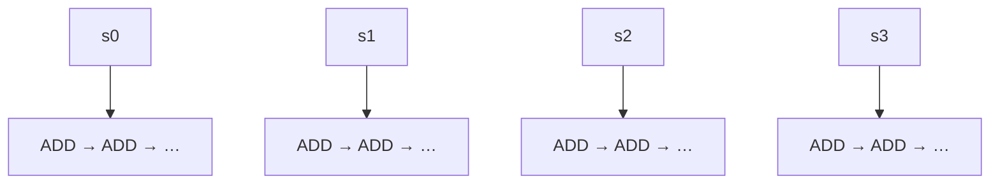

单 accumulator 的各次运算形成一条串行依赖链；重构后，图中四条 chain 相互独立。

<details>
<summary>查看原图与完整文字转写</summary>

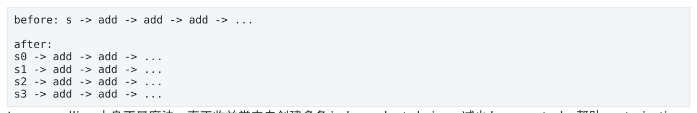

- ` before: s → add → add → add → ... `
- ` after: `
- ` s0 → add → add → ... `
- ` s1 → add → add → ... `
- ` s2 → add → add → ... `
- ` s3 → add → add → ... `

</details>

Loop unrolling 本身不是魔法。真正收益常来自创建多条 independent chains、减少 loop control、帮助 vectorization 或扩大 optimization window。增加 accumulator 直到 latency 被隐藏，之后性能会在 load ports、FMA/ALU、 frontend 或其他 throughput ceiling 上 plateau。

<a id="pdf-page-012"></a>

<!-- source-pdf-page: 12 -->

*[原 PDF 第 12 页](./Level4_CPU_Latency_Pathology_CN.pdf#page=12)*

实验方法  测 1/2/4/8 accumulators 的 cycles/element。若 1→4 显著改善而 4→8 基本不变，原先很可能有 dependency-latency bottleneck，之后出现新的 throughput ceiling。

### 3.5 Execution Ports 与 Resource Pressure

不是所有 µops 都能去所有 execution units。大量 independent work 仍可能集中争某些 ALU/FMA/divider/load/store ports。Resource-bound 的特征是 operands 已 ready，但兼容 resource 已饱和。

```text
Dependency bound: resource free, operand not ready
Resource bound:    operand ready, required resource busy
```

ROB、scheduler entries、physical registers、load/store queues 也都是有限 resources。看到 ROB full/load-buffer full 时要继续追原因：长 miss 可能让 entries 长时间不能释放，因此“buffer full”可能只是 downstream symptom。

### 3.6 AGU / Load-Store Resources

即使所有数据 L1 hit，load/store/AGU throughput 仍有限。`c[i]=a[i]+b[i]` 每 iteration 需要至少两个 load address、 一个 store address、load/store data paths 等资源。L1 resident 只说明层次，不意味着 memory subsystem 无限吞吐。

Latency bound vs bandwidth bound even in L1

| 模式 | 主要约束 |
| --- | --- |
| p = p-&gt;next | dependent load-to-use latency |
| 多个 independent loads | load-port/L1 bandwidth |
| 2 loads + 1 store loop | AGU + load/store pipelines |

### 3.7 Memory Disambiguation 与 Store-to-Load Forwarding

Memory dependency 不像 register dependency 那么早就完全确定。CPU 可能 speculative 地判断 younger load 是否与 older store alias。猜错可能 replay/machine clear。匹配的 recent store→load 可以通过 store buffer forwarding； partial overlap、size/alignment pattern 不理想时 forwarding 可能失败并产生 stall/replay。

### 3.8 Register Pressure、Spill 与 Unrolling Trade-off

更多 unroll/accumulators 能增加 ILP，但 live values 增多会提高 register pressure；compiler 可能 spill 到 stack，产生额外 loads/stores、AGU/L1D demand。Unrolling 还扩大 code footprint，可能把 Session 3 的 backend 优化变成 Session 2 的 frontend regression。

```text
Unrolling
 + more ILP
 + less loop overhead
 - register pressure / spill
 - code size / I-cache pressure
 - more scheduler/ROB demand
```

### 3.9 ROB、Load/Store Buffers 与 Downstream Symptoms

长 latency oldest operation 会阻塞 in-order retirement；younger instructions 即使 complete 也继续占 ROB，最终 ROB/physical regs/scheduler entries 无法释放。类似地，很多 DRAM misses 会让 load buffers/fill resources 长时间 occupied。因此看到 ROB full、load-buffer pressure 时不要马上说“硬件资源太小”，它们常是 upstream memory latency 的 downstream symptom。

<a id="pdf-page-013"></a>

<!-- source-pdf-page: 13 -->

*[原 PDF 第 13 页](./Level4_CPU_Latency_Pathology_CN.pdf#page=13)*

Store buffer 允许 stores 先离开执行主路径、之后再完成 cache/coherence visibility。Store-heavy code 可能受 store-address、store-data、buffer entries 或 ownership 限制。它还与 x86 Store→Load ordering / store-buffer semantics 相连接，但 ordering 与 coherence ownership 是不同层。

Special Operations 与 False Machine Dependencies

Divide/sqrt 等 operation 可能同时有高 latency 与有限 throughput；若结果又形成 loop-carried chain，就同时受到 dependency 与 specialized-unit capacity 约束。Machine-level dependency 也不总在 C++ source 显而易见，例如 partial-overlap store forwarding、某些 register forms。现代 CPU 还会识别 `xor eax,eax` 等 zero idiom 在 rename 阶段打断旧 value dependency。

### 3.10 Backend Diagnosis

1. 确认 thread 在 on-CPU 且 Frontend 不是主要瓶颈。

2. 看 optimized assembly，而不是仅看 C++ source。

3. 画 producer-consumer dependency DAG，找最长 critical path。

4. 用 llvm-mca/厂商资料估算 latency、port pressure、block throughput。

5. 通过增加 independent chains、改变 unroll factor 等做可证伪实验。

6. 如果更多 ILP 不再改善，寻找新的 resource ceiling。

本章结论  OoO 只利用 independence，不创造 independence；RAW true dependency 决定 critical-path lower bound；Resource-bound 与 dependency-bound 的优化方向不同；L1 resident 仍可能受 load/store/AGU throughput 或 load-use latency。

<a id="pdf-page-014"></a>

<!-- source-pdf-page: 14 -->

*[原 PDF 第 14 页](./Level4_CPU_Latency_Pathology_CN.pdf#page=14)*

## 第 4 章 Memory Latency Pathology

本章目标  把“memory bound”继续拆成 latency、bandwidth、MLP、prefetch、working set 与 data layout，理解为什么同样 miss count 可以有完全不同性能。

### 4.1 Memory Latency Hierarchy

具体数字依微架构，但量级直觉稳定：L1 hit 是 few cycles，L2 更高，LLC tens-of-cycles class，DRAM 常是 ~100ns class。真正关键不是背数字，而是知道同一 load 从 L1 到 DRAM 可以跨两个数量级，并问这段 latency 是否被 overlap。

第一原则  DRAM 300-cycle class latency 不等于程序一定停 300 cycles。Independent misses 可以同时 outstanding；dependent misses 则会把 latency 一层层暴露。

### 4.2 Memory-Level Parallelism (MLP)

**图示转写**

| 模式 | 内存访问关系 |
| --- | --- |
| High MLP | Miss A / B / C 同时 outstanding |
| Low MLP / pointer chain | Miss A → result → miss B → result → miss C |

<details>
<summary>查看原图与完整文字转写</summary>

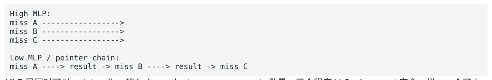

- ` High MLP: `
- ` miss A → `
- ` miss B → `
- ` miss C → `
- ` Low MLP / pointer chain: `
- ` miss A → result → miss B → result → miss C `

</details>

MLP 是同时可以 outstanding 的 independent memory requests 数量。两个程序 LLC miss count 完全一样，一个可大量 overlap，一个 MLP≈1 串行等待，性能可以相差数倍。

### 4.3 Latency-bound vs Bandwidth-bound

| 类型 | 典型 workload | 典型现象 |
| --- | --- | --- |
| Latency-bound | pointer chasing、tree/hash chain、dependent state | 带宽很低也可能很慢；MLP 低 |
| Bandwidth-bound | streaming arrays、memcpy、大向量扫描 | MLP 高，memory channels/LLC bandwidth饱和 |

因此 “服务器有 200GB/s DRAM bandwidth，而程序只用 2GB/s，所以不是 memory bound” 是错误推理。Pointer chasing 可能正因为一次只能发少量 request 才用不满 bandwidth。

### 4.4 Hardware / Software Prefetch

Prefetch 的本质是把等待提前发生，而不是让 DRAM 更快。Sequential/fixed-stride addresses 容易被硬件预取；data-dependent next pointer 很难。软件 prefetch 只有在 future address 已知且有足够 lead time 时才有效，太早会污染 cache，太晚则数据来不及。

```text
prefetch(next)
process(current)   // needs enough useful work as lead time
use(next)
```

Prefetch vs MLP  Prefetch 在 demand 之前请求数据；MLP 是多个 demand misses 同时飞。两者都能隐藏 latency，但不是同一机制。

<a id="pdf-page-015"></a>

<!-- source-pdf-page: 15 -->

*[原 PDF 第 15 页](./Level4_CPU_Latency_Pathology_CN.pdf#page=15)*

### 4.5 Working Set、Capacity 与 Cache Pollution

Working set 是相关时间窗口内真正活跃的数据，不是总 allocated memory。Hot set 从 L1 capacity 跨到 L2/LLC/DRAM 时，cycles/op 通常出现阶梯式变化。Background snapshot、large statistics scan 等也可能把 hot state 驱逐，形成 periodic cache pollution tail。

### 4.6 Cache-line Density、Hot/Cold Split、AoS/SoA

Cache 按 line 传输。如果 64B line 里真正只用 8B，87.5% transfer 可能是 waste。Hot/cold split、compact struct、 packed storage 能同时降低 cache footprint、提高每 line 有效 bytes。AoS/SoA 没有绝对赢家：只扫描一个字段时 SoA 常更密集；每 request 同时使用同一 object 多字段时 AoS 可能更好。

| 设计 | 优势 | 风险/适用条件 |
| --- | --- | --- |
| Hot/Cold split | 减小 hot working set | 多一次 indirection if cold path used |
| SoA | 单字段扫描密度高、SIMD 友好 | 对象级访问需要多 arrays |
| Packed index storage | 更小 node、更好 locality | next index 仍可能 dependent |
| Large lookup table | 少算术 | random DRAM lookup 可能比重算更慢 |

### 4.7 Pointer Chasing、Hash Table 与 Tree

Array 快的深层原因不是“index 比 pointer 快”，而是未来地址可预测，因此能预取、OoO 发多个 loads、提高 MLP。 Linked list/tree/chained hash 的未来地址依赖前一次 load，形成 serial load-use chain。

**图示转写**

| 场景 / 部分 | 路径、状态或说明 |
| --- | --- |
| Array | ` &a[i+1], &a[i+2] known early → prefetch + MLP ` |
| Linked list | ` p->next must return before address of next node is known ` |

<details>
<summary>查看原图与完整文字转写</summary>

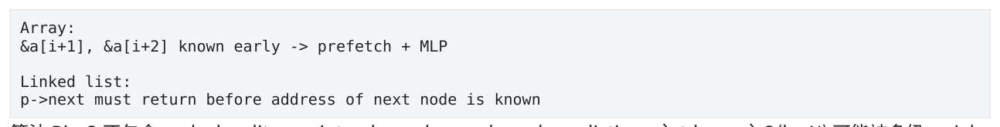

- ` Array: `
- ` &a[i+1], &a[i+2] known early → prefetch + MLP `
- ` Linked list: `
- ` p->next must return before address of next node is known `

</details>

算法 Big-O 不包含 cache locality、pointer dependency、branch prediction。`std::map` O(logN) 可能被多级 serial misses 拖慢；小 N 下 sorted vector linear scan 甚至可能因 contiguous/SIMD/branch predictability 更快。

### 4.8 TLB-aware Memory Thinking

大而稀疏的数据结构不仅有 data working set，还有 translation working set。每个 page 只用一个小 object 时，cache footprint 看似不大，但可能跨大量 pages，造成 DTLB miss/page walk。Huge pages 属于下一章/第 7 章的 paging optimization，不能替代 locality/MLP。

### 4.9 Random Access、Prefetch Failure 与 Miss Types

Random access 与 pointer chasing 不能混为一谈：`table[idx0], table[idx1], ...` 即使地址不可预测，只要 indices 已 ready，OoO 仍可发多个 independent misses，MLP 可以很高；pointer chain 的 next address 直到 previous load 返回才知道，MLP 才真正接近 1。Hardware prefetch failure 也不等于 OoO failure。

Cache miss 还可粗分 capacity/conflict/compulsory 等来源。Low-latency 实战中通常先解决 working set、layout、 dependency；极端 set-conflict 才进一步研究 associativity/alignment。

Compute vs Lookup

为了“少算”而加入大 random lookup table 可能适得其反：几十个 register/L1 arithmetic operations 可能比一个 critical DRAM lookup 更便宜。Small L1-resident table 很好，大 random table 则需要按 table size、reuse、 dependency 与 page footprint 重新评估。

<a id="pdf-page-016"></a>

<!-- source-pdf-page: 16 -->

*[原 PDF 第 16 页](./Level4_CPU_Latency_Pathology_CN.pdf#page=16)*

### 4.10 Memory Diagnosis

**图示转写**

- ` Memory Bound `
  - ` dependent accesses? → exposed latency / pointer chasing `
  - ` cache residency? L1/L2/LLC/DRAM `
  - ` MLP enough? `
  - ` prefetch effective? `
  - ` bandwidth saturated? `
  - ` working set / cache-line density / pollution? `

<details>
<summary>查看原图与完整文字转写</summary>

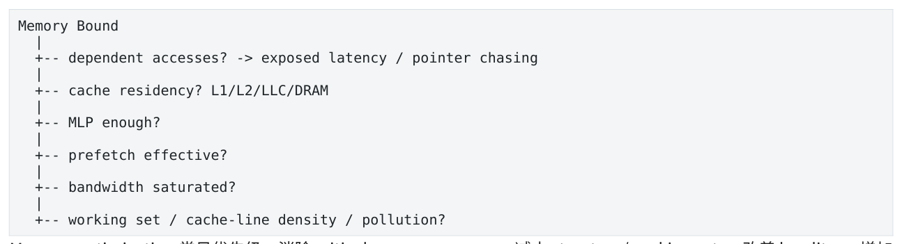

- ` Memory Bound `
- ` -- dependent accesses? → exposed latency / pointer chasing `
- ` -- cache residency? L1/L2/LLC/DRAM `
- ` -- MLP enough? `
- ` -- prefetch effective? `
- ` -- bandwidth saturated? `
- ` -- working set / cache-line density / pollution? `

</details>

Memory optimization 常见优先级：消除 critical memory access → 减小 structure/working set → 改善 locality → 增加 independent chains/MLP → 必要时软件 prefetch。

本章结论  Memory-bound 不等于 bandwidth saturated；MLP 决定多少 latency 能被隐藏；pointer chasing 的根因是 future address data-dependent；最好的 memory 优化往往是移除 critical access 而不是更努力 prefetch。

<a id="pdf-page-017"></a>

<!-- source-pdf-page: 17 -->

*[原 PDF 第 17 页](./Level4_CPU_Latency_Pathology_CN.pdf#page=17)*

## 第 5 章 Coherence Pathology

本章目标  从多核角度理解 cache-line ownership：false/true sharing、atomic/CAS、lock、fan-out、message passing 与 single-owner 为什么本质上都是 ownership topology 问题。

### 5.1 Coherence operates on cache lines

C++ 变量不是 coherence 的基本单位，cache line 才是。两个线程写不同 uint64_t，如果它们落在同一 64B line，硬件仍会把它当成同一个 coherence unit。

```text
cache line:
| counter_A | counter_B | .... |
      ^            ^
    Core0        Core1

logical independent, physical shared ownership
```

### 5.2 MESI、Ownership 与 RFO

用简化 MESI mental model：read-only line 可以在多个 cores 的 Shared 状态；某 core 要写，需要获得 exclusive/write ownership，并使其他 copies 失效。Read For Ownership (RFO) 表示“把这条 line 的写 ownership 给我”。

**图示转写**

| 场景 / 部分 | 路径、状态或说明 |
| --- | --- |
| Core A owns M | ` Core B wants write → request ownership → A invalidated → B owns M `；` Core A writes again → ownership moves back ` |
| 部分 2 | ` A <-> B <-> A <-> B = cache-line bouncing ` |

<details>
<summary>查看原图与完整文字转写</summary>

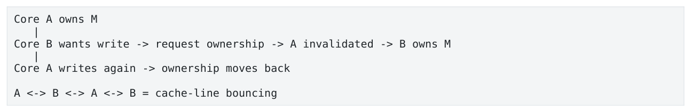

- ` Core A owns M `
- ` Core B wants write → request ownership → A invalidated → B owns M `
- ` Core A writes again → ownership moves back `
- ` A <-> B <-> A <-> B = cache-line bouncing `

</details>

### 5.3 False Sharing vs True Sharing

| 类型 | 逻辑关系 | 硬件结果 |
| --- | --- | --- |
| True sharing | 多个线程真的修改同一变量 | 同一 line 反复 ownership transfer |
| False sharing | 线程写不同变量但落在同一 line | 同样可能反复 invalidation/bounce |

False sharing 常出现在 per-thread counters、queue head/tail、worker status、metrics、contiguous atomic arrays。`alignas(64)` 的目的不是让访问神奇变快，而是把独立写 ownership 分到不同 lines；过度 padding 会增加 working set。

### 5.4 Atomic Hotspot 与 CAS

`memory_order_relaxed` 只弱化 ordering，不取消 atomicity/coherence。多个 cores 对同一 `fetch_add(relaxed)` 仍需要同一 cache line 的 write ownership，因此 arithmetic +1 很便宜，ownership serialization 才是 dominant cost。

非常重要  Relaxed solves ordering constraints, not ownership contention。把 seq_cst 改 relaxed 不能挽救一个 32- core shared atomic hotspot。 CAS loop 在 contention 下还会叠加 failed retries：coherence transfer + compare + retry 做了很多无用工作。Lock-free 是 progress guarantee，不等于 contention-free 或 low latency。

<a id="pdf-page-018"></a>

<!-- source-pdf-page: 18 -->

*[原 PDF 第 18 页](./Level4_CPU_Latency_Pathology_CN.pdf#page=18)*

### 5.5 Locks、Ticket Lock 与 MCS

最差 spinlock 会不断 RMW 同一 line 形成 coherence storm。Test-and-test-and-set 让 waiters 先读，持锁期间可以共享 read copies，减少写 ownership 抢夺。Ticket lock 公平但所有 waiters 盯同一个 grant counter，unlock 会 fan-out invalidation。MCS lock 则让每个 waiter spin on its own node，handoff 只涉及相邻 waiter，属于 distributed waiting。

**图示转写**

| 场景 / 部分 | 路径、状态或说明 |
| --- | --- |
| Shared spin | ` N waiters → one hot line ` |
| MCS | ` waiter1 → local node `；` waiter2 → local node `；` waiter3 → local node `；` only neighbour handoff ` |

<details>
<summary>查看原图与完整文字转写</summary>

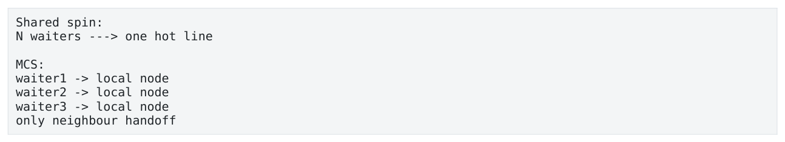

- ` Shared spin: `
- ` N waiters → one hot line `
- ` MCS: `
- ` waiter1 → local node `
- ` waiter2 → local node `
- ` waiter3 → local node `
- ` only neighbour handoff `

</details>

### 5.6 One Writer + Many Readers / Fan-out

Read-only sharing 通常很好；问题出现在 writer 高频更新 read-mostly line。每次写使 readers 的 Shared copies invalid，readers 再 load 又要获取最新 copy。Reader 虽然只执行 load，也会被 writer 的 invalidation rate 拖慢。

Versioned snapshot、copy-publish、immutable publication 的思想是 writer 私下构建新状态，最后低频发布 pointer/version，使 readers 大部分时间读取 immutable data，把 continuous shared mutation 变成 rare publication event。

### 5.7 SPSC、Message Passing 与 Ownership Handoff

SPSC 快不仅因为“没有 mutex”，还因为 producer-owned 与 consumer-owned metadata 可以分线，data slot 主要单向 producer→consumer handoff。One-way ownership transfer 可以很高效，真正病态的是 A↔B 高频 bounce。 Batching tail/cursor update 还可以 amortize shared metadata coherence，但会增加单消息等待，需要 bounded batching。

### 5.8 Sharding 与 Single Owner

Per-core counter、per-shard table、instrument→worker ownership 的本质都是把 shared write domain 拆开。 Global sequence/global risk 等强语义会天然形成 serialized ownership point，因此要问是否真的需要全局顺序，还是可以用 `(writer_id, local_seq)`、local reservation、hierarchical aggregation 等重构语义。

最强 coherence 优化  不是把 CAS 写得更巧，而是删除 hot shared write：single owner、per-thread state、 partitioned SPSC、immutable publication、local aggregation。

### 5.9 Seqlock、Reference Count 与 Read-mostly Patterns

Seqlock/version pattern 让 readers 无锁读取，但 writer 更新 version 仍会 invalidating many readers，因此“reader lock-free”并不等于 coherence-free。Shared pointer/reference count 在跨 core 高频 inc/dec 时也可能把 refcount line 变成 hotspot；intrusive refcount 只是移动 counter 位置，并不自动改变 ownership topology。

RCU/epoch 类策略的一个性能价值是让 readers mostly avoid shared writes，把 reclamation/epoch publication 移到更低频路径。实现如果又让所有线程高频更新同一 global epoch，仍可能重新制造热点，因此常用 per-thread epoch state + aggregation。

<a id="pdf-page-019"></a>

<!-- source-pdf-page: 19 -->

*[原 PDF 第 19 页](./Level4_CPU_Latency_Pathology_CN.pdf#page=19)*

Hierarchical Aggregation

大机器上可把 global aggregation 变成 per-thread → per-NUMA → global，减少远距离 ownership transfer。 Coherence topology 与 NUMA distance 相乘后，cross-socket hot shared state 尤其昂贵。

### 5.10 perf c2c / HITM Diagnosis

普通 LLC miss 可能看不到 coherence 问题，因为数据可能来自另一 core cache。Cache-to-cache/HITM 证据能更直接定位哪些 lines 在 core 间频繁 transfer。典型流程：多线程 scaling 变差 → 找 shared mutable structures → inspect addresses/layout → perf c2c/HITM → 分离 line → 重测。

本章结论  Coherence 的单位是 cache line；write 需要 ownership，多 writer 会串行化；false sharing 是“逻辑独立但物理同 line”；lock-free 仍可能 coherence storm；single writer/message passing 的核心价值是让 ownership topology 可控。

<a id="pdf-page-020"></a>

<!-- source-pdf-page: 20 -->

*[原 PDF 第 20 页](./Level4_CPU_Latency_Pathology_CN.pdf#page=20)*

## 第 6 章 OS / Scheduler / Interrupt Pathology

本章目标  把“函数花了 50us”拆成实际 CPU work 与系统 interruption，理解 preemption、 migration、IRQ/softirq、fault、SMI、SMT 与 power state 如何制造 tail。

### 6.1 Wall-clock Time vs CPU Progress

```text
start
  | 2us application work
  |------ preempted / IRQ / blocked 47us ------|
  | 3us application work
end

wall = 52us, actual application service ~= 5us
```

Context switch 自身的机械开销通常不是最主要问题，更大的业务成本是“关键 worker 有多久没有 forward progress”。

### 6.2 Preemption、Blocking 与 Runqueue

Preemption：thread 仍 runnable，但 CPU 先给其他 task；Blocking：thread 因 mutex/futex/I/O/sleep 等进入 waiting。两者都 off-CPU，但诊断与解决方向不同。Runqueue length 反映同 CPU 上竞争 runnable work；machinewide CPU 低并不意味着关键 CPU 没竞争。

### 6.3 CPU Migration、Affinity 与 Isolation

Migration 不只产生直接 scheduling gap，还破坏 L1/L2、TLB、branch-predictor 等 warm state，常形成“一个大 spike + 后面几个逐渐恢复”的 latency cluster。Affinity 限制某 thread 能去哪里运行，但不禁止其他 work/IRQ 落在同一 CPU；因此 affinity ≠ isolation。

```text
Affinity:  pricing may run only on CPU7
Isolation: try to keep unrelated tasks/IRQs/housekeeping away from CPU7
```

Low-latency CPU placement 需要看 physical core、SMT sibling、socket、NUMA、NIC locality，而不是只看逻辑 CPU 编号。

### 6.4 IRQ 与 SoftIRQ

Hardware IRQ 可以暂停用户 instruction stream 进入 interrupt handler。网络通常还会把部分处理延后到 NET_RX/NET_TX softirq 或 ksoftirqd。用户线程可能没有发生普通 sched_switch，但仍停止 forward progress，所以必须把 IRQ/softirq trace 纳入 tail correlation。

IRQ affinity trade-off  把 NIC IRQ 从 pricing core 移开可减少 jitter，但如果 packet 仍走 kernel path，过远 placement 也可能增加 cross-core/NUMA handoff。Isolation 与 data locality 要一起设计。

### 6.5 nohz_full / rcu_nocbs / Housekeeping

`nohz_full` 的目标之一是减少指定 CPU 上 periodic scheduler tick；`rcu_nocbs` 将部分 RCU callback work offload。典型架构把 hot application cores 与 housekeeping/IRQ cores 分离。它们不是“绝对无中断”开关，而是减少可控 kernel variance source。

<a id="pdf-page-021"></a>

<!-- source-pdf-page: 21 -->

*[原 PDF 第 21 页](./Level4_CPU_Latency_Pathology_CN.pdf#page=21)*

### 6.6 Page Fault、Syscall 与 Allocation Slow Path

一次看似普通 store 可能触发 first-touch page fault，进入 kernel 做 physical-page allocation/zeroing/PTE setup。 malloc 平时可能命中 thread-local fast path，偶尔却 refill arena、锁、mmap，随后 first touch 再 fault。Hot path 避免 allocation 的核心原因是 slow path variance，而不是“malloc 每次都慢”。

### 6.7 Busy Spin、Blocking 与 RT Scheduling

Busy spin 保持 worker on-CPU，避免 sleep→wakeup→scheduler latency，但消耗 dedicated CPU、power，并可能带来 SMT/coherence polling interference。Hybrid spin-then-sleep 在通常短 wait、偶尔长 idle 时折中。 `SCHED_FIFO/RR` 可以减少普通任务抢占，但配置错误会 starving system tasks，属于系统架构选择而非 benchmark trick。

### 6.8 SMI、Frequency、C-state 与 SMT

SMI/firmware event 可能让 CPU“消失”一段时间，OS scheduler 看不到普通 switch，形成 mysterious timestamp gap。频率/P-state 变化会出现 cycles/request 类似但 ns/request 改变；深 C-state 增加 wakeup latency；SMT sibling 则是 thread 仍在 on-CPU，却共享 frontend/execution/L1 等 physical-core resources。

| 现象 | 机制 |
| --- | --- |
| sched_switch overlap | preemption/blocking |
| 无 switch 但 IRQ overlap | interrupt interference |
| 无 switch/IRQ 的 mysterious gap | 考虑 SMI/NMI/firmware |
| cycles/request≈不变，ns 变差 | frequency/power state |
| sibling workload 开启后慢 | SMT interference |

### 6.9 Wakeup Latency、Timer/Power 与 Measurement

Blocking worker 的 latency 不只包括 sleep 本身，还包括 event 到来后从 `sched_wakeup` 到真正 on-CPU 的 runnable wait。Busy-spin 避免这段路径，但 dedicated CPU 与 power/SMT 代价必须接受。

Cycles/request 与 ns/request 的对比有诊断价值：如果 cycles 基本不变而 wall time 变差，应怀疑 frequency/power； 如果 cycles 也显著增加，则更像额外 work/stall/interference。Modern invariant TSC 适合低开销时间轴，但 microbenchmark 仍要处理 instruction ordering 与 migration。

### 6.10 OS Diagnosis

**图示转写**

- ` Tail spike `
  - ` sched_switch? → preemption/block/wakeup latency `
  - ` IRQ / softirq overlap? `
  - ` page fault / syscall / allocator slow path? `
  - ` migration? `
  - ` SMT sibling / frequency / SMI? `
  - ` none → return to on-CPU PMU diagnosis `

<details>
<summary>查看原图与完整文字转写</summary>

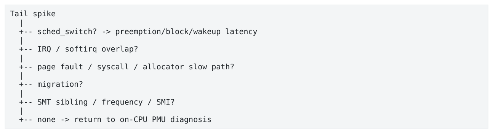

- ` Tail spike `
- ` -- sched_switch? → preemption/block/wakeup latency `
- ` -- IRQ / softirq overlap? `
- ` -- page fault / syscall / allocator slow path? `
- ` -- migration? `
- ` -- SMT sibling / frequency / SMI? `
- ` -- none → return to on-CPU PMU diagnosis `

</details>

<a id="pdf-page-022"></a>

<!-- source-pdf-page: 22 -->

*[原 PDF 第 22 页](./Level4_CPU_Latency_Pathology_CN.pdf#page=22)*

典型证据工具包括 perf sched、sched_switch/sched_wakeup tracepoints、ftrace/BPF、/proc/interrupts、/proc/softirqs、page-fault events。生产中最有价值的是把这些 event 与 slow request timestamp 对齐。

本章结论  wall time 不等于 CPU service time；affinity ≠ isolation；IRQ 可无 sched_switch 地打断用户进度；一次 interruption 可以通过 queue buildup 放大；低延迟 OS tuning 的本质是移除 uncontrolled variance。

<a id="pdf-page-023"></a>

<!-- source-pdf-page: 23 -->

*[原 PDF 第 23 页](./Level4_CPU_Latency_Pathology_CN.pdf#page=23)*

## 第 7 章 NUMA / Allocation / Paging Pathology

本章目标  理解 CPU affinity 与 memory placement 是两回事；first-touch、TLB/page walk、huge pages、allocator arena、page fault、TLB shootdown 如何共同决定 memory tail。

### 7.1 NUMA Topology

```text
Socket / Node 0                     Socket / Node 1
cores + LLC + memory ctrl ---- fabric ---- cores + LLC + memory ctrl
        |                                       |
     local DRAM                              local DRAM
```

Node0 core 访问 node0 DRAM 是 local；访问 node1 DRAM 需要跨 inter-socket fabric，通常更高 latency。NUMA penalty 主要在 cache miss 最终到 memory 时暴露，因此 hot cached state 可能 p50 看不出，但 rare cold state 把 remote latency 放进 p99.99。

### 7.2 First-touch

Linux anonymous memory 常由第一次实际 fault/touch page 的 NUMA node 决定 physical placement。真正危险的不是 `malloc` 在哪里调用，而是谁先写这些 pages。Startup thread 如果在 node1 初始化 worker0 的 buffer，后来 worker0 即使 pinned node0，cache miss 仍可能访问 remote node1 memory。

**图示转写**

1. ` bind owner thread `
2. ` allocate `
3. ` touch every critical page `
4. ` warm `
5. ` enter hot loop `

<details>
<summary>查看原图与完整文字转写</summary>

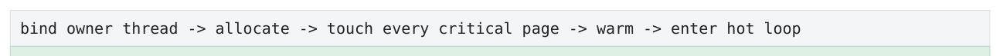

- ` bind owner thread → allocate → touch every critical page → warm → enter hot loop `

</details>

关键  Pre-touch 同时做两件事：把 page fault/zeroing/PTE work 移出 hot path，并帮助建立预期的 NUMA placement。

### 7.3 Local vs Remote Latency / Bandwidth

NUMA 也有 latency 与 bandwidth 两种模式。Random dependent cold loads 更关心 remote latency；large streaming parallel workloads 可能通过 interleave 多 memory controllers 获得 aggregate bandwidth。`numactl -- interleave` 对 bandwidth 可能有利，但对 single low-latency worker 未必。

### 7.4 NUMA-aware Sharding

理想 ownership chain 是 thread → cache lines → pages → NUMA node。Instrument/client shard 若由 node0 workers 独占，相关 arena/pool/pages 也尽量 node0 first-touch；跨 socket 只做 coarse-grained aggregation。 Global pool/allocator 可能同时制造 allocator contention、coherence hotspot 与 wrong NUMA placement。

### 7.5 TLB 与 Page Walk

TLB 缓存 virtual→physical translation。TLB miss 不等于 page fault：mapping 已存在时，hardware page walker 可以读取多级 page tables 找到 PTE；page fault 则需要 OS intervention。Page-table entries 自己也通过 cache/memory hierarchy，因此 page-walk latency 不是固定值。

Translation working set  数据 working set 小并不代表 TLB working set 小。如果每个 4KB page 只访问一个对象， translation footprint 仍可能巨大。

### 7.6 Huge Pages 与 THP

Huge pages 的首要价值是提高 TLB reach：同样 TLB entry 数量，用 2MB pages 可覆盖远多于 4KB pages，从而减少 DTLB misses/page walks。它不会让 DRAM 本身更快，也不会消除 pointer-chasing dependency。

<a id="pdf-page-024"></a>

<!-- source-pdf-page: 24 -->

*[原 PDF 第 24 页](./Level4_CPU_Latency_Pathology_CN.pdf#page=24)*

| 机制 | 优势 | 低延迟风险/代价 |
| --- | --- | --- |
| Explicit hugetlb | placement/生命周期更可控 | 预留、fragmentation、deployment complexity |
| THP | 透明、易使用 | promotion/split/compaction 等background variance |
| 4KB pages | 细粒度 NUMA/内存利用 | TLB reach 小 |

Huge page 与 NUMA 还存在 granularity trade-off：一个 2MB page 主要属于一个 node，如果多个 NUMA workers 共享 page 内对象，placement 更难细分。

### 7.7 Allocator / Arena / Object Pool

Allocator fast path 可以非常快，但 p99 关注 slow path。Per-thread arenas/tcache 减少 central lock/coherence； cross-thread free 可能让 metadata ownership 跨核。Object pool/arena 能提供 bounded allocation、better locality、stable NUMA 与 fewer faults，但 global atomic free-list 又可能成为 coherence hotspot。

```text
bad pool:   all threads -> one atomic free-list head
good pattern: per-thread/per-shard pools + batched transfer if needed
```

Compact arena 还可能改善 cache/TLB，但 packed small objects 如果分别由不同 workers 写，也可能产生 false sharing；因此 layout 必须同时考虑 cache-line ownership 与 page/NUMA ownership。

### 7.8 TLB Shootdown

当 mapping 变化时，其他 CPUs 可能还缓存旧 TLB entry，OS 需要跨核协调 invalidation，常涉及 IPI。`munmap`、 `mprotect`、page migration、某些 allocator/runtime/THP/NUMA-balancing 行为都可能触发 mapping changes。 Shootdown 把虚拟内存操作变成跨-core synchronization，并可能打断 latency core。

### 7.9 mmap/munmap、Fragmentation、Swap 与 Memory Pressure

频繁 mmap/munmap 不只承担 syscall bookkeeping，还可能分配/释放 page tables 并触发 TLB invalidation。Explicit huge pages 若运行时才申请，physical fragmentation 可能迫使 expensive compaction，因此更适合 boot/startup reservation。

严格 low-latency server 通常不希望 critical pages 进入 swap；major fault 的 storage latency 完全超出微秒 hot-path budget。`mlock/mlockall` 可降低 swap 风险，但不能替代 correct NUMA placement、pre-touch、TLB locality 与 allocator ownership。Memory overcommit 也意味着 `malloc` 成功不等于未来 physical capacity 已经被保证。

### 7.10 NUMA / Paging Diagnosis

**图示转写**

- ` Thread pinned? `
  - ` where are pages? local / remote `
    - ` who first-touched? allocator? balancing? `
  - ` DTLB miss / page walk? `
  - ` page fault? first touch? COW? `
  - ` huge page helps? `
  - ` mapping changes / shootdown? `

<details>
<summary>查看原图与完整文字转写</summary>

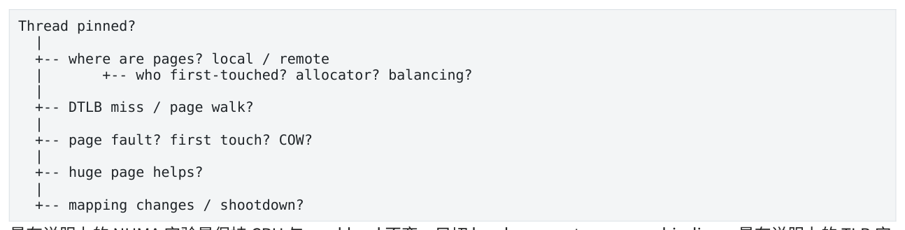

- ` Thread pinned? `
- ` -- where are pages? local / remote `
- ` -- who first-touched? allocator? balancing? `
- ` -- DTLB miss / page walk? `
- ` -- page fault? first touch? COW? `
- ` -- huge page helps? `
- ` -- mapping changes / shootdown? `

</details>

最有说服力的 NUMA 实验是保持 CPU 与 workload 不变，只切 local vs remote memory binding。最有说服力的 TLB 实验是保持 layout/NUMA 不变，对比 4KB 与 explicit huge pages，并同时看 TLB counters 与 cycles/request。

<a id="pdf-page-025"></a>

<!-- source-pdf-page: 25 -->

*[原 PDF 第 25 页](./Level4_CPU_Latency_Pathology_CN.pdf#page=25)*

## 第 8 章 Tail Latency 与 Production Diagnosis

本章目标  把 slow request、queue、scheduler/IRQ、PMU、coherence、NUMA 与 topology 对齐，形成可重复的 production latency RCA。

### 8.1 Characterize the Distribution

第一步永远不是运行某个工具，而是描述 regression 的形状：何时开始、哪条业务 path、p50/p99/p99.9/p99.99、 throughput、queue depth、workload distribution、host/core 是否改变。

```text
Before: p50 5us, p99 8us, p99.9 12us
After : p50 5.1us, p99 8.4us, p99.9 39us
=> normal path roughly stable; rare disturbance increased
```

### 8.2 Service Time vs Queueing Time

Stage timestamps 至少应能拆 ingress、enqueue、dequeue、book、pricing、risk、publish。Queue depth 必须和 latency 一起看：如果 service p99 不变但 dequeue wait 从2us 变30us，问题在 burst/capacity/consumer interruption，不在 computation。

**图示转写**

1. ` arrival `
2. ` [queue wait] `
3. ` service start `
4. ` [service time] `
5. ` finish `

<details>
<summary>查看原图与完整文字转写</summary>


- ` arrival → [queue wait] → service start → [service time] → finish `

</details>

### 8.3 Time Correlation：Production 最强 evidence

对单个 slow request，将 application timestamp 与 sched_switch、IRQ/softirq、fault、migration、PMU sample 对齐。能够说“Request 84723 的 45us service window 中 pricing thread 被 schedule out 34us”比“LLC misses 整体高了 10%”强得多。

### 8.4 Tail-aware Observability

- per-thread low-overhead ring buffer，避免 hot-path logging/allocations。

- slow-request tagging：超过阈值时记录 CPU、queue depth、stage、message type、instrument/client。

- triggered tracing：常态保存最近 N events，发生 spike 后冻结前后窗口。

- 按 workload class 分 histogram，避免 rare path 被 common path 淹没。

- 记录 CPU ID，便于定位 one-core IRQ/sibling/topology 问题。

Observer effect  Metrics 自己可能 false sharing；timestamp 自己可能破坏 code/cache layout。Observability 必须是 bounded、local、preallocated。

### 8.5 Production Case Studies

Case 1：Migration → cold-state latency cluster

Slow request 开始 CPU5、结束 CPU21，之后数个 requests 从 13us→8us→5us 逐渐恢复。Pin thread 后 cluster 消失。因果链：migration direct gap + cache/TLB/predictor cold recovery。

> **转换补充（数学边界）**：一次请求的各段时间在互不重复计时的边界下可以相加；各段 p99/p99.9 通常不能直接相加得到 E2E 的相同 percentile。讲义中的 budget 是规划值，真实 percentile 应直接测 E2E。

<a id="pdf-page-026"></a>

<!-- source-pdf-page: 26 -->

*[原 PDF 第 26 页](./Level4_CPU_Latency_Pathology_CN.pdf#page=26)*

Case 2：IRQ → Queue Amplification

Consumer 2us/msg，市场 burst 期间被 NIC/softirq 打断 20us，期间约 20 messages 入队。Worker 恢复后还需 drain backlog，因此一个 20us interruption 可以让几十个 requests 在未来 100us 内都变慢。Primary disturbance 与 business impact 不是同一个时间长度。

Case 3：Rare LLC + Remote NUMA

p50/p99 正常，仅 p99.99 慢；slow samples 集中 rare instruments。Load-latency/NUMA evidence 显示 cold risk state pages 在 remote node。让 pricing owner first-touch 后 extreme tail 恢复。Miss count 可能几乎相同，但 miss cost 不同。

Case 4：Metrics 引入 False Sharing

单 worker 无变化，4/8 workers p99 恶化；perf c2c 指向 contiguous worker_stats counters。改 per-thread cache-line-separated stats 后 scaling 与tail 恢复。Observability feature 自己成了 coherence pathology。

Case 5：Allocation / Page Fault

正常 3us，rare new object/session 80-300us；slow samples 包含 minor fault/allocator refill。Startup preallocate+pre-touch pool 后 tail 消失。

Case 6：Frontend Code Bloat

整个 distribution 平移；Top-Down Frontend Bound/L1I 恶化，branch miss 基本不变；deployment 增加 template specialization + aggressive inline。Outline cold helpers/PGO 后恢复。

Case 7：Pointer Chasing，Bandwidth 很低但仍 Memory-bound

CPU100%、IPC 低、DRAM bandwidth 低，代码是 linked traversal。多个 independent lists 同时 traverse 后吞吐显著提升，证明原来 MLP 低而 full latency exposed。

Case 8：修复一个 bottleneck 暴露另一个

1 accumulator dependency-bound → multiple accumulators 后 load ports saturated → data layout 优化后 queueing 成 dominant。性能系统没有唯一“永远的 bottleneck”，只有当前 dominant ceiling。

### 8.6 Coordinated Omission 与 Replay

Closed-loop load generator 如果必须等待上一个 request 完成才发送下一个，会在系统 stall 期间停止产生本应到达的请求，从而严重低估 tail，这就是 coordinated omission。市场数据是外部 arrival source，不会因为 engine 忙就暂停， 因此 benchmark 需要 realistic open-loop/burst timing。

Replay 也要区分 time-faithful replay 与 as-fast-as-possible throughput replay：前者保留 inter-arrival/queue behavior，后者更适合 capacity test，不能混用结论。

### 8.7 Scope 与 Topology Analysis

先问影响范围：one request、one thread、one logical CPU、one physical core、one socket、whole process、 whole machine。One-core spike 优先查该 CPU IRQ/sibling；同 socket 多 cores 同步慢可查 LLC/memory-controller/socket power；不同 cores 同一时间 mysterious gap 可考虑 system-wide firmware/SMI 等。

<a id="pdf-page-027"></a>

<!-- source-pdf-page: 27 -->

*[原 PDF 第 27 页](./Level4_CPU_Latency_Pathology_CN.pdf#page=27)*

三张图

**图示转写**

1. ` 1) Business pipeline: MD `
2. ` Book `
3. ` Pricing `
4. ` Risk `
5. ` Execution `
6. ` 2) Thread/queue topology: Thread A `
7. ` SPSC `
8. ` Thread B `
9. ` 3) Hardware topology: CPU/core/socket/NUMA/NIC `

<details>
<summary>查看原图与完整文字转写</summary>

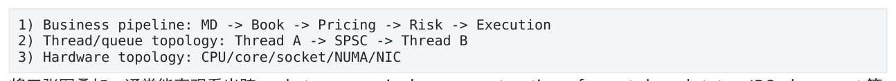

- ` 1) Business pipeline: MD → Book → Pricing → Risk → Execution `
- ` 2) Thread/queue topology: Thread A → SPSC → Thread B `
- ` 3) Hardware topology: CPU/core/socket/NUMA/NIC `

</details>

将三张图叠加，通常能直观看出跨 socket queue、single-owner saturation、fan-out shared state、IRQ placement 等问题。

### 8.8 Headroom、Amdahl 与 Performance Invariants

Tail latency 同时是 microarchitecture 与 capacity engineering。接近 100% 的 critical serialization point 没有 headroom，10us disturbance 也会因 queue drain 不及时被放大；overall machine CPU 20% 并不能说明 single-owner engine 有余量。

Amdahl 在 latency RCA 中同样适用：总 latency 30us，其中 queue 20us、pricing 5us，把 pricing 优化到 2us 只让总量到 27us。先找 dominant contributor，再做最有趣的微优化。

成熟系统可以把 performance assumption 写成 invariant：hot path alloc count=0、worker migration=0、one writer per hot mutable state、critical pages pre-touched、bounded work per poll、no cross-socket hot queue 等，并用 benchmark/monitoring 验证。

### 8.9 Production RCA Methodology

1. Define the regression precisely。

2. Inspect latency distribution and sample count。

3. Separate queueing from service time。

4. Localize the affected stage。

5. Correlate slow samples with CPU ID/workload class。

6. Determine on-CPU vs interrupted/off-CPU。

7. If interrupted：scheduler / IRQ / fault / blocking / SMI。

8. If on-CPU：frontend / core / memory / coherence。

9. If memory：cache / dependency / MLP / TLB / NUMA。

10. Build competing hypotheses and distinguishing predictions。

11. Change one variable and rerun the same workload。

12. Confirm causality, then check for a new bottleneck。

Mitigation ≠ RCA  Incident 中 rollback/restart/move IRQ 可以先恢复 SLO，但 restart 同时改变 cache、queue、 allocator、NUMA、scheduler 等很多状态，不能单凭“重启好了”证明 root cause。

本章结论  Tail diagnosis 的单位应是 slow request/time window；queueing 可以放大微小 interruption；aggregate counters 容易被 99.9% normal samples 淹没；production RCA 要明确 Facts / Inference / Experiment；最终目标是证明谁阻止了关键请求 forward progress。

<a id="pdf-page-028"></a>

<!-- source-pdf-page: 28 -->

*[原 PDF 第 28 页](./Level4_CPU_Latency_Pathology_CN.pdf#page=28)*

## 附录 A：诊断矩阵、工具、面试与复习

### A.1 Symptom → Hypothesis → Evidence 矩阵

| Symptom | 优先 hypotheses | Distinguishing evidence / experiment |
| --- | --- | --- |
| p50 不变，p99.9 暴涨 | scheduler/IRQ/fault/rare miss/rare path | slow timestamp ↔ sched/IRQ/fault；isolation/pretouch experiment |
| 整个分布平移 | extra work/frontend/dependency/working set/NUMA | before/after PMU + assembly/layout + local NUMA |
| more threads -&gt; slower | coherence/lock/bandwidth/SMT | c2c/HITM、bandwidth、sibling test |
| CPU100%但IPC 低且带宽低 | dependency/pointer latency/spin | assembly DAG、多链 experiment、on-CPU state |
| L3 misses 同样但版本B 更慢 | remote NUMA/coherence/MLP 不同 | data-source/NUMA/c2c、local bind experiment |
| first access 慢，之后快 | page fault/cache/TLB cold | fault trace、pre-touch |
| 只某CPU 慢 | IRQ/sibling/topology | CPU ID、/proc/interrupts、SMT experiment |
| 所有 cores 同时 gap | SMI/system-wide event/power | cross-core timestamps、platform counters |
| queue depth 涨但service 不变 | arrival burst/consumer interruption | arrival timeline、sched/IRQ |
| atomic relaxed 多核崩 | ownership serialization | c2c/HITM、per-core sharding |

### A.2 工具选择地图

| 工具/信息源 | 最适合回答什么 | 不要把它误当成什么 |
| --- | --- | --- |
| Application timestamps/histogram | 哪段慢、哪个 request 慢 | 根因自动分析器 |
| perf stat | 整体cycles/instructions/branches/faults/migrati ons regression | 单个 tail request 解释 |
| perf record/report/annotate | CPU time hotspot | off-CPU latency 分析器 |
| Top-Down / VTune | Frontend/Backend/Memory 高层分类 | 完整 OS/queue diagnosis |
| llvm-mca | 理想 core 的 dependency/port/block throughput | 真实 cache/IRQ/scheduler simulation |
| perf sched / sched trace | preemption/runqueue/wakeup | IRQ/SMI 解释器 |
| ftrace / BPF | exact-time kernel events correlation | 零开销 tracing |
| perf c2c / HITM | shared cache-line/cache-to-cache | 普通 DRAM bandwidth profiler |
| perf mem / PEBS load sampling | 慢 load/data source/latency samples | 跨所有 CPU 都一致的 event schema |
| numactl/numastat/topology | CPU/memory NUMA placement | cache residency 直接证明 |

<a id="pdf-page-029"></a>

<!-- source-pdf-page: 29 -->

*[原 PDF 第 29 页](./Level4_CPU_Latency_Pathology_CN.pdf#page=29)*

### A.3 面试问答精选

Q：p99.9 从 10us 变 40us，怎么查？

A：先看 distribution 与 queueing/service；slow samples 对齐 CPU、sched/IRQ/fault；若持续 on-CPU 再用 Top- Down/PMU 区分 frontend/core/memory/coherence/NUMA；最后做 one-variable experiment。

Q：为什么 CPU 只有 40% 仍高 latency？

A：整体 utilization 不代表关键 single-owner core；也可能 queueing、memory-latency-bound、off-CPU wait。看 critical worker service、queue、on-CPU state。

Q：为什么 relaxed atomic 仍慢？

A：relaxed 减少 ordering 约束，不取消 RMW atomicity/cache-line ownership；多 writer 仍形成 coherence serialization。

Q：为什么 linked list 即使全在 L1 仍慢？

A：next address 依赖前一 load，MLP 低，load-to-use latency 按链暴露。

Q：为什么 high LLC miss count 不能证明 root cause？

A：miss 可能 independent/可 overlap，也可能是 migration/working-set 变化的下游症状；要看 critical-path exposure 与 controlled experiment。

Q：Affinity 与 isolation 区别？

A：Affinity 限制该 thread 去哪里；isolation 限制还有谁/哪些IRQ 可在该 CPU 上运行。

Q：Huge pages 为什么有用？

A：提高 TLB reach，减少 TLB misses/page walks；不让 DRAM 更快，也不打破 pointer dependency。

Q：为什么 20us IRQ 会制造 100us tail？

A：worker 停顿期间 arrival 继续导致 queue buildup，恢复后还要 drain，并可能有 cold-cache after-effect，形成 amplification。

Q：lock-free 一定快于 mutex？

A：不是。Progress guarantee 与 coherence/contention cost 不同，高竞争 CAS loop 可大量 failed retry + line bouncing。

Q：为什么 multiple accumulators 快？

A：从单 loop-carried dependency chain 变成多个 independent chains，让 OoO 隐藏 latency，直到 port/load bandwidth 等新 ceiling。

### A.4 推荐实验

1. 1/2/4/8 accumulators：观察 dependency hiding 与 throughput plateau。

2. 单 linked list vs 4 independent lists：观察 MLP 对 pointer latency 的隐藏。

3. working-set sweep：从 L1/L2/LLC 到 DRAM，记录 cycles/element。

<a id="pdf-page-030"></a>

<!-- source-pdf-page: 30 -->

*[原 PDF 第 30 页](./Level4_CPU_Latency_Pathology_CN.pdf#page=30)*

4. normal pages vs explicit huge pages：看 DTLB/page-walk 与 cycles/request。

5. NUMA local vs remote binding：同 CPU/同 workload 对比 miss cost。

6. shared atomic vs per-thread counter：画 1/2/4/8/16/32-thread scaling curve。

7. false-sharing struct vs cache-line-separated struct：结合 perf c2c。

8. worker sibling idle vs loaded：测 SMT p99 interference。

9. IRQ on hot core vs housekeeping core：对齐 IRQ trace 与 latency。

10. cold allocation vs preallocated/pre-touched pool：观察 rare page-fault tail。

11. over-inline version vs outlined cold path：看 binary size/L1I/Frontend Bound。

12. closed-loop vs time-faithful open-loop replay：观察 coordinated omission。

### A.5 Production Checklist

- 关键 latency histogram 是否有足够 sample count，并按 message/path 分类？

- 是否能拆 queueing time 与 service time？

- 每个 latency-sensitive worker 是否记录 CPU ID / migration？

- CPU affinity、SMT sibling、IRQ、housekeeping 是否有明确 topology？

- 关键 memory 是否 preallocated、pre-touched、NUMA-local？

- hot path 是否有 dynamic allocation、blocking syscall、global shared atomic？

- producer/consumer-owned metadata 是否避免 false sharing？

- 关键 queues 是否有 queue-depth/burst observability？

- background snapshot/metrics/allocator 是否可能污染 cache 或触发 mapping work？

- 性能回归是否有 before/after baseline，而不是只看单次绝对值？

- 每个 hypothesis 是否定义了预测与 one-variable experiment？

### A.6 术语表

| 术语 | 这里的核心含义 |
| --- | --- |
| Critical Path | 决定业务 forward progress 的最长依赖/等待路径 |
| ILP | 可同时执行的 independent instructions |
| MLP | 可同时 outstanding 的 independent memory requests |
| Frontend Bound | 正确 µops 供应不足 |
| Dependency Bound | 执行资源可能空闲，但 operand 未 ready |
| Resource Bound | operands ready，但目标资源 capacity 饱和 |
| False Sharing | 不同变量共享同一 coherence cache line |
| RFO | 写前请求 cache-line ownership |
| HITM | 请求命中其他 core 修改状态的 line 的典型 coherence 线索 |
| Preemption | runnable thread 被 scheduler 暂时拿下 CPU |

<a id="pdf-page-031"></a>

<!-- source-pdf-page: 31 -->

*[原 PDF 第 31 页](./Level4_CPU_Latency_Pathology_CN.pdf#page=31)*

| 术语 | 这里的核心含义 |
| --- | --- |
| IRQ/SoftIRQ | interrupt/deferred kernel work 打断应用进度 |
| First Touch | 首次访问影响 anonymous page 的 physical/NUMA placement |
| TLB Reach | TLB entries 能直接覆盖的 virtual-memory 范围 |
| TLB Shootdown | mapping 变化导致跨 CPU translation invalidation |
| Coordinated Omission | load generator 因系统慢而少发请求，低估真实 tail |

### A.7 最终心智模型

**图示转写**

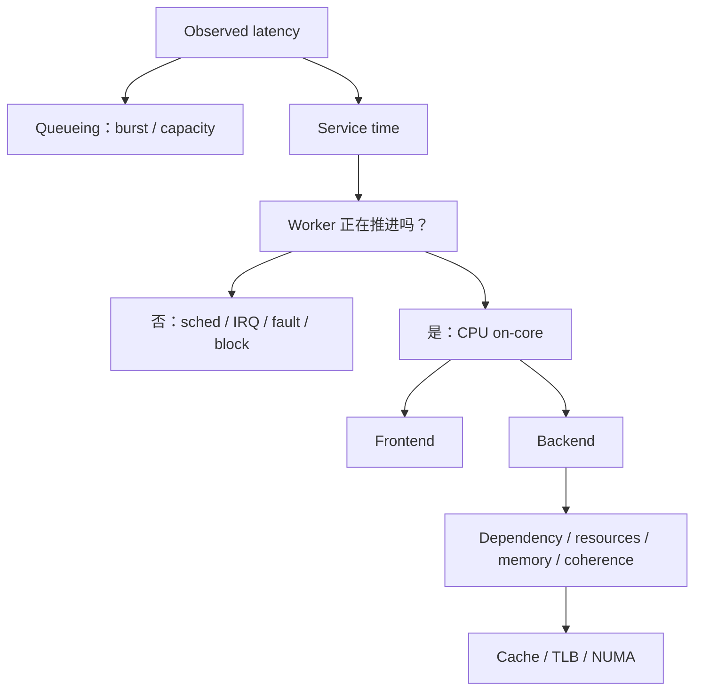

<details>
<summary>查看原图与完整文字转写</summary>

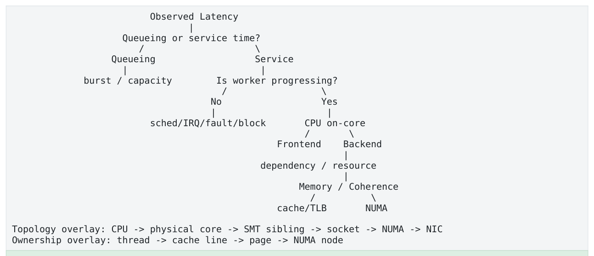

- ` Observed Latency `
- ` Queueing or service time? `
- ` Queueing Service `
- ` burst / capacity Is worker progressing? `
- ` No Yes `
- ` sched/IRQ/fault/block CPU on-core `
- ` Frontend Backend `
- ` dependency / resource `
- ` Memory / Coherence `
- ` cache/TLB NUMA `
- ` Topology overlay: CPU → physical core → SMT sibling → socket → NUMA → NIC `
- ` Ownership overlay: thread → cache line → page → NUMA node `

</details>

第四层最终一句话  Low-latency performance debugging is the science of finding what prevented the critical request from making forward progress, proving it with correlated evidence, and removing that cause without creating a worse bottleneck elsewhere. 看到 p99.9 变差，不要先问“是不是 cache miss”。先问：哪一段？queueing 还是 service？worker 是否在跑？如果在跑，operand、resource、data、ownership、translation、NUMA 哪一层阻止 progress？如果没在跑，谁抢走了 CPU？最后用 evidence 与 intervention 证明，而不是猜。

<a id="conversion-errata"></a>

## 转换补充与勘误

本节及正文中“转换补充 / 转换勘误”均为 2026-11-06 转换时新增；原 PDF 仍是原始内容与版式的对照。

- [原 PDF 第 25 页处的补充](#pdf-page-025)：一次请求的各段时间在互不重复计时的边界下可以相加；各段 p99/p99.9 通常不能直接相加得到 E2E 的相同 percentile。

### 适用边界

原文中的时延、cache/ROB 大小、PMU event、kernel 参数及 compiler lowering 均需要绑定具体平台。转写结构的覆盖校验不等同于对全部技术命题的逐条实测；复杂图的精确布局以随附原图为准。
