# CPU Performance Profiling

> 来源：[Level5_CPU_Performance_Profiling_CN.pdf](./Level5_CPU_Performance_Profiling_CN.pdf)（38 页）。本文件按原文逐页转写；转换补充与勘误单独标明。

> 图示优先转为 Mermaid、表格或步骤；每图附原图和文字以便核对。代码保留原文逻辑与缩进，跨页片段及概念示例未宣称可以独立编译。

[返回目录](README.md) · [转换说明与校验](CONVERSION_NOTES.md) · [本文补充与勘误](#conversion-errata)

[原文目录](#pdf-page-003) · [第一章正文](#pdf-page-006)

<a id="pdf-page-001"></a>

<!-- source-pdf-page: 1 -->

*[原 PDF 第 1 页](./Level5_CPU_Performance_Profiling_CN.pdf#page=1)*

## Performance Profiling &amp; Measurement

### C++ / CPU 深度学习 - 第五层完整讲义

Measurement · perf stat · Sampling · PMU · Top-Down · PEBS · LBR · off-CPU · Scheduler · IRQ · Tail Latency

目标  建立从“性能数字”到“硬件/OS root cause”的完整证据链：可信测量 -&gt; 分类 -&gt; 定位 -&gt; 微架构解释 -&gt; 时间相关性 -&gt; 受控优化 -&gt; 重新测量。

2026-08 · 详尽版

<a id="pdf-page-002"></a>

<!-- source-pdf-page: 2 -->

*[原 PDF 第 2 页](./Level5_CPU_Performance_Profiling_CN.pdf#page=2)*

## 如何使用这份讲义

这份 PDF 不是 perf 命令大全，也不是 8 个 Session 的聊天记录拼接。它按性能工程的真实诊断顺序重新组织：先确认“测量是否可信”，再区分 stable slow 与 tail slow；随后用 perf stat 和 Top-Down 缩小问题空间，用 sampling / annotate 定位代码，再用 PEBS、LBR、perf mem、perf c2c 或 scheduler/IRQ tracing 验证具体机制。

最核心的方法  不要从 counter 出发编故事。先定义可证伪 hypothesis，再选择能观测该机制的工具；最终必须看到“代码/系统机制 -&gt; 硬件或 OS 证据 -&gt; cycles/latency 变化”的闭环。

本文描述现代 Linux + 高性能 superscalar OoO CPU 上的通用 profiling 原则。具体 PMU event 名称、Top-Down 子指标、PEBS/IBS 能力、perf 命令细节会随 CPU 型号、kernel 和 perf 版本变化；凡是 model-specific event，都必须绑定具体平台验证。

### 阅读路线

| 章节 | 主题 | 你最终要回答的问题 |
| --- | --- | --- |
| 第 1 章 | Measurement Fundamentals | 这个数字到底测了什么？是否可信？ |
| 第 2 章 | perf stat | 整个 workload 的症状属于哪一类？ |
| 第 3 章 | Sampling / perf record | CPU 时间主要花在哪里？调用路径是什么？ |
| 第 4 章 | Hardware PMU | counter 到底统计哪个 pipeline stage / event？ |
| 第 5 章 | Top-Down | Frontend / speculation / backend / useful work 谁在主导？ |
| 第 6 章 | Skid / PEBS / LBR | 到底是哪条 load / branch 触发事件？ |
| 第 7 章 | Latency / off-CPU | 线程没运行的时间去哪了？ |
| 第 8 章 | Profiling Methodology | 如何形成完整可重复的诊断闭环？ |
| 第 9 章 | Case Studies | 如何把工具链用于 HFT 常见问题？ |
| 附录 | 速查 / 面试 / 实验 | 如何复习、落地和面试表达？ |

### 贯穿全书的六个问题

- What exactly is the metric and measurement boundary?

- Is the symptom stable slow, tail slow, throughput saturation, or queueing?

- Is the lost time on-CPU, off-CPU, or external/device time?

- Which code path consumes the events, and what microarchitectural mechanism explains them?

- Is the event actually on the critical path, or merely correlated / overlapped?

- What controlled experiment would falsify the hypothesis?

<a id="pdf-page-003"></a>

<!-- source-pdf-page: 3 -->

*[原 PDF 第 3 页](./Level5_CPU_Performance_Profiling_CN.pdf#page=3)*

## 原文目录

- [1. Measurement Fundamentals](#pdf-page-006)
- [1.1 性能指标与 measurement boundary](#pdf-page-006)
- [1.2 Latency / Throughput / Utilization](#pdf-page-006)
- [1.3 Percentile、Histogram 与 tail](#pdf-page-006)
- [1.4 Wall time / CPU time / cycles](#pdf-page-007)
- [1.5 Benchmark vs Profiling vs Tracing](#pdf-page-007)
- [1.6 Measurement overhead / warm-up / environment](#pdf-page-007)
- [1.7 Open-loop、Closed-loop 与 coordinated omission](#pdf-page-008)
- [1.8 Clock / TSC / hardware timestamp](#pdf-page-008)
- [1.9 Benchmark validity checklist](#pdf-page-008)
- [2. perf stat: Aggregate Classification](#pdf-page-010)
- [2.1 PMU 与 software counters](#pdf-page-010)
- [2.2 cycles / instructions / IPC / CPI](#pdf-page-010)
- [2.3 branches / branch-misses / MPKI](#pdf-page-010)
- [2.4 cache generic events 的边界](#pdf-page-011)
- [2.5 page faults / context switches / migrations](#pdf-page-011)
- [2.6 task-clock / user vs kernel / per-thread / per-CPU](#pdf-page-011)
- [2.7 multiplexing / grouping / repeated runs](#pdf-page-011)
- [2.8 Normalize by work](#pdf-page-011)
- [2.9 perf stat 诊断树](#pdf-page-012)
- [3. Sampling: perf record / report / annotate](#pdf-page-013)
- [3.1 Sampling model](#pdf-page-013)
- [3.2 Frequency / period / sample count](#pdf-page-013)
- [3.3 Call graph: FP / DWARF / LBR](#pdf-page-013)
- [3.4 Self vs Children / inclusive vs exclusive](#pdf-page-013)
- [3.5 Symbols / optimized binaries / inlining](#pdf-page-013)
- [3.6 perf annotate 与 machine code](#pdf-page-014)
- [3.7 Flame Graph](#pdf-page-014)
- [3.8 Event-driven sampling](#pdf-page-014)
- [3.9 Hotspot ≠ root cause](#pdf-page-014)
- [4. Hardware PMU](#pdf-page-015)
- [4.1 Retired / issued / executed](#pdf-page-015)
- [4.2 Instruction ≠ µop](#pdf-page-015)
- [4.3 cycles / ref-cycles / TSC](#pdf-page-015)
- [4.4 Branch events](#pdf-page-015)
- [4.5 Cache / TLB / page walk events](#pdf-page-015)
- [4.6 Demand vs prefetch / request vs retired](#pdf-page-015)
- [4.7 MLP 与 stall impact](#pdf-page-016)
- [4.8 Backend resources / ports / AGU](#pdf-page-016)
- [4.9 Stores / coherence / NUMA / HITM](#pdf-page-016)
- [4.10 Event interpretation checklist](#pdf-page-016)
- [5. Top-Down Microarchitecture Analysis](#pdf-page-018)

<a id="pdf-page-004"></a>

<!-- source-pdf-page: 4 -->

*[原 PDF 第 4 页](./Level5_CPU_Performance_Profiling_CN.pdf#page=4)*

- [5.1 Pipeline-slot accounting](#pdf-page-018)
- [5.2 Retiring](#pdf-page-018)
- [5.3 Frontend Bound: latency vs bandwidth](#pdf-page-018)
- [5.4 Bad Speculation](#pdf-page-018)
- [5.5 Backend Bound: Core vs Memory](#pdf-page-018)
- [5.6 L1/L2/L3/DRAM/Store Bound](#pdf-page-019)
- [5.7 Memory latency-bound vs bandwidth-bound](#pdf-page-019)
- [5.8 Percentage denominator / bottleneck migration](#pdf-page-019)
- [5.9 Top-Down decision tree](#pdf-page-019)
- [6. Sampling Accuracy: skid / PEBS / LBR](#pdf-page-021)
- [6.1 Skid 的来源](#pdf-page-021)
- [6.2 Precise event 与 :p/:pp/:ppp](#pdf-page-021)
- [6.3 PEBS hardware records](#pdf-page-021)
- [6.4 perf mem / load latency / data source](#pdf-page-021)
- [6.5 NUMA / HITM / perf c2c](#pdf-page-022)
- [6.6 LBR / indirect branch / branch path](#pdf-page-022)
- [6.7 PEBS vs LBR vs Intel PT](#pdf-page-022)
- [6.8 Precision vs statistical confidence](#pdf-page-022)
- [7. Latency Profiling: off-CPU / OS Noise](#pdf-page-024)
- [7.1 On-CPU vs Off-CPU](#pdf-page-024)
- [7.2 Blocked vs runnable-but-not-running](#pdf-page-024)
- [7.3 sched_switch / sched_wakeup / runqueue](#pdf-page-024)
- [7.4 perf sched / off-CPU flame graph](#pdf-page-024)
- [7.5 IRQ / softirq / ksoftirqd](#pdf-page-024)
- [7.6 Page fault / prefault / mlockall](#pdf-page-025)
- [7.7 TLB shootdown / reclaim / compaction / writeback](#pdf-page-025)
- [7.8 SMI / NMI / SMT / shared-resource interference](#pdf-page-025)
- [7.9 Timestamp-correlated tail tracing](#pdf-page-025)
- [8. Low-Latency C++ Profiling Methodology](#pdf-page-027)
- [8.1 12-step workflow](#pdf-page-027)
- [8.2 Stable slow vs Tail slow](#pdf-page-027)
- [8.3 WHERE / WHY / WHEN](#pdf-page-027)
- [8.4 Queue depth / Little’s Law / burst](#pdf-page-027)
- [8.5 Benchmark design for parser/orderbook/SPSC](#pdf-page-028)
- [8.6 Regression CI / reproducibility](#pdf-page-028)
- [8.7 Optimization priority / failure modes](#pdf-page-028)
- [9. Case Studies](#pdf-page-030)
- [9.1 Order book pointer chasing](#pdf-page-030)
- [9.2 SPSC false sharing](#pdf-page-030)
- [9.3 Branch-heavy parser](#pdf-page-031)
- [9.4 50 µs scheduler tail spike](#pdf-page-031)
- [9.5 Minor page fault tail](#pdf-page-032)
- [9.6 Frontend pressure](#pdf-page-032)
- [9.7 Dependency-bound reduction](#pdf-page-032)

<a id="pdf-page-005"></a>

<!-- source-pdf-page: 5 -->

*[原 PDF 第 5 页](./Level5_CPU_Performance_Profiling_CN.pdf#page=5)*

- [9.8 Instruction inflation](#pdf-page-033)
- [9.9 Queueing latency without CPU regression](#pdf-page-033)
- [A. 附录](#pdf-page-035)
- [A.1 perf 命令速查](#pdf-page-035)
- [A.2 指标与工具对照表](#pdf-page-035)
- [A.3 Top-Down 速记卡](#pdf-page-035)
- [A.4 常见误区](#pdf-page-036)
- [A.5 面试问答](#pdf-page-036)
- [A.6 推荐实验](#pdf-page-037)
- [A.7 最终复习清单](#pdf-page-037)

<a id="pdf-page-006"></a>

<!-- source-pdf-page: 6 -->

*[原 PDF 第 6 页](./Level5_CPU_Performance_Profiling_CN.pdf#page=6)*

## 第 1 章 Measurement Fundamentals

本章目标  在接触 perf 之前，先建立“什么叫可信测量”的心智模型。性能工程最常见的错误不是不会用工具，而是一开始就测错了。

### 1.1 “哪个更快必须先定义” metric

“A 比 B 快”本身不是完整技术结论。至少要区分单次 latency、平均 latency、tail latency、最大吞吐、CPU efficiency、资源占用和业务有效工作量。不同指标可能给出相反排名。

| 指标 | 回答的问题 | 典型单位 |
| --- | --- | --- |
| Latency | 一个 work item 从开始到结束多久？ | ns / µs / ms |
| Throughput | 单位时间完成多少 work？ | msg/s, ops/s |
| Tail latency | 极端慢样本有多慢？ | p99 / p99.9 / p99.99 / max |
| CPU cost | 处理一个 work item 消耗多少 CPU？ | cycles/op, instructions/op |
| Queueing | 请求在服务前等了多久？ | µs, queue depth |
| Jitter | 延迟分布有多宽？ | variance / percentile spread |

核心原则  性能数字必须带 measurement boundary、workload、统计口径和运行环境。单独的“120 ns”几乎没有解释力。

### 1.2 Latency、Throughput、Utilization 与 queueing

Throughput 和 latency 是不同维度。系统可以维持很高 throughput，同时 queueing delay 已显著恶化。设 arrival rate 为 λ，service rate 为 µ，utilization ρ=λ/µ。当 ρ 接近 1 时，queueing latency 往往非线性上升。

```text
ρ = λ / µ
当 ρ -> 1：
queueing delay 通常急剧增加
化直： latency ∝ 1 / (1 - ρ)
```

对 latency-sensitive 系统，“CPU 99% busy”不等于“性能很好”。尤其对于 spinning hot thread，100% CPU 甚至可能是设计目标；真正要看的是 service capacity、backlog 和 tail distribution。

### 1.3 Average 不够：percentile、histogram 与 tail

p99=20 µs 的含义是至少 99% observations 不超过 20 µs；它不是“最慢 1% 的平均”。越高 percentile 需要越多 samples 才稳定。1000 个样本估计 p99.9 时几乎落到极端单点，统计置信度很弱。

```text
Example:
999 requests = 5 µs
1 request     = 5 ms

mean ≈ 10 µs
```

但系统真实存在 5 ms tail。

Low latency  Low-latency engineering 不只是低平均值，更重要的是 low variance + bounded pathological behavior。

<a id="pdf-page-007"></a>

<!-- source-pdf-page: 7 -->

*[原 PDF 第 7 页](./Level5_CPU_Performance_Profiling_CN.pdf#page=7)*

### Histogram 为什么比单个平均值更有价值

Histogram 能同时展示 main body 与 long tail。HdrHistogram 一类结构适合跨多个数量级记录 latency，并计算高 percentile；但 histogram 本身仍依赖正确的 sampling/load-generation methodology。

### 1.4 Wall-clock time、CPU time、cycles

| 概念 | 含义 | 常见误解 |
| --- | --- | --- |
| Wall time | 用户从开始到结束真正等待的时间 | 包含 off-CPU / IO / scheduler |
| CPU time | 线程真正得到 CPU 的累计时间 | 不能解释线程没运行的空洞 |
| Core cycles | PMU 统计的 active core cycles | 受实际 core clock 影响 |
| Reference cycles | 参考频率尺度的 cycles | 与 turbo 关系不同 |
| TSC ticks | invariant TSC 的时间计数 | 不等同于实际 core cycles |

因此“100 cycles”必须问：TSC delta、PMU core cycles、reference cycles，还是 llvm-mca 估计？这些不是同一概念。

### 1.5 Benchmark、Profiling、Hardware Profiling、Tracing

| 方法 | 核心问题 | 典型输出 |
| --- | --- | --- |
| Benchmark | 有多快？ | ns/op, p99, msg/s |
| CPU Profiling | CPU 时间花在哪里？ | hot functions / call paths |
| Hardware Profiling | 为什么 CPU 在这里慢？ | Frontend/Backend/branch/memory |
| Tracing | 什么时候发生了什么？ | timeline: wakeup/IRQ/fault/request |

WHERE / WHY / WHEN  perf record 主要回答 WHERE；PMU/Top-Down/PEBS 主要回答 WHY；scheduler/eBPF/ftrace 主要回答 WHEN。

### 1.6 Measurement overhead、observer effect 与 warm-up

任何测量都会改变被测系统。对 30 ns 操作，在每次调用前后读 clock 的成本可能与 workload 同量级。printf/std::cout 更会引入锁、缓冲和 syscall/terminal 路径，严重污染 hot loop。

：

```text
for (...) {
    t1 = now();
    foo();
    t2 = now();
    printf("%ld\n", t2-t1);
}
```

更合理：

**图示转写**

1. ` preallocate result buffer `
2. ` record `
3. ` benchmark end `
4. ` offline histogram `

<details>
<summary>查看原图与完整文字转写</summary>

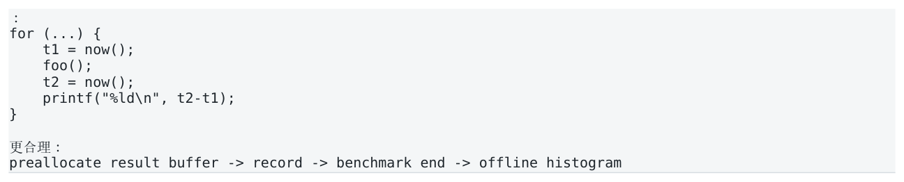

- ` preallocate result buffer → record → benchmark end → offline histogram `

</details>

<a id="pdf-page-008"></a>

<!-- source-pdf-page: 8 -->

*[原 PDF 第 8 页](./Level5_CPU_Performance_Profiling_CN.pdf#page=8)*

Warm-up 需要处理 I-cache、D-cache、TLB、branch predictor、allocator、dynamic linker、page faults 和 frequency state。但 warm-up 不是为了让数字更漂亮，而是为了匹配目标 production state。Cold-start 和 steadystate 应分开报告。

### 1.7 CPU affinity、NUMA、frequency 与 compiler

- 固定 CPU，避免 migration 引入 cache/TLB/NUMA 噪声。

- 控制 memory placement；first-touch 决定匿名内存初始 NUMA locality。

- 记录 turbo / governor / thermal state；同时看 ns/op 与 cycles/op。

- 使用 production-like optimization（-O2/-O3），不要 profile -O0。

- 阻止 benchmark-specific dead-code elimination，而不是“禁止 compiler 优化”。

- 避免 constant folding / dead store elimination / unrealistic repeated identical input。

### 1.8 Microbenchmark、Macrobenchmark 与 batching

Microbenchmark 可控且容易解释，但容易不真实；Macrobenchmark 接近系统行为，却难定位瓶颈。合理流程通常是：macro 发现 regression -&gt; profile -&gt; 用 microbenchmark 复现具体组件 -&gt; 修改 -&gt; 回到 macro 验证。 Batching 可以 amortize timer/loop overhead，却也可能让 cache、pipeline、branch predictor 变得比 production 更热。真实系统如果请求之间有 gap，就不能简单用 tight loop 代替。

### 1.9 Open-loop、Closed-loop 与 Coordinated Omission

Closed-loop generator 发送一个 request 后等待 response，再发送下一个。如果 server 卡住 100 ms，generator 也停止产生请求，于是只记录一个 100 ms 样本，低估了本应在这 100 ms 内到达的其他请求的等待。

**图示转写**

1. ` Closed-loop: `
2. ` send A `
3. ` wait 100 ms `
4. ` send B `

<details>
<summary>查看原图与完整文字转写</summary>

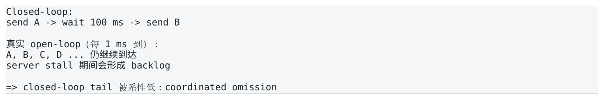

- ` Closed-loop: `
- ` send A → wait 100 ms → send B `

</details>

真实 open-loop（每 1 ms 到）：

```text
A, B, C, D ... 仍继续到达
server stall 期间会形成 backlog
=> closed-loop tail 被系性低：coordinated omission
```

市场数据是典型外部驱动 workload：exchange 不会因为你的 pricing engine 忙就停止发送。因此 HFT load test 应显式考虑 open-loop、burst distribution、queueing 和 stale work。

### 1.10 Clock：steady_clock、RDTSC/RDTSCP 与 hardware timestamp

std::chrono::steady_clock 可移植且 monotonic；Linux 常通过 vDSO 优化，但具体成本依实现。RDTSC 低开销但必须理解执行排序：读 TSC 本身并不自动构成任意意义上的序列化边界。常见测量序列会结合 LFENCE/RDTSCP，具体推荐模式应绑定目标 CPU 文档。

念量界：

```text
LFENCE; RDTSC     # start
... hot code ...
RDTSCP; LFENCE    # end

注意：TSC ticks 通常是 invariant reference time，不等于 PMU core cycles。
```

网络 end-to-end latency 若只在 application ingress/egress 取 timestamp，会漏掉 NIC/driver/kernel 段。NIC hardware timestamp + PTP 可扩展测量边界，但必须清楚每个 timestamp 属于哪个 clock domain。

<a id="pdf-page-009"></a>

<!-- source-pdf-page: 9 -->

*[原 PDF 第 9 页](./Level5_CPU_Performance_Profiling_CN.pdf#page=9)*

### 1.11 Benchmark validity checklist

| 检查项 | 需要明确的内容 |
| --- | --- |
| What | latency / throughput / cycles / percentile |
| Where | timestamp boundary: NIC / app / component |
| Clock | steady_clock / TSC / HW timestamp |
| Workload | message mix / dataset / burst / working set |
| Environment | CPU / NUMA / SMT / frequency / kernel |
| Compiler | version / flags / -march / symbols |
| Statistics | sample count / histogram / repeat variance |
| Generator | open-loop or closed-loop / coordinated omission |
| Overhead | timer / instrumentation / tracing cost |

### 本章结论

- “更快”必须先定义 metric；throughput、p50、tail 和 CPU efficiency 可以给出不同结论。

- Wall latency 与 thread CPU time 不同；这为后续 on-CPU / off-CPU 分流奠定基础。

- Benchmark 必须匹配真实 workload；warm-up、affinity、NUMA、frequency 和 compiler 都属于实验定义。

- Closed-loop benchmark 可能产生 coordinated omission，尤其危险于外部驱动的 market-data workload。

<a id="pdf-page-010"></a>

<!-- source-pdf-page: 10 -->

*[原 PDF 第 10 页](./Level5_CPU_Performance_Profiling_CN.pdf#page=10)*

## 第 2 章 perf stat：Aggregate Classification

本章目标  用少量 aggregate counters 把“程序慢”缩小为 instruction inflation、branch/speculation、memory/stall、OS noise 等少数方向。perf stat 是分类器，不是最终 root-cause 工具。

### 2.1 PMU 与 perf stat

CPU 内部 PMU（Performance Monitoring Unit）维护硬件事件计数器；Linux perf 同时暴露 software counters。 perf stat 聚合整个 measurement window 的事件数量。

```bash
perf stat ./app
perf stat -e cycles,instructions,branches,branch-misses,\
page-faults,context-switches,cpu-migrations ./app
```

| 类别 | 例子 | 本质 |
| --- | --- | --- |
| Hardware | cycles, instructions, branches | CPU PMU |
| Software | page-faults, context-switches | kernel accounting |
| Generic cache | cache-references, cache-misses | 映射到底层 PMU，语义依 CPU |
| Model-specific | MEM_LOAD_RETIRED.*, IDQ.*, OFFCORE_* | 微架构特定 |

### 2.2 cycles、instructions、IPC、CPI

instructions 通常指 retired architectural instructions。错误 speculation 上执行过但最终 squash 的工作不会进入 retired count。IPC=instructions retired / cycles；CPI 为其倒数。IPC 是诊断 signal，不是 performance objective。

**图示转写**

1. ` A: 1000 instructions / 500 cycles => IPC 2.0 `
2. ` B: 200 instructions / 250 cycles => IPC 0.8 `

<details>
<summary>查看原图与完整文字转写</summary>

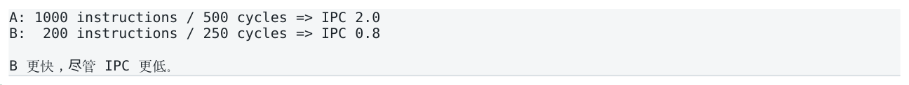

- ` A: 1000 instructions / 500 cycles => IPC 2.0 `
- ` B: 200 instructions / 250 cycles => IPC 0.8 `

</details>

B 更快，尽管 IPC 更低。

阅读顺序  先看 elapsed + work units，再看 cycles/op、instructions/op，随后才看 IPC。总计数不 normalize 很容易把“处理了更多消息”误判为 regression。

### cycles 高的两种根本形态

| 现象 | 初步方向 |
| --- | --- |
| cycles/op 高 + instructions/op 高 | 做了太多工作（instruction inflation） |
| cycles/op 高 + instructions/op 正常 + IPC 低 | CPU 在等待：frontend/backend/dependency/speculation |

### 2.3 Branches、branch-misses 与 MPKI

branch miss rate = branch-misses / branches，但还应考虑 branch density。更适合跨实现比较的一个指标是 Branch MPKI = branch misses / instructions * 1000。

<a id="pdf-page-011"></a>

<!-- source-pdf-page: 11 -->

*[原 PDF 第 11 页](./Level5_CPU_Performance_Profiling_CN.pdf#page=11)*

```text
10M branch misses / 1B instructions * 1000 = 10 MPKI
```

1% miss rate 是否高没有固定答案；随机条件分支可能接近 50% miss，而稳定 parser path 可能远低于此。最终要看 Bad Speculation 的 slot loss 与 cycles/op 是否真正受影响。

### 2.4 Generic cache counters 的边界

perf 的 cache-references/cache-misses 是通用抽象，不能跨 CPU 硬编码成“所有 cache access”或“LLC miss”。精确分析应使用 model-specific events，并先读 event definition。

严禁直接推理  LLC miss high -&gt; DRAM bound 是不成立的。还缺 data source、MLP、stall impact 和 critical-path evidence。

### 2.5 Page faults、context switches、migrations

| 指标 | 正常含义 | HFT 关注点 |
| --- | --- | --- |
| minor faults | 无需磁盘但进入 fault handler / mapping | steady hot window 希望接近 0 |
| major faults | 需要 backing storage IO | hot path 基本必须为 0 |
| context switches | task 被切换出/入 | 一次几十 µs 就可能炸 tail |
| cpu migrations | task 换 logical CPU | cache/TLB/NUMA locality 可能改变 |

一个 aggregate context-switch count 只能证明“发生过”，不能证明“就是该 p99.99 spike”。要建立时间相关性需要 Session 7 的 scheduler tracing。

### 2.6 task-clock、user/kernel、TID 与 CPU scope

task-clock 是任务实际运行在 CPU 上的累计时间。多线程程序 task-clock 可以大于 elapsed wall time。perf 可用 :u/:k 分离 user/kernel，也可 attach PID/TID 或 per-CPU 统计。

```bash
perf stat -e cycles:u,instructions:u -t <tid>
perf stat -p <pid>
perf stat -C 6 ...
```

per-CPU 统计会包含该 CPU 上所有 activity，因此既可能污染 hot-thread measurements，也可以反向用于检查 isolation 是否真的干净。

### 2.7 Multiplexing 与 event groups

硬件 programmable counters 数量有限。一次要求过多 events 时，kernel 会 time-multiplex 并 scale。对稳定 workload 尚可，对 phase-changing workload 可能严重偏差。

```bash
perf stat -e '{cycles,instructions,branches,branch-misses}' ./app
```

Event group 尝试让 ratio 所需 counters 同时计数；但 group 超过硬件能力也可能无法 schedule。实践中分多次 pass 比一次塞 20 个 events 更可信。

### 2.8 Repeated runs 与 interval mode

```bash
perf stat -r 10 ./bench
perf stat -I 1000 -p <pid>
```

-r 适合观察 run-to-run variance；-I 适合服务型 workload 的宏观 phase 变化。但 1 s interval 无法解释 20 µs tail spike。

<a id="pdf-page-012"></a>

<!-- source-pdf-page: 12 -->

*[原 PDF 第 12 页](./Level5_CPU_Performance_Profiling_CN.pdf#page=12)*

### 2.9 Normalize by work

| Raw counter | 更有价值的 normalized metric |
| --- | --- |
| cycles | cycles / packet, order, update |
| instructions | instructions / message |
| branch misses | branch misses / op 或 MPKI |
| LLC misses | misses / op |
| faults / context switches | events / hot window + timestamp correlation |

如果 A 有 10M misses/100M packets，而 B 有 20M/1B packets，B 总 miss 更多但每 packet 更高效。任何跨 run comparison 都必须先确认 work amount 一致。

### 2.10 perf stat 作为 hypothesis-space reducer

```bash
Program slow
   |
perf stat
   |
   +-- instructions/op high? -> too much work
   +-- branch miss high?      -> speculation candidate
   +-- faults/csw/migration?  -> OS/tail candidate
   +-- IPC low?               -> frontend/backend/dependency/memory
   +-- cache signal high?     -> memory suspicious, NOT yet root cause
```

最重要的一句  Counter 本身不是瓶颈；只有阻塞 critical path 或显著增加 total work 的机制才是瓶颈。

### 本章结论

- perf stat 先回答“发生了什么”，不是“在哪里发生”或“为什么发生”。

- IPC 高不等于程序快；cycles/op 和 latency 是第一优先级，IPC 用于解释。

- generic cache events 只适合初步 signal；精确 diagnosis 必须绑定 CPU-specific event definition。

- page fault/context switch/migration 对 tail-sensitive hot thread 即使次数很少也值得调查。

<a id="pdf-page-013"></a>

<!-- source-pdf-page: 13 -->

*[原 PDF 第 13 页](./Level5_CPU_Performance_Profiling_CN.pdf#page=13)*

## 第 3 章 Sampling：perf record / report / annotate

本章目标  从 aggregate symptoms 下钻到 code location：哪个函数、哪条调用路径、哪段 machine code 消耗了所采样的 event。

### 3.1 Sampling 的统计模型

perf record 通常不记录每条 instruction，而是让 PMU 每经过一定 event period 产生 sample，记录 IP、call chain 等上下文。若某函数占 40% sampled cycles，在样本足够、采样近似均匀时，可近似认为它占约 40% on-CPU cycle cost。

```bash
perf record -e cycles -g ./app
perf report
```

### 3.2 Frequency、Period、sample count 与 overhead

-F 999 表示目标约 999 samples/s；更高频率提升统计分辨率，也增加 PMI / data handling overhead。太短的 benchmark 采样不足，太高 sampling rate 又会改变被测程序。 Precise attribution 与 statistical confidence 是不同维度：PEBS 可以让单个 sample 更准确落到 instruction，但 20 个样本仍然没有 20,000 个样本的统计稳定性。

### 3.3 Call graph：Frame Pointer、DWARF、LBR

| 方法 | 优点 | 代价/限制 |
| --- | --- | --- |
| Frame Pointer | 低开销、简单、稳定 | binary 需要保留 FP |
| DWARF unwind | 不要求 FP，适合 production optimized binary | stack capture 更重 |
| LBR | 硬件 branch history，低开销 | history depth 有限，平台依赖 |

```bash
Recommended profiling build:
-O3 -g -fno-omit-frame-pointer

perf record --call-graph fp -e cycles ./app
perf record --call-graph dwarf -e cycles ./app
perf record --call-graph lbr -e cycles ./app
```

不要 profile -O0  -O0 会改变 inlining、vectorization、register allocation、spill、branch layout。你看到的是另一种程序。

### 3.4 Self / Children，Exclusive / Inclusive

Self 表示 sample 直接落在该 symbol；Children/Inclusive 包含其调用子树。OrderBook::update Self=2%、 Children=70% 并不表示 update 便宜，而是 wrapper 本身便宜、整个 operation 仍占 70%。

### 3.5 Symbolization、debug info 与 inlining

Sampling 记录的是地址；debug symbols 用于把地址映射回 symbol/source。生产 binary 可以 stripped，但必须保存 matching build-id 和 separate debuginfo。优化后 inline function 可能没有独立 machine function，source line 与 assembly 也不是一一对应。

<a id="pdf-page-014"></a>

<!-- source-pdf-page: 14 -->

*[原 PDF 第 14 页](./Level5_CPU_Performance_Profiling_CN.pdf#page=14)*

### 3.6 perf annotate：从 source 进入 machine code

perf annotate 的目标不是找“百分比最高的汇编”，而是理解 hot loop 的 dependency、loads、branches、 spills、vectorization 和 instruction mix。普通 cycles sampling 还会受 skid 影响，因此 hotspot instruction 只是 instruction neighborhood。

```text
Example:
  5%  mov   0x8(%rbx), %rbx   # dependent load
 65%  test  %rbx, %rbx        # sample may skid here
  5%  jne   loop
```

错误结论：test 很慢

```text
更合理：前面的 load 可能是 cache-missing dependent load。
```

### 在 annotate 中重点看什么

- Dependent load chain / loop-carried dependency

- Branch tree / indirect call / jump table

- Unexpected scalar code vs SIMD

- Stack spills / reloads

- Division / serialization

- Over-unrolling / huge code footprint

- Call frequency and repeated memcpy/malloc

### 3.7 Flame Graph

Flame graph 把大量 sampled stacks 聚合，横向宽度表示 sample weight / inclusive cost，不是时间轴。它很适合看“哪个调用路径”在使用共享 utility，例如 malloc、memcpy、hash lookup。

Top function ≠ optimization target  memcpy 占 30% 时，先问为什么上层复制了 3 次，而不是先重写 memcpy。总成本 = call frequency * cost per call；减少调用次数常比微调单次成本更有效。

### 3.8 Event-driven sampling

默认 cycles 用于找到“CPU 时间在哪里”。若 perf stat 已提示 branch miss 可疑，可改采 branch-misses；若想区分 instruction-heavy 与 stall-heavy，也可对比 cycles samples 与 instructions samples。

```bash
perf record -e cycles -g ./app
perf record -e instructions -g ./app
perf record -e branch-misses -g ./app
```

Function A: cycles samples 40%、instruction samples 10% -&gt; stall-heavy 候选。Function B 两者都约 40% -&gt; 更像单纯执行了大量 work。该推理仍需 Top-Down/PMU 进一步验证。

### 3.9 Hotspot ≠ root cause

Hotspot 只回答“哪里观察到了成本”。pointer chasing 中样本可能落在等待 load 结果的 consumer；malloc 热点可能意味着 architecture 每消息分配；memcpy 热点可能意味着 ownership/copy design 有问题。真正 root cause 必须跨代码结构和微架构机制建立因果链。

### 本章结论

- perf record 是统计 sampling，不是完整 execution log。

- 每个 percentage 都必须问“percentage of which event?”。

- Call graph 中要区分 self 与 inclusive cost，并追 caller context。

- perf annotate 必须结合 optimized assembly，且普通 samples 可能 skid。

- Hotspot 是 location，不是 root cause。

<a id="pdf-page-015"></a>

<!-- source-pdf-page: 15 -->

*[原 PDF 第 15 页](./Level5_CPU_Performance_Profiling_CN.pdf#page=15)*

## 第 4 章 Hardware PMU：理解 Counter 的真正语义

本章目标  学会在读 PMU event 前先问“它在哪个 pipeline stage、统计 speculative 还是 retired、统计 request 还是 instruction”。避免按 event 名字字面解释。

### 4.1 Pipeline stage：Issued、Executed、Retired

**图示转写**

1. ` Fetch `
2. ` Decode `
3. ` Rename `
4. ` Dispatch `
5. ` Issue `
6. ` Execute `
7. ` Complete `
8. ` Retire `

<details>
<summary>查看原图与完整文字转写</summary>

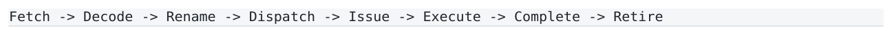

- ` Fetch → Decode → Rename → Dispatch → Issue → Execute → Complete → Retire `

</details>

branch misprediction 的 wrong-path instructions 可能 fetch/decode/issue/execute，却不会 retire。因此 instructions retired 无法反映全部 speculative waste。不同 PMU events 可以在不同 stage 计数，不能混用。

### 4.2 Instruction ≠ µop

x86 architectural instruction 可能拆成多个 µops。Backend scheduler、ports、ROB 等更接近 µop 级资源。uops issued / executed / retired 也不是同一件事；branch flush、replay 等会使 issued/executed 大于 retired。

PMU 不是 ISA 标准  Event 是 microarchitecture contract。Skylake、Ice Lake、Sapphire Rapids、Zen 等可能有不同名字、 定义、约束和 errata。严肃分析必须查 CPU-specific PMU documentation。

### 4.3 cycles、ref-cycles、TSC

| 计数 | 近似含义 | 注意 |
| --- | --- | --- |
| cycles / cpu-cycles | active core clock cycles | 随 core frequency/turbo 变化 |
| ref-cycles | reference clock cycles | 用于 frequency 关系分析 |
| TSC | invariant time counter ticks | 通常固定 rate，不等于 core cycles |

### 4.4 Branch events

除 branches/branch-misses 外，CPU 可能提供 conditional、indirect、return、taken、machine clears 等细分。 Bad Speculation 不等于 branch miss rate，但 branch misprediction 通常是主要来源。

### 4.5 Cache event：先问哪个“ access、哪个层级、哪个 stage”

“L1 miss”必须说明 data load、store、instruction fetch 还是 prefetch；L1 miss 可能 L2 hit，L2 miss 可能 LLC hit，LLC miss 也可能从另一个 core cache、remote NUMA 或 local DRAM 获得。

**图示转写**

1. ` L1D miss `
2. ` L2 hit (not DRAM) `
3. ` L1D miss `
4. ` L2 miss `
5. ` LLC hit (not DRAM) `
6. ` LLC miss `
7. ` local DRAM / remote DRAM / cache-to-cache / coherence `

<details>
<summary>查看原图与完整文字转写</summary>

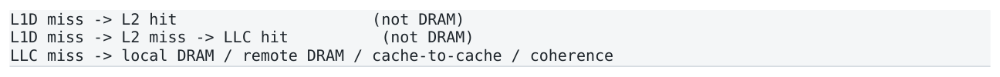

- ` L1D miss → L2 hit (not DRAM) `
- ` L1D miss → L2 miss → LLC hit (not DRAM) `
- ` LLC miss → local DRAM / remote DRAM / cache-to-cache / coherence `

</details>

### 4.6 Retired load vs request / Demand vs prefetch

MEM_LOAD_RETIRED.L3_MISS 一类事件更接近“最终 retire 的 load 经历 L3 miss”；cache-controller request event 则更接近 memory request traffic。wrong-path speculative loads 可能产生流量，却不会出现在 retired-load event。硬件 prefetch 也可能造成大量 cache traffic。

> **转换补充**：PMU event 的定义、可用性与 precise-sampling 能力依 CPU model 而异。先用 `perf list` 和对应 CPU 的事件说明确认；相同的工具输出名称不自动证明在不同 CPU 上测到相同微架构量。参见 [Intel PerfMon Events](https://perfmon-events.intel.com/)。

<a id="pdf-page-016"></a>

<!-- source-pdf-page: 16 -->

*[原 PDF 第 16 页](./Level5_CPU_Performance_Profiling_CN.pdf#page=16)*

### 4.7 Miss count 不等于 stall cost：MLP

多个 independent cache misses 可以同时 outstanding，单次 DRAM latency 很高却被 overlap；pointer chasing 则下一地址依赖上一 load，MLP 低，同样 miss 数可能暴露完全不同的 latency。

| 模式 | miss 数量 | 性能影响 |
| --- | --- | --- |
| 4 independent DRAM misses | 可能较多 | 高 MLP，可 overlap |
| 4 serial pointer misses | 可能相同 | MLP≈1，latency 直接暴露 |

Event -&gt; Stall -&gt; Critical Path  真正要证明的不是“事件发生很多”，而是“事件造成 stall，且 stall 位于 critical path，从而解释 cycles/latency”。

### 4.8 TLB / page walk PMU

DTLB miss 可能在 second-level TLB 命中，也可能触发 hardware page-table walk。Page walk 需要读取 pagetable entries，可能进一步访问 cache/DRAM。ITLB 对 code footprint 和 frontend 同样重要。Huge page 的价值之一是提高 TLB reach，但必须测量。

### 4.9 Core backend resources：Ports、AGU、divider、dependency

Backend Core Bound 可能来自 execution-port throughput，也可能来自 serial dependency。即使全部数据 L1 hit，load ports / store ports / AGUs 仍有有限 throughput；divider 等特殊资源 latency/throughput 更低。

```text
Runtime lower bound ≳ max(
  dependency critical path,
  ALU demand / ALU capacity,
  load demand / load capacity,
  store/AGU demand / capacity,
  frontend demand / frontend capacity
)
```

### 4.10 Stores、coherence、NUMA 与 HITM

Store retire 后可以进入 store buffer，数据并未因此立即全局可见。Store Bound 可能来自 store buffer / ownership / writeback path。False sharing/true sharing 常表现为 cache-line ownership ping-pong；HITM/cache-to-cache data source 是有力证据。 LLC miss 也不等于 DRAM：如果另一个 core 持有 modified line，数据可能直接 cache-to-cache transfer；若来自 remote socket，则是 NUMA latency。

### 4.11 Counter overlap 与 multiplexing

Raw PMU events 经常 overlap：同一 cycle 可能同时满足 load pending、backend stalled、scheduler full 等条件， 因此不能随意相加为 100%。这也是 Top-Down 采用 structured slot accounting 的原因。

### 4.12 PMU Event Interpretation Checklist

1. What exactly is counted?

2. At which pipeline stage?

3. Retired or speculative?

4. Load/store/fetch/prefetch/request which one?

<a id="pdf-page-017"></a>

<!-- source-pdf-page: 17 -->

*[原 PDF 第 17 页](./Level5_CPU_Performance_Profiling_CN.pdf#page=17)*

5. What is the denominator?

6. Can this event overlap with others?

7. Is it precise / skid-prone?

8. Is the event reliable on this CPU/kernel?

9. Does it correlate with actual stall cycles?

10. Is that stall on the critical path?

### 本章结论

- Retired ≠ executed；instruction ≠ µop。

- Cache-level event 必须区分 access type、request/retired、demand/prefetch。

- Miss count 只有与 MLP、stall impact、critical path 结合才有性能意义。

- Coherence、remote NUMA 与 cache-to-cache transfer 可能隐藏在“LLC miss”背后。

<a id="pdf-page-018"></a>

<!-- source-pdf-page: 18 -->

*[原 PDF 第 18 页](./Level5_CPU_Performance_Profiling_CN.pdf#page=18)*

## 第 5 章 Top-Down Microarchitecture Analysis

本章目标  用一棵固定诊断树代替“随机看几十个 PMU counters”。先从四个一级类别判断 pipeline slots 为什么没有形成更多 useful retirement，再逐层 drill down。

### 5.1 Pipeline-slot accounting

Top-Down 把每 cycle 的 pipeline capacity 作为 accounting abstraction。一级分类设计为大致互斥：Retiring、 Frontend Bound、Bad Speculation、Backend Bound，合计约 100%。它是 PMU-based model，不是逐 slot 物理日志。

**图示转写**

| 场景 / 部分 | 路径、状态或说明 |
| --- | --- |
| 部分 1 | ` CPU 为什么没有 retire 更多 useful work？ ` |
| 没拿到工作 → Frontend Bound | ` 拿到了但做错了 → Bad Speculation `；` 拿到了但做不动 → Backend Bound ` |

<details>
<summary>查看原图与完整文字转写</summary>

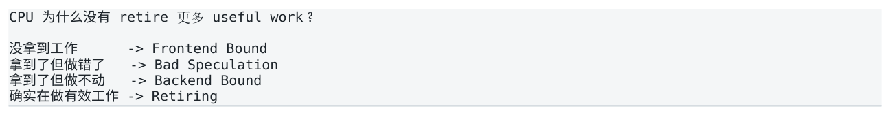

- ` CPU 为什么没有 retire 更多 useful work？ `
- ` 没拿到工作 → Frontend Bound `
- ` 拿到了但做错了 → Bad Speculation `
- ` 拿到了但做不动 → Backend Bound `

</details>

确实在做有效工作 -&gt; Retiring

### 5.2 Retiring

Retiring 表示 slot 最终对应 architectural work，但 Retiring 高不代表程序一定快。一个 O(N^2) 算法完全可以 Retiring 很高，因为 CPU 正在高效执行大量不必要 work。此时应看 instructions/op。

Retiring high + instructions/op high  常见结论不是“CPU 很健康所以无事可做”，而是“CPU 很勤奋，但程序让它做了太多事”。优化方向是 do less work。

### 5.3 Frontend Bound：Latency vs Bandwidth

```text
Frontend Bound
```

+-- Latency:   一段时间几乎断粮

**图示转写**

1. ` I-cache miss / ITLB miss / redirect / fetch stall `

<details>
<summary>查看原图与完整文字转写</summary>

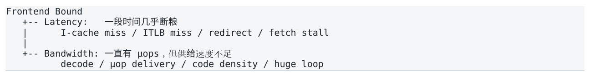

- ` I-cache miss / ITLB miss / redirect / fetch stall `

</details>

+-- Bandwidth: 一直有 µops，但供给速度不足

```text
          decode / µop delivery / code density / huge loop
```

HFT C++ 容易因 template explosion、force-inline、巨大 switch、过度 unroll 造成 code footprint 膨胀。Inlining 的收益是去 call + 跨函数优化；代价是 I-cache、ITLB、µop cache 和 register pressure。

### 5.4 Bad Speculation

Bad Speculation 表示 CPU 做了随后被丢弃的工作，主要来自 branch misprediction，也可能包括 machine clears 等。比单纯 branch miss rate 更直接地表达 pipeline capacity waste。

### 5.5 Backend Bound：Core vs Memory

**图示转写**

| Backend 类别 | 继续调查 |
| --- | --- |
| Core Bound | dependency / execution ports / divider / AGU / resources |
| Memory Bound | L1 / L2 / L3 / DRAM / Store / TLB / coherence |

<details>
<summary>查看原图与完整文字转写</summary>

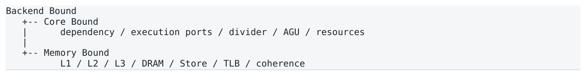

- ` Backend Bound `
- ` -- Core Bound `
- ` dependency / execution ports / divider / AGU / resources `
- ` -- Memory Bound `
- ` L1 / L2 / L3 / DRAM / Store / TLB / coherence `

</details>

Core Bound 高时不能直接说 port saturation：单条 serial dependency 也会让 execution units 空闲但 consumer 未 ready。需要结合 assembly、llvm-mca 与 port metrics。

<a id="pdf-page-019"></a>

<!-- source-pdf-page: 19 -->

*[原 PDF 第 19 页](./Level5_CPU_Performance_Profiling_CN.pdf#page=19)*

### 5.6 Memory Bound 子层级

| 类别 | 正确理解 | 常见原因 |
| --- | --- | --- |
| L1 Bound | 受 L1 data path / load-use / store-forwarding 等限制 | 即使 L1 hit 也可能存在 |
| L2 Bound | 主要暴露 L2 latency | working set 超出 L1 |
| L3 Bound | 主要暴露 LLC latency | working set 超出 private caches |
| DRAM Bound | off-core memory latency 真正阻塞backend | serial misses / low MLP |
| Store Bound | store path / buffer / ownership 限制 | write-heavy / coherence |

### 5.7 Memory latency-bound vs bandwidth-bound

| 类型 | 典型形态 | 关键特征 | 优化方向 |
| --- | --- | --- | --- |
| Latency-bound | pointer chasing | 低 MLP，bandwidth 可能很低 | packing / reduce dependency / locality |
| Bandwidth-bound | stream huge arrays | 高 MLP，DRAM channels 饱和 | reduce bytes / reuse / batching |

重要反直觉  Memory Bound 不等于 memory bandwidth high。pointer chasing 可以几乎不吃 bandwidth，却把 core 大部分时间耗在等待单个 serial memory access。

### 5.8 百分比的 denominator effect

Top-Down percentage 是 composition，不是 absolute cost。Before: 100 cycles 中 Backend 60 cycles=60%； After: 50 cycles 中 Backend 35 cycles=70%。百分比变差，绝对 Backend cost 却从 60 降到 35 cycles，总体显著变快。 因此 A/B 必须同时记录 ns/op、cycles/op、instructions/op 和 Top-Down composition。

### 5.9 Bottleneck Migration

优化 memory 后可能变 Core Bound；branchless rewrite 降 Bad Spec 后可能提高 instruction count 或 frontend pressure。每次优化都必须重新 profile，旧 bottleneck 结论不能自动沿用。

### 5.10 Top-Down decision tree

**图示转写**

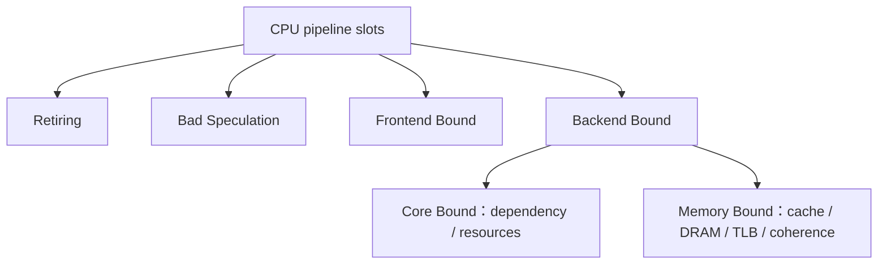

<details>
<summary>查看原图与完整文字转写</summary>

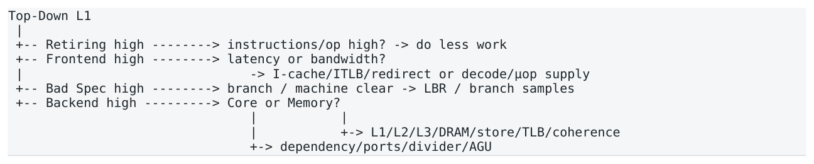

- ` Top-Down L1 `
- ` -- Retiring high → instructions/op high? → do less work `
- ` -- Frontend high → latency or bandwidth? `
- ` → I-cache/ITLB/redirect or decode/µop supply `
- ` -- Bad Spec high → branch / machine clear → LBR / branch samples `
- ` -- Backend high → Core or Memory? `
- ` -> L1/L2/L3/DRAM/store/TLB/coherence `
- ` -> dependency/ports/divider/AGU `

</details>

<a id="pdf-page-020"></a>

<!-- source-pdf-page: 20 -->

*[原 PDF 第 20 页](./Level5_CPU_Performance_Profiling_CN.pdf#page=20)*

### 5.11 工具入口

支持的平台可以通过 perf metric groups、Intel VTune Microarchitecture Exploration、pmu-tools/toplev 等展示 Top-Down。命令/子指标取决于 CPU、kernel 和 perf 版本；方法论比固定命令更重要。

```bash
perf list | less
perf list metric
```

# 具体 Top-Down metric 名称以当前平台为准

### 本章结论

- Top-Down 一级四类：Retiring / Frontend / Bad Speculation / Backend。

- Frontend 先拆 Latency vs Bandwidth；Backend 先拆 Core vs Memory。

- Memory Bound 再区分 cache level、DRAM、Store、TLB、coherence，以及 latency vs bandwidth。

- Top-Down percentage 必须与 absolute cycles/op 和 latency 一起解释。

<a id="pdf-page-021"></a>

<!-- source-pdf-page: 21 -->

*[原 PDF 第 21 页](./Level5_CPU_Performance_Profiling_CN.pdf#page=21)*

## 第 6 章 Sampling Accuracy：Skid、PEBS、LBR 与 Data Source

本章目标  解决普通 sampling 的 attribution 不够精确的问题：哪条 load/branch 真正触发 event？数据从哪里来？控制流如何走到这里？

### 6.1 Skid：event location 与 sampled IP 的偏差

普通 PMU sampling 常由 counter overflow 触发 PMI。CPU 不会在 event 瞬间冻结；interrupt pending、delivery、 kernel entry 和 OoO execution 会让 sample IP 落到后面的 instruction。 真正事件：

```text
A: mov (%rax), %rbx      # slow load
```

CPU 继续：

```text
B: test %rbx, %rbx
C: jne  loop
普通 sample 可能记录在 B/C -> skid
```

Interpret annotate carefully  cycles annotate 上最热的一条 instruction 可能只是 stall manifestation，而不是 root cause。先看周围 dependency chain，再考虑 precise events。

### 6.2 Precise event 与 :p / :pp / :ppp

perf 对支持的 event 可以要求不同 precise_ip level。它是硬件 capability，不是软件凭空“去 skid”；CPU/event 不支持时会失败。具体 precise semantics 依平台。

### 6.3 PEBS：Precise Event Based Sampling

Intel PEBS 让硬件在更接近 event 的位置把 execution state 写入 PEBS buffer，随后软件批量处理，因此 instruction attribution 通常远精确于普通 PMI sampling。AMD 对应有 IBS（Instruction-Based Sampling）等机制。

**图示转写**

| 场景 / 部分 | 路径、状态或说明 |
| --- | --- |
| Ordinary | ` event → PMI → kernel captures state ` |
| PEBS | ` event → hardware records precise state → PEBS buffer → later consume ` |

<details>
<summary>查看原图与完整文字转写</summary>

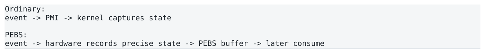

- ` Ordinary: `
- ` event → PMI → kernel captures state `
- ` PEBS: `
- ` event → hardware records precise state → PEBS buffer → later consume `

</details>

### 6.4 perf mem / Load Latency / Data Source

对 memory-bound workload，precise load sampling 可以从“10M LLC misses”升级到“哪条 retired load 经常高 latency、访问哪个地址、来自哪个 data source”。

```bash
perf mem record ./app
perf mem report
# 具体可用字段取决于 CPU / kernel / perf
```

| Data source | 含义线索 | 典型方向 |
| --- | --- | --- |
| L1/L2/L3 hit | cache hierarchy | working set / locality |
| Local DRAM | 本 socket memory | latency / MLP |
| Remote DRAM | 跨 NUMA node/socket | placement / first-touch / ownership |
| Remote cache / HITM | 另一个 core 持有 line | true/false sharing / coherence |

<a id="pdf-page-022"></a>

<!-- source-pdf-page: 22 -->

*[原 PDF 第 22 页](./Level5_CPU_Performance_Profiling_CN.pdf#page=22)*

| Data source | 含义线索 | 典型方向 |
| --- | --- | --- |
| TLB miss / page walk | 地址翻译 | huge pages / layout / working set |

### 6.5 Load-latency threshold

有些 memory sampling 模式可以聚焦超过某 latency threshold 的 loads，从海量 L1 hits 中筛出真正 pathological accesses。Threshold 只筛样本，不自动证明它们在 critical path；仍应结合 Top-Down 和 dependency analysis。

### 6.6 perf c2c 与 false sharing

```bash
perf c2c record ./app
perf c2c report
```

perf c2c 重点分析 cache-to-cache sharing、HITM 和热点 cache line。若 producer/consumer 分别写同一 cache line 上的 head/tail，remote HITM 高且精确指向该 line，是 false-sharing 的强证据。

### 6.7 LBR：Last Branch Record

LBR 在硬件里保存最近有限数量 taken branch 的 source/target，可用于低开销 call-chain reconstruction、branch path、indirect-call target distribution 和 misprediction context。

```bash
perf record --call-graph lbr -e cycles ./app
# 或使用 branch-stack sampling；具体 -j filters 依平台
```

Virtual call/indirect jump 不是天然慢。若 target 长期稳定，predictor 可能处理很好；若 target 高度多样，LBR + branch PMU 才能证明 indirect prediction 是问题。

### 6.8 LBR vs Intel PT

| 机制 | 信息 | 适用 |
| --- | --- | --- |
| LBR | 最近有限 branch history | 低开销 profiling / call path |
| Intel PT | 压缩的更完整 control-flow trace | 精细 execution reconstruction |
| PEBS | 精确 statistical event samples | load/branch/instruction attribution |

### 6.9 Precision vs Confidence

PEBS 改善“sample 是否落在正确 instruction”，不自动改善“样本数量是否足够”。Attribution precision 和 statistical confidence 必须分开评估。

### 6.10 Precise sampling 的正确使用顺序

```bash
perf stat -> Top-Down -> perf record cycles -> hot function ->
precise event / PEBS / LBR only if needed -> data source / branch path -> root cause
```

Coarse -&gt; Fine  Precise sampling 是显微镜，不是第一步。先用便宜、通用的工具缩小问题空间，再针对具体 hypothesis 使用 PEBS/LBR。

### 本章结论

- Skid 使 ordinary sample IP 可能偏离真正 event instruction。

- PEBS/IBS 改善 instruction attribution；perf mem 可进一步提供 load latency/data source。

<a id="pdf-page-023"></a>

<!-- source-pdf-page: 23 -->

*[原 PDF 第 23 页](./Level5_CPU_Performance_Profiling_CN.pdf#page=23)*

- HITM/cache-to-cache evidence 能把“memory bound”区分为 coherence 问题而不是 DRAM。

- LBR 对 branch path、indirect target 和低开销 call graph 很有价值。

<a id="pdf-page-024"></a>

<!-- source-pdf-page: 24 -->

*[原 PDF 第 24 页](./Level5_CPU_Performance_Profiling_CN.pdf#page=24)*

## 第 7 章 Latency Profiling：Off-CPU、Scheduler、IRQ 与 OS Noise

本章目标  回答 low-latency 系统最关键的问题之一：当 wall-clock latency 暴涨时，线程是否真的在 CPU 上运行？如果没有， 那段时间去了哪里？

### 7.1 Latency accounting：On-CPU 与 Off-CPU

```text
Total latency ≈
  on-CPU execution
+ off-CPU / runqueue
+ queueing
+ external/device time
```

CPU profiler 只解释线程正在执行时的 on-CPU cost。如果 request latency=100 µs，其中 CPU execution 只有 5 µs、descheduled 95 µs，cycles flame graph 几乎看不到那 95 µs。

### 7.2 Blocked vs Runnable-but-not-running

**图示转写**

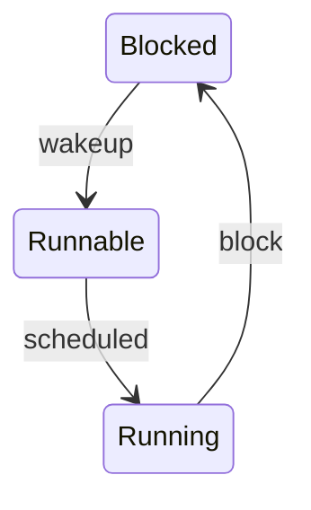

Blocked time = wakeup − block；runqueue delay = scheduled − wakeup。

<details>
<summary>查看原图与完整文字转写</summary>

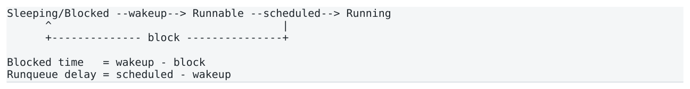

- ` Sleeping/Blocked --wakeup→ Runnable --scheduled→ Running `
- ` block + `
- ` Blocked time = wakeup - block `
- ` Runqueue delay = scheduled - wakeup `

</details>

锁、condition variable、blocking IO 常造成 blocked；runqueue delay 则表示线程已经想跑，但 CPU 在执行其他 task。两者优化完全不同。

### 7.3 sched_switch / sched_wakeup / perf sched

sched_switch 记录 CPU 从 task A 切到 B；sched_wakeup 表示 task 变 runnable。二者结合可以估算 runqueue latency，并回答“谁占用了 hot core”。

```bash
perf sched record ./app
perf sched latency
perf sched timehist
```

Tail correlation  context-switches=5 只能证明发生过 5 次。只有把具体 tail request timestamp 与 sched_switch 时间线对齐，才能证明该 preemption 解释了这次 spike。

### 7.4 Spinning thread 与 busy wait

HFT hot thread 常用 busy spin + _mm_pause 以避免 sleep/wakeup 和 C-state wakeup latency。它仍然可以被 scheduler/interrupt/SMI 干扰；busy spin 的 100% CPU 也不等于业务 capacity 已满。

### 7.5 IRQ、SoftIRQ 与 /proc/interrupts

/proc/interrupts 主要给 per-CPU interrupt counts，可发现某 NIC/timer IRQ 是否打到 hot core，但不能给单次 IRQ duration。具体时间线需要 IRQ tracepoints / ftrace / eBPF。

```bash
cat /proc/interrupts
NIC IRQ -> hardirq -> NAPI -> softirq -> network stack -> app
```

<a id="pdf-page-025"></a>

<!-- source-pdf-page: 25 -->

*[原 PDF 第 25 页](./Level5_CPU_Performance_Profiling_CN.pdf#page=25)*

NET_RX/NET_TX/TIMER/RCU softirq 也可能消耗 hot CPU；大量 softirq 可能由 ksoftirqd/&lt;cpu&gt; 执行。IRQ affinity、RSS/RPS、network CPU placement、busy polling 或 kernel bypass 都是 architecture-specific tradeoff。

### 7.6 CPU affinity ≠ CPU isolation

把 pricing thread pin 到 CPU 6 只限制该 thread 的 placement，并不意味着 CPU 6 只运行 pricing。Unrelated task、IRQ、kernel work、IPI、NMI、SMI 仍可能干扰。Housekeeping CPU 的目的就是把普通 OS work 尽量集中到其他 cores。

### 7.7 Page fault、prefault 与 mlockall

Minor fault 不需要磁盘，但可能进入 kernel、分配/映射 page、更新 page tables，足以制造 µs 级 tail。Major fault 对 microsecond hot path 基本不可接受。

```cpp
preallocate buffer
for (size_t i = 0; i < size; i += page_size)
    buffer[i] = 0;      // prefault / first-touch before hot phase
```

mlockall 可降低 swap-out 风险，但不等价于“未来不会产生 page fault”；allocation、first touch 和 mapping strategy 仍需正确设计。

### 7.8 TLB shootdown / IPI

修改 page-table mapping 时，其他 CPUs 可能需要 invalidate cached TLB entries，kernel 通过 IPI 触发 shootdown。即使 application core 做了 scheduler isolation，也可能收到这类 inter-processor interrupt。

### 7.9 Reclaim、Compaction、Dirty Writeback

| 机制 | 风险 | 低延迟策略 |
| --- | --- | --- |
| Direct reclaim | hot thread 自己进入 reclaim | 预留内存，避免 hot-period allocation |
| kswapd | 后台 reclaim 消耗 CPU/带宽 | 控制 memory pressure |
| kcompactd / compaction | page migration / locks / TLB effects | 启动前预留大页/内存 |
| dirty writeback | 后台 IO / throttling | 日志异步化、控制 dirty pages |

CPU isolation 可以减少 kcompactd 在该 core 上直接执行，但不能推导为“compaction 完全不影响 isolated core”；memory bandwidth、page migration、TLB invalidation 等系统级影响仍可能存在。

### 7.10 SMI、NMI 与无法解释的时间黑洞“ ”

SMI 让 CPU 进入 System Management Mode 执行 firmware，OS 不能正常控制该段执行，因此 Linux trace 可能只看到 CPU “消失”几十 µs。它是 scheduler/IRQ/fault 等都无法解释的 gap 的候选，但绝不能一看到 gap 就断言 SMI。

### 7.11 Shared-resource interference：不是 off-CPU，却会炸 tail

SMT sibling、LLC neighbor、memory-bandwidth competitor 可以让 hot thread 始终处于 on-CPU，却因共享 frontend/ports/cache/DRAM queueing 显著变慢。这类问题应回到 PMU/Top-Down 并做时间相关分析。

<a id="pdf-page-026"></a>

<!-- source-pdf-page: 26 -->

*[原 PDF 第 26 页](./Level5_CPU_Performance_Profiling_CN.pdf#page=26)*

### 7.12 eBPF / ftrace / off-CPU profiling

eBPF 可挂 scheduler tracepoints、syscalls、faults、network events，在 kernel 内做 filter/histogram/threshold aggregation。off-CPU flame graph 聚合 blocked duration，而不是 CPU samples，可快速看 pthread_mutex_lock、futex、socket read 等等待来源。

### 7.13 Tail-latency triggered tracing

**图示转写**

1. ` request / event timestamp + TID + CPU + latency `
2. ` latency > threshold ? `
3. ` yes `
4. ` freeze / snapshot nearby ring-buffer trace `
5. ` correlate sched / IRQ / fault / PMU / app phase `

<details>
<summary>查看原图与完整文字转写</summary>

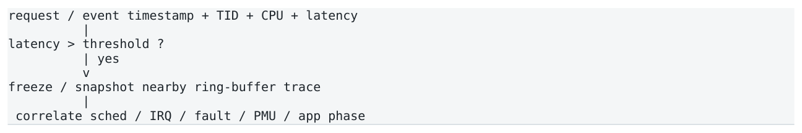

- ` request / event timestamp + TID + CPU + latency `
- ` latency > threshold ? `
- ` yes `
- ` freeze / snapshot nearby ring-buffer trace `
- ` correlate sched / IRQ / fault / PMU / app phase `

</details>

Rare tail 事件在 10 秒 aggregate profile 中占比极低，最有效的方法往往是保存最近 N ms 的 ring-buffer trace，在 spike 触发时冻结并分析。

### 7.14 Tail diagnosis tree

**图示转写**

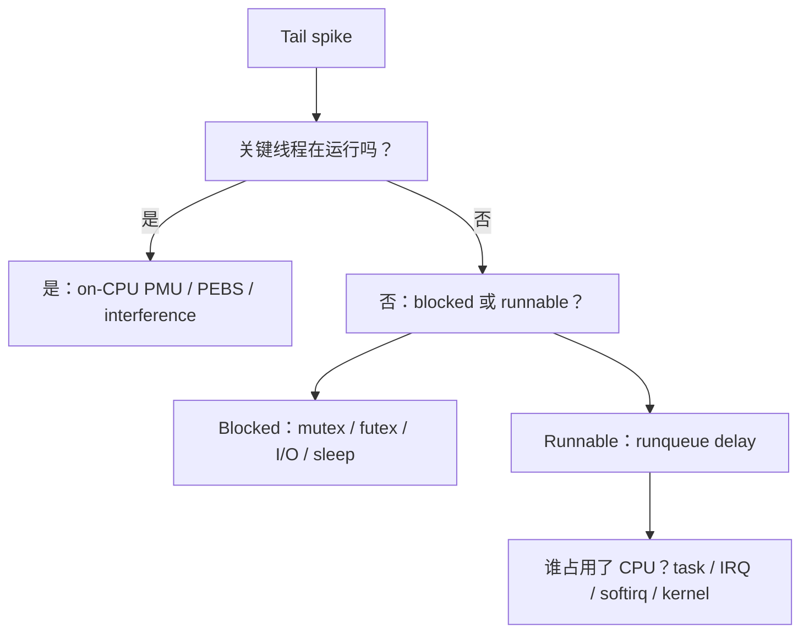

<details>
<summary>查看原图与完整文字转写</summary>

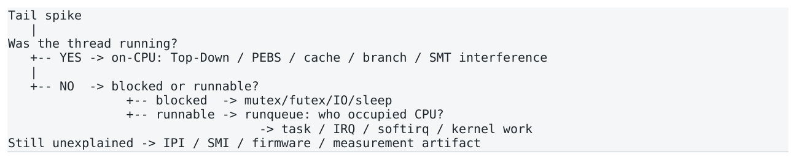

- ` Tail spike `
- ` Was the thread running? `
- ` -- YES → on-CPU: Top-Down / PEBS / cache / branch / SMT interference `
- ` -- NO → blocked or runnable? `
- ` -- blocked → mutex/futex/IO/sleep `
- ` -- runnable → runqueue: who occupied CPU? `
- ` → task / IRQ / softirq / kernel work `
- ` Still unexplained → IPI / SMI / firmware / measurement artifact `

</details>

### 本章结论

- 第一问经常应该是“spike 期间我的线程是否真的在运行？”。

- Off-CPU 必须区分 blocked 与 runnable-but-not-running；sched_wakeup -&gt; sched_switch 给 runqueue delay。

- /proc/interrupts 只给 count；具体 IRQ duration 和 tail correlation 需要 tracing。

- Minor fault、TLB shootdown、reclaim、compaction 和 SMI 都可能制造 rare tail。

<a id="pdf-page-027"></a>

<!-- source-pdf-page: 27 -->

*[原 PDF 第 27 页](./Level5_CPU_Performance_Profiling_CN.pdf#page=27)*

## 第 8 章 Low-Latency C++ Profiling Methodology

本章目标  把前七章组合为一个可重复、可证伪、可落地的完整诊断流程。

### 8.1 12-step profiling workflow

11. Validate measurement：确认 boundary、clock、sample count、generator 和 observer overhead。

12. Classify symptom：throughput / stable slow / tail slow / queueing。

13. Establish baseline：ns/op、cycles/op、instructions/op、percentiles、throughput。

14. perf stat：先看 work、IPC、branch、fault、csw、migration。

15. Top-Down：Frontend / Bad Spec / Backend / Retiring。

16. perf record/report：定位 hot code 与 caller path。

17. perf annotate：看 optimized assembly、dependency、load/branch/spill。

18. Precise profiling：针对 hypothesis 使用 PEBS/perf mem/LBR/perf c2c。

19. OS tracing：tail 场景看 scheduler/IRQ/fault/off-CPU。

20. Form causal hypothesis：机制 -&gt; event/stall -&gt; critical path -&gt; observed latency。

21. Change one major variable：尽量保持 workload/environment 不变。

22. Re-measure：验证 latency/cycles 与原 bottleneck metric 是否同步改善。

### 8.2 Stable slow vs Tail slow

| 症状 | 第一优先级 | 典型工具 |
| --- | --- | --- |
| p50/p99 都慢且分布窄 | steady-state on-CPU | perf stat -&gt; Top-Down -&gt; record/annotate |
| p50 好，p99.99 偶尔炸 | rare path / OS | timestamp + perf sched/ftrace/eBPF |
| throughput 达上限且 queue 累积 | capacity / queueing | queue depth + service time + PMU |
| cycles/msg 正常但 e2e latency 高 | queue/external/off-CPU | queue timeline / scheduler / device |

### 8.3 WHERE / WHY / WHEN

| 问题 | 工具 | 产出 |
| --- | --- | --- |
| WHERE | perf record / call graph / flame graph | hot symbol / calling path |
| WHY | Top-Down / PMU / PEBS / llvm-mca | microarchitectural mechanism |
| WHEN | perf sched / eBPF / ftrace / app timestamps | specific tail-event timeline |

### 8.4 Queue depth、Little’s Law 与 burst

L=λW 将 average number-in-system、arrival/throughput rate 与 average time 联系起来。若 cycles/msg 不变但 queue depth 在 market burst 中上升，end-to-end latency 可以暴涨，而 CPU microarchitecture profile 完全“正常”。

<a id="pdf-page-028"></a>

<!-- source-pdf-page: 28 -->

*[原 PDF 第 28 页](./Level5_CPU_Performance_Profiling_CN.pdf#page=28)*

**图示转写**

1. ` market burst `
2. ` arrival rate > service rate `
3. ` queue builds → `
4. ` service time unchanged, response time rises `

<details>
<summary>查看原图与完整文字转写</summary>


- ` market burst → arrival rate > service rate → queue builds → `
- ` service time unchanged, response time rises `

</details>

Market data 还存在 stale work：如果 backlog 中旧 quote 已无业务价值，coalesce/latest-only 可能比把每条消息微优化 10% 更有效。这属于 architecture-level performance engineering。

### 8.5 Optimize less work before optimize instructions

```text
1. Don't do it
2. Do it less often
3. Precompute / hoist invariants
4. Improve data layout / ownership
5. Improve execution efficiency
6. Instruction-level micro-tuning
```

Retiring high + instructions/op high 往往指向 redundant validation、copy、lookup、serialization 等“有效但不必要 work”。这类 architecture simplification 通常比单条指令微调价值更高。

### 8.6 Representative microbenchmarks

| 组件 | 必须模拟的关键特征 |
| --- | --- |
| Parser | 真实 message-type/field/length distribution，不能重复同一packet |
| Order book | 真实 price-level update mix / working set / hot-cold distribution |
| SPSC | 真正 two-core / topology / cache-line ownership / NUMA |
| Pricing | 真实 dependency fan-in / subscription mix / branch distribution |
| Network path | 明确 App/App 或 NIC/NIC boundary，考虑 open-loop burst |

### 8.7 Reproducibility 与 Performance CI

记录 CPU model、topology、kernel、compiler、flags、SMT、turbo、NUMA、dataset 和 workload。Shared CI runner 噪声大，只适合抓大 regression；精细性能 CI 应使用 dedicated hardware，并先测 baseline variance 再设置 threshold。 Statistical significance 不等于 engineering significance。2.000 µs -&gt; 1.995 µs 即使统计显著，工程价值也可能为零；HFT 更关注 effect size、tail、cycles/msg 和业务 outcome。

### 8.8 Profiling failure modes

- 先猜 container / cache / branch 再找证据。

- 只看 average，不看 distribution。

- 把 100% CPU 当 overload，而忽略 spinning design。

- 把 IPC 当 performance score。

- 看到 cache miss 就断言 memory bound。

- 看到 annotate 某 instruction 60% 就怪这条 instruction。

- 只 profile whole process，hot thread 被 logging/monitoring 淹没。

- 用 -O0 debug build。

- 一次收集过多 PMU events 导致 multiplexing。

- 优化后不 re-profile，忽略 bottleneck migration。

- 把 rare outlier 直接删除。

<a id="pdf-page-029"></a>

<!-- source-pdf-page: 29 -->

*[原 PDF 第 29 页](./Level5_CPU_Performance_Profiling_CN.pdf#page=29)*

### 8.9 Final decision tree

**图示转写**

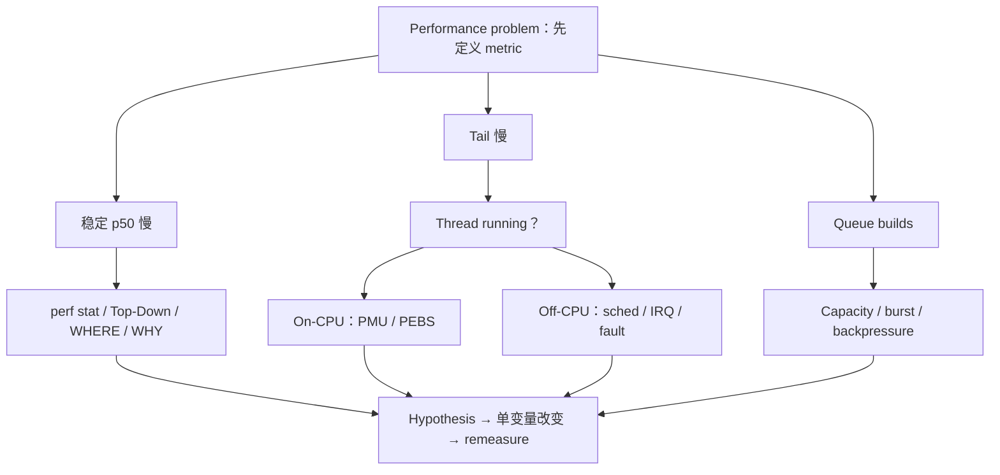

<details>
<summary>查看原图与完整文字转写</summary>

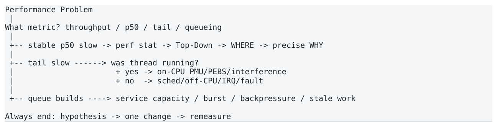

- ` Performance Problem `
- ` What metric? throughput / p50 / tail / queueing `
- ` -- stable p50 slow → perf stat → Top-Down → WHERE → precise WHY `
- ` -- tail slow → was thread running? `
- ` yes → on-CPU PMU/PEBS/interference `
- ` no → sched/off-CPU/IRQ/fault `
- ` -- queue builds → service capacity / burst / backpressure / stale work `
- ` Always end: hypothesis → one change → remeasure `

</details>

### 本章结论

- Profiling 是问题驱动，而不是工具驱动。

- Stable slow 主要走 PMU/Top-Down；rare tail 主要走 timestamp-correlated tracing。

- WHERE、WHY、WHEN 需要不同工具协作。

- Architecture-level “do less work” 常优先于 micro-tuning。

<a id="pdf-page-030"></a>

<!-- source-pdf-page: 30 -->

*[原 PDF 第 30 页](./Level5_CPU_Performance_Profiling_CN.pdf#page=30)*

## 第 9 章 HFT / Low-Latency Case Studies

本章目标  用同一套证据链完成 9 类典型问题的端到端诊断。每个案例都区分 Observation、Hypothesis、Evidence、Fix、 Verification。

### 9.1 Order Book：Pointer Chasing Observation

链式 price-level traversal 的 cycles/update 高、IPC 很低；代码看起来并没有很多 instructions。

### Evidence chain

```bash
perf stat: instructions/update normal, IPC ~0.45
Top-Down: Backend 73% -> Memory 65%
perf record: findLevel dominates
annotate: mov [node+next], node
PEBS/perf mem: high-latency samples on next-pointer load
data source: LLC miss / DRAM
```

### Diagnosis

Root cause  linked structure 形成 serial load-to-use dependency；下一地址依赖上一 node 返回，MLP 低，因此 LLC/DRAM latency 直接暴露到 critical path。

### Fix direction

优先考虑 packed/index-based storage、减少 pointer hops、提升 spatial locality；必要时重新评估 sorted vector / dense levels。

### Verification

期望 cycles/update、Memory Bound、high-latency load samples 和 p99 同步下降。 Confidence: High

### 9.2 SPSC：False Sharing / Coherence Ping-Pong Observation

单线程 queue benchmark 很快，但 producer/consumer 放到两个 cores 后性能显著恶化。

### Evidence chain

```bash
Top-Down: Backend Memory high
head/tail atomics around hotspot
perf c2c: remote HITM / cache-to-cache high
cache line mapping: producer-written tail and consumer-written head share one line
```

### Diagnosis

Root cause  两个逻辑上独立变量共享 cache line，两个 cores 的 writes 触发 MESI ownership ping-pong；问题是 coherence，不是 DRAM。

### Fix direction

将 producer-owned 和 consumer-owned metadata 分离到不同 cache lines；保持 single-writer ownership，必要时批量 publish。

<a id="pdf-page-031"></a>

<!-- source-pdf-page: 31 -->

*[原 PDF 第 31 页](./Level5_CPU_Performance_Profiling_CN.pdf#page=31)*

### Verification

HITM/cache-to-cache traffic 下降、cycles/op 和 tail latency 同步改善。 Confidence: High

### 9.3 Branch-heavy Parser Observation

Parser IPC 较低，branch-miss 明显偏高。

### Evidence chain

```bash
perf stat: branch MPKI high
Top-Down: Bad Speculation ~35%
perf record -e branch-misses: Parser::dispatch dominates
annotate: compare/jcc chain or indirect dispatch
LBR: direction/target distribution highly variable
```

### Diagnosis

Root cause  运行时 message distribution 使关键 branch/indirect target 高 entropy，predictor 经常错误，wrong-path work 被 flush。

### Fix direction

尝试 common/rare path split、table-driven dispatch、data grouping 或 branchless transform；不要假设 likely/unlikely 能修复随机数据。

### Verification

看 cycles/msg 与 Bad Speculation 是否一起下降；若 Frontend/Memory 上升则说明 bottleneck migration。 Confidence: High

### 9.4 50 µs Tail Spike：Scheduler Preemption Observation

p50≈2 µs、p99≈3 µs，但 p99.99≈52 µs；steady CPU profile 看起来正常。

### Evidence chain

```bash
perf stat: faults=0, migration=0, context-switches occasional
request timestamp aligns with:
  sched_switch pricing -> monitoring
  monitoring runs ~47 us
  sched_switch monitoring -> pricing
```

### Diagnosis

Root cause  background monitoring thread 允许在 hot core 运行，导致 pricing thread off-CPU 约 47 µs，几乎完整解释 tail sample。

### Fix direction

将 monitoring thread 移到 housekeeping CPU，检查 affinity/cgroup/scheduler policy。

### Verification

hot-core context switches 显著下降，p99.99 从 ~52 µs 回落到接近 steady distribution。 Confidence: High

<a id="pdf-page-032"></a>

<!-- source-pdf-page: 32 -->

*[原 PDF 第 32 页](./Level5_CPU_Performance_Profiling_CN.pdf#page=32)*

### 9.5 Minor Page Fault Tail Observation

每隔一段时间出现 10-20 µs latency spike；平均值几乎不受影响。

### Evidence chain

```bash
perf stat: minor faults > 0 during hot window
trace: first touch of newly allocated buffer page
        -> page fault handler
        -> return userspace
request spike timestamp matches fault
```

### Diagnosis

Root cause  hot path 第一次触碰尚未建立物理 mapping 的 page，minor fault 进入 kernel 并制造 microsecond-scale tail。

### Fix direction

startup 阶段 preallocate + prefault；控制 allocator/page lifecycle；必要时 mlockall 降低 swapping 风险。

### Verification

hot window minor faults -&gt; 0；对应 p99.9/p99.99 spikes 消失。 Confidence: High

### 9.6 Frontend Pressure：Over-Inlining / Code Footprint Observation

Data-cache 指标正常、branch miss 不高，但 IPC 不理想；hot handler 由于 template/force-inline/unroll 变得非常大。

### Evidence chain

```text
Top-Down: Frontend Bound ~45%
Frontend Latency dominates
I-cache / ITLB-related metrics elevated
annotate: huge inlined/unrolled code body
```

### Diagnosis

Root cause  code footprint 超出 frontend 友好工作集，导致 I-cache/ITLB/decoded-op supply 断粮；“减少 call”换来了更严重的 frontend latency。

### Fix direction

只保留真正 hot tiny helpers inline，把 rare/cold branches out-of-line，减少过度 unroll/template expansion。

### Verification

cycles/op 与 Frontend Bound 同步下降；注意 Retiring% 变化本身不是目标。 Confidence: High

### 9.7 Dependency-bound Reduction：Multiple Accumulators Observation

数据都在 L1，Memory Bound 不高，但 scalar reduction throughput 仍低。

<a id="pdf-page-033"></a>

<!-- source-pdf-page: 33 -->

*[原 PDF 第 33 页](./Level5_CPU_Performance_Profiling_CN.pdf#page=33)*

### Evidence chain

```bash
Top-Down: Backend Core Bound high
annotate: one loop-carried accumulator
assembly dependency: s_i -> add -> s_i+1
llvm-mca: critical path limited by FP add latency
```

### Diagnosis

Root cause  单 accumulator 形成 loop-carried true dependency；不是 cache miss，而是算术 latency 暴露。

### Fix direction

拆成多个 independent accumulators（或让 compiler vectorize/reassociate，在语义允许时），提高 ILP。

### Verification

cycles/element 和 Core Bound 下降；final merge 的 O(1) 成本被主循环收益摊薄。 Confidence: High

### 9.8 Instruction Inflation：Retiring 很高仍然慢Observation

Top-Down Retiring 约 70%，看似“CPU 很健康”，但 cycles/quote 仍高。

### Evidence chain

```bash
perf stat: instructions/quote extremely high
IPC healthy
perf record: static validation / logging checks / hash lookups dominate
Top-Down: little stall, mostly retiring
```

### Diagnosis

Root cause  CPU 没有卡住，而是在高效执行大量“架构上允许但业务上可避免”的 work。

### Fix direction

把静态 validation/metadata lookup hoist 到 subscription/configuration 阶段；precompute；减少 copies/lookup frequency。

### Verification

instructions/quote 与 cycles/quote 同步下降；Top-Down percentages 可能变化不大。 Confidence: High

### 9.9 Queueing Latency：CPU 本身没有 Regression Observation

market burst 时 end-to-end latency 暴涨，但 cycles/message、Top-Down 与 parser/orderbook microbench 都基本不变。

### Evidence chain

```text
service time/message stable
arrival burst temporarily exceeds service capacity
queue depth rises sharply
response time grows while processing cost stays flat
```

<a id="pdf-page-034"></a>

<!-- source-pdf-page: 34 -->

*[原 PDF 第 34 页](./Level5_CPU_Performance_Profiling_CN.pdf#page=34)*

### Diagnosis

Root cause  主要成本在 queueing，不是单消息 CPU path。系统在 burst 中积累 backlog，旧 market-data work 甚至可能已经 stale。

### Fix direction

提升 capacity / partition；评估 coalescing/latest-only、backpressure、priority 和 burst-aware scheduling，而不是只微调 instruction。

### Verification

关注 queue depth、e2e percentile 和 useful decisions/sec，而不只是 cycles/msg。 Confidence: High

<a id="pdf-page-035"></a>

<!-- source-pdf-page: 35 -->

*[原 PDF 第 35 页](./Level5_CPU_Performance_Profiling_CN.pdf#page=35)*

## 附录 A：速查、面试与复习

### A.1 perf 命令速查

```bash
# Aggregate
perf stat ./app
perf stat -r 5 -e cycles,instructions,branches,branch-misses,page-faults,context-switches,cpu-migrations ./app

# Sampling / call graph
perf record -e cycles -g ./app
perf report
perf annotate

# Alternative call-chain methods
perf record --call-graph fp -e cycles ./app
perf record --call-graph dwarf -e cycles ./app
perf record --call-graph lbr -e cycles ./app

# Memory / coherence
perf mem record ./app
perf mem report
perf c2c record ./app
perf c2c report

# Scheduler
perf sched record ./app
perf sched latency
perf sched timehist

# Discover current platform capabilities
perf list
perf list metric
```

注意：具体 event、precise sampling level、Top-Down metric group、branch-stack filter 都依 CPU/kernel/perf 版本。上面的命令是 workflow 入口，不是跨平台保证。

### A.2 指标 -&gt; 问题 -&gt; 工具

| 看到的现象 | 下一问 | 典型工具 |
| --- | --- | --- |
| cycles/op high | work 多还是 stall 多？ | instructions/op, IPC, Top-Down |
| instructions/op high | 哪里在做太多 work？ | perf record instructions/cycles |
| IPC low | Frontend/BadSpec/Backend 哪类？ | Top-Down |
| branch miss high | 哪条 branch/target？ | branch sampling, LBR |
| Memory Bound high | latency/bandwidth/level/source？ | PEBS, perf mem |
| HITM high | 哪条 cache line 在 ping-pong？ | perf c2c |
| p50 好、tail 差 | 线程是否在运行？ | perf sched / trace |
| fault &gt; 0 | 是否对应 tail timestamp？ | fault trace / app timestamps |
| queue depth ↑ | service capacity or burst？ | queue metrics / Little’s Law |

### A.3 Top-Down 速记卡

```text
Retiring       = useful architectural work
Frontend Bound = no/insufficient µops supplied
Bad Speculation= work executed then discarded
Backend Bound  = µops available but cannot execute

Frontend -> Latency vs Bandwidth
```

<a id="pdf-page-036"></a>

<!-- source-pdf-page: 36 -->

*[原 PDF 第 36 页](./Level5_CPU_Performance_Profiling_CN.pdf#page=36)*

**图示转写**

1. ` Backend `
2. ` Core vs Memory `
3. ` Memory `
4. ` L1/L2/L3/DRAM/Store/TLB/coherence `
5. ` Core `
6. ` dependency vs resource/port/special unit `

<details>
<summary>查看原图与完整文字转写</summary>

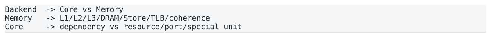

- ` Backend → Core vs Memory `
- ` Memory → L1/L2/L3/DRAM/Store/TLB/coherence `
- ` Core → dependency vs resource/port/special unit `

</details>

### A.4 15 个常见误区

- “IPC 更高，所以更快。”

- “LLC miss 20%，所以 20% 时间都在等 DRAM。”

- “perf annotate 的 test 60%，所以 test 指令慢。”

- “Retiring 70%，说明代码已经很优化。”

- “Context switch 只有 1 次，对 HFT 不重要。”

- “CPU affinity 后这个 core 就不会被别的东西影响。”

- “/proc/interrupts 能看每次 interrupt 花多久。”

- “TLB miss 可能触发 page fault，所以两者差不多。”

- “Busy-spin 100% CPU 表示 overload。”

- “Branchless 一定更快。”

- “Huge page 一定提升性能。”

- “Cache miss 越少一定越快。”

- “Microbenchmark tight loop 就等于真实 production workload。”

- “把 outlier 删除后 percentile 更稳定，所以结果更可信。”

- “一次开所有 PMU counters 信息最多。”

### A.5 面试问答Q1. How do you investigate a slow C++ hot path?

先确认 measurement 和 workload；用 perf stat 看 cycles/op、instructions/op、IPC、branch 和 OS events；用 Top-Down 分类；perf record/call graph 找 WHERE；perf annotate 看 machine code；针对 memory/branch hypothesis 用 PEBS/perf mem/LBR 验证；最后 controlled change + remeasure。

### Q2. Why can’t you trust the hottest instruction in perf annotate?

因为普通 interrupt-based sampling 会 skid，而且 stall 可能由更早的 producer load 引起，sample 却落到 dependent consumer。需要看 dependency chain，必要时用 precise events。

### Q3. Is high LLC miss rate enough to call a workload DRAM-bound?

No. 还必须看 data source、MLP、Top-Down Memory/DRAM Bound 和 critical-path impact。High miss count 可以被高度 overlap。

### Q4. What is Intel Top-Down?

PMU-based hierarchical slot accounting，将 pipeline slots 先分为 Retiring、Frontend Bound、Bad Speculation、Backend Bound，再按最大 bucket drill down。

### Q5. What is skid? What does PEBS improve?

Skid 是真实 event instruction 与 sampled IP 之间的偏移；PEBS 让 hardware 在更靠近 event 的位置记录 state，因此对支持 event 的 instruction attribution 更精确。

### Q6. How do you investigate p99.99 spikes?

先区分 on-CPU/off-CPU。若 wall latency spike 但 thread 没运行，查 sched_switch/sched_wakeup、runqueue、 blocking、IRQ、fault；若 thread 始终 on-CPU，再看 PMU/PEBS/shared-resource interference。

<a id="pdf-page-037"></a>

<!-- source-pdf-page: 37 -->

*[原 PDF 第 37 页](./Level5_CPU_Performance_Profiling_CN.pdf#page=37)*

### Q7. Why does CPU isolation not eliminate all noise?

它主要减少 scheduler/housekeeping noise；IRQ、IPI（如 TLB shootdown）、NMI、SMI、shared LLC/DRAM interference 等仍可能影响 core。

### Q8. Why can a linked list be slow even if all nodes are in L1?

因为 p=p-&gt;next 仍是 serial load-to-use dependency，下一地址在上一 load 返回前未知；即使每次 L1 hit，也可能暴露 load latency，MLP 低。

### A.6 推荐实验

23. 用 perf stat 比较 single accumulator vs 4 accumulators，记录 cycles/element、IPC、Top-Down Core Bound。

24. 构造 linked list vs packed index storage，固定 working set，观察 Memory Bound 和 precise load samples。

25. 构造 predictable vs random branch dataset，比较 branch MPKI、Bad Speculation、cycles/op。

26. 构造 SPSC head/tail 同 cache line vs 分离 cache line，使用 perf c2c 看 HITM。

27. 启动后分配大 buffer，不 prefault vs prefault，记录 hot-window minor faults 和 p99.9。

28. 让 background thread 允许跑到 hot core，再通过 perf sched 观察 preemption tail。

29. 重复同一 parser packet vs representative mixed packets，观察 branch/cache “虚假优化”。

30. Closed-loop generator vs scheduled open-loop generator，观察 coordinated omission 和 queue latency。

### A.7 最终复习清单

- 我能区分 benchmark / profiling / tracing。

- 我能解释 p99、p99.9 以及为什么高 percentile 需要更多样本。

- 我能解释 wall time、CPU time、core cycles、ref cycles、TSC ticks 的区别。

- 我能解释 coordinated omission。

- 我会先 normalize counters by useful work。

- 我不会把 IPC 当 performance score。

- 我能解释 generic cache counter 为什么不能直接当 LLC/DRAM 证据。

- 我能解释 self/inclusive、FP/DWARF/LBR call graph。

- 我能解释 hotspot ≠ root cause、annotate ≠ exact attribution。

- 我能解释 retired / executed / µop 的区别。

- 我能画出 Top-Down 四大类以及 Backend/Core/Memory 下钻。

- 我能解释 Memory latency-bound vs bandwidth-bound。

- 我能解释 skid、PEBS、perf mem、LBR、perf c2c 的用途。

- 我能区分 blocked 与 runnable-but-not-running。

- 我能解释 sched_switch/sched_wakeup 如何形成 runqueue latency。

- 我知道 /proc/interrupts 只能给 count，duration 需要 tracing。

- 我能解释 minor fault、TLB shootdown、reclaim/compaction、SMI 如何影响 tail。

- 我能从 Observation -&gt; Hypothesis -&gt; Evidence -&gt; Fix -&gt; Verification 完成闭环。

第五层最终心智模型  Measure -&gt; Classify -&gt; Locate -&gt; Explain -&gt; Correlate -&gt; Change ONE thing -&gt; Re-measure。性能工程的成熟度，不在于知道多少 perf 子命令，而在于能否构造可证伪的因果证据链。

<a id="pdf-page-038"></a>

<!-- source-pdf-page: 38 -->

*[原 PDF 第 38 页](./Level5_CPU_Performance_Profiling_CN.pdf#page=38)*

## Performance Profiling &amp; Measurement

第五层结束

**图示转写**

1. ` Observation `
2. ` Hypothesis `
3. ` Hardware / OS Evidence `
4. ` Root Cause `
5. ` Optimization `
6. ` Re-measure `

<details>
<summary>查看原图与完整文字转写</summary>

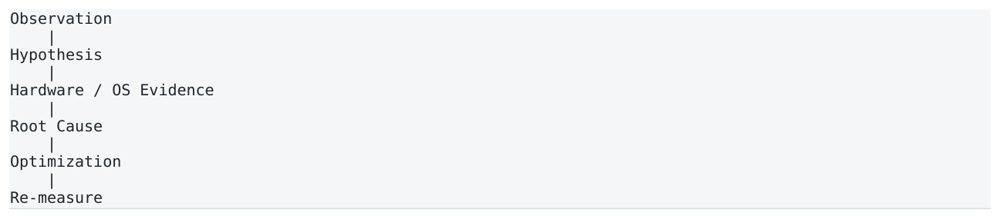

- ` Observation `
- ` Hypothesis `
- ` Hardware / OS Evidence `
- ` Root Cause `
- ` Optimization `
- ` Re-measure `

</details>

### 从“感觉这里慢”升级到“我能证明为什么慢”。

<a id="conversion-errata"></a>

## 转换补充与勘误

本节及正文中“转换补充 / 转换勘误”均为 2026-11-06 转换时新增；原 PDF 仍是原始内容与版式的对照。

- [原 PDF 第 15 页处的补充](#pdf-page-015)：PMU event 的定义、可用性与 precise-sampling 能力依 CPU model 而异。

### 适用边界

原文中的时延、cache/ROB 大小、PMU event、kernel 参数及 compiler lowering 均需要绑定具体平台。转写结构的覆盖校验不等同于对全部技术命题的逐条实测；复杂图的精确布局以随附原图为准。
