# Linux OS Runtime

> 来源：[Level6_Linux_OS_Runtime_CN.pdf](./Level6_Linux_OS_Runtime_CN.pdf)（36 页）。本文件按原文逐页转写；转换补充与勘误单独标明。

> 图示优先转为 Mermaid、表格或步骤；每图附原图和文字以便核对。代码保留原文逻辑与缩进，跨页片段及概念示例未宣称可以独立编译。

[返回目录](README.md) · [转换说明与校验](CONVERSION_NOTES.md) · [本文补充与勘误](#conversion-errata)

[原文目录](#pdf-page-003) · [第一章正文](#pdf-page-005)

<a id="pdf-page-001"></a>

<!-- source-pdf-page: 1 -->

*[原 PDF 第 1 页](./Level6_Linux_OS_Runtime_CN.pdf#page=1)*

## Linux / OS / Runtime

### C++ / CPU 深度学习 - 第六层完整讲义

Syscall · Scheduler · CPU Isolation · IRQ / SoftIRQ / NAPI · VM / Page Fault · NUMA · Reclaim / Compaction · Huge Pages · malloc / Allocator · Futex / Mutex · Low-Latency Runtime

目标：建立从 C++ hot path 到 Linux scheduler、interrupt、virtual memory、allocator 与 thread runtime 的完整因果模型，并能把 tail-latency spike 分解为 on-CPU、off-CPU、kernel noise、VM 与 runtime slow path。

2026-08 · 详尽版

<a id="pdf-page-002"></a>

<!-- source-pdf-page: 2 -->

*[原 PDF 第 2 页](./Level6_Linux_OS_Runtime_CN.pdf#page=2)*

## 如何使用这份讲义

这份 PDF 不是 Session 1-8 的聊天记录拼接，而是按照 low-latency runtime 的因果链重新组织：先理解 user/kernel boundary，再解释线程为什么离开 CPU、CPU 为什么会被异步打断、普通 load/store 为什么会触发 kernel VM，最后把 reclaim、allocator、futex 与 production runtime 统一到一套诊断模型中。

最核心的方法  不要把所有 outlier 都叫“OS jitter”。先问线程是否仍在 CPU 上；如果 off-CPU，追 scheduler/blocking；如果仍在 CPU 但离开 user code，追 IRQ/softirq/IPI/page fault；如果持续执行 user code，再回到 cache/TLB/DRAM/dependency 等微架构证据。

本文讨论现代 Linux + x86-64/高性能服务器的通用原则。具体 kernel 版本、glibc allocator、scheduler implementation、THP policy、IRQ 管理、BIOS/firmware 与 NIC driver 会变化。任何具体的 ns/us 数字、boot parameter 或 PMU/trace event 都必须绑定目标机器验证。

### 阅读路线  从边界到生产架构

| 章节 | 主题 | 最终要回答的问题 |
| --- | --- | --- |
| 第 1 章 | User Space / Kernel / Syscall | 什么时候只是普通 C++ 指令，什么时候真正进入 kernel？ |
| 第 2 章 | Scheduler / Preemption / Affinity | 线程为什么会从 RUNNING 变成RUNNABLE/OFF-CPU？ |
| 第 3 章 | IRQ / SoftIRQ / NAPI / IPI / SMI | 没有 context switch，CPU 为什么仍会停止执行 hot thread？ |
| 第 4 章 | Virtual Memory / Fault / NUMA | 普通 load/store 为什么会触发 page fault？first touch 如何决定 page placement？ |
| 第 5 章 | Reclaim / Compaction / Huge Pages / Writeback | 为什么运行几小时后 VM 仍可能制造大 tail？ |
| 第 6 章 | malloc / C++ Runtime / Allocator | 为什么 malloc fast path 很快，却仍不应依赖它的 tail？ |
| 第 7 章 | Futex / Mutex / CV / Spin | mutex 什么时候只是 atomic，什么时候进入sleep/wakeup/scheduler？ |
| 第 8 章 | Low-Latency Runtime Architecture | 如何把 Linux 动态工作从 hot path 在时间和空间上移走？ |

### 贯穿全书的五个问题

- 这次 latency spike 期间，关键线程是在 RUNNING，还是已经 off-CPU？

- 如果线程仍在 RUNNING，CPU 是否被 IRQ、softirq、IPI、NMI/SMI 或 synchronous fault 暂时接管？

- 这次内存访问是否触发了 page fault、physical allocation、reclaim、compaction 或 NUMA fallback？

- 这次 C++ 操作是否从 user-space fast path 掉进了 allocator / futex / kernel slow path？

- 如何用 context switch、migration、IRQ/softirq、fault、vmstat、queue depth 与 stage latency 证伪假设？

<a id="pdf-page-003"></a>

<!-- source-pdf-page: 3 -->

*[原 PDF 第 3 页](./Level6_Linux_OS_Runtime_CN.pdf#page=3)*

## 原文目录

- [1. User Space、Kernel Space 与 System Call](#pdf-page-005)
- [1.1  Privilege 与 user/kernel boundary](#pdf-page-005)
- [1.2  Function call、syscall、context switch](#pdf-page-005)
- [1.3  syscall entry/exit 与 blocking](#pdf-page-005)
- [1.4  vDSO 与 clock_gettime](#pdf-page-006)
- [1.5  Exception、interrupt 与 kernel entry](#pdf-page-006)
- [1.6  malloc/mutex/page fault 的边界](#pdf-page-006)
- [1.7  blocking、busy polling 与 wakeup latency](#pdf-page-007)
- [1.8  诊断与面试结论](#pdf-page-007)
- [2. Linux Scheduler、Preemption 与 CPU Affinity](#pdf-page-008)
- [2.1  task、runqueue、RUNNING/RUNNABLE](#pdf-page-008)
- [2.2  normal scheduler：CFS/EEVDF mental model](#pdf-page-008)
- [2.3  preemption 与 context switch](#pdf-page-008)
- [2.4  CPU migration 与 locality](#pdf-page-008)
- [2.5  affinity vs isolation](#pdf-page-009)
- [2.6  SCHED_OTHER / FIFO / RR](#pdf-page-009)
- [2.7  isolcpus / nohz_full / housekeeping](#pdf-page-009)
- [2.8  SMT 与 NUMA](#pdf-page-010)
- [2.9  on-CPU / off-CPU diagnosis](#pdf-page-010)
- [3. Interrupt、IRQ、SoftIRQ、NAPI 与 Kernel Noise](#pdf-page-011)
- [3.1  hard IRQ 与 /proc/interrupts](#pdf-page-011)
- [3.2  NIC DMA、MSI-X 与 queue affinity](#pdf-page-011)
- [3.3  NAPI / NET_RX softirq](#pdf-page-011)
- [3.4  interrupt coalescing / busy poll](#pdf-page-012)
- [3.5  IPI / RES / CAL / TLB shootdown](#pdf-page-012)
- [3.6  timer / RCU / kworker](#pdf-page-012)
- [3.7  NMI / SMI / firmware noise](#pdf-page-012)
- [3.8  IRQ placement trade-off](#pdf-page-013)
- [3.9  kernel-noise diagnosis](#pdf-page-013)
- [4. Virtual Memory、Page Fault、mmap 与 First Touch](#pdf-page-014)
- [4.1  virtual address / TLB / page table](#pdf-page-014)
- [4.2  page walk vs page fault](#pdf-page-014)
- [4.3  demand paging 与 lazy physical allocation](#pdf-page-014)
- [4.4  anonymous / file-backed / shared memory](#pdf-page-015)
- [4.5  minor / major / COW / protection fault](#pdf-page-015)
- [4.6  VMA / mmap / page cache](#pdf-page-015)
- [4.7  first touch 与 NUMA placement](#pdf-page-016)
- [4.8  prefault / mlock / MAP_POPULATE](#pdf-page-016)
- [4.9  stack/code warmup](#pdf-page-016)
- [4.10  RSS / faults / observation](#pdf-page-016)
- [5. Reclaim、Compaction、THP、HugeTLB 与 Writeback](#pdf-page-018)
- [5.1  watermark / kswapd / direct reclaim](#pdf-page-018)
- [5.2  dirty pages / writeback / throttling](#pdf-page-018)
- [5.3  physical fragmentation / buddy allocator](#pdf-page-018)
- [5.4  kcompactd / direct compaction](#pdf-page-019)
- [5.5  THP / khugepaged / collapse/split](#pdf-page-019)
- [5.6  Explicit HugeTLB / 2MB / 1GB](#pdf-page-019)
- [5.7  NUMA hugepage pool / fallback](#pdf-page-019)
- [5.8  memory pressure 与 bounded resources](#pdf-page-020)
- [5.9  vmstat / buddyinfo / compact counters](#pdf-page-020)
- [6. C++ Runtime、malloc 与 Allocator](#pdf-page-021)
- [6.1  new / operator new / malloc](#pdf-page-021)
- [6.2  tcache / arena / bins](#pdf-page-021)

<a id="pdf-page-004"></a>

<!-- source-pdf-page: 4 -->

*[原 PDF 第 4 页](./Level6_Linux_OS_Runtime_CN.pdf#page=4)*

- [6.3  brk / mmap / munmap](#pdf-page-021)
- [6.4  allocator fragmentation 与 retention](#pdf-page-021)
- [6.5  vector/string/unordered_map growth](#pdf-page-021)
- [6.6  shared_ptr / std::function / lazy init](#pdf-page-022)
- [6.7  object pool / per-thread arena / PMR](#pdf-page-022)
- [6.8  single ownership / remote free](#pdf-page-022)
- [6.9  allocator benchmark 与 tail](#pdf-page-022)
- [6.10  bounded storage architecture](#pdf-page-023)
- [7. Futex、Mutex、Condition Variable 与 Spin](#pdf-page-024)
- [7.1  uncontended mutex fast path](#pdf-page-024)
- [7.2  contention / spin / futex](#pdf-page-024)
- [7.3  PAUSE / yield / sleep](#pdf-page-024)
- [7.4  wakeup latency / convoy / herd](#pdf-page-025)
- [7.5  condition_variable / atomic::wait](#pdf-page-025)
- [7.6  priority inversion / PI futex](#pdf-page-025)
- [7.7  spinlock / TTAS / ticket / MCS](#pdf-page-025)
- [7.8  lock-free progress 与 SPSC](#pdf-page-025)
- [7.9  single-writer / sharding / copy-publish](#pdf-page-026)
- [8. Low-Latency Linux Runtime Architecture](#pdf-page-028)
- [8.1  Topology / physical core / NIC locality](#pdf-page-028)
- [8.2  housekeeping / CPU &amp; IRQ partition](#pdf-page-028)
- [8.3  NUMA / preallocation / prefault / mlock](#pdf-page-028)
- [8.4  hugepage / allocator / synchronization policy](#pdf-page-029)
- [8.5  busy polling / network path / logging](#pdf-page-029)
- [8.6  bounded queues / backpressure / overload](#pdf-page-029)
- [8.7  power / SMT / firmware](#pdf-page-029)
- [8.8  startup phases / LIVE invariants](#pdf-page-030)
- [8.9  verification / diagnosis tree](#pdf-page-030)
- [A. 附录](#pdf-page-032)
- [A.1  术语表](#pdf-page-032)
- [A.2  误区对照表](#pdf-page-033)
- [A.3  常用命令速查](#pdf-page-033)
- [A.4  面试级简答](#pdf-page-034)
- [A.5  推荐实验](#pdf-page-035)
- [A.6  第六层复习清单](#pdf-page-035)

<a id="pdf-page-005"></a>

<!-- source-pdf-page: 5 -->

*[原 PDF 第 5 页](./Level6_Linux_OS_Runtime_CN.pdf#page=5)*

## 第 1 章  User Space、Kernel Space 与 System Call

本章目标  建立 user mode / kernel mode、syscall、exception、interrupt、context switch 的严格边界；理解“进入 kernel”与“线程被换掉”为什么是两件事。

### 1.1  User Space / Kernel Space：Privilege 才是第一层边界

现代 Linux application 大多数时间直接在 CPU 的 user mode 执行。x86-64 提供 privilege levels，Linux 主要使用 Ring 3 运行用户程序、Ring 0 运行 kernel。这个边界不是“软件习惯”，而是 CPU 的权限保护机制：普通 application 不能直接修改 page table、关闭 interrupt、访问 arbitrary device register 或另一个 process 的内存。

**图示转写**

| 场景 / 部分 | 路径、状态或说明 |
| --- | --- |
| C++ application | ` ordinary load/store/ALU/branch `；` CPU user mode (Ring 3) ` |
| privileged operation required | ` Linux kernel (Ring 0) ` |

<details>
<summary>查看原图与完整文字转写</summary>

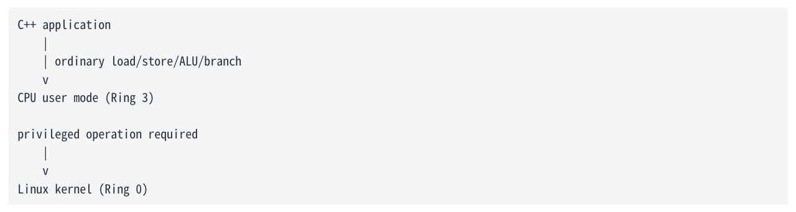

- ` C++ application `
- ` ordinary load/store/ALU/branch `
- ` CPU user mode (Ring 3) `
- ` privileged operation required `
- ` Linux kernel (Ring 0) `

</details>

核心转换  普通 C++ 算术、load/store、branch 并不“经过 OS”。只有在 syscall、exception、interrupt 等边界事件发生时，CPU 才转入 kernel execution path。

### 1.2  Function Call、System Call 与 Context Switch

| 概念 | 发生了什么 | 线程是否一定变化 |
| --- | --- | --- |
| Function call | 同一 privilege level 内 call/ret，通常仍在user mode | 否 |
| System call | 当前 task 从 user mode 进入 kernel，请求 privileged service | 否 |
| Context switch | scheduler 保存一个 task 的执行上下文并恢复另一个 task | 是 |
| Process switch | context switch 且 address space/process identity 也变化 | 是 |

最常见的错误表述是“syscall 很慢，因为一定 context switch”。更准确的说法：syscall 至少产生 user/kernel privilege transition 与 kernel entry/exit 开销；只有当 syscall block、被 preempt 或 scheduler 选择其他 task 时，才进一步发生 context switch。

常见说法 更准确的理解 “一次 read() = 一次 context switch。” read() 可能进入 kernel 后立即从 page cache/socket buffer 取到数据并返回同一线程；只有无法继续时才需要 block 和调度。

### 1.3  x86-64 Syscall Entry / Exit 与 Blocking

用户代码调用 read()/recv()/mmap() 等 C library API 时，通常先经过 glibc wrapper；真正进入 kernel 的机制由 architecture ABI 决定，x86-64 常使用 syscall instruction。用户态函数名与 kernel system call 是不同层。

<a id="pdf-page-006"></a>

<!-- source-pdf-page: 6 -->

*[原 PDF 第 6 页](./Level6_Linux_OS_Runtime_CN.pdf#page=6)*

**图示转写**

| 场景 / 部分 | 路径、状态或说明 |
| --- | --- |
| your C++ | ` → glibc recv() `；` → syscall instruction `；` → kernel syscall entry `；` → socket/file/VM subsystem `；` → return to same task ` |
| If data unavailable | ` → mark task sleeping `；` → scheduler `；` → another task runs ` |

<details>
<summary>查看原图与完整文字转写</summary>

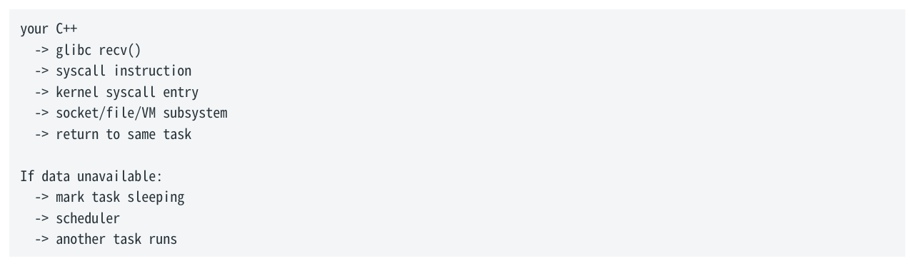

- ` your C++ `
- ` → glibc recv() `
- ` → syscall instruction `
- ` → kernel syscall entry `
- ` → socket/file/VM subsystem `
- ` → return to same task `
- ` If data unavailable: `
- ` → mark task sleeping `
- ` → scheduler `
- ` → another task runs `

</details>

blocking syscall 最危险的不是 syscall instruction 本身，而是后续 off-CPU time。线程被放入 wait queue 后，事件到来只会使其从 SLEEPING 变成 RUNNABLE；真正恢复 RUNNING 还需要 scheduler 选中它，因此存在 wake-up latency。

### 1.4  vDSO：看起来像 Syscall，但可以完全留在 User Space

某些内核信息可以通过内核映射到进程地址空间的 vDSO（virtual Dynamic Shared Object）快速获取。典型例子是 clock_gettime()/gettimeofday() 的部分 clock 类型：userspace 可以读取 kernel-maintained metadata 与硬件 clocksource/TSC 完成时间换算，避免每次 privilege transition。

性能含义  不要仅从 API 名判断是否进入 kernel。对 timestamping hot path，应确认实际 clock、glibc、vDSO 与硬件 clocksource 路径；不同 clock type/architecture/kernel 可以有不同 fallback。

### 1.5  三种进入 Kernel 的路径：Syscall、Exception、Interrupt

| 入口 | 触发者 | 同步性 | 例子 |
| --- | --- | --- | --- |
| Syscall | 当前 application 主动请求 | 同步 | read, mmap, futex, nanosleep |
| Exception | 当前正在执行的 instruction | 同步 | page fault, divide error, invalid opcode |
| Interrupt | 外部/异步事件或 CPU 间事件 | 通常异步 | NIC IRQ, timer, IPI |

Page fault 特别容易误解：源代码可能只是 `p[i] = 1`，但 CPU translation 发现 mapping 不满足访问语义时会触发 #PF exception，随后进入 kernel。application 没有调用任何 syscall，却仍然离开了 user mode。

### 1.6  malloc、mutex、Page Fault：API 名称不能代替 Runtime Path

| 操作 | 是否天然 syscall | 典型 fast path | 可能的 slow path |
| --- | --- | --- | --- |
| malloc(64) | 否 | tcache/allocator freelist，pure userspace | arena -&gt; mmap/brk -&gt; kernel；first touch fault |
| std::mutex::lock | 否 | atomic state transition | contention -&gt; futex -&gt; sleep/wakeup |
| clock_gettime | 不一定 | vDSO | fallback syscall |
| 普通 store | 否 | CPU store pipeline | page fault -&gt; VM handler |
| read/recv | 通常进入 kernel I/O path | kernel data already ready -&gt; immediate return | block -&gt; scheduler |

<a id="pdf-page-007"></a>

<!-- source-pdf-page: 7 -->

*[原 PDF 第 7 页](./Level6_Linux_OS_Runtime_CN.pdf#page=7)*

### 1.7  Blocking vs Busy Polling：CPU Efficiency 与 Wake-up Determinism

**图示转写**

| 场景 / 部分 | 路径、状态或说明 |
| --- | --- |
| Blocking | ` no work → sleep → event → wake → runnable → scheduled → process ` |
| Busy polling | ` no work → poll → pause → poll → event → process ` |

<details>
<summary>查看原图与完整文字转写</summary>

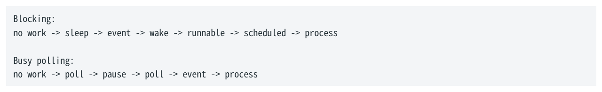

- ` Blocking: `
- ` no work → sleep → event → wake → runnable → scheduled → process `
- ` Busy polling: `
- ` no work → poll → pause → poll → event → process `

</details>

busy polling 的本质是用一个 dedicated logical/physical CPU 的持续占用换掉 sleep/wakeup/scheduler dependency。它并不会“让 CPU 指令更快”，而是让关键线程一直处于 RUNNING 状态。代价包括 100% CPU、功耗、温度以及 SMT sibling interference。

| 等待方式 | Kernel involvement | 线程状态 | 低延迟特征 |
| --- | --- | --- | --- |
| _mm_pause() | 无 | 仍 RUNNING | 最小 scheduler dependency；持续占 CPU |
| yield() | scheduler involvement | 仍 runnable，可能换人 | 不保证立即回来 |
| sleep/futex wait | 有 | SLEEPING | 资源高效，但有 wakeup/off- CPU jitter |

### 1.8  Session 1 诊断框架

**图示转写**

- ` Latency spike `
  - ` Did the thread enter kernel? `
    - ` syscall? `
    - ` page fault/exception? `
    - ` interrupt? `
  - ` Did the running task change? `
    - ` yes: context switch / scheduler `
    - ` no : kernel interruption only `

<details>
<summary>查看原图与完整文字转写</summary>

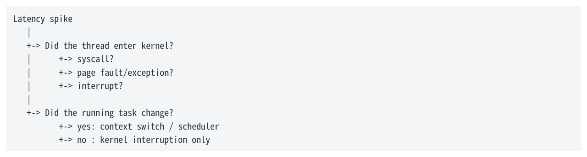

- ` Latency spike `
- ` -> Did the thread enter kernel? `
- ` -> syscall? `
- ` -> page fault/exception? `
- ` -> interrupt? `
- ` -> Did the running task change? `
- ` -> yes: context switch / scheduler `
- ` -> no : kernel interruption only `

</details>

本章结论

- syscall != context switch；user-&gt;kernel != thread A-&gt;thread B。

- page fault != syscall；interrupt != syscall，但都可能进入 kernel。

- no syscall != uninterrupted CPU：IRQ、page fault、preemption、SMI 仍可打断 hot loop。

- blocking latency 的主要风险通常是 off-CPU + wakeup + cache recovery，而不是单次 privilege transition。

- low-latency steady state 的第一目标是长期保持同一 hot thread RUNNING in userspace。

<a id="pdf-page-008"></a>

<!-- source-pdf-page: 8 -->

*[原 PDF 第 8 页](./Level6_Linux_OS_Runtime_CN.pdf#page=8)*

## 第 2 章  Linux Scheduler、Preemption 与 CPU Affinity

本章目标  理解 task/runqueue、RUNNING/RUNNABLE、preemption、migration、SCHED_*、CPU affinity、CPU isolation、nohz_full 与 housekeeping 的关系。

### 2.1  Scheduler 调度的是 Task / Thread

Linux 内核用 task_struct 表示 schedulable entity；同一 process 的不同 pthread/std::thread 通常是独立调度对象。 CPU affinity、scheduler policy 和 runtime priority 因而首先是 thread-level 属性，而不是“整个 C++ process 一定统一”。

**图示转写**

- ` Process `
  - ` main thread → task_struct `
  - ` MD thread → task_struct `
  - ` Pricing → task_struct `
  - ` Logger → task_struct `

<details>
<summary>查看原图与完整文字转写</summary>

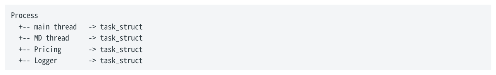

- ` Process `
- ` -- main thread → task_struct `
- ` -- MD thread → task_struct `
- ` -- Pricing → task_struct `
- ` -- Logger → task_struct `

</details>

### 2.2  RUNNING、RUNNABLE、SLEEPING

| 状态 | 含义 | low-latency 关注点 |
| --- | --- | --- |
| RUNNING | 此刻真的占一个 logical CPU 执行 | 理想 hot thread steady state |
| RUNNABLE | 有资格运行但当前没有 CPU | queueing in scheduler / preemption 后常见 |
| SLEEPING/BLOCKED | 等待事件，不能运行 | futex, I/O, sleep, condition variable |

关键  wake-up 只把 SLEEPING 变成 RUNNABLE，并不等于 immediately RUNNING。event-&gt;RUNNING 的差额就是 wake-up/scheduling latency 的一部分。

### 2.3  Normal Scheduler：从 CFS 到 EEVDF 的 Mental Model

现代 Linux 普通任务调度实现持续演进；经典 CFS 的 vruntime 概念与现代 EEVDF 的 eligibility/virtual deadline 都服务于一个大原则：normal scheduler 要在系统层面管理 fairness、latency、weight 与 CPU utilization，而不是知道“这个 PricingThread 的 p99.99 最重要”。 因此不要把某个具体 data structure 或版本算法背成 low-latency 答案。对 runtime engineering，更稳定的不变量是： 如果一个 hot core 上有多个 runnable tasks，normal scheduler 就需要不断做 scheduling decisions；如果 hot core 上稳定只有一个关键 runnable task，最理想的 scheduler 决策就是几乎没有决策。

### 2.4  Preemption：不 Block 也会离开 CPU

**图示转写**

1. ` Pricing RUNNING `
2. ` scheduler decides another task should run `
3. ` Pricing `
4. ` RUNNABLE `
5. ` OtherTask `
6. ` RUNNING `
7. ` Pricing selected later `
8. ` RUNNING `

<details>
<summary>查看原图与完整文字转写</summary>

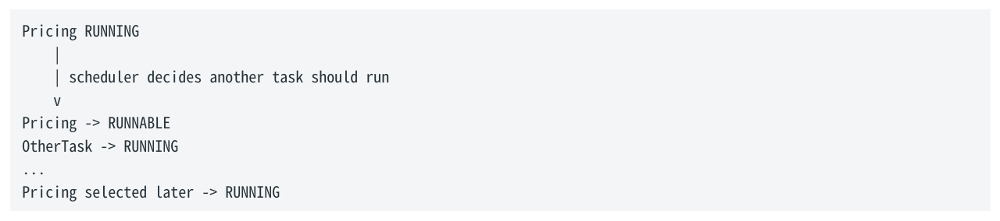

- ` Pricing RUNNING `
- ` scheduler decides another task should run `
- ` Pricing → RUNNABLE `
- ` OtherTask → RUNNING `
- ` Pricing selected later → RUNNING `

</details>

<a id="pdf-page-009"></a>

<!-- source-pdf-page: 9 -->

*[原 PDF 第 9 页](./Level6_Linux_OS_Runtime_CN.pdf#page=9)*

这叫 involuntary context switch。相对地，线程因为 recv/futex/sleep 等自己不能继续而离开 CPU，属于 voluntary context switch。对于 busy-spinning HFT thread，异常增加的 involuntary switches 是重要信号。

性能含义  context-switch instruction/save-restore 本身通常不是最值得争论的数字。真正的尾延迟损失 = off-CPU time + scheduling delay + 恢复后的 cache/TLB/predictor warm-state disturbance。

### 2.5  CPU Migration 与 Cache/NUMA Locality

scheduler 为 load balancing 可以让一个 runnable task 下次在另一 CPU 上运行。migration 会破坏 core-local microarchitectural state，并可能把原本 local NUMA memory 变成 remote access。因此 low-latency hot thread 通常明确 pin 到一个 CPU。

**图示转写**

| 场景 / 部分 | 路径、状态或说明 |
| --- | --- |
| Before | ` Pricing CPU4 → deschedule → CPU11 ` |
| After affinity | ` Pricing allowed CPUs = {4} `；` CPU migration → approximately zero ` |

<details>
<summary>查看原图与完整文字转写</summary>

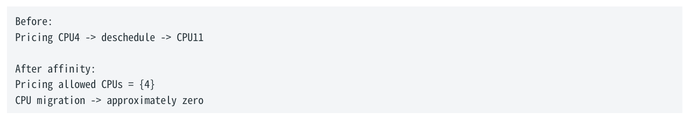

- ` Before: `
- ` Pricing CPU4 → deschedule → CPU11 `
- ` After affinity: `
- ` Pricing allowed CPUs = {4} `
- ` CPU migration → approximately zero `

</details>

### 2.6  Affinity != Isolation

| 机制 | 回答的问题 | 不能保证什么 |
| --- | --- | --- |
| Thread affinity | 我的 thread 可以在哪些 CPU 上运行？ | 其他 task/IRQ/kernel work 不会来 |
| CPU scheduler isolation | 哪些普通 runnable tasks/load-balancing应避开这个 CPU？ | 没有 IRQ/softirq/SMI |
| IRQ affinity | 某类 hardware IRQ 在哪些 CPU 上处理？ | scheduler/kworker/SMT sibling 干扰 |
| NUMA policy | page 尽量在哪个 node？ | CPU 上没有 scheduler/IRQ noise |

常见说法 更准确的理解 “pthread_setaffinity_np() 之后这个 core 就属于我。” Affinity 只限制 hot thread 的 allowed CPUs；CPU exclusivity 还需要 partition、IRQ placement、housekeeping、SMT sibling 与 runtime 行为共同保证。

### 2.7  SCHED_OTHER、SCHED_FIFO 与 SCHED_RR

SCHED_OTHER 是普通 task 的典型 policy。SCHED_FIFO / SCHED_RR 属于 real-time scheduling classes，改变的是 runnable tasks 竞争 CPU 时的 priority/preemption semantics，不会让 ADD、load 或 cache hit 本身更快。

| Policy | 核心语义 | 低延迟优势 | 主要风险 |
| --- | --- | --- | --- |
| SCHED_OTHER | normal fairness/weight scheduler | 管理简单；isolated single task时可已很稳定 | 仍受 normal scheduler policy |
| SCHED_FIFO | 高 priority RT task 可持续运行直到 block/yield/更高 RT priority | 降低 normal-task scheduling interference | starvation、priority inversion、运维风险 |
| SCHED_RR | 同 priority RT tasks 之间有时间量子轮转 | 可控 RT sharing | 仍有 RT priority 设计复杂度 |

设计原则  如果 CPU 已真正隔离且只有一个 hot runnable task，SCHED_FIFO 的边际收益可能远小于“共享 CPU 上提高 priority”的直觉。是否使用应由测量与 failure-mode 设计决定。

<a id="pdf-page-010"></a>

<!-- source-pdf-page: 10 -->

*[原 PDF 第 10 页](./Level6_Linux_OS_Runtime_CN.pdf#page=10)*

### 2.8  isolcpus、nohz_full、Housekeeping 与 SMT

CPU isolation 不是一个 magic switch，而是把 scheduler balancing、periodic tick、RCU callbacks、workqueues、 IRQ 与普通 daemon 等噪声尽量搬到 housekeeping CPUs。现代系统可能使用 cpuset/cgroup partition 等机制；boot parameters 只是实现选择之一。

```text
Housekeeping CPUs:
  scheduler / timers / RCU / kworker / OS daemons / many IRQs

Hot CPU5:
  Pricing Pricing Pricing Pricing ...

nohz_full target:
  reduce periodic scheduling tick when conditions allow
```

SMT 必须看 physical core，而不是 logical CPU 编号。Pricing pin CPU5，但 CPU21 是同 core sibling 且跑 Logger 时，仍共享 frontend/execution resources。极端低 jitter 场景常 reserve sibling 或关闭 SMT；代价是总 compute capacity。

### 2.9  On-CPU vs Off-CPU：Scheduler Diagnosis 的第一刀

**图示转写**

| 线程状态 | 主要调查方向 |
| --- | --- |
| OFF-CPU | preemption / blocking / sleep / scheduler queue |
| 仍为 RUNNING | IRQ / softirq / SMI / page fault / CPU-memory pathology |

<details>
<summary>查看原图与完整文字转写</summary>

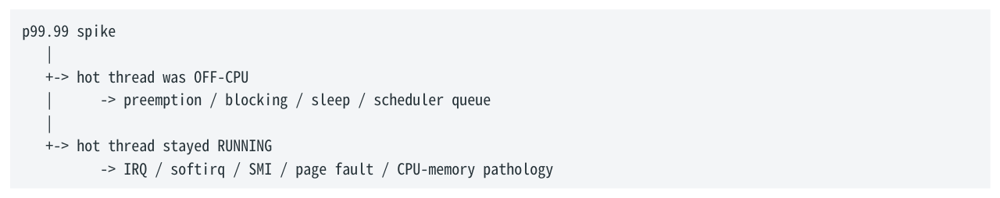

- ` p99.99 spike `
- ` -> hot thread was OFF-CPU `
- ` → preemption / blocking / sleep / scheduler queue `
- ` -> hot thread stayed RUNNING `
- ` → IRQ / softirq / SMI / page fault / CPU-memory pathology `

</details>

perf stat 的 context-switches、cpu-migrations，perf sched/ftrace/eBPF 的 sched_switch/sched_wakeup，以及 per-thread wall-clock stage timestamps 可以共同证明“线程是否真的离开 CPU”。whole-process counter 可能被 logger/background threads 污染，因此尽量做 thread-level attribution。

本章结论

- RUNNABLE != RUNNING；wakeup != immediately running。

- busy loop 在 SCHED_OTHER 下仍可被 preempt；pinning 阻止 migration，不阻止 preemption。

- CPU affinity != CPU isolation；CPU isolation != IRQ isolation。

- SCHED_FIFO 改 scheduling policy，不改变 instruction/cache latency，并引入 starvation/priority risks。

- 真正的 dedicated core 要看 physical core、SMT sibling、housekeeping、IRQ 和 NUMA，而不是一个 taskset 命令。

<a id="pdf-page-011"></a>

<!-- source-pdf-page: 11 -->

*[原 PDF 第 11 页](./Level6_Linux_OS_Runtime_CN.pdf#page=11)*

## 第 3 章  Interrupt、IRQ、SoftIRQ、NAPI 与 Kernel Noise

本章目标  把 scheduler preemption 与 asynchronous CPU interruption 分开；理解 NIC RX、NAPI/softirq、IPI/TLB shootdown、RCU/kworker、NMI/SMI 如何制造“无 context switch 的 outlier”。

### 3.1  Hardware Interrupt：Task 不换，User Code 也会停

**图示转写**

1. ` Pricing user code `
2. ` NIC/timer interrupt arrives `
3. ` hard IRQ handler (kernel) `
4. ` return to same Pricing task `

<details>
<summary>查看原图与完整文字转写</summary>

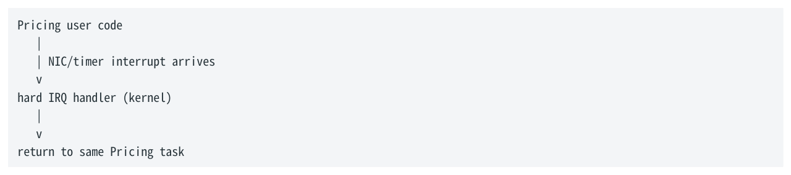

- ` Pricing user code `
- ` NIC/timer interrupt arrives `
- ` hard IRQ handler (kernel) `
- ` return to same Pricing task `

</details>

这一路径可以完全没有 task A-&gt;task B 的 context switch，却让 Pricing wall-clock 增加。因而“context-switches = 0”不能证明没有 OS/firmware interference。

### 3.2  /proc/interrupts、MSI-X 与 NIC Queue Affinity

现代 NIC 常用多 RX/TX queues + MSI-X vectors，把不同 queue 的 interrupt 分布到不同 CPUs。`/proc/interrupts` 最适合回答 what / where / how many：哪个 IRQ source、在哪个 CPU、累计多少次；它不直接给每次 IRQ duration。

```text
             CPU2      CPU3      CPU4      CPU5
IRQ100          0         0     812934         0   NIC-Rx-0
IRQ101          0         0          0    723114   NIC-Rx-1
```

IRQ affinity 与 application affinity 是两个独立控制面。Pricing pin CPU5，但 NVMe/management NIC IRQ 也打到 CPU5，仍会直接插入 hot execution。

### 3.3  NIC RX：DMA -&gt; Hard IRQ -&gt; NAPI -&gt; NET_RX SoftIRQ

**图示转写**

1. ` NIC `
2. ` DMA packet into RX ring / memory `
3. ` IRQ (notification) `
4. ` hard IRQ: acknowledge/schedule NAPI `
5. ` NET_RX softirq `
6. ` NAPI poll(budget) `
7. ` kernel network stack `
8. ` socket receive queue `
9. ` application `

<details>
<summary>查看原图与完整文字转写</summary>

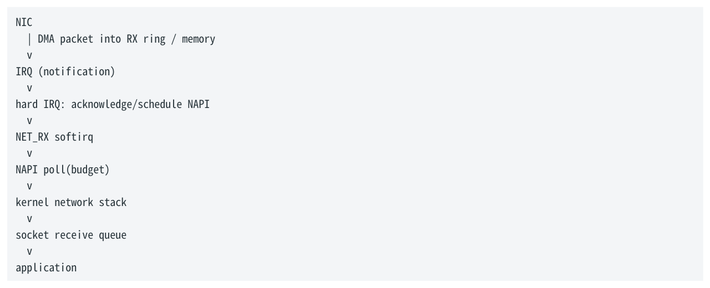

- ` NIC `
- ` DMA packet into RX ring / memory `
- ` IRQ (notification) `
- ` hard IRQ: acknowledge/schedule NAPI `
- ` NET_RX softirq `
- ` NAPI poll(budget) `
- ` kernel network stack `
- ` socket receive queue `
- ` application `

</details>

NAPI 的关键是把“每包一次完整 interrupt handling”变成 event notification + bounded polling/batching。Hard IRQ 要尽量短，把更多 packet work defer 到 NAPI/softirq。这样提高 throughput、避免 interrupt storm，但也意味着 softirq 本身可以长时间占用 CPU。

<a id="pdf-page-012"></a>

<!-- source-pdf-page: 12 -->

*[原 PDF 第 12 页](./Level6_Linux_OS_Runtime_CN.pdf#page=12)*

### 3.4  SoftIRQ、ksoftirqd 与 Hidden Latency

SoftIRQ 不是普通 user thread。普通非-PREEMPT_RT mental model 下，它可以在 kernel/interrupt return path 直接执行；backlog 较大时，部分 work 可由 per-CPU ksoftirqd/N kernel thread 继续。前者表现为 direct interruption， 后者又可能变成 scheduler competition。

| 路径 | 形态 | 观察特征 |
| --- | --- | --- |
| inline softirq | Pricing -&gt; IRQ -&gt; NET_RX softirq -&gt; Pricing | 无 user-task switch 也可产生明显 gap |
| ksoftirqd | softirq backlog -&gt; ksoftirqd runnable -&gt; scheduler | 可能出现 kernel-thread scheduling/off- CPU 影响 |

### 3.5  Interrupt Coalescing 与 Busy Polling

NIC interrupt moderation/coalescing 会等待一定 packet 数或时间再通知 CPU，用 notification latency 换更少 interrupt 和更好 throughput。Low-latency workload 常需要降低 moderation，或采用 kernel busy-poll / userspace polling / kernel bypass，把 event-driven wakeup 改成主动 poll。

Trade-off  “interrupt 越少越好”是错误目标。真正要优化的是 packet arrival -&gt; application useful work 的完整 latency distribution，同时考虑 CPU cost、batch efficiency 与 cache locality。

### 3.6  IPI：CPU 也会 Interrupt 另一个 CPU

Inter-Processor Interrupt (IPI) 用于 reschedule、cross-CPU function call、TLB shootdown 等 SMP coordination。 x86 `/proc/interrupts` 常能看到 RES、CAL、TLB 等类别。isolated CPU 仍可能因为 system-wide kernel operation 接到 IPI。

**图示转写**

| 步骤 | CPU0 | CPU5 / Pricing |
| --- | --- | --- |
| 1 | 修改 mapping / 更新 page table | 运行业务代码 |
| 2 | 发送 TLB shootdown IPI | 处理 IPI |
| 3 | 等待必要的失效完成 | Invalidate stale translation 后继续 |

<details>
<summary>查看原图与完整文字转写</summary>

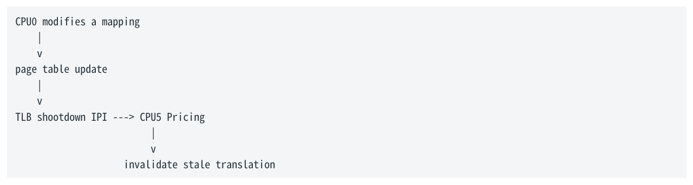

- ` CPU0 modifies a mapping `
- ` page table update `
- ` TLB shootdown IPI → CPU5 Pricing `
- ` invalidate stale translation `

</details>

这解释了为什么 background thread 的 mmap/munmap/mprotect 或 allocator 大块释放可能跨 core 影响 hot thread：VM mapping change 不只是 background CPU 上的本地工作。

### 3.7  Timer、RCU 与 kworker

periodic local timer/scheduler tick、RCU callback、workqueue/kworker 都属于 kernel noise 的不同来源。 nohz_full 主要减少满足条件时的 periodic tick；RCU offload 主要把 callback execution 搬走；unbound workqueue 可以搬到 housekeeping，但 bound work/其他不可迁移路径仍要实际验证。

常见说法 更准确的理解 “设置 nohz_full 后 isolated CPU 不会再进 kernel。” nohz_full 主要减少 periodic tick。syscall、fault、IRQ、IPI、 NMI/SMI 与其他必要 kernel entry 仍然存在。

<a id="pdf-page-013"></a>

<!-- source-pdf-page: 13 -->

*[原 PDF 第 13 页](./Level6_Linux_OS_Runtime_CN.pdf#page=13)*

### 3.8  NMI 与 SMI：越过普通 Scheduler/IRQ Tuning 的噪声

NMI（Non-Maskable Interrupt）用于 watchdog、PMU/硬件错误等特殊路径；SMI（System Management Interrupt）会使 x86 CPU 进入 SMM 执行 firmware/platform code。SMI 不由 Linux scheduler/IRQ affinity 控制，因此即使 isolated CPU + nohz_full + RT policy 都正确，仍可能出现 firmware-level wall-clock gap。

平台层结论  极端 tail-latency engineering 必须把 BIOS、firmware、power/thermal management 纳入平台 qualification。Linux tuning 无法消灭 Linux 控制域之外的 SMI。

### 3.9  IRQ Placement：Isolation 与 Cache Locality 的真实 Trade-off

| 方案 | 优点 | 缺点 |
| --- | --- | --- |
| NIC IRQ/NAPI 与 MD 分离 | application core 更干净 | 增加 cross-core handoff/cacheline movement |
| NIC IRQ/NAPI 与 MD 同 core | RX descriptor/data locality 可能更好 | user code 被 networking kernel work 直接打断 |
| userspace polling/kernel bypass | 减少 softirq/wakeup/kernel-stack dependency | 独占 CPU、driver/NIC topology 与operational complexity 更高 |

因此不能背“IRQ 一定离 application 越远越好”。应该固定 flow -&gt; RX queue -&gt; IRQ/NAPI core -&gt; application core 的 topology，并通过 p99.9、cache/queue depth、IRQ duration 与 cross-core handoff 成本验证。

### 3.10  Kernel-Noise Diagnosis

```text
If hot thread did NOT context-switch but wall-clock jumped:
  1. /proc/interrupts delta on hot CPU
  2. /proc/softirqs delta: NET_RX/TIMER/RCU/SCHED
  3. IPI counters: RES/CAL/TLB
  4. trace irq_handler_entry/exit, softirq_entry/exit
  5. consider NMI/SMI if Linux-visible evidence is insufficient
```

本章结论

- IRQ != context switch；no context switch != no OS interference。

- 传统 NIC RX 主线是 DMA -&gt; hard IRQ -&gt; NAPI/NET_RX softirq -&gt; kernel stack -&gt; socket/application。

- softirq 可以 inline，也可能转化为 ksoftirqd scheduler interference。

- IPI 解释了 mapping/TLB 等 system-wide operation 如何跨 core 干扰 hot CPU。

- CPU isolation、IRQ isolation、SMT/firmware tuning 是不同层；必须分别测量。

<a id="pdf-page-014"></a>

<!-- source-pdf-page: 14 -->

*[原 PDF 第 14 页](./Level6_Linux_OS_Runtime_CN.pdf#page=14)*

## 第 4 章  Virtual Memory、Page Fault、mmap 与 First Touch

本章目标  把 Level 3 的 TLB/page walk 与 Linux VM 连接起来；区分 virtual reservation、physical population、page residency 与 NUMA placement。

### 4.1  Virtual Address -&gt; TLB -&gt; Page Table -&gt; Physical Address

C++ pointer 是 virtual address。CPU 先查 TLB；TLB miss 时由 hardware page-table walker 根据 kernel 建立的 page tables 完成 translation。Kernel 不会参与每一次 address translation，否则普通 load/store 根本无法达到现代 CPU 的吞吐。

**图示转写**

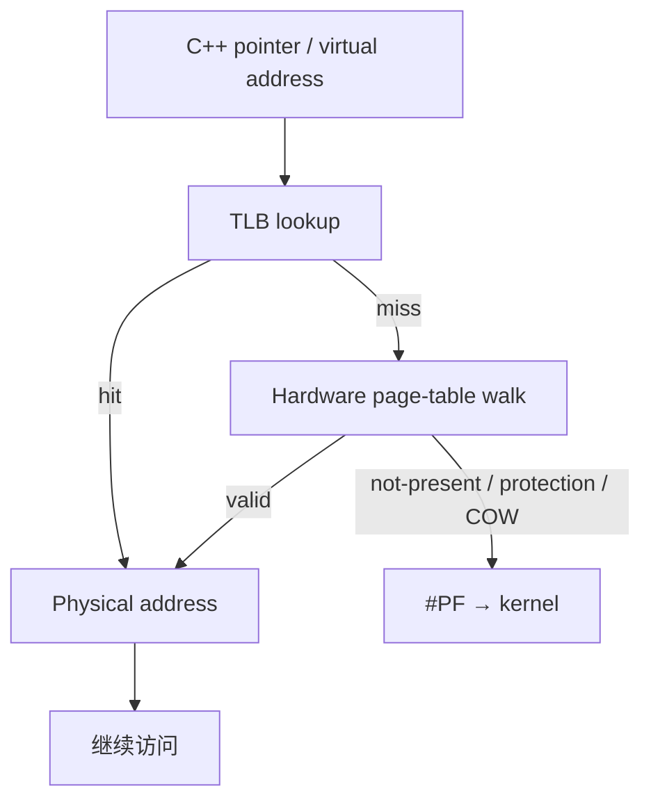

<details>
<summary>查看原图与完整文字转写</summary>

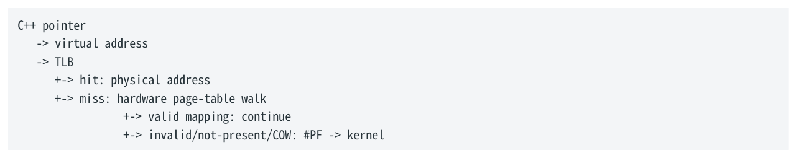

- ` C++ pointer `
- ` → virtual address `
- ` → TLB `
- ` -> hit: physical address `
- ` -> miss: hardware page-table walk `
- ` -> valid mapping: continue `
- ` -> invalid/not-present/COW: #PF → kernel `

</details>

### 4.2  Page-table Walk != Page Fault

| 事件 | Kernel 是否介入 | 典型成本来源 |
| --- | --- | --- |
| TLB hit | 否 | normal load/store/cache hierarchy |
| TLB miss + page walk success | 否 | page-table memory accesses / walk latency |
| Page fault | 是 | exception entry + VM handler；可能physical allocation/I/O |
| Major fault | 是，通常还需要等待 I/O | storage/swap + block/wakeup |

常见说法 更准确的理解 “TLB miss 就会 page fault。” TLB miss 常由 hardware page walk 完成；只有 mapping/permission/COW 等语义无法直接满足时才产生 #PF exception。

### 4.3  Demand Paging：malloc(1GB) != 1GB DRAM 已准备

Linux 与 allocator 可以先建立/保留 virtual address range，physical anonymous pages 在 first touch 时再实例化。这样 application 申请大地址空间但只实际使用少量 pages 时不会立即消耗全部 RAM 与 zeroing CPU。

**图示转写**

| 场景 / 部分 | 路径、状态或说明 |
| --- | --- |
| malloc(1GB) | ` → virtual address range / allocator metadata `；` → return ` |
| first write p[0] = 1 | ` → page fault `；` → allocate physical page `；` → zero page `；` → install PTE ` |

<details>
<summary>查看原图与完整文字转写</summary>

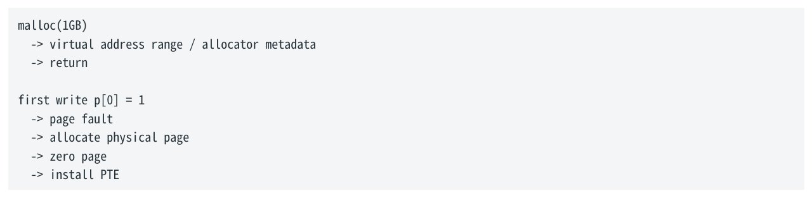

- ` malloc(1GB) `
- ` → virtual address range / allocator metadata `
- ` → return `
- ` first write p[0] = 1 `
- ` → page fault `
- ` → allocate physical page `
- ` → zero page `
- ` → install PTE `

</details>

<a id="pdf-page-015"></a>

<!-- source-pdf-page: 15 -->

*[原 PDF 第 15 页](./Level6_Linux_OS_Runtime_CN.pdf#page=15)*

```text
  -> retry store
```

Benchmark 警告  只计时 malloc(1GB) 常只测到 allocator/virtual reservation；如果要测 physical population，必须实际触碰 pages，并把 NUMA/hugepage policy 固定。

### 4.4  Anonymous、File-backed 与 Shared Memory

| 类型 | 典型来源 | Resident steady-state 访问 |
| --- | --- | --- |
| Anonymous | heap/stack/MAP_ANONYMOUS | 普通 load/store；可能受 swap/reclaim |
| File-backed | mmap file / shared library code | resident 时普通 load/store，内容来自page cache/file backing |
| Shared memory | shm/tmpfs/memfd/MAP_SHARED 等 | 多个 process/thread 共享 coherent pages；不等于每次 disk I/O |

因此“file-backed shared-memory SPSC 一定慢”是错误的。只要 mapping 已 resident，producer/consumer 仍通过 normal coherent memory load/store 通信；主成本是 cacheline ownership、NUMA、memory ordering 与 synchronization。真正危险的是 fault/reclaim/writeback/persistence 语义。

### 4.5  Minor、Major、COW 与 Protection Fault

| Fault 类型 | 是否 storage I/O | 例子 |
| --- | --- | --- |
| Minor | 否 | anonymous demand-zero page；file page 已在 page cache，只需建立mapping |
| Major | 需要 | nonresident mapped file；swap-in |
| COW write fault | 通常不需要 storage I/O | fork/MAP_PRIVATE 后第一次 write：allocate/copy/update PTE |
| Protection fault | 取决于语义，可能 fatal | 写 read-only mapping -&gt; SIGSEGV 等 |

“minor”只表示无需 storage I/O，不表示对 5us hot path 很轻。它仍可包含 exception、physical allocator、 zeroing、PTE update、NUMA placement 与 kernel accounting。

### 4.6  VMA、mmap 与 Page Cache

mmap() 主要建立 virtual memory area (VMA) 和 mapping policy；它不保证整个范围已经 resident。`/proc/<pid>/maps` 展示 virtual mappings，而 RSS/smaps/mincore 等才更接近 residency。file-backed mmap 第一次访问若 page cache hit 可为 minor fault，若需要读 storage 则为 major fault。

**图示转写**

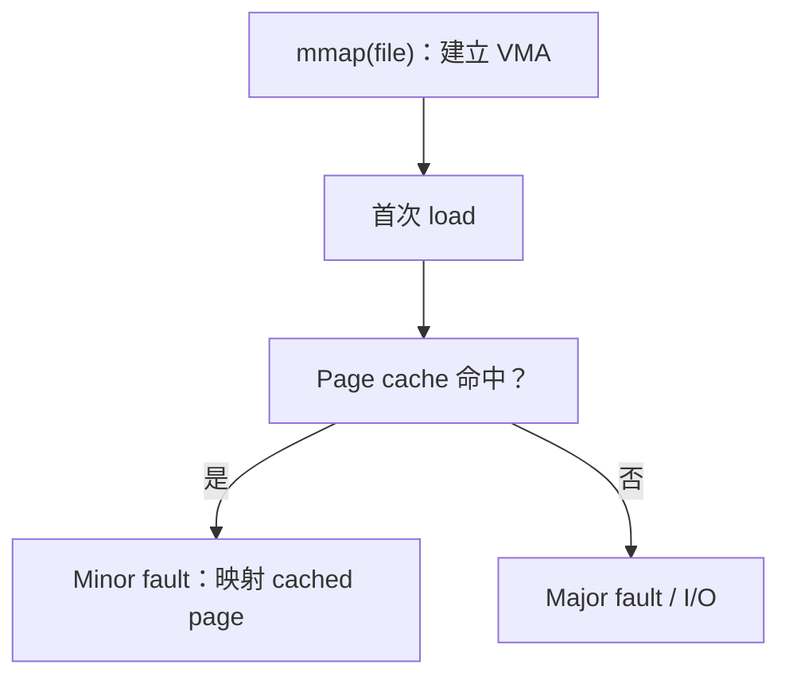

<details>
<summary>查看原图与完整文字转写</summary>

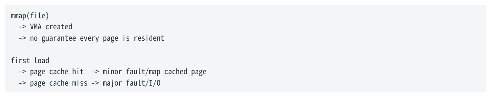

- ` mmap(file) `
- ` → VMA created `
- ` → no guarantee every page is resident `
- ` first load `
- ` → page cache hit → minor fault/map cached page `
- ` → page cache miss → major fault/I/O `

</details>

<a id="pdf-page-016"></a>

<!-- source-pdf-page: 16 -->

*[原 PDF 第 16 页](./Level6_Linux_OS_Runtime_CN.pdf#page=16)*

### 4.7  First Touch 与 NUMA Placement

默认 NUMA 策略下，anonymous physical page 往往在 first fault/touch 的 CPU 所属 node 分配。真正决定 page placement 的常常不是“哪个 thread 调用 malloc”，而是“哪个 CPU 第一次需要这个 page”。

**图示转写**

| 场景 / 部分 | 路径、状态或说明 |
| --- | --- |
| Main thread CPU0: malloc(1GB) # no real pages yet | ` Pricing CPU20 / NUMA1: first-touch every page `；` => pages tend to NUMA1 ` |
| Wrong pattern | ` CPU0 initializes all pages → pages on NUMA0 `；` Pricing later runs on NUMA1 → remote memory ` |

<details>
<summary>查看原图与完整文字转写</summary>

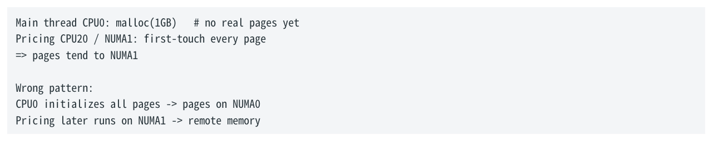

- ` Main thread CPU0: malloc(1GB) # no real pages yet `
- ` Pricing CPU20 / NUMA1: first-touch every page `
- ` => pages tend to NUMA1 `
- ` Wrong pattern: `
- ` CPU0 initializes all pages → pages on NUMA0 `
- ` Pricing later runs on NUMA1 → remote memory `

</details>

架构原则  线程 ownership、CPU pinning 与 first-touch 初始化必须一起设计。per-thread/per-partition data 应由最终 owner 在目标 NUMA node 上初始化。

### 4.8  Prefault、mlock 与 MAP_POPULATE

| 手段 | 主要目的 | 不能保证什么 |
| --- | --- | --- |
| Explicit touch/prefault | 把 lazy page allocation/PTE setup/NUMA placement 提前 | page 永远不被 reclaim；cache 永远 hot |
| mlock/mlockall | 让关键 pages 保持 resident、避免paging/swap-related loss | 无 cache/TLB miss、IRQ、scheduler |
| MAP_POPULATE | 在 mmap 时更积极 population/pre-fault | 所有未来 VM 成本消失；最优 NUMA ownership |
| madvise | 给 VM policy hint，如HUGE/NOHUGE/WILLNEED | 硬实时保证 |

对于 anonymous writable buffer，write-touch 每个 page 往往比只 read 更能确保 private physical page 真正实例化，因为 zero-page 等 lazy optimization 会让纯 read 的含义不同。

### 4.9  Stack、Code Page、TLS 与 Runtime Warm-up

Hot thread 的第一次请求可能同时承受 stack growth fault、shared-library code page fault、dynamic symbol resolution、thread_local/static lazy initialization、allocator metadata 初始化等 cold work。warm-up 应执行 representative end-to-end code paths，而不是仅“进程启动后等几秒”。

- 预先创建并 pin hot threads，触碰合理的 stack range。

- 运行 parser/encoder/risk/pricing 的代表性路径，让 code/data pages 与 lazy runtime 初始化提前发生。

- 需要强调：warm-up 可以消除 one-time lazy work，但不能保证 L1/L2/TLB 永远不被替换。

### 4.10  RSS、Fault Observation 与 Steady-State Invariant

| 观察项 | 回答的问题 |
| --- | --- |
| VIRT/VSZ | 映射/保留了多少 virtual address space？ |
| RSS | 多少 memory 当前 resident？ |
| Minor/Major faults | 运行时是否仍在 demand paging / I/O fault？ |
| numastat | resident pages / accesses 是否落在预期 NUMA node？ |

LIVE invariant  Latency-critical live phase 的目标不是“page fault 平均很快”，而是 hot path page fault 近似为 0，

> **转换补充**：first-touch 的 local allocation 直觉有前提：实际 policy、cpuset、共享映射及可用内存会改变分配结果；已有物理页也不会仅因换线程就重新分配。参见 [Linux NUMA Memory Policy](https://docs.kernel.org/admin-guide/mm/numa_memory_policy.html)。

<a id="pdf-page-017"></a>

<!-- source-pdf-page: 17 -->

*[原 PDF 第 17 页](./Level6_Linux_OS_Runtime_CN.pdf#page=17)*

major fault 必须为 0。

本章结论

- TLB miss != page fault；page-table walk 通常由硬件完成。

- virtual allocation != physical population；first touch 可以承担真正的 page allocation 成本。

- minor fault 无 storage I/O，但对微秒级 hot path 仍然很重；major fault 通常不可接受。

- NUMA first-touch、prefault、mlock 是一套连续策略：where -&gt; populate -&gt; keep resident。

- file-backed/shared memory resident 后仍是普通 load/store；disk/writeback 是另一层行为。

<a id="pdf-page-018"></a>

<!-- source-pdf-page: 18 -->

*[原 PDF 第 18 页](./Level6_Linux_OS_Runtime_CN.pdf#page=18)*

## 第 5 章  Reclaim、Compaction、THP、HugeTLB 与Writeback

本章目标  理解“内存已经 warm 过”为什么仍不足够：global memory pressure、physical fragmentation、dirty writeback 与 dynamic huge-page management 可以在运行数小时后重新制造 tail。

### 5.1  Watermark、kswapd 与 Direct Reclaim

Linux 不会等 free memory 归零才行动。每个 zone/node 维护 watermarks；内存压力上升时后台 kswapd 尝试回收 cold/reclaimable pages。最危险的情况是 allocation 不能及时满足，申请内存的当前 task 自己进入 direct reclaim。

**图示转写**

1. ` Pricing touches a new page `
2. ` → physical allocation `
3. ` → free pages insufficient `
4. ` → DIRECT RECLAIM `
5. ` → Pricing scans/reclaims memory `
6. ` → allocation eventually succeeds `
7. ` → return to business code `

<details>
<summary>查看原图与完整文字转写</summary>

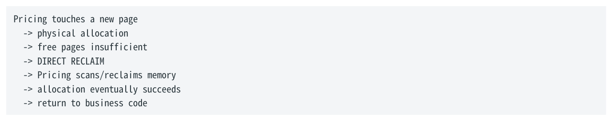

- ` Pricing touches a new page `
- ` → physical allocation `
- ` → free pages insufficient `
- ` → DIRECT RECLAIM `
- ` → Pricing scans/reclaims memory `
- ` → allocation eventually succeeds `
- ` → return to business code `

</details>

低延迟本质  Direct reclaim 的 work amount 依赖全局 machine memory state，而不是当前 order/message 的 bounded input。这正是 deterministic hot path 最不希望引入的 dependency。

### 5.2  哪些 Page 能 Reclaim？

| Page 类型 | Reclaim 方式 | 风险 |
| --- | --- | --- |
| clean file cache | 可直接丢弃，需要时从 backing file 重建 | 未来 file-backed access 可能再次 fault |
| dirty file-backed | 必须 writeback 后才能安全释放 | I/O 与 throttling 进入路径 |
| anonymous | 启用 swap 时可 swap out | 未来 major fault/swap-in |
| mlocked | 通常不能被普通 reclaim | 提高 residency predictability，但消耗不可回收 RAM |

### 5.3  Dirty Page、Writeback 与 Writer Throttling

buffered file write 通常先把 page cache 变 dirty，随后后台 flusher/writeback 把数据写回 storage。dirty memory 超过更高阈值时，正在产生 dirty pages 的 process 可能被 throttled，等待 writeback 进展。

**图示转写**

1. ` hot thread writes journal/file `
2. ` → dirty page cache grows `
3. ` → dirty limit pressure `
4. ` → balance/throttle writer `
5. ` → wait for writeback/storage `
6. ` → latency jumps `

<details>
<summary>查看原图与完整文字转写</summary>

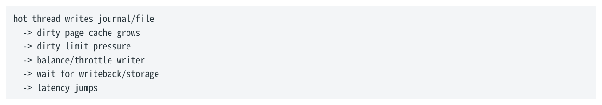

- ` hot thread writes journal/file `
- ` → dirty page cache grows `
- ` → dirty limit pressure `
- ` → balance/throttle writer `
- ` → wait for writeback/storage `
- ` → latency jumps `

</details>

因此 async logger 的价值不仅是“少一个 write syscall”，而是把 formatting、allocation、dirty/writeback、 storage I/O 与 blocking dependency 搬到 cold thread。但 logger queue 仍必须 bounded；disk 卡住最终会变成 queue-full/backpressure 问题。

<a id="pdf-page-019"></a>

<!-- source-pdf-page: 19 -->

*[原 PDF 第 19 页](./Level6_Linux_OS_Runtime_CN.pdf#page=19)*

### 5.4  Physical Fragmentation 与 Buddy Allocator

普通 4KB virtual pages 可以映射到离散 physical frames，因此 application virtual continuity 不要求 physical continuity。但 THP、HugeTLB 或某些 high-order allocation 需要更大的 physically contiguous block。系统可能“总 free memory 很多”，却没有足够高-order contiguous region。

```text
Free memory: many 4K holes
P . P . P . P . P . P

Need one 2MB contiguous block
=> total free is not enough evidence
```

buddy allocator 用 order 表示 2^order 个连续 base pages；`/proc/buddyinfo` 可以观察各 order 的 free blocks。 high-order 接近 0 是 fragmentation 的重要迹象。

### 5.5  Compaction：Reclaim 与整理碎片不是一回事

| 机制 | 目标 | 谁可能执行 |
| --- | --- | --- |
| Reclaim | 让更多 pages 变 free | kswapd 或 requesting task (direct reclaim) |
| Compaction | 移动 movable pages，让 free pages 聚成连续大块 | kcompactd 或 requesting task (direct compaction) |

```text
Before: P . P P . P . P P . P
Move movable pages
After : P P P P P P . . . . .
```

CPU isolation 可以把 kcompactd 的 scheduler execution 搬离 hot CPU，但不能阻止 hot thread 自己因 high-order allocation 进入 direct compaction；后台 compaction 也仍会消耗 DRAM bandwidth/LLC/interconnect。

### 5.6  THP：Translation Efficiency 与 Runtime Variance

Transparent Huge Pages 让 kernel 动态用较大 mappings 覆盖 anonymous/file/shmem 等适用 region。经典 x86 场景是 2MB PMD-size huge page；现代 Linux 也可能有多尺寸 THP。主要收益是提高 TLB reach、减少 page-table walk 和 fault count。

| 收益 | 潜在代价 |
| --- | --- |
| TLB entries cover more memory | large-page allocation 可能需要 reclaim/compaction |
| page-table footprint 更小 | khugepaged background collapse work |
| populate 大 region 时 fault 次数更少 | collapse/split/page migration 引入动态 VM activity |
| 某些 large working-set workload 明显更快 | single fault/zeroing unit 可能更大；tail 需测量 |

正确结论  THP 不是“永远应该关”或“永远更快”。Low-latency 真正担心的是 implicit dynamic VM policy 是否让 live request 承担 reclaim/compaction/collapse 的不可预测成本。

### 5.7  Explicit HugeTLB：用静态 Provisioning 换 Runtime Predictability

hugetlb/hugetlbfs/MAP_HUGETLB 允许管理员/application 使用预先保留的 hugepage pool。boot/initialization 阶段预留 2MB/1GB pages，可以避免 live 时依赖“现在是否能找到 contiguous block”。代价是内存被预留后灵活性下降，unused pool 不能像普通 page cache 一样自由利用。

<a id="pdf-page-020"></a>

<!-- source-pdf-page: 20 -->

*[原 PDF 第 20 页](./Level6_Linux_OS_Runtime_CN.pdf#page=20)*

| 维度 | THP | Explicit HugeTLB |
| --- | --- | --- |
| Provision | dynamic/automatic | explicit reserved pool |
| Convenience | 高 | 低 |
| Runtime flexibility | 高 | 低 |
| Tail predictability | 取决于 policy/fragmentation | 通常更容易控制 |
| Memory utilization | 灵活 | 可能预留浪费 |

### 5.8  Huge Pages 仍然必须 NUMA-aware

Hugepage pool 可以按 NUMA node 分布。Pricing 固定 Node1，但 hugepages 只预留在 Node0 时，可能 remote allocation 或失败/fallback。Huge page 解决 translation，不自动解决 locality；thread placement、page pool 与 first-touch/memory policy 仍是一套设计。

### 5.9  Memory Headroom 与 Bounded Capacity

对低延迟系统，“没有 OOM”是非常低的健康标准。机器可能在 OOM 之前很久就进入持续 reclaim/compaction/writeback，业务仍活着但 p99.99 已经失效。RAM headroom 本身是 latency resource。

**图示转写**

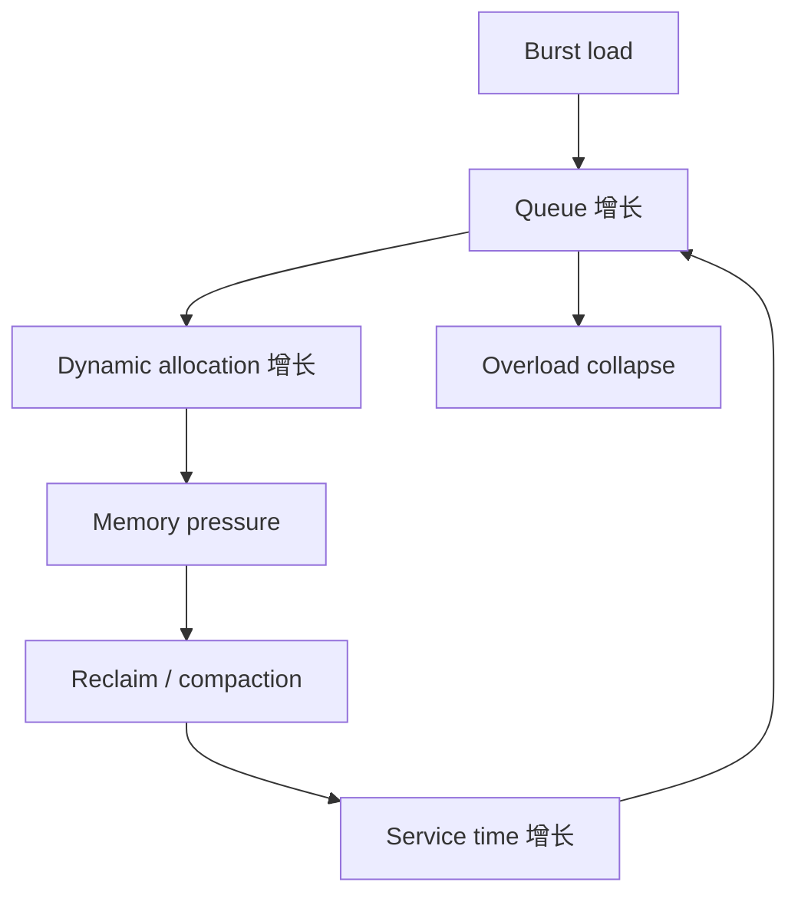

<details>
<summary>查看原图与完整文字转写</summary>

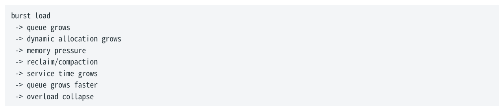

- ` burst load `
- ` → queue grows `
- ` → dynamic allocation grows `
- ` → memory pressure `
- ` → reclaim/compaction `
- ` → service time grows `
- ` → queue grows faster `
- ` → overload collapse `

</details>

因此 fixed-capacity object pool、bounded queue、预先 stress-tested maximum 并不是“内存浪费”，而是把 overload behavior 从全局 OS slow path 改成 application 可定义的 fail-fast/backpressure policy。

### 5.10  观察 Reclaim / Compaction / Writeback

| 接口/指标 | 主要用途 |
| --- | --- |
| /proc/vmstat | pgscan/pgsteal、allocstall、compact_* 等 VM activity 趋势 |
| vmstat 1 | swap in/out、I/O、CPU、system memory pressure 快速总览 |
| /proc/meminfo | MemAvailable、Dirty、Writeback、AnonHugePages、HugePages_* |
| /proc/buddyinfo | 高-order contiguous free blocks / fragmentation |
| latency timeline + trace | 证明 compact/reclaim/writeback stall 是否与业务 outlier 同时发生 |

本章结论

- kswapd 是 background reclaim；direct reclaim 由 allocation/faulting task 自己付费。

- reclaim 解决 free page 不足；compaction 解决 physical continuity 不足。

- kcompactd 在后台做不等于 zero impact；direct compaction 更会直接发生在 hot thread。

- THP 主要优化 address translation，但动态 promotion/compaction 可能伤 tail；Explicit HugeTLB 更偏静态 provisioning。

- 低延迟系统必须保留 memory headroom，并把 capacity exhaustion 变成 explicit application policy。

<a id="pdf-page-021"></a>

<!-- source-pdf-page: 21 -->

*[原 PDF 第 21 页](./Level6_Linux_OS_Runtime_CN.pdf#page=21)*

## 第 6 章  C++ Runtime、malloc 与 Allocator

本章目标  理解 general-purpose allocator 的 fast/slow path，识别 STL/container 与 C++ runtime 中“平时很快、偶尔做大量工作”的 hidden allocation/lifetime transition。

### 6.1  new Expression -&gt; operator new -&gt; malloc-like Allocator

`new T` 包含 raw storage allocation + T construction。默认 `::operator new` 通常委托到 C allocator，但 C++ 标准没有规定 glibc malloc。性能分析要把 allocation、constructor 与后续 first-touch 分开。

**图示转写**

1. ` new Order `
2. ` → operator new(sizeof(Order)) `
3. ` → malloc-like allocator `
4. ` → raw memory `
5. ` → Order::Order() `

<details>
<summary>查看原图与完整文字转写</summary>

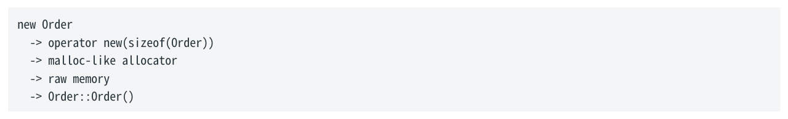

- ` new Order `
- ` → operator new(sizeof(Order)) `
- ` → malloc-like allocator `
- ` → raw memory `
- ` → Order::Order() `

</details>

### 6.2  glibc Mental Model：tcache -&gt; arena/bins -&gt; mmap/brk

**图示转写**

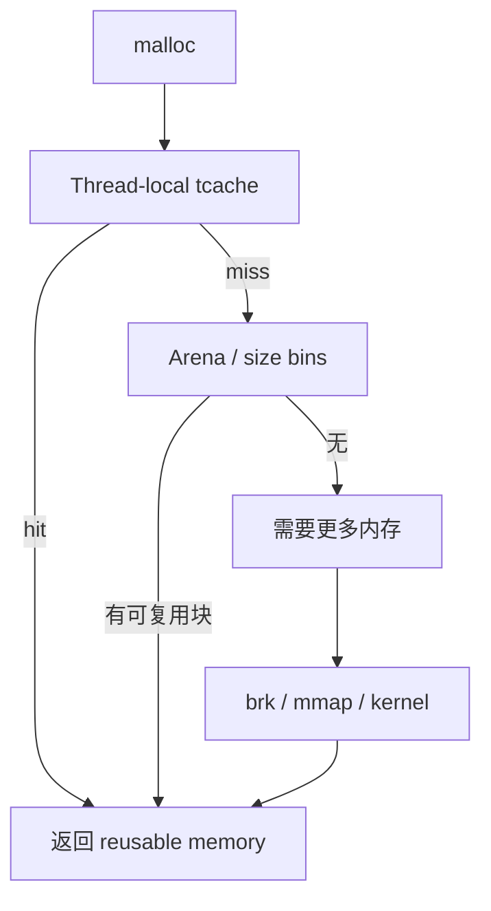

<details>
<summary>查看原图与完整文字转写</summary>

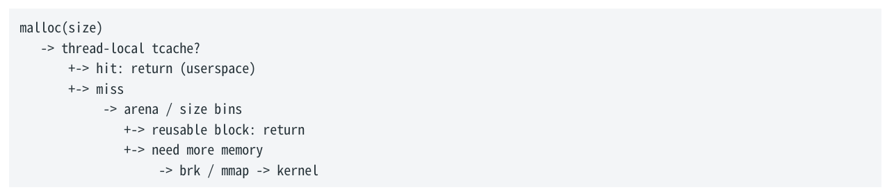

- ` malloc(size) `
- ` → thread-local tcache? `
- ` -> hit: return (userspace) `
- ` -> miss `
- ` → arena / size bins `
- ` -> reusable block: return `
- ` -> need more memory `
- ` → brk / mmap → kernel `

</details>

tcache 把常见 small allocation/free 留在线程本地，减少 global/arena lock 与 cacheline bouncing。因此无竞争 malloc fast path 可以非常快。真正的 low-latency 风险是 tcache miss、arena contention、heap growth、VM slow path 与 physical page population。

### 6.3  Arena != NUMA Node；更多 Arena != 永远更好

allocator arena 是 allocator 的 metadata/synchronization/allocation domain，不是 physical NUMA node。更多 arena 可以减少多线程锁竞争，但也可能提高 memory retention、fragmentation 与 RSS。page 最终在哪个 NUMA node，仍由 memory policy 与 first touch 决定。

### 6.4  free()、Memory Retention 与 munmap

小对象 free 通常只回到 tcache/bin，allocator 保留内存供未来复用；因此 RSS 不立即下降并不等于 leak。大 mmapbacked allocation 的 free 则可能触发 munmap，进而修改 page tables、invalidations，甚至对同 address space 的其他 CPUs 发 TLB shootdown。

常见说法 更准确的理解 “把 malloc/free 移到 background core 后 hot thread 就完全 不同 CPU 仍共享 allocator/address space/LLC/DRAM/page 不受影响。” tables。background munmap、memory pressure 或 bandwidth consumption 可以跨 core 泄漏到 hot latency。

### 6.5  std::vector：Amortized O(1) 不是 Bounded O(1)

```text
push_back when size < capacity:
  construct at end
```

<a id="pdf-page-022"></a>

<!-- source-pdf-page: 22 -->

*[原 PDF 第 22 页](./Level6_Linux_OS_Runtime_CN.pdf#page=22)*

```text
push_back when size == capacity:
  allocate bigger block
  move/copy N elements
  construct new element
  free old block
```

算法复杂度里的 amortized O(1) 是长期平均工作量陈述，不是单事件 latency bound。p99.99 关心的恰好是某一次 capacity growth。`reserve(max)` 可以移除 reallocation，但 reserve 本身不等于 physical pages 全部 prefault。

### 6.6  std::string、unordered_map 与 Rehash

短 std::string 常有 SSO，但 SSO 容量是 library/ABI implementation detail，不能依赖一个 portable 固定字符数。 string growth 与 vector 类似会 allocate/copy/free。node-based unordered_map insert 常有 node allocation，load factor 超阈值还会 rehash：allocate new buckets + visit/rebucket 大量 existing entries。

| 操作 | 常见 fast path | rare expensive path |
| --- | --- | --- |
| vector::push_back | capacity 内 append | reallocate + move/copy all elements |
| string append | SSO/已有 capacity | heap growth + copy |
| unordered_map insert | hash + bucket + node insert | node allocation / rehash O(N) |
| shared_ptr reset | atomic refcount decrement | last release -&gt; destructor + frees |
| std::function assign/copy | small-object optimization | callable too large -&gt; heap allocation |

### 6.7  shared_ptr：Allocation 只是成本的一部分

shared_ptr 通常还有 control block 与 atomic strong/weak reference counts。跨 core copy/reset 会让 refcount cacheline 在 cores 间 bounce；最后一次 release 又会突然执行 object destructor、child destruction 与 allocator free。因此“多数 reset 很快，某次 final release 很慢”也是典型 bimodal tail。

### 6.8  Lazy Runtime Work：static、thread_local、Dynamic Loader

function-local static、complex thread_local、PLT/dynamic symbol resolution 等可以把 initialization 推迟到第一次调用。general-purpose software 里这是方便的；low-latency live path 则更希望 explicit warm-up，把 one-time runtime work 搬到 INIT/WARMUP。

### 6.9  Object Pool、Per-thread Arena 与 PMR

| 方案 | 适用条件 | 主要价值 |
| --- | --- | --- |
| Fixed-size object pool | 对象大小固定、最大数量可估算 | allocation/free = bounded freelist op；无VM growth |
| Per-thread pool/arena | single owner 或 owner-local lifetime | 无 global lock/CAS/remote free |
| Bump/monotonic arena | batch/request lifetime，整体 reset | 几条 pointer arithmetic；individual free 可省略 |
| std::pmr resource | 需要把 allocator policy 显式注入标准容器 | 可统一使用 custom/preallocated resource |

Ownership 优先  比“找最快 malloc”更强的优化是把 memory ownership 约束成 single owner + fixed lifetime。这样很多 synchronization、remote free 与 general allocator 问题直接从模型中删除。

<a id="pdf-page-023"></a>

<!-- source-pdf-page: 23 -->

*[原 PDF 第 23 页](./Level6_Linux_OS_Runtime_CN.pdf#page=23)*

### 6.10  Index-based Storage 与 Generation Handle

固定数组/packed storage 可以用 32-bit index 代替 heap pointer，获得 stable contiguous storage、较好 cache density、无 per-object allocation。slot recycle 时使用 index + generation 防止 stale handle 指向复用后的新对象。

```text
Handle = { index: 10, generation: 7 }
slot 10 recycled
new generation = 8
old handle no longer valid
```

### 6.11  Allocator Benchmark：不要只测 Hot tcache Loop

`malloc(64); free();` 的 tight loop 很容易只测到 perfect tcache reuse，与 production 的 mixed sizes、burst、cross-thread free、large allocation、memory pressure 完全不同。Allocator benchmark 至少要区分 fast/cold path、 multi-thread contention、remote free、first-touch 与 memory pressure，并看 histogram/p99.99，而不只是 ops/sec/average ns。

### 6.12  Hot-path Allocation 的真正优先级

```text
Strongest determinism
  1. no allocation/free in LIVE
  2. fixed-capacity single-owner pool
  3. per-thread arena / bounded allocator
  4. general allocator thread-local fast path
  5. allocator -> OS/VM slow path
Weakest determinism
```

本章结论

- malloc != syscall；small allocation fast path 可以 pure userspace。

- 真正问题是 fast-path miss 后依赖 arena、mmap/brk、page fault、reclaim/compaction 的 latency variance。

- free 也可能走 munmap/TLB shootdown；memory lifecycle 同样需要移出 hot path。

- amortized O(1) 不等于 per-event bounded latency；vector growth、rehash、final shared_ptr release 都是 tail source。

- 最强策略不是更快的 general allocator，而是 fixed capacity + single ownership + LIVE 阶段无 general allocation。

<a id="pdf-page-024"></a>

<!-- source-pdf-page: 24 -->

*[原 PDF 第 24 页](./Level6_Linux_OS_Runtime_CN.pdf#page=24)*

## 第 7 章  Futex、Mutex、Condition Variable 与 Spin

本章目标  把 std::mutex 从 C++ API 追到 atomic fast path、futex wait/wake、scheduler/off-CPU；理解 spin、 blocking、priority inversion、lock-free 与 SPSC 的真实 trade-off。

### 7.1  Uncontended Mutex：通常只是 User-space Atomic Fast Path

C++ 标准不规定 std::mutex 的 Linux 实现，但常见 libstdc++/pthread mental model 是：uncontended lock 通过 atomic state transition 获取 ownership；只有 contention 需要 kernel-assisted wait/wake。因此“mutex = syscall”不准确。

```asm
lock word = UNLOCKED
Thread A CAS UNLOCKED -> LOCKED
  -> success
  -> continue in userspace
```

### 7.2  Contention：Spin -&gt; Futex -&gt; Sleep -&gt; Scheduler

**图示转写**

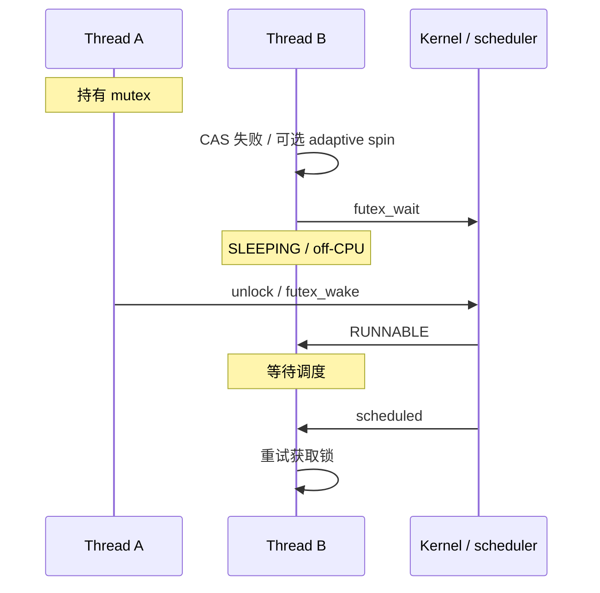

<details>
<summary>查看原图与完整文字转写</summary>

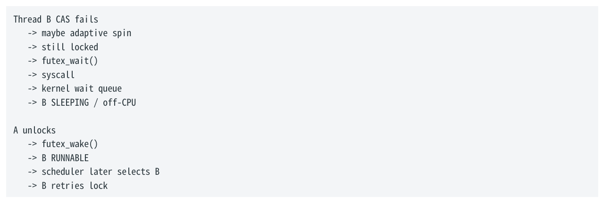

- ` Thread B CAS fails `
- ` → maybe adaptive spin `
- ` → still locked `
- ` → futex_wait() `
- ` → syscall `
- ` → kernel wait queue `
- ` → B SLEEPING / off-CPU `
- ` A unlocks `
- ` → futex_wake() `
- ` → B RUNNABLE `
- ` → scheduler later selects B `
- ` → B retries lock `

</details>

因此 contended mutex 的 tail = failed atomic/coherence + spin + syscall + off-CPU + wakeup/scheduling + warmstate loss + reacquire。平均 uncontended 速度无法代表这个 slow path。

### 7.3  PAUSE、yield、sleep：三个完全不同的等待层级

| 方式 | 线程是否仍 RUNNING | 是否 scheduler/kernel | 典型用途 |
| --- | --- | --- | --- |
| _mm_pause() | 是 | 否 | tight spin 内降低资源压力/改善 SMT friendliness |
| yield() | 不一定 | scheduler | 愿意让其他 runnable task 运行 |
| sleep/futex | 否 | 是 | 长等待，节省 CPU，但wakeup jitter 更大 |

如果 lock owner 只会再运行 100ns，sleep/wakeup 往往比短暂 spin 贵；如果 owner 被 descheduled 1ms，继续 spin 又浪费 CPU。Adaptive mutex/hybrid wait 本质是在预测 wait-duration distribution。

<a id="pdf-page-025"></a>

<!-- source-pdf-page: 25 -->

*[原 PDF 第 25 页](./Level6_Linux_OS_Runtime_CN.pdf#page=25)*

### 7.4  Cacheline Bouncing：Synchronization 既是 OS 问题也是 Coherence 问题

多个 cores 对同一个 lock word 做 write-style atomic，会争夺 cacheline exclusive ownership。即使最终没有进入 futex，CAS/exchange retry 也可能产生强烈 cacheline ping-pong。TAS spinlock 特别容易如此；TTAS 通过 locked 时只 load、看起来 free 时再 exchange，降低无意义 write ownership traffic。

```text
TAS:
while (flag.exchange(true)) pause   # every retry wants exclusive line

TTAS:
while (flag.load()) pause           # shared reads
if (!flag.exchange(true)) acquired
```

### 7.5  Condition Variable 与 Lost Wakeup Protocol

condition_variable 不是“收到 notify 就继续”的简单事件。正确 protocol 是在 mutex 保护下检查 predicate；false 时原子地 release mutex + wait；wake 后重新 acquire mutex 并再次检查 predicate，因为允许 spurious wakeup，也可能已有其他 consumer 改变条件。

```text
lock(m)
while (!predicate):
    atomically release m + futex wait
wake
reacquire m
recheck predicate
```

它的优势是 idle consumer 不占 CPU；缺点是 live wake path 引入 futex/scheduler/reacquire/cache recovery。因此 control-plane 很合适，ultra-low-latency data-plane 常更偏 busy-poll SPSC。

### 7.6  Lock Convoy、Thundering Herd 与 Lock Hold Time

真正重要的不是“lock instruction 几 ns”，而是 critical section 多久以及里面是否做 unbounded work。持锁期间 malloc、I/O、logging、page fault、sleep 会把所有 waiters 的 latency 与 owner 的 worst-case fate 绑定。很多 waiter 连续排队形成 lock convoy；一次唤醒大量 waiter 又可能形成 thundering herd。

Transitive latency dependency  A 等 B 的 lock，意味着 A 的 latency 开始依赖 B 的 code、scheduler、fault、SMI、 I/O；如果 B 又等 C，dependency 继续传递。低延迟架构应尽量缩小这种 dependency graph。

### 7.7  Priority Inversion 与 PI Futex

**图示转写**

| 场景 / 部分 | 路径、状态或说明 |
| --- | --- |
| High H waits for mutex owned by Low L | ` Medium M can preempt L `；` => H indirectly waits behind M ` |
| Priority inheritance | ` H waits → temporarily boost L → L unlocks → restore priority ` |

<details>
<summary>查看原图与完整文字转写</summary>

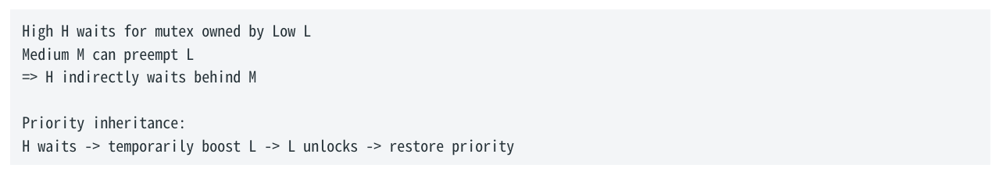

- ` High H waits for mutex owned by Low L `
- ` Medium M can preempt L `
- ` => H indirectly waits behind M `
- ` Priority inheritance: `
- ` H waits → temporarily boost L → L unlocks → restore priority `

</details>

PI futex/priority inheritance 解决的是 scheduler priority inversion，不会消除 owner 自己的 page fault、SMI、I/O、 reclaim 等 delay。因此 RT scheduling + PI lock 是一种 real-time tool，而不是替代良好 ownership architecture。

### 7.8  Spinlock Variants：TAS、TTAS、Ticket、MCS

| 锁 | 核心思路 | 主要 trade-off |
| --- | --- | --- |
| TAS | 所有 waiter exchange 同一 word | 简单但 coherence traffic 高 |

<a id="pdf-page-026"></a>

<!-- source-pdf-page: 26 -->

*[原 PDF 第 26 页](./Level6_Linux_OS_Runtime_CN.pdf#page=26)*

| 锁 | 核心思路 | 主要 trade-off |
| --- | --- | --- |
| TTAS | locked 时 shared load，free 时再 exchange | 减少 write bouncing |
| Ticket | 取号 + 等 serving，FIFO | 公平，但 waiters 仍看共享 serving line |
| MCS | 每个 waiter 在自己的 queue node 上 spin | 高 contention 可扩展，复杂度/metadata 更高 |

对于 HFT，通常更重要的问题不是“哪种 fancy lock 最快”，而是能否通过 ownership partition 把 hot shared write state 变成 single writer。

### 7.9  Lock-free、Wait-free 与 Progress Guarantee

| 术语 | 保证的是什么 | 不保证什么 |
| --- | --- | --- |
| blocking | owner/stalled thread 可能阻碍其他线程 | - |
| lock-free | 系统整体持续有 operation 完成 | 单个 thread latency 有界；一定更快 |
| wait-free | 每个 operation 在有限 steps 内完成 | constant factor 小、实现简单 |

常见说法 更准确的理解 “lock-free 一定比 mutex 更快。” 高 contention CAS loop 可以产生 retry storm/cacheline bouncing。Progress property 与实际 latency/throughput 是不同维度。

### 7.10  为什么 SPSC 特别适合 Low Latency

SPSC 的优势首先来自 topology restriction：一个 producer、一个 consumer，各自拥有 write/read index，通信退化为 atomic publication + cache coherence，而不是 general MPMC arbitration。

**图示转写**

| 场景 / 部分 | 路径、状态或说明 |
| --- | --- |
| Producer owns write_idx | ` Consumer owns read_idx ` |
| Producer → write slot → publish write_idx | ` Consumer → observe → read slot → publish read_idx ` |

<details>
<summary>查看原图与完整文字转写</summary>

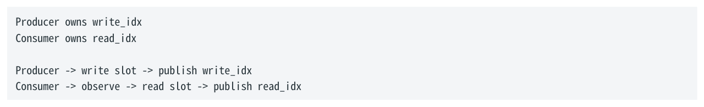

- ` Producer owns write_idx `
- ` Consumer owns read_idx `
- ` Producer → write slot → publish write_idx `
- ` Consumer → observe → read slot → publish read_idx `

</details>

实现仍要注意 producer/consumer hot-write metadata 分 cacheline、memory ordering、ring full/backpressure 与 cross-NUMA handoff。SPSC 不是“免费”，但其工作量更容易 bounded，通常不需要 futex/scheduler。

### 7.11  Single Writer、Sharding 与 Copy-Publish

| 模式 | 把什么问题删掉 | 代价 |
| --- | --- | --- |
| Single owner + message passing | mutex/write-write contention/priority inversion | owner 可能成为 serial bottleneck；需要queue |
| Sharding | global lock/CAS hotspot | partition/rebalancing complexity |
| Immutable copy-publish | reader lock contention | copy + reclamation/version management |
| Seqlock/versioned snapshot | reader blocking | reader 可能 retry；适合短 bounded read |

本章结论

- mutex uncontended path 可以完全 userspace；contention 才可能 futex/sleep。

- PAUSE != yield != sleep；spin 的合理性取决于 expected wait 与 owner 是否正在运行。

<a id="pdf-page-027"></a>

<!-- source-pdf-page: 27 -->

*[原 PDF 第 27 页](./Level6_Linux_OS_Runtime_CN.pdf#page=27)*

- blocking synchronization 的真正成本是 off-CPU/wakeup/scheduler/cache recovery，而不只是 syscall。

- priority inheritance 只解决 scheduler priority inversion，不解决 owner 的所有 delay。

- 低延迟 concurrency 优先改变 ownership/topology，其次才选择 lock/atomic implementation。

<a id="pdf-page-028"></a>

<!-- source-pdf-page: 28 -->

*[原 PDF 第 28 页](./Level6_Linux_OS_Runtime_CN.pdf#page=28)*

## 第 8 章  Low-Latency Linux Runtime Architecture

本章目标  把前七章收束成 production playbook：从 hardware topology、CPU/IRQ partition、NUMA/memory preparation、allocator/synchronization、network path，到 LIVE invariants 与 verification。

### 8.1  最终目标：Mostly User-space + Fixed Resource Ownership

```text
LIVE hot thread target:
  RUNNING
  same physical core
  local resident memory
  fixed capacity
  no blocking
  no page faults
  no allocator growth
  minimal IRQ/IPI/kernel work
  bounded cross-core queues
```

真正目标不是“Linux disappears”，而是把 Linux 必须做的 dynamic work 在时间上搬到 INIT/WARMUP，在空间上搬到 housekeeping/cold cores。

### 8.2  先做 Topology Discovery，再做 taskset

CPU number 本身没有足够信息。必须知道 socket/NUMA node、physical core、SMT sibling、LLC、NIC PCIe locality。一个 logical CPU 被 pin 并不代表 physical core dedicated；一个 NIC 与 MD thread 跨 socket 也可能增加 DMA/descriptor/interconnect latency。

```text
Socket0 / NUMA0
  Core0: CPU0 + CPU16
  Core1: CPU1 + CPU17
  NIC0 attached here

Socket1 / NUMA1
  Core0: CPU8 + CPU24
  ...
```

### 8.3  Housekeeping 与 Hot Core Partition

housekeeping 不是“剩下一个 CPU 随便放系统杂活”，而是需要足够 capacity 承接 scheduler、timer、RCU、 workqueue、IRQ、logging、monitoring、admin/control plane。hot physical cores 则保持单一 owner，SMT sibling 也纳入 partition 设计。

| CPU 类别 | 典型工作 | 目标 |
| --- | --- | --- |
| Housekeeping | kernel threads、RCU、timers、monitoring、most IRQs | 吸收动态 OS noise |
| Network helper | kernel NAPI/IRQ 或专用 poller，取决于stack | 固定 RX topology / locality |
| Hot data-plane | MD/Pricing/Execution/Gateway | single owner + busy poll + bounded work |
| Cold/control | DB/config/recovery/logger | 允许 blocking/malloc/I/O |

<a id="pdf-page-029"></a>

<!-- source-pdf-page: 29 -->

*[原 PDF 第 29 页](./Level6_Linux_OS_Runtime_CN.pdf#page=29)*

### 8.4  CPU/IRQ/NUMA 三种 Placement 必须同时成立

**图示转写**

1. ` Thread placement: Pricing `
2. ` CPU5 `
3. ` IRQ placement : unrelated IRQs `
4. ` housekeeping, NIC according to RX design `
5. ` Memory placement: Pricing pages `
6. ` CPU5 local NUMA node `

<details>
<summary>查看原图与完整文字转写</summary>

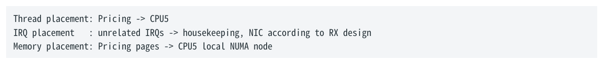

- ` Thread placement: Pricing → CPU5 `
- ` IRQ placement : unrelated IRQs → housekeeping, NIC according to RX design `
- ` Memory placement: Pricing pages → CPU5 local NUMA node `

</details>

只完成其中一项都会留下明显 hole：thread pin 但 pages remote；CPU isolated 但 NIC/NVMe IRQ 仍进来；NUMA local 但 SMT sibling 跑 noisy workload。Low-latency “dedicated core”应被理解为整套 placement invariant。

### 8.5  Startup：Preallocate -&gt; Pin -&gt; First-touch -&gt; Lock -&gt; Warm

**图示转写**

1. ` BOOT `
2. ` → INIT config/topology `
3. ` → create hot threads `
4. ` → pin CPU / set NUMA policy `
5. ` → allocate fixed pools/rings/tables `
6. ` → first-touch owner-local pages `
7. ` → mlock critical regions where appropriate `
8. ` → warm parser/pricer/encoder/TLS/symbol paths `
9. ` → verify `
10. ` → LIVE `

<details>
<summary>查看原图与完整文字转写</summary>

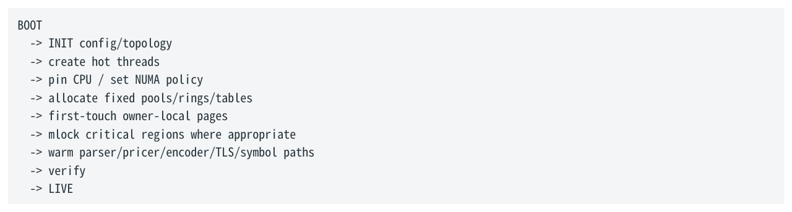

- ` BOOT `
- ` → INIT config/topology `
- ` → create hot threads `
- ` → pin CPU / set NUMA policy `
- ` → allocate fixed pools/rings/tables `
- ` → first-touch owner-local pages `
- ` → mlock critical regions where appropriate `
- ` → warm parser/pricer/encoder/TLS/symbol paths `
- ` → verify `
- ` → LIVE `

</details>

顺序很重要：如果 main thread 在 Node0 先把所有 page 写一遍，再把 Pricing pin 到 Node1，prefault 虽成功却把 NUMA placement 做错。

### 8.6  Hugepage、Allocator 与 Synchronization Policy 按 Region/Path 设计

| 区域/路径 | 建议倾向 |
| --- | --- |
| 大而长期 hot region | benchmark 4K vs explicit hugepages；预留/prefault，固定NUMA |
| small/sparse state | 普通 pages 往往足够，不为“用了 hugepage”而 hugepage |
| hot object lifecycle | fixed pool / index storage / per-owner arena |
| hot inter-thread handoff | SPSC/single writer，避免 blocking |
| cold/control path | general malloc、mutex/cv、blocking I/O 可以合理使用 |

### 8.7  Busy Polling、Network Path 与 Logging

hot threads 用 busy polling 的主要价值是保持 RUNNING、避免 scheduler wake path。network 可以是 kernel NAPI、busy-poll、Onload/DPDK 等不同模型；真正要比较的是 NIC-&gt;useful business work 的 boundary，而不是只比较某个 recv call。

**图示转写**

| 场景 / 部分 | 路径、状态或说明 |
| --- | --- |
| Hot data-plane | ` NIC/RX → MD → SPSC → Pricing → SPSC → Gateway ` |
| Cold logging | ` Pricing → fixed binary LogEvent → SPSC → Logger → format/write/fsync ` |

<details>
<summary>查看原图与完整文字转写</summary>

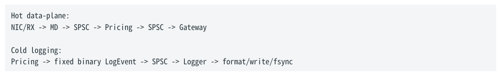

- ` Hot data-plane: `
- ` NIC/RX → MD → SPSC → Pricing → SPSC → Gateway `
- ` Cold logging: `
- ` Pricing → fixed binary LogEvent → SPSC → Logger → format/write/fsync `

</details>

日志、DB、monitoring 不能直接进入 hot lock/critical section。把它们异步化后，必须给 queue 设计 overflow policy，否则只是把 filesystem jitter 变成 unbounded backlog。

<a id="pdf-page-030"></a>

<!-- source-pdf-page: 30 -->

*[原 PDF 第 30 页](./Level6_Linux_OS_Runtime_CN.pdf#page=30)*

### 8.8  Bounded Queue、Backpressure 与 Overload Semantics

所有 bounded queue 最终都可能 full。正确架构必须按业务语义决定 spin、drop、coalesce、overwrite、 backpressure、disconnect/recover 或 fail-fast。Market data 常允许 latest-only/coalesce；order/execution/audit event 通常不能随意 drop。

Determinism  Unbounded queue 把 overload 变成 growing memory + growing queue latency；bounded queue 把 overload 变成显式、可测试的 application policy。

### 8.9  Power、Turbo、C-state、SMT 与 Thermal

busy-spin core 不会频繁进入 deep idle C-state，但全机大量 spinning 会增加 power/temperature，可能造成 thermal throttling。Turbo 能降低 service time，也可能引入频率/thermal variability。是否禁 turbo/SMT/deep C- state 不是教条，必须在目标 server 上以 tail distribution 与 operational constraints 测量。

### 8.10  Runtime Phases：INIT 可以 Dynamic，LIVE 尽量 Static

| 操作 | INIT/WARMUP | LIVE |
| --- | --- | --- |
| malloc/mmap/thread creation | 允许 | hot path 尽量禁止 |
| page fault | 可接受并应主动触发 | 应接近 0 |
| container resize/rehash | 可做 | 应禁止/提前 reserve |
| symbol/TLS/static lazy init | 主动 warm | 不应第一次发生 |
| blocking I/O | cold setup 可用 | 不进入 hot chain |
| bulk free/munmap | 可在 drain/shutdown | 避免 live churn |

这可以固化成程序 invariant：进入 LIVE 后 debug/perf build 用 allocation guard、capacity assertions、thread creation guard 等方式把隐藏 slow fallback 变成测试时可见错误。

### 8.11  Verification：配置不是证据

| 想验证什么 | 证据 |
| --- | --- |
| 没有 migration/preemption | per-thread cpu-migrations/context-switches；sched_switch timeline |
| IRQ clean | /proc/interrupts before/after；trace irq handlers |
| softirq clean | /proc/softirqs NET_RX/TIMER/RCU delta |
| 无 page fault | per-thread/per-process minor/major faults；fault trace |
| 无 reclaim/compaction | /proc/vmstat allocstall/pgscan/compact_* 与 timeline |
| NUMA local | numastat / page placement / remote-access evidence |
| queue 未形成隐藏 latency | depth/max/full/drop/lag + stage timestamps |
| hot path 无 allocation | instrument/global new guard/custom counters |

### 8.12  统一 Latency Spike Diagnostic Tree

```text
Latency spike
 |
 +-- Was hot thread OFF-CPU?
 |     +-- yes -> block/futex/I/O/sleep/preemption/scheduler
```

<a id="pdf-page-031"></a>

<!-- source-pdf-page: 31 -->

*[原 PDF 第 31 页](./Level6_Linux_OS_Runtime_CN.pdf#page=31)*

**图示转写**

  - ` no `
  - ` Did CPU leave user code? `
    - ` IRQ/softirq/IPI/NMI/SMI `
    - ` page fault → allocation → reclaim/compaction `
    - ` syscall/runtime slow path `
  - ` Stayed on user code? `
    - ` cache/TLB/DRAM/NUMA/coherence `
    - ` branch/frontend/dependency/resource pressure `
    - ` queueing vs service-time decomposition `

<details>
<summary>查看原图与完整文字转写</summary>

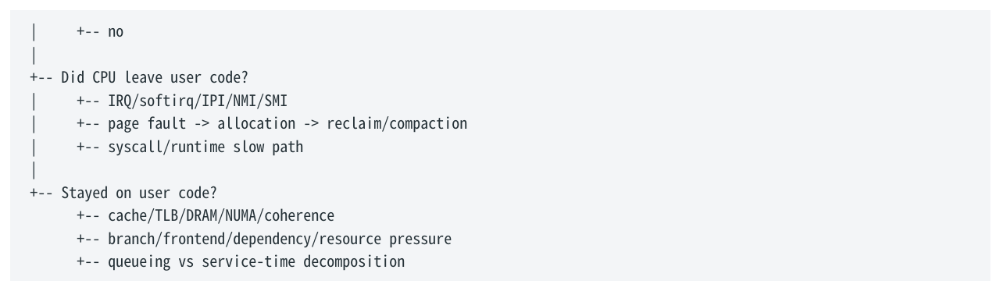

- ` -- no `
- ` -- Did CPU leave user code? `
- ` -- IRQ/softirq/IPI/NMI/SMI `
- ` -- page fault → allocation → reclaim/compaction `
- ` -- syscall/runtime slow path `
- ` -- Stayed on user code? `
- ` -- cache/TLB/DRAM/NUMA/coherence `
- ` -- branch/frontend/dependency/resource pressure `
- ` -- queueing vs service-time decomposition `

</details>

这个 tree 的价值是把 Level 1-6 串起来：先区分 service time 与 off-CPU，再区分 kernel interruption 与 CPU microarchitecture，最后才针对 specific evidence 做 controlled experiment。

### 8.13  Production Anti-pattern -&gt; Better Architecture

```asm
Anti-pattern:
on_market_data():
  lock global mutex
  vector.push_back()        # may grow
  LOG_INFO(...)             # format/allocate/write
  buffer.resize()           # allocation/fault
  send(socket)              # kernel path

Better:
MD owner -> fixed parse -> SPSC
Pricing owner -> fixed state -> SPSC
Gateway owner -> preallocated encoder/network path
Logger/control plane -> separate cold queues
```

最重要的结果  生产中真正要缩短的不是“代码行数”，而是 critical-path dependency graph：Pricing 的 latency 最好只依赖 Pricing CPU、本地 resident state、输入/输出 bounded queues，而不是依赖 logger/DB/general allocator/filesystem/其他 thread 的 scheduler fate。

### 8.14  Level 6 最终原则

1. 把 dynamic work 在时间上搬到 INIT/WARMUP：allocation、fault、symbol/TLS init、page placement、 hugepage provisioning。

2. 把 noisy work 在空间上搬到 housekeeping/cold CPUs：IRQ、RCU、logging、control-plane、background I/O。

3. 通过 single owner、SPSC、sharding 限制并发 topology，而不是用更复杂同步去“战胜 contention”。

4. 把所有可能增长的资源 bounded：objects、queues、subscriptions、pending orders、buffers。

5. 假设 system-wide state 会泄漏到 local latency：reclaim、TLB shootdown、memory bandwidth、thermal、SMI 都可跨边界影响。

6. 任何 tuning 都必须 verify：配置文件/boot args 只是 intent，counter/trace/timeline 才是 evidence。

本章结论

- 低延迟 runtime 的目标是 mostly userspace + fixed ownership + resident local memory + bounded queues。

- CPU/IRQ/NUMA/SMT 是一套 placement 问题，不能只做 thread affinity。

- INIT/WARMUP dynamic、LIVE static 是最强的 runtime phase model。

- 不要隐藏 slow fallback；capacity exhaustion 应有 explicit overload semantics。

- 最终诊断顺序：off-CPU? -&gt; kernel/interrupt? -&gt; VM/runtime slow path? -&gt; CPU/memory pathology?。

<a id="pdf-page-032"></a>

<!-- source-pdf-page: 32 -->

*[原 PDF 第 32 页](./Level6_Linux_OS_Runtime_CN.pdf#page=32)*

## 第 A 章  附录：术语、误区、命令、面试与实验

本章目标  把第六层压缩成可检索的 reference：术语表、常见错误表述、Linux 命令速查、面试级回答、实验与复习 checklist。

### A.1  核心术语表

| 术语 | 定义 |
| --- | --- |
| User mode | application 以受限 privilege 执行的 CPU mode。 |
| Kernel mode | Linux kernel 以高 privilege 执行的 CPU mode。 |
| Syscall | 用户 task 主动请求 kernel service 的入口。 |
| Context switch | scheduler 把 CPU 的 running task 从 A 换为 B。 |
| RUNNABLE | task 可运行但当前未占 CPU。 |
| Preemption | task 未主动 block，但被 scheduler 抢下 CPU。 |
| CPU migration | task 下次在不同 CPU 上运行。 |
| CPU affinity | 限制 task 可运行的 CPU 集合。 |
| CPU isolation | 系统性减少某 CPU 上的 unrelated scheduler/kernel noise。 |
| IRQ | Interrupt Request；hardware/平台 interrupt source。 |
| SoftIRQ | Linux deferred kernel execution mechanism，如 NET_RX。 |
| NAPI | Linux networking event/poll mechanism，用 bounded polling 处理RX/TX work。 |
| IPI | Inter-Processor Interrupt；CPU-&gt;CPU interrupt。 |
| TLB shootdown | page-table mapping change 后让其他 CPU invalidate stale TLB translation。 |
| NMI | Non-Maskable Interrupt，优先级更高的特殊 interrupt。 |
| SMI/SMM | System Management Interrupt/Mode，firmware/platform execution，Linux 不控制。 |
| VMA | Virtual Memory Area，process address-space mapping region。 |
| Page fault | CPU exception：当前 translation/access semantics 无法直接完成。 |
| Minor fault | 无需 storage I/O 即可 resolve 的 fault。 |
| Major fault | 需要 storage/swap I/O 的 fault。 |
| First touch | 第一次 fault/touch physical page；常影响 NUMA placement。 |
| Prefault | 提前 touch/populate pages，把 lazy fault work 搬到 warm-up。 |
| mlock | 保持 page resident，减少 paging/swap-related residency loss。 |
| Reclaim | 扫描/回收 cold pages，制造 free pages。 |
| Direct reclaim | 请求 allocation 的 task 自己进入 reclaim。 |
| Compaction | 迁移 movable pages，把 free pages 聚成 contiguous blocks。 |
| THP | Transparent Huge Pages，kernel 动态 huge-page management。 |
| HugeTLB | 显式/预留 hugepage pool 机制。 |
| tcache | allocator thread-local cache。 |
| Arena | general allocator 的 heap/synchronization domain。 |
| Futex | Fast Userspace Mutex kernel primitive：common state in |

<a id="pdf-page-033"></a>

<!-- source-pdf-page: 33 -->

*[原 PDF 第 33 页](./Level6_Linux_OS_Runtime_CN.pdf#page=33)*

| 术语 | 定义 |
| --- | --- |
|  | userspace，wait/wake 时 kernel assist。 |
| Priority inversion | 高优先级 task 因等待低优先级 lock owner 而被间接延迟。 |
| SPSC | single-producer/single-consumer queue。 |
| Housekeeping CPU | 承接 scheduler/timer/RCU/IRQ/daemon 等动态 OS work 的 CPU。 |

### A.2  高频误区对照

| 错误直觉 | 更准确的理解 |
| --- | --- |
| syscall = context switch | syscall 可以从 A user -&gt; A kernel -&gt; A user；只有 task 真的换人时才context switch。 |
| 没有 syscall 就不会进入 kernel | page fault、IRQ、IPI 等都可以进入 kernel。 |
| pin CPU = 独占 CPU | pinning 不阻止其他 tasks/IRQ/kworker/SMT sibling 干扰。 |
| nohz_full = 没有 interrupt | 主要减少 periodic tick，不关闭 device IRQ/IPI/NMI/SMI。 |
| TLB miss = page fault | TLB miss 常由 hardware page walk resolve。 |
| malloc(1GB) = 1GB DRAM 已分配 | physical pages 常 first-touch 才实例化。 |
| minor fault 很轻 | 只是无需 storage I/O；仍可远超微秒级 hot path budget。 |
| mlock = cache 永远 hot | 只针对 residency/paging，不保证 cache/TLB/NUMA latency。 |
| kswapd 做 reclaim，所以 app 不会 reclaim | 内存不足时 requesting task 可 direct reclaim。 |
| THP 一定应该关 | 应按 workload/policy/tail 测；核心风险是 dynamic VM variability。 |
| malloc 本身很慢 | fast path 可以很快，问题是 slow-path variance 与 global VM dependency。 |
| mutex = syscall | uncontended mutex 常 pure userspace；contention 才 futex/block。 |
| lock-free 一定更快 | CAS retry/coherence contention 可能更差；progress guarantee != performance。 |
| 100% CPU 一定异常 | dedicated busy-poll core 可能有意保持 100%。 |
| isolated core 后 kcompactd 完全无影响 | 可减少直接 scheduling interference，但后台 DRAM activity 与 hot-thread direct compaction 仍可能影响。 |

### A.3  Linux / Runtime 命令速查

| 主题 | 常用入口 |
| --- | --- |
| CPU topology | lscpu -e ; lscpu ; cat /sys/devices/system/cpu/cpu*/topology/thread_siblings_list |
| Affinity | taskset -pc &lt;PID&gt; ; ps -eLo pid,tid,psr,cls,rtprio,pri,ni,comm |
| NUMA | numactl --hardware ; numastat -p &lt;PID&gt; ; cat /proc/&lt;pid&gt;/numa_maps |
| Context/migration | perf stat -e context-switches,cpu-migrations,page-faults ... |
| Scheduler tracing | perf sched ; trace sched_switch/sched_wakeup (ftrace/trace-cmd/eBPF) |
| IRQs | cat /proc/interrupts ; /proc/irq/&lt;N&gt;/smp_affinity_list ; irqtop/lsirq if available |
| SoftIRQs | cat /proc/softirqs ; mpstat -I ALL |
| VM mappings | cat /proc/&lt;pid&gt;/maps ; /proc/&lt;pid&gt;/smaps ; /proc/&lt;pid&gt;/status |

<a id="pdf-page-034"></a>

<!-- source-pdf-page: 34 -->

*[原 PDF 第 34 页](./Level6_Linux_OS_Runtime_CN.pdf#page=34)*

| 主题 | 常用入口 |
| --- | --- |
| Memory pressure | vmstat 1 ; cat /proc/meminfo ; cat /proc/vmstat |
| Fragmentation | cat /proc/buddyinfo |
| Huge pages | grep -i huge /proc/meminfo ; inspect THP sysfs policy for target kernel |
| Syscalls debug | strace -f -ttT ... (debug only; do not use as precise latency benchmark) |
| Per-thread IDs | ls /proc/&lt;pid&gt;/task ; perf/trace by TID where possible |

工具原则  `strace`、heavy tracing、whole-process perf 都可能干扰/混淆低延迟 workload。先用轻量 counters 和 stage timestamps 建 hypothesis，再缩小到目标 TID、目标 CPU 与短 tracing window。

### A.4  面试级简答

Q: Why are syscalls bad for low latency? A: A syscall adds user/kernel transition and kernel entry/exit work, but it does not inherently context-switch. The larger tail appears when the operation blocks or expands into scheduler, VM or I/O work. Q: Does CPU affinity eliminate context switches? A: No. Affinity prevents migration outside the allowed CPU set; another task can still preempt the hot thread on the same CPU. Q: Why is CPU isolation different from affinity? A: Affinity answers where my thread may run; isolation reduces what unrelated scheduler/kernel work runs on that CPU. IRQ and SMT interference are separate concerns. Q: What is the difference between a TLB miss and a page fault? A: A TLB miss can be resolved by a hardware page-table walk if the mapping is valid. A page fault occurs when the required translation/access semantics cannot be completed and the kernel must intervene. Q: Why can malloc hurt tail latency even if its average is tiny? A: The fast path may be a thread-local cache pop, but a miss can reach arenas, mmap/brk, first-touch faults, reclaim or compaction. Low latency cares about the slow-path distribution, not only the mean. Q: What is direct reclaim? A: The allocating/faulting task itself enters the kernel reclaim path because free pages are insufficient, so an application operation becomes dependent on global memory pressure. Q: Reclaim vs compaction? A: Reclaim creates free pages; compaction moves movable pages so free pages become physically contiguous for high-order allocation. Q: Why can THP hurt tail latency? A: THP improves TLB reach, but dynamic huge-page allocation/promotion may require reclaim, compaction, collapse or split work. The exact risk depends on policy and workload. Q: Why might explicit HugeTLB be attractive? A: It trades memory flexibility for predictability by reserving huge pages before the live phase, avoiding dependence on runtime contiguous-page creation. Q: Is std::mutex always a syscall? A: No. The uncontended path is typically an atomic userspace fast path. Kernel futex wait/wake is used when contention requires blocking. Q: Why can a lock affect a critical thread even if the owner is on another core?

<a id="pdf-page-035"></a>

<!-- source-pdf-page: 35 -->

*[原 PDF 第 35 页](./Level6_Linux_OS_Runtime_CN.pdf#page=35)*

A: Waiting creates a transitive latency dependency on the owner: its scheduler state, faults, I/O and other stalls now determine the waiter latency, in addition to cache-line coherence. Q: Why is SPSC common in HFT? A: The single-producer/single-consumer topology removes general arbitration. Communication can be bounded atomic publication and cache coherence without sleep/wakeup or a contended global lock. Q: How would you prepare a low-latency Linux runtime? A: Discover topology; partition housekeeping/hot physical cores; pin threads and IRQs deliberately; place NUMA-local memory; preallocate/prefault/lock hot regions; use bounded ownership and nonblocking handoffs; warm runtime paths; then verify migrations, IRQs, faults, VM pressure and queue depth.

### A.5  推荐做的 8 组实验

| Lab | 实验 | 控制变量 | 核心指标 |
| --- | --- | --- | --- |
| 1 | Syscall vs vDSO timestamp | 对比 clock_gettime 的不同 clock / direct syscall（若可控） | cycles/call、syscalls、distribution |
| 2 | Blocking vs busy poll SPSC | 同一 producer event pattern；consumer CV/futex vs spin | event-&gt;consume p50/p99.9、CPU usage |
| 3 | Affinity/migration | unpinned vs pinned hot loop | cpu-migrations、cycles/op、tail |
| 4 | IRQ placement | 把指定 NIC/测试 IRQ 从 hot CPU 移走 | /proc/interrupts delta、p99.9 gap |
| 5 | First touch / NUMA | CPU0 init vs owner-thread init | numastat、remote access、cycles/access |
| 6 | Prefault / page fault | large anonymous buffer cold touch vs prefault | minor faults、latency histogram |
| 7 | Allocator slow path | tcache reuse vs mixed/large allocations + first touch | p99.99 allocation/touch、page faults |
| 8 | Mutex vs SPSC | 同一 handoff workload，contended mutex/CV vs pinned SPSC | off-CPU、context switches、latency/throughput |

实验必须使用 dedicated/known hardware 时段、固定 CPU topology、固定 compiler/build、representative burst distribution，并区分 warm/cold phase。每次只改变一个主要变量，否则很难建立 causality。

### A.6  第六层复习清单

- [ ] 我能解释 syscall、mode transition、context switch 的区别。

- [ ] 我能解释 page fault 为什么不是 syscall，IRQ 为什么也不意味着 task switch。

- [ ] 我能区分 RUNNING / RUNNABLE / SLEEPING，并解释 wake-up latency。

- [ ] 我能解释 CPU affinity 为什么只阻止 migration，而不是 CPU exclusivity。

- [ ] 我能解释 SCHED_FIFO 的价值与 starvation/priority-inversion 风险。

- [ ] 我能解释 isolcpus/nohz_full/housekeeping/IRQ isolation 分别解决什么。

- [ ] 我能画出 NIC DMA -&gt; IRQ -&gt; NAPI -&gt; NET_RX -&gt; socket/application 路径。

- [ ] 我能解释 softirq inline 与 ksoftirqd 的两种 interference。

- [ ] 我能解释 IPI / TLB shootdown 为什么能让 background VM activity 干扰 hot core。

- [ ] 我知道 SMI 在 Linux 控制之外，CPU isolation 无法屏蔽。

- [ ] 我能区分 TLB miss/page walk/page fault/minor/major fault。

- [ ] 我能解释 malloc(1GB) 为什么不代表 1GB physical pages 已准备。

- [ ] 我能解释 first touch、NUMA placement、prefault、mlock 的逻辑链。

- [ ] 我能区分 reclaim 与 compaction、kswapd 与 direct reclaim、kcompactd 与 direct compaction。

- [ ] 我能解释 THP 与 explicit HugeTLB 的 translation vs determinism trade-off。

- [ ] 我知道 dirty writeback/throttling 为什么会把 filesystem pressure 泄漏到 application latency。

<a id="pdf-page-036"></a>

<!-- source-pdf-page: 36 -->

*[原 PDF 第 36 页](./Level6_Linux_OS_Runtime_CN.pdf#page=36)*

- [ ] 我能解释 tcache/arena/mmap slow path，以及为什么 malloc fast average 不能代表 tail。

- [ ] 我能识别 vector growth、unordered_map rehash、shared_ptr final release 等 hidden slow path。

- [ ] 我能解释 futex 的 userspace fast state + kernel wait/wake 设计。

- [ ] 我能解释 PAUSE/yield/sleep 的差别以及 mutex contention 的 off-CPU 成本。

- [ ] 我能解释 priority inversion、PI futex、lock-free/wait-free progress 的边界。

- [ ] 我能说明 single owner/SPSC 为什么是 topology simplification，而不只是“lock-free 技巧”。

- [ ] 我能设计 INIT/WARMUP/LIVE/DRAIN 阶段，并定义 LIVE 期间禁止的动态行为。

- [ ] 我能用 off-CPU -&gt; kernel noise -&gt; VM/runtime -&gt; microarchitecture 的诊断树分析 tail spike。

第六层一句话  Low-latency Linux runtime 的本质不是把每个 kernel mechanism 微调到最快，而是通过 fixed ownership、resource partition、preparation/warm-up 与 evidence-driven verification，让 critical path 尽量不依赖 scheduler、VM、allocator、blocking 与其他全局动态状态。

### A.7  与前五层的统一性能推理栈

**图示转写**

| 场景 / 部分 | 路径、状态或说明 |
| --- | --- |
| C++ source | ` → optimized assembly `；` → CPU OoO / dependency / ports `；` → cache / TLB / coherence / NUMA `；` → latency pathology `；` → perf / VTune / tracing evidence `；` → Linux scheduler / IRQ / VM / allocator / futex ` |
| Question for every outlier | ` Was the critical request making forward progress? If not, where did progress stop? ` |

<details>
<summary>查看原图与完整文字转写</summary>

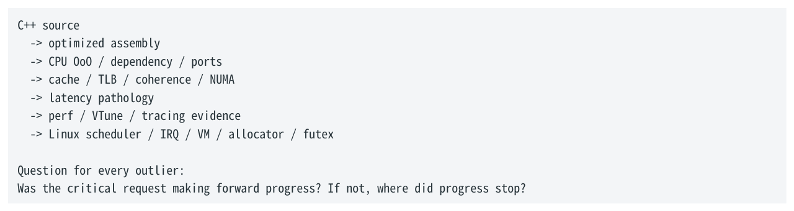

- ` C++ source `
- ` → optimized assembly `
- ` → CPU OoO / dependency / ports `
- ` → cache / TLB / coherence / NUMA `
- ` → latency pathology `
- ` → perf / VTune / tracing evidence `
- ` → Linux scheduler / IRQ / VM / allocator / futex `
- ` Question for every outlier: `
- ` Was the critical request making forward progress? If not, where did progress stop? `

</details>

<a id="conversion-errata"></a>

## 转换补充与勘误

本节及正文中“转换补充 / 转换勘误”均为 2026-11-06 转换时新增；原 PDF 仍是原始内容与版式的对照。

- [原 PDF 第 16 页处的补充](#pdf-page-016)：first-touch 的 local allocation 直觉有前提：实际 policy、cpuset、共享映射及可用内存会改变分配结果；已有物理页也不会仅因换线程就重新分配。

### 适用边界

原文中的时延、cache/ROB 大小、PMU event、kernel 参数及 compiler lowering 均需要绑定具体平台。转写结构的覆盖校验不等同于对全部技术命题的逐条实测；复杂图的精确布局以随附原图为准。
