# Network / NIC / Kernel Bypass

> 来源：[Level7_Network_NIC_Kernel_Bypass_CN.pdf](./Level7_Network_NIC_Kernel_Bypass_CN.pdf)（39 页）。本文件按原文逐页转写；转换补充与勘误单独标明。

> 图示优先转为 Mermaid、表格或步骤；每图附原图和文字以便核对。代码保留原文逻辑与缩进，跨页片段及概念示例未宣称可以独立编译。

[返回目录](README.md) · [转换说明与校验](CONVERSION_NOTES.md) · [本文补充与勘误](#conversion-errata)

[原文目录](#pdf-page-003) · [第一章正文](#pdf-page-009)

<a id="pdf-page-001"></a>

<!-- source-pdf-page: 1 -->

*[原 PDF 第 1 页](./Level7_Network_NIC_Kernel_Bypass_CN.pdf#page=1)*

## Network / NIC / Kernel Bypass

### C++ / CPU 深度学习 - 第七层完整讲义

Wire · Ethernet · NIC · DMA · RX/TX Descriptor Rings · RSS · MSI-X · NAPI · SoftIRQ · Socket · TCP/UDP · Queueing · Onload · DPDK · AF_XDP · Busy Polling · PTP · Production Tuning

目标

建立从物理链路、NIC 硬件、Linux 网络栈到 userspace/kernel-bypass 的统一心智模型：不仅能解释“packet 如何到 C++”，还要能定位一个 p99.9/p99.99 spike 究竟发生在 switch、NIC、IRQ/NAPI、socket queue、poll loop 还是 application。

### 核心问题：一个 packet 从 wire 进入 NIC，到 C++ hot path 处理并再次上wire，中间有哪些 queue、ownership handoff、DMA、interrupt、scheduler、copy 和 cache/NUMA 边界？

2026-08 · 详尽版

<a id="pdf-page-002"></a>

<!-- source-pdf-page: 2 -->

*[原 PDF 第 2 页](./Level7_Network_NIC_Kernel_Bypass_CN.pdf#page=2)*

## 如何使用这份讲义

这份 PDF 不是 8 个 Session 的聊天记录拼接，而是按“packet path → NIC hardware → Linux execution context → socket semantics → queueing → kernel bypass → polling/thread model → measurement”重新组织。建议先建立 invariant，再记工具和参数。

最重要的方法

先确定 measurement boundary，再建立 packet ownership/queue topology；出现问题时从“哪里开始排队、谁没及时消费、哪一个执行上下文停止服务”出发，而不是从某个 counter 或某个网络名词开始编故事。

### 阅读路线

| 章节 | 主题 | 你最终要回答的问题 |
| --- | --- | --- |
| 第 1 章 | 从 wire 到 application | `recv()` 到底在做什么？NIC 与 kernel 之前发生了什么？ |
| 第 2 章 | NIC Architecture | descriptor、DMA、doorbell、completion、RSS、MSI-X 如何协作？ |
| 第 3 章 | IRQ / NAPI / SoftIRQ | 为什么平均 latency 很好，p99.9 却可能掉进 `ksoftirqd`？ |
| 第 4 章 | Linux Socket Data Path | skb、UDP/TCP、socket buffer、recv/epoll、copy/wakeup 如何组合？ |
| 第 5 章 | Queueing / Batching / Microburst | 为什么 drop 之前 latency 已经坏了？如何计算 backlog recovery？ |
| 第 6 章 | Kernel Bypass | Onload、DPDK、AF_XDP、RDMA 各自绕掉什么、保留什么？ |
| 第 7 章 | Busy Polling / CPU Isolation / RTC | 为什么 100% CPU 可以是健康状态？poll gap 为什么是核心指标？ |
| 第 8 章 | Measurement / Production Tuning | 如何用 timestamp + counters + tracing 快速排除整层问题？ |

### 贯穿全书的七个问题

- 这个 packet 当前由谁拥有？下一次 ownership handoff 在哪里？

- 这里有没有 queue？容量是多少？满了以后 drop、block、backpressure 还是 overwrite？

- 数据搬运是 CPU copy 还是 DMA？

- 哪个 CPU 会触碰这个 packet / metadata？是否跨 core / NUMA？

- notification 依赖 interrupt/wakeup，还是 polling？

- burst 到来后 service rate μ 是否明显高于 arrival rate λ，能够快速 drain backlog？

- 我怎样用一个可信 timestamp/counter 去证伪当前假设？

<a id="pdf-page-003"></a>

<!-- source-pdf-page: 3 -->

*[原 PDF 第 3 页](./Level7_Network_NIC_Kernel_Bypass_CN.pdf#page=3)*

## 原文目录

- [如何使用这份讲义 2 阅读路线 2 贯穿全书的七个问题](#pdf-page-002)（原页码 2）
- [第 1 章 从 Wire 到 `recv()`：Packet RX/TX 总体路径](#pdf-page-009)（原页码 9）
- [1.1 最常见的错误模型](#pdf-page-009)（原页码 9）
- [1.2 Wire → PHY → MAC → Ethernet Frame](#pdf-page-009)（原页码 9）
- [1.3 NIC RX Queue：为什么不是一个全局入口](#pdf-page-009)（原页码 9）
- [1.4 DMA：NIC 如何把 Packet 放进 Host Memory](#pdf-page-009)（原页码 9）
- [1.5 Normal Linux UDP RX Path](#pdf-page-010)（原页码 10）
- [1.6 UDP 与 TCP 的第一层语义差异](#pdf-page-010)（原页码 10）
- [1.7 RX Path 的几个独立 Queue](#pdf-page-010)（原页码 10）
- [1.8 Blocking `recv()` 的 Wakeup 成本](#pdf-page-010)（原页码 10）
- [1.9 需要测什么时间点](#pdf-page-010)（原页码 10）
- [第 2 章 NIC Architecture：Descriptor Ring、DMA、Doorbell、RSS 与 MSI-X](#pdf-page-012)（原页码 12）
- [2.1 Queue、Descriptor Ring、Packet Buffer](#pdf-page-012)（原页码 12）
- [2.2 RX Descriptor Ownership](#pdf-page-012)（原页码 12）
- [2.3 Head/Tail 与 Circular Ring](#pdf-page-012)（原页码 12）
- [2.4 RX DMA 与 TX DMA 的方向](#pdf-page-012)（原页码 12）
- [2.5 Doorbell：CPU 如何告诉 NIC 有新 Work](#pdf-page-013)（原页码 13）
- [2.6 Completion：为什么 `send()`/descriptor submit 不等于上 Wire](#pdf-page-013)（原页码 13）
- [2.7 RSS 与 Indirection Table](#pdf-page-013)（原页码 13）
- [2.8 MSI-X 与 IRQ Affinity](#pdf-page-013)（原页码 13）
- [2.9 PCIe / NUMA Topology](#pdf-page-013)（原页码 13）
- [2.10 IOMMU / IOTLB 与 Huge Pages](#pdf-page-014)（原页码 14）
- [2.11 Offloads 与 Low Latency](#pdf-page-014)（原页码 14）

<a id="pdf-page-004"></a>

<!-- source-pdf-page: 4 -->

*[原 PDF 第 4 页](./Level7_Network_NIC_Kernel_Bypass_CN.pdf#page=4)*

- [2.12 Queue-per-Core 与 Static Ownership](#pdf-page-014)（原页码 14）
- [第 3 章 IRQ / NAPI / SoftIRQ / `ksoftirqd`](#pdf-page-015)（原页码 15）
- [3.1 为什么不能 One Packet → One Interrupt](#pdf-page-015)（原页码 15）
- [3.2 Hard IRQ](#pdf-page-015)（原页码 15）
- [3.3 NAPI：Interrupt → Poll Hybrid](#pdf-page-015)（原页码 15）
- [3.4 SoftIRQ](#pdf-page-015)（原页码 15）
- [3.5 NAPI Budget 与 Bounded Work](#pdf-page-015)（原页码 15）
- [3.6 `ksoftirqd/N`：为什么 Tail 会突然变坏](#pdf-page-015)（原页码 15）
- [3.7 Interrupt Moderation 与 NAPI 是两层机制](#pdf-page-016)（原页码 16）
- [3.8 RPS / RFS / XPS](#pdf-page-016)（原页码 16）
- [3.9 Same-CPU vs Separate-CPU Kernel RX](#pdf-page-016)（原页码 16）
- [3.10 CPU Isolation 并不会自动隔离 IRQ](#pdf-page-016)（原页码 16）
- [3.11 诊断接口](#pdf-page-016)（原页码 16）
- [3.12 Overload Cascade](#pdf-page-016)（原页码 16）
- [第 4 章 Linux Socket Data Path：`skb`、UDP/TCP、Socket Buffer 与 Wakeup](#pdf-page-018)（原页码 18）
- [4.1 `sk_buff`：不是“packet bytes”的同义词](#pdf-page-018)（原页码 18）
- [4.2 `skb` 的成本来自通用性](#pdf-page-018)（原页码 18）
- [4.3 UDP Socket Lookup 与 Datagram Queue](#pdf-page-018)（原页码 18）
- [4.4 `SO_RCVBUF`：Buffer 是 Burst Insurance，也可能是 Latency Warehouse](#pdf-page-018)（原页码 18）
- [4.5 TCP：Ordered Byte Stream 与 Head-of-Line Blocking](#pdf-page-018)（原页码 18）
- [4.6 TCP Receive Window：Backpressure 的含义](#pdf-page-018)（原页码 18）
- [4.7 Blocking `recv()`、Wait Queue 与 Scheduler](#pdf-page-019)（原页码 19）
- [4.8 Non-blocking 与 `epoll`](#pdf-page-019)（原页码 19）
- [4.9 Edge-triggered 与 Level-triggered](#pdf-page-019)（原页码 19）
- [4.10 `recvmsg()` / `recvmmsg()` 与 Batching](#pdf-page-019)（原页码 19）
- [4.11 TX：`send()` Return 不等于 Packet 上 Wire](#pdf-page-019)（原页码 19）
- [4.12 `TCP_NODELAY`、Delayed ACK 与小消息](#pdf-page-019)（原页码 19）

<a id="pdf-page-005"></a>

<!-- source-pdf-page: 5 -->

*[原 PDF 第 5 页](./Level7_Network_NIC_Kernel_Bypass_CN.pdf#page=5)*

- [4.13 Zero Copy：真正难题是 Ownership](#pdf-page-019)（原页码 19）
- [第 5 章 Queueing / Buffering / Batching / Microburst](#pdf-page-020)（原页码 20）
- [5.1 整条 Datapath 是 Queueing Network](#pdf-page-020)（原页码 20）
- [5.2 Queue 是“时间解耦器”](#pdf-page-020)（原页码 20）
- [5.3 Little's Law](#pdf-page-020)（原页码 20）
- [5.4 Ring 大并不等于健康](#pdf-page-020)（原页码 20）
- [5.5 Utilization 与非线性 Queueing](#pdf-page-020)（原页码 20）
- [5.6 Burst Recovery Formula](#pdf-page-020)（原页码 20）
- [5.7 Microburst](#pdf-page-021)（原页码 21）
- [5.8 λ ↑ 与 μ ↓ 往往同时发生](#pdf-page-021)（原页码 21）
- [5.9 Batching：Latency 与 Service Rate 的真正 Trade-off](#pdf-page-021)（原页码 21）
- [5.10 Run-to-Completion vs Pipeline](#pdf-page-021)（原页码 21）
- [5.11 Backpressure 与 Queue Policy](#pdf-page-021)（原页码 21）
- [5.12 Bufferbloat](#pdf-page-021)（原页码 21）
- [5.13 Coordinated Omission 与 Open-loop Benchmark](#pdf-page-022)（原页码 22）
- [5.14 低延迟 Queue 的七问](#pdf-page-022)（原页码 22）
- [第 6 章 Kernel Bypass：Onload、DPDK、AF_XDP 与 RDMA](#pdf-page-023)（原页码 23）
- [6.1 Kernel Bypass 的准确含义](#pdf-page-023)（原页码 23）
- [6.2 Normal Linux vs Bypass](#pdf-page-023)（原页码 23）
- [6.3 Onload：保留 BSD Socket 的 Userspace Stack](#pdf-page-023)（原页码 23）
- [6.4 DPDK：Userspace 直接拥有 Packet Datapath](#pdf-page-023)（原页码 23）
- [6.5 DPDK Huge Pages / Mempool / NUMA](#pdf-page-023)（原页码 23）
- [6.6 AF_XDP：Linux-native High-performance Packet I/O](#pdf-page-024)（原页码 24）
- [6.7 AF_XDP 四类 Ring 的 Ownership](#pdf-page-024)（原页码 24）
- [6.8 RDMA：不是“另一种 DPDK”](#pdf-page-024)（原页码 24）
- [6.9 对比表](#pdf-page-024)（原页码 24）
- [6.10 Zero-copy 不是全部故事](#pdf-page-024)（原页码 24）

<a id="pdf-page-006"></a>

<!-- source-pdf-page: 6 -->

*[原 PDF 第 6 页](./Level7_Network_NIC_Kernel_Bypass_CN.pdf#page=6)*

- [6.11 Polling 与 Bypass 是两个独立维度](#pdf-page-024)（原页码 24）
- [6.12 常见 Failure Modes](#pdf-page-025)（原页码 25）
- [6.13 Hybrid Architecture](#pdf-page-025)（原页码 25）
- [第 7 章 Busy Polling、CPU Isolation 与 Run-to-Completion](#pdf-page-026)（原页码 26）
- [7.1 Interrupt / Hybrid / Full Polling](#pdf-page-026)（原页码 26）
- [7.2 Poll Gap 才是核心指标](#pdf-page-026)（原页码 26）
- [7.3 100% CPU 为什么可能是健康](#pdf-page-026)（原页码 26）
- [7.4 Busy Poll 的额外收益：C-state / Frequency](#pdf-page-026)（原页码 26）
- [7.5 CPU Isolation 是一组配置，不是一个 Flag](#pdf-page-026)（原页码 26）
- [7.6 SMI / NMI：Kernel Bypass 也躲不开](#pdf-page-027)（原页码 27）
- [7.7 Prefault 与 First-touch NUMA](#pdf-page-027)（原页码 27）
- [7.8 Run-to-Completion (RTC)](#pdf-page-027)（原页码 27）
- [7.9 为什么 Lock-free Queue 仍然有成本](#pdf-page-027)（原页码 27）
- [7.10 Pipeline 什么时候更合理](#pdf-page-027)（原页码 27）
- [7.11 Application 自己成为 Scheduler](#pdf-page-027)（原页码 27）
- [7.12 Hybrid Spin 与 Bimodal Latency](#pdf-page-027)（原页码 27）
- [7.13 Hot Thread 的 Microarchitectural Isolation](#pdf-page-027)（原页码 27）
- [7.14 Hot-path Telemetry 设计](#pdf-page-028)（原页码 28）
- [第 8 章 Measurement / Production Tuning：从 p99.9 Spike 反推 Root Cause](#pdf-page-029)（原页码 29）
- [8.1 时间边界：先定义“这个 latency 数字到底是什么”](#pdf-page-029)（原页码 29）
- [8.2 TSC、CLOCK_MONOTONIC、PHC、PTP](#pdf-page-029)（原页码 29）
- [8.3 `ethtool`：NIC/Driver 第一层证据](#pdf-page-029)（原页码 29）
- [8.4 `/proc/interrupts` / `/proc/softirqs`](#pdf-page-029)（原页码 29）
- [8.5 `/proc/net/softnet_stat`](#pdf-page-030)（原页码 30）
- [8.6 `ss`：Socket Backlog](#pdf-page-030)（原页码 30）
- [8.7 `nstat`：Protocol-layer Counters](#pdf-page-030)（原页码 30）
- [8.8 `perf`：CPU 为什么不在做你以为的事](#pdf-page-030)（原页码 30）

<a id="pdf-page-007"></a>

<!-- source-pdf-page: 7 -->

*[原 PDF 第 7 页](./Level7_Network_NIC_Kernel_Bypass_CN.pdf#page=7)*

- [8.9 `ftrace` / eBPF：时间线证据](#pdf-page-030)（原页码 30）
- [8.10 `tcpdump` 与 Wire Truth](#pdf-page-030)（原页码 30）
- [8.11 UDP Sequence Gap 的分层诊断](#pdf-page-030)（原页码 30）
- [8.12 p99.9 NIC→App Spike Decision Tree](#pdf-page-031)（原页码 31）
- [8.13 TCP Order-entry：把 Local TX 与 Network/Venue 分开](#pdf-page-031)（原页码 31）
- [8.14 Production Telemetry：不要让 Monitoring 反过来制造 Tail](#pdf-page-031)（原页码 31）
- [8.15 Flight Recorder](#pdf-page-031)（原页码 31）
- [8.16 Benchmark：找 Latency Knee，不是只找 Drop Capacity](#pdf-page-031)（原页码 31）
- [8.17 Tuning 的正确顺序](#pdf-page-031)（原页码 31）
- [8.18 Diagnosis Matrix](#pdf-page-032)（原页码 32）
- [附录 A：核心术语表](#pdf-page-033)（原页码 33）
- [附录 B：关键对照表](#pdf-page-034)（原页码 34）
- [B.1 RX Ring vs Socket Queue vs Application Queue](#pdf-page-034)（原页码 34）
- [B.2 Interrupt vs Polling](#pdf-page-034)（原页码 34）
- [B.3 UDP vs TCP Low-latency Failure Mode](#pdf-page-034)（原页码 34）
- [B.4 Kernel Socket / Onload / AF_XDP / DPDK](#pdf-page-034)（原页码 34）
- [附录 C：Linux / NIC 诊断命令速查](#pdf-page-035)（原页码 35）
- [C.1 NIC / Queue / Offload](#pdf-page-035)（原页码 35）
- [C.2 IRQ / SoftIRQ](#pdf-page-035)（原页码 35）
- [C.3 Socket / Protocol](#pdf-page-035)（原页码 35）
- [C.4 CPU / NUMA / Topology](#pdf-page-035)（原页码 35）
- [C.5 Profiling / Tracing](#pdf-page-035)（原页码 35）
- [附录 D：HFT / Low-latency 面试问答](#pdf-page-036)（原页码 36）
- [D.1 Walk me through a UDP packet from wire to a Linux application](#pdf-page-036)（原页码 36）
- [D.2 What is a NIC doorbell?](#pdf-page-036)（原页码 36）
- [D.3 What does an RX descriptor do?](#pdf-page-036)（原页码 36）
- [D.4 RSS vs RPS?](#pdf-page-036)（原页码 36）

<a id="pdf-page-008"></a>

<!-- source-pdf-page: 8 -->

*[原 PDF 第 8 页](./Level7_Network_NIC_Kernel_Bypass_CN.pdf#page=8)*

- [D.5 Why does Linux use NAPI?](#pdf-page-036)（原页码 36）
- [D.6 What is `ksoftirqd` and why do HFT engineers care?](#pdf-page-036)（原页码 36）
- [D.7 Why can a large RX ring hurt latency?](#pdf-page-036)（原页码 36）
- [D.8 Does batching always hurt latency?](#pdf-page-036)（原页码 36）
- [D.9 Onload vs DPDK?](#pdf-page-037)（原页码 37）
- [D.10 Why would you intentionally use 100% CPU?](#pdf-page-037)（原页码 37）
- [D.11 Why does CPU isolation still matter with DPDK?](#pdf-page-037)（原页码 37）
- [D.12 How do you investigate a p99.9 receive-latency spike?](#pdf-page-037)（原页码 37）
- [D.13 Why is `send()` return not application-to-wire latency?](#pdf-page-037)（原页码 37）
- [D.14 Why is packet age sometimes more important than drop count?](#pdf-page-037)（原页码 37）
- [附录 E：推荐实验](#pdf-page-038)（原页码 38）
- [E.1 RX Queue / IRQ Mapping Audit](#pdf-page-038)（原页码 38）
- [E.2 Interrupt Coalescing Sweep](#pdf-page-038)（原页码 38）
- [E.3 Ring Size Sweep](#pdf-page-038)（原页码 38）
- [E.4 Blocking vs Busy Poll](#pdf-page-038)（原页码 38）
- [E.5 Poll-gap Flight Recorder](#pdf-page-038)（原页码 38）
- [E.6 Burst Recovery](#pdf-page-038)（原页码 38）
- [E.7 RTC vs SPSC Pipeline](#pdf-page-038)（原页码 38）
- [附录 F：复习清单](#pdf-page-039)（原页码 39）
- [F.1 如果这些问题能直接回答，第七层就算打通](#pdf-page-039)（原页码 39）

<a id="pdf-page-009"></a>

<!-- source-pdf-page: 9 -->

*[原 PDF 第 9 页](./Level7_Network_NIC_Kernel_Bypass_CN.pdf#page=9)*

## 第 1 章 从 Wire 到 `recv()`：Packet RX/TX 总体路径

本章目标

建立最重要的纠正：`recv()` 不是“CPU 从 NIC 取数据”。正常 Linux RX 中，packet 在 application 运行之前通常已经被 NIC DMA 到 host memory，并经历 driver/NAPI/protocol/socket queue。

### 1.1 最常见的错误模型

**图示转写**

| 场景 / 部分 | 路径、状态或说明 |
| --- | --- |
| Wrong mental model | ` recv() → CPU reads NIC → packet appears ` |
| Useful model | ` wire → NIC → DMA → host memory → Linux stack → socket queue → recv() ` |

<details>
<summary>查看原图与完整文字转写</summary>

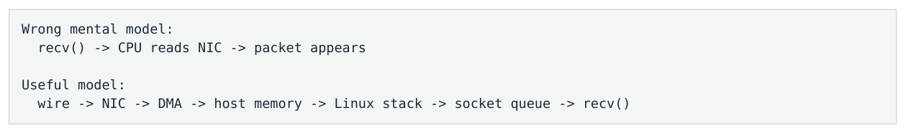

- ` Wrong mental model: `
- ` recv() → CPU reads NIC → packet appears `
- ` Useful model: `
- ` wire → NIC → DMA → host memory → Linux stack → socket queue → recv() `

</details>

CPU 不会逐 byte 从 NIC register 搬 packet。NIC 通过 PCIe 作为 bus master 做 DMA；CPU/driver 负责准备 descriptor/buffer、处理 protocol 与 application semantics。

关键

`recv()` 主要消费“已经 deliver 到这个 socket、等待 userspace 的数据”。它不是对 NIC 发出的“现在去收一个 packet”的命令。

### 1.2 Wire → PHY → MAC → Ethernet Frame

PHY 负责把电/光信号恢复为 bit stream；MAC 处理 Ethernet frame，验证 frame length、FCS/CRC、MAC/VLAN 等基础信息。损坏 frame 可以在 NIC 很早的位置被丢弃，Linux socket 根本不会看到。

**图示转写**

| 阶段 / 内容 | 原图含义 |
| --- | --- |
| Wire / optical signal | 输入信号 |
| PHY | 物理层 |
| MAC | MAC 层 |
| Ethernet frame 字段 | dst MAC / src MAC；EtherType / VLAN；IP packet；FCS |

<details>
<summary>查看原图与完整文字转写</summary>

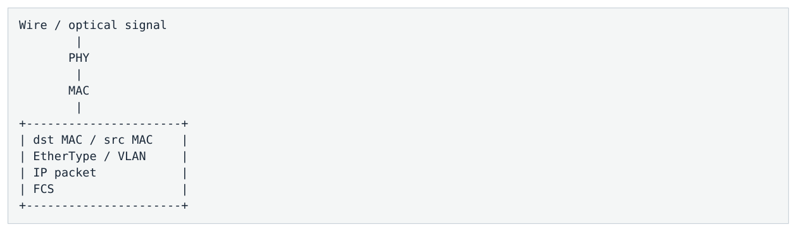

- ` Wire / optical signal `
- ` PHY `
- ` MAC `
- ` dst MAC / src MAC `
- ` EtherType / VLAN `
- ` IP packet `
- ` FCS `

</details>

### 1.3 NIC RX Queue：为什么不是一个全局入口

现代 NIC 为多核 CPU 提供多个 RX/TX queues。一个 flow 经过 RSS 或显式 flow steering 后进入某个 RX queue，后续可绑定对应 interrupt vector 或 polling core。多 queue 的目的不是“越多越快”，而是提供可控的并行与 isolation。

### 1.4 DMA：NIC 如何把 Packet 放进 Host Memory

Driver 预先准备 RX buffers，并在 descriptor ring 中告诉 NIC 每个 buffer 的 DMA address。packet 到来后 NIC 直接 DMA-write 到这些 buffers。CPU 不执行一个 `for` 循环把 packet bytes 从网卡拷到 RAM。

更精确的表达是“NIC DMA 到 host memory/cache hierarchy”。在支持 I/O coherency / Intel DDIO 一类机制的平台上，数据可能以更接近 LLC 的方式进入 CPU 可见层次；具体行为必须绑定平台。不要机械说“一定先写 DRAM”。

<a id="pdf-page-010"></a>

<!-- source-pdf-page: 10 -->

*[原 PDF 第 10 页](./Level7_Network_NIC_Kernel_Bypass_CN.pdf#page=10)*

### 1.5 Normal Linux UDP RX Path

**图示转写**

1. ` wire `
2. ` → NIC MAC / RSS `
3. ` → RX queue + descriptor `
4. ` → DMA write `
5. ` → MSI-X / NAPI `
6. ` → driver / packet metadata `
7. ` → Ethernet `
8. ` IP `
9. ` UDP `
10. ` → socket lookup `
11. ` → socket receive queue `
12. ` → wakeup (if sleeping) `
13. ` → recv()/recvmsg() `
14. ` → copy_to_user `
15. ` → C++ parser `

<details>
<summary>查看原图与完整文字转写</summary>

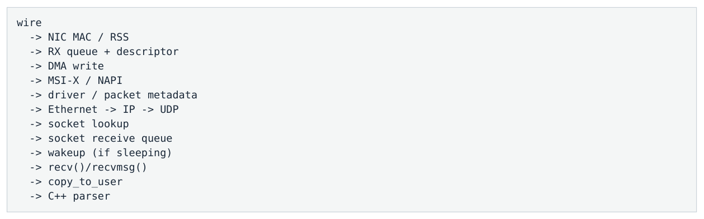

- ` wire `
- ` → NIC MAC / RSS `
- ` → RX queue + descriptor `
- ` → DMA write `
- ` → MSI-X / NAPI `
- ` → driver / packet metadata `
- ` → Ethernet → IP → UDP `
- ` → socket lookup `
- ` → socket receive queue `
- ` → wakeup (if sleeping) `
- ` → recv()/recvmsg() `
- ` → copy_to_user `
- ` → C++ parser `

</details>

这一条路径包含多个 queue、execution context 和 ownership boundary。任何一个阶段都可能引入 latency 或 jitter； 因此“network latency”不是一个单一函数的耗时。

### 1.6 UDP 与 TCP 的第一层语义差异

| 维度 | UDP | TCP |
| --- | --- | --- |
| 应用语义 | Datagram/message boundary | Ordered byte stream |
| 丢包 | 后续 datagram 仍可到应用；协议自行 gap detection | 缺失 byte range 会阻塞后续 stream delivery |
| Backpressure | 无 transport-level backpressure | receive window / congestion / send-buffer 传播压力 |
| 典型交易用途 | Multicast market data | FIX/order entry / session connectivity |

### 1.7 RX Path 的几个独立 Queue

至少要区分：NIC RX descriptor ring、Linux per-CPU/NAPI backlog、socket receive queue、application SPSC/processing queue。它们属于不同层；“RX ring full”和“socket buffer full”绝不是同一件事。

### 1.8 Blocking `recv()` 的 Wakeup 成本

**图示转写**

1. ` socket queue empty `
2. ` → recv() blocks `
3. ` → thread sleeps `
4. ` packet arrives `
5. ` → socket becomes readable `
6. ` → thread marked RUNNABLE `
7. ` → scheduler eventually runs it `
8. ` → recv() returns `

<details>
<summary>查看原图与完整文字转写</summary>

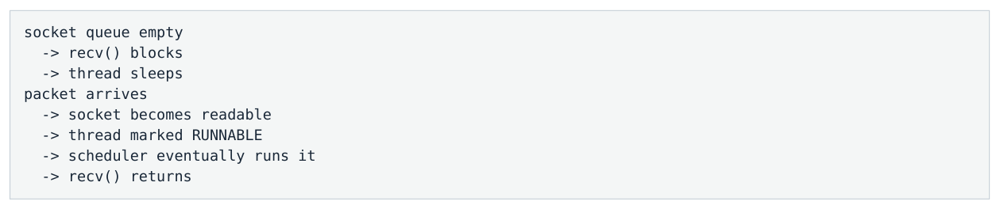

- ` socket queue empty `
- ` → recv() blocks `
- ` → thread sleeps `
- ` packet arrives `
- ` → socket becomes readable `
- ` → thread marked RUNNABLE `
- ` → scheduler eventually runs it `
- ` → recv() returns `

</details>

RUNNABLE ≠ RUNNING。传统 blocking socket 的 tail latency 中，scheduler/wakeup variance 往往比 `copy_to_user` 本身更危险。

### 1.9 需要测什么时间点

```text
T1 = NIC ingress hardware timestamp
T2 = application sees packet
T3 = parser done
T4 = book updated
T5 = strategy done

Host RX latency = T2 - T1
Application work = T5 - T2
```

<a id="pdf-page-011"></a>

<!-- source-pdf-page: 11 -->

*[原 PDF 第 11 页](./Level7_Network_NIC_Kernel_Bypass_CN.pdf#page=11)*

本章一句话

Packet 到达 application 之前，已经经历硬件 producer/consumer、DMA、driver/kernel processing、queueing 和可能的 scheduler wakeup。低延迟优化首先要把这些层分开。

<a id="pdf-page-012"></a>

<!-- source-pdf-page: 12 -->

*[原 PDF 第 12 页](./Level7_Network_NIC_Kernel_Bypass_CN.pdf#page=12)*

## 第 2 章 NIC Architecture：Descriptor Ring、DMA、Doorbell、RSS 与 MSI-X

本章目标

把 NIC 看成一组并行硬件 engines：它通过 host-memory descriptor rings + DMA + MMIO doorbells + interrupts/polling 与 CPU 协作。

### 2.1 Queue、Descriptor Ring、Packet Buffer

| 对象 | 位置/归属 | 作用 |
| --- | --- | --- |
| RX/TX Queue | NIC + driver abstraction | 独立 packet-processing channel |
| Descriptor Ring | Host memory / NIC-driver interface | 记录可用 buffer、长度、status、offload metadata |
| DMA Buffer | Host memory | 真正存 packet bytes |

Descriptor 不是 packet，它是 packet buffer 的控制记录。真实格式由 Intel / NVIDIA-Mellanox / AMD-Xilinx / Broadcom 等 NIC 决定。

### 2.2 RX Descriptor Ownership

**图示转写**

1. ` CPU/driver prepares buffer `
2. ` NIC owns RX descriptor `
3. ` packet arrives `
4. ` NIC DMA-writes buffer `
5. ` NIC marks completion `
6. ` CPU consumes packet `
7. ` CPU replenishes descriptor `

<details>
<summary>查看原图与完整文字转写</summary>

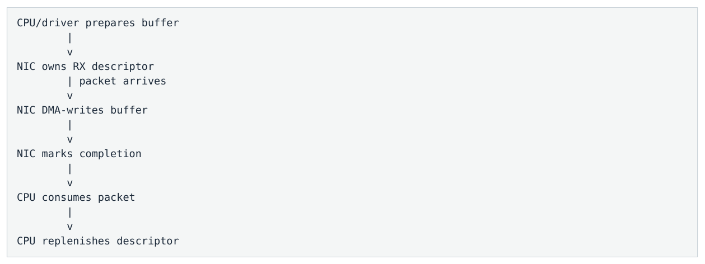

- ` CPU/driver prepares buffer `
- ` NIC owns RX descriptor `
- ` packet arrives `
- ` NIC DMA-writes buffer `
- ` NIC marks completion `
- ` CPU consumes packet `
- ` CPU replenishes descriptor `

</details>

从 packet completion flow 看 NIC 是 producer、CPU 是 consumer；从 empty-buffer supply 看 CPU 又是 producer、 NIC 是 consumer。与其死记“谁是 producer”，更应该记 ownership 何时转移。

### 2.3 Head/Tail 与 Circular Ring

Ring 使用 producer/consumer index 管理可用/已完成 entries。不同厂商/driver 对 head/tail 命名可能相反，不能把某个 driver 的字段名当 universal rule；真正 invariant 是双方必须知道哪些 entries 已授权、已完成、可回收。

### 2.4 RX DMA 与 TX DMA 的方向

| 方向 | 数据移动 | 典型过程 |
| --- | --- | --- |
| RX | NIC → host memory，DMA WRITE | NIC 收 frame → 选 descriptor → 写 packet → completion |
| TX | host memory → NIC，DMA READ | CPU 填 packet/descriptor → doorbell → NIC 读 packet → transmit |

<a id="pdf-page-013"></a>

<!-- source-pdf-page: 13 -->

*[原 PDF 第 13 页](./Level7_Network_NIC_Kernel_Bypass_CN.pdf#page=13)*

### 2.5 Doorbell：CPU 如何告诉 NIC 有新 Work

CPU 通常把 NIC registers 映射为 MMIO。准备好 TX descriptors 后，CPU 通过 MMIO write 更新 producer/tail 状态， 类似“按门铃”。NIC 不需要不停扫描所有 RAM。

```text
CPU:
  write packet data
  write TX descriptors
  make descriptor/data device-visible
  MMIO doorbell(new_tail)

NIC:
  observe doorbell
  DMA-read descriptors/data
  transmit
```

Ordering invariant

TX 的核心顺序是“data/descriptor visible before notification”。这与 C++ release 的直觉相似，但 device DMA/MMIO ordering 不等价于 C++ 线程内存模型；driver/DPDK 必须使用 architecture-aware DMA/MMIO barriers。

### 2.6 Completion：为什么 `send()`/descriptor submit 不等于上 Wire

TX completion 首先是 ownership handback：NIC 不再需要这块 buffer，CPU 可以 reclaim。具体 completion 表示 “descriptor read 完”“packet 已进入内部 FIFO”还是更晚阶段由 NIC semantics 决定。TX completion 也不等于 peer 收到，更不天然等于 TX hardware timestamp。

### 2.7 RSS 与 Indirection Table

**图示转写**

1. ` 5-tuple / selected fields `
2. ` RSS hash `
3. ` indirection table `
4. ` RX Queue N `

<details>
<summary>查看原图与完整文字转写</summary>

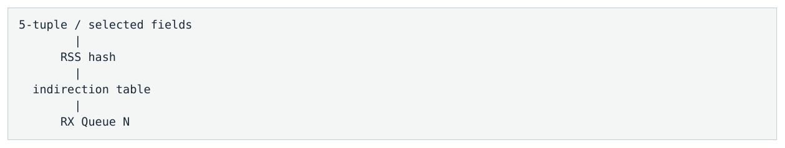

- ` 5-tuple / selected fields `
- ` RSS hash `
- ` indirection table `
- ` RX Queue N `

</details>

RSS 的重要目标之一是 flow affinity：同一 flow 稳定落在同一 RX queue，保持 ordering convenience 与 cache locality。不同 flow 可以 hash 到同一 queue；RSS 不保证“一 flow 一 queue”。HFT 中 critical flow 常用更精确的 hardware flow steering，避免背景流碰撞。

### 2.8 MSI-X 与 IRQ Affinity

**图示转写**

1. ` Flow `
2. ` RXQ3 `
3. ` MSI-X vector `
4. ` IRQ 91 `
5. ` CPU 7 `

<details>
<summary>查看原图与完整文字转写</summary>


- ` Flow → RXQ3 → MSI-X vector → IRQ 91 → CPU 7 `

</details>

MSI-X 允许不同 queue 使用独立 interrupt vectors；Linux 的 IRQ affinity 再决定该 vector 在哪个 CPU 处理。RX queue 与 application thread 并没有天然绑定。

### 2.9 PCIe / NUMA Topology

```text
             CPU
            /   \
           /     \
       Memory --- NIC

Goal: NIC PCIe locality, packet memory and hot CPU
      stay in the same NUMA domain when possible.
```

<a id="pdf-page-014"></a>

<!-- source-pdf-page: 14 -->

*[原 PDF 第 14 页](./Level7_Network_NIC_Kernel_Bypass_CN.pdf#page=14)*

不要只考虑 CPU↔memory NUMA。NIC 连接哪个 PCIe root complex、RX buffers 实际落在哪个 NUMA node、processing CPU 在哪里，三者共同决定 locality。

### 2.10 IOMMU / IOTLB 与 Huge Pages

有 IOMMU 时 device DMA address 需要翻译到 physical backing；IOTLB 类似 CPU TLB 缓存 DMA mappings。大规模 packet buffers 使用 huge pages 可以减少 CPU TLB、IOMMU mapping 数和 IOTLB pressure，并让 preallocation/NUMA placement 更可控。

### 2.11 Offloads 与 Low Latency

| 机制 | 吞吐目标 | 低延迟注意点 |
| --- | --- | --- |
| RSS | 多 queue 并行 | 通常有价值，但要控制 steering |
| Checksum offload | 减少 CPU checksum | 通常可保留，需 benchmark |
| TSO/GSO | 大块数据由后层分段 | 偏 throughput；small order messages 收益有限 |
| GRO/LRO | 聚合 receive packets | 可能改变 batch/latency characteristics |
| Hardware timestamp | 靠近 wire 测时 | 低延迟 measurement 的核心能力 |

### 2.12 Queue-per-Core 与 Static Ownership

低延迟系统常偏好固定映射：flow → RXQ → CPU → state owner，TX 也尽量 one producer → one TX queue。目标不是最大 queue 数，而是必要的并行 + predictable ownership。

本章一句话

NIC 与 CPU 主要通过 host-memory descriptor rings、DMA、MMIO doorbells 以及 interrupts/polling 交流。理解这四个对象后，DPDK/AF_XDP 不再神秘。

<a id="pdf-page-015"></a>

<!-- source-pdf-page: 15 -->

*[原 PDF 第 15 页](./Level7_Network_NIC_Kernel_Bypass_CN.pdf#page=15)*

## 第 3 章 IRQ / NAPI / SoftIRQ / `ksoftirqd`

本章目标

理解 Linux 为什么不是 interrupt-per-packet；以及为什么高 load/microburst 会让 packet processing 从短路径滑向 scheduler-managed `ksoftirqd`，从而制造 tail spikes。

### 3.1 为什么不能 One Packet → One Interrupt

高 PPS 下 interrupt-per-packet 会形成 interrupt storm：频繁打断 application、增加 entry/exit overhead、破坏 code/data locality，甚至导致 receive livelock。Linux 用 NAPI 把“interrupt notification”与“batch polling” 组合。

### 3.2 Hard IRQ

MSI-X 到来后 CPU 进入 hardirq context。现代 NAPI driver 通常只做很少工作：ack/mask queue interrupt、schedule NAPI，然后尽快返回。hardirq 不应该慢慢处理几千个 packets，因为它直接打断当前 CPU。

### 3.3 NAPI：Interrupt → Poll Hybrid

**图示转写**

1. ` packet arrives `
2. ` → MSI-X interrupt `
3. ` → driver schedules NAPI and suppresses RX IRQ `
4. ` → NET_RX_SOFTIRQ `
5. ` → napi poll(queue, budget) `
6. ` → harvest many completed descriptors `
7. ` → if queue drained: complete + re-enable IRQ `
8. ` → if budget hit: keep scheduled and continue later `

<details>
<summary>查看原图与完整文字转写</summary>

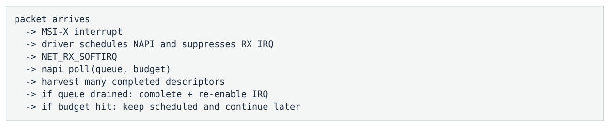

- ` packet arrives `
- ` → MSI-X interrupt `
- ` → driver schedules NAPI and suppresses RX IRQ `
- ` → NET_RX_SOFTIRQ `
- ` → napi poll(queue, budget) `
- ` → harvest many completed descriptors `
- ` → if queue drained: complete + re-enable IRQ `
- ` → if budget hit: keep scheduled and continue later `

</details>

因此“Linux 是 interrupt-based、DPDK 是 polling-based”过于粗糙。现代 Linux RX 本质上已经是 interrupt-triggered polling；区别在于 polling 所在的 execution context、是否经过 generic stack、是否需要 application wakeup。

### 3.4 SoftIRQ

网络 RX 主要通过 `NET_RX_SOFTIRQ` 做 deferred work。SoftIRQ 不是普通 pthread，也不必先切换到一个 schedulable kernel thread；它可在 interrupt-return 或其他内核路径直接执行。

### 3.5 NAPI Budget 与 Bounded Work

单个 NAPI poll 有 packet budget，整体 networking softirq 也有 work/time budget。目的不是单纯“batch 越大越快 ”，而是防止一个繁忙 NIC 永久垄断 CPU。budget 大提高 amortization/throughput，但可能延迟其他 work；budget 小 fairness 好但 overhead 更高。

### 3.6 `ksoftirqd/N`：为什么 Tail 会突然变坏

**图示转写**

| 场景 / 部分 | 路径、状态或说明 |
| --- | --- |
| Normal path | ` IRQ → softirq → NAPI → socket/app ` |
| Under pressure | ` IRQ → softirq → budget/time exhausted `；` → remaining softirq deferred `；` → ksoftirqd/N becomes runnable `；` → scheduler decides when it runs `；` → networking continues ` |

<details>
<summary>查看原图与完整文字转写</summary>

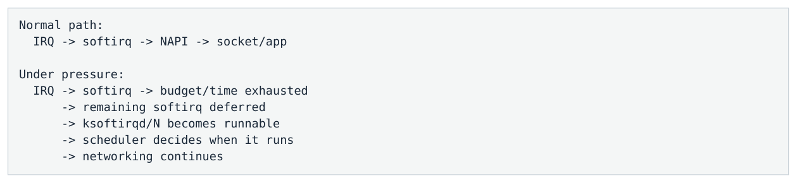

- ` Normal path: `
- ` IRQ → softirq → NAPI → socket/app `
- ` Under pressure: `
- ` IRQ → softirq → budget/time exhausted `
- ` → remaining softirq deferred `
- ` → ksoftirqd/N becomes runnable `
- ` → scheduler decides when it runs `
- ` → networking continues `

</details>

> **转换补充**：IRQ → softirq → NAPI 是常见路径，不是每个 packet 的强制顺序。NAPI 可以通过 busy polling 无中断运行，也可使用独立 kernel thread；queue、IRQ 与 NAPI instance 的映射不能一概假定为固定 1:1。参见 [Linux NAPI 文档](https://docs.kernel.org/networking/napi.html)。

<a id="pdf-page-016"></a>

<!-- source-pdf-page: 16 -->

*[原 PDF 第 16 页](./Level7_Network_NIC_Kernel_Bypass_CN.pdf#page=16)*

关键

`ksoftirqd` 活跃不等于 bug；但 latency-critical RX work 大量掉进 `ksoftirqd`，意味着 packet processing 开始依赖普通 scheduler，常与 p99.9/p99.99 spikes 相关。

### 3.7 Interrupt Moderation 与 NAPI 是两层机制

| 层 | 机制 | Latency/Throughput trade-off |
| --- | --- | --- |
| NIC hardware | rx-usecs / rx-frames / adaptive moderation | 先等一小段时间/数量再发 IRQ，减少 IRQ 但增加first-packet wait |
| Linux/driver | NAPI polling + budget | IRQ 后批量 drain RX descriptors，减少interrupt-per-packet cost |

### 3.8 RPS / RFS / XPS

RSS 是 NIC hardware steering：packet 到 kernel 前选择 RX queue；RPS 是 Linux software steering，可把 stack processing 从一个 CPU 转给另一个 CPU；RFS进一步参考 consuming socket 的 CPU；XPS 是 TX 方向的 CPU→TX queue steering。它们提高 general-purpose scaling，但也可能引入 cross-core queue/IPI/cache movement。

### 3.9 Same-CPU vs Separate-CPU Kernel RX

| 方案 | 优点 | 代价 |
| --- | --- | --- |
| IRQ/NAPI 与 app 同 CPU | cache locality，少一次 cross-core handoff | kernel RX 直接抢 hot app cycles |
| IRQ/NAPI 独立 CPU，app 另一 CPU | app core 更干净 | wakeup/IPI/cache-line movement |

没有 universal answer；kernel bypass 后 fast path 可能直接由 app CPU poll NIC，此时问题又变成“poll loop 是否被其他 IRQ 打断”。

### 3.10 CPU Isolation 并不会自动隔离 IRQ

`isolcpus` / `nohz_full` 主要处理 scheduler tick/housekeeping；hardware IRQ affinity 是另一套机制。一个 “isolated” core 如果仍被 NIC/storage interrupt 打断，tail 仍会坏。`irqbalance` 也可能破坏静态 topology。

### 3.11 诊断接口

| 接口 | 看什么 |
| --- | --- |
| `/proc/interrupts` | NIC/vector 的 CPU 分布 |
| `/proc/softirqs` | NET_RX/NET_TX 在哪些 CPU 增长 |
| `/proc/net/softnet_stat` | per-CPU processed/dropped/time-squeeze 等 pressure signal（字段需按 kernel 版本解释） |
| `perf`/`ftrace` | `net_rx_action`、NAPI driver poll、softirq、scheduler/IRQ 时间线 |

### 3.12 Overload Cascade

**图示转写**

1. ` microburst / CPU disturbance `
2. ` → NAPI work grows `
3. ` → softirq budget pressure `
4. ` → ksoftirqd involvement `
5. ` → socket/RX backlog grows `
6. ` → packet age rises `
7. ` → eventual drop `

<details>
<summary>查看原图与完整文字转写</summary>

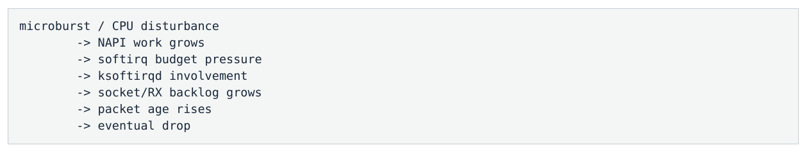

- ` microburst / CPU disturbance `
- ` → NAPI work grows `
- ` → softirq budget pressure `
- ` → ksoftirqd involvement `
- ` → socket/RX backlog grows `
- ` → packet age rises `
- ` → eventual drop `

</details>

<a id="pdf-page-017"></a>

<!-- source-pdf-page: 17 -->

*[原 PDF 第 17 页](./Level7_Network_NIC_Kernel_Bypass_CN.pdf#page=17)*

本章一句话

Linux NAPI 的设计目标是 scalable throughput + livelock avoidance，不是 p99.999 最小化。Tail latency 的关键转折点往往是 backlog 让 networking work 从 inline softirq/NAPI 滑向 `ksoftirqd` 和 scheduler。

<a id="pdf-page-018"></a>

<!-- source-pdf-page: 18 -->

*[原 PDF 第 18 页](./Level7_Network_NIC_Kernel_Bypass_CN.pdf#page=18)*

## 第 4 章 Linux Socket Data Path：`skb`、UDP/TCP、Socket Buffer 与 Wakeup

本章目标

理解 packet 经过 NAPI 之后，Linux 为什么仍要维护 `sk_buff`、protocol state、socket queues、readiness/wakeup；并区分 UDP datagram 与 TCP byte-stream 的 latency pathology。

### 4.1 `sk_buff`：不是“packet bytes”的同义词

`struct sk_buff`（skb）是 Linux packet control/metadata object，关联 packet storage，并保存 protocol offsets、 length、device、checksum/timestamp/routing 等 metadata。协议层通常通过 offset/pointer 操作同一 packet representation，而不是每层完整 copy 一次。

### 4.2 `skb` 的成本来自通用性

Linux 要支持 IPv4/IPv6、TCP/UDP、VLAN、routing、firewall、namespace、tunnel、GRO/GSO 等；因此 metadata initialization、allocation/recycling、branches、pointer chasing、reference/lifetime bookkeeping 都比极简 userspace packet object 更复杂。

### 4.3 UDP Socket Lookup 与 Datagram Queue

**图示转写**

1. ` Ethernet `
2. ` IP `
3. ` UDP `
4. ` socket lookup `
5. ` socket receive queue `
6. ` recvfrom() `

<details>
<summary>查看原图与完整文字转写</summary>

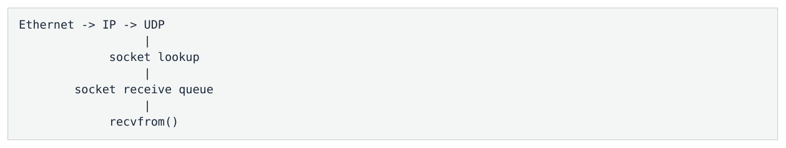

- ` Ethernet → IP → UDP `
- ` socket lookup `
- ` socket receive queue `
- ` recvfrom() `

</details>

UDP 保留 datagram boundary。若 userspace buffer 小于 datagram，超出的 datagram 数据不会像 TCP stream 那样在下一次 `recv()` 继续读；market-data buffer 应覆盖 protocol 的最大 packet size。

### 4.4 `SO_RCVBUF`：Buffer 是 Burst Insurance，也可能是 Latency Warehouse

Receive buffer 用来吸收 producer/consumer 的短期不匹配。UDP queue 满后新 datagram 被 drop，不会向 exchange 产生 transport backpressure。把 `SO_RCVBUF` 调得很大可以减少 drop，却可能把 overload 隐藏成 stale packets。

### 4.5 TCP：Ordered Byte Stream 与 Head-of-Line Blocking

```text
1000-1099 arrives
1200-1299 arrives
1100-1199 missing

TCP application cannot consume 1200-1299 as stream data
until the missing range is recovered.
```

TCP 的 message boundary 与 network segment boundary 无关。两次 `send()` 可能被一次 `recv()` 合并，也可能一条 FIX message 被多次 `recv()` 拆开，所以 FIX parser 必须自己 framing（例如根据 BodyLength / checksum）。

### 4.6 TCP Receive Window：Backpressure 的含义

TCP receiver 慢时 receive buffer occupancy 上升，advertised window 缩小，压力向 sender 传播。它降低丢失风险， 但不会消灭 overload：压力会转移到 sender send buffer、application queue 等上游位置。No loss ≠ low latency。

<a id="pdf-page-019"></a>

<!-- source-pdf-page: 19 -->

*[原 PDF 第 19 页](./Level7_Network_NIC_Kernel_Bypass_CN.pdf#page=19)*

### 4.7 Blocking `recv()`、Wait Queue 与 Scheduler

socket queue 为空时 blocking `recv()` 会把 thread 放入 wait mechanism 并 sleep；packet 到达后 kernel 只会把 task 变为 runnable，真正运行仍由 scheduler 决定。对 HFT，最危险的是 wakeup/scheduler variance 而不是函数名 `recv`。

### 4.8 Non-blocking 与 `epoll`

`O_NONBLOCK` 让 `recv()` 在无数据时返回 `EAGAIN`；`epoll` 解决的是“大量 fd 中哪些 ready”的 scalability，并不是 packet transport。`epoll_wait()` 在无事件时同样可以 sleep/wakeup，因此非常适合 control plane/大量连接， 但不必然是单一 critical feed 的最低延迟方案。

### 4.9 Edge-triggered 与 Level-triggered

EPOLLET 常与 non-blocking fd 配合，收到 edge 后读到 `EAGAIN`。它可减少重复 readiness 通知，但代码复杂度更高； ET 并不自动等于更低 tail latency。

### 4.10 `recvmsg()` / `recvmmsg()` 与 Batching

`recvmsg()` 可读取 ancillary data（hardware/software timestamp、packet info 等）并支持 scatter/gather。 `recvmmsg()` 一次 syscall 收多个 datagrams，用 batching amortize syscall cost；但它依然受 queue-position/first-packet latency trade-off。

### 4.11 TX：`send()` Return 不等于 Packet 上 Wire

**图示转写**

1. ` application send() `
2. ` → socket send buffer `
3. ` → TCP/IP `
4. ` → qdisc / driver `
5. ` → TX descriptors `
6. ` → NIC queue `
7. ` → wire `

<details>
<summary>查看原图与完整文字转写</summary>

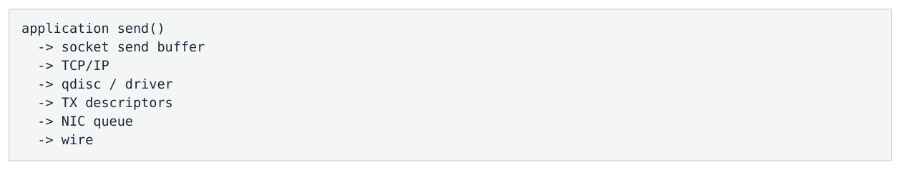

- ` application send() `
- ` → socket send buffer `
- ` → TCP/IP `
- ` → qdisc / driver `
- ` → TX descriptors `
- ` → NIC queue `
- ` → wire `

</details>

`send()` 快只说明 stack 接受数据快。真实 application-to-wire 需要靠近 TX egress 的 timestamp。对于 TCP order-entry，`Send-Q` 增长可能意味着 hidden backlog，即使 `send()` 仍然快速返回。

### 4.12 `TCP_NODELAY`、Delayed ACK 与小消息

Nagle 试图减少 tiny segments；HFT order-entry 通常希望 small write 尽快发出，因此常启用 `TCP_NODELAY`。 Delayed ACK 与 Nagle 组合可能造成额外等待；`TCP_QUICKACK` 更像行为 hint，不应该理解为永久关闭 delayed ACK。

### 4.13 Zero Copy：真正难题是 Ownership

普通 socket copy 让 kernel 很快回收原 packet buffer；zero-copy 让 application 直接持有 NIC/kernel-backed buffer，必须明确何时归还。对几十/几百字节的小 trading packet，copy 本身可能不是最大成本；减少 syscall、wakeup、 generic stack、queue/context handoff 往往更关键。

本章一句话

Socket API 把通用 protocol semantics、安全隔离、buffer lifecycle 与 scheduler readiness 统一起来。它非常强，但也意味着 packet 从 NIC 到 C++ 之间有多个不可忽视的 queue 和 execution-context boundary。

<a id="pdf-page-020"></a>

<!-- source-pdf-page: 20 -->

*[原 PDF 第 20 页](./Level7_Network_NIC_Kernel_Bypass_CN.pdf#page=20)*

## 第 5 章 Queueing / Buffering / Batching / Microburst

本章目标

把 switch、NIC、NAPI、socket、application queues 串成一个 queueing network。理解为什么 drop 是晚期症状，真正的 latency capacity 取决于 headroom 与 backlog drain speed。

### 5.1 整条 Datapath 是 Queueing Network

**图示转写**

| 场景 / 部分 | 路径、状态或说明 |
| --- | --- |
| Exchange egress | ` → switch queue `；` → NIC internal buffer `；` → RX descriptor ring `；` → NAPI/softnet backlog `；` → socket receive queue `；` → app SPSC / parser queue `；` → book / strategy ` |
| 部分 2 | ` TX direction has another chain of queues. ` |

<details>
<summary>查看原图与完整文字转写</summary>

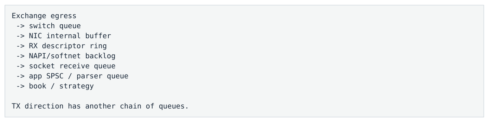

- ` Exchange egress `
- ` → switch queue `
- ` → NIC internal buffer `
- ` → RX descriptor ring `
- ` → NAPI/softnet backlog `
- ` → socket receive queue `
- ` → app SPSC / parser queue `
- ` → book / strategy `
- ` TX direction has another chain of queues. `

</details>

### 5.2 Queue 是“时间解耦器”

Queue 让 producer 暂时不必等待 consumer，因此可以吸收 burst；代价是 consumer 看到的是“更早产生的数据”。 Buffer 实际上把空间换成时间。

### 5.3 Little's Law

公式

L = λW，因此粗略 queueing delay W ≈ queue depth L / arrival rate λ。在 1 Mpps 下，100 packets backlog 就是约 100 µs 的时间尺度；在 HFT 中已经很大。

### 5.4 Ring 大并不等于健康

例如 4096-entry RX ring 在 2 Mpps 下，如果接近积满，意味着约 2.0 ms 的 packet age capacity。大 ring 可以防 burst drop，但也允许系统无声地处理毫秒级 stale data。

### 5.5 Utilization 与非线性 Queueing

令 ρ=λ/μ。即使真实 market traffic 不是 M/M/1，简单模型仍说明当 ρ→1 时 queueing delay 会急剧上升。 Low-latency capacity planning 不是“CPU 是否能扛住平均吞吐”，而是“发生 pause/burst 后能多快回到近零 queue”。

### 5.6 Burst Recovery Formula

> **非常实用**：发生长度为 P 的 processing pause，arrival rate 为 λ，恢复后 service rate μ>λ。backlog ≈ λP，drain time ≈ λP/(μ-λ)。用 ρ=λ/μ 表示：`T_drain = P·ρ/(1-ρ)`。

| Utilization ρ | 一次 50 µs pause 后的理论 drain multiplier |
| --- | --- |
| 50% | 约 1×P |
| 80% | 约 4×P |
| 90% | 约 9×P |

<a id="pdf-page-021"></a>

<!-- source-pdf-page: 21 -->

*[原 PDF 第 21 页](./Level7_Network_NIC_Kernel_Bypass_CN.pdf#page=21)*

| Utilization ρ | 一次 50 µs pause 后的理论 drain multiplier |
| --- | --- |
| 95% | 约 19×P |
| 99% | 约 99×P |

这解释了为什么一次 20 µs SMI/IRQ/page fault 可以制造几百 µs 甚至毫秒级 elevated tail：queue 保存了“过去 overload 的记忆”。

### 5.7 Microburst

市场流量不是平稳平均流：开盘、宏观新闻、auction、价格快速移动时，几十到几百微秒内 packet rate 可能远高于一秒平均值。1-second CPU/pps 指标几乎看不见这类 burst，却足以把 switch/NIC/socket/app queues 推高。

### 5.8 λ ↑ 与 μ ↓ 往往同时发生

stress market 不仅 packet rate 上升（λ↑），还可能触及更多 symbols/books，导致 working set 变大、cache miss 增加、复杂 message path 变多（μ↓）。这就是为什么市场压力下 latency 可能突然“拐点式”恶化。

### 5.9 Batching：Latency 与 Service Rate 的真正 Trade-off

Batching amortize syscall、interrupt、descriptor handling、doorbell、prefetch 等固定成本。它会让 batch 后部 packet 等前部 packet，但如果 batch 让 service rate μ 大幅提高、utilization 下降，总体 p99 反而可能改善。不要机械追求 batch=1。

`rx_burst(...,32)` 通常是“最多取 32”，不等于“等满 32 才返回”。真正危险的是 wait-for-batch policy；低延迟常选择“立即处理当前可用，up to N”。

### 5.10 Run-to-Completion vs Pipeline

| 维度 | Run-to-Completion | Pipeline |
| --- | --- | --- |
| Cross-core queue | 少/无 | 多 |
| Cache locality | 好 | 需要 handoff |
| Tail predictability | 好，前提是每 event bounded | 受多级 queueing 影响 |
| Throughput scaling | 单 core ceiling | 可扩到多 core |
| 慢 stage isolation | 较差 | 较好 |

### 5.11 Backpressure 与 Queue Policy

| 事件语义 | Queue full 可接受策略 |
| --- | --- |
| Order / execution command | 不能静默 drop；应 reject/throttle/backpressure/risk-stop |
| Incremental market-data delta | 不能任意丢中间 transition；需 gap detection + recovery/snapshot |
| Complete latest-state snapshot | 可以考虑 drop-oldest / latest-wins |
| Telemetry/logging | 通常可以 bounded drop / overwrite |

### 5.12 Bufferbloat

“无 loss + 很大 buffer”不等于低延迟。大 buffer 让 congestion 以 queueing delay 形式存在。低延迟系统更偏好 small/bounded/observable queues，并让 overload 尽早以明确 signal 暴露。

<a id="pdf-page-022"></a>

<!-- source-pdf-page: 22 -->

*[原 PDF 第 22 页](./Level7_Network_NIC_Kernel_Bypass_CN.pdf#page=22)*

### 5.13 Coordinated Omission 与 Open-loop Benchmark

如果 load generator 每次都等 response 才发下一条，系统卡住时它也停止制造本应到达的 request，tail 被低估。网络 /market-data replay 应尽量 open-loop，并保留真实 inter-arrival timing、packet sizes、message mix 与 microbursts。

### 5.14 低延迟 Queue 的七问

- Producer 是谁？Consumer 是谁？

- 容量是多少？

- 满了以后做什么？

- 怎样测 occupancy / high-water？

- 怎样直接测 packet age？

- event 能否安全 drop/coalesce？

- burst 过后 spare capacity 能多快 drain backlog？

本章一句话

Drop 是 capacity failure；queueing latency 是 capacity stress 更早的表现。真正的 low-latency headroom 是“在 realistic burst 后快速回到 near-zero backlog”的能力。

<a id="pdf-page-023"></a>

<!-- source-pdf-page: 23 -->

*[原 PDF 第 23 页](./Level7_Network_NIC_Kernel_Bypass_CN.pdf#page=23)*

## 第 6 章 Kernel Bypass：Onload、DPDK、AF_XDP 与 RDMA

本章目标

不要把 kernel bypass 简化成“零拷贝”。不同技术的核心差异是：谁拥有 fast path、保留什么 protocol abstraction、application 离 NIC ring 有多近。

### 6.1 Kernel Bypass 的准确含义

更准确的说法是“bypass generic Linux networking data fast path”。Kernel 仍可能负责 process/memory/device setup、IOMMU/security、control plane、fallback。Fast path 绕过 kernel 并不意味着 CPU 永远不进入 kernel，也不意味着 SMI/NMI/page fault 消失。

### 6.2 Normal Linux vs Bypass

**图示转写**

| 场景 / 部分 | 路径、状态或说明 |
| --- | --- |
| Normal Linux RX | ` NIC → IRQ/NAPI → skb → IP/TCP/UDP → socket queue `；` → wakeup → recv syscall → user copy → app ` |
| Bypass/acceleration goal | ` NIC → DMA/rings → userspace stack or packet API → app ` |

<details>
<summary>查看原图与完整文字转写</summary>

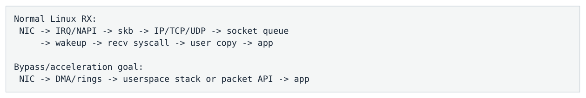

- ` Normal Linux RX: `
- ` NIC → IRQ/NAPI → skb → IP/TCP/UDP → socket queue `
- ` → wakeup → recv syscall → user copy → app `
- ` Bypass/acceleration goal: `
- ` NIC → DMA/rings → userspace stack or packet API → app `

</details>

### 6.3 Onload：保留 BSD Socket 的 Userspace Stack

Onload 的价值是“socket programming model 不变，但 fast path 前移到 userspace accelerated TCP/UDP stack”。已有 FIX/TCP C++ 系统仍可使用 `socket/connect/recv/send/poll` 语义，却减少 per-packet syscall、kernel wakeup 与 generic stack overhead；不支持/不适合的场景可能 fallback 到 kernel。

适用直觉

已有大型 TCP/FIX trading stack、希望以较低迁移成本获得低 latency：Onload-like socket acceleration 往往比 raw DPDK 更自然。

### 6.4 DPDK：Userspace 直接拥有 Packet Datapath

**图示转写**

1. ` NIC RX queue `
2. ` → DMA into preallocated mbuf/mempool `
3. ` → userspace PMD polls descriptors `
4. ` → application parses Ethernet/IP/UDP `
5. ` → business logic `
6. ` → TX descriptor + doorbell `

<details>
<summary>查看原图与完整文字转写</summary>

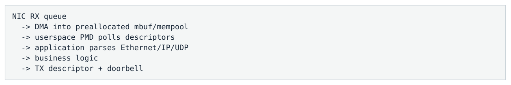

- ` NIC RX queue `
- ` → DMA into preallocated mbuf/mempool `
- ` → userspace PMD polls descriptors `
- ` → application parses Ethernet/IP/UDP `
- ` → business logic `
- ` → TX descriptor + doorbell `

</details>

DPDK 不是 socket acceleration，而是 raw packet I/O framework。PMD 理解 NIC descriptor/registers/doorbells， application直接控制 queue/core/memory topology。TCP 语义需要额外 userspace TCP stack；因此 custom UDP feed handler 更自然，FIX/TCP migration cost 更高。

### 6.5 DPDK Huge Pages / Mempool / NUMA

Mempool 提供预分配 fixed packet objects，避免 per-packet malloc。Huge pages 减少 CPU TLB、DMA/IOMMU mapping/IOTLB pressure，并便于大块预留、prefault、NUMA-local memory。最佳 topology 通常是 NIC PCIe node = polling CPU node = mempool node。

<a id="pdf-page-024"></a>

<!-- source-pdf-page: 24 -->

*[原 PDF 第 24 页](./Level7_Network_NIC_Kernel_Bypass_CN.pdf#page=24)*

### 6.6 AF_XDP：Linux-native High-performance Packet I/O

XDP 在 Linux RX 非常早的位置运行，可 DROP/PASS/TX/REDIRECT；AF_XDP 通过 UMEM 与 Fill/RX/TX/Completion rings 把 packet 重定向到 userspace。zero-copy 是否可用取决于 NIC/driver；不支持时可以 copy mode。

### 6.7 AF_XDP 四类 Ring 的 Ownership

| Ring | 意义 |
| --- | --- |
| Fill Ring | userspace 提供可用于 RX 的 UMEM frames |
| RX Ring | driver/NIC 把已收到 packet descriptor 交给 userspace |
| TX Ring | userspace 提交待发 packet descriptors |
| Completion Ring | TX 完成后归还 buffer ownership |

### 6.8 RDMA：不是“另一种 DPDK”

RDMA 提供 registered memory + queue pair + work request/completion 的远程内存/消息语义，可让 NIC 直接 READ/WRITE remote registered memory，降低 remote CPU/kernel involvement。它更常见于 datacenter/HPC/storage/internal transport，并不是 external exchange UDP/FIX 的通用替代。

### 6.9 对比表

| 特征 | Linux Socket | Onload | AF_XDP | DPDK |
| --- | --- | --- | --- | --- |
| BSD socket API | 是 | 是 | 否 | 否 |
| TCP stack | Kernel | Userspace accelerated | 需额外 stack | 需额外 stack |
| Raw packet control | 低 | 中 | 高 | 很高 |
| Fast path generic kernel stack | 是 | 大量绕过 | 大量绕过 | 基本绕过 |
| Busy polling | 可选 | 常见 | 常见 | 核心模式 |
| 迁移/运维成本 | 低 | 低-中 | 中-高 | 高 |
| Determinism/control | 一般 | 高 | 高 | 很高 |

### 6.10 Zero-copy 不是全部故事

对 64-256B trading message，一次 memcpy 可能远小于 scheduler wakeup、syscall、generic stack、cross-core handoff 的 tail cost。Kernel bypass 的大价值是 path simplification + static ownership + variance reduction， 而不是把“copy”这个词从 diagram 中删除。

### 6.11 Polling 与 Bypass 是两个独立维度

| 组合 | 例子 |
| --- | --- |
| Kernel + interrupt | 普通 Linux socket |
| Kernel + polling | `SO_BUSY_POLL` / busy NAPI |
| Bypass + polling | DPDK PMD / Onload spin / AF_XDP poll |
| Bypass + event/interrupt | 某些 userspace/event 模式，具体依 framework |

<a id="pdf-page-025"></a>

<!-- source-pdf-page: 25 -->

*[原 PDF 第 25 页](./Level7_Network_NIC_Kernel_Bypass_CN.pdf#page=25)*

### 6.12 常见 Failure Modes

- poll 错 queue / RSS steering 错误；

- mempool / RX buffers 耗尽；

- TX completion 不 reclaim → TX ring full；

- RTC business logic 太长 → RX ring 长时间无人服务；

- NUMA mismatch；

- 过度 batching；

- Onload/acceleration hidden fallback 形成 bimodal latency；

- 误把 Mpps benchmark 当 production p99。

### 6.13 Hybrid Architecture

```text
Market Data : DPDK / AF_XDP / Onload UDP
Order Entry : Onload TCP / optimized kernel TCP
Control     : normal kernel sockets + epoll/asio
Recovery    : protocol-specific slow path
```

本章一句话

Kernel bypass 不是技术排名。选型先问 protocol semantics、latency SLO、packet rate、existing code、hardware 与 operational complexity；最快的 raw datapath 不一定是整体最好的 trading architecture。

<a id="pdf-page-026"></a>

<!-- source-pdf-page: 26 -->

*[原 PDF 第 26 页](./Level7_Network_NIC_Kernel_Bypass_CN.pdf#page=26)*

## 第 7 章 Busy Polling、CPU Isolation 与 Run-to-Completion

本章目标

理解为什么 dedicated poller 的 100% CPU 可以代表“随时 ready”，而真正 headroom 要看 useful-work ratio、 poll-gap distribution 与 service capacity。

### 7.1 Interrupt / Hybrid / Full Polling

| 模式 | 空闲时 | 典型 latency 特征 | 成本 |
| --- | --- | --- | --- |
| Interrupt/blocking | sleep | 依赖 IRQ+wakeup+scheduler，variance 较高 | CPU 省 |
| Hybrid spin | 先 poll 一段，再 sleep | 活跃时快，睡眠后形成 slow mode | 折中 |
| Full polling | 一直 RUNNING | detection 主要由 poll-loop revisit interval 决定 | 占用 dedicated core |

### 7.2 Poll Gap 才是核心指标

理想化公式

如果 poll-loop revisit interval 为 P，且 packet 随机到达：best detection≈0，worst≈P，average≈P/2。真实 P 不是常数，而是 poll + packet work + timers + control + IRQ/SMI/page-fault 等 disturbance 的分布。

因此 full polling 并不自动低延迟；你必须让 time-away-from-RX bounded。一次 50 µs strategy/logging/page fault 就意味着 RX queue 至少 50 µs 没被服务。

### 7.3 100% CPU 为什么可能是健康

`top` 看到 100% 只说明 poller 一直 RUNNING，并不说明 packet processing 占满 core。更有意义的是：empty polls / total polls、useful cycles / total cycles、cycles per packet、poll-gap histogram。

| Poll core 状态 | 含义 |
| --- | --- |
| 90% empty polling + 10% packet work | 虽然 OS 显示 100%，但实际有大量 service headroom |
| 5% empty polling + 95% packet work | core 接近 saturation，microburst recovery 能力弱 |

### 7.4 Busy Poll 的额外收益：C-state / Frequency

持续 polling 让 core 保持 active，避免 deep C-state wakeup，并可能让 frequency 更稳定。但如果很多 cores 都 busy-spin，package power/thermal 上升，可能降低 sustained turbo；因此“把所有 core 100% spin”不一定最优。

### 7.5 CPU Isolation 是一组配置，不是一个 Flag

- thread affinity / cpuset；

- `isolcpus` / housekeeping placement；

- `nohz_full` 减少 periodic tick；

- `rcu_nocbs` offload RCU callbacks；

- IRQ affinity / irqbalance 管理；

- SMT sibling 策略；

- NUMA memory + NIC PCIe locality；

- prefault / mlock / hugepage；

- 避免 background memory-bandwidth/cache interference。

<a id="pdf-page-027"></a>

<!-- source-pdf-page: 27 -->

*[原 PDF 第 27 页](./Level7_Network_NIC_Kernel_Bypass_CN.pdf#page=27)*

### 7.6 SMI / NMI：Kernel Bypass 也躲不开

SMI 由 firmware/platform 触发，OS 很难控制；即使 DPDK + isolated core 仍可能被暂停。若 poll gap 出现几十/几百 µs，而 scheduler/IRQ trace 没有对应事件，SMI/firmware 是重要候选。

### 7.7 Prefault 与 First-touch NUMA

Hot memory 应在正确 CPU/NUMA context 下 allocate/touch，避免首次业务访问触发 page fault 或把 page 放到 remote node。一个常见安全初始化顺序是：bind worker → allocate/preallocate → touch/prefault → warm data structures → enter hot loop。

### 7.8 Run-to-Completion (RTC)

**图示转写**

1. ` one owner core: `
2. ` RX `
3. ` parse `
4. ` book `
5. ` decision `
6. ` TX `
7. ` poll again `

<details>
<summary>查看原图与完整文字转写</summary>

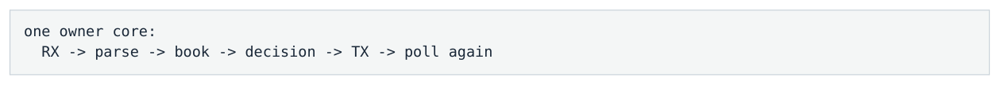

- ` one owner core: `
- ` RX → parse → book → decision → TX → poll again `

</details>

RTC 把跨线程 SPSC、store-release/load-acquire、cache-line ownership transfer 换成同一 core 上的 function call，通常获得更好的 locality、ordering simplicity 与 tail predictability。代价是整个 flow 必须 fit in one core， 并且每个 event work 必须 bounded。

### 7.9 为什么 Lock-free Queue 仍然有成本

SPSC 虽然无锁，仍有 producer/consumer indices、release/acquire、cache coherence 与 queueing delay。 `lock-free ≠ zero-cost`；如果 stage 可以在同一 core 直接调用，RTC 可能更快、更可预测。

### 7.10 Pipeline 什么时候更合理

如果一个 stage 真正占据单 core 大部分 cycles，或者需要 isolation heavy compute，可把 workload 通过 symbol/venue/session 固定 partition 到多个 cores，或采用 pipeline。HFT 通常优先 static flow partition + RTC， 而不是 global work-stealing thread pool。

### 7.11 Application 自己成为 Scheduler

```text
while (running) {
    process_up_to_N_rx();
    reclaim_some_tx();
    check_critical_control();
    service_due_timers();
    poll_again();
}
```

移除 OS scheduler 后，调度问题没有消失，而是变成 application responsibility：每个 work class 多久服务一次、最多一次做多少、如何避免 control/timer starvation，都必须明确 bounded budget。

### 7.12 Hybrid Spin 与 Bimodal Latency

如果 thread spin 20 µs 后 sleep，packet 在 spin window 到达可能 3 µs，在 sleep 后到达可能 20+ µs，于是 latency distribution 出现 fast/slow 两个 mode。选择 spin budget 应参考 inter-arrival histogram 与 tail SLO， 而不是拍脑袋。

### 7.13 Hot Thread 的 Microarchitectural Isolation

除了 scheduler，还要关注 SMT sibling、LLC sharing、memory bandwidth、DDIO/DMA cache pressure、false sharing 和 monitoring atomics。一个“独占逻辑 CPU”仍与很多硬件资源共享。

<a id="pdf-page-028"></a>

<!-- source-pdf-page: 28 -->

*[原 PDF 第 28 页](./Level7_Network_NIC_Kernel_Bypass_CN.pdf#page=28)*

### 7.14 Hot-path Telemetry 设计

- per-thread counters，避免 global atomics；

- 记录 max/p99 poll gap；

- cycles/packet 或 cycles/message；

- empty-poll/useful-work ratio；

- queue high-water；

- 低开销 flight recorder，background thread 聚合/格式化。

本章一句话

Polling 用 CPU cycles 购买“immediate readiness”。真正决定 tail 的不是 CPU=100%，而是你的 loop 多久回到 RX、 每次 work 是否 bounded，以及这个 core 是否真的免受 IRQ/SMI/page-fault/SMT/NUMA 干扰。

<a id="pdf-page-029"></a>

<!-- source-pdf-page: 29 -->

*[原 PDF 第 29 页](./Level7_Network_NIC_Kernel_Bypass_CN.pdf#page=29)*

## 第 8 章 Measurement / Production Tuning：从 p99.9 Spike反推 Root Cause

本章目标

先切 measurement boundary，再用 NIC/kernel/socket/app 多层 evidence 快速排除整层问题。目标是 hypothesis-driven diagnosis，而不是随机调 sysctl。

### 8.1 时间边界：先定义“这个 latency 数字到底是什么”

```text
T0 = exchange/source timestamp
T1 = NIC HW RX timestamp
T2 = application first sees packet
T3 = parser done
T4 = book updated
T5 = strategy done
T6 = NIC HW TX timestamp

Network     = T1-T0
Host RX     = T2-T1
App logic   = T5-T2
App->Wire   = T6-T5
```

如果 start/end 不在同一 clock domain，或者 timestamp placement 改变，latency chart 本身可以骗人。Measurement sanity 永远是 incident 的第一步。

### 8.2 TSC、CLOCK_MONOTONIC、PHC、PTP

| 时间源 | 适合用途 | 注意点 |
| --- | --- | --- |
| TSC / RDTSC(RDTSCP) | 本机 hot-code / poll-gap 高分辨率计时 | 需正确 serialization；invariant TSC tick rate ≠ current turbo GHz |
| CLOCK_MONOTONIC(_RAW) | 本机统一 ns 时间线 | vDSO 可能很快，但比 raw TSC 重 |
| NIC PHC / HW timestamp | 靠近 wire 的 RX/TX 边界 | 必须知道 exact timestamp point |
| PTP | 跨 NIC/host/设备 clock discipline | 精度取决于 topology/GM/servo/hardware timestamp |

### 8.3 `ethtool`：NIC/Driver 第一层证据

```bash
ethtool eth0        # link/speed
ethtool -S eth0     # driver/NIC counters
ethtool -l eth0     # channels/queues
ethtool -g eth0     # ring sizes
ethtool -c eth0     # interrupt coalescing
ethtool -k eth0     # offloads
```

Counter 名称高度 driver-specific。诊断重点是把错误类型分类：CRC/FCS→physical/link；RX missed/no-buffer→RX resource/servicing；per-queue packet counters→验证 flow steering。

### 8.4 `/proc/interrupts` / `/proc/softirqs`

先验证 flow→RXQ→IRQ→CPU topology，再看 NET_RX/NET_TX 在哪些 CPU 增长。若 IRQ 在 CPU2、NET_RX 却集中 CPU7， 需要检查 RPS/RFS 或其他 software steering。

<a id="pdf-page-030"></a>

<!-- source-pdf-page: 30 -->

*[原 PDF 第 30 页](./Level7_Network_NIC_Kernel_Bypass_CN.pdf#page=30)*

### 8.5 `/proc/net/softnet_stat`

可观察 per-CPU kernel network pressure，例如 processed、dropped、time_squeeze 等。字段布局随 kernel 版本变化，生产脚本必须按目标 kernel 文档/实现验证，不能死记网上旧列号。

### 8.6 `ss`：Socket Backlog

`Recv-Q` 持续增长说明 kernel 已经收到数据但 app 没及时消费；`Send-Q` 增长说明 outbound bytes 被 TCP/network 堆在本地。对 order-entry 来说，“send() 仍很快但 Send-Q 变大”是非常典型的 hidden latency。

### 8.7 `nstat`：Protocol-layer Counters

用于观察 UDP receive errors、TCP retransmissions、IP/TCP/UDP statistics。`ethtool` 更偏 NIC/driver，`nstat` 更偏 protocol stack；两层同时看可以迅速缩小 UDP gap / TCP tail 问题。

### 8.8 `perf`：CPU 为什么不在做你以为的事

`perf top/record` 可发现 hot CPU 正在 `net_rx_action`/NAPI driver poll、`ksoftirqd`、memcpy、parser 或 strategy。`perf stat` 适合 good vs bad run 对比 cycles/instructions/cache/branch/context-switch/migration/pag e-fault。Sampling 有 skid，优先做 path/function-level attribution。

### 8.9 `ftrace` / eBPF：时间线证据

当 poll gap/scheduler jitter 是怀疑对象时，追 `sched_switch/sched_wakeup`、`irq_handler_entry/exit`、 `softirq_entry/exit`。eBPF 可动态追 kernel events，但 observer 本身也有 overhead；生产应采样或使用低成本专用 tracing。

### 8.10 `tcpdump` 与 Wire Truth

host `tcpdump` 看的是某个 kernel capture point，不是“绝对 wire truth”；DPDK/某些 accelerated path 的 packets 甚至不会走普通 capture path。最强证据来自 TAP、switch mirror、dedicated capture card / hardware timestamps。

### 8.11 UDP Sequence Gap 的分层诊断

**图示转写**

- ` application sees seq gap `
  - ` wire/upstream capture already missing? → exchange/network upstream `
  - ` NIC error/missed/no-buffer counter? → NIC/RX servicing `
  - ` kernel UDP/softnet/socket drops? → kernel/socket pressure `
  - ` all clean → app queue/parser/ordering/recovery logic `

<details>
<summary>查看原图与完整文字转写</summary>

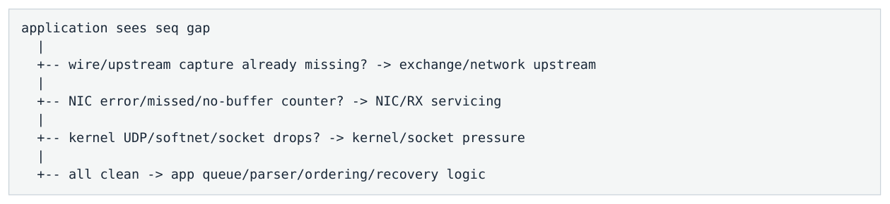

- ` application sees seq gap `
- ` -- wire/upstream capture already missing? → exchange/network upstream `
- ` -- NIC error/missed/no-buffer counter? → NIC/RX servicing `
- ` -- kernel UDP/softnet/socket drops? → kernel/socket pressure `
- ` -- all clean → app queue/parser/ordering/recovery logic `

</details>

<a id="pdf-page-031"></a>

<!-- source-pdf-page: 31 -->

*[原 PDF 第 31 页](./Level7_Network_NIC_Kernel_Bypass_CN.pdf#page=31)*

### 8.12 p99.9 NIC→App Spike Decision Tree

```text
1) Is exchange/source -> NIC also slow?
     yes: network/switch/source
     no : host problem

2) NIC drops / RX pressure?
     yes: queue/driver/service issue

3) Kernel path?
     NET_RX/ksoftirqd/Recv-Q/time_squeeze

4) Bypass path?
     poll-gap / RX-ring occupancy / useful-work ratio

5) CPU disturbance?
     IRQ / sched / page fault / cache / NUMA / SMI
```

### 8.13 TCP Order-entry：把 Local TX 与 Network/Venue 分开

**图示转写**

| 场景 / 部分 | 路径、状态或说明 |
| --- | --- |
| decision T0 | ` → NIC TX HW timestamp T1 `；` → venue/peer ACK T2 ` |
| Local TX path = T1-T0 | ` Network+venue = T2-T1 ` |

<details>
<summary>查看原图与完整文字转写</summary>

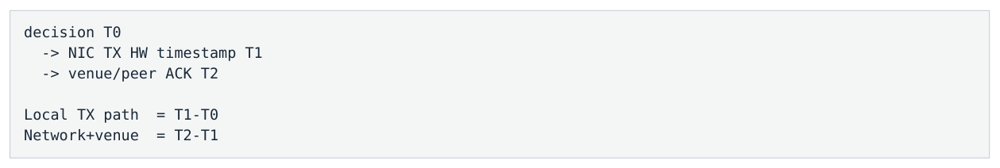

- ` decision T0 `
- ` → NIC TX HW timestamp T1 `
- ` → venue/peer ACK T2 `
- ` Local TX path = T1-T0 `
- ` Network+venue = T2-T1 `

</details>

Local TX bad 时检查 Send-Q、TX ring/completion、poll loop、TCP stack；T1 正常但 ACK 变慢则更多看 retransmission、network/venue/remote processing。

### 8.14 Production Telemetry：不要让 Monitoring 反过来制造 Tail

Hot thread 建议维护 thread-local counters、poll-gap max/histogram、queue high-water、cycles/message、 sequence gaps。Background thread 周期性聚合。不要每 packet string-format/log/disk/global atomic。

### 8.15 Flight Recorder

固定大小 circular trace buffer 保存最近 N 个轻量事件（TSC、event type、seq、queue depth）；正常覆盖旧数据， incident 时 freeze/snapshot，离线重建 timeline。它非常适合微秒级 HFT hot path。

### 8.16 Benchmark：找 Latency Knee，不是只找 Drop Capacity

做 open-loop rate sweep + realistic burst replay，记录 p50/p99/p99.9、queue depth、packet age、drops、drain time。系统可能 2 Mpps 才开始 drop，但 1.3 Mpps 就违反 p99.9 SLO；真正要报的是 latency-constrained capacity。

### 8.17 Tuning 的正确顺序

- 定义 latency boundary；

- 验证 clock/timestamp；

- 画实际 queue/IRQ/CPU/NUMA topology；

- 找最早开始增长的 queue / poll gap；

- 提出可证伪 hypothesis；

- 只改一个维度；

- 用同一 realistic replay 对比 full distribution；

- 把 NIC/IRQ/sysctl/BIOS/affinity 配置 version-control 并在 startup/runtime 验证。

<a id="pdf-page-032"></a>

<!-- source-pdf-page: 32 -->

*[原 PDF 第 32 页](./Level7_Network_NIC_Kernel_Bypass_CN.pdf#page=32)*

### 8.18 Diagnosis Matrix

| 现象 | 优先怀疑 |
| --- | --- |
| Exchange→NIC latency ↑ | source / switch / network |
| CRC/FCS ↑ | physical/link |
| RX missed/no-buffer ↑ | RX ring/driver servicing |
| NET_RX/time_squeeze ↑ | NAPI/softirq pressure |
| `ksoftirqd` ↑ | deferred softirq overload |
| Recv-Q ↑ | app not draining socket |
| Send-Q ↑ | TCP/outbound backpressure |
| App SPSC ↑, socket clean | downstream app bottleneck |
| Poll-gap ↑ | CPU interruption / long handler |
| page faults ↑ | memory lifecycle |
| LLC/TLB misses ↑ | cache/working-set/NUMA |
| TCP retrans ↑ | network loss/recovery |
| all datapath metrics clean, time jumps | clock/measurement or SMI candidate |

> **本章一句话**：优秀 instrumentation 的价值不是“收集很多指标”，而是能用一个硬件 timestamp 或一个 queue/poll-gap counter迅速排除整个层级。先 localize，再优化。

<a id="pdf-page-033"></a>

<!-- source-pdf-page: 33 -->

*[原 PDF 第 33 页](./Level7_Network_NIC_Kernel_Bypass_CN.pdf#page=33)*

## 附录 A：核心术语表

| 术语 | 一句话定义 |
| --- | --- |
| PHY | 把物理电/光信号与 bit stream 连接起来的物理层 transceiver。 |
| MAC | Ethernet frame 处理单元，负责 L2 frame 发送/接收。 |
| RX/TX Queue | NIC 提供的独立 receive/transmit processing channel。 |
| Descriptor | 描述 packet buffer、length、status/offload metadata 的 NIC/host 控制记录。 |
| DMA | NIC 直接读写 host memory，而不是 CPU 逐 byte 搬 packet。 |
| MMIO / Doorbell | CPU 通过 memory-mapped device register 通知 NIC producer/tail 状态变化。 |
| Completion | NIC 完成 descriptor/buffer 使用后返回 ownership 的通知/状态。 |
| RSS | NIC hardware 对 flow fields 做 hash，再通过 indirection table 选择 RX queue。 |
| MSI-X | 支持多 interrupt vector 的现代 PCIe interrupt 机制。 |
| NAPI | Linux interrupt-triggered polling receive model。 |
| SoftIRQ | Linux deferred kernel work context；NET_RX 是 networking receive 的核心 softirq。 |
| ksoftirqd/N | per-CPU kernel thread，用于在需要时继续 pending softirq work。 |
| skb | Linux 通用 packet metadata/control object，关联 packet storage。 |
| Recv-Q / Send-Q | socket 上已接收未消费 / 已提交未完成发送的数据 backlog。 |
| GRO/LRO | receive-side aggregation/offload，偏 throughput。 |
| TSO/GSO | send-side segmentation aggregation/offload，偏 throughput。 |
| Onload | 保留 socket API 的 userspace accelerated TCP/UDP stack。 |
| DPDK PMD | userspace poll-mode driver，直接管理 NIC queues/descriptors。 |
| rte_mbuf / mempool | DPDK 预分配 packet object / buffer pool。 |
| XDP | Linux driver 早期 programmable packet path。 |
| AF_XDP / UMEM | XDP 与 userspace 共享 packet rings/memory 的高性能 raw packet API。 |
| RDMA | 通过 registered memory / QP 让 NIC 执行 remote memory/message operation。 |
| PHC | NIC 上的 PTP Hardware Clock。 |
| PTP | 高精度 clock synchronization protocol，常配合 hardware timestamps。 |
| Poll gap | polling loop 两次 service RX 的时间间隔；是 polling tail 的核心指标。 |
| Microburst | 非常短窗口内瞬时 packet rate 远高于长期平均值。 |
| Bufferbloat | 过大 buffer 将 congestion 隐藏为高而可变 queueing latency。 |

<a id="pdf-page-034"></a>

<!-- source-pdf-page: 34 -->

*[原 PDF 第 34 页](./Level7_Network_NIC_Kernel_Bypass_CN.pdf#page=34)*

## 附录 B：关键对照表

### B.1 RX Ring vs Socket Queue vs Application Queue

| Queue | Producer | Consumer | Full 后典型结果 |
| --- | --- | --- | --- |
| NIC RX ring | NIC completion / buffer consumption | driver/PMD/NAPI | RX resource exhaustion / NIC-driver drop |
| Socket receive queue | kernel TCP/UDP stack | application `recv()` | UDP drop；TCP flow-control /backlog |
| Application SPSC | network/parser thread | book/strategy thread | 由业务定义：reject/drop/re cover/backpressure |

### B.2 Interrupt vs Polling

| 维度 | Interrupt-driven | Full polling |
| --- | --- | --- |
| 空闲 CPU | 低 | 100% dedicated |
| Detection path | IRQ→NAPI→wakeup/scheduler | poll loop revisit |
| Tail variance | 较高 | 更可控，但仍受 SMI/IRQ/page-fault/logic 影响 |
| 核心 tuning | coalescing/IRQ/NAPI/socket | poll gap / bounded work / isolation |

### B.3 UDP vs TCP Low-latency Failure Mode

| 维度 | UDP | TCP |
| --- | --- | --- |
| Overload | buffer full 后显式 drop/gap | backpressure/queueing/window 先增加 latency |
| Loss recovery | 应用协议 sequence/replay/snapshot | TCP retransmit + 更高层 session recovery |
| HOL | 无 TCP stream HOL | 缺失 byte range 阻塞后续 stream |
| Measurement | datagram/packet 边界较直观 | segment/recv/business message 边界不一一对应 |

### B.4 Kernel Socket / Onload / AF_XDP / DPDK

| 特征 | Kernel | Onload | AF_XDP | DPDK |
| --- | --- | --- | --- | --- |
| API | BSD socket | BSD socket | raw packet rings | raw packet queues |
| TCP | kernel | userspace accelerated | 额外 stack | 额外 stack |
| Fast-path OS machinery | 最多 | 少 | 少 | 最少 |
| 控制力 | 低 | 中高 | 高 | 很高 |
| 迁移成本 | 低 | 低 | 高 | 很高 |
| 典型选择 | 通用/control | FIX/TCP low latency | Linux-native custom packet | 极致 custom packet datapath |

<a id="pdf-page-035"></a>

<!-- source-pdf-page: 35 -->

*[原 PDF 第 35 页](./Level7_Network_NIC_Kernel_Bypass_CN.pdf#page=35)*

## 附录 C：Linux / NIC 诊断命令速查

### C.1 NIC / Queue / Offload

```bash
ethtool eth0
ethtool -S eth0
ethtool -l eth0
ethtool -g eth0
ethtool -c eth0
ethtool -k eth0
```

### C.2 IRQ / SoftIRQ

```bash
cat /proc/interrupts
cat /proc/softirqs
cat /proc/net/softnet_stat
cat /proc/irq/<IRQ>/smp_affinity_list
```

### C.3 Socket / Protocol

```text
ss -tin
ss -uapn
nstat
```

### C.4 CPU / NUMA / Topology

```bash
lscpu -e
numactl --hardware
lspci -vv
cat /sys/class/net/eth0/device/numa_node
taskset -cp <pid>
```

### C.5 Profiling / Tracing

```bash
perf stat -p <pid> ...
perf record -g -p <pid>
perf top
# ftrace / tracefs: sched_switch, sched_wakeup, irq_*, softirq_*
# eBPF/bpftrace: targeted production probes
```

命令输出字段、NIC counters 和 sysctl 默认值都可能随 kernel/driver/NIC 改变。本文强调机制和排障顺序；生产脚本必须绑定目标版本验证字段语义。

<a id="pdf-page-036"></a>

<!-- source-pdf-page: 36 -->

*[原 PDF 第 36 页](./Level7_Network_NIC_Kernel_Bypass_CN.pdf#page=36)*

## 附录 D：HFT / Low-latency 面试问答

### D.1 Walk me through a UDP packet from wire to a Linux application

NIC 接收 Ethernet frame，使用 RSS/steering 选择 RX queue，再根据预先发布的 RX descriptor DMA-write packet 到 host buffer。NIC 通过 MSI-X 通知 CPU；driver/NAPI 在 NET_RX softirq 中批量 harvest descriptors，把 packet 交给 Ethernet/IP/UDP stack。UDP socket lookup 后 datagram 进入 socket receive queue；若应用阻塞则被唤醒， `recvfrom()/recvmsg()` 通常再把 payload copy 到 userspace buffer。低延迟关注 interrupt/NAPI、queueing、 wakeup/scheduler、copy、cache/NUMA 和 cross-core handoff。

### D.2 What is a NIC doorbell?

Doorbell 通常是 CPU 对 NIC MMIO register 的写，用来告诉 NIC “host-memory ring 的 producer/tail 已推进到这里，有新的 descriptors 可消费”。CPU 必须先保证 data/descriptor 对 device 可见，再 ring doorbell；MMIO 比普通 cache store 昂贵，因此常做适度 batching。

### D.3 What does an RX descriptor do?

Driver/PMD 预先发布 RX descriptors，描述 NIC 可以 DMA-write 的 host buffers。packet 到来后 NIC 消费 descriptor、写入 buffer、记录 length/status/completion；CPU 后续消费 packet 并 replenishes descriptor。

### D.4 RSS vs RPS?

RSS 是 NIC hardware steering，在 packet 进入 Linux 之前通过 hash+indirection table 选择 RX queue；RPS 是 kernel software steering，把后续 protocol processing 迁到另一 CPU。RSS 更容易做静态、可预测的 low-latency topology；RPS 可提高 general-purpose scaling，但增加 cross-core handoff。

### D.5 Why does Linux use NAPI?

Interrupt-per-packet 在高 PPS 下不可扩展。NAPI 把 interrupt 作为“有工作”的通知，随后 suppress interrupt 并 polling/batching RX descriptors；用 budget 限制每轮 work，既降低 interrupt overhead，又避免 network receive 永久垄断 CPU。

### D.6 What is `ksoftirqd` and why do HFT engineers care?

`ksoftirqd/N` 是 per-CPU kernel thread，用于在 softirq 不适合继续 inline 处理时执行 pending work。大量 NET_RX 掉进 `ksoftirqd` 意味着 networking 开始依赖普通 scheduler，常与 tail-latency spikes、backlog、 time_squeeze 同时出现。

### D.7 Why can a large RX ring hurt latency?

它提高 burst tolerance、减少 drops，但也允许更多 packets 在 host 中排队。高 PPS 下几千 descriptors 可以对应毫秒级 stale data。低延迟 ring 应足够吸收 realistic short burst，同时依赖 service headroom 快速 drain，而不是用大 buffer 隐藏 overload。

### D.8 Does batching always hurt latency?

不。Batching 会增加 batch 内的 queue-position wait，但可显著提高 service rate μ。如果它把 utilization 从接近 100% 降到有足够 headroom，减少的 queueing latency 可能远大于 batch 本身的等待。因此应在 realistic burst 下测 p99/p99.9，而不是机械坚持 batch=1。

<a id="pdf-page-037"></a>

<!-- source-pdf-page: 37 -->

*[原 PDF 第 37 页](./Level7_Network_NIC_Kernel_Bypass_CN.pdf#page=37)*

### D.9 Onload vs DPDK?

Onload 保留 BSD socket/TCP/UDP semantics，把 fast stack 前移到 userspace，适合 existing FIX/TCP application； DPDK 暴露 raw NIC packet queues/buffers，由 userspace PMD polling，控制力更强但需要更多 protocol/lifecycle engineering，custom UDP datapath 更自然。

### D.10 Why would you intentionally use 100% CPU?

Dedicated poller 用 CPU cycles 换掉 interrupt/wakeup/scheduler notification latency。100% 只是 thread 一直 RUNNING；真正 saturation 要看 packet-processing useful-work ratio、empty poll headroom、cycles/message、 poll-gap distribution 和 RX queue pressure。

### D.11 Why does CPU isolation still matter with DPDK?

DPDK 绕过 kernel networking fast path，但 hot core 仍可被 unrelated IRQ、scheduler activity、page fault、 SMI/NMI、SMT sibling、NUMA/cache/memory-bandwidth 干扰。任何 pause 都会扩大 poll gap，packet 继续在 RX ring 积累。

### D.12 How do you investigate a p99.9 receive-latency spike?

先用 hardware timestamp 把 source→NIC 与 NIC→app 切开。如果 host path bad，再看 NIC per-queue/drop counters；kernel socket 看 IRQ/NET_RX/ksoftirqd/softnet/Recv-Q，bypass 看 poll-gap/RX ring/useful-work。最后 correlate scheduler/IRQ/page fault/cache/NUMA/SMI，找“最早开始形成 backlog”的层。

### D.13 Why is `send()` return not application-to-wire latency?

`send()` 通常只表示 kernel/userspace stack 接受 bytes。数据可能还在 socket send buffer、TCP/qdisc、TX descriptor ring、NIC scheduler 中。真正 application-to-wire 应使用接近 egress 的 NIC TX hardware timestamp。

### D.14 Why is packet age sometimes more important than drop count?

Buffer 可以在无 loss 的情况下让 packet 排队很久。对 market data，“完整但 1ms 过时”的状态可能比一次可检测并 recovery 的 gap 更危险。低延迟系统既要看 sequence continuity，也要看 ingress→business processing 的 packet age。

<a id="pdf-page-038"></a>

<!-- source-pdf-page: 38 -->

*[原 PDF 第 38 页](./Level7_Network_NIC_Kernel_Bypass_CN.pdf#page=38)*

## 附录 E：推荐实验

### E.1 RX Queue / IRQ Mapping Audit

- 发送单一 UDP flow；

- 看 per-queue NIC counters 确认实际 RXQ；

- 从 `/proc/interrupts` 找对应 vector/IRQ；

- 验证 `smp_affinity_list`；

- 看 `/proc/softirqs` 的 NET_RX 是否符合预期；

- 把 app pin 到同/不同 CPU，对比 NIC→app p99.9。

### E.2 Interrupt Coalescing Sweep

在同一 realistic traffic replay 下分别测试不同 `rx-usecs/rx-frames/adaptive` 配置，记录 IRQ/s、CPU、 p50/p99/p99.9、drops、socket backlog。目标不是找最低 average，而是找稳定 tail 与 CPU headroom 的折中。

### E.3 Ring Size Sweep

小/中/大 RX ring 在 microburst 下比较：drop capacity、max packet age、drain time。观察“drop 消失但 packet age 增长”的典型 bufferbloat。

### E.4 Blocking vs Busy Poll

同一 UDP feed 比较 blocking `recv/epoll`、kernel busy poll、Onload spin/DPDK poll（条件允许时）。必须使用 NIC ingress HW timestamp，使“source arrival variation”不污染 host receive comparison。

### E.5 Poll-gap Flight Recorder

在 poller 每次 loop 记录 cheap TSC delta，只保存 max/histogram；制造 unrelated IRQ、page fault、SMT sibling load、memory bandwidth stress，观察 poll-gap tail 如何对应 NIC→app latency。

### E.6 Burst Recovery

steady λ 下插入固定长度 P 的 pause 或 burst，测 backlog 和 drain time；验证 `Tdrain≈λP/(μ-λ)` 的趋势。逐渐提高 utilization，观察 recovery tail 非线性放大。

### E.7 RTC vs SPSC Pipeline

实现同一 parse→book→decision 两版：single-core RTC 与 two-core SPSC。比较 p50/p99.9、cycles/update、cache misses、throughput knee。重点不是证明谁“永远更快”，而是找哪种 topology 更适合当前 service-time distribution。

<a id="pdf-page-039"></a>

<!-- source-pdf-page: 39 -->

*[原 PDF 第 39 页](./Level7_Network_NIC_Kernel_Bypass_CN.pdf#page=39)*

## 附录 F：复习清单

### F.1 如果这些问题能直接回答，第七层就算打通

- `recv()` 为什么不是“直接从 NIC 读 packet”？

- RX descriptor ring 里放的是 packet 还是描述 packet buffer 的 control entries？

- RX 与 TX 的 DMA 方向分别是什么？

- Doorbell 和 completion 分别解决什么 ownership/notification 问题？

- RSS、indirection table、MSI-X、IRQ affinity 如何串成 flow→queue→CPU？

- 为什么 NAPI 是 interrupt→poll hybrid？

- hardirq、softirq、`ksoftirqd` 有什么本质区别？

- 为什么 `isolcpus` 不能自动防 NIC IRQ？

- RX ring full 与 socket Recv-Q full 有什么不同？

- 为什么 UDP market data 与 TCP order entry 的 overload pathology 不一样？

- Little's Law 如何把 queue depth 转成时间直觉？

- 为什么 95% utilization 下 50 µs pause 可能制造近毫秒 recovery tail？

- 为什么 batching 有时反而改善 p99？

- Onload、DPDK、AF_XDP 的 fast path ownership 有何差异？

- Kernel bypass 为什么不等于 zero-copy、也不等于 kernel 永远不会运行？

- 为什么 dedicated poller 的 100% CPU 不等于 saturation？

- poll-gap histogram 对 p99.99 有什么约束？

- RTC 为什么更 deterministic，又为什么要求 bounded work？

- 如何用 NIC HW timestamp 把 network 与 host latency 一刀切开？

- UDP sequence gap 怎样从 wire→NIC→kernel→app 分层定位？

- TCP order-entry 怎样用 TX HW timestamp + ACK 把 local 与 network/venue 分开？

第七层最终心智模型

Where does the packet wait? Who owns it? Which CPU touches it? How is new work detected? How old is the packet when business logic sees it? What happens during a burst? Can the measurement prove the root cause?

能持续回答这七个问题，就不再只是“会调网络参数”，而是在做真正的 low-latency datapath engineering。

<a id="conversion-errata"></a>

## 转换补充与勘误

本节及正文中“转换补充 / 转换勘误”均为 2026-11-06 转换时新增；原 PDF 仍是原始内容与版式的对照。

- [原 PDF 第 15 页处的补充](#pdf-page-015)：IRQ → softirq → NAPI 是常见路径，不是每个 packet 的强制顺序。

### 适用边界

原文中的时延、cache/ROB 大小、PMU event、kernel 参数及 compiler lowering 均需要绑定具体平台。转写结构的覆盖校验不等同于对全部技术命题的逐条实测；复杂图的精确布局以随附原图为准。
