# Low-Latency C++ Design Patterns

> 来源：[Level8_Low_Latency_CPP_Design_Patterns_CN.pdf](./Level8_Low_Latency_CPP_Design_Patterns_CN.pdf)（54 页）。本文件按原文逐页转写；转换补充与勘误单独标明。

> 图示优先转为 Mermaid、表格或步骤；每图附原图和文字以便核对。代码保留原文逻辑与缩进，跨页片段及概念示例未宣称可以独立编译。

[返回目录](README.md) · [转换说明与校验](CONVERSION_NOTES.md) · [本文补充与勘误](#conversion-errata)

[原文目录](#pdf-page-003) · [第一章正文](#pdf-page-009)

<a id="pdf-page-001"></a>

<!-- source-pdf-page: 1 -->

*[原 PDF 第 1 页](./Level8_Low_Latency_CPP_Design_Patterns_CN.pdf#page=1)*

## Low-Latency C++ Design Patterns

## C++ / CPU 深度学习 - 第八层完整讲义

### Hot Path ・Data-Oriented Design ・Ownership ・SPSC ・Partitioning ・

### Messaging ・State Machine ・Recovery ・Deterministic Tail Latency ・HFT System Design

目标：把前七层关于 CPU、Memory、Linux、Profiling 与 Network 的知识收敛成可落地的低延迟 C++ 架构方法。学完后，应能够从 critical path、state ownership、data layout、queue semantics、recovery 与 p99.9 measurement 六个角度审查一套 HFT / Market Data / Pricing / OMS / Gateway 系统。

### 2026-08 ・详尽版

<a id="pdf-page-002"></a>

<!-- source-pdf-page: 2 -->

*[原 PDF 第 2 页](./Level8_Low_Latency_CPP_Design_Patterns_CN.pdf#page=2)*

## 如何使用这份讲义

这份 PDF 不是 Session 1-8 聊天记录的拼接，而是按照“先划 critical path，再决定 ownership 与 layout，再设计线程通信、消息语义、恢复与 measurement”的工程顺序重新组织第八层全部内容。排版与学习结构参考了第一层完整讲义的风格：先给统一模型，再逐章深入，最后用 end-to-end system design 和附录检查表形成闭环。

最重要的方法：不要从“我要用 lock-free、huge page、zero-copy”这些技术名词出发。先问业务不变量和 critical path，再问谁拥有 state、工作是否 bounded、哪里必须跨线程、消息是 event 还是 state、过载时允许发生什么，最后才选择具体 C++ primitive。

### 阅读路线

| 章 | 主题 | 最终要回答的问题 |
| --- | --- | --- |
| 1 | Hot Path / Cold Path | 哪些工作真正影响E2E latency？哪些工作必须从hot path 移走？ |
| 2 | Data-Oriented Design | CPU 实际按什么地址序列访问数据？怎样控制cache/TLB/依赖链？ |
| 3 | Memory Ownership | 对象在哪里创建、谁拥有、何时安全复用，怎样消除allocator jitter？ |
| 4 | Concurrency Patterns | 能否先不共享？必须跨线程时怎样用 single-writer、partition 与SPSC？ |
| 5 | Messaging | 每条消息必须收到吗？可否 coalesce？queue full 和 slow consumer 怎么办？ |
| 6 | State &amp; Recovery | duplicate、乱序、gap、restart 后怎样仍得到正确业务状态？ |
| 7 | Deterministic Latency | 怎样控制 p99.9/p99.99，而不是只优化 average/p50？ |
| 8 | End-to-End Design | 怎样把所有 pattern 组合成可解释、可恢复、可测量的交易系统？ |

### 贯穿全书的八个问题

1. What is the critical path?

2. Who owns each mutable state?

3. Where are thread boundaries, and why do they exist?

4. Is a channel an event stream or a latest-state publication?

5. What work is bounded, and what can grow without bound?

6. What happens under overload, queue full, or slow consumer?

7. How does the system recover after loss, duplicate, disconnect, and crash?

8. How is end-to-end tail latency measured under realistic load?

工程边界 本文讨论的是现代 Linux/x86 服务器上的工程型低延迟设计。这里的 deterministic 通常指 latency distribution 窄、主要工作有界、outlier 可解释，而不是hard real-time 系统中可证明的worst-case deadline。任何具体 ns/µs 数字都必须绑定 CPU、NIC、NUMA topology、kernel、compiler、traffic 与 measurement boundary。

<a id="pdf-page-003"></a>

<!-- source-pdf-page: 3 -->

*[原 PDF 第 3 页](./Level8_Low_Latency_CPP_Design_Patterns_CN.pdf#page=3)*

## 原文目录

- [如何使用这份讲义](#pdf-page-002)（原页码 2）
- [第一章 Hot Path / Cold Path Architecture](#pdf-page-009)（原页码 9）
- [1.1 Hot Path 的定义：不是“执行次数最多”](#pdf-page-009)（原页码 9）
- [1.1.1 Hot code 与 hot path 的区别](#pdf-page-009)（原页码 9）
- [1.2 Cold Work 为什么危险：问题是 variance，不只是平均慢](#pdf-page-009)（原页码 9）
- [1.3 Bounded Work：determinism 的第一根支柱](#pdf-page-009)（原页码 9）
- [1.3.1 Bounded Polling Loop](#pdf-page-010)（原页码 10）
- [1.4 Single Writer：先改变 ownership，再谈同步 primitive](#pdf-page-010)（原页码 10）
- [1.4.1 Lock-free 不等于 contention-free](#pdf-page-010)（原页码 10）
- [1.5 Run-to-Completion vs Pipeline](#pdf-page-011)（原页码 11）
- [1.5.1 Run-to-Completion](#pdf-page-011)（原页码 11）
- [1.5.2 Pipeline](#pdf-page-011)（原页码 11）
- [1.6 Queue Operation Cost 与 Queueing Delay](#pdf-page-011)（原页码 11）
- [1.7 Utilization、Headroom 与 Tail Amplification](#pdf-page-011)（原页码 11）
- [1.8 Data Plane 与 Control Plane](#pdf-page-012)（原页码 12）
- [1.9 本章 Design Review 清单](#pdf-page-012)（原页码 12）
- [1.10 本章结论](#pdf-page-012)（原页码 12）
- [第二章 Data-Oriented Design](#pdf-page-013)（原页码 13）
- [2.1 CPU 访问的是 Bytes、Addresses 与 Cache Lines](#pdf-page-013)（原页码 13）
- [2.2 AoS、SoA 与 AoSoA](#pdf-page-013)（原页码 13）
- [2.2.1 Array of Structures](#pdf-page-013)（原页码 13）
- [2.2.2 Structure of Arrays](#pdf-page-013)（原页码 13）
- [2.2.3 AoSoA](#pdf-page-014)（原页码 14）
- [2.3 Hot/Cold Field Splitting 与 Working Set](#pdf-page-014)（原页码 14）
- [2.4 Pointer Chasing：问题不仅是 Cache Miss](#pdf-page-014)（原页码 14）
- [2.4.1 多个独立链为什么可能更快](#pdf-page-014)（原页码 14）
- [2.5 Packed Storage 与 Index-Based Structure](#pdf-page-014)（原页码 14）
- [2.6 Intrusive Container 与 Stable Storage](#pdf-page-015)（原页码 15）
- [2.7 Big-O 不等于 CPU Latency](#pdf-page-015)（原页码 15）
- [2.8 Dense / Sparse Price Ladder](#pdf-page-016)（原页码 16）
- [2.9 Hash Table 的 Tail 风险](#pdf-page-016)（原页码 16）
- [2.10 Stable Address、Handle 与 Generation](#pdf-page-016)（原页码 16）
- [2.11 False Sharing 与 True Sharing](#pdf-page-016)（原页码 16）
- [2.12 Small Value Object、Copy 与 Zero-Copy](#pdf-page-016)（原页码 16）
- [2.13 Compact IDs、Denormalization 与 Precomputation](#pdf-page-017)（原页码 17）
- [2.14 本章结论](#pdf-page-017)（原页码 17）

<a id="pdf-page-004"></a>

<!-- source-pdf-page: 4 -->

*[原 PDF 第 4 页](./Level8_Low_Latency_CPP_Design_Patterns_CN.pdf#page=4)*

- [第三章 Memory Ownership &amp; Allocation Patterns](#pdf-page-018)（原页码 18）
- [3.1 为什么 General Heap 对 Hot Path 不友好](#pdf-page-018)（原页码 18）
- [3.2 Preallocation 与 Fixed Capacity](#pdf-page-018)（原页码 18）
- [3.2.1 reserve 不等于 prefault](#pdf-page-018)（原页码 18）
- [3.3 Object Pool 与 Free List](#pdf-page-018)（原页码 18）
- [3.3.1 Slot Metadata 复用](#pdf-page-019)（原页码 19）
- [3.4 Arena / Region / Bump Allocation](#pdf-page-019)（原页码 19）
- [3.5 Stack 与 Value Semantics First](#pdf-page-019)（原页码 19）
- [3.6 unique_ptr、shared_ptr 与 Non-owning Reference](#pdf-page-019)（原页码 19）
- [3.7 Lifetime Classes：Allocator 应跟语义走](#pdf-page-019)（原页码 19）
- [3.8 Destruction 也必须 Bounded](#pdf-page-020)（原页码 20）
- [3.9 Deferred Reclamation](#pdf-page-020)（原页码 20）
- [3.9.1 Reference Counting](#pdf-page-020)（原页码 20）
- [3.9.2 Epoch-Based Reclamation](#pdf-page-020)（原页码 20）
- [3.9.3 RCU](#pdf-page-020)（原页码 20）
- [3.9.4 Hazard Pointer](#pdf-page-020)（原页码 20）
- [3.10 Double/Triple Buffer 与 Reuse Safety](#pdf-page-020)（原页码 20）
- [3.11 Per-Thread Allocator 与 Cross-Thread Free](#pdf-page-021)（原页码 21）
- [3.12 Pool Exhaustion 与 Memory Backpressure](#pdf-page-021)（原页码 21）
- [3.13 Zeroing、Lazy Init 与 Reuse](#pdf-page-021)（原页码 21）
- [3.14 本章结论](#pdf-page-021)（原页码 21）
- [第四章 Concurrency Patterns](#pdf-page-022)（原页码 22）
- [4.1 Shared Mutable State 才是根问题](#pdf-page-022)（原页码 22）
- [4.2 Thread-per-Core 与 Stable Execution Ownership](#pdf-page-022)（原页码 22）
- [4.3 Partition Before Synchronize](#pdf-page-022)（原页码 22）
- [4.3.1 Co-location of Dependencies](#pdf-page-022)（原页码 22）
- [4.4 SPSC：最理想的 Thread Boundary](#pdf-page-022)（原页码 22）
- [4.4.1 Cache-Line Placement 与 Cached Cursor](#pdf-page-023)（原页码 23）
- [4.4.2 Monotonic Sequence + Power-of-Two Ring](#pdf-page-023)（原页码 23）
- [4.5 MPSC：Multiple SPSC Fan-In 往往更好](#pdf-page-023)（原页码 23）
- [4.6 MPMC 与 Work-Stealing 的位置](#pdf-page-023)（原页码 23）
- [4.7 Shared Read-Only / Read-Mostly State](#pdf-page-023)（原页码 23）
- [4.8 Seqlock](#pdf-page-024)（原页码 24）
- [4.9 Versioned Data Store / Ring of Versions](#pdf-page-024)（原页码 24）
- [4.10 Latest-Value Publication](#pdf-page-024)（原页码 24）
- [4.11 Spinlock、Mutex、Lock-Free 与 Wait-Free](#pdf-page-024)（原页码 24）
- [4.12 Atomic RMW vs Atomic Load/Store](#pdf-page-024)（原页码 24）
- [4.13 NUMA、SMT 与 Cross-Core Handoff](#pdf-page-025)（原页码 25）
- [4.14 Uniqueness vs Total Ordering](#pdf-page-025)（原页码 25）
- [4.15 本章结论](#pdf-page-025)（原页码 25）

<a id="pdf-page-005"></a>

<!-- source-pdf-page: 5 -->

*[原 PDF 第 5 页](./Level8_Low_Latency_CPP_Design_Patterns_CN.pdf#page=5)*

- [第五章 Messaging &amp; Event Processing Patterns](#pdf-page-026)（原页码 26）
- [5.1 Event Semantics vs State Semantics](#pdf-page-026)（原页码 26）
- [5.2 Coalescing 与 Latest-Value-Wins](#pdf-page-026)（原页码 26）
- [5.3 Sequence Number、Ordering 与 Gap Detection](#pdf-page-026)（原页码 26）
- [5.4 Immutable Event 与 Ownership Transfer](#pdf-page-026)（原页码 26）
- [5.5 Ring Buffer：Fixed Capacity 才是本质](#pdf-page-026)（原页码 26）
- [5.5.1 Queue 越大不一定越好](#pdf-page-027)（原页码 27）
- [5.6 Batching：Throughput vs Latency](#pdf-page-027)（原页码 27）
- [5.7 Event Loop 是用户态 Scheduler](#pdf-page-027)（原页码 27）
- [5.8 Slow Consumer 与 Backpressure 不变量](#pdf-page-027)（原页码 27）
- [5.8.1 Reliability Classes](#pdf-page-027)（原页码 27）
- [5.9 Broadcast 与 Slow Reader](#pdf-page-027)（原页码 27）
- [5.10 Replay、Event Sourcing 与 Deterministic Reducer](#pdf-page-027)（原页码 27）
- [5.11 Message Representation](#pdf-page-028)（原页码 28）
- [5.12 Aeron / Disruptor / Custom SPSC 的选择](#pdf-page-028)（原页码 28）
- [5.13 Microburst、Saturation Curve 与 Latency Cliff](#pdf-page-028)（原页码 28）
- [5.14 Stale Work Elimination 与 Throttling](#pdf-page-028)（原页码 28）
- [5.15 Head-of-Line Blocking 与 Multi-Queue Ordering](#pdf-page-028)（原页码 28）
- [5.16 Commit Point](#pdf-page-028)（原页码 28）
- [5.17 本章结论](#pdf-page-029)（原页码 29）
- [第六章 State Machines &amp; Recovery Patterns](#pdf-page-030)（原页码 30）
- [6.1 Order = State + Events](#pdf-page-030)（原页码 30）
- [6.2 State Enum 不够：还需要 Invariants](#pdf-page-030)（原页码 30）
- [6.3 Duplicate 与 Idempotency](#pdf-page-030)（原页码 30）
- [6.4 Out-of-Order：Accept、Defer、Reconcile](#pdf-page-030)（原页码 30）
- [6.5 Illegal Transition 与 Ignore Policy](#pdf-page-031)（原页码 31）
- [6.6 Deterministic Reducer + Side-Effect Shell](#pdf-page-031)（原页码 31）
- [6.7 Recovery 的三层](#pdf-page-031)（原页码 31）
- [6.8 Snapshot + Replay](#pdf-page-031)（原页码 31）
- [6.9 Journal 与 Durability Trade-off](#pdf-page-031)（原页码 31）
- [6.10 Source of Truth 与 Derived State](#pdf-page-032)（原页码 32）
- [6.11 Reconciliation](#pdf-page-032)（原页码 32）
- [6.12 Connected != Ready](#pdf-page-032)（原页码 32）
- [6.13 Fail Closed 与 Uncertain Outcome](#pdf-page-032)（原页码 32）
- [6.14 Market Data Recovery](#pdf-page-032)（原页码 32）
- [6.15 FIX Session Recovery 与 Business Recovery](#pdf-page-032)（原页码 32）
- [6.16 At-Most-Once / At-Least-Once / Exactly-Once Effect](#pdf-page-032)（原页码 32）
- [6.17 Crash Consistency 与 Atomicity Boundary](#pdf-page-033)（原页码 33）
- [6.18 Replay Determinism：Time、Random 与 Config Version](#pdf-page-033)（原页码 33）
- [6.19 Parent / Child Order](#pdf-page-033)（原页码 33）
- [6.20 Timer 作为 Event 与 Generation](#pdf-page-033)（原页码 33）

<a id="pdf-page-006"></a>

<!-- source-pdf-page: 6 -->

*[原 PDF 第 6 页](./Level8_Low_Latency_CPP_Design_Patterns_CN.pdf#page=6)*

- [6.21 Failure Injection 与 Model-Based Testing](#pdf-page-033)（原页码 33）
- [6.22 Recovery SLO 与 Recovery Storm](#pdf-page-033)（原页码 33）
- [6.23 本章结论](#pdf-page-033)（原页码 33）
- [第七章 Deterministic Latency Patterns](#pdf-page-035)（原页码 35）
- [7.1 Fast 与 Deterministic 是不同目标](#pdf-page-035)（原页码 35）
- [7.2 Latency = Useful Work + Waiting/Interference](#pdf-page-035)（原页码 35）
- [7.3 Bounded Work 与 Latency Budget](#pdf-page-035)（原页码 35）
- [7.4 Tail Amplification、Utilization 与 Headroom](#pdf-page-035)（原页码 35）
- [7.5 Memory Variance：Allocation、Page Fault、Cache、TLB](#pdf-page-035)（原页码 35）
- [7.6 Concurrency Variance：Locks、CAS、Handoff](#pdf-page-036)（原页码 36）
- [7.7 OS Variance：Scheduler、IRQ、Kernel Path](#pdf-page-036)（原页码 36）
- [7.8 System Call、Logging、Clock 与 Observer Effect](#pdf-page-036)（原页码 36）
- [7.9 Frequency、Thermal 与 Warm-Up](#pdf-page-036)（原页码 36）
- [7.10 Lazy Initialization 是 Tail Trap](#pdf-page-036)（原页码 36）
- [7.11 Branch、Code Layout 与 Frontend Stability](#pdf-page-036)（原页码 36）
- [7.12 Prefetch：Fix Layout Before Hint](#pdf-page-036)（原页码 36）
- [7.13 Failure Path 也要 Bounded](#pdf-page-037)（原页码 37）
- [7.14 Benchmark：Tail、Open-Loop 与 Coordinated Omission](#pdf-page-037)（原页码 37）
- [7.14.1 Percentile 需要足够样本](#pdf-page-037)（原页码 37）
- [7.15 Outlier Attribution](#pdf-page-037)（原页码 37）
- [7.16 Deterministic Design 五步](#pdf-page-037)（原页码 37）
- [7.17 面试回答：What is deterministic programming?](#pdf-page-037)（原页码 37）
- [7.18 本章结论](#pdf-page-037)（原页码 37）
- [第八章 End-to-End Low-Latency Trading System Design](#pdf-page-039)（原页码 39）
- [8.1 Step 1：先定义 Optimization Target](#pdf-page-039)（原页码 39）
- [8.2 Naive Pipeline 与第一轮重构](#pdf-page-039)（原页码 39）
- [8.3 Scale by Partition, Not by Stage](#pdf-page-039)（原页码 39）
- [8.4 Market Data Distribution](#pdf-page-040)（原页码 40）
- [8.4.1 Central RX + Fan-Out](#pdf-page-040)（原页码 40）
- [8.4.2 NIC Queue / Feed Partition Direct to Worker](#pdf-page-040)（原页码 40）
- [8.5 Order Book Ownership 与 Representation](#pdf-page-040)（原页码 40）
- [8.6 Pricing Output：Event 还是 State？](#pdf-page-040)（原页码 40）
- [8.7 Gateway Fan-In 与 Polling](#pdf-page-040)（原页码 40）
- [8.8 Head-of-Line Blocking 与 Business Ordering](#pdf-page-040)（原页码 40）
- [8.9 OMS 是否独立？](#pdf-page-041)（原页码 41）
- [8.10 Risk：Local vs Global](#pdf-page-041)（原页码 41）
- [8.11 Kill Switch](#pdf-page-041)（原页码 41）
- [8.12 Order Lifecycle 与 Commit Points](#pdf-page-041)（原页码 41）
- [8.13 Order ID 与 Routing](#pdf-page-041)（原页码 41）
- [8.14 Execution Return Path](#pdf-page-041)（原页码 41）

<a id="pdf-page-007"></a>

<!-- source-pdf-page: 7 -->

*[原 PDF 第 7 页](./Level8_Low_Latency_CPP_Design_Patterns_CN.pdf#page=7)*

- [8.15 Market Data Gap Recovery](#pdf-page-042)（原页码 42）
- [8.16 Process Restart 与 Readiness Gate](#pdf-page-042)（原页码 42）
- [8.17 Telemetry、Audit 与 Durability](#pdf-page-042)（原页码 42）
- [8.18 Config / Reference Data](#pdf-page-042)（原页码 42）
- [8.19 NUMA、CPU 与 NIC Topology](#pdf-page-042)（原页码 42）
- [8.20 Measurement Plan](#pdf-page-042)（原页码 42）
- [8.21 Performance / Fault Test Matrix](#pdf-page-043)（原页码 43）
- [8.22 System-Level Invariants](#pdf-page-043)（原页码 43）
- [8.23 System Design Interview Answer Template](#pdf-page-043)（原页码 43）
- [8.24 第八层最终闭环](#pdf-page-043)（原页码 43）
- [附录 A Pattern Decision Table](#pdf-page-044)（原页码 44）
- [附录 B Low-Latency Design Review Checklist](#pdf-page-045)（原页码 45）
- [B.1 Critical Path](#pdf-page-045)（原页码 45）
- [B.2 Ownership / Concurrency](#pdf-page-045)（原页码 45）
- [B.3 Memory / Data Layout](#pdf-page-045)（原页码 45）
- [B.4 Messaging](#pdf-page-045)（原页码 45）
- [B.5 Recovery](#pdf-page-045)（原页码 45）
- [B.6 Measurement](#pdf-page-046)（原页码 46）
- [附录 C 核心 Code Skeletons](#pdf-page-047)（原页码 47）
- [C.1 SPSC Publication Skeleton](#pdf-page-047)（原页码 47）
- [C.2 Fixed Pool + Generation Handle](#pdf-page-047)（原页码 47）
- [C.3 Seqlock Read Skeleton](#pdf-page-047)（原页码 47）
- [C.4 Reducer Skeleton](#pdf-page-048)（原页码 48）
- [附录 D 面试问答速查](#pdf-page-049)（原页码 49）
- [D.1 为什么 single writer 比 lock-free 更重要？](#pdf-page-049)（原页码 49）
- [D.2 为什么 SPSC 仍然不是 zero-cost？](#pdf-page-049)（原页码 49）
- [D.3 什么时候 latest-value-wins 合理？](#pdf-page-049)（原页码 49）
- [D.4 为什么 queue 大不等于系统更稳？](#pdf-page-049)（原页码 49）
- [D.5 为什么 fixed capacity 不是坏设计？](#pdf-page-049)（原页码 49）
- [D.6 为什么 shared_ptr 不适合很多 hot path？](#pdf-page-049)（原页码 49）
- [D.7 为什么 p99.9 经常是 architecture property？](#pdf-page-049)（原页码 49）
- [D.8 如何回答“Design a low-latency trading system”？](#pdf-page-050)（原页码 50）
- [附录 E 术语表](#pdf-page-051)（原页码 51）
- [附录 F 推荐实验](#pdf-page-052)（原页码 52）
- [F.1 实验 1：List vs Packed Vector](#pdf-page-052)（原页码 52）
- [F.2 实验 2：AoS vs SoA](#pdf-page-052)（原页码 52）
- [F.3 实验 3：malloc/free vs Fixed Pool](#pdf-page-052)（原页码 52）
- [F.4 实验 4：Mutex / Atomic Counter / Per-Thread Counter](#pdf-page-052)（原页码 52）

<a id="pdf-page-008"></a>

<!-- source-pdf-page: 8 -->

*[原 PDF 第 8 页](./Level8_Low_Latency_CPP_Design_Patterns_CN.pdf#page=8)*

- [F.5 实验 5：SPSC Operation vs Real Handoff](#pdf-page-052)（原页码 52）
- [F.6 实验 6：Pipeline vs Partition](#pdf-page-052)（原页码 52）
- [F.7 实验 7：Coalescing Stale Quote](#pdf-page-052)（原页码 52）
- [F.8 实验 8：Coordinated Omission](#pdf-page-053)（原页码 53）
- [附录 G 最终复习清单](#pdf-page-054)（原页码 54）

<a id="pdf-page-009"></a>

<!-- source-pdf-page: 9 -->

*[原 PDF 第 9 页](./Level8_Low_Latency_CPP_Design_Patterns_CN.pdf#page=9)*

### 第 1 章

## Hot Path / Cold Path Architecture

本章目标 建立低延迟架构的最高层模型：先确定 latency-critical path，把不可预测的 cold work 移走， 再用 bounded work、single ownership 与 run-to-completion 控制 waiting 和 variance。

### 1.1 Hot Path 的定义：不是“执行次数最多”

普通 profiler 中的 hot code 往往表示 CPU 时间占比高；低延迟系统中的 hot path 更重要的含义是：直接决定某类关键事件 end-to-end latency 的路径。例如 market-data-to-order：

**图示转写**

1. ` NIC RX `
2. ` decode `
3. ` book update `
4. ` pricing/strategy `
5. ` risk `
6. ` encode `
7. ` NIC TX `

<details>
<summary>查看原图与完整文字转写</summary>

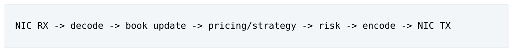

- ` NIC RX → decode → book update → pricing/strategy → risk → encode → NIC TX `

</details>

这条路径上的任何waiting、allocation、cross-core handoff 或unbounded loop 都会直接进入tick-to-trade latency。相反，logging、metrics aggregation、DB persistence、GUI、配置解析即使每条消息都会触发，也应尽可能成为 cold concern，而不是同步执行在 critical chain 上。

#### 1.1.1 Hot code 与 hot path 的区别

假设每次报价都执行 stats.increment()。从 sampling profiler 看它可能是高频代码，但业务上并不一定必须在“收到市场数据到发送报价”之间完成。若统计允许异步或per-thread accumulation，就可以把它从critical path 移开。

核心思维 Hot path 是 latency semantics 概念，不只是 profiler frequency 概念。优化前先画出“事件从哪里进入、在哪里产生业务结果”的完整路径。

### 1.2 Cold Work 为什么危险：问题是 variance，不只是平均慢

同步 logger、数据库调用、动态格式化等行为的风险来自隐藏工作：allocator、lock、syscall、buffer flush、 page fault、network timeout、filesystem 等。即使 99.9% 情况很快，偶发 slow path 也会制造极宽的 tail。

| Cold work | 隐藏成本 | 典型 hot-path 处理 |
| --- | --- | --- |
| Human-readable logging | formatting、timestamp、lock、file I/O | 写 compact binary event，后台格式化 |
| Metrics | atomic contention、histogram update | per-thread counter，后台 aggregate |
| DB persistence | TCP、lock、disk、timeout | 异步 journal / cold persistence |
| Config parse | JSON/string allocation/map rebuild | control thread 构造 immutable snapshot |
| Audit rendering | text / serialization | hot path 只记录最小结构化字段 |

### 1.3 Bounded Work：determinism 的第一根支柱

低延迟设计最危险的代码之一是：

<a id="pdf-page-010"></a>

<!-- source-pdf-page: 10 -->

*[原 PDF 第 10 页](./Level8_Low_Latency_CPP_Design_Patterns_CN.pdf#page=10)*

```text
while (!queue.empty()) {
    process(queue.pop());
}
```

如果 queue 深度可以从 1 变成 100000，这一轮 event-loop work 就没有明确上限。更合理的是 bounded batching：

```cpp
for (int i = 0; i < MAX_BATCH && !queue.empty(); ++i) {
    process(queue.pop());
}
```

bounded 不表示“每次必须做一样多”，而表示你知道单次 scheduler turn、recovery batch、timer batch、 hash probe、container growth 的最坏工作量在哪里停止。

#### 1.3.1 Bounded Polling Loop

一个 thread-per-core event loop 事实上承担了用户态 scheduler 的职责：

```text
while (running) {
    process_rx(MAX_RX);
    process_orders(MAX_ORDERS);
    process_timers(MAX_TIMERS);
    process_control(MAX_CTRL);
}
```

若任何一个 source 使用无限 draining，其他 work class 就可能 starvation。移除 OS scheduler 并没有移除 scheduling problem，而是把公平性、priority、budget 交给 application。

### 1.4 Single Writer：先改变 ownership，再谈同步 primitive

如果多个线程都写同一个 OrderBook，自然会出现 mutex、atomics 或 CAS。更高层的问题是：为什么它需要多个 writer？低延迟设计优先把 mutable state 绑定到一个 owner thread。

```text
PricingThread owns:
    Book
    PricingState
    QuoteState
    SubscriptionState
```

这样许多字段可以是普通整数、指针和结构体，不需要 per-field atomic。single writer 同时减少 write/write race、atomic RMW、cache-line bouncing、memory-order reasoning 和 recovery 复杂度。

#### 1.4.1 Lock-free 不等于 contention-free

多个 core 对同一个 atomic counter 做 fetch_add，虽然没有 mutex，但 cache line 仍需在 cores 之间反复获得 Modified ownership。真正优化应先考虑 per-thread counter + cold aggregation，而不是更复杂的 CAS loop。

<a id="pdf-page-011"></a>

<!-- source-pdf-page: 11 -->

*[原 PDF 第 11 页](./Level8_Low_Latency_CPP_Design_Patterns_CN.pdf#page=11)*

### 1.5 Run-to-Completion vs Pipeline

#### 1.5.1 Run-to-Completion

**图示转写**

1. ` packet `
2. ` decode `
3. ` book `
4. ` pricing `
5. ` risk `
6. ` output `
7. ` all on the same owner core `

<details>
<summary>查看原图与完整文字转写</summary>

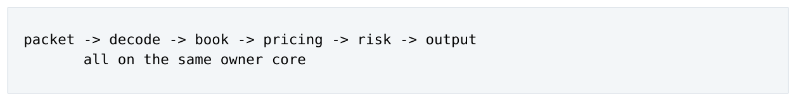

- ` packet → decode → book → pricing → risk → output `
- ` all on the same owner core `

</details>

优势是没有中间 queueing、较少 cache migration、自然 ordering 和稳定 working set。它通常最适合 low latency，但吞吐上限受单 core service capacity 限制。

#### 1.5.2 Pipeline

**图示转写**

1. ` RX core `
2. ` queue `
3. ` Book core `
4. ` queue `
5. ` Pricing core `
6. ` queue `
7. ` Gateway core `

<details>
<summary>查看原图与完整文字转写</summary>

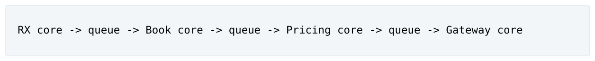

- ` RX core → queue → Book core → queue → Pricing core → queue → Gateway core `

</details>

Pipeline 可以让不同事件同时处于不同stage，提高stage parallelism；代价是handoff、coherence、queueing、backpressure 和 failure boundary 都增多。

| Run-to-Completion | Pipeline |
| --- | --- |
| E2E latency 通常更低、更窄 | 增加每段 queue/wait |
| Throughput 受一个 ownership core 限制 | 可按 stage 扩展 |
| Locality 强 | state 经常跨 core |
| Ownership 简单 | 跨 stage 生命周期复杂 |
| Best fit 可 partition 的 HFT data path | 某 stage 很重或无法同核 |

核心思维 扩展low-latency 系统时，优先尝试“按instrument/client/session 横向partition，每个partition run-to-completion”，而不是“每个逻辑模块拆成独立 thread”。

### 1.6 Queue Operation Cost 与 Queueing Delay

SPSC push/pop 可能只有几十 ns，但事件进入 queue 后，consumer 前面如果有 50 条，每条 service time 2 µs，则等待时间已约 100 µs。真实 handoff latency 应理解为：

Thandoff = Tpublish + Tcoherence + Tpoll + Tqueueing

其中 queueing 常常最大。因此性能测量不能只 benchmark 空 queue 的操作成本。

### 1.7 Utilization、Headroom 与 Tail Amplification

当 arrival rate λ 接近 service rate µ 时，任何 cache miss、interrupt 或异常重计算都容易形成 backlog。一个 100 µs slow event 不只让自己慢，还让后续事件排队，形成 tail amplification。

低延迟线程并不追求“CPU 利用率越高越好”。保留 headroom 是为了吸收 microburst 与偶发 jitter，避免系统工作在 latency cliff 附近。

<a id="pdf-page-012"></a>

<!-- source-pdf-page: 12 -->

*[原 PDF 第 12 页](./Level8_Low_Latency_CPP_Design_Patterns_CN.pdf#page=12)*

### 1.8 Data Plane 与 Control Plane

Data plane 包含 MD、orders、execution、pricing 等 latency-sensitive flow；control plane 包含配置、 health、admin、recovery orchestration、GUI 等。两个 plane 可以使用不同 programming model：hot path 固定内存、single writer、SPSC、busy polling；cold path 可以正常使用 mutex、shared_ptr、JSON、 asio、DB。

### 1.9 本章 Design Review 清单

- 关键 latency boundary 是 NIC/NIC、app/app 还是 client/venue？

- 哪些同步工作可以 defer、sample、aggregate 或 coalesce？

- 所有 loop/batch/retry 是否存在明确上限？

- 每个 thread boundary 是否对应真实 ownership/throughput/failure boundary？

- 同线程模块之间是否错误地使用了 queue/event bus？

- queue 深度、event age、consumer lag 是否进入 latency measurement？

### 1.10 本章结论

- Hot path 是 latency-critical path，不只是执行频率高的代码。

- Low latency 的上层目标是控制 work 和 waiting，而不是先优化单条 instruction。

- Single writer 和 thread confinement 往往比 generic lock-free 更重要。

- Run-to-completion 通常最利于 latency locality；throughput 不够时优先 partition。

- Queue 是 waiting 的存储器，也是 tail amplification 的放大器。

<a id="pdf-page-013"></a>

<!-- source-pdf-page: 13 -->

*[原 PDF 第 13 页](./Level8_Low_Latency_CPP_Design_Patterns_CN.pdf#page=13)*

### 第 2 章

## Data-Oriented Design

本章目标 从“对象关系”切换到“CPU 地址序列”：让 hot working set 更小、更连续、更可预测，减少 pointer chasing、TLB pressure 与隐藏的 dependency chain。

### 2.1 CPU 访问的是 Bytes、Addresses 与 Cache Lines

CPU 不理解 class diagram。对 hot code 而言，关键问题是下一次 load 的地址能否提前计算、同一 cache line 中有多少有用 bytes、访问是否跨大量 pages，以及多个 loads 是否 independent。

假设一个 Order 有 128B，但 pricing 只读取 price/qty/side 共 16B。即使所有对象在 L1，过大的 hot object 仍会浪费 cache capacity、增加 load traffic，并让 active working set 更快挤出 L1/L2。

核心思维 Data layout 的评价标准不是“面向对象是否优雅”，而是 CPU 在 hot loop 中以什么顺序访问哪些 bytes。

### 2.2 AoS、SoA 与 AoSoA

#### 2.2.1 Array of Structures

```cpp
struct Order {
    double price;
    int qty;
    int status;
};
Order orders[N];
```

如果每次处理几乎需要完整 Order，AoS 可以很好地把相关字段放在一起。

#### 2.2.2 Structure of Arrays

```cpp
struct Orders {
    double price[N];
    int qty[N];
    int status[N];
};
```

若算法只扫描price，SoA 能让一个64B cache line 带回多个连续price，提升cache-line utilization、prefetchability 和 SIMD friendliness。

<a id="pdf-page-014"></a>

<!-- source-pdf-page: 14 -->

*[原 PDF 第 14 页](./Level8_Low_Latency_CPP_Design_Patterns_CN.pdf#page=14)*

#### 2.2.3 AoSoA

对于固定 SIMD/block 宽度，可以每 8 个或 16 个元素组成一个小 SoA block，再把 block 排成 array，在 locality、vectorization 和多字段访问之间折中。

工程边界 没有“AoS 永远慢、SoA 永远快”的规则。layout 必须跟 access pattern 绑定；频繁一起访问的字段应该靠近，冷字段则尽量拆出。

### 2.3 Hot/Cold Field Splitting 与 Working Set

实际系统中最实用的手段往往不是全面 SoA，而是将 hot fields 与 audit/config/metadata 分离。比如：

```cpp
struct HotOrder {
    uint64_t id;
    int64_t priceTicks;
    int32_t qty;
    uint32_t next;
};

struct ColdOrder {
    ClientId client;
    Timestamp createTime;
    AuditData audit;
};
```

如果 10000 个 active order 的 hot state 从 256B 缩到 32B，working set 从约 2.5MB 下降到约 320KB， 这种变化通常比单条 prefetch hint 更重要。

### 2.4 Pointer Chasing：问题不仅是 Cache Miss

链表遍历：

```text
p = p->next;
p = p->next;
p = p->next;
```

下一次 load 地址依赖上一次 load 的结果，因此形成 serialized load-to-use chain。即使所有 node 都在 L1， CPU 也不能像连续array 那样同时发出多条independent loads。连续array 的地址由base + index * stride 直接得到，硬件 prefetcher 和 OoO engine 都更容易工作。

#### 2.4.1 多个独立链为什么可能更快

若同时处理 A/B/C/D 四条 independent list，每条链内部仍 serial，但四条链之间可提供 memory-level parallelism。它隐藏 latency，而不是消除每次 dependent load latency。

### 2.5 Packed Storage 与 Index-Based Structure

固定 pool：

<a id="pdf-page-015"></a>

<!-- source-pdf-page: 15 -->

*[原 PDF 第 15 页](./Level8_Low_Latency_CPP_Design_Patterns_CN.pdf#page=15)*

```cpp
struct Order {
    OrderId id;
    Qty qty;
    uint32_t next;
    uint32_t prev;
};
std::array<Order, MAX_ORDERS> pool;
```

用 32-bit index 代替 64-bit pointer 可以缩小 node、提高每个 cache line 的对象密度，并让 storage 更容易 relocation、snapshot、shared-memory mapping。

工程边界 index 并不会自动消除 pointer chasing。如果 i = pool[i].next，地址依赖仍然存在。真正收益来自 compact representation + packed active storage，而不是“把 pointer 改成 uint32_t”这一动作本身。

### 2.6 Intrusive Container 与 Stable Storage

std::list&lt;Order&gt; 往往意味着 per-node allocation、next/prev node overhead 和 scattered address。 intrusive list 把 links 放进对象本身，可以消除额外 list node；再配合 fixed pool，才能同时得到 O(1) unlink、 stable slot、bounded allocation 和较好的 locality。

L3 order book 的典型组合：

**图示转写**

1. ` OrderId `
2. ` fixed/open-address hash `
3. ` pool index `
4. ` packed Order `
5. ` Price `
6. ` level index `
7. ` PriceLevel `
8. ` head/tail order index `

<details>
<summary>查看原图与完整文字转写</summary>

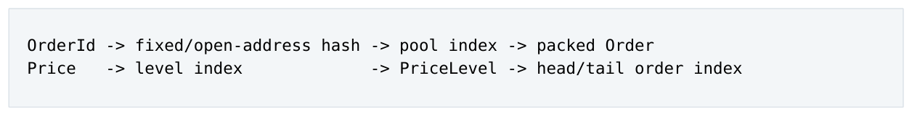

- ` OrderId → fixed/open-address hash → pool index → packed Order `
- ` Price → level index → PriceLevel → head/tail order index `

</details>

一个 storage 不必承担所有 lookup。多份 index + 单份 compact storage 往往是正确的 space-time tradeoff。

### 2.7 Big-O 不等于 CPU Latency

一个 20-50 元素的 sorted vector 即使插入 O(N)，移动的数据可能只有几百 bytes，且完全 contiguous； generic chained hash 虽平均 O(1)，却可能需要 hash、bucket、随机 node load、collision traversal，还存在 rehash tail。性能必须看实际 N、实际 bytes、branch 和 memory behavior。

| 结构 | 适合场景 | 主要低延迟 trade-off |
| --- | --- | --- |
| Dense array | 紧密 tick range、direct ID | 极快 direct indexing，但 working set 可能巨大 |
| Sorted vector / flat map | 小 N、频繁遍历 | 连续、compact；insert/delete 要移动 |
| Open-address hash | 大 key space、direct lookup | locality 好于 chained hash；需要 fixed capacity/load factor |
| Tree / std::map | 复杂 ordered operations | pointer chasing、node allocation，通常非首选hot path |
| Bitmap + dense ladder | bounded tick window | bit scan 快速找 next occupied level；需要控制window |

<a id="pdf-page-016"></a>

<!-- source-pdf-page: 16 -->

*[原 PDF 第 16 页](./Level8_Low_Latency_CPP_Design_Patterns_CN.pdf#page=16)*

### 2.8 Dense / Sparse Price Ladder

如果price 可转换为integer tick，index = tick - baseTick 可以直接定位level。对于bounded window， 还可维护occupied bitmap，用TZCNT/LZCNT/bit scan 找下一有效level。若price space 很稀疏，则dense array 的内存浪费可能反过来扩大 working set，此时 sorted vector 或 flat hash 更合理。

### 2.9 Hash Table 的 Tail 风险

Hot path 中的 hash table 应特别审查：

- 是否会 rehash？如果会，谁承担这次 O(N) 工作？

- load factor 是否有上限？probe length 是否可监控/限制？

- 是否 per-node allocation？

- key 是 compact integer，还是需要 string hash？

常见策略是启动阶段 reserve/fixed capacity，禁止 runtime rehash，或使用 fixed/open-address table 并把“capacity full”变成显式 failure policy。

### 2.10 Stable Address、Handle 与 Generation

如果 slot 可能复用，裸 index 42 无法区分“旧 Order A”与“新 Order B”。generation handle：

```cpp
struct Handle {
    uint32_t index;
    uint32_t generation;
};
```

复用 slot 时 generation++，旧 handle 通过一次整数比较失效。它用极低成本换来 stale-reference 检测，也比 raw pointer 更适合 relocation/serialization。

### 2.11 False Sharing 与 True Sharing

两个线程写同一cache line 上不同字段属于false sharing；可通过per-writer cache-line separation 解决。若两线程确实写同一个atomic counter，则属于true sharing，padding 没有用，必须改变ownership/algorithm， 如 per-core counter 后台 aggregate。

工程边界 不要“看到 64B 就 alignas(64)”。padding 也会放大 working set。只有高频跨核写入的 independent state 才值得主动分 cache line。

### 2.12 Small Value Object、Copy 与 Zero-Copy

小型 16-32B value 直接 copy 往往比 shared_ptr/pointer lifetime 更便宜。zero-copy 主要用于大 buffer； 对小 message，为了避免 copy 而引入 heap、refcount、pointer chasing，可能反而更慢、更难预测。

<a id="pdf-page-017"></a>

<!-- source-pdf-page: 17 -->

*[原 PDF 第 17 页](./Level8_Low_Latency_CPP_Design_Patterns_CN.pdf#page=17)*

### 2.13 Compact IDs、Denormalization 与 Precomputation

hot path 应尽量把 string symbol/client/venue 预解析成 compact integer ID，直接 array indexing。对于经常访问的派生常量，如 tick scale、multiplier、route code，也可启动阶段 precompute 或复制到 hot state。内存设计允许适度 denormalization，用内存换 locality 和少一次 pointer traversal。

### 2.14 本章结论

- CPU 的真实输入是地址序列、cache lines 和 dependency graph。

- 缩小 hot working set 往往比微调 instruction 更有价值。

- Packed storage 同时改善 cache、TLB、prefetch、allocation 和 serialization。

- Pointer chasing 的损失包括低 MLP，不只是 cache miss。

- Big-O 必须结合实际 N、layout、probe/branch 与 worst-case work。

- Index/handle、intrusive links、multiple indices 是低延迟数据结构的重要组合。

<a id="pdf-page-018"></a>

<!-- source-pdf-page: 18 -->

*[原 PDF 第 18 页](./Level8_Low_Latency_CPP_Design_Patterns_CN.pdf#page=18)*

### 第 3 章

## Memory Ownership &amp; Allocation Patterns

本章目标 让创建、销毁、容量、lifetime 与 reclamation 都进入可推理模型。目标不是“禁止 new”，而是避免 runtime allocator variance 与不清晰 shared ownership。

### 3.1 为什么 General Heap 对 Hot Path 不友好

普通 new/delete 的主要风险不是平均慢，而是其执行路径可能依赖 allocator metadata、thread cache、 central lock、page expansion、fragmentation、page fault、NUMA placement 等。低延迟代码关心的是 tail property：是否可能在最忙时触发完全不同的 allocator path。

### 3.2 Preallocation 与 Fixed Capacity

如果业务容量上限可以定义，启动阶段一次性准备存储：

```cpp
constexpr size_t MAX_ORDERS = 100000;
std::array<Order, MAX_ORDERS> orders;
```

Fixed capacity 把“内存会不会继续增长”从 runtime behavior 变成 architecture invariant。capacity exceeded 时应明确 reject、throttle、stop quoting 或 fail fast，而不是隐式 fallback 到 heap。

#### 3.2.1 reserve 不等于 prefault

vector.reserve(N) 主要保证capacity，不能证明所有virtual pages 已经映射到local physical memory。 低延迟初始化常采用：

**图示转写**

1. ` bind worker `
2. ` allocate/preallocate `
3. ` touch/prefault `
4. ` warm `
5. ` enter hot loop `

<details>
<summary>查看原图与完整文字转写</summary>

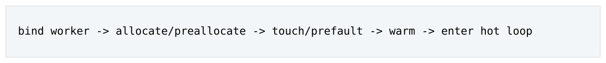

- ` bind worker → allocate/preallocate → touch/prefault → warm → enter hot loop `

</details>

first-touch 也影响 NUMA placement，因此最好由最终 owner thread 在正确 NUMA core 上触碰自己的 pools。

### 3.3 Object Pool 与 Free List

固定大小、高频创建/销毁的对象适合 pool：

**图示转写**

1. ` freeHead `
2. ` slot 5 `
3. ` slot 2 `
4. ` slot 9 `
5. ` ... `
6. ` allocate: pop head `
7. ` release: push head `

<details>
<summary>查看原图与完整文字转写</summary>

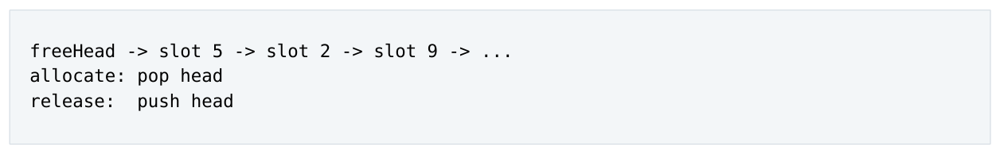

- ` freeHead → slot 5 → slot 2 → slot 9 → ... `
- ` allocate: pop head `
- ` release: push head `

</details>

若 pool 由单线程 owner 管理，allocate/release 可以是几条普通 load/store，不需要 atomic freelist。Pool 同时提供 stable storage、known maximum capacity、better locality 和 predictable reuse。

<a id="pdf-page-019"></a>

<!-- source-pdf-page: 19 -->

*[原 PDF 第 19 页](./Level8_Low_Latency_CPP_Design_Patterns_CN.pdf#page=19)*

#### 3.3.1 Slot Metadata 复用

free slot 可以把storage 的部分bytes 当作nextFree，occupied 时再placement-new 构造对象。对trivially destructible 的 hot object，reuse 更简单；若对象内部拥有 string/vector/shared_ptr，construction/destruction 的隐藏成本会显著增加。

### 3.4 Arena / Region / Bump Allocation

同一生命周期的一组 temporary object 可以放在 arena：

```text
allocate: p = current; current += aligned_size;
free: no individual free
reset: current = base;
```

它非常适合packet decode scratch、batch-scoped temporary、one-request workspace。优势是pointer arithmetic + bounds check，几乎没有 fragmentation；限制是对象通常一起死亡，individual free 不自然。

### 3.5 Stack 与 Value Semantics First

小型、固定、短生命周期对象优先 local value：

```text
Quote q; // often stack/register
process(q);
```

没有理由把一个 32B、单 owner、callback 内结束生命周期的对象改成 make_shared。Hot C++ 中“value first, heap only when lifetime requires it”通常既简单又快。

### 3.6 unique_ptr、shared_ptr 与 Non-owning Reference

unique_ptr 明确单一 ownership，若确实需要 heap，基本没有 refcount overhead。shared\_ptr 的问题不仅是跨线程 atomic refcount，还有最后一个 reference 在哪里消失不可预测：hot thread 的一次 reset 可能触发复杂 destructor 和 deallocation。

核心思维 shared ownership 经常是 ownership architecture 不清晰的信号。低延迟系统更偏向 single owner + raw pointer/reference/handle 作为 non-owning borrow。raw pointer 本身不是问题，模糊 ownership 才是问题。

### 3.7 Lifetime Classes：Allocator 应跟语义走

Lifetime 对象例子 常见 storage

Process lifetime Instrument config、route ta- preallocated/static/immutable snapble shot Session lifetime FIX session、gateway state owner-local object / pool Order lifetime active order fixed object pool + handle Event lifetime one queue hop ring slot / inline value

<a id="pdf-page-020"></a>

<!-- source-pdf-page: 20 -->

*[原 PDF 第 20 页](./Level8_Low_Latency_CPP_Design_Patterns_CN.pdf#page=20)*

One iteration scratch/temp calculation stack / arena Read-mostly versions config/risk snapshot RCU / immutable version

先分类 lifetime，再决定 pool/arena/stack，而不是“团队有某 allocator，所以所有对象都从它分配”。

### 3.8 Destruction 也必须 Bounded

vector.clear() 可能同步运行 N 个 destructor；shared\_ptr.reset() 可能成为最后一个 owner。RAII 没有问题，但 hot-path destructor 应尽量 trivial/O(1)。复杂 cleanup 可 defer 到 cold path 或采用 bulk reset。

### 3.9 Deferred Reclamation

跨线程读取时，writer 不能在 reader 仍访问对象时直接 free。选择顺序应从简单到复杂：

1. 能否避免共享，single owner 直接回收？

2. 能否让对象 immutable，并延迟到确定 quiescent point？

3. 能否 batch lifetime / return handle to owner？

4. 才考虑 epoch、RCU、hazard pointer 等 concurrent reclamation。

#### 3.9.1 Reference Counting

精确、直观，但每个 acquire/release 可能带 atomic RMW/coherence，且最后释放点不稳定。

#### 3.9.2 Epoch-Based Reclamation

reader 进入某个 epoch 处理一批对象，writer retire 后等待所有 reader 离开旧 epoch 再回收。读路径较轻， 但 slow/stuck reader 会阻止 reclamation 进展，因此 reader critical section 也必须 bounded。

#### 3.9.3 RCU

writer 构建新immutable version、publish pointer，reader 几乎只做pointer load；旧版本等grace period 后回收。非常适合 read-mostly config/routing/risk limits。

#### 3.9.4 Hazard Pointer

reader 显式publish 正在使用的pointer，writer 扫描hazard set 后决定是否可reclaim。精确但bookkeeping 更重、实现复杂，通常是“共享无法避免后的方案”，不是默认选择。

### 3.10 Double/Triple Buffer 与 Reuse Safety

双buffer 只有在writer 能证明reader 已结束旧buffer 时才安全；“有两个buffer”本身不是lifetime protocol。 若 reader 可以无限慢，需要 version/epoch/ack 或更多 buffer，但任何 finite buffer 在无限慢 reader 下最终都会遇到 reuse pressure。

<a id="pdf-page-021"></a>

<!-- source-pdf-page: 21 -->

*[原 PDF 第 21 页](./Level8_Low_Latency_CPP_Design_Patterns_CN.pdf#page=21)*

### 3.11 Per-Thread Allocator 与 Cross-Thread Free

理想：allocate owner = reclaim owner。如果A 分配对象给B，B 完成后可以把handle 通过return SPSC 返给 A，由 A recycle pool，避免 remote free、global allocator metadata 或 atomic freelist contention。

### 3.12 Pool Exhaustion 与 Memory Backpressure

固定 pool 的 capacity full 不是“小概率容器边界”，而是 system overload signal。不要写：

```text
if (pool.empty()) return new Order; // bad fallback
```

这会在最忙时突然改变latency model。正确做法是让business semantics 决定reject/throttle/stop/fail，并监控 high watermark。

### 3.13 Zeroing、Lazy Init 与 Reuse

每次 reuse 512B slot 都 memset(0) 可能成为显著成本。可以只初始化有效字段，或使用 generation/version 表示 validity；但必须保证旧值不会漏入逻辑。arena reset 通常只移动 bump pointer，不需要清零整块 memory。

### 3.14 本章结论

- Preallocation 把 allocator/page/capacity uncertainty 移到 startup。

- Pool 适合独立 lifetime 的固定对象；arena 适合同一 lifetime group。

- single owner + non-owning borrow 比 pervasive shared_ptr 更适合 hot path。

- allocate/reclaim ownership 与 NUMA/thread ownership 最好一致。

- Reclamation complexity 应在共享确实无法避免后再引入。

- Fixed capacity 必须配显式 exhaustion policy。

<a id="pdf-page-022"></a>

<!-- source-pdf-page: 22 -->

*[原 PDF 第 22 页](./Level8_Low_Latency_CPP_Design_Patterns_CN.pdf#page=22)*

### 第 4 章

## Concurrency Patterns

本章目标 把并发问题从“选哪种锁”提升为“是否需要共享”。通过 thread confinement、partitioning、 single writer、SPSC 与 immutable publication 减少 synchronization 和 coherence。

### 4.1 Shared Mutable State 才是根问题

mutex 只是共享 mutable state 的一种协调工具。即便改成 atomic/CAS，多个 core 仍需竞争 cache-line ownership。低延迟并发首先要尝试把共享写入变成 partitioned ownership。

```text
Shared counter + atomic RMW
        |
        v
Per-thread counters + cold aggregation
```

前者是 synchronization problem，后者变成 aggregation problem，通常更容易、更稳定。

### 4.2 Thread-per-Core 与 Stable Execution Ownership

专用 hot thread 长期绑定同一 logical CPU，不仅减少 migration 和 scheduler noise，也能保持更稳定的 L1/L2、TLB 与branch-predictor state。它不意味着“一个component 一个thread”，而是让一个ownership domain 有稳定的 execution home。

### 4.3 Partition Before Synchronize

常见 key：instrument、client、account、venue、order、strategy、session。好的 partition key 同时考虑：state ownership、事件局部性、cross-partition dependency、load balance 和 routing cost。

#### 4.3.1 Co-location of Dependencies

如果 Book、PricingState、QuoteState 几乎每个 event 都一起用，把它们放同 owner thread 比“分别做成 scalable service”更符合 low latency。错误 partitioning 可能让一个 event 在 instrument core、client core、account core、gateway core 之间连续跳转。

### 4.4 SPSC：最理想的 Thread Boundary

Single Producer Single Consumer 的关键不是“lock-free”标签，而是 producer/consumer 对 cursor 的 ownership 很清楚：producer 写 tail，consumer 写 head。

<a id="pdf-page-023"></a>

<!-- source-pdf-page: 23 -->

*[原 PDF 第 23 页](./Level8_Low_Latency_CPP_Design_Patterns_CN.pdf#page=23)*

```text
producer:
    write slot
    tail.store(next, release)

consumer:
    t = tail.load(acquire)
    if (head != t) read slot
```

release/acquire 用于 publication ordering；payload 本身通常可以是普通 memory。不要把所有 slot field 都做 atomic。

#### 4.4.1 Cache-Line Placement 与 Cached Cursor

head/tail 若由不同 cores 高频写，应避免放在同 cache line。producer 也不必每次都读取 consumer head， 可以 local-cache，只有 queue 接近 full 时刷新 shared head，降低 coherence traffic。

#### 4.4.2 Monotonic Sequence + Power-of-Two Ring

head/tail 使用 monotonically increasing sequence，slot index 用 seq AND mask，queue occupancy 用 tail-head。这种模型比只维护反复 wrap 的数组下标更容易 reasoning overflow/full/empty。

### 4.5 MPSC：Multiple SPSC Fan-In 往往更好

一个 generic MPSC 往往需要 producers 争 shared producer cursor。若 producer 数可控，可以：

**图示转写**

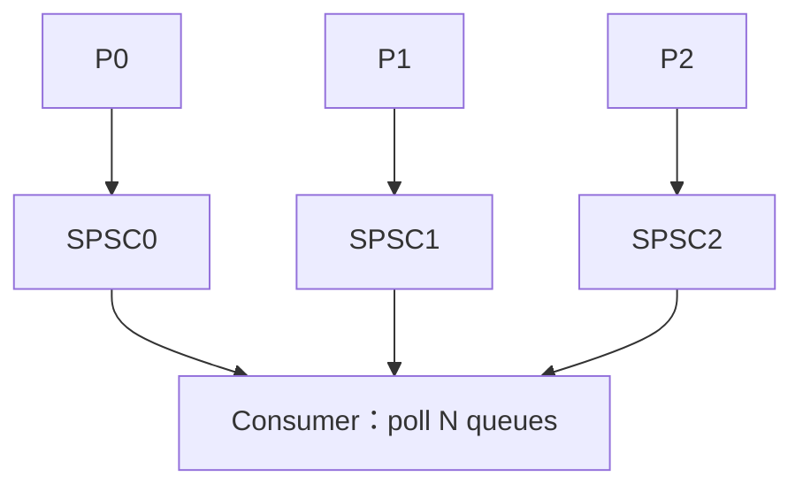

<details>
<summary>查看原图与完整文字转写</summary>

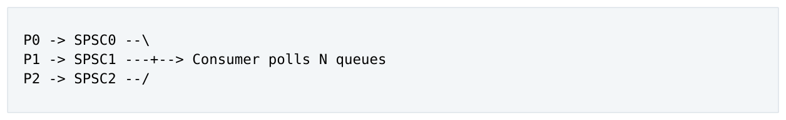

- ` P0 → SPSC0 --\ `
- ` P1 → SPSC1 +→ Consumer polls N queues `
- ` P2 → SPSC2 --/ `

</details>

这样 producer path 没有互相 contention，代价是 consumer 需要轮询多个 queues；当 N 很大时 polling overhead 也要评估。

### 4.6 MPMC 与 Work-Stealing 的位置

MPMC/work-stealing 适合 throughput-oriented generic task pool，因为它动态平衡 CPU 使用率；但动态 ownership、CAS、cache migration 与 scheduler uncertainty 往往不是 strict low-latency hot path 的优先选择。静态 assignment 可以接受一定 under-utilization，换 locality 和 predictable ownership。

### 4.7 Shared Read-Only / Read-Mostly State

启动后 immutable 的 instrument config 可在多个 cores Shared cache state 中读取，不发生 write invalidation。若偶尔更新，可用 immutable snapshot / RCU：control thread 构造 B，atomic publish pointer； reader 只 load pointer + ordinary reads。

<a id="pdf-page-024"></a>

<!-- source-pdf-page: 24 -->

*[原 PDF 第 24 页](./Level8_Low_Latency_CPP_Design_Patterns_CN.pdf#page=24)*

### 4.8 Seqlock

适合 one writer + many readers + small in-place state：

**图示转写**

| 角色 / 步骤 | 动作 |
| --- | --- |
| Writer 1 | seq 变为 odd |
| Writer 2 | write fields |
| Writer 3 | seq 变为 even，按正确协议发布 |
| Reader 1 | 读取 seq1 |
| Reader 2 | 读取 fields |
| Reader 3 | 读取 seq2 |
| 接受条件 | seq1 == seq2 且为 even；仍需独立证明 C++ race freedom |

<details>
<summary>查看原图与完整文字转写</summary>

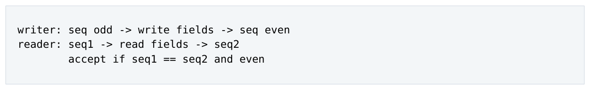

- ` writer: seq odd → write fields → seq even `
- ` reader: seq1 → read fields → seq2 `
- ` accept if seq1 == seq2 and even `

</details>

reader 无需 lock，但 writer 高频时会 retry，tail 可能变宽；若 data 含可被 writer free 的 pointer，仅靠 seqlock 不能保证 lifetime safety。

### 4.9 Versioned Data Store / Ring of Versions

writer 把 version N 写入 slot = N \% capacity 并 publish；reader 若落后超过 ring capacity，数据可能被覆盖。若要求所有 readers lossless，producer progress 受最慢 reader position 限制。若不允许慢 reader 拖 producer，只能改变语义：drop、snapshot/rejoin、latest-value、disconnect slow consumer。

核心思维 有限内存下无法同时满足：producer 永不阻塞、所有 consumers 不丢、consumer 可以无限慢。这个不变量必须在 architecture 层接受。

### 4.10 Latest-Value Publication

若 consumer 只关心当前 value，可以用 atomic snapshot / coalesced state，而不是每次 update 都排队。 event stream 与 state snapshot 是两种不同语义：前者中间变化本身重要；后者只关心最终 current state。

### 4.11 Spinlock、Mutex、Lock-Free 与 Wait-Free

| 机制 | 特点 | Low-latency 风险 |
| --- | --- | --- |
| mutex | 可 sleep/block | holder preempted、scheduler/wakeup variance |
| spinlock | short wait without sleep | holder delayed 时 busy-spin；contention bounce |
| lock-free | system overall progress | 单线程可能无限 CAS retry，不等于 bounded |
| wait-free | per-operation bounded steps | 性质强但复杂，通用实现成本高 |
| SPSC topology | fixed producer/consumer | 通过限制 topology 自然简化同步 |

Cold path 每分钟一次的 config lock 完全可以用 mutex，不必为了“全系统 lock-free”引入高复杂度结构。

### 4.12 Atomic RMW vs Atomic Load/Store

fetch_add 需要exclusive ownership，容易成为coherence hotspot；read-mostly atomic load 或single-writer store 的成本模型不同。x86 上 acquire/release 可能汇编看起来接近普通 load/store，但 C++ 语义仍用于建立 happens-before，不应因为“x86 强序”就随意使用 relaxed。

> **转换勘误（高置信度）**：本节及附录 C.3 是概念示例。若 `data` 为普通非 atomic 对象，writer 写入与 reader 的 `Snapshot s = data` 没有 happens-before，则并发访问已经构成 C++ data race / UB；事后发现版本变化并丢弃 snapshot 不能消除已经发生的 race。还需独立证明 payload race freedom、读写排序和 lifetime。可选方案包括经过证明的 atomic payload 协议、不可变 snapshot + 安全回收，或锁。依据：[C++ draft / intro.races](https://eel.is/c++draft/intro.races)。

<a id="pdf-page-025"></a>

<!-- source-pdf-page: 25 -->

*[原 PDF 第 25 页](./Level8_Low_Latency_CPP_Design_Patterns_CN.pdf#page=25)*

### 4.13 NUMA、SMT 与 Cross-Core Handoff

跨NUMA queue 会把publication/coherence 送过inter-socket link；NIC 在NUMA0 而pricing 在NUMA1 也会增加 remote traffic。两个 hot threads 放同一 physical core 的 SMT siblings 会共享 frontend、execution resources、L1/L2 等，通常需要谨慎。

真实handoff 要测A 写payload、release publication、coherence、B polling observation、payload read 的完整时间，而不是只测 queue function 本身。

### 4.14 Uniqueness vs Total Ordering

多个 partitions 若只需要全局唯一 OrderId，可以编码：

```text
OrderId = [partition_id | local_sequence]
```

避免 global atomic fetch-add。严格全局 total order 是真正 serialization requirement；很多业务只需要 per-order/per-symbol/per-session order，不要为不需要的 global order 支付代价。

### 4.15 本章结论

- Partition before synchronize；不要先共享再用 atomic 修补。

- Thread boundary 应与 ownership/throughput/failure boundary 对齐。

- same-thread 模块优先 function call，queue 是 execution boundary 不是 class boundary。

- SPSC 是极强 primitive，因为 topology 本身消除了 arbitration。

- Read-mostly 数据应让 reader cheap，把复杂度移向 cold writer。

- Lock-free 不保证 contention-free、fairness 或 bounded latency。

<a id="pdf-page-026"></a>

<!-- source-pdf-page: 26 -->

*[原 PDF 第 26 页](./Level8_Low_Latency_CPP_Design_Patterns_CN.pdf#page=26)*

### 第 5 章

## Messaging &amp; Event Processing Patterns

本章目标 从“queue 多快”提升到“消息允许发生什么”：明确event/state、ordering、loss、backpressure、 slow consumer、replay、staleness 和 commit semantics。

### 5.1 Event Semantics vs State Semantics

Event 表示“发生了一件事”，例如 AddOrder、Cancel、Fill、SessionReset；中间事件、顺序与 identity 通常重要。State 表示“现在是什么”，例如current fair value、GUI price、kill switch、health status；consumer 可能只需要 latest。

如果 consumer 只需要 latest state，却把每个中间 update 都排队，slow consumer 会花 CPU 处理已经失去业务价值的 stale work。这不是 queue 实现问题，而是语义选错。

### 5.2 Coalescing 与 Latest-Value-Wins

EURUSD price v100-v110 若只有 v110 有价值，可以 overwrite/coalesce；L3 delta、orders、executions 则通常不能。Coalescing 的价值是直接减少工作量，而不是把每次 pop 优化几纳秒。

### 5.3 Sequence Number、Ordering 与 Gap Detection

Event stream 常带sequence 以支持per-stream ordering 和gap detection。要区分：transport sequence （例如 FIX MsgSeqNum）与 business identity（例如 ExecID）。一个 execution 可以从 live、drop copy、 replay 多个 channel 到达，session sequence 连续不等于业务 effect 没有重复。

### 5.4 Immutable Event 与 Ownership Transfer

理想生命周期：publish 前 producer owns slot；release publish 后 consumer 获得 read ownership；consume 后slot 可复用。Event 一旦publish 不再修改，可以把共享mutation 问题缩小成publication ordering + lifetime。

### 5.5 Ring Buffer：Fixed Capacity 才是本质

Ring 的价值来自 fixed memory、contiguous slots、no runtime allocation 和明确 producer-consumer &lt;= N。capacity 不应只因为 power-of-two 好实现，而要根据 max burst、consumer stall、arrival rate、 event age SLO 与 memory footprint 决定。

<a id="pdf-page-027"></a>

<!-- source-pdf-page: 27 -->

*[原 PDF 第 27 页](./Level8_Low_Latency_CPP_Design_Patterns_CN.pdf#page=27)*

#### 5.5.1 Queue 越大不一定越好

大 queue 可以吸收更长 burst，却也能隐藏 sustained overload。系统可能从不 full，但长期保持几十万 stale events。应监控 depth distribution、producer-consumer sequence lag 和 event age，而不只 full count。

### 5.6 Batching：Throughput vs Latency

批量可摊薄 cursor update、syscall、publication 和 branch overhead；但若等待 batch 填满，会增加第一个 event latency。low latency 更常用 opportunistic bounded batch：立即处理当前已有数据，但每次最多 N 条，然后服务其他 source。

### 5.7 Event Loop 是用户态 Scheduler

一个 busy-spinning core 同时处理 MD、orders、timers、control，需要明确 weighted budget。Strict priority 若高优先级流量永远非空，会导致低优先级 starvation；不同 work class 的 deadline 和业务重要度应进入 scheduler policy。

### 5.8 Slow Consumer 与 Backpressure 不变量

若 λ &gt; µ 长期成立，只有几种结果：queue 增长、producer 变慢、drop、coalesce、disconnect 或 fail。finite memory 下，不可能同时要求 producer 永不阻塞、consumer 永不丢、consumer 可无限慢。

#### 5.8.1 Reliability Classes

| Class | 例子 | Full / Slow Policy |
| --- | --- | --- |
| Must not lose | Orders / Executions | backpressure、fail、persist、reconcile；绝不silent drop |
| Recoverable | Incremental market data | detect gap + replay/snapshot/rejoin |
| Latest-state | Price snapshot、health、some risk snapshot | overwrite/coalesce/stale skip |
| Best effort | Metrics / debug telemetry | drop/sample/rate-limit |

同一个系统应该允许不同 channel 使用不同语义，而不是所有 queue 统一行为。

### 5.9 Broadcast 与 Slow Reader

Reliable broadcast 的 retention 受最慢 consumer 控制；best-effort 可以丢；recoverable broadcast 允许实时 loss 后通过 replay/snapshot 恢复。非关键 reader 不应决定关键 publisher tail latency，可通过 separate queue、drop lagging consumer 或 snapshot/rejoin 隔离。

### 5.10 Replay、Event Sourcing 与 Deterministic Reducer

可 replay stream 对 testing、incident reproduction、new consumer bootstrap 和 recovery 都有价值。 核心 state reducer 尽量满足：

<a id="pdf-page-028"></a>

<!-- source-pdf-page: 28 -->

*[原 PDF 第 28 页](./Level8_Low_Latency_CPP_Design_Patterns_CN.pdf#page=28)*

```text
new_state = reduce(old_state, event)
```

并避免在 reducer 内调用 wall clock、随机数、external mutable DB。side effects 在边界生成 Action，由 shell 执行。

### 5.11 Message Representation

Hot message 倾向 small/fixed/flat，compact IDs，避免 string/vector/shared_ptr。小 message 直接 inline copy 往往优于 pointer ownership；大 payload 可用 descriptor ring + buffer pool，让 ring slot 固定、payload lifetime 明确。

### 5.12 Aeron / Disruptor / Custom SPSC 的选择

Custom SPSC 适合 same-process one-producer-one-consumer 的最小边界。Disruptor 类 ring 提供 sequence-based publication 与多consumer 模型。Aeron 解决IPC/UDP/fan-out/flow control/archive/replay 等更完整问题。功能越多，成本与 operational semantics 也越复杂；选择要看需求，而不是单看 microbenchmark。

### 5.13 Microburst、Saturation Curve 与 Latency Cliff

Average rate 不能代表交易流量。几十 µs 内集中到达的 microburst 会迅速产生 queue。应在不同 offered load 下测 p50/p99/p99.9、depth、drop、event age，观察系统的 knee point；生产应远离接近 saturation 后 tail 急剧上升的区域。

### 5.14 Stale Work Elimination 与 Throttling

派生 quote/analytics event 可以携带 version，consumer 发现 old version 已被 newer state 覆盖时直接 skip。对于报价还可采用 leading-edge + trailing-latest：第一次立即发送，窗口内只保留最新，窗口尾发送最后状态。Token bucket 是主动 rate limit；backpressure 是下游 capacity 迫使上游减速，两者语义不同。

### 5.15 Head-of-Line Blocking 与 Multi-Queue Ordering

Critical cancel 若排在大量 quote update 后会被 HoL blocking。拆成不同 latency/reliability queues 可缓解，但多 queue 天然失去全局 FIFO order。New/Cancel/Replace 等有因果关系的业务事件仍需要 per-order owner、sequence 或 unified business stream 来保证 causal ordering。

### 5.16 Commit Point

“queue push 成功”只意味着local ownership handoff 成功，不意味着bytes 已送NIC，更不意味着exchange accepted。系统应该明确不同commit point：decision、local publication、gateway encode、NIC submit、 venue receipt、venue ACK。Crash 位于不同点会产生不同 uncertain outcome。

<a id="pdf-page-029"></a>

<!-- source-pdf-page: 29 -->

*[原 PDF 第 29 页](./Level8_Low_Latency_CPP_Design_Patterns_CN.pdf#page=29)*

### 5.17 本章结论

- Event 与 State 是 messaging 设计的第一分叉。

- Queue full / slow consumer 是 architecture semantics，不是容器 edge case。

- Queue operation latency 通常小于 queueing/waiting latency。

- Reliability class 应决定 drop、coalesce、backpressure、replay 策略。

- Replay、idempotency、sequence 与 message lifetime 应一起设计。

- Message boundary 同时是 ownership、latency 和 failure boundary。

<a id="pdf-page-030"></a>

<!-- source-pdf-page: 30 -->

*[原 PDF 第 30 页](./Level8_Low_Latency_CPP_Design_Patterns_CN.pdf#page=30)*

### 第 6 章

## State Machines &amp; Recovery Patterns

本章目标 让 duplicate、out-of-order、gap、uncertain outcome、restart 和 reconciliation 都成为明确状态转换，而不是异常时临时写补丁。

### 6.1 Order = State + Events

订单生命周期不是几个 bool，而是显式状态机：

**图示转写**

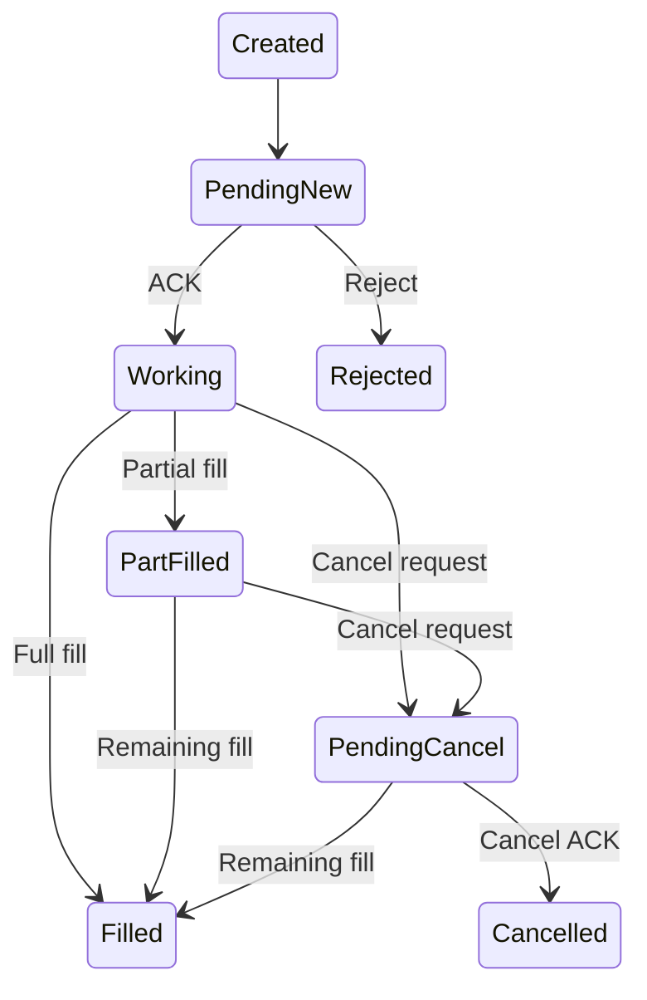

> **转换补充**：原图的 PendingCancel 连线位置不清，这里按常见订单生命周期展开示意；真实交易所协议可能用正交的 pending flag。Cancel request 不是 cancel success，pending 期间仍可成交，terminal state 与优先级须以协议为准。

<details>
<summary>查看原图与完整文字转写</summary>

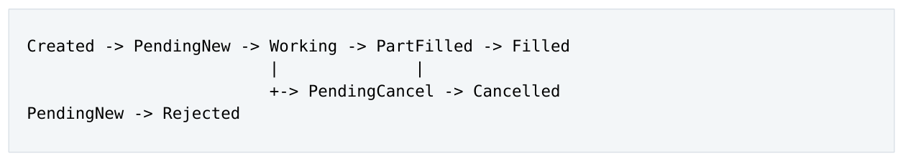

- ` Created → PendingNew → Working → PartFilled → Filled `
- ` -> PendingCancel → Cancelled `
- ` PendingNew → Rejected `

</details>

PendingCancel 并不表示已经取消；venue 在 cancel ACK 前仍可能 fill。terminal state 后也可能收到 duplicate/late event，因此每个 state x event 组合需要定义 accept、ignore、defer、reconcile 或 invariant violation。

### 6.2 State Enum 不够：还需要 Invariants

例如：

```text
• cumQty >= 0, leavesQty >= 0
• 正常模型下 orderQty = cumQty + leavesQty
```

- Filled/Cancelled 时 leavesQty = 0

- cumQty 不应下降

- position = sum(unique applied executions)

Invariant 比具体 container/implementation 更持久，也更适合 property-based testing。

### 6.3 Duplicate 与 Idempotency

同一 ExecID 重复到达不能重复改变 position/cumQty。可以用 seen-set、sequence 或 durable ledger，但要区分transport sequence 和business key。In-memory dedup 若restart 后丢失，跨restart 的exactlyonce effect 仍需要 durable key/ledger/DB unique constraint 等最终保障。

### 6.4 Out-of-Order：Accept、Defer、Reconcile

PendingNew + Fill 可能在某些 venue/channel topology 中出现。三类策略：

1. Accept：若 Fill 本身足以证明 order 被接受，直接进入 PartFilled/Filled，late ACK 只 merge metadata。

2. Defer：短暂 buffer 等 prerequisite event，但必须有 timeout 和 bounded buffer。

<a id="pdf-page-031"></a>

<!-- source-pdf-page: 31 -->

*[原 PDF 第 31 页](./Level8_Low_Latency_CPP_Design_Patterns_CN.pdf#page=31)*

3. Reconcile：无法安全推断时进入 Unknown/Uncertain，查询 authoritative source。

不要为了 enum 简洁而对不确定状态“猜 Working 或 Rejected”。

### 6.5 Illegal Transition 与 Ignore Policy

Cancelled + duplicate CancelAck 可以 idempotently ignore；Filled + unseen new Fill 则是新业务信息， 不能忽略。非法 transition 应触发 invariant violation、audit 和 reconciliation，而不是 silently overwrite state。

### 6.6 Deterministic Reducer + Side-Effect Shell

核心逻辑尽量：

```text
(state, event) -> (new_state, actions)
```

网络发送、DB、logging、wall clock 放在 side-effect shell。这样 live、replay、test 可以使用同一 reducer； timeout 也可以建模为 TimerExpired event，而不是散落的 now() 判断。

### 6.7 Recovery 的三层

| 层 | 解决什么 | 典型机制 |
| --- | --- | --- |
| Transport recovery | 消息流是否有 gap | FIX seq、MD seq、replay、GapFill |
| Application state recovery | process memory 丢失 | snapshot + journal/replay、DB load |
| Business reconciliation | 内外状态是否一致 | venue query、drop copy、open-order compare |

FIX sequence 连续只说明 session stream 没发现 gap，不等于 position/order business state 一定正确。

### 6.8 Snapshot + Replay

Snapshot 必须绑定明确lastAppliedSeq=N，restart 从N+1 replay。Single-owner partition 的consistent snapshot 容易获得，因为 state mutation 有天然 total order；多 writer state 做 globally consistent snapshot 则需要 coordination。

### 6.9 Journal 与 Durability Trade-off

Persist-before-apply 能提供更强 crash semantics，但直接增加 hot latency；apply-first + async journal 更快，但 crash window 内可能丢最后一段 local derived state。选择取决于 state 是否 authoritative、是否可从 venue/drop-copy/replay 重建。

<a id="pdf-page-032"></a>

<!-- source-pdf-page: 32 -->

*[原 PDF 第 32 页](./Level8_Low_Latency_CPP_Design_Patterns_CN.pdf#page=32)*

### 6.10 Source of Truth 与 Derived State

- Venue/exchange：通常是其 order/execution outcome 的 authoritative truth。

- Internal OMS：可能是 parent order、client intent、routing decision 的 authoritative truth。

- Position/P&amp;L/risk aggregate：尽量做成由 unique executions 派生，可 rebuild。

Derived state 越多，crash consistency 越容易围绕一个 authoritative ledger 重建，而不是维护多个独立 durable truth。

### 6.11 Reconciliation

Mismatch 不应 silent overwrite，而应 detect -&gt; classify -&gt; repair -&gt; audit。Repair 最好仍转换成 structured recovery event，走同一个 reducer，这样 normal/recovery semantics 统一。

### 6.12 Connected != Ready

Session state 可以：

**图示转写**

1. ` Disconnected `
2. ` Connecting `
3. ` Recovering `
4. ` Synchronizing `
5. ` Live/Ready `

<details>
<summary>查看原图与完整文字转写</summary>

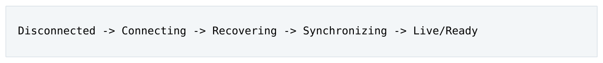

- ` Disconnected → Connecting → Recovering → Synchronizing → Live/Ready `

</details>

TCP connected 或 FIX logon success 并不表示 open orders、position、risk、market data 都已同步。只有 transport、business reconciliation、risk readiness、MD validity 全部通过，才打开 trading gate。

### 6.13 Fail Closed 与 Uncertain Outcome

Request 已发送但ACK 未观察到时，系统不知道remote 是否执行。blind retry 可能复制订单。正确策略是协议允许时idempotent retry，或query/reconcile；在uncertain state 下限制新风险，按worst-case exposure 预留，直到 authoritative truth 明确。

### 6.14 Market Data Recovery

典型状态：Healthy -&gt; Gap/Invalid -&gt; Recovering -&gt; Apply buffered deltas -&gt; Healthy。gap 期间不能继续把 corrupted book 当 valid。Snapshot seq = S 后，只应用 buffered events with seq &gt; S；若 live buffer overflow 或 recovery timeout，进入 failed/refresh path，而不是无限增长 memory。

### 6.15 FIX Session Recovery 与 Business Recovery

FIX inbound expected 100 收到 105，可通过 resend/gap fill 恢复 session sequence；business layer 仍需处理 PossDup、duplicate ExecID、open-order status、drop copy 和 late fill。二者必须分层。

### 6.16 At-Most-Once / At-Least-Once / Exactly-Once Effect

网络physical delivery 很难“神奇地exactly once”。更实用的模型是at-least-once transport + idempotent business effect，使重复 delivery 最终只 apply 一次。Exactly-once 应理解为 effect semantics，而不是

<a id="pdf-page-033"></a>

<!-- source-pdf-page: 33 -->

*[原 PDF 第 33 页](./Level8_Low_Latency_CPP_Design_Patterns_CN.pdf#page=33)*

packet semantics。

### 6.17 Crash Consistency 与 Atomicity Boundary

若一个 Fill 触发 order、position、risk、journal 多处更新，crash 可能发生在任意中间点。一个强设计是把 execution ledger 作为 authoritative durable event，其他 aggregates 都从它 rebuild；这样减少需要同步原子提交的 durable state 数量。

### 6.18 Replay Determinism：Time、Random 与 Config Version

若reducer 依赖now()、random 或current config，历史事件replay 可能得到不同结果。应记录event time / clock abstraction、random seed 或结果，以及当时使用的 config version，使 replay 有足够输入重建原逻辑。

### 6.19 Parent / Child Order

SOR parent state 应尽量由child authoritative states 派生，例如parent filledQty = sum(child cumQty)， 避免 child update 和 parent counter 分别 increment 后因 duplicate 导致 divergence。Partial routing/- failure 需要真实表示 desired/routed/active/filled，而不是强行只有 Working/Done 两态。

### 6.20 Timer 作为 Event 与 Generation

TimerExpired(orderId, type, generation) 进入同一个 reducer。若 response 到来后旧 timer callback 仍触发，generation mismatch 可判 stale，避免 timer cancellation race 改变已更新 state。

### 6.21 Failure Injection 与 Model-Based Testing

应该主动 duplicate、drop、reorder、delay event，暂停 consumer、填满 queue、kill process，并在每个 logical step 后模拟crash。可维护一个简单reference state machine，与production optimized pool/hash implementation 跑同一随机 event sequence，验证最终 state/invariants 一致。

### 6.22 Recovery SLO 与 Recovery Storm

除了 normal latency，还应定义 FIX/MD/process recovery 时间 SLO。大规模 outage 时多 session 同时 reconnect/replay/DB load 可能形成 recovery storm，需 bounded concurrency、staggering、priority isolation，避免恢复路径摧毁仍存活的 live path。

### 6.23 本章结论

- State machine 的价值在于显式定义合法、重复、乱序与非法行为。

- Unknown/Uncertain 是合法且必要的状态，不要猜 remote outcome。

- Recovery 分 transport、application state、business reconciliation 三层。

- Snapshot 必须与 sequence/version 绑定；replay 最好 idempotent。

<a id="pdf-page-034"></a>

<!-- source-pdf-page: 34 -->

*[原 PDF 第 34 页](./Level8_Low_Latency_CPP_Design_Patterns_CN.pdf#page=34)*

- Connected 不等于 Ready，交易开启需要 readiness barrier。

- Single-owner deterministic reducer 极大简化 replay、snapshot、audit 和 recovery。

<a id="pdf-page-035"></a>

<!-- source-pdf-page: 35 -->

*[原 PDF 第 35 页](./Level8_Low_Latency_CPP_Design_Patterns_CN.pdf#page=35)*

### 第 7 章

## Deterministic Latency Patterns

本章目标 把 CPU、memory、OS、queue 和 architecture 的 variance 统一到 tail-latency 模型。重点不是让平均更快，而是减少 hidden work、waiting、rare slow path 与 outlier amplification。

### 7.1 Fast 与 Deterministic 是不同目标

System A p50 2 µs、p99.9 500 µs；System B p50 5 µs、p99.9 10 µs。哪个更好取决于业务，但很多 HFT critical path 更关心 narrow distribution。这里 deterministic 指 work/interference 可控制、tail 可解释， 而不是每次精确相同 ns。

### 7.2 Latency = Useful Work + Waiting/Interference

Useful work 包含decode/book/pricing/risk/encode；waiting/interference 包含queue、lock、cache/TL- B/page fault、IRQ、scheduler、NUMA、frequency variation 等。架构优化经常通过“让第二部分接近零” 获得比 arithmetic micro-tuning 更大的 tail 改善。

### 7.3 Bounded Work 与 Latency Budget

为每 stage 建立粗略 budget，迫使设计者回答 worst-case N、max hash probe、max batch、max retry、 max recovery work，而不是只引用 average benchmark。一个理论平均 O(1) 但可能 rehash 的结构，可能不如 N&lt;=32 的 sorted vector predictable。

### 7.4 Tail Amplification、Utilization 与 Headroom

一个slow event 让consumer 停100 µs，后续到达事件一起排队。因此p99.9 常常是architecture property。 利用率接近 100% 时，任何短暂 jitter 都转换成 backlog；保留 capacity headroom 是购买 tail stability，而不是浪费 CPU。

### 7.5 Memory Variance：Allocation、Page Fault、Cache、TLB

- Allocation：preallocate/pool/arena，避免 rare allocator slow path。

- Page fault：启动阶段 touch/prefault；避免 hot memory 被 reclaim/swap pressure 影响。

- Cache：缩小 working set、hot/cold split、packed storage。

- TLB：减少 pages、考虑 huge pages、保持 stable locality。

- Pointer chasing：减少 serial address dependency，增加 independent work/MLP。

Huge page 的工程价值不只是平均TLB hit，而是减少page walk 的发生频率，从而收窄latency distribution； 同时要考虑内存浪费和管理复杂度。

<a id="pdf-page-036"></a>

<!-- source-pdf-page: 36 -->

*[原 PDF 第 36 页](./Level8_Low_Latency_CPP_Design_Patterns_CN.pdf#page=36)*

### 7.6 Concurrency Variance：Locks、CAS、Handoff

mutex tail 受 holder scheduling/critical-section duration 影响；spinlock holder 被 preempt 时会长时间 spin；CAS retry count 可能随contention 增长。跨core handoff 的publication/coherence/poll/queueing 本身也引入 variable latency。因此 single owner、partition、RTC 是 tail pattern，而不仅是“平均快”。

### 7.7 OS Variance：Scheduler、IRQ、Kernel Path

CPU affinity 减少migration 并维持cache/TLB/predictor state。CPU isolation、IRQ affinity、housekeeping core 的目标是减少 scheduler/RCU/workqueue/device interrupt noise，而不是声称 Linux core 可以绝对零 kernel activity。Kernel bypass/busy polling 的价值之一，是把被动 interrupt-driven arrival 改成 application-controlled polling。

### 7.8 System Call、Logging、Clock 与 Observer Effect

Syscall 的问题在于后面可能进入复杂 kernel path。同步 logging 可能触发 formatting、allocation、lock、 I/O；timestamp/histogram/trace 本身也会perturb latency。因此measurement 应使用compact records、 per-thread counters、sampling、deferred aggregation，并明确观察者开销。

### 7.9 Frequency、Thermal 与 Warm-Up

同样100 cycles 在不同GHz 下wall time 不同。Turbo、power state、thermal throttling、SMT interference 可能让长期 production 与短 benchmark 不同。应区分 cold start、steady-state warm、recovery 三种状态；显式 initialization phase 应提前触发 lazy page、table、symbol/config construction。

### 7.10 Lazy Initialization 是 Tail Trap

function-local static、lazy map build、lazy allocation、lazy connection 等会把 setup cost 随机绑定到某个业务事件。deterministic design 更喜欢 startup/warm-up upfront pay。

### 7.11 Branch、Code Layout 与 Frontend Stability

branch 本身不是坏事；99.99% predictable branch 可能很好。rare error/recovery path 应out-of-line，使 common path 小且contiguous，降低I-cache/uop-cache pressure。likely/unlikely 主要帮助compiler layout，不是运行时命令 predictor。

过度 template/inlining 虽减少 dynamic dispatch，也可能 code bloat；static dispatch 的价值来自 devirtualization/constant propagation，但仍需平衡 I-cache footprint。

### 7.12 Prefetch：Fix Layout Before Hint

Software prefetch 需要可提前知道 future address、足够 distance，并且硬件 prefetcher 不容易自动处理。 Pointer chain 下一地址直到当前load 返回才知道，hint 往往太晚。优先改变packed layout、batch multiple independent chains，再考虑 prefetch distance。

<a id="pdf-page-037"></a>

<!-- source-pdf-page: 37 -->

*[原 PDF 第 37 页](./Level8_Low_Latency_CPP_Design_Patterns_CN.pdf#page=37)*

### 7.13 Failure Path 也要 Bounded

Rare path 在 incident 时可能瞬间变 hot：bad packet 每条 sync log、1000 sessions 同时 reconnect、1M replay event 一次 drain，都能拖垮 live path。错误/恢复路径应 rate-limit diagnostics、bounded batch、 stagger recovery，并避免无限 memory growth。

### 7.14 Benchmark：Tail、Open-Loop 与 Coordinated Omission

只测 request 完成后再发送下一个，会在系统 stall 时停止产生“本应到达的请求”，低估 queueing latency， 这就是 coordinated omission。更真实的 benchmark 应根据 production arrival process 独立调度 offered load，并在 normal/burst/near-saturation/recovery 下测 distribution。

#### 7.14.1 Percentile 需要足够样本

1000 samples 不足以讨论p99.99。应看sample count、distribution shape、p50/p99/p99.9/p99.99/max， 以及 tail 随 load 的曲线，而不是只给一个孤立 percentile。

### 7.15 Outlier Attribution

500 µs outlier 应尽量与 scheduler migration、IRQ、page fault、queue depth、frequency、LLC miss、 business slow path 等时间关联。perf/PEBS/ftrace/eBPF/application/NIC timestamp 是证据源；不要把所有异常都叫“OS jitter”。

### 7.16 Deterministic Design 五步

1. Eliminate：删不必要 work、queue、allocation、copy、dynamic lookup。

2. Bound：限制 loop、batch、capacity、probe、retry、recovery。

3. Localize：state/thread/NIC/NUMA 靠近。

4. Isolate：cold work、IRQ、slow consumer、recovery 与 hot path 隔离。

5. Warm then Optimize：先支付 setup cost，再做 SIMD/prefetch/assembly tuning。

### 7.17 面试回答：What is deterministic programming?

```text
I do not mean every request takes exactly the same number of nanoseconds.
I mean designing the latency-critical path so that the amount of work and
interference are bounded and predictable: fixed ownership and capacity,
preallocated memory, no unexpected blocking/allocation, bounded loops,
stable CPU/NUMA placement, and explicit backpressure. The goal is to
control tail latency, not only improve the average.
```

### 7.18 本章结论

- p99.9 常由 waiting/queueing 和 rare path 决定，而不是 arithmetic average cost。

<a id="pdf-page-038"></a>

<!-- source-pdf-page: 38 -->

*[原 PDF 第 38 页](./Level8_Low_Latency_CPP_Design_Patterns_CN.pdf#page=38)*

- 高 utilization、unbounded work 和 hidden lazy behavior 是 tail 的大敌。

- OS、NUMA、cache/TLB、frequency 与 application queueing 必须统一看。

- Tail benchmark 必须 realistic、open-loop、样本足够，并考虑 coordinated omission。

- 最好的 deterministic code 往往很“无聊”：固定数组、简单 state machine、单 owner、SPSC、bounded loop。

<a id="pdf-page-039"></a>

<!-- source-pdf-page: 39 -->

*[原 PDF 第 39 页](./Level8_Low_Latency_CPP_Design_Patterns_CN.pdf#page=39)*

### 第 8 章

## End-to-End Low-Latency Trading System Design

本章目标 从零设计一条 Exchange -&gt; NIC -&gt; Market Data -&gt; Book -&gt; Pricing -&gt; Risk -&gt; Gateway -&gt; Exchange 的系统，并明确线程模型、ownership、message semantics、recovery、NUMA 与 p99.9 measurement。

### 8.1 Step 1：先定义 Optimization Target

“Low latency”必须绑定 boundary，例如 tick-to-trade、application ingress-to-egress、client order-to-venue 或execution processing。不同target 会产生不同的architecture priority。以下以market-data-to-order 为主：

**图示转写**

1. ` Exchange MD `
2. ` NIC RX `
3. ` decode `
4. ` book `
5. ` pricing `
6. ` risk `
7. ` gateway `
8. ` NIC TX `

<details>
<summary>查看原图与完整文字转写</summary>


- ` Exchange MD → NIC RX → decode → book → pricing → risk → gateway → NIC TX `

</details>

目标不仅是低p50，还包括stable p99.9、orders/executions 不silent loss、burst 下work bounded、failure 后可恢复。

### 8.2 Naive Pipeline 与第一轮重构

初版常见：RX thread -&gt; Decoder -&gt; Book -&gt; Strategy -&gt; Risk -&gt; Gateway，每段一个 queue。它逻辑清楚，却为每个 event 引入多次 handoff 和 queueing。

更低延迟的第一轮：

**图示转写**

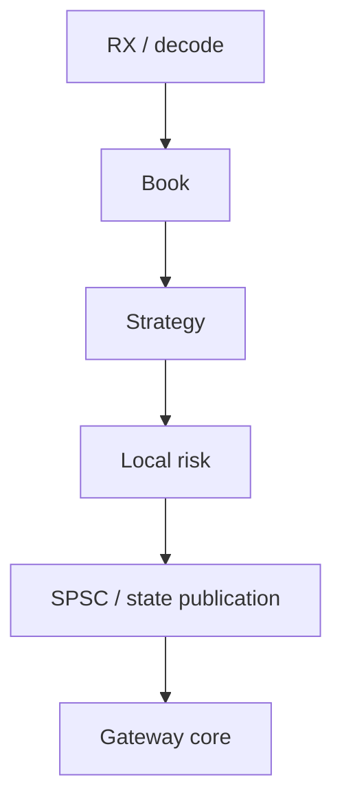

<details>
<summary>查看原图与完整文字转写</summary>

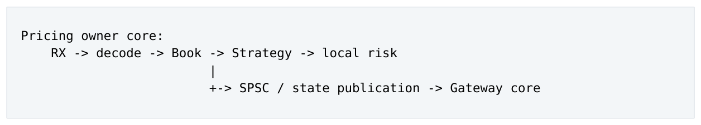

- ` Pricing owner core: `
- ` RX → decode → Book → Strategy → local risk `
- ` -> SPSC / state publication → Gateway core `

</details>

把 latency-critical same-ownership stages co-locate，Gateway 因 session/socket/sequence/throttle ownership 独立。

### 8.3 Scale by Partition, Not by Stage

如果一个 core 不够，优先按 instrument/strategy 分：

```text
Core2: partition0 full path
Core3: partition1 full path
Core4: partition2 full path
Core5: partition3 full path
```

<a id="pdf-page-040"></a>

<!-- source-pdf-page: 40 -->

*[原 PDF 第 40 页](./Level8_Low_Latency_CPP_Design_Patterns_CN.pdf#page=40)*

```text
Core6: gateway session owner
Core7: telemetry/cold work
```

每个 instrument 的 book/pricing/quote state single owner。只有 capacity 或 natural ownership 真正要求时才加新的 stage boundary。

### 8.4 Market Data Distribution

#### 8.4.1 Central RX + Fan-Out

一个 RX core decode 后通过 SPSC 路由到 partitions，逻辑简单但每个 event 至少一次 cross-core hop，RX 可能成为 bottleneck。

#### 8.4.2 NIC Queue / Feed Partition Direct to Worker

若 NIC/feed 支持可控 queue mapping，可让 RX queue 直接绑定 pricing partition，使 network -&gt; book -&gt; decision 同 core。是否可行取决于 protocol sequencing、RSS/hash、feed layout 和 NIC capabilities， 不能假设所有 exchange feed 都天然可按 instrument 分包。

### 8.5 Order Book Ownership 与 Representation

每instrument book 一个writer。L3 可使用fixed hash(OrderId-&gt;pool index) + packed pool + intrusive FIFO；price level 根据 density 选择 dense ladder、sorted vector、flat hash、bitmap。不要让 Book 成为“所有线程共享的一组 atomics”。

### 8.6 Pricing Output：Event 还是 State？

Venue throttle 下，Quote v100-v110 中间版本可能没有价值，可用 latest desired quote + dirty flag；但 New/Cancel/Execution 是state-transition event，不能coalesce。一个边界可以同时存在不同语义channel， 不能“一条统一消息总线解决所有业务”。

### 8.7 Gateway Fan-In 与 Polling

多个 partitions 更适合每个 producer 一个 SPSC，Gateway bounded poll，而不是 shared MPSC cursor。 Gateway 同时必须服务 exchange RX、critical order、quote refresh、timer、control；outbound quote flood 不能饿死 execution ACK/fill processing。

### 8.8 Head-of-Line Blocking 与 Business Ordering

Critical cancel 与quote update 可拆latency class 避免HoL，但multi-queue 破坏global FIFO。per-order commands 最好先由 Order/OMS owner 串行化 business causal order，再产生 transport action，避免 Cancel 先于 New。

<a id="pdf-page-041"></a>

<!-- source-pdf-page: 41 -->

*[原 PDF 第 41 页](./Level8_Low_Latency_CPP_Design_Patterns_CN.pdf#page=41)*

### 8.9 OMS 是否独立？

若 strategy partition 本身拥有 order lifecycle，可减少一次 handoff；若多个 strategies/gateways 共享 parent-child routing、client-facing OMS semantics，独立 OMS 是合理 ownership boundary。答案取决于业务 state ownership，不是“OMS 通常应该是一个服务”。

### 8.10 Risk：Local vs Global

Local order size、price collar、instrument/strategy position limit 可inline 在owner core。Strict global exposure 若要求每单 linearizable check，就有真实 serialization requirement；若业务允许把 global budget 预分给 partitions，可把 global synchronized check 转成 local check。

核心思维 很多性能问题无法靠 C++ primitive 消掉，因为它们来自业务要求的强一致性。正确问题是：语义是否真的需要全局 total order / global linearizable state？

### 8.11 Kill Switch

Kill switch 需要 bounded propagation，不能排在百万 quote events 后。它通常更像 latest control state， 可用 replicated atomic/snapshot 或专用 high-priority control channel；hot thread 读取本地/compact state，而不是同步调用远程 risk service。

### 8.12 Order Lifecycle 与 Commit Points

建议区分：Created -&gt; PendingLocalSend -&gt; PendingNew -&gt; Working ...。local try_push 失败时，order 还没被Gateway 接受，所以不要提前当成已发送。Commit points 可以是decision、local publication、gateway encode、NIC submit、venue ACK；crash 位于不同点产生不同 uncertain outcome。

### 8.13 Order ID 与 Routing

使用 partition bits + local sequence 可以获得 uniqueness 并 O(1) route execution back to owner，避免 global atomic counter 和 global concurrent order map。只有业务确实需要跨 partitions total order 时才引入 centralized sequencer。

### 8.14 Execution Return Path

Gateway owns transport truth，Order owner owns business truth：

**图示转写**

1. ` Exchange `
2. ` Gateway decode `
3. ` ExecutionEvent(orderId, execId, ...) `
4. ` → extract partition `
5. ` owner SPSC `
6. ` FSM/reducer `
7. ` position/risk `

<details>
<summary>查看原图与完整文字转写</summary>

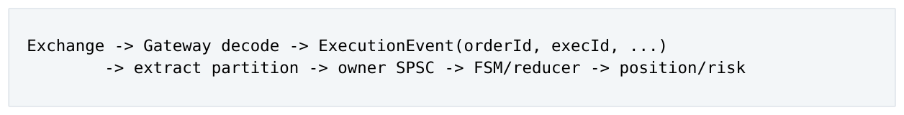

- ` Exchange → Gateway decode → ExecutionEvent(orderId, execId, ...) `
- ` → extract partition → owner SPSC → FSM/reducer → position/risk `

</details>

Execution channel 必须 lossless/recoverable/idempotent，不能 latest-value 或 silent drop。

<a id="pdf-page-042"></a>

<!-- source-pdf-page: 42 -->

*[原 PDF 第 42 页](./Level8_Low_Latency_CPP_Design_Patterns_CN.pdf#page=42)*

### 8.15 Market Data Gap Recovery

Gap detected -&gt; mark book invalid -&gt; use A/B feed if possible -&gt; otherwise snapshot/replay -&gt; buffer live -&gt; apply in sequence -&gt; Healthy。恢复期间strategy 可stop quoting/cancel/use secondary feed；live buffer 和 recovery batch 都必须 bounded。

### 8.16 Process Restart 与 Readiness Gate

**图示转写**

1. ` Initialize `
2. ` -> allocate/prefault/warm `
3. ` -> load snapshot `
4. ` -> replay durable events `
5. ` -> connect sessions `
6. ` -> transport recovery `
7. ` -> business reconciliation `
8. ` -> risk + MD validation `
9. ` -> READY `

<details>
<summary>查看原图与完整文字转写</summary>

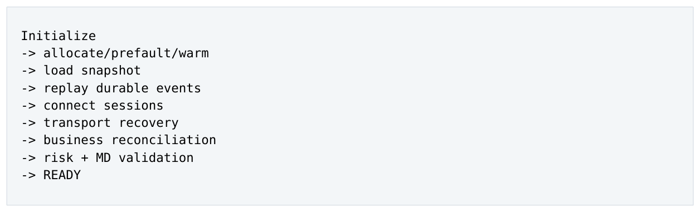

- ` Initialize `
- ` -> allocate/prefault/warm `
- ` -> load snapshot `
- ` -> replay durable events `
- ` -> connect sessions `
- ` -> transport recovery `
- ` -> business reconciliation `
- ` -> risk + MD validation `
- ` -> READY `

</details>

Connected != Ready。Restart/recovery 流量应与 live path 进行 CPU/queue priority isolation，避免 recovery storm。

### 8.17 Telemetry、Audit 与 Durability

Best-effort telemetry 可以drop/sample；operational event 可recoverable；regulatory execution audit 可能需要 durable semantics。不要把三种 reliability class 强行塞进一个 async logger。hot path 只记录 compact structured data，format/persist 在合适的 plane 完成。

### 8.18 Config / Reference Data

Control thread parse/validate/build immutable Config B，hot thread 只acquire published pointer/version。这样 rare config update 的 allocation/string/map rebuild 不进入 data plane。

### 8.19 NUMA、CPU 与 NIC Topology

NIC 在NUMA0 时，尽量让RX、pricing、gateway 和pools 位于NUMA0；worker 自己first-touch memory。 critical hot threads 固定 cores，避免 noisy SMT sibling；IRQ/housekeeping 尽量移开。Kernel bypass 只能减少 network/kernel variability，无法补救应用内部 5 个 queues + mutex + malloc 的架构问题。

### 8.20 Measurement Plan

建议关键 timestamps：NIC RX HW、app RX、book/pricing done、gateway consume、app TX、NIC TX HW。由此拆：app latency、tick-to-decision、handoff/queueing、NIC-to-NIC。每条 queue 同时监控 depth/high-watermark/full/drop/lag/event age。

<a id="pdf-page-043"></a>

<!-- source-pdf-page: 43 -->

*[原 PDF 第 43 页](./Level8_Low_Latency_CPP_Design_Patterns_CN.pdf#page=43)*

### 8.21 Performance / Fault Test Matrix

| Scenario | 观察 | 目标 |
| --- | --- | --- |
| Steady normal load | p50/p99.9/cycles/msg | stable baseline |
| Microburst | depth/event age/tail | no uncontrolled queueing |
| Consumer stall | backpressure/full behavior | semantics correct |
| MD packet gap | recovery latency/book validity | no corrupt pricing |
| Duplicate execution | position/order invariants | effect once |
| Gateway disconnect | uncertain orders/readiness | fail closed/reconcile |
| Process kill/restart | snapshot/replay/recovery SLO | deterministic recovery |
| Config update | hot-path p99.9 | no significant jitter |

### 8.22 System-Level Invariants

- Every mutable market/order/session state has exactly one owner.

- Orders/executions are never silently dropped.

- MD loss is explicitly detected; invalid book cannot silently drive trading.

- All queues/pools are finite, and every full condition has defined semantics.

- Trading is gated when authoritative state is uncertain.

- Cold/recovery work cannot block hot path without explicit policy.

- E2E tail is measured under representative burst and failure conditions.

### 8.23 System Design Interview Answer Template

1. Clarify critical latency boundary and throughput/burst assumptions.

2. Define state ownership: book、order、session、risk.

3. Prefer run-to-completion inside ownership domain; partition for scale.

4. Use SPSC only at necessary boundaries; classify event vs latest-state.

5. Preallocate/prefault, compact IDs, fixed pools, cache-friendly data.

6. Define queue full/backpressure/drop/coalesce semantics.

7. Define transport recovery、business idempotency、snapshot/replay、reconcile.

8. Place cores/memory/NIC with NUMA awareness and reduce OS interference.

9. Measure E2E p99.9/p99.99, queueing, event age, and recovery behavior.

### 8.24 第八层最终闭环

前七层回答“机器怎样工作、为什么变慢、怎样测量、packet 怎样到 CPU”；第八层回答“既然知道这些约束，系统一开始怎样设计才能少做、少等、少共享、少搬运，同时在 failure 后仍能恢复”。

Low-Latency C++ Design 的核心：Own -&gt; Partition -&gt; Bound -&gt; Preallocate -&gt; Localize -&gt; Publish -&gt; Recover -&gt; Measure。真正成熟的系统不是使用了多少性能技巧，而是 critical path 上的工作量、ownership、capacity、failure semantics 与 latency evidence 都能被解释。

<a id="pdf-page-044"></a>

<!-- source-pdf-page: 44 -->

*[原 PDF 第 44 页](./Level8_Low_Latency_CPP_Design_Patterns_CN.pdf#page=44)*

### 第 A 章

## Pattern Decision Table

本章目标 把常见 pattern 放进同一张选择框架，避免把技术名词当默认答案。

| Pattern | 最适合 | 主要收益 | 主要 Failure/Tradeoff |
| --- | --- | --- | --- |
| Run-to-completion | 一条 flow 可 fit one core | 最少 handoff，locality 强 | throughput ceiling |
| Partitioning | state 可按 key 独立 | single writer + scale | imbalance/cross-key dependency |
| SPSC | 固定 1P1C boundary | 简单 ordering/低 contention | finite capacity/back-pressure |
| Multiple SPSC fanin | 少量 producers -&gt; one owner | 避免 producer contention | consumer poll N queues |
| Latest-state | 中间版本无业务价值 | coalesce stale work | 不能用于 stateful deltas |
| Fixed pool | 高频固定对象 | bounded alloc/lifetime | capacity planning required |
| Arena | 同生命周期 temporaries | cheap bump/reset | individual free 不自然 |
| Immutable snapshot/RCU | read-mostly config/state | reader 极轻 | old-version reclamation |
| Seqlock | small one-writer manyreader | no reader lock | writer frequent -&gt; retries |
| Open-address fixed hash | compact ID lookup | locality/bounded allocation | load factor/probe tail |
| Sorted vector | 小 N ordered data | contiguous/simple | O(N) move |
| Dense ladder + bitmap | bounded dense ticks | O(1) lookup/fast next | memory footprint |
| Generation handle | slot reuse | stale-reference detection | extra validation/load |
| Async telemetry | non-critical observability | hot path isolation | slow consumer debt/- drop policy |
| Snapshot + replay | recoverable state | fast restart/reproduce | snapshot consistency/journal integrity |

<a id="pdf-page-045"></a>

<!-- source-pdf-page: 45 -->

*[原 PDF 第 45 页](./Level8_Low_Latency_CPP_Design_Patterns_CN.pdf#page=45)*

### 第 B 章

## Low-Latency Design Review Checklist

### B.1 Critical Path

- latency boundary 是否明确？NIC/NIC、app/app、client/venue？

- hot path 上哪些工作其实是 cold concern？

- 是否存在多余 queue/process/thread hop？

- 每个 stage 的 useful-work unit 和 budget 是什么？

### B.2 Ownership / Concurrency

- 每个 mutable state 有且只有一个 writer 吗？

- shared atomic 是真正需要，还是可改 per-thread/partition？

- thread boundary 是否对应真实 ownership？

- 是否存在 global RMW hotspot / global total-order bottleneck？

- SMT sibling、NUMA、NIC queue topology 是否与 hot threads 对齐？

### B.3 Memory / Data Layout

- hot object 多大？哪些字段其实 cold？

- 有 per-node heap allocation、pointer chasing、string hash 吗？

- container 会 runtime grow/rehash 吗？

- pool/queue capacity 与 exhaustion policy 是否明确？

- pages 是否 prefault、owner-local first-touch？

### B.4 Messaging

- channel 是 event 还是 state？

- ordering scope 是 per-order、per-session、per-stream 还是 global？

- 可以 drop/coalesce 吗？依据什么业务语义？

- consumer 慢、queue full、event stale 时怎么办？

- 是否有 sequence、lag、age、high-watermark metrics？

### B.5 Recovery

- transport/application/business recovery 是否分层？

- duplicate/out-of-order/missing/uncertain outcome 是否有状态机策略？

<a id="pdf-page-046"></a>

<!-- source-pdf-page: 46 -->

*[原 PDF 第 46 页](./Level8_Low_Latency_CPP_Design_Patterns_CN.pdf#page=46)*

- snapshot 与 lastAppliedSeq 是否原子对应？

- replay 是否 idempotent、time/config deterministic？

- Connected 与 Ready 是否分开？

- recovery storm 是否会干扰 live path？

### B.6 Measurement

- p50/p99/p99.9/p99.99 是否在 representative load 下测？

- sample 数足够支撑目标 percentile 吗？

- benchmark 是否存在 coordinated omission？

- 是否区分 service time 与 queue/waiting time？

- 能否把 outlier 对齐 IRQ、scheduler、page fault、queue depth、PMU evidence？

<a id="pdf-page-047"></a>

<!-- source-pdf-page: 47 -->

*[原 PDF 第 47 页](./Level8_Low_Latency_CPP_Design_Patterns_CN.pdf#page=47)*

### 第 C 章

## 核心 Code Skeletons

### C.1 SPSC Publication Skeleton

```cpp
// producer owns tail
slots[tail & mask] = msg;
tail_shared.store(tail + 1, std::memory_order_release);
++tail;

// consumer owns head
auto published = tail_shared.load(std::memory_order_acquire);
if (head != published) {
    auto msg = slots[head & mask];
    ++head;
    head_shared.store(head, std::memory_order_release);
}
```

重点不是这几行语法，而是ownership、finite capacity、full policy、cache-line placement 与cursor caching。

### C.2 Fixed Pool + Generation Handle

```cpp
struct Handle { uint32_t index, generation; };
struct Slot {
    uint32_t generation;
    uint32_t nextFree;
    Order order;
};

Handle allocate();
void release(Handle h); // generation++ before reuse
```

### C.3 Seqlock Read Skeleton

```cpp
for (;;) {
    auto v1 = seq.load(std::memory_order_acquire);
    if (v1 & 1) continue;
    Snapshot s = data; // ordinary reads
    auto v2 = seq.load(std::memory_order_acquire);
    if (v1 == v2) return s;
}
```

需要证明 data lifetime stable，且 writer frequency 不会让 reader retry tail 失控。

> **转换勘误（高置信度）**：本节及附录 C.3 是概念示例。若 `data` 为普通非 atomic 对象，writer 写入与 reader 的 `Snapshot s = data` 没有 happens-before，则并发访问已经构成 C++ data race / UB；事后发现版本变化并丢弃 snapshot 不能消除已经发生的 race。还需独立证明 payload race freedom、读写排序和 lifetime。可选方案包括经过证明的 atomic payload 协议、不可变 snapshot + 安全回收，或锁。依据：[C++ draft / intro.races](https://eel.is/c++draft/intro.races)。

> **转换补充**：附录 C.1 只展示 publication 方向。完整 bounded SPSC 还必须在 producer 覆盖 slot 前检查 consumer progress（相应 acquire/reuse 协议），并明确 full policy、counter wrap、对象构造/析构与异常条件；不能原样当作完整 queue 实现。

<a id="pdf-page-048"></a>

<!-- source-pdf-page: 48 -->

*[原 PDF 第 48 页](./Level8_Low_Latency_CPP_Design_Patterns_CN.pdf#page=48)*

### C.4 Reducer Skeleton

```text
Result on_event(State& s, const Event& e) {
    if (is_duplicate(e)) return Ignored;
    if (!legal(s, e)) return NeedReconcile;
    apply(s, e);
    assert_invariants(s);
    return generate_actions(s, e);
}
```

<a id="pdf-page-049"></a>

<!-- source-pdf-page: 49 -->

*[原 PDF 第 49 页](./Level8_Low_Latency_CPP_Design_Patterns_CN.pdf#page=49)*

### 第 D 章

## 面试问答速查

### D.1 为什么 single writer 比 lock-free 更重要？

因为 lock-free 只消除 blocking，不消除 cache-line ownership transfer、RMW contention 和 state reasoning complexity。single writer 从 architecture 上消除 write/write race，普通 fields 不再需要 atomic， 并让 ordering/recovery 更简单。

### D.2 为什么 SPSC 仍然不是 zero-cost？

它仍然需要 publication、acquire/release、producer/consumer cursor、cache coherence 和 queueing。 若两个模块本来同线程，直接 function call 通常更低延迟。

### D.3 什么时候 latest-value-wins 合理？

当中间update 没有独立业务语义，consumer 只关心current state，如GUI/health/某些fair-value 或quote desired state。Orders、executions、L3 deltas 通常不适用。

### D.4 为什么 queue 大不等于系统更稳？

更大queue 只吸收更长burst，不能提高service rate；还可能隐藏overload，让consumer 处理更旧的stale work。应同时监控 lag 和 event age。

### D.5 为什么 fixed capacity 不是坏设计？

它把容量变成明确 invariant，使 allocation、memory footprint 和 worst-case work 可分析。关键是 full 时必须有明确 business policy，而不是 silent fallback。

### D.6 为什么 shared_ptr 不适合很多 hot path？

除了 atomic refcount/cache traffic，最后一个 reference 消失时的 destructor/deallocation 发生在哪个线程不可预测。single owner + borrow 通常成本模型更清楚。

### D.7 为什么 p99.9 经常是 architecture property？

因为queue、utilization、cross-core hop、scheduler、recovery 和slow event 会相互放大。单个函数service time 很快并不能保证 E2E waiting 很小。

<a id="pdf-page-050"></a>

<!-- source-pdf-page: 50 -->

*[原 PDF 第 50 页](./Level8_Low_Latency_CPP_Design_Patterns_CN.pdf#page=50)*

### D.8 如何回答“Design a low-latency trading system”？

先clarify latency boundary，再定义ownership、thread model/partition、messaging semantics、memory/capacity、backpressure、recovery、NUMA/NIC placement，最后给 measurement plan。不要从“用 lock-free queue”开始。

<a id="pdf-page-051"></a>

<!-- source-pdf-page: 51 -->

*[原 PDF 第 51 页](./Level8_Low_Latency_CPP_Design_Patterns_CN.pdf#page=51)*

### 第 E 章

## 术语表

| 术语 | 本讲义中的含义 |
| --- | --- |
| Hot path | 直接决定某类关键事件 E2E latency 的路径 |
| Cold path | 可异步、延后或不影响关键结果及时性的工作 |
| Run-to-completion | 一个 owner core 完成一条逻辑 chain，减少 handoff |
| Thread confinement | object/state 只由固定 thread 访问/修改 |
| Single writer | 某 mutable state 只有一个 writer |
| Partitioning / sharding | 按 key 把 state 与 work 固定分配到 owners |
| SPSC | Single Producer Single Consumer fixed-topology queue |
| Backpressure | consumer capacity 不足使 producer 被迫降速 |
| Coalescing | 多个中间 state update 合并成更少 latest work |
| Event semantics | 每个变化本身重要，需要顺序/identity |
| State semantics | consumer 主要关心 current/latest value |
| Idempotency | 同一 logical event 重复 apply 不产生额外 effect |
| Reconciliation | 比较 internal 与 authoritative external state 并修复 divergence |
| Prefault | 在 hot workload 前主动触碰 pages，支付 page-fault/setup cost |
| Generation handle | index + generation，用于检测 slot reuse 后的 stale reference |
| Seqlock | writer version 标记，reader optimistic read + retry |
| RCU | Read-Copy-Update，读路径轻，把 update/reclamation 移向 writer |
| Headroom | service capacity 与 expected load 之间保留余量以吸收 burst/jitter |
| Coordinated omission | benchmark 因等待系统完成而停止发请求，低估真实排队延迟 |
| Ready barrier | transport/business/risk/MD 状态全部同步后才允许 trading |

<a id="pdf-page-052"></a>

<!-- source-pdf-page: 52 -->

*[原 PDF 第 52 页](./Level8_Low_Latency_CPP_Design_Patterns_CN.pdf#page=52)*

### 第 F 章

## 推荐实验

### F.1 实验 1：List vs Packed Vector

构造相同 N 的 linked list 与 contiguous array，分别测全部 L1-resident 和 larger-than-cache 场景的 cycles/element、LLC/TLB/MLP evidence。重点验证“linked list 即使 L1 hit 仍受 dependent load chain”。

### F.2 实验 2：AoS vs SoA

让 Order 包含 hot + cold fields，只扫描 price/qty，比较 bandwidth、cycles/item、cache misses；再改成同时使用大部分 fields，观察 AoS/SoA 优势如何反转。

### F.3 实验 3：malloc/free vs Fixed Pool

相同 message/order lifecycle，测 steady p50 与 p99.99；加入多线程 allocator contention、first-touch 和 page-fault setup，验证 average 与 tail 的区别。

### F.4 实验 4：Mutex / Atomic Counter / Per-Thread Counter

2/4/8 cores 更新同一 counter，比较 fetch-add cache bouncing；再改 per-thread counters + cold sum， 观察 coherence traffic 与 throughput/tail。

### F.5 实验 5：SPSC Operation vs Real Handoff

分别测单线程push/pop 函数成本、两core empty handoff、带32/128B payload、跨NUMA、queue depth 0/100/1000。验证 queue op 与 queueing/handoff 不是同一 metric。

### F.6 实验 6：Pipeline vs Partition

构造 decode-&gt;book-&gt;pricing 三 stage：版本 A 三线程 pipeline，版本 B 两个 partitions 各自 RTC。保持总 work 接近，比较 E2E p99.9、throughput、cache misses、queue depth。

### F.7 实验 7：Coalescing Stale Quote

让 producer 快于 throttled consumer。版本 A 排队每个 quote；版本 B per-instrument latest state + dirty bit。比较发送 quote 的 age、queue depth、CPU work 和业务 freshness。

<a id="pdf-page-053"></a>

<!-- source-pdf-page: 53 -->

*[原 PDF 第 53 页](./Level8_Low_Latency_CPP_Design_Patterns_CN.pdf#page=53)*

### F.8 实验 8：Coordinated Omission

做 closed-loop benchmark 与固定 arrival/open-loop benchmark，在服务端注入 10ms pause，比较两者报告的 percentile，直观看到遗漏排队请求如何掩盖 latency collapse。

<a id="pdf-page-054"></a>

<!-- source-pdf-page: 54 -->

*[原 PDF 第 54 页](./Level8_Low_Latency_CPP_Design_Patterns_CN.pdf#page=54)*

### 第 G 章

## 最终复习清单

1. 能否从任意 trading flow 画出 critical path？

2. 能否解释 hot path 与 profiler hot code 的区别？

3. 能否从 ownership 角度判断是否真的需要 mutex/atomic？

4. 能否解释为什么 lock-free 仍有 coherence/queueing cost？

5. 能否比较 RTC、partition 与 pipeline 的 latency/throughput trade-off？

6. 能否从 CPU 地址序列解释 AoS/SoA、packed、pointer chasing？

7. 能否设计 fixed pool、generation handle、arena，并定义 exhaustion policy？

8. 能否手写 SPSC release/acquire publication mental model？

9. 能否区分 event semantics 与 latest-state semantics？

10. 能否为 Must-not-lose / Recoverable / Latest / Best-effort 定义不同 overload policy？

11. 能否解释 queue depth 为什么直接转化为 waiting latency？

12. 能否设计 order FSM 处理 duplicate、late fill、PendingCancel fill、uncertain outcome？

13. 能否解释 transport recovery 与 business reconciliation 的区别？

14. 能否设计 snapshot + replay + readiness gate？

15. 能否解释 deterministic latency 为什么不等于 hard real-time guarantee？

16. 能否解释 high utilization、microburst、queue amplification 与 latency cliff？

17. 能否识别 allocation/page fault/TLB/IRQ/frequency/lazy init 等 tail sources？

18. 能否设计 realistic p99.9 benchmark 并避免 coordinated omission？

19. 能否在 10-15 分钟内完整回答 low-latency trading system design？

20. 最后，能否对每个优化给出可证伪 hypothesis 和 measurement plan？

第八层完成标志当你不再首先问“该用哪个 lock-free queue”，而是先问 critical path、ownership、semantics、 capacity、failure、measurement，并能说明每个 thread/queue 为什么存在时，才真正进入 Low-Latency C++ Design 的系统层。

<a id="conversion-errata"></a>

## 转换补充与勘误

本节及正文中“转换补充 / 转换勘误”均为 2026-11-06 转换时新增；原 PDF 仍是原始内容与版式的对照。

- [原 PDF 第 24 页处的补充](#pdf-page-024)：Seqlock 的 C++ data-race 边界。

- [原 PDF 第 47 页处的补充](#pdf-page-047)：Seqlock 的 C++ data-race 边界。

- [原 PDF 第 47 页处的补充](#pdf-page-047)：附录 C.1 只展示 publication 方向。

### 适用边界

原文中的时延、cache/ROB 大小、PMU event、kernel 参数及 compiler lowering 均需要绑定具体平台。转写结构的覆盖校验不等同于对全部技术命题的逐条实测；复杂图的精确布局以随附原图为准。
