# Concurrency Architecture

> 来源：[Level9_Concurrency_Architecture_CN.pdf](./Level9_Concurrency_Architecture_CN.pdf)（33 页）。本文件按原文逐页转写；转换补充与勘误单独标明。

> 图示优先转为 Mermaid、表格或步骤；每图附原图和文字以便核对。代码保留原文逻辑与缩进，跨页片段及概念示例未宣称可以独立编译。

[返回目录](README.md) · [转换说明与校验](CONVERSION_NOTES.md) · [本文补充与勘误](#conversion-errata)

[原文目录](#pdf-page-003) · [第一章正文](#pdf-page-005)

<a id="pdf-page-001"></a>

<!-- source-pdf-page: 1 -->

*[原 PDF 第 1 页](./Level9_Concurrency_Architecture_CN.pdf#page=1)*

## Concurrency Architecture

## C++ / CPU 深度学习 - 第九层完整讲义

Ownership · Single Writer · Thread Topology · Pipeline · SPSC/MPSC/SPMC/MPMC · Sharding · Fan-out/Fan-in · Backpressure · Scheduling · Memory Reclamation · Determinism · NUMA/SMT/NIC Placement

目标：把低延迟系统的线程、状态、队列和 CPU core 组织成可推理、可扩展、可恢复且 tail latency 可控的执行架构。

2026-08 · 详尽版

<a id="pdf-page-002"></a>

<!-- source-pdf-page: 2 -->

*[原 PDF 第 2 页](./Level9_Concurrency_Architecture_CN.pdf#page=2)*

## 如何使用这份讲义

这份 PDF 不是并发容器 API 的罗列，也不是 Session 对话的简单拼接。它按照“先定义 ownership，再映射线程和 core，再设计通信与 overload，最后处理 lifetime/recovery”的顺序重新组织第九层全部内容。读完后，你应该能看到一张 trading-system data-flow 图，就主动追问每份 mutable state 的 owner、每条边的 ordering/backpressure 语义、每次跨核 handoff 的必要性，以及故障和 replay 时如何恢复。

最核心的方法  先解决“为什么需要共享”，再解决“怎样同步”。如果一个 atomic、mutex 或 lock-free container 出现在 hot path，第一反应不是优化它，而是确认 ownership 是否本来可以更简单。

本文主要面向现代 Linux + C++ 的低延迟单机/多核系统，尤其是 Market Data、Pricing、Risk、OMS、 Connectivity 等交易链路。具体 cache-line latency、NUMA 代价、SMT 影响和 queue handoff 数字高度依赖 CPU/NIC/拓扑；本文强调稳定的原则和可验证的设计过程，不把某一代 CPU 的具体纳秒数当成普适常量。

### 阅读路线

| 章节 | 主题 | 你最终要回答的问题 |
| --- | --- | --- |
| 第 1 章 | Ownership / Single Writer | 为什么并发设计首先是 ownership 问题？ |
| 第 2 章 | Thread Topology / Pipeline | 什么时候 fuse，什么时候 split，为什么更多线程可能更慢？ |
| 第 3 章 | Queue Architecture | SPSC 为什么是黄金结构？MPSC/MPMC 的协调成本从哪里来？ |
| 第 4 章 | Sharding | 一个 single writer 不够时，怎样扩展而不回到 shared-write？ |
| 第 5 章 | Fan-out / Fan-in | slow consumer、broadcast、merge ordering 应怎样定义？ |
| 第 6 章 | Backpressure / Scheduling | 系统处理不过来时怎样有控制地退化？ |
| 第 7 章 | Lifetime / Reclamation | atomic pointer 为什么仍可能 UAF？何时能安全 reuse memory？ |
| 第 8 章 | 综合 Trading Architecture | 如何把 ownership、queues、NUMA、recovery 组合成完整系统？ |
| 附录 | 术语 / 对照 / 面试 / 实验 | 如何快速复习、验证和在面试中表达？ |

### 贯穿全书的五个问题

- 这份 mutable state 的 canonical owner 是谁？其他线程为什么需要直接访问它？

- 这一条 thread boundary 真正购买了什么：throughput、isolation、blocking containment，还是只是“组件看起来更独立”？

- 这个 channel 传的是 transactional event 还是 latest state？full 时允许 drop / conflate / reject / backpressure 哪一种？

<a id="pdf-page-003"></a>

<!-- source-pdf-page: 3 -->

*[原 PDF 第 3 页](./Level9_Concurrency_Architecture_CN.pdf#page=3)*

## 原文目录

- • 系统是否真的需要 global total order / exact global state，还是 per-source order + causality 已经足够？ • 当一个 consumer/stage/thread 卡住时，影响能否被限制在本 shard / 本 channel，而不是沿整个 hot path 传播？
- [1. Concurrency Architecture 第一原则](#pdf-page-005)
- [1.1 从 Shared Mutable State 开始](#pdf-page-005)
- [1.2 Single Writer Principle](#pdf-page-005)
- [1.3 Lock-free 与 contention-free](#pdf-page-005)
- [1.4 Thread / State / Data Ownership](#pdf-page-006)
- [1.5 Event Loop 与 Run-to-Completion](#pdf-page-006)
- [1.6 Determinism、Replay 与 Business Invariant](#pdf-page-007)
- [1.7 Hot / Cold Path Separation](#pdf-page-007)
- [1.8 Architecture Design 顺序](#pdf-page-007)
- [2. Thread Topology 与 Pipeline Architecture](#pdf-page-008)
- [2.1 Logical Graph vs Execution Topology](#pdf-page-008)
- [2.2 Run-to-completion / Pipeline / Hybrid](#pdf-page-008)
- [2.3 Single-event latency vs throughput](#pdf-page-008)
- [2.4 Handoff / Coherence / Queueing Cost](#pdf-page-009)
- [2.5 Stage Fusion 与 Stage Split](#pdf-page-009)
- [2.6 Pipeline Bubble / Saturation / Skew](#pdf-page-009)
- [2.7 Dedicated Core / SMT / NUMA / NIC Locality](#pdf-page-009)
- [2.8 Pipeline vs Sharded Run-to-Completion](#pdf-page-010)
- [3. Queue Architecture：SPSC / MPSC / SPMC / MPMC](#pdf-page-011)
- [3.1 SPSC ownership model](#pdf-page-011)
- [3.2 Release / Acquire publication](#pdf-page-011)
- [3.3 Cache-line layout / false sharing](#pdf-page-011)
- [3.4 Batching / cached indices / queue depth](#pdf-page-012)
- [3.5 MPSC serialization point](#pdf-page-012)
- [3.6 N×SPSC vs MPSC](#pdf-page-012)
- [3.7 SPMC：work-sharing vs broadcast](#pdf-page-013)
- [3.8 MPMC 与 dynamic ownership](#pdf-page-013)
- [3.9 Event / State / Snapshot semantics](#pdf-page-013)
- [3.10 Queue selection tree](#pdf-page-013)
- [4. State Partitioning / Sharding](#pdf-page-014)
- [4.1 Shard 是 ownership domain](#pdf-page-014)
- [4.2 Instrument / Order / Client / Venue / Strategy keys](#pdf-page-014)
- [4.3 Load balance 与 hot key](#pdf-page-014)
- [4.4 Dependency-aware partition](#pdf-page-014)
- [4.5 Dynamic migration 的成本](#pdf-page-015)
- [4.6 Cross-shard protocol](#pdf-page-015)
- [4.7 Global aggregation / hierarchical risk](#pdf-page-015)
- [4.8 NUMA-aware sharding / IDs / recovery](#pdf-page-016)
- [5. Fan-out / Fan-in / Broadcast](#pdf-page-017)

<a id="pdf-page-004"></a>

<!-- source-pdf-page: 4 -->

*[原 PDF 第 4 页](./Level9_Concurrency_Architecture_CN.pdf#page=4)*

- [5.1 Broadcast / selective routing / latest-state](#pdf-page-017)
- [5.2 N×SPSC vs shared ring](#pdf-page-017)
- [5.3 Slowest consumer problem](#pdf-page-017)
- [5.4 Lossless / lossy / conflation](#pdf-page-017)
- [5.5 NUMA fan-out 与 zero-copy trade-off](#pdf-page-018)
- [5.6 Fan-in merge semantics](#pdf-page-018)
- [5.7 Fairness / priority / deterministic merge](#pdf-page-018)
- [5.8 Redundant feed aggregation](#pdf-page-018)
- [6. Backpressure / Scheduling / Work Distribution](#pdf-page-019)
- [6.1 Capacity mismatch 与 bounded queue](#pdf-page-019)
- [6.2 Block / drop / overwrite / conflate / spill](#pdf-page-019)
- [6.3 High/Low watermark 与 hysteresis](#pdf-page-019)
- [6.4 Credit / token bucket / proactive flow control](#pdf-page-020)
- [6.5 Dedicated threads vs pools / work stealing](#pdf-page-020)
- [6.6 Busy-spin / yield / park](#pdf-page-020)
- [6.7 Priority / bounded draining / starvation](#pdf-page-020)
- [6.8 Load shedding / graceful degradation / headroom](#pdf-page-021)
- [7. Concurrent Lifetime / Memory Reclamation](#pdf-page-022)
- [7.1 Atomic pointer ≠ lifetime](#pdf-page-022)
- [7.2 Logical remove vs physical reclaim](#pdf-page-022)
- [7.3 Reference counting / shared_ptr](#pdf-page-022)
- [7.4 Epoch / QSBR](#pdf-page-023)
- [7.5 Hazard Pointer](#pdf-page-023)
- [7.6 RCU / immutable snapshots](#pdf-page-023)
- [7.7 ABA / tagged pointer / generation handle](#pdf-page-023)
- [7.8 Pool / arena / deferred recycle](#pdf-page-024)
- [7.9 Pointer stability / shared-memory index](#pdf-page-024)
- [7.10 Lifetime review invariants](#pdf-page-024)
- [8. Trading-System Concurrency Architecture 综合设计](#pdf-page-025)
- [8.1 从 logical graph 到 ownership map](#pdf-page-025)
- [8.2 Fuse / split / shard 的设计流程](#pdf-page-025)
- [8.3 Pricing / Risk / OMS / Gateway ownership](#pdf-page-025)
- [8.4 Queue topology / fan-in / late serialization](#pdf-page-026)
- [8.5 Backpressure by semantics](#pdf-page-026)
- [8.6 Recovery / version / causality](#pdf-page-026)
- [8.7 NUMA / SMT / memory placement](#pdf-page-026)
- [8.8 Testing / observability / failure injection](#pdf-page-027)
- [8.9 System-design interview framework](#pdf-page-027)
- [8.10 第九层统一模型](#pdf-page-028)
- [A. 附录](#pdf-page-029)
- [A.1 术语表](#pdf-page-029)
- [A.2 关键对照表](#pdf-page-030)
- [A.3 高频面试问答](#pdf-page-030)
- [A.4 推荐实验](#pdf-page-032)
- [A.5 Architecture Review Checklist](#pdf-page-032)
- [A.6 最终复习清单](#pdf-page-033)

<a id="pdf-page-005"></a>

<!-- source-pdf-page: 5 -->

*[原 PDF 第 5 页](./Level9_Concurrency_Architecture_CN.pdf#page=5)*

## 第 1 章 Concurrency Architecture 第一原则

本章目标  建立“先 ownership，后 synchronization”的系统观：对每份 mutable state 先指定唯一 writer，再决定线程拓扑、通信边界与同步原语。

### 1.1 从 Shared Mutable State 开始

一个常见错误设计是：Gateway、Risk、Strategy、Recovery、Monitoring 等线程都直接访问同一个 Orders / Position / Book 容器，然后再逐步叠加 mutex、shared_mutex、atomic、lock-free hashmap。技术越来越复杂，但问题可能从第一步就定义错了：为什么这些线程都需要直接修改同一份 authoritative state？

```text
Gateway Thread  --\
Risk Thread      ---->  shared Orders / Position
Strategy Thread  --/
Recovery Thread  --/

结果：mutation + lifetime + ordering + coherence 全部耦合。
```

Concurrency Architecture 的第一问题不是“mutex 还是 atomic”，而是“能否把修改权限收敛到一个 owner， 让其他执行上下文通过 event / command 与 owner 交互”。当这个问题解决后，许多原本需要并发容器的 state 可以退化成普通的 vector/map/plain fields。

### 1.2 Single Writer Principle

Single Writer Principle 指：对一份 mutable state，尽可能只有一个 execution context 有权修改。它不等于整个进程只有一个线程，也不禁止多个 reader；它定义的是“修改权”的归属。

**图示转写**

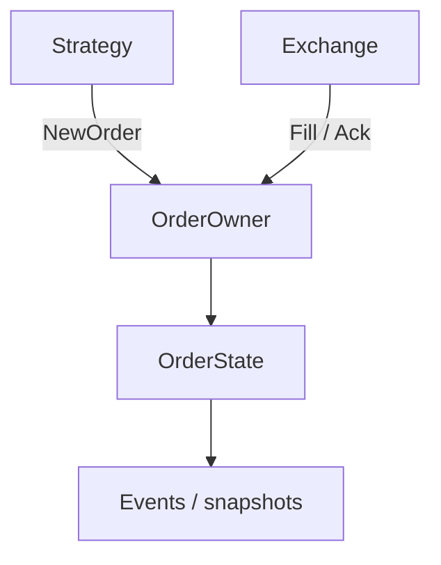

<details>
<summary>查看原图与完整文字转写</summary>

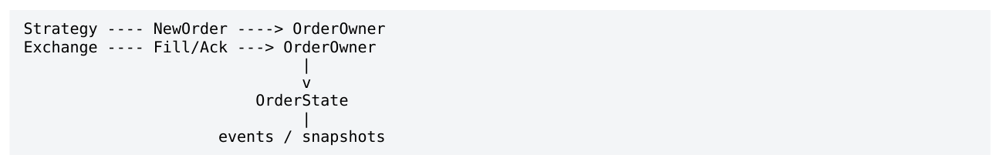

- ` Strategy NewOrder → OrderOwner `
- ` Exchange Fill/Ack → OrderOwner `
- ` OrderState `
- ` events / snapshots `

</details>

核心 invariant  在任意时刻，每份 mutable object 最好有明确的唯一 writer。其他线程通过 message 触发 owner 执行 state transition，而不是绕过 owner 修改对象。

其直接收益包括：避免多个 core 对同一 writable cache line 争夺 exclusive ownership；业务 invariant 在一条 sequential stream 中维护；replay 更容易；object lifetime 更简单；hot object 内部无需到处使用 atomic。

### 1.3 Lock-free 与 contention-free

Lock-free 是 progress guarantee，不是性能保证。多个 producer 对一个 atomic fetch_add 或 CAS loop 进行 RMW，即使算法 lock-free，仍然要在 coherence 层面序列化 cache-line ownership。Wait-free 更强，保证每个 participant 在有限步骤内完成；但仍不意味着不存在 shared-line contention。

<a id="pdf-page-006"></a>

<!-- source-pdf-page: 6 -->

*[原 PDF 第 6 页](./Level9_Concurrency_Architecture_CN.pdf#page=6)*

| 概念 | 解决什么 | 不保证什么 |
| --- | --- | --- |
| Lock-based | 用锁进行 mutual exclusion | 不代表一定慢；cold path 上可能最简单 |
| Lock-free | 系统整体持续 progress | 不保证低 tail、不保证无 cache contention |
| Wait-free | 每个线程有限步骤 progress | 不保证零协调成本 |
| Contention-free architecture | 尽量不让多个 cores 写同一 mutable line | 需要通过 ownership / partition 改架构 |

低延迟架构常见优先级可以写成：avoid sharing -&gt; single writer -&gt; partition -&gt; SPSC communication -&gt; shared atomics -&gt; locks。它不是绝对规则，但体现“先消灭协调，再优化协调”的方向。

### 1.4 Thread Ownership / State Ownership / Data Ownership

Thread ownership 描述 execution context 与 core 的稳定绑定；state ownership 描述哪个 execution context 有权修改业务状态；data ownership 描述 packet/event/buffer 在 producer-consumer 之间何时发生转移。三者需要分开定义。

| Ownership | 典型问题 | 低延迟关注点 |
| --- | --- | --- |
| Thread / Core | PricingThread 跑在哪个 physical core？ | cache/TLB/branch state 稳定、减少迁移 |
| Mutable State | 谁能修改 OrderState / Book / FIX seq？ | single writer、业务 invariant |
| Data / Buffer | packet memory 谁创建、谁 reuse？ | copy vs transfer、lifetime、remote free |

对于 packet，复制不是天然坏事：小的 value copy 可以换来独立 lifetime 和本地 cache；pointer transfer 虽然减少 payload copy，却必须定义 producer 何时可以 reuse memory。低延迟架构应比较“copy cost”与“shared-lifetime/coherence cost”，而不是把 zero-copy 当宗教。

### 1.5 Event Loop 与 Run-to-Completion

Single writer 很自然地形成 event loop：owner 轮询 input queues，顺序执行 state transition，再发布 outputs。对同一份 state，事件序列 E1,E2,E3 形成 S0 -&gt; S1 -&gt; S2 -&gt; S3，逻辑顺序清晰。

```text
while (running) {
    poll_market_data();
    poll_orders();
    poll_commands();
    do_bounded_housekeeping();
}

State(t) + Event(t) -> State(t+1)
```

Run-to-completion 指一个 event 尽可能在同一个 owner/core 上完成强依赖的有用工作，例如 parse -&gt; book -&gt; pricing -&gt; local risk。它减少 handoff 和 cache transfer，但要求每个 handler work bounded；否则一个长 handler 会造成 head-of-line blocking。

<a id="pdf-page-007"></a>

<!-- source-pdf-page: 7 -->

*[原 PDF 第 7 页](./Level9_Concurrency_Architecture_CN.pdf#page=7)*

### 1.6 Determinism、Replay 与 Business Invariant

并发架构里的 determinism 主要指：给定相同的输入事件序列，逻辑 state transition 得到相同结果，而不是每条 CPU instruction 的时间完全一致。多 writer + lock acquisition timing 往往让 live ordering 难以重现；single-owner state machine 更容易 record/replay。

业务一致性  Atomicity of fields != atomicity of business state。两个 atomic 字段分别安全，并不意味着 reader 能获得跨字段一致 snapshot。若 position、pending_qty、risk reservation 必须共同维护 invariant，最好由同一个 owner 在一个 transition 中更新，再发布 coherent snapshot。

例如 `position` 与 `pending_qty` 分别做 atomic load，reader 可能读到一个新值和一个旧值。正确问题不是“memory_order 是否更强”，而是“业务 invariant 是否应该由同一 owner 串行维护”。

### 1.7 Hot / Cold Path Separation

Logging、DB、metrics formatting、configuration、admin 等工作不应因为软件模块边界而混入 hot event loop。常见结构是 hot owner 只发布紧凑 event 到 cold SPSC，cold thread 自己完成慢工作。

**图示转写**

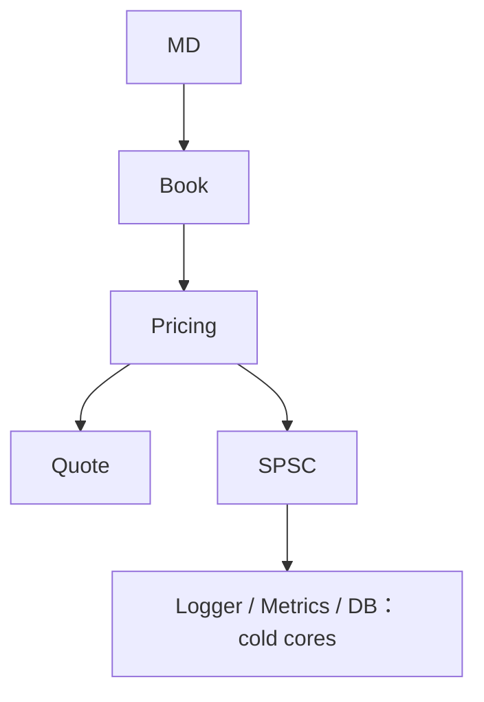

<details>
<summary>查看原图与完整文字转写</summary>

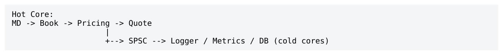

- ` Hot Core: `
- ` MD → Book → Pricing → Quote `
- ` → SPSC → Logger / Metrics / DB (cold cores) `

</details>

关键不是“异步就快”，而是每条 hot-&gt;cold 边必须定义 slow-consumer policy。Debug metrics 可以 drop， regulatory record 可能必须 lossless；一个低价值 cold consumer 不应反向把整个 trading path backpressure。

### 1.8 Architecture Design 顺序

1. 先画 logical data flow，例如 MD -&gt; Book -&gt; Pricing -&gt; Risk -&gt; Execution。

2. 列出所有 mutable state，并写出业务 invariant。

3. 为每份 state 指定 canonical owner。

4. 只有 owner 不同的地方才引入通信边界。

5. 根据 topology 选择 SPSC/MPSC/broadcast，而不是先选 queue library。

6. 最后才决定 atomic、fence、mutex 和具体 memory_order。

设计顺序  Business state -&gt; Ownership -&gt; Thread topology -&gt; Communication topology -&gt; Synchronization -&gt; Memory ordering。这个顺序是第九层相对于“只懂 atomic”最重要的升级。

<a id="pdf-page-008"></a>

<!-- source-pdf-page: 8 -->

*[原 PDF 第 8 页](./Level9_Concurrency_Architecture_CN.pdf#page=8)*

## 第 2 章 Thread Topology 与 Pipeline Architecture

本章目标  区分 logical component 与 physical execution topology，从 single-event latency、throughput、 queueing、cache locality、isolation、NUMA 等维度决定 stage fusion / split。

### 2.1 Logical Graph vs Execution Topology

FeedHandler、OrderBook、Pricing、Risk、Execution 是 logical stages，并不意味着五个 threads。逻辑图描述“数据经过哪些功能”，execution topology 才描述“哪些功能在哪些 core 上运行”。同一个 logical graph 可以映射成一个 core、深 pipeline、或多种 hybrid。

**图示转写**

| 层次 / topology | 处理路径 |
| --- | --- |
| Logical | Feed → Book → Pricing → Risk → Execution |
| A：单 core | Core2：Feed + Book + Pricing + Risk + Execution |
| B：pipeline | Core2：Feed+Book → Core3：Pricing → Core4：Risk+Execution |

<details>
<summary>查看原图与完整文字转写</summary>

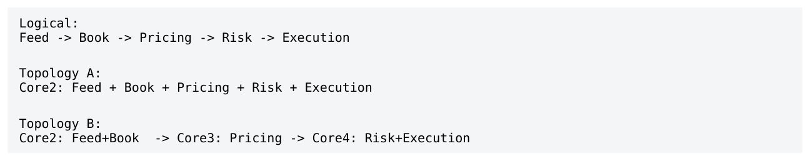

- ` Logical: `
- ` Feed → Book → Pricing → Risk → Execution `
- ` Topology A: `
- ` Core2: Feed + Book + Pricing + Risk + Execution `
- ` Topology B: `
- ` Core2: Feed+Book → Core3: Pricing → Core4: Risk+Execution `

</details>

### 2.2 Run-to-Completion / Full Pipeline / Hybrid

| Topology | 优势 | 代价 |
| --- | --- | --- |
| Run-to-completion | 最低 handoff、最佳 locality、简单 ordering | 单 core capacity、长 handler 互相耦合 |
| Full pipeline | 不同 events 可在 stages 上 overlap，提升throughput | 每个 event 多次跨core，queueing/ordering 复杂 |
| Hybrid | 只在真正需要的瓶颈/隔离点拆分 | 需要通过测量找到正确边界 |

真实 low-latency 系统往往倾向 hybrid：强依赖且轻量的 stages 合并，CPU-heavy 或高 variance / blocking 的 stages 独立。设计目标不是最少 threads，也不是最大并行，而是满足 throughput/isolation 所需的最少 concurrency boundaries。

### 2.3 Single-event Latency vs Throughput

Pipeline 最大的概念误区是把“更多 core”直接等同于“一个 event 更快”。若同一 event 必须依次经过 T1,T2,T3，则拆到多个 cores 并不能并行这条依赖链，只能让不同 events 同时位于不同 stages。

```text
Single event latency ~= T1 + T2 + T3 + handoff costs
Steady-state throughput ~= 1 / max(T1, T2, T3)
Pipeline 用额外 handoff/queueing latency 换取多 event overlap。
```

对于 sparse 或 bursty traffic，pipeline 可能长期空，真正的 parallelism 没被利用，但 handoff 成本每个 event 都要付。因此 queue-empty 比例、stage utilization 和 burst profile 都应参与 topology 决策。

<a id="pdf-page-009"></a>

<!-- source-pdf-page: 9 -->

*[原 PDF 第 9 页](./Level9_Concurrency_Architecture_CN.pdf#page=9)*

### 2.4 Handoff / Coherence / Queueing Cost

一次 Core A -&gt; Core B 的 SPSC handoff 通常包含 payload write、producer sequence release-publish、 coherence propagation、consumer observe、payload load。SPSC 已经是低成本 handoff，但不是 zero-cost。

更危险的是 queueing latency：handler 自身 200ns 并不意味着 response 200ns；如果前面已有 50 条 backlog， 最后一条至少等待约 10us。低延迟诊断要把 total latency 分成 compute + handoff + queue + scheduling + coherence，而不是只 benchmark push/pop。

Queueing first  Queue depth 是 latency 的领先指标。一个 microbench 里 80ns 的 stage，如果 burst 下 depth=100，就可能贡献微秒级排队延迟。

### 2.5 Stage Fusion 与 Stage Split

Stage fusion 适合轻量、强数据依赖、共享 hot working set 的相邻 stages。Feed+Book、Book+Pricing 在很多系统中具有良好 locality；拆开后不仅多一次 queue，还可能把刚写热的数据跨 core 传走。

Stage split 适合 CPU-heavy、high variance、可能 blocking、或需要独立 scaling 的 stage。拆分的收益是 throughput/isolation；代价是把 synchronous stall 转化为 queue/backpressure，因此 split 后一定要定义 downstream overload policy。

| 更偏 Fuse | 更偏 Split |
| --- | --- |
| 两段都很轻，handoff 可能比 compute 还贵 | 某一段长期接近 core capacity |
| B 紧接着读取 A 刚更新的数据 | B 偶尔出现很长 tail / blocking |
| 同一业务 invariant / state owner | 需要独立扩容或故障隔离 |
| 输入稀疏，pipeline parallelism 很少利用 | 持续高吞吐，多 events in-flight |

### 2.6 Pipeline Bubble / Saturation / Skew

Pipeline bubble 表示 stages 空闲，没有足够 events 填满 pipeline；saturation 表示最慢 stage service rate 已低于 arrival rate，queue depth 持续增加。两者分别提示“可能过度拆分”和“必须增加 capacity/降载”。

Pipeline skew 是拆线程后天然出现的逻辑版本差：BookVersion=105、PricingVersion=103、 ExecutionVersion=101。系统不能假设所有 stage 位于同一 logical time。下游消息应携带 source sequence / version / correlation，才能检测 stale work 和建立 causality。

### 2.7 Dedicated Core / SMT / NUMA / NIC Locality

Dedicated hot core 的价值不只是不被 OS 切走，还包括稳定的 L1/L2、TLB、branch predictor、runqueue 和 frequency behavior。若 SMT sibling 跑 noisy workload，即使 affinity 不冲突，仍会共享 frontend、 execution resources、L1/L2 等资源并产生 jitter。

<a id="pdf-page-010"></a>

<!-- source-pdf-page: 10 -->

*[原 PDF 第 10 页](./Level9_Concurrency_Architecture_CN.pdf#page=10)*

NUMA / LLC / NIC topology 是 execution mapping 的物理底座。NIC 接在 NUMA0 时，RX 及最关键 processing cores、queue storage、hot state 尽量放在同一 node；跨 socket handoff 往往比同 node 更贵。具体 placement 必须在目标硬件 benchmark。

```text
Cost tendency (not a numeric law):
same thread < same LLC/NUMA < cross-NUMA/socket
Hot thread affinity only works fully if hot memory is local too.
```

### 2.8 Pipeline vs Sharded Run-to-Completion

当 state 可按 instrument/client/strategy 自然 partition 时，多核扩展不一定需要深 pipeline。更有吸引力的是： 每个 shard 在一个 core 上 run-to-completion，既获得多核 throughput，又保留 single-writer/locality。

**图示转写**

| Core | Pipeline（按 stage） | Sharded RTC（按数据分片） |
| --- | --- | --- |
| Core2 | Book(all) | Book+Pricing+Risk shard0 |
| Core3 | Pricing(all) | Book+Pricing+Risk shard1 |
| Core4 | Risk(all) | Book+Pricing+Risk shard2 |

<details>
<summary>查看原图与完整文字转写</summary>

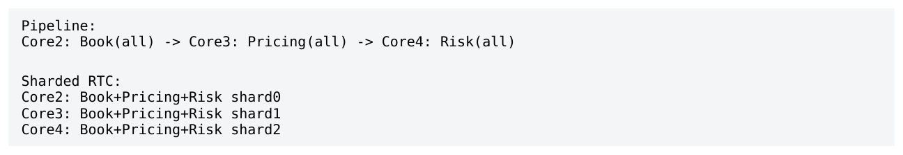

- ` Pipeline: `
- ` Core2: Book(all) → Core3: Pricing(all) → Core4: Risk(all) `
- ` Sharded RTC: `
- ` Core2: Book+Pricing+Risk shard0 `
- ` Core3: Book+Pricing+Risk shard1 `
- ` Core4: Book+Pricing+Risk shard2 `

</details>

Sharded RTC 的代价是 cross-shard dependency 复杂。选择 pipeline 还是 sharding，最终取决于 data dependency graph，而不是“pipeline 更专业”或“多线程更快”的抽象偏好。

<a id="pdf-page-011"></a>

<!-- source-pdf-page: 11 -->

*[原 PDF 第 11 页](./Level9_Concurrency_Architecture_CN.pdf#page=11)*

## 第 3 章 Queue Architecture：SPSC / MPSC / SPMC / MPMC

本章目标  从 cache-line ownership、release/acquire、ordering、backpressure 和 lifetime 角度理解 queue。重点不是实现一个万能容器，而是让 queue topology 跟 ownership topology 一致。

### 3.1 SPSC：固定 Ownership 的黄金结构

SPSC 的强大来自固定 ownership：producer 是 write position 的唯一 writer，consumer 是 read position 的唯一 writer。没有 producer-producer 或 consumer-consumer slot arbitration，因此通常不需要 CAS reservation。

```text
Producer owns tail                 Consumer owns head
       |                                  |
       v                                  v
 [ slot0 ][ slot1 ][ slot2 ] ... [ slotN ]

One writer per hot metadata field.
```

这种结构与 Single Writer Principle 完全一致：queue metadata 自身也被拆成两个独立 single-writer state。所谓“SPSC 很快”不是 ring buffer 的魔法，而是 coordination requirement 极少。

### 3.2 Release / Acquire Publication

典型 producer 先写 payload，再用 release store 发布 tail；consumer 用 acquire load 观察新 tail 后读取 payload。release/acquire 建立 publish/consume 的 happens-before，使 consumer 看到对应 payload 的初始化。

```cpp
Producer:
buffer[tail] = event;
tail.store(next, std::memory_order_release);

Consumer:
if (head != tail.load(std::memory_order_acquire)) {
    event = buffer[head];
}
```

producer 自己读取本地拥有的 tail、consumer 自己读取本地拥有的 head，通常可以 relaxed；跨线程观察对方进度的位置才承担同步语义。具体实现仍需对 full/empty、wrap 和 object lifetime 做完整证明。

### 3.3 Cache-line Layout 与 False Sharing

如果 head 与 tail 落在同一 cache line，producer 写 tail、consumer 写 head 仍会让整条 line 在 cores 间 bouncing，即使它们是不同变量。这是典型 false sharing。

优化原则不是死记 `padding[56]`，而是把 independently-written hot metadata 放到不同 destructiveinterference domain。payload slot 是否需要 cache-line alignment 则要看 slot size、producer-consumer distance 与 batching，不能盲目每 slot 64B。

<a id="pdf-page-012"></a>

<!-- source-pdf-page: 12 -->

*[原 PDF 第 12 页](./Level9_Concurrency_Architecture_CN.pdf#page=12)*

### 3.4 Batching / Cached Remote Indices / Queue Depth

Producer 可以写多条 payload 后一次 publish tail；consumer 可以一次 load tail 后 drain 已可见的多个 items， 再一次发布 head。这样摊薄 release/acquire 和 coherence metadata 访问。低延迟 batching 应更偏 opportunistic：批处理“已经到达的工作”，而不是为了凑 batch 主动等待。

双方还可以缓存对方 index：producer 只有接近 full 时刷新 consumer head，consumer 只有本地认为 empty 时刷新 producer tail。stale cached value 通常只让判断更保守，而不破坏 correctness（前提是算法证明正确）。

Operational metrics  Queue capacity、current depth、max/p99 depth、full count、consumer lag 应作为一等指标。大 queue 不会创造 capacity，只会延迟暴露 mismatch，并可能把 stale work 留得更久。

### 3.5 MPSC：Shared Serialization Point

MPSC 最大结构变化是：write position 不再有唯一 writer。多个 producers 必须协调“谁得到下一个 slot”，常见方式是 atomic fetch_add/CAS reservation。即使 lock-free，这个 metadata cache line 仍是 shared serialization point。

**图示转写**

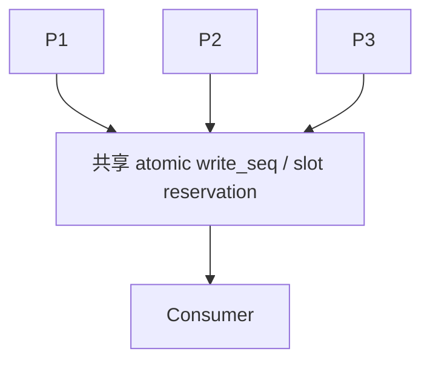

<details>
<summary>查看原图与完整文字转写</summary>

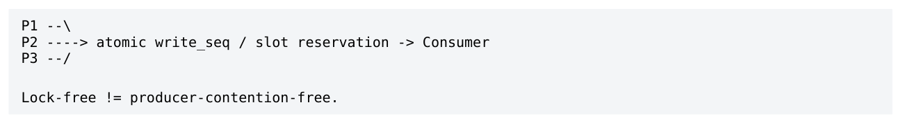

- ` P1 --\ `
- ` P2 → atomic write_seq / slot reservation → Consumer `
- ` P3 --/ `
- ` Lock-free != producer-contention-free. `

</details>

reservation order 与 completion order 还可能不同：P1 先拿 slot100 但变慢，P2 快速完成 slot101；若 FIFO 要求 100 先于 101，consumer 需要 per-slot readiness/sequence 之类的额外协议。

### 3.6 N×SPSC vs MPSC

如果 producers 固定，常见替代是每 producer 一条 SPSC：P0-&gt;Q0、P1-&gt;Q1、P2-&gt;Q2，consumer 轮询。这样 producer side 完全隔离，没有 shared write index；代价是 consumer 需要 merge/fairness policy，而且天然只有 per-producer order，没有全局 total order。

| 维度 | MPSC | N×SPSC |
| --- | --- | --- |
| Producer contention | shared reservation metadata | producer 之间独立 |
| Consumer simplicity | 一条队列 | 需要 poll/merge 多条 |
| Global FIFO | 较容易定义 | 需要额外 merge rule |
| Memory | 较集中 | 更多 queue storage |
| 适合 | 确实需要共享 ingress order | 固定 producer topology、低延迟 |

如果业务只需要 A1&lt;A2、B1&lt;B2，而不需要定义 A2 与 B1 的绝对顺序，就不应为不存在的 global order 支付同步成本。

<a id="pdf-page-013"></a>

<!-- source-pdf-page: 13 -->

*[原 PDF 第 13 页](./Level9_Concurrency_Architecture_CN.pdf#page=13)*

### 3.7 SPMC：Work-sharing vs Broadcast

“一个 producer、多个 consumers”必须先区分两种语义：work-sharing 表示每个 item 只被一个 worker 处理；broadcast 表示每个 consumer 都必须看到每个 item。二者虽然都可叫 SPMC，但并发协议完全不同。

Broadcast 中每个 consumer 有自己的 cursor。若所有 consumer lossless，producer 不能覆盖 slowest consumer 尚未读的 slot，因此 `min(consumer_positions)` 决定 ring 可前进边界。slow subscriber 不只是自己慢，而可能反向限制 producer。

### 3.8 MPMC 与 Dynamic Ownership

MPMC 同时需要 producer arbitration 与 consumer arbitration：谁拿 write slot、谁拿 read slot 都必须协调。 它买到最大 flexibility 和 dynamic load balancing，却牺牲固定 ownership、cache affinity、简单 ordering。

MPMC 对 general task scheduler、background jobs 很合理；但在低延迟 hot path，如果 producer/consumer 关系本来固定，使用 MPMC 往往是在为“用不到的通用性”付费。优先先问能否 partition ownership 或显式连接 SPSC edges。

### 3.9 Event / State / Snapshot Semantics

| 语义 | 例子 | 典型要求 |
| --- | --- | --- |
| Transactional event | Fill / CancelAck / Reject | lossless、ordered、可 replay |
| State update | BBO / quote intent / metric | 可根据语义 conflation / skip stale |
| Snapshot | latest coherent config/state | 只需最近一致版本，不必排队所有中间变化 |

Queue API 不能替代业务语义。Full 时 drop-old、drop-new、block、overwrite、conflate 的正确选择取决于消息是什么，而不是容器最容易实现什么。

### 3.10 Queue Selection Tree

**图示转写**

| Producers | Consumers / 语义 | 选择方向 |
| --- | --- | --- |
| 1 | 1 | SPSC |
| 1 | N | 先区分 broadcast 与 work-sharing |
| N | 1 | 优先 N×SPSC；真正需要共享 total order 再考虑 MPSC |
| N | N | 先 partition ownership；真实需要动态共享时再考虑 MPMC |

<details>
<summary>查看原图与完整文字转写</summary>

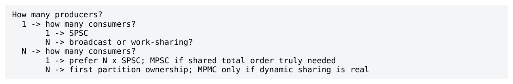

- ` How many producers? `
- ` 1 → how many consumers? `
- ` 1 → SPSC `
- ` N → broadcast or work-sharing? `
- ` N → how many consumers? `
- ` 1 → prefer N x SPSC; MPSC if shared total order truly needed `
- ` N → first partition ownership; MPMC only if dynamic sharing is real `

</details>

选择 queue 时至少评估 producer/consumer count、ordering、loss semantics、backpressure、event size、 burst envelope、lifetime、core/NUMA topology 与 recovery。单纯用 ns/op microbenchmark 排名容易误导。

<a id="pdf-page-014"></a>

<!-- source-pdf-page: 14 -->

*[原 PDF 第 14 页](./Level9_Concurrency_Architecture_CN.pdf#page=14)*

## 第 4 章 State Partitioning / Sharding

本章目标  当单个 owner/core 的 capacity 不足时，通过切分 ownership domain 扩展吞吐，而不是让多个 threads 同时修改同一份 state。

### 4.1 Shard 是 Ownership Domain

Sharding 的本质不是“多开几个线程”，而是把 canonical ownership 切成互不重叠的 domains：Shard0 owns subset A，Shard1 owns subset B。系统有多个 writers，但每个 object 仍只有一个 writer。

**图示转写**

1. ` Business key `
2. ` Logical shard `
3. ` Thread `
4. ` Physical core / NUMA `
5. ` EURUSD `
6. ` Shard3 `
7. ` Pricing3 `
8. ` Core7 / NUMA0 `

<details>
<summary>查看原图与完整文字转写</summary>


- ` Business key → Logical shard → Thread → Physical core / NUMA `
- ` EURUSD → Shard3 → Pricing3 → Core7 / NUMA0 `

</details>

这种模型同时获得 parallelism、cache locality 和 single-writer state transition。它是 low-latency 多核扩展最重要的 architecture pattern 之一。

### 4.2 Shard Key：Instrument / Order / Client / Venue / Strategy

Instrument sharding 适合 Book/market-local pricing；OrderId sharding 能确保同一 order 的 New/Ack/Fill/Cancel 进入同一 owner；Client/Account sharding 有利于 client-local limits/position；Venue sharding 天然匹配 FIX/FIXP session；Strategy sharding 适合 strategy-local signals/timers。

Consistency boundary  Shard key 的首要标准不是 hash 是否均匀，而是“哪些 state 经常一起维护业务 invariant”。应优先让一笔 hot transaction 尽量留在一个 ownership domain。

### 4.3 Load Balance 与 Hot Key

对象数量均匀不等于 work 均匀。100 个 symbols 的 shard 可能因为包含 EURUSD/XAUUSD 而远重于另一个 100 个 illiquid crosses 的 shard。更好的 static placement 使用历史 update rate、quote rate、pricing complexity 等权重。

Hot key 是更难的问题：一个单独 key 本身可能超过一个 core capacity。此时增加 shard 数没有用，因为该 key 仍只能落在一个 shard。策略包括 dedicated core、vertical optimization、拆分 downstream fan-out、 replicate read-only state，或重新定义更细的 ownership boundary。

### 4.4 Dependency-aware Partition

FX cross、option-underlying、derived products 会形成 dependency graph。简单 `hash(symbol)%N` 可能把强依赖节点分到不同 cores，导致每次定价都跨 shard。可以把 node workload 当 vertex weight、 communication 当 edge weight，做近似 graph partition：既平衡 CPU，又减少昂贵 cross-partition edges。

```text
EURUSD --\
          +--> EURSGD
USDSGD --/
```

<a id="pdf-page-015"></a>

<!-- source-pdf-page: 15 -->

*[原 PDF 第 15 页](./Level9_Concurrency_Architecture_CN.pdf#page=15)*

```text
目标：dependency locality + workload balance，而不是 symbol count balance。
```

### 4.5 Dynamic Migration 的成本

运行时把 EURUSD 从 Core2 迁到 Core3，不只是改 routing table。必须处理 Book、PricingState、Orders、 timers、pending events、sequence、references，并保证旧 owner 不再处理新 event、旧 inbox 已 drain、新 owner 已完整接管。

因此 ultra-low-latency 系统往往偏好 stable ownership + offline/market-window rebalance。预计算 `instrument_to_shard[]` 热路径 lookup 既便宜，又可支持 weighted/dependency-aware assignment；不必为了“动态”引入复杂迁移协议。

### 4.6 Cross-shard Operation 是 Coordination Protocol

一旦一个业务操作同时读写 Shard A 与 B，纯 local invariant 就消失。单机多核在这里开始像一个小型 distributed system：message ordering、partial completion、timeout、retry、duplicate、stale reply 都需要协议。

**图示转写**

| 步骤 | 发送 / 执行者 | 动作 |
| --- | --- | --- |
| 1 | OrderShard → RiskShard | ReserveRequest(id, version) |
| 2 | RiskShard → OrderShard | ReserveAccepted(id, version) |
| 3 | OrderShard | Continue order transition |

<details>
<summary>查看原图与完整文字转写</summary>

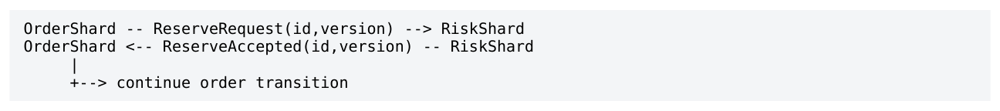

- ` OrderShard -- ReserveRequest(id,version) → RiskShard `
- ` OrderShard ← ReserveAccepted(id,version) -- RiskShard `
- ` → continue order transition `

</details>

第一优先仍是避免 cross-shard：把频繁共同更新的 Order + PendingQty + Position + LocalRisk colocate。只有真正 global/cross-domain 的动作才使用 message choreography、coordinator 或 reservation protocol。

### 4.7 Global Aggregation 与 Hierarchical Risk

一个 global atomic counter 很容易把 sharding 扩展性“悄悄打回原形”：8 个 shards 每次 fill 都 fetch_add 同一 total_position，会在一条 cache line 上重新形成 serialization。若 global 值只用于 monitoring，可使用 shard-local counters + periodic aggregation。

如果 hard global risk 必须每单严格保证，协调无法凭技术消失。一个实用办法是 hierarchical quota：全局 credit 先分配预算给 shards，绝大多数 checks 本地完成，仅低频 rebalancing 需要 global coordination。高频 local、低频 coordinated 是重要模式。

| Global need | 推荐思路 |
| --- | --- |
| Monitoring total | local counters + async aggregation |
| Unique ID | (shard_id, local_seq)，避免 global RMW |
| Exact global order | 承认需要 sequencer/serializer |
| Exact global risk | central reservation 或 hierarchical quota |

<a id="pdf-page-016"></a>

<!-- source-pdf-page: 16 -->

*[原 PDF 第 16 页](./Level9_Concurrency_Architecture_CN.pdf#page=16)*

### 4.8 NUMA-aware Sharding / IDs / Recovery

Logical shard 与 physical placement 要分开：Shard3 可以今天映射 Core7、明天映射 Core9；业务 ownership 不变。部署时再把 dependency cluster 放到同 NUMA/LLC，并让 shard-owned arena/pages first-touch 到本 node。

每 shard 使用 local sequence 比 global fetch_add 更可扩展；`(shard_id, local_seq)` 可以全局唯一但不提供 total order。Recovery 也可按 shard 拆分：初始 state + shard event stream -&gt; reconstructed shard state；跨 shard protocol events 必须同样记录或可重建。

<a id="pdf-page-017"></a>

<!-- source-pdf-page: 17 -->

*[原 PDF 第 17 页](./Level9_Concurrency_Architecture_CN.pdf#page=17)*

## 第 5 章 Fan-out / Fan-in / Broadcast Architecture

本章目标  定义 1-&gt;N 与 N-&gt;1 的真实语义：consumer 是否都要完整数据、slow consumer 是否能拖住 producer、 fan-in 到底按什么规则 merge。

### 5.1 Broadcast / Selective Routing / Latest-State

Fan-out 至少有三种完全不同的需求：broadcast（每个 consumer 都看全部 events）、selective routing（按 key 发到目标 shard）、latest-state replication（只关心最近一致状态）。不要因为都是“1-&gt;N”就用一套 delivery/backpressure 语义。

Event 与 State 的差异再次决定架构：Fill 的事实不能消失；BBO snapshot 的中间版本可能可以跳过。设计 fanout 前先问 consumer 需要 completeness 还是 freshness。

### 5.2 N×SPSC vs Shared Broadcast Ring

每 consumer 一条 SPSC 提供最强 isolation：各自 head/tail、capacity、full policy 独立；代价是 producer 多次写 payload。Shared ring 只写一份 payload，每 consumer 有 cursor；代价是 lifetime/gating/slow consumer coupling 更复杂。

| 维度 | Per-consumer SPSC | Shared broadcast ring |
| --- | --- | --- |
| Producer writes | N copies / publishes | payload 一次 |
| Consumer isolation | 强，可不同 policy | 较弱，gating 可能耦合 |
| Slow consumer | 只影响自己 channel | lossless 时限制 producer |
| Lifetime | 每 queue 简单 | slot 要等相关 readers 完成 |
| 适合 | 不同 SLA / 少量 consumer | 同语义、多 reader、payload 较大 |

### 5.3 Slowest Consumer Problem

在 lossless shared ring 中，producer 不能覆盖 slowest consumer 尚未读的数据，因此系统 capacity 受 `min(cursor_i)` 控制。一个非关键 monitoring subscriber 也可能让 pricing/recorder 被迫停住，这是典型 slowconsumer coupling。

Isolation rule  不要让低价值 slow consumer 对高价值 hot consumer 产生 backpressure。不同 SLA 的 subscribers 往往应使用不同 physical channels，即使逻辑上都订阅同一 source。

### 5.4 Lossless / Lossy / Conflation

Lossless consumer 必须完整读取 sequence；lossy consumer 可以检测 gap 后跳到新位置、snapshot/resync； latest-state consumer 可以 per-key conflation。三类机制都必须显式可检测，不能“悄悄读取已被覆盖的 slot”。

<a id="pdf-page-018"></a>

<!-- source-pdf-page: 18 -->

*[原 PDF 第 18 页](./Level9_Concurrency_Architecture_CN.pdf#page=18)*

**图示转写**

1. ` Pricing: freshness critical `
2. ` may conflate derived state `
3. ` Recorder: completeness critical `
4. ` lossless `
5. ` Monitoring: best effort `
6. ` drop/sample/latest `

<details>
<summary>查看原图与完整文字转写</summary>

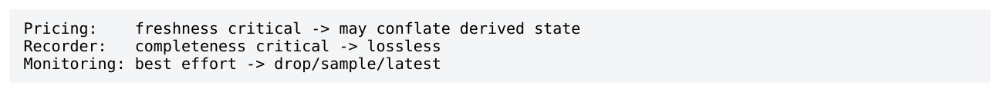

- ` Pricing: freshness critical → may conflate derived state `
- ` Recorder: completeness critical → lossless `
- ` Monitoring: best effort → drop/sample/latest `

</details>

Conflation 会改变 event ordering 和 transition visibility，因此只适合 state-like data。A1,B1,A2 可能被压成 B1,A2；如果 downstream 需要每次 transition，就不能这样做。

### 5.5 NUMA Fan-out 与 Zero-copy Trade-off

如果 producer 在 NUMA0，而多个 consumers 在 NUMA1，所有人直接读 NUMA0 shared ring 可能造成持续 remote traffic。有时更好的做法是跨 NUMA copy 一次到 NUMA1 local ring，再由本 node 多 consumers 读取。

NUMA reality  Zero-copy 不等于 zero-cost。减少 memcpy 可能增加 remote cache access、shared lifetime 和 reader coordination。低延迟设计比较的是总成本。

### 5.6 Fan-in：Merge Semantics First

N-&gt;1 的核心不是 queue 类型，而是 merge：Arrival order、hardware timestamp、exchange sequence、per-source order、business priority 都是不同语义。多个 cores 上的 events 未必存在一个自然、无歧义的“真实全局先后”。

如果只要求 source-local order，N×SPSC + round-robin/bounded draining 已足够；如果必须 global total order，就需要 serializer：MPSC ticket、single ingress、exchange-provided sequence 等。Total order 本质上意味着 coordination。

### 5.7 Fairness / Priority / Deterministic Merge

Round-robin 简单公平但不代表 arrival order；drain-one-queue 提高 batching/locality 但可能 starvation； bounded draining 是常见折中。Priority merge 可以让 Cancel/Ack 更快，但需要 quota 避免低优先级永远得不到服务。

若 replay 要求同输入得到同 merge stream，就必须定义 deterministic tie-break（timestamp then source_id/seq），或直接记录 live canonical merged stream。否则 live 中由 timing 形成的顺序难以重现。

### 5.8 Redundant Feed Aggregation

A/B redundant market-data feeds 是 fan-in 的典型高级场景：两个路径携带同一逻辑 sequence，aggregator 需要 dedup、gap detect、选择先到副本，并在 A 缺 101、B 有 101 时用 B 补 gap。Aggregator 自身适合 single-owner state machine，维护 last_seq / gap / dedup state。

**图示转写**

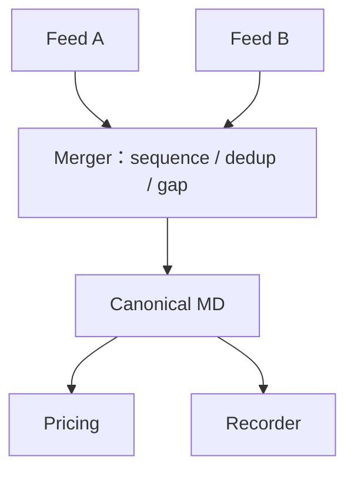

<details>
<summary>查看原图与完整文字转写</summary>

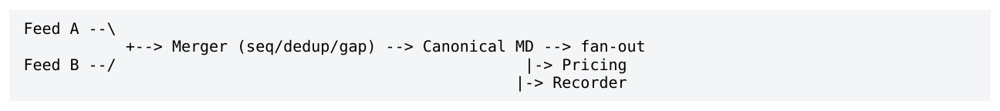

- ` Feed A --\ `
- ` → Merger (seq/dedup/gap) → Canonical MD → fan-out `
- ` Feed B --/ |-> Pricing `
- ` -> Recorder `

</details>

<a id="pdf-page-019"></a>

<!-- source-pdf-page: 19 -->

*[原 PDF 第 19 页](./Level9_Concurrency_Architecture_CN.pdf#page=19)*

## 第 6 章 Backpressure / Scheduling / Work Distribution

本章目标  把 queue full 从“实现错误”提升为 end-to-end capacity contract：定义 sustained overload 时如何降级，并让 application scheduler 保护关键工作。

### 6.1 Capacity Mismatch 与 Bounded Queue

若 arrival rate λ 长期大于 service rate μ，任何 finite queue 最终都会满；unbounded queue 只是把失败形式变成 memory growth + stale latency + eventual OOM。Queue capacity 只能吸收有限 burst。

```text
backlog growth rate = max(0, lambda - mu)
recovery drain rate = mu - current_arrival_rate
recovery_time ~= backlog / drain_rate
```

因此 capacity planning 要看 peak rate、burst duration、consumer sustainable rate 和 drain headroom。长期把 core 跑到 95-100% 会让任何小 variance 都形成 queue，而且 burst 后 backlog 很久才消失。Idle headroom 是 latency insurance。

### 6.2 Block / Drop / Overwrite / Conflate / Spill

| 策略 | 适合 | 主要风险 |
| --- | --- | --- |
| Block / spin producer | 真正 lossless 且 upstream 可以减速 | backpressure 沿 pipeline 传播 |
| Drop newest | 新数据不比旧数据重要 | freshness workload 常不合理 |
| Drop oldest / overwrite | latest-state / telemetry | 必须可检测 gap |
| Conflate | 同 key 中间 state 可 supersede | 丢失 transition order |
| Spill | audit/recorder 等可走慢存储 | latency / complexity 激增 |
| Disconnect / fail fast | 非关键 subscriber 或保护模式 | 需要明确 recovery / alert |

Stale-work elimination 是 low-latency overload 的重要武器：若 PriceCalc v100/v101 已被 v102 supersede， 继续计算旧版本只会消耗 CPU 并延长 queue。相反，Fill/Cancel 等外部事务事件不能这样删除。

### 6.3 High/Low Watermark 与 Hysteresis

不要等 queue full 才进入 overload。可以在 high watermark 进入 DEGRADED，在 low watermark 恢复 NORMAL，通过 hysteresis 避免阈值附近频繁抖动。Queue depth 还可用于 admission control：当 downstream 已高水位，提前 reject/conflate，而不是把 latency 拖到不可接受。

**图示转写**

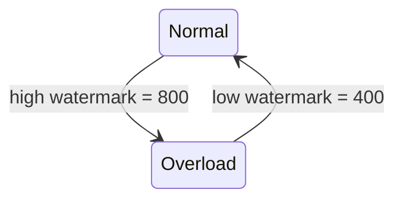

Capacity = 1024；原文未规定比较是否包含等号，具体实现需明确定义边界。

<details>
<summary>查看原图与完整文字转写</summary>

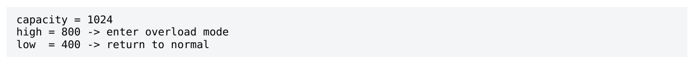

- ` capacity = 1024 `
- ` high = 800 → enter overload mode `
- ` low = 400 → return to normal `

</details>

<a id="pdf-page-020"></a>

<!-- source-pdf-page: 20 -->

*[原 PDF 第 20 页](./Level9_Concurrency_Architecture_CN.pdf#page=20)*

### 6.4 Credit / Token Bucket / Proactive Flow Control

Credit-based flow control 让 consumer 显式告知 producer 可发送多少 work；producer 可以批量获取 credits 后本地消费，减少每次碰 remote metadata。Backpressure 是 downstream capacity 的反馈；rate limiting 则是主动约束 producer，两者概念不同但经常结合。

Token bucket 用 rate R 和 bucket B 表示长期速率上限 + 可允许 burst。Venue message-rate、client throttle 等是典型 proactive flow control；queue high-watermark 则更偏 reactive。

### 6.5 Dedicated Threads vs Pools / Work Stealing

Dedicated threads + fixed affinity 提供 stable ownership、cache/NUMA locality 和可预测 scheduling； generic thread pool / work stealing 提供动态 utilization 和 load balance，却让 stateful hot task 在 cores 间漂移。

| Workload | 更合适的模型 |
| --- | --- |
| Persistent Book / Order / Pricing state | fixed owner / shard |
| Stateless independent compute | thread pool / work stealing 可考虑 |
| Cold IO / admin / logging | blocking pool |
| Ultra-low-latency queue consumer | dedicated core + busy polling 常见 |

Work stealing 不是“坏”，只是它解决的是 throughput / utilization 问题；如果 task 绑定 persistent hot state，cache migration 和 NUMA remote access 可能比平衡 CPU 更昂贵。

### 6.6 Busy-spin / Yield / Park

Busy-spin 用一个 dedicated core 换取 immediate readiness，避免 futex/scheduler wake-up；yield 把重新运行时机交给 OS；park/sleep 节能但增加 wake-up tail 和 cache cooling。Hybrid spin-then-park 折中 CPU 与 latency，却会让事件落在 spin/park 边界时出现更大 variance。

**图示转写**

1. ` busy spin `
2. ` lowest wake-up latency, highest CPU cost `
3. ` yield `
4. ` scheduler-dependent middle ground `
5. ` park `
6. ` CPU efficient, higher and more variable wake-up latency `

<details>
<summary>查看原图与完整文字转写</summary>

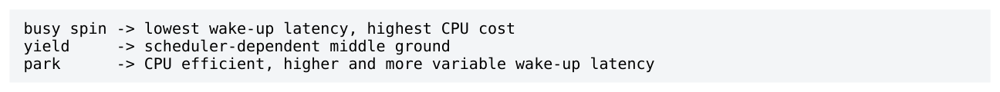

- ` busy spin → lowest wake-up latency, highest CPU cost `
- ` yield → scheduler-dependent middle ground `
- ` park → CPU efficient, higher and more variable wake-up latency `

</details>

### 6.7 Priority / Bounded Draining / Starvation

Application event loop 本身就是 scheduler。`while(exec_queue.not_empty())` 可能让 MD/control 永远 starvation；完全 round-robin 又可能不符合业务优先级。常见做法是 bounded priority / weighted roundrobin，例如每轮最多 32 Ack、16 Cancel、16 New、64 MD、4 control。

Handler work 同样要 bounded：timer 一次扫描 100k orders、一个 update 扫所有 clients 都会造成 head-of-line blocking。必要时使用 timer wheel、incremental scan 或 work chunking，但 chunking 会引入 continuation state，应只在大而非关键的工作上使用。

<a id="pdf-page-021"></a>

<!-- source-pdf-page: 21 -->

*[原 PDF 第 21 页](./Level9_Concurrency_Architecture_CN.pdf#page=21)*

### 6.8 Load Shedding / Graceful Degradation / Headroom

成熟系统在 overload 时应保护 critical work，而不是平均把一切拖慢。典型顺序可以是：先 drop debug/analytics，再 sample monitoring，再 conflate pricing，再限制新的 discretionary work，最后进入 protective mode 保留 execution/risk/recovery。

Graceful degradation  Fast reject 有时比 slow success 更安全。对于 transactional channels，如果系统无法在 bounded latency 内继续提供正确服务，显式拒绝/保护往往优于无限 queue。具体动作必须服从协议和业务要求。

Overload mode 最好是显式 state machine：NORMAL -&gt; DEGRADED -&gt; PROTECTIVE，而不是 scattered `if(queue_full)`。这样测试、监控和恢复策略都更可推理。

<a id="pdf-page-022"></a>

<!-- source-pdf-page: 22 -->

*[原 PDF 第 22 页](./Level9_Concurrency_Architecture_CN.pdf#page=22)*

## 第 7 章 Concurrent Lifetime / Memory Reclamation

本章目标  理解 publication correctness 与 object lifetime correctness 是两套问题；比较 refcount、Epoch/QSBR、Hazard Pointer、RCU，并用 ownership/pool/arena 让 hot path 尽可能不需要复杂 reclamation。

### 7.1 Atomic Pointer != Object Lifetime

`std::atomic<Node*>` 可以保证 pointer load/store 本身原子，也可以通过 release/acquire 安全发布初始化后的 object；但 reader load 之后，writer 仍可能 exchange 新 pointer 并 delete old，reader 随后 dereference 就是 use-after-free。

```text
Reader                       Writer
p = head.load()               old = head.exchange(new)
                              delete old
use(p)   // UAF
```

Critical distinction  更强 memory_order、seq_cst fence 都不能让已结束 lifetime 的对象重新“活着”。 Ordering / visibility 与 reclamation 是不同维度。

### 7.2 Logical Remove vs Physical Reclaim

安全删除通常分两步：先从 shared structure remove，使新 readers 不再发现 object；再等待所有旧 readers 都不可能继续 dereference 后，才允许 free/reuse。Removal != reclamation。

**图示转写**

1. ` reachable `
2. ` logically removed `
3. ` no new discovery `
4. ` → wait old readers `
5. ` → reclaim / reuse memory `

<details>
<summary>查看原图与完整文字转写</summary>

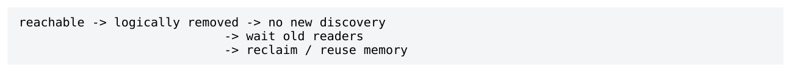

- ` reachable → logically removed → no new discovery `
- ` → wait old readers `
- ` → reclaim / reuse memory `

</details>

低延迟系统经常选择“现在 logical delete，稍后 physical reclaim”，因为 allocator/destructor/free 的 latency 和 cross-thread coordination 都可以移出 critical transition。

### 7.3 Reference Counting / shared_ptr

Reference counting 通过 reader 获得 ownership 时 increment、释放时 decrement，最后一个 owner 才 destroy。`shared_ptr` correctness 友好，特别适合 dynamic lifetime；但 control block refcount 是 shared atomic mutable state，高频跨 core copy/reset 可能产生 RMW/coherence。

因此不要简单说“low latency 不能用 shared_ptr”。对每天几次配置更新、低频 control path，它可能是最合理工具；对每 packet/read 都 copy shared_ptr 的 hot path，则应 benchmark，并考虑 immutable snapshot + RCU/epoch 或 architecture ownership。

<a id="pdf-page-023"></a>

<!-- source-pdf-page: 23 -->

*[原 PDF 第 23 页](./Level9_Concurrency_Architecture_CN.pdf#page=23)*

### 7.4 Epoch / QSBR

Epoch-Based Reclamation 把 reader 归属到 generation；object 在 epoch E retire 后，只有当系统证明没有 reader 仍处于可能引用 E 对象的 critical section，才批量 reclaim。QSBR 用明确 quiescent state 表示 reader 已不持有旧 borrowed references。

固定 dedicated event-loop threads 特别适合 QSBR：每次 batch/loop boundary 可以自然 report quiescent。 Reader path 很轻，但一个 stalled reader 可能阻塞整个 old epoch 的大量对象回收，因此需要 bounded critical section、watchdog 和 participant lifecycle 管理。

### 7.5 Hazard Pointer

Hazard Pointer 让 reader 显式发布“我可能 dereference P”。Writer remove P 后放入 retire list；reclaim 时扫描所有 hazard records，只有未被任何 reader 保护的对象才能 free。Reader 通常要 load-&gt;publish hazard- &gt;recheck pointer，避免在保护建立前被移除。

| 维度 | Hazard Pointer | Epoch/QSBR |
| --- | --- | --- |
| Reader cost | 发布 hazard + 可能 retry | 通常更轻 |
| Reclaim precision | per-object | batch / epoch |
| Stalled reader | 只阻止保护对象 | 可能卡住整批 epoch |
| 适合 | reader duration 更任意 | 固定、受控 event-loop threads |
| 复杂度 | 较高 | 中等 |

### 7.6 RCU / Immutable Snapshots

RCU/Read-Copy-Update 的核心是 reader 读取 immutable old version；writer 构建 new version、publish， 再等待 grace period 后 reclaim old。Read-mostly config/routing/instrument metadata 很适合这种模式。

**图示转写**

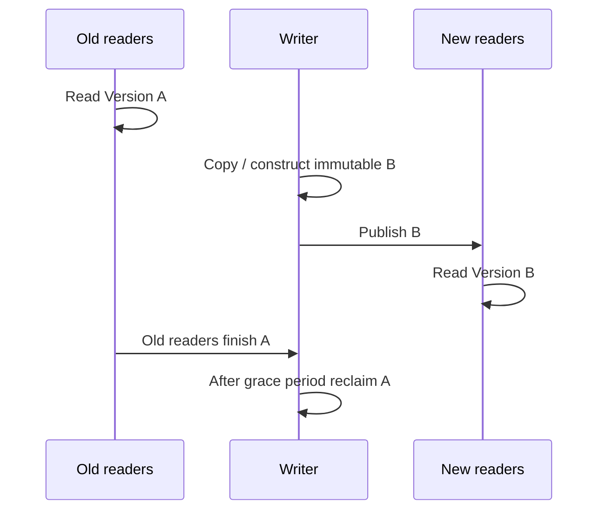

<details>
<summary>查看原图与完整文字转写</summary>

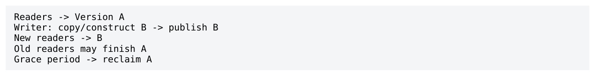

- ` Readers → Version A `
- ` Writer: copy/construct B → publish B `
- ` New readers → B `
- ` Old readers may finish A `
- ` Grace period → reclaim A `

</details>

Immutable payload 消除了 mutation race，但不自动解决 lifetime；仍需要 shared_ptr、grace period、epoch 或“直到 shutdown 都不 free”等策略。对于低频小配置，甚至保留旧 snapshots 到进程重启都可能是最佳工程答案。

### 7.7 ABA / Tagged Pointer / Generation Handle

ABA 表示 thread 观察 A，其他线程把值改为 B 后又变回 A，原 thread 只比较 pointer equality 就误以为“没变”。Memory pool 地址复用会让同一地址代表完全不同逻辑对象，是典型危险来源。

> **转换补充**：generation/version 校验和 safe reuse 是不同证明。检查 generation 之后、实际读取之前仍可能发生 reuse；若没有保护 reader 的协议，仅有 version mismatch 检测不能保证 lifetime 或普通 payload 的 race freedom。

<a id="pdf-page-024"></a>

<!-- source-pdf-page: 24 -->

*[原 PDF 第 24 页](./Level9_Concurrency_Architecture_CN.pdf#page=24)*

Tagged pointer / generation counter 用 `(pointer,version)` 或 `(index,generation)` 识别 identity generation。 它可发现 stale handle/ABA，但不等于 safe reclamation：reader 仍不能 dereference 已 free 的 object。ABA detection 与 lifetime protection 必须分开。

### 7.8 Pool / Arena / Deferred Recycle

Per-shard preallocated pool/arena 可以让 allocate/free 都在 owner core 上完成，避免 general heap、remote free、fragmentation 和 allocator metadata contention。Arena 还可以 epoch-wise bulk reset。

Pool 不自动安全：如果 reader 还握着 Order*，slot 被 recycle 给新 order，就出现 same address / different object。正确策略是 owner-local immediate recycle（没有外部 reader）或 retire -&gt; safe epoch -&gt; recycle，并使用 generation handle 检测 stale async references。

### 7.9 Pointer Stability / Shared-memory Index

即使没有 delete，`vector` reallocation 也会让 pointer/iterator 失效。跨 ownership boundary 保留 raw pointer 时必须考虑 address stability。Preallocated storage、pool、deque、index-based packed storage 都可提供不同程度的稳定性。

跨 process shared memory 更不应依赖 raw virtual address，因为两进程 mapping 地址可能不同。offset/index/handle 更自然，也更利于 replay/serialization。Index + generation 是低延迟系统中很实用的 logical identity。

### 7.10 Lifetime Review Invariants

7. 谁创建对象？谁是 canonical owner？

8. 哪些线程可以读/写，borrowed reference 最长可以跨多少工作边界？

9. 对象何时从 shared root 移除，从此新 reader 不再发现？

10. 用什么机制证明所有旧 reader 已结束？refcount / hazard / epoch / ownership？

11. 谁执行 physical reclaim/recycle，是否会在 hot core 触发 destructor/allocator jitter？

12. 内存何时允许 reuse？generation/handle 如何识别 stale identity？

Reclamation theorem  Before memory is reused, prove that no thread can still legally dereference the old object。这个 invariant 是所有 reclamation 技术的共同底座。

<a id="pdf-page-025"></a>

<!-- source-pdf-page: 25 -->

*[原 PDF 第 25 页](./Level9_Concurrency_Architecture_CN.pdf#page=25)*

## 第 8 章 Trading-System Concurrency Architecture 综合设计

本章目标  把第 1-7 章组合成一个完整低延迟交易系统：从 logical graph 到 ownership、sharding、queues、 backpressure、recovery、NUMA placement、测试和观测。

### 8.1 从 Logical Graph 到 Ownership Map

先画逻辑链路：NIC RX -&gt; Feed/Decode -&gt; Book -&gt; Pricing/Strategy -&gt; Risk -&gt; OMS -&gt; Venue Gateway -&gt; TX， 同时列出 Recorder、Monitoring、Config、Recovery。然后列 mutable state：feed seq/gap、book、pricing model/subscription/quote、risk/position/reservation、order state、FIX/FIXP session seq/socket。

再逐项指定 canonical owner。不要一开始按 component 数量创建线程。设计目标是让 authoritative state 的 ownership 清楚，其他线程通过 commands/events/snapshots 交互。

### 8.2 Fuse / Split / Shard 的设计流程

第一版应该偏 fused/run-to-completion：如果 RX+Feed+Book+Pricing+Risk+OMS+Encode 能在一个 core 的 burst envelope 内满足 SLA，它通常给最低 handoff。只有当 core saturation、RX poll gap、high-variance stage、blocking 行为或独立 scaling 需要时才 split。

**图示转写**

| 场景 / 部分 | 路径、状态或说明 |
| --- | --- |
| Start fused | ` Core2: RX → Feed → Book → Pricing → Risk → OMS → Encode → TX ` |
| Then split only measured bottleneck/isolation boundaries | ` Core2: RX+Feed+Book → SPSC → Core3: Pricing+Risk+OMS → SPSC → Core4: Gateway ` |

<details>
<summary>查看原图与完整文字转写</summary>

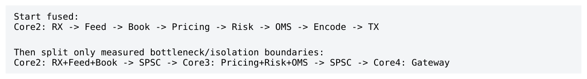

- ` Start fused: `
- ` Core2: RX → Feed → Book → Pricing → Risk → OMS → Encode → TX `
- ` Then split only measured bottleneck/isolation boundaries: `
- ` Core2: RX+Feed+Book → SPSC → Core3: Pricing+Risk+OMS → SPSC → Core4: Gateway `

</details>

如果 Pricing 一个 core 不够，优先按业务 key shard，让每个 shard 内 Book+Pricing+LocalRisk+Orders vertical run-to-completion，而不是让多个 threads 共同写一个 PricingState。

### 8.3 Pricing / Risk / OMS / Gateway Ownership

Risk 与 OMS 往往有强一致性关系：NewOrder 要 reserve qty、建立 OrderState；Fill 要同时更新 position/pending/risk。因此很多架构会把 local risk + order state colocate。FIX/FIXP session state（in/out seq、heartbeat、logon/recovery、socket）天然是 sequential state machine，适合单 owner。

| Domain | Canonical owner 建议 | 原因 |
| --- | --- | --- |
| Book / feed state | feed/book shard owner | sequence + book update 顺序明确 |
| Pricing state | pricing shard owner | 模型/订阅/quote locality |
| Local Risk + Orders | trading shard/OMS owner | 业务 invariant 共更新 |
| Venue session | gateway owner | 协议 seq/socket/recovery 串行 |
| Monitoring view | monitoring replica | 不能污染 authoritative hot state |

<a id="pdf-page-026"></a>

<!-- source-pdf-page: 26 -->

*[原 PDF 第 26 页](./Level9_Concurrency_Architecture_CN.pdf#page=26)*

### 8.4 Queue Topology / Fan-in / Late Serialization

固定 RX-&gt;Shard、Shard-&gt;Gateway 关系优先 SPSC；多个 shards 共享同 venue session 时，Gateway 可以 poll N×SPSC 并在这里建立唯一 outgoing total order。不要让前面的 shards 每个 send 都争一个 global atomic FIX sequence。

Serialization boundary  Serialize as late as possible, but as early as semantics require。能并行的 ownership domains 保持独立；真正必须形成一条 venue stream 时才在 gateway owner merge。

如果某 business invariant 从一开始就必须顺序，例如单 Order state machine，则应该 early serialize。不要为了 parallelism 把语义本身拆坏。

### 8.5 Backpressure by Semantics

| Channel | Full / overload policy |
| --- | --- |
| Derived MD -&gt; Pricing | skip/conflate stale，必要时 snapshot resync |
| Pricing -&gt; Gateway quote intent | latest unsent per key / conflation |
| Order request -&gt; Gateway | bounded；reject/admission/protective mode |
| Execution report -&gt; OMS | lossless；不能 silent drop |
| Hot -&gt; Recorder | dedicated lossless/durable path，隔离 trading |
| Hot -&gt; Monitoring | drop/sample/latest-value |

关键边界是 internal intent vs external side effect：Quote v100/v101/v102 在尚未 send 前可能只保留 v102；一旦 v100 已发到 exchange，就成为外部事实，后续必须用 replace/cancel/reconcile，而不能“当作没发生”。

### 8.6 Recovery / Version / Causality

理想 shard 是 deterministic state machine：initial state + ordered input events -&gt; reconstructed state。Live network、manual intervention、recovery、timer、config 等所有 state-changing inputs 最终都进入同一个 owner transition path，而不是 Recovery/GUI thread 直接修改 hot map。

跨 pipeline/shard message 应携带 source seq、book version、quote version、request/correlation id、order generation。这样可以识别 stale reply、解释 pipeline skew，并在 incident/replay 中建立 causality。

如果 live fan-in merge 顺序依赖 arrival timing，replay 可以记录 canonical merged stream；否则必须定义 deterministic merge rule。Authoritative side effects 与 derived state 的持久化要求应区别对待。

### 8.7 NUMA / SMT / Memory Placement

Hot thread affinity、memory locality、NIC locality 必须一起设计：把 RX/critical shards 放 NIC-local NUMA，queue/storage/state first-touch 到对应 node；避免把两个 noisy hot threads 放在同一 SMT sibling； IRQ/housekeeping/DB/Logger/Reclaimer 放非 hot cores。

```text
Example placement:
```

<a id="pdf-page-027"></a>

<!-- source-pdf-page: 27 -->

*[原 PDF 第 27 页](./Level9_Concurrency_Architecture_CN.pdf#page=27)*

```text
Core2  RX/Feed
Core3  Trading Shard0
Core4  Trading Shard1
Core5  Trading Shard2
Core6  Gateway
Core10 Recorder
Core11 Monitoring
Other  OS/IRQ/housekeeping
```

具体 core 编号完全取决于机器 topology；原则是 stable placement + local memory + controlled sharing。一个“独占逻辑 CPU”仍可能被 sibling、LLC、memory bandwidth、DMA/DDIO 等共享资源干扰。

### 8.8 Testing / Observability / Failure Injection

Concurrency correctness 与业务 state machine correctness 应分层测试：核心 owner state machine 用单线程 deterministic event sequence 测；queue/handoff 单独做并发 integration；然后做 end-to-end burst、slowconsumer、gap/recovery、stall injection。

| 层次 | 建议指标/实验 |
| --- | --- |
| Stage | service time p50/p99/p99.9/max、cycles/message |
| Edge/Queue | depth、p99/max depth、full/offer-fail、consumer lag |
| Shard | event rate、CPU、poll gap、drop/conflation、overload mode |
| System | e2e percentiles、burst drain time、recovery correctness |
| Failure injection | pause recorder、stall pricing、throttle gateway、kill/restart consumer |

Slow Recorder test 的目标是验证 Pricing p99.9 不明显受影响；Pricing stall test 应尽量只伤害本 shard； Gateway throttle test 要看到 quote conflation/admission，而不是无限 queue。架构成熟度往往体现在这些 failure modes。

### 8.9 System-design Interview Framework

面对“Design a low-latency trading engine”，成熟回答不应从“我会用 lock-free queue”开始，而应从 mutable state 与 ownership 开始。

```text
1. Identify mutable authoritative state and business invariants.
2. Assign single-writer owners; keep strong transactions local.
3. Start with minimal thread boundaries; fuse strongly coupled stages.
4. Shard before shared writers when one core is insufficient.
5. Use SPSC for fixed edges; N x SPSC for fixed fan-in.
6. Define ordering and overload semantics per channel.
7. Separate hot/cold path and authoritative/derived state.
8. Map cores + memory + NIC/NUMA; preallocate hot objects.
9. Design recovery/versioning/causality and failure tests.
```

若追问 global risk，要先问 exactness；若 exact，每单 coordination 不可避免，或用 hierarchical quota 降低频率。若追问 slow consumer，按 consumer semantics 分 lossless/freshness/best-effort。若追问 MPMC，强调 dynamic ownership 的协调成本与显式 topology 的可预测性。

<a id="pdf-page-028"></a>

<!-- source-pdf-page: 28 -->

*[原 PDF 第 28 页](./Level9_Concurrency_Architecture_CN.pdf#page=28)*

### 8.10 第九层统一模型

四个核心词  Ownership + Locality + Boundedness + Semantics。Ownership 决定谁改 state；Locality 决定 state/work 放在哪里；Boundedness 决定 queue/work/lifetime 是否可控；Semantics 决定哪些 order/loss/global guarantees 真正必须付成本。

理想的 low-latency concurrency architecture 像多个 ownership islands：每个 core/shard 内部使用普通数据结构和 sequential state transitions，岛与岛之间通过少量显式 queues 传递 immutable/value events。Atomic 与 memory ordering 主要出现在边界，而不是渗透到每个 object。

**图示转写**

| Owner | 本地内容 | 跨 owner 通信 |
| --- | --- | --- |
| Core / Shard A | Owned state + event loop | 通过 explicit queue 向 B 发消息 |
| Core / Shard B | Owned state + event loop | 从 A 的 explicit queue 接收消息 |

<details>
<summary>查看原图与完整文字转写</summary>

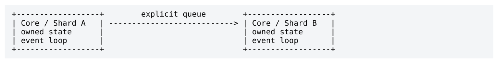

- ` explicit queue + + `
- ` Core / Shard A | → | Core / Shard B `
- ` owned state | | owned state `
- ` event loop | | event loop `

</details>

因此第九层最核心结论是：low-latency concurrency architecture 首先是 ownership 和 placement 问题；同步原语只是剩余边界上的实现细节。

<a id="pdf-page-029"></a>

<!-- source-pdf-page: 29 -->

*[原 PDF 第 29 页](./Level9_Concurrency_Architecture_CN.pdf#page=29)*

## 附录 A：速查、面试与复习

### A.1 术语表

| 术语 | 定义 |
| --- | --- |
| Canonical owner | authoritative mutable state 的唯一修改者/源头。 |
| Single Writer | 同一 mutable object/domain 同时只有一个 writer。 |
| Run-to-completion | 一个 event 的强依赖 work 尽量在同 owner/core 一次完成。 |
| Pipeline | 不同 stages 在不同 execution contexts 上处理多个 in-flight events。 |
| Stage fusion | 合并相邻 stages，减少 queue/handoff，提高 locality。 |
| Shard | 独立 ownership domain；同一 shard state 由一个 owner 修改。 |
| SPSC | Single Producer Single Consumer，固定 ownership queue。 |
| Fan-out | 一个 source 向多个 consumers 分发。 |
| Fan-in | 多个 sources 向一个 consumer/aggregator 汇聚。 |
| Backpressure | downstream capacity 限制被 upstream 感知并改变 upstream行为。 |
| Conflation | 多个同 key 中间 state 合并成最新 pending state。 |
| Consumer lag | producer sequence 与 consumer progress 的差。 |
| Quiescent state | reader 明确不再持有旧 shared references 的状态。 |
| Grace period | remove 后等待所有旧 readers 结束的时间/逻辑区间。 |
| ABA | value/pointer 从 A 变走又回 A，单纯 equality 无法察觉generation 已变化。 |
| Causality | 事件之间的因果关系；不等于全局 total order。 |
| Pipeline skew | 不同 stages 同时处于不同 logical version。 |
| Load shedding | overload 时主动丢弃/降级低价值 work，保护关键路径。 |
| Headroom | 正常负载下保留的 service capacity，用来吸收burst/variance。 |

<a id="pdf-page-030"></a>

<!-- source-pdf-page: 30 -->

*[原 PDF 第 30 页](./Level9_Concurrency_Architecture_CN.pdf#page=30)*

### A.2 关键对照表

A.2.1 Pipeline vs Sharding

| 维度 | Pipeline | Sharded run-to-completion |
| --- | --- | --- |
| 并行方式 | 不同 stages overlap | 不同 data domains parallel |
| 每 event 跨核 | 通常多 | 通常少 |
| State ownership | 按 stage | 按 business/data shard |
| 强项 | stage specialization / isolation | locality / single writer |
| 难点 | queueing / skew | cross-shard dependencies / imbalance |

A.2.2 SPSC / MPSC / MPMC

| 结构 | 共享协调点 | 常见 low-latency 判断 |
| --- | --- | --- |
| SPSC | 几乎只有跨边 publish/observe | 固定 edge 首选 |
| MPSC | producer shared reservation | 先问能否 N×SPSC |
| SPMC broadcast | slowest reader gating 或独立 copies | 先定义 loss semantics |
| MPMC | 两端 arbitration | dynamic task ownership 才值得 |

A.2.3 Reclamation

| 方法 | Reader cost | 适合 |
| --- | --- | --- |
| Single owner/local pool | 最低 | hot authoritative state |
| shared_ptr/refcount | atomic ref changes | 动态 ownership、低频 control |
| Epoch/QSBR | 低 | 固定受控 readers/event loops |
| Hazard Pointer | hazard store/retry | reader duration 更灵活 |
| RCU snapshot | 极低 read-side | read-mostly immutable state |

### A.3 高频面试问答

Q: 为什么 single writer 比 lock-free 更重要？ A: 它直接移除 shared mutation：不仅减少锁，还减少 cache-line contention、business-ordering 和 lifetime complexity。Lock-free 仍可能在共享 RMW 上序列化。

Q: 为什么更多线程可能提高 latency？ A: 增加 core parallelism 的同时，也增加 inter-core handoff、queueing、coherence、ordering 和 scheduling variability。如果一个 core 已够，split 只付成本不买 throughput。

<a id="pdf-page-031"></a>

<!-- source-pdf-page: 31 -->

*[原 PDF 第 31 页](./Level9_Concurrency_Architecture_CN.pdf#page=31)*

Q: 为什么 SPSC 快？ A: producer/consumer metadata 都是 single-writer，没有 producer-producer 或 consumer-consumer arbitration，只需要 publish/observe。

Q: 为什么 N×SPSC 常比 MPSC 更好？ A: MPSC producers 争 shared reservation line；N×SPSC 把竞争移除到 consumer merge，代价是没有天然 global order。

Q: 什么时候一定需要 global total order？ A: 只有业务/协议语义真正要求时，例如单 FIX session outgoing sequence。建立 total order 需要 serializer/coordination，无法免费获得。

Q: 如何处理 slow broadcast consumer？ A: 先按语义分类：lossless consumer 需要独立 capacity/durable path；best-effort drop；latest-state 可 conflate/resync。不要让低价值 subscriber backpressure hot producer。

Q: queue 为什么不能解决 overload？ A: queue 只能吸收有限 burst。持续 arrival&gt;service 时 backlog 线性增长；扩大 queue 只推迟 full，并增加 worstcase latency。

Q: work stealing 为什么不适合 hot state？ A: task ownership 动态漂移导致 cache/NUMA locality 下降、stateful sequencing 不稳定；更适合 independent/stateless throughput tasks。

Q: atomic pointer 为什么不够？ A: 它只能保证 pointer publication/access，不保证 pointed object 在 reader 使用期间仍 alive；需要 refcount/hazard/epoch/RCU 或单 owner。

Q: ABA 与 reclamation 是同一问题吗？ A: 不是。generation/tag 可以检测 A-&gt;B-&gt;A，但仍不能阻止 dereference freed object；safe reclaim 还需要 lifetime protocol。

Q: global risk 怎么设计？ A: 先问是否每单 exact。若 exact，coordination 不可避免；可用 hierarchical quota 把绝大多数 checks 本地化，低频 rebalance。

Q: 怎样做 deterministic replay？ A: 把 authoritative state 设计成 single-owner event state machine，记录/重建输入顺序，并传播 source version/correlation；timing-dependent fan-in 可记录 canonical merged stream。

Q: zero-copy 是否一定更快？ A: 不一定。共享 payload 会增加 coherence、remote NUMA access 和 lifetime coordination；几十字节 local copy 有时整体更快、更简单。

Q: 线程该按 component 拆吗？ A: 不应该。logical component != thread。thread boundary 应由 CPU capacity、blocking/isolation、ownership 和 scaling 需求决定。

Q: 如何判断 stage 应 fuse 还是 split？

<a id="pdf-page-032"></a>

<!-- source-pdf-page: 32 -->

*[原 PDF 第 32 页](./Level9_Concurrency_Architecture_CN.pdf#page=32)*

A: 轻量+强依赖+locality 好 -&gt; fuse；CPU-heavy/high variance/blocking/独立 scaling -&gt; split，并重新定义 queue/backpressure。

### A.4 推荐实验

| 实验 | 控制变量 | 观察 |
| --- | --- | --- |
| Fuse vs split | 相同业务逻辑；同 NUMA，比较 0/1 handoff | e2e p99.9、queue depth、cycles/event |
| SPSC same vs cross NUMA | 固定 queue/event size，仅改 core placement | handoff latency、remote traffic |
| False sharing | head/tail same line vs separated | throughput、cache-to-cache/HITM |
| MPSC vs N×SPSC | 固定 N producers/1 consumer | producer tail、p99、coherence contention |
| Queue burst | 固定 service，注入不同 burst duration | max depth、drain time、staleness |
| Busy spin vs park | 相同 event rate | wake-up p99.9、CPU/power |
| Shard imbalance | 均匀 key vs hot key | hottest shard CPU、lag |
| Conflation | state workload，all-events vs latest-only | useful decisions/s、stale backlog |
| Slow recorder injection | 暂停 recorder | hot pricing latency 是否隔离 |
| Epoch stalled reader | 故意延迟 quiescent | retired memory growth / watchdog |

### A.5 Architecture Review Checklist

A.5.1 Ownership

- 每份 authoritative mutable state 是否有唯一 canonical owner？

- 是否有 GUI/Recovery/Monitoring 绕过 owner 直接修改 hot state？

- 有没有 global atomic/shared map 破坏了原本的 sharding？

- 跨 thread raw pointer 是否真的必要？

A.5.2 Thread / Core Topology

- 每个 hot thread 跑在哪个 physical core？SMT sibling 是什么？

- 一次关键 event 跨多少次 core/queue？每次边界购买了什么收益？

- hot state/pages 是否在 thread-local NUMA？NIC 在哪个 node？

- 是否有 stage 平时空闲但仍强制每 event handoff？

A.5.3 Queues / Backpressure

- Producer/consumer count 是否与 SPSC/MPSC/MPMC 选择匹配？

- Queue capacity 基于哪个 burst envelope？

- Full 时明确 block/drop/conflate/reject 哪一种？

- 哪些 consumer 有资格 backpressure producer？

- 是否监控 lag/depth/full/high-watermark/drain time？

<a id="pdf-page-033"></a>

<!-- source-pdf-page: 33 -->

*[原 PDF 第 33 页](./Level9_Concurrency_Architecture_CN.pdf#page=33)*

A.5.4 Ordering / Recovery

- 业务究竟需要 per-source order、causality 还是 total order？

- 跨 stage 是否传播 source version/correlation id？

- Live merge 的顺序如何在 replay 中重现？

- authoritative event 与 derived state 的 recovery 策略是否分开？

A.5.5 Lifetime

- remove 后新 reader 是否无法再发现对象？

- 什么机制证明旧 reader 已结束？

- physical delete/recycle 是否在 hot core 造成 variance？

- pool reuse 是否用 generation/epoch 防 stale handle？

### A.6 最终复习清单

1. Concurrency starts with ownership, not locks.

2. Single writer usually beats shared lock-free mutation for predictability.

3. Logical components do not imply threads; use the minimum necessary concurrency.

4. More cores increase throughput potential, not necessarily single-event latency.

5. Shard ownership before adding concurrent writers.

6. SPSC is the natural edge between fixed ownership islands.

7. Global total order and exact global state both require coordination; never invent them casually.

8. Every queue needs explicit loss/backpressure/recovery semantics.

9. Transactional events and state updates must have different overload policies.

10. Keep authoritative state single-owner; publish derived snapshots/views.

11. Atomic pointer ordering cannot solve object lifetime; reclamation needs its own protocol.

12. NUMA/core/memory/NIC placement is part of concurrency architecture, not deployment trivia.

13. Tail latency is often queueing + variance + coordination, not only compute latency.

14. Design overload and failure behavior before production, then verify with burst/stall injection.

15. The best low-latency architecture minimizes required coordination while preserving business invariants.

Final takeaway  第九层一句话：A low-latency concurrency architecture is primarily an ownership and placement problem; synchronization is only the implementation detail at the remaining boundaries.

<a id="conversion-errata"></a>

## 转换补充与勘误

本节及正文中“转换补充 / 转换勘误”均为 2026-11-06 转换时新增；原 PDF 仍是原始内容与版式的对照。

- [原 PDF 第 23 页处的补充](#pdf-page-023)：generation/version 校验和 safe reuse 是不同证明。

### 适用边界

原文中的时延、cache/ROB 大小、PMU event、kernel 参数及 compiler lowering 均需要绑定具体平台。转写结构的覆盖校验不等同于对全部技术命题的逐条实测；复杂图的精确布局以随附原图为准。
