# Lock-Free Programming

> 来源：[Topic_Lock_Free_Programming_CN.pdf](./Topic_Lock_Free_Programming_CN.pdf)（32 页）。本文件按原文逐页转写；转换补充与勘误单独标明。

> 图示优先转为 Mermaid、表格或步骤；每图附原图和文字以便核对。代码保留原文逻辑与缩进，跨页片段及概念示例未宣称可以独立编译。

[返回目录](README.md) · [转换说明与校验](CONVERSION_NOTES.md) · [本文补充与勘误](#conversion-errata)

[原文目录](#pdf-page-003) · [第一章正文](#pdf-page-008)

<a id="pdf-page-001"></a>

<!-- source-pdf-page: 1 -->

*[原 PDF 第 1 页](./Topic_Lock_Free_Programming_CN.pdf#page=1)*

## Lock-Free Programming

### C++ / CPU 深度学习 - 综合专题完整讲义

### Progress Guarantees  Linearizability  CAS  Memory Ordering  ABA  Memory Reclamation Treiber Stack  Michael-Scott Queue  SPSC/MPSC/MPMC  Bounded Ring  Per-Slot Sequence  HFT Architecture

目标：从 C++ memory model、x86 atomic RMW 与 cache coherence 一直下钻到 lock-free 数据结构、对象生命周期和低延迟架构选择，建立可证明 correctness、可分析 progress、可测量 tail latency 的完整心智模型。

### 2026-08  详尽版

<a id="pdf-page-002"></a>

<!-- source-pdf-page: 2 -->

*[原 PDF 第 2 页](./Topic_Lock_Free_Programming_CN.pdf#page=2)*

## 如何使用这份讲义

这份 PDF 不是 std::atomic API 的罗列，也不是 8 个 Session 对话的简单拼接。它按照“先定义 correctness 与 progress，再理解 CAS 与 memory ordering，随后处理 ABA/lifetime，最后进入 queue/ring 与低延迟架构取舍”的顺序重新组织整个专题。

最核心的方法

看到任何所谓 lock-free 代码时，固定分开回答五个问题：

1) linearization point 在哪里？ 2) progress guarantee 是 wait-free、lock-free 还是更弱？ 3) 哪个 atomic 建立 publication/happens-before？ 4) pointer 的 lifetime/reclamation 如何保证？ 5) cache-line ownership、retry 与 queueing 会怎样影响 p99.9？

本文主要面向现代 Linux + C++ 的低延迟多核系统。x86 的具体指令 lowering、cache coherence 路径、128-bit CAS 支持、 locked RMW 成本等属于 implementation detail；C++ 标准保证的是 observable semantics，不保证某代 CPU 内部电路如何实现。

### 阅读路线

| 章节 | 主题 | 最终要回答的问题 |
| --- | --- | --- |
| 第 1 章 | Correctness / Progress | Lock-free 到底保证什么？为什么 atomic 不等于 lock-free？ |
| 第 2 章 | CAS / x86 / Coherence | compare_exchange 如何从 C++ 落到 LOCK CMPXCHG？失败 CAS 为什么也贵？ |
| 第 3 章 | Memory Ordering | release/acquire 到底在发布什么？CAS success/failure order 如何证明？ |
| 第 4 章 | Treiber Stack / ABA | 为什么 A→B→A 可以让正确 CAS 产生错误结果？ |
| 第 5 章 | Memory Reclamation | remove 后为什么不能 delete？Hazard/EBR/QSBR/RCU 如何比较？ |
| 第 6 章 | Lock-Free Queue | dummy node、tail lagging、helping 与 linearization 如何组合？ |
| 第 7 章 | Bounded Ring / Sequence | per-slot sequence 如何编码 generation + ownership + publication？ |
| 第 8 章 | Low-Latency Engineering | mutex/spinlock/lock-free/SPSC/sharding/RCU 应怎样选择？ |
| 第 9 章 | Verification / Profiling | 怎样测试 linearizability、ABA、reclamation 与 contention？ |
| 附录 | 速查 / 面试 / 实验 | 怎样快速复习并在面试中准确表达？ |

### 贯穿全书的六个问题

这个操作的抽象状态转换是什么，真正的 linearization point 在哪里？

如果某个线程在任意一条指令后永久暂停，系统整体还能继续完成操作吗？

哪个 atomic 只是 reservation metadata，哪个 atomic 才是真正 publication carrier？

一个线程拿到 raw pointer 后，另一个线程何时才允许 recycle/free 对象？

失败 CAS 表示别的线程 progress，还是可能形成所有线程共同 livelock？

即使算法形式上 lock-free，是否仍在同一 cache line 上发生硬件级 serialization？

<a id="pdf-page-003"></a>

<!-- source-pdf-page: 3 -->

*[原 PDF 第 3 页](./Topic_Lock_Free_Programming_CN.pdf#page=3)*

## 原文目录

- [如何使用这份讲义 2 阅读路线 2 贯穿全书的六个问题](#pdf-page-002)（原页码 2）
- [第 1 章 Lock-Free 的本质：Correctness 与 Progress](#pdf-page-008)（原页码 8）
- [1.1 Blocking 与 Non-Blocking 的真正分界](#pdf-page-008)（原页码 8）
- [1.2 Wait-Free / Lock-Free / Obstruction-Free](#pdf-page-008)（原页码 8）
- [1.3 Starvation、Livelock 与 Fairness](#pdf-page-008)（原页码 8）
- [1.4 Atomicity 不等于算法正确](#pdf-page-008)（原页码 8）
- [1.5 Linearizability 与 Linearization Point](#pdf-page-009)（原页码 9）
- [1.6 Data-Race Freedom、Linearizability、Lifetime 是不同维度](#pdf-page-009)（原页码 9）
- [1.7 Atomic 本身也不一定 Lock-Free](#pdf-page-009)（原页码 9）
- [第 2 章 CAS：从 C++ 到 x86 Cache Coherence](#pdf-page-010)（原页码 10）
- [2.1 CAS = Validate + Conditional Commit](#pdf-page-010)（原页码 10）
- [2.2 expected 是 In/Out 参数](#pdf-page-010)（原页码 10）
- [2.3 compare_exchange_weak vs strong](#pdf-page-010)（原页码 10）
- [2.4 x86 LOCK CMPXCHG 的高层模型](#pdf-page-010)（原页码 10）
- [2.5 RFO、MESI 与 Cache-Line Ownership](#pdf-page-010)（原页码 10）
- [2.6 Failed CAS 为什么也可能很贵](#pdf-page-011)（原页码 11）
- [2.7 Retry Amplification](#pdf-page-011)（原页码 11）
- [2.8 fetch_add / exchange vs 手写 CAS](#pdf-page-011)（原页码 11）
- [2.9 Backoff 与 PAUSE](#pdf-page-011)（原页码 11）
- [2.10 False Sharing 与 Layout](#pdf-page-011)（原页码 11）
- [第 3 章 Lock-Free Memory Ordering：Publication 与 Ownership Transfer](#pdf-page-012)（原页码 12）
- [3.1 Atomicity 不等于 Visibility](#pdf-page-012)（原页码 12）
- [3.2 Sequenced-Before -&gt; Synchronizes-With -&gt; Happens-Before](#pdf-page-012)（原页码 12）
- [3.3 Relaxed 到底保证什么](#pdf-page-012)（原页码 12）
- [3.4 Release / Acquire 的 Ownership 解释](#pdf-page-012)（原页码 12）
- [3.5 Atomic Pointer 与 Pointee](#pdf-page-013)（原页码 13）

<a id="pdf-page-004"></a>

<!-- source-pdf-page: 4 -->

*[原 PDF 第 4 页](./Topic_Lock_Free_Programming_CN.pdf#page=4)*

- [3.6 acquire/release 不是 Full Fence](#pdf-page-013)（原页码 13）
- [3.7 CAS Success / Failure Order](#pdf-page-013)（原页码 13）
- [3.8 Publication Carrier](#pdf-page-013)（原页码 13）
- [3.9 Release Sequence](#pdf-page-013)（原页码 13）
- [3.10 Fence 的边界](#pdf-page-013)（原页码 13）
- [3.11 x86 与 ARM 的实现差异](#pdf-page-013)（原页码 13）
- [第 4 章 Treiber Stack 与 ABA：CAS 只比较现在，不记录历史](#pdf-page-014)（原页码 14）
- [4.1 Treiber Stack Push](#pdf-page-014)（原页码 14）
- [4.2 朴素 Pop 与 ABA 时间线](#pdf-page-014)（原页码 14）
- [4.3 ABA = False-Positive Validation](#pdf-page-014)（原页码 14）
- [4.4 ABA 与 Use-After-Free 必须分开](#pdf-page-014)（原页码 14）
- [4.5 什么样的 A-&gt;B-&gt;A 才有害](#pdf-page-015)（原页码 15）
- [4.6 Tagged / Versioned Pointer](#pdf-page-015)（原页码 15）
- [4.7 Double-Width CAS 与 Pointer Packing](#pdf-page-015)（原页码 15）
- [4.8 从结构上让 ABA 不可能](#pdf-page-015)（原页码 15）
- [4.9 Free List 为什么特别危险](#pdf-page-015)（原页码 15）
- [4.10 测试 ABA 与 Linearizability](#pdf-page-015)（原页码 15）
- [第 5 章 Memory Reclamation：Live -&gt; Retired -&gt; Reclaimed](#pdf-page-016)（原页码 16）
- [5.1 Removed 不等于 Safe to Delete](#pdf-page-016)（原页码 16）
- [5.2 为什么 Mutex 让 Lifetime 简单](#pdf-page-016)（原页码 16）
- [5.3 Hazard Pointer：保护具体 Pointer](#pdf-page-016)（原页码 16）
- [5.4 Hazard Pointer 的性能与失败半径](#pdf-page-016)（原页码 16）
- [5.5 Epoch-Based Reclamation (EBR)](#pdf-page-016)（原页码 16）
- [5.6 QSBR：显式 Quiescent State](#pdf-page-017)（原页码 17）
- [5.7 RCU：Read-Mostly 的结构化答案](#pdf-page-017)（原页码 17）
- [5.8 Reference Counting / shared_ptr](#pdf-page-017)（原页码 17）
- [5.9 Hazard vs Epoch vs QSBR vs RCU](#pdf-page-017)（原页码 17）
- [5.10 Reclamation Progress 与 Operation Progress](#pdf-page-017)（原页码 17）
- [5.11 Batching、Incremental Reclaim 与 Tail Latency](#pdf-page-017)（原页码 17）

<a id="pdf-page-005"></a>

<!-- source-pdf-page: 5 -->

*[原 PDF 第 5 页](./Topic_Lock_Free_Programming_CN.pdf#page=5)*

- [5.12 Thread Lifecycle 与 RAII](#pdf-page-018)（原页码 18）
- [5.13 Pool 中的 Reclaim 不一定是 delete](#pdf-page-018)（原页码 18）
- [第 6 章 Lock-Free Queue：Dummy Node、Tail Lagging 与 Helping](#pdf-page-019)（原页码 19）
- [6.1 先确定 Topology，再选 Queue](#pdf-page-019)（原页码 19）
- [6.2 SPSC 的黄金模型](#pdf-page-019)（原页码 19）
- [6.3 Michael-Scott Queue 的 Dummy Node](#pdf-page-019)（原页码 19）
- [6.4 Enqueue：真正 Linearization 在 next CAS](#pdf-page-019)（原页码 19）
- [6.5 Tail Lagging 是合法 Intermediate State](#pdf-page-020)（原页码 20）
- [6.6 Helping 与 Lock-Free Progress](#pdf-page-020)（原页码 20）
- [6.7 Dequeue 的 Linearization](#pdf-page-020)（原页码 20）
- [6.8 Queue Snapshot 不是原子 Tuple](#pdf-page-020)（原页码 20）
- [6.9 Queue 的 Publication](#pdf-page-020)（原页码 20）
- [6.10 Memory Reclamation 仍未消失](#pdf-page-020)（原页码 20）
- [6.11 为什么 Linked MPMC 在 HFT Hot Path 往往不理想](#pdf-page-020)（原页码 20）
- [第 7 章 Bounded Ring Buffer 与 Per-Slot Sequence](#pdf-page-021)（原页码 21）
- [7.1 Logical Position 与 Physical Slot](#pdf-page-021)（原页码 21）
- [7.2 Per-Slot Sequence](#pdf-page-021)（原页码 21）
- [7.3 一个 Slot 的完整生命周期](#pdf-page-021)（原页码 21）
- [7.4 Payload 为什么可以 Non-Atomic](#pdf-page-021)（原页码 21）
- [7.5 Reservation Atomics 与 Publication Atomics 职责不同](#pdf-page-021)（原页码 21）
- [7.6 为什么不能简单 fetch_add 后再检查 Full](#pdf-page-021)（原页码 21）
- [7.7 Sequence 比较的含义](#pdf-page-022)（原页码 22）
- [7.8 Sequence Wrap-Around](#pdf-page-022)（原页码 22）
- [7.9 Claim-Then-Publish 的 Progress Caveat](#pdf-page-022)（原页码 22）
- [7.10 Bounded Queue Full 不等于 Progress Failure](#pdf-page-022)（原页码 22）
- [7.11 Backpressure 是语义，不是小细节](#pdf-page-022)（原页码 22）
- [7.12 Queue Depth 本身就是 Latency](#pdf-page-022)（原页码 22）
- [7.13 False Sharing、Slot Layout 与 Padding](#pdf-page-023)（原页码 23）
- [7.14 NUMA、Pre-touch 与 Huge Page](#pdf-page-023)（原页码 23）
- [7.15 Disruptor-Style Sequence 与 Broadcast](#pdf-page-023)（原页码 23）

<a id="pdf-page-006"></a>

<!-- source-pdf-page: 6 -->

*[原 PDF 第 6 页](./Topic_Lock_Free_Programming_CN.pdf#page=6)*

- [7.16 Multiple SPSC vs One MPMC](#pdf-page-023)（原页码 23）
- [第 8 章 Low-Latency / HFT Engineering：不要追求“尽可能 Lock-Free”](#pdf-page-024)（原页码 24）
- [8.1 真正的优化优先级](#pdf-page-024)（原页码 24）
- [8.2 Mutex 的真实成本模型](#pdf-page-024)（原页码 24）
- [8.3 Spinlock 何时合理](#pdf-page-024)（原页码 24）
- [8.4 Lock-Free 也可能输给短临界区](#pdf-page-024)（原页码 24）
- [8.5 Single Writer / Single Owner](#pdf-page-024)（原页码 24）
- [8.6 Parallelize Across Objects, Not Inside One Object](#pdf-page-024)（原页码 24）
- [8.7 Sharding 的代价](#pdf-page-024)（原页码 24）
- [8.8 Read-Mostly State：RCU/Immutable Snapshot](#pdf-page-025)（原页码 25）
- [8.9 Atomic 最适合小型 Metadata](#pdf-page-025)（原页码 25）
- [8.10 Cache-Line Ownership 是真实 Serialization Point](#pdf-page-025)（原页码 25）
- [8.11 Tail Latency 与 Retry Ratio](#pdf-page-025)（原页码 25）
- [8.12 Bounded Work 比形式化标签更接近工程 Determinism](#pdf-page-025)（原页码 25）
- [8.13 Hot / Cold Path Separation](#pdf-page-025)（原页码 25）
- [8.14 Queue Semantics 先于 Queue Library](#pdf-page-025)（原页码 25）
- [8.15 决策树](#pdf-page-026)（原页码 26）
- [8.16 选择表](#pdf-page-026)（原页码 26）
- [第 9 章 Verification、Benchmark 与 Failure Modes](#pdf-page-027)（原页码 27）
- [9.1 Correctness Review Checklist](#pdf-page-027)（原页码 27）
- [9.2 Controlled Interleaving 比“跑很久”更有价值](#pdf-page-027)（原页码 27）
- [9.3 ASan / TSan 的边界](#pdf-page-027)（原页码 27）
- [9.4 Linearizability Testing](#pdf-page-027)（原页码 27）
- [9.5 Benchmark 必须匹配 Production Topology](#pdf-page-027)（原页码 27）
- [9.6 关注哪些指标](#pdf-page-027)（原页码 27）
- [9.7 Performance Diagnosis 顺序](#pdf-page-028)（原页码 28）
- [9.8 常见 Failure Modes](#pdf-page-028)（原页码 28）
- [附录 A：术语、对照表、面试问答与复习清单](#pdf-page-029)（原页码 29）
- [A.1 术语表](#pdf-page-029)（原页码 29）

<a id="pdf-page-007"></a>

<!-- source-pdf-page: 7 -->

*[原 PDF 第 7 页](./Topic_Lock_Free_Programming_CN.pdf#page=7)*

- [A.2 memory_order 速查](#pdf-page-029)（原页码 29）
- [A.3 CAS Review Checklist](#pdf-page-029)（原页码 29）
- [A.4 Queue / Ring 选择问题](#pdf-page-029)（原页码 29）
- [A.5 高频面试问答 30 Q1. What does lock-free actually guarantee? 30 Q2. Is lock-free always faster than mutex? 30 Q3. Why can while(!CAS()) still be lock-free? 30 Q4. weak vs strong CAS? 30 Q5. Why does expected change after CAS failure? 30 Q6. Why can failed CAS be expensive? 30 Q7. What is a linearization point? 30 Q8. What does relaxed guarantee? 30 Q9. Why does atomic pointer not protect pointee? 30 Q10. Can seq_cst solve ABA? 30 Q11. What is ABA? 30 Q12. Hazard pointer vs epoch? 30 Q13. retire vs reclaim? 30 Q14. Why dummy node in Michael-Scott queue? 30 Q15. Why can tail lag? 30 Q16. Why SPSC is so efficient? 30 Q17. Why per-slot sequence? 31 Q18. Is CAS-based bounded MPMC automatically lock-free? 31 Q19. Best optimization before lock-free? 31 Q20. How do you think about lock-free in HFT?](#pdf-page-031)（原页码 31）
- [A.6 推荐实验](#pdf-page-031)（原页码 31）
- [A.7 最终复习清单：15 条必须记住](#pdf-page-031)（原页码 31）
- [A.8 统一心智模型](#pdf-page-032)（原页码 32）

<a id="pdf-page-008"></a>

<!-- source-pdf-page: 8 -->

*[原 PDF 第 8 页](./Topic_Lock_Free_Programming_CN.pdf#page=8)*

## 第 1 章 Lock-Free 的本质：Correctness 与 Progress

本章目标

把 atomicity、linearizability、memory safety 与 progress guarantee 严格分开。理解 wait-free / lock-free / obstruction-free / blocking 的差别，以及为什么 lock-free 允许 starvation。

### 1.1 Blocking 与 Non-Blocking 的真正分界

Blocking synchronization 的关键不是“出现了 mutex 这个类”，而是一个线程的停顿可能成为其他线程继续执行的必要前提。 线程 A 持有 mutex 后被 OS deschedule，线程 B 即使拥有充足 CPU 时间也无法完成依赖该锁的操作。

**图示转写**

1. ` Thread A: lock(m) descheduled `
2. ` Thread B: lock(m) `
3. ` blocked until A runs again `

<details>
<summary>查看原图与完整文字转写</summary>

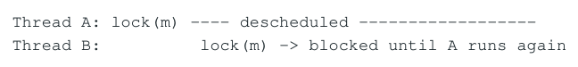

- ` Thread A: lock(m) descheduled `
- ` Thread B: lock(m) → blocked until A runs again `

</details>

Non-blocking algorithm 则试图删除这种“等待具体线程继续运行”的依赖。注意：CPU 仍然可能等待 cache miss、coherence ownership、memory latency；non-blocking 是算法 progress property，不是“硬件永不 stall”。

### 1.2 Wait-Free / Lock-Free / Obstruction-Free

| 保证 | 核心定义 | 允许什么 |
| --- | --- | --- |
| Wait-free | 每个 operation 在有限数量的自身步骤内完成 | 不允许某线程因竞争无限 starvation |
| Lock-free | 无限执行中系统整体持续完成 operation | 允许某个具体线程无限失败 |
| Obstruction-free | 线程独占运行足够久时可完成 | 持续竞争时所有线程都可能不完成 |
| Blocking | progress 可能依赖另一个线程释放资源 | holder 暂停可冻结其他线程 |

典型 CAS retry loop 可以是 lock-free 但不是 wait-free：当前线程每次 CAS 失败，往往说明另一个线程成功改变了共享状态， 系统整体有 progress；但当前线程理论上可以永远输掉竞争。

```cpp
int old = x.load(std::memory_order_relaxed);
while (!x.compare_exchange_weak(old, old + 1,
                                std::memory_order_relaxed)) {
    // this thread may retry forever
}
```

面试级压缩

wait-free = per-operation bounded progress；lock-free = system-wide progress；obstruction-free = solo progress。不要把 lock-free 解释成“没有线程会等待”。

### 1.3 Starvation、Livelock 与 Fairness

Lock-free 不保证 fairness。线程 T1 可以连续看到 T2/T3/T4 成功而自己不断失败，这叫 starvation。Livelock 则更严重：多个线程都在执行、都在响应冲突，但状态转换设计使得没有 operation 真正完成。CAS 是构建块，不是自动的 lock-free 证明。

**图示转写**

1. ` T1: CAS fail <- T2 changed state `
2. ` T1: CAS fail <- T3 changed state `
3. ` T1: CAS fail <- T4 changed state `
4. ` ... T1 may starve while the system progresses `

<details>
<summary>查看原图与完整文字转写</summary>

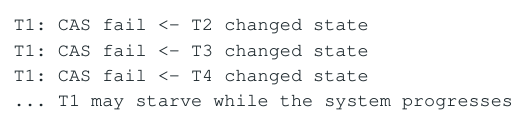

- ` T1: CAS fail <- T2 changed state `
- ` T1: CAS fail <- T3 changed state `
- ` T1: CAS fail <- T4 changed state `
- ` ... T1 may starve while the system progresses `

</details>

### 1.4 Atomicity 不等于算法正确

每个 load/store 都 atomic，并不意味着复合操作 atomic。例如 atomic load + atomic store 实现 increment 会发生 lost update：两个线程都读到 0，随后都写 1。程序可能 data-race-free，但不满足“每次 increment 像一个原子操作”的抽象语义。

```cpp
std::atomic<int> x{0};

void bad_increment() {
    int v = x.load(std::memory_order_relaxed);
    x.store(v + 1, std::memory_order_relaxed);
```

<a id="pdf-page-009"></a>

<!-- source-pdf-page: 9 -->

*[原 PDF 第 9 页](./Topic_Lock_Free_Programming_CN.pdf#page=9)*

```text
}
// two calls can leave x == 1 instead of 2
```

### 1.5 Linearizability 与 Linearization Point

Linearizability 要求每个并发 operation 都能看起来像在 invocation 到 response 之间的某一个瞬间原子生效，并且不违反真实时间顺序：如果 A 已经返回后 B 才开始，那么线性化顺序必须 A 在 B 前；若调用区间重叠，则可以按某个合法顺序解释。

**图示转写**

| 场景 / 部分 | 路径、状态或说明 |
| --- | --- |
| time → | ` T1: \| A `；` T2: \| B ` |
| Legal linearizations may be A-&gt;B or B-&gt;A, | ` provided the sequential specification is satisfied. ` |

<details>
<summary>查看原图与完整文字转写</summary>

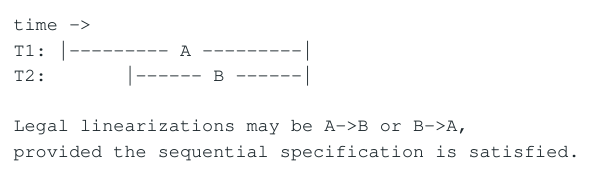

- ` time → `
- ` T1: | A `
- ` T2: | B `
- ` Legal linearizations may be A->B or B->A, `
- ` provided the sequential specification is satisfied. `

</details>

在 Treiber stack 中，successful CAS on head 通常是 push/pop 的 linearization point。但“找到一个 CAS”不是完整 proof；还必须证明 CAS 成功时使用的 derived state（例如 old-&gt;next）仍属于同一逻辑 generation。ABA 正是破坏这个前提。

### 1.6 Data-Race Freedom、Linearizability、Lifetime 是不同维度

| 问题 | 回答什么 | 典型失败 |
| --- | --- | --- |
| Data-race freedom | C++ conflicting accesses 是否被 atomic/happens-before 保护 | 普通字段并发读写造成 UB |
| Linearizability | 操作是否可解释为合法原子顺序 | lost update / stale snapshot |
| Memory ordering | 普通数据何时对 reader 安全可见 | 看到 ready 但看不到 payload |
| Lifetime safety | 对象在 dereference 时是否仍存活 | use-after-free |
| Progress | 竞争时是否保证系统/线程完成 | starvation / livelock / blocking |

固定分析模板

任何 lock-free 数据结构都至少要分别证明：Abstract state -&gt; Linearization -&gt; Memory ordering -&gt; Lifetime/Reclamation -&gt; Progress。把这些问题混成一句“用了 atomic 所以线程安全”通常意味着证明并未完成。

### 1.7 Atomic&lt;T&gt; 本身也不一定 Lock-Free

C++ 允许 std::atomic&lt;T&gt; 的实现使用非 lock-free 机制。对具体类型应区分 is_lock_free() 与 is_always_lock_free。64-bit 整数在主流 x86-64 上通常 lock-free，但较大的结构体可能通过 runtime helper 或内部锁实现。即使某个 atomic operation 本身 lock-free， 也不能推出整个 algorithm lock-free。

<a id="pdf-page-010"></a>

<!-- source-pdf-page: 10 -->

*[原 PDF 第 10 页](./Topic_Lock_Free_Programming_CN.pdf#page=10)*

## 第 2 章 CAS：从 C++ 到 x86 Cache Coherence

本章目标

理解 compare_exchange 的输入/输出语义、weak/strong、x86 LOCK CMPXCHG、RFO/cache-line ownership、失败 CAS 的成本以及 contention/retry amplification。

### 2.1 CAS = Validate + Conditional Commit

CAS（compare-and-exchange）原子地执行：若 memory == expected，则写入 desired 并返回成功；否则不写，返回失败，并把 expected 更新为实际值。它把 optimistic concurrency 中最关键的“validate snapshot + commit”组合为一个 atomic RMW。

```text
if (*addr == expected) {
    *addr = desired;
    return true;
} else {
    expected = *addr;
    return false;
}
```

### 2.2 expected 是 In/Out 参数

CAS 失败后 expected 被覆盖为当前值，是 retry loop 的重要设计。第一次 expected=10/desired=11；若实际值已变为 15，失败后 expected=15，下一轮应重新计算 desired=f(expected)。常见 bug 是 desired 只计算一次，导致第二轮错误地尝试 15-&gt;11。

```text
int expected = x.load();
while (true) {
    int desired = expected + 1;  // recompute every attempt
    if (x.compare_exchange_weak(expected, desired))
        break;
}
```

### 2.3 compare_exchange_weak vs strong

| API | 语言语义 | 常见用法 |
| --- | --- | --- |
| weak | 允许 spurious failure，即值相等也可报告失败 | 已有 retry loop 时自然使用 |
| strong | 不允许这种 spurious failure | single-shot transition 更直观 |

允许 weak 的重要原因是 LL/SC 架构：store-conditional 可能因 reservation 丢失而失败。x86 原生 CMPXCHG 没有典型 LL/SC 式 spurious failure，因此 weak/strong 常生成相同机器指令；这是常见实现，不是 C++ 标准保证。

### 2.4 x86 LOCK CMPXCHG 的高层模型

x86 上 atomic compare_exchange 通常落到带 LOCK 前缀的 CMPXCHG。现代 cacheable memory 上，不应简单解释为“锁住整个总线”；更有用的模型是：核心必须参与 coherence，取得足以完成原子 RMW 的 cache-line ownership，并在一个不可分割的 coherent transaction 中比较并条件写入。

```asm
C++ compare_exchange
        |
        v
compiler atomic RMW
        |
        v
lock cmpxchg [mem], reg
        |
        v
coherent ownership / compare / conditional write
```

### 2.5 RFO、MESI 与 Cache-Line Ownership

一个 core 想修改 cache line 时需要获得写 ownership，常可概念化为 RFO（Read For Ownership）以及其他 cores 副本 invalidation。真正的共享资源不是 4-byte atomic 整数，而是通常 64-byte coherence line。

<a id="pdf-page-011"></a>

<!-- source-pdf-page: 11 -->

*[原 PDF 第 11 页](./Topic_Lock_Free_Programming_CN.pdf#page=11)*

重要区别

Atomic granularity 可能是 4/8 bytes，但 coherence granularity 通常是整条 cache line。因此两个不同 atomic 若落在同一 line，仍会 false sharing；同一个 atomic 被多个 core 写则是真正 true sharing。

### 2.6 Failed CAS 为什么也可能很贵

“CAS 失败没有写，所以等于 load”是错误模型。compare_exchange 是 atomic RMW attempt，x86 上通常仍是 locked CMPXCHG，需要参与强 ordering/coherence。具体微架构可能优化失败路径，但工程上应该把 failed CAS 看作 write-like coherent operation，而不是 cheap read。

**图示转写**

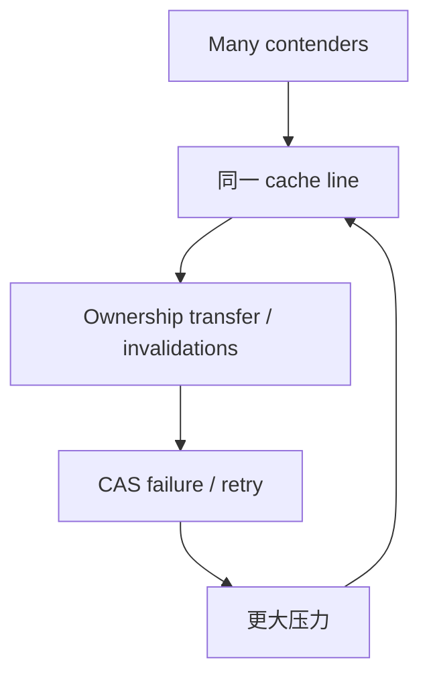

<details>
<summary>查看原图与完整文字转写</summary>

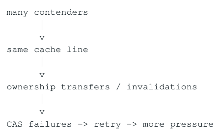

- ` many contenders `
- ` same cache line `
- ` ownership transfers / invalidations `
- ` CAS failures → retry → more pressure `

</details>

### 2.7 Retry Amplification

假设 16 个线程从同一 snapshot 计算 desired，最终只有一个 CAS 成功，其余 15 个失败并重算。实际成本 = useful work + failed speculative work + coherence cost。竞争越高，源码里“一次 CAS”的视觉复杂度越无法代表真实硬件成本。

若 transformation 本身昂贵，load -&gt; expensive compute -&gt; CAS 的 snapshot window 越长，状态被别人修改的概率越高。常见优化是把与共享 snapshot 无关的工作提前，把真正依赖旧值的计算靠近 CAS，或者直接重构 ownership。

### 2.8 fetch_add / exchange vs 手写 CAS

如果 transformation 已有专用 atomic RMW（increment、bit set、exchange），通常优先直接 fetch_add/fetch_or/exchange，而不是用 CAS loop 重建同一操作。CAS 的价值在于“desired=f(current)”是任意条件状态转换。

### 2.9 Backoff 与 PAUSE

高 contention 下可以使用短暂 pause/backoff 减少所有线程同时 hammer 同一 line 的强度。x86 PAUSE 是 spin-wait hint，不是 memory fence。backoff 是性能策略，不改变 correctness；在 low-contention hot path 上过度 backoff 反而增加成功重试延迟。 sched_yield/sleep 会引入 scheduler jitter，通常不是极低延迟第一选择。

### 2.10 False Sharing 与 Layout

```cpp
struct Counters {
    std::atomic<uint64_t> a;  // Core 0 writes
    std::atomic<uint64_t> b;  // Core 1 writes
};
// if a and b share one line, both writers invalidate the same line
```

通过 alignas 或 padding 可以消除 false sharing，但无法消除 true sharing。若 32 个线程都修改同一个 global counter，真正优化方向通常是 per-thread/per-core counter + cold-path aggregate，而不是继续微调 CAS。

<a id="pdf-page-012"></a>

<!-- source-pdf-page: 12 -->

*[原 PDF 第 12 页](./Topic_Lock_Free_Programming_CN.pdf#page=12)*

## 第 3 章 Lock-Free Memory Ordering：Publication 与 Ownership Transfer

本章目标

把 relaxed/acquire/release/acq_rel/seq_cst 用到真实 lock-free algorithm 中。重点不是背 API，而是证明普通 payload 通过哪个 atomic 建立 synchronizes-with / happens-before。

### 3.1 Atomicity 不等于 Visibility

```cpp
// Writer
data.x = 10;
data.y = 20;
ready.store(true, std::memory_order_relaxed);

// Reader
if (ready.load(std::memory_order_relaxed))
    use(data);
```

ready 本身没有 data race，但 relaxed ready 不为普通 data 建立跨线程 happens-before。正确 publication 通常是 writer release + reader acquire，并要求 acquire 实际观察到对应 release（或相应 release sequence）。

```cpp
data.x = 10;
data.y = 20;
ready.store(true, std::memory_order_release);

if (ready.load(std::memory_order_acquire))
    use(data);
```

### 3.2 Sequenced-Before -&gt; Synchronizes-With -&gt; Happens-Before

**图示转写**

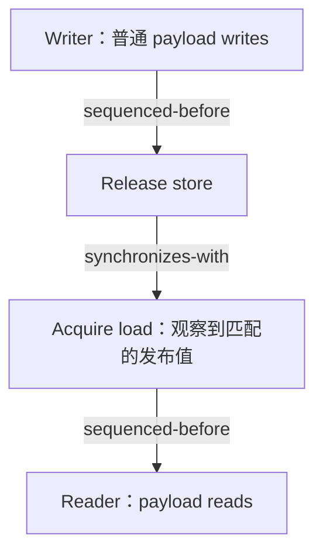

<details>
<summary>查看原图与完整文字转写</summary>

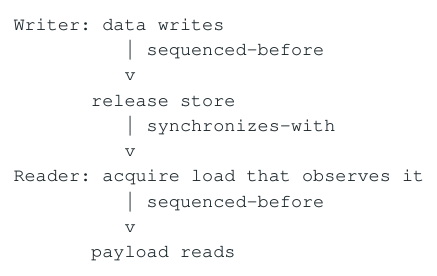

- ` Writer: data writes `
- ` sequenced-before `
- ` release store `
- ` synchronizes-with `
- ` Reader: acquire load that observes it `
- ` sequenced-before `
- ` payload reads `

</details>

最终目标不是“代码里出现 acquire/release”，而是某个普通 write happens-before 对应 ordinary read。两个互不相关的 atomic，一个 release 一个 acquire，并不会凭空建立同步。

### 3.3 Relaxed 到底保证什么

memory_order_relaxed 仍然保证 atomicity，并参与该 atomic object 的 modification order；它不是“CPU 随便做”。它缺少的是用于其他内存的额外 synchronization/ordering。纯统计计数、唯一 position reservation、小型独立状态都可能正确使用 relaxed。

### 3.4 Release / Acquire 的 Ownership 解释

最实用的 mental model 是 ownership transfer。producer 在独占拥有 payload 时普通写入，release 某个 metadata 作为“完成 token”；consumer acquire 到该 token 后取得读取 ownership。之后 consumer 可通过另一个 release 把 slot 的 reuse ownership 交还 producer。

比“防止 CPU 乱序”更准确

Release/Acquire 描述的是跨线程信息与 ownership 的安全传递。它同时约束 compiler 与目标 ISA 的 observable behavior，但不是 cache flush API；release 不意味着把所有 cache line 写回 DRAM，acquire 也不意味着从 RAM 重读全部数据。

<a id="pdf-page-013"></a>

<!-- source-pdf-page: 13 -->

*[原 PDF 第 13 页](./Topic_Lock_Free_Programming_CN.pdf#page=13)*

### 3.5 Atomic Pointer 与 Pointee

```cpp
Node* n = new Node;
n->value = 42;
ptr.store(n, std::memory_order_release);

Node* p = ptr.load(std::memory_order_acquire);
if (p) use(p->value);
```

std::atomic&lt;Node*&gt; 只保证 pointer value 的 atomicity。pointee 的普通字段依靠 publication happens-before 才可安全读取；对象是否仍然 alive 又是第三个独立问题，需要 reclamation。

### 3.6 acquire/release 不是 Full Fence

概念上 acquire 主要阻止之后的相关操作越到 acquire 前；release 主要阻止之前的相关操作越到 release 后。acq_rel 用于 RMW 同时承担 acquire 与 release 角色。seq_cst 在此基础上还要求所有 seq_cst atomic 进入一个全局一致 total order。

### 3.7 CAS Success / Failure Order

成功 CAS 是 RMW，可以拥有 relaxed/acquire/release/acq_rel/seq_cst 等 ordering；失败 CAS 没有 write，只是读取当前值并更新 expected，因此 failure order 是 load-like，不能使用 release/acq_rel。

```cpp
head.compare_exchange_weak(old, node,
    std::memory_order_release,  // success: publish node
    std::memory_order_relaxed  // failure: only obtain new head
);
```

失败路径是否需要 acquire，取决于失败后如何使用新的 expected。如果下一轮马上 dereference 新 head-&gt;next，那么 failure acquire 可能是必要的。不能机械复制“success release / failure relaxed”。

### 3.8 Publication Carrier

| 结构 | 普通 payload | Publication carrier |
| --- | --- | --- |
| SPSC ring | slot payload | write index / per-slot sequence |
| Treiber stack | Node fields | head CAS |
| Michael-Scott queue | new node value | old_tail-&gt;next CAS |
| RCU snapshot | immutable snapshot fields | current pointer |
| state machine | associated config/data | state/version flag |

找到 publication carrier 后，再问 writer 的 release 在哪里、reader 的 matching acquire 在哪里、reader 是否真正观察到这一 generation，memory order 通常就能自然推导出来。

### 3.9 Release Sequence

一个 release modification 后的 atomic RMW 链可以形成 release sequence，使后续 acquire 通过某个 RMW 值继续同步回更早的 release。这在 reference counting、CAS chain 等算法中很重要。失败 CAS 不修改对象，因此不产生 modification-order 中的新节点。

### 3.10 Fence 的边界

atomic_thread_fence 是 standalone ordering primitive，但比把 ordering 直接附着在 publication atomic 上更难证明。Fence 不能修复 ABA、UAF、错误 linearization point，也不能靠两个 seq_cst fence 自动让普通变量安全通信；仍需要一个正确的 atomic communication path。

### 3.11 x86 与 ARM 的实现差异

在 x86 TSO 上普通 acquire load / release store 通常仍可用 MOV，因为硬件已提供足够强的基本 ordering，memory_order 仍然约束 compiler 并定义 portable semantics。弱内存序 ARM 更常需要 LDAR/STLR 或 barrier。不能因为 x86 汇编相同就说 acquire/release 与 relaxed“没有意义”。

<a id="pdf-page-014"></a>

<!-- source-pdf-page: 14 -->

*[原 PDF 第 14 页](./Topic_Lock_Free_Programming_CN.pdf#page=14)*

## 第 4 章 Treiber Stack 与 ABA：CAS 只比较现在，不记录历史

本章目标

用经典 lock-free stack 展示 atomic CAS、memory ordering、linearizability 与 ABA/lifetime 如何同时出现；掌握 tagged pointer/version counter 与有害 ABA 的判断标准。

### 4.1 Treiber Stack Push

```cpp
struct Node {
    int value;
    Node* next;
};
std::atomic<Node*> head{nullptr};

void push(Node* n) {
    Node* old = head.load(std::memory_order_relaxed);
    do {
        n->next = old;
    } while (!head.compare_exchange_weak(
        old, n,
        std::memory_order_release,
        std::memory_order_relaxed));
}
```

successful head CAS 是典型 linearization point，同时 release 发布 n-&gt;value/n-&gt;next。CAS 失败后 old 自动更新，重新设置 n-&gt;next 再尝试。push 一侧 lifetime 通常简单，真正困难在 pop。

### 4.2 朴素 Pop 与 ABA 时间线

**图示转写**

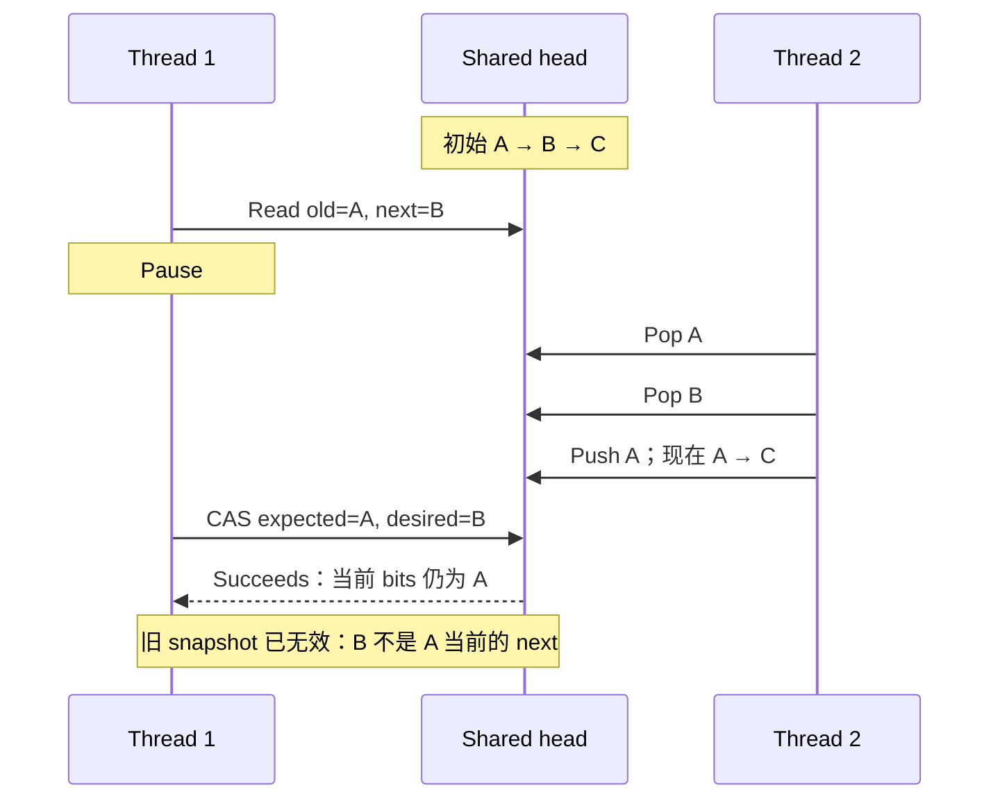

<details>
<summary>查看原图与完整文字转写</summary>

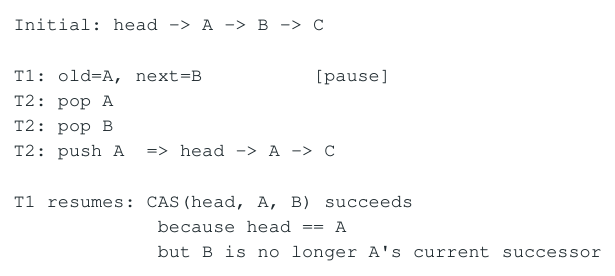

- ` Initial: head → A → B → C `
- ` T1: old=A, next=B [pause] `
- ` T2: pop A `
- ` T2: pop B `
- ` T2: push A => head → A → C `
- ` T1 resumes: CAS(head, A, B) succeeds `
- ` because head == A `
- ` but B is no longer A's current successor `

</details>

CAS 只验证 current bits == expected bits。T1 把“head 仍然等于 A”错误地解释为“我基于 A 计算的 snapshot 仍然有效”。 A-&gt;B-&gt;A 中第二个 A 可能是同一对象的新 generation，甚至是 allocator 在同一地址构造的完全不同对象。

### 4.3 ABA = False-Positive Validation

核心定义

CAS validates current equality, not state history。ABA 的本质是：current == expected，但逻辑 snapshot 已不再有效。它不是 memory-ordering 问题；seq_cst 也不会保存历史。

### 4.4 ABA 与 Use-After-Free 必须分开

| 问题 | 本质 | 是否一定同时发生 |
| --- | --- | --- |
| ABA | 旧值重新出现导致 stale snapshot 被错误验证 | 否；对象可一直存活但 remove/reinsert |
| Use-after-free | 线程持有 pointer 时对象已经被 destroy/reuse | 否；即使无 ABA 也可能直接 UAF |

永远不 delete node 可以消除 UAF，却不一定消除“同一个 live Node remove 后又 reinsert”的 ABA。反过来 tagged pointer 能检测 head generation，却不能阻止另一个线程提前 delete old 导致 dereference UB。

<a id="pdf-page-015"></a>

<!-- source-pdf-page: 15 -->

*[原 PDF 第 15 页](./Topic_Lock_Free_Programming_CN.pdf#page=15)*

### 4.5 什么样的 A-&gt;B-&gt;A 才有害

并非所有 ABA pattern 都是 bug。判断标准是：值回到 A 后，之前基于 A 推导出的 derived state 是否仍然有效。如果算法只关心“当前整数值等于 5”，5-&gt;6-&gt;5 可能无害；Treiber pop 保存 old-&gt;next，因此 generation 改变会让 next 失效，ABA 有害。

### 4.6 Tagged / Versioned Pointer

**图示转写**

| Head 历史 | 校验含义 |
| --- | --- |
| (A,5) → (B,6) → (C,7) → (A,8) | pointer 相同，generation 不同 |
| T1 expected = (A,5) | 与当前 (A,8) 比较失败 |

<details>
<summary>查看原图与完整文字转写</summary>

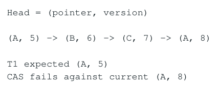

- ` Head = (pointer, version) `
- ` (A, 5) → (B, 6) → (C, 7) → (A, 8) `
- ` T1 expected (A, 5) `
- ` CAS fails against current (A, 8) `

</details>

把 validation predicate 从 pointer == expected 扩展为 pointer + generation 都相等，即可检测历史变化。版本位宽必须考虑 wrap-around；32-bit 在极高更新率下可能很快回卷，64-bit 通常具有足够大的工程安全窗口。

### 4.7 Double-Width CAS 与 Pointer Packing

64-bit pointer + 64-bit version 需要原子比较 128 bits，x86-64 可用 CMPXCHG16B 的平台能力，但 C++ 不保证 std::atomic&lt;Head&gt; 一定 lock-free，应检查 is_lock_free/is_always_lock_free。若编译器退化到 libatomic/internal lock，算法的形式和真实 progress property 可能改变。

也可以利用 pointer alignment 的低位或特定架构的未使用高位 pack tag，但这属于 architecture-specific implementation；需要考虑 canonical address、pointer provenance、sanitizer、未来地址宽度等，不能当 portable C++ 常识。

### 4.8 从结构上让 ABA 不可能

比检测 ABA 更简单的方向是改变生命周期：节点一旦 remove 就只进入 retired 状态，不允许 reinsert，同时时间上延迟 reuse 直到所有旧 reader 消失。Hazard/Epoch/RCU 主要解决 lifetime，却也因此自然消除一大类“地址过早复用”ABA。

### 4.9 Free List 为什么特别危险

Lock-free object pool/free list 会快速 pop/use/push 同一批节点，因此同一 address/generation 重现概率很高。全局 Treiber freelist 同时叠加 ABA、CAS contention 和 cache-line bouncing；低延迟系统常更偏向 per-thread/per-core pool，偶尔 batch refill/return。

### 4.10 测试 ABA 与 Linearizability

普通随机 stress 不足以证明无 ABA。应构造 controlled interleaving：T1 读取 A/B 后暂停，T2 精确执行 remove/reinsert，再恢复 T1。ASan 擅长 UAF，但 live-object ABA 可能不报；TSan 只查 data race，也无法证明 linearizability。

<a id="pdf-page-016"></a>

<!-- source-pdf-page: 16 -->

*[原 PDF 第 16 页](./Topic_Lock_Free_Programming_CN.pdf#page=16)*

## 第 5 章 Memory Reclamation：Live -&gt; Retired -&gt; Reclaimed

本章目标

解决 lock-free 最难的对象生命周期问题。系统比较 Hazard Pointer、Epoch-Based Reclamation、QSBR、RCU 与 refcount，并关注 stalled thread、tail latency 与 bounded memory。

### 5.1 Removed 不等于 Safe to Delete

节点从共享结构中不可达，只能说明未来 traversal 不再从 root 找到它；另一个线程可能早已把 raw pointer 放进寄存器，然后被 deschedule。真正 delete 前必须证明：不存在任何线程未来还可能合法 dereference 该对象。

**图示转写**

1. ` Live `
2. ` logical remove `
3. ` Retired <- no longer reachable, but old readers may hold it `
4. ` grace/protection proof `
5. ` Reclaimed <- safe to reuse/free `

<details>
<summary>查看原图与完整文字转写</summary>

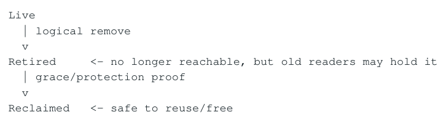

- ` Live `
- ` logical remove `
- ` Retired <- no longer reachable, but old readers may hold it `
- ` grace/protection proof `
- ` Reclaimed <- safe to reuse/free `

</details>

### 5.2 为什么 Mutex 让 Lifetime 简单

若所有对象访问都要求持同一 mutex，那么 remover 在持锁状态下 unlink + delete 时，其他线程无法同时持有合法访问资格。 Lock-free 没有天然 critical-section lifetime barrier，因此必须另外追踪 reader/protection/grace period。

### 5.3 Hazard Pointer：保护具体 Pointer

```text
reader:
  p = load(root)
  hazard.store(p)
  if (load(root) != p) retry
  dereference(p)
  hazard.clear()

reclaimer:
  retire(p)
  scan hazard records
  if p is unprotected -> reclaim
```

最关键步骤是 protect 后重新 verify。若先 load p 后被暂停，remover 可能在 hazard 发布前删除并 free p；因此“load -&gt; hazard.store -&gt; use”不安全。publish + revalidate 把“保护已经生效”与“pointer 仍属于当前结构”连接起来。

### 5.4 Hazard Pointer 的性能与失败半径

Reader side 付出 hazard atomic store、verification load、clear；reclaimer 批量扫描 hazard slots 与 retired lists。Hazard slot 应避免 false sharing。它的优势是 stalled thread 通常只冻结其保护的少量对象，不会阻止整个 generation 的 reclaim。

### 5.5 Epoch-Based Reclamation (EBR)

EBR 不保护每个 pointer，而是声明“当前线程正在 epoch E 的 read critical section 中”。remove 的节点按 epoch retire；只有所有可能看到旧节点的 active readers 都退出旧 epoch 或进入新 epoch 后，旧 generation 才能 reclaim。

**图示转写**

| 场景 / 部分 | 路径、状态或说明 |
| --- | --- |
| Thread record: active + local_epoch | ` Global: global_epoch ` |
| enter → record epoch, active=true | ` traverse many nodes `；` exit → active=false ` |

<details>
<summary>查看原图与完整文字转写</summary>

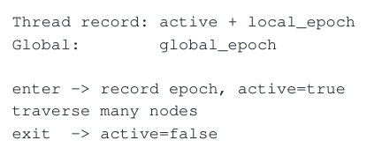

- ` Thread record: active + local_epoch `
- ` Global: global_epoch `
- ` enter → record epoch, active=true `
- ` traverse many nodes `
- ` exit → active=false `

</details>

相比 Hazard，每次 traversal 内可以访问很多 pointer 而无需逐个 publish，因此 read path 更便宜。最大问题是 stalled active thread 可能阻止整个 epoch 前进，造成大量 retired memory 积压。

> **转换补充**：Hazard Pointer 和 EBR 的片段是协议示意，省略了关键 memory-order / fence 与 thread-registration 细节，不能据此直接实现。保护必须先建立再 revalidate，reclaimer 的扫描也须与该协议配套；建议对照经过验证的实现。

<a id="pdf-page-017"></a>

<!-- source-pdf-page: 17 -->

*[原 PDF 第 17 页](./Topic_Lock_Free_Programming_CN.pdf#page=17)*

### 5.6 QSBR：显式 Quiescent State

QSBR（Quiescent-State-Based Reclamation）要求线程主动报告“我现在不再持有任何旧共享 pointer”。固定 event loop 天然可以把 batch/iteration 边界作为 quiescent point，因此 reader overhead 很低；但线程若永远不 report quiescent state，grace period 可能永久停滞。

### 5.7 RCU：Read-Mostly 的结构化答案

```text
Writer:
  old = current
  new = copy_and_modify(old)
  current.store(new, release)
  retire(old)
  wait/defer grace period
  reclaim(old)

Reader:
  enter read-side section
  p = current.load(acquire)
  read immutable state
  exit
```

RCU 的核心不是“无锁链表”，而是让 reader 尽量保持 read-only，把复杂度推给 writer 与 grace-period reclamation。非常适合 routing/config/reference data 等 read-many/write-rare 状态。

### 5.8 Reference Counting / shared_ptr

引用计数也是 reclamation，但每个 reader 对同一 refcount 做 atomic increment/decrement，会把逻辑 read-only access 变成 write-sharing，并造成 control-block cache-line bouncing。shared_ptr correctness 很方便，但不应默认视为纳秒级 hot-path 的最佳选择；atomic&lt;shared_ptr&gt; 的 lock-free 属性也需要具体实现检查。

### 5.9 Hazard vs Epoch vs QSBR vs RCU

| 机制 | Reader cost | Stalled thread 影响 | 适合场景 |
| --- | --- | --- | --- |
| Hazard Pointer | per-pointer publish/verify | 通常局部对象不能 reclaim | 动态 pointer 结构、线程可能不可预测 stall |
| EBR | enter/exit epoch | 可能全局拖延一批 retired nodes | 固定线程、短 critical section |
| QSBR | safe point 报告 | 极依赖线程 cooperation | event loop / run-to-completion workers |
| RCU style | 极轻 read side | 依 grace-period 实现 | read-mostly immutable snapshot |
| Refcount | 每引用原子 inc/dec | 局部 control block | ownership 简单、性能要求较宽松 |

### 5.10 Reclamation Progress 与 Operation Progress

一个 stack/queue 的 push/pop 可以是 lock-free，但 EBR 的内存回收仍被一个永久 active 的线程卡住，导致 retired memory 无界增长。因此生产系统至少分别问：data-structure operations 是否 progress？reclamation 是否 eventually progress？memory footprint 是否 bounded？

### 5.11 Batching、Incremental Reclaim 与 Tail Latency

每 retire 一个节点就扫描所有 hazards 太贵，因此实现常积累到 threshold 再批量回收；但某次 hot-path operation 突然扫描/释放几千对象会制造 p99.9 spike。低延迟系统更关注 bounded work：每轮最多扫描 N、free M，或把 reclaim 转移给 background/cold thread。

<a id="pdf-page-018"></a>

<!-- source-pdf-page: 18 -->

*[原 PDF 第 18 页](./Topic_Lock_Free_Programming_CN.pdf#page=18)*

### 5.12 Thread Lifecycle 与 RAII

EpochGuard/HazardGuard 应通过 RAII 确保异常或早返回不会遗留 active epoch/hazard。线程退出还必须清理 registration、 hazard slots、retired list。异步 cancellation、长 syscall、page fault 可能破坏“short critical section”假设，因此 reclamation 设计与 thread runtime model 是同一个系统问题。

### 5.13 Pool 中的 Reclaim 不一定是 delete

预分配 pool 中 reclaim 可能只是“slot 可以 reuse”。安全条件完全相同：没有旧 reader 可以再访问旧 generation。index + generation handle 可以把 dangling raw pointer 风险转成 generation mismatch，但 generation validation 与 reuse timing 仍是两个互补问题。

<a id="pdf-page-019"></a>

<!-- source-pdf-page: 19 -->

*[原 PDF 第 19 页](./Topic_Lock_Free_Programming_CN.pdf#page=19)*

## 第 6 章 Lock-Free Queue：Dummy Node、Tail Lagging 与 Helping

本章目标

从 SPSC/MPSC/SPMC/MPMC 拓扑进入 Michael-Scott Queue。理解 enqueue/dequeue linearization、tail 作为 hint、可帮助中间状态与 memory reclamation。

### 6.1 先确定 Topology，再选 Queue

| Topology | Producer | Consumer | 典型复杂度 |
| --- | --- | --- | --- |
| SPSC | 1 | 1 | single-writer indices，通常无需 CAS |
| MPSC | 多 | 1 | producer reservation/link 有争用 |
| SPMC | 1 | 多 | consumer ownership 有争用 |
| MPMC | 多 | 多 | enqueue/dequeue 两端都需协调 |

Topology 越 general，ownership 可能性越多，通常意味着更多 atomic/CAS、更多 progress/lifetime proof。已知固定 topology 时，generic MPMC 往往是过度设计。

### 6.2 SPSC 的黄金模型

**图示转写**

| 场景 / 部分 | 路径、状态或说明 |
| --- | --- |
| Producer | ` w = write_idx (relaxed, producer-owned) `；` if next == read_idx.acquire → full `；` buffer[w] = value `；` write_idx.store(next, release) ` |
| Consumer | ` r = read_idx (relaxed, consumer-owned) `；` if r == write_idx.acquire → empty `；` value = buffer[r] `；` read_idx.store(next, release) ` |

<details>
<summary>查看原图与完整文字转写</summary>

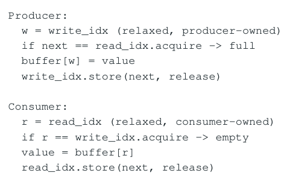

- ` Producer: `
- ` w = write_idx (relaxed, producer-owned) `
- ` if next == read_idx.acquire → full `
- ` buffer[w] = value `
- ` write_idx.store(next, release) `
- ` Consumer: `
- ` r = read_idx (relaxed, consumer-owned) `
- ` if r == write_idx.acquire → empty `
- ` value = buffer[r] `
- ` read_idx.store(next, release) `

</details>

payload 是 ordinary memory，两个 index 分别单 writer；release/acquire 只承担 ownership handoff。write_idx/read_idx 应避免同一 cache line 的 false sharing。SPSC 的真正价值是显式 ownership，而不仅是“lock-free”标签。

### 6.3 Michael-Scott Queue 的 Dummy Node

**图示转写**

1. ` head `
2. ` dummy `
3. ` A `
4. ` B `
5. ` C `
6. ` tail `

<details>
<summary>查看原图与完整文字转写</summary>

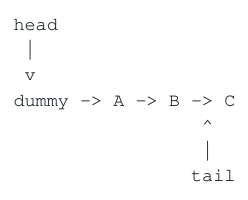

- ` head `
- ` dummy → A → B → C `
- ` tail `

</details>

dummy node 让 queue 永远至少有一个节点，empty 判断转成 head-&gt;next == nullptr。每次 dequeue 后，第一业务节点成为新的 dummy；返回的是 next-&gt;value，而 retire 的是旧 dummy。

### 6.4 Enqueue：真正 Linearization 在 next CAS

**图示转写**

| 顺序 | 动作 | 含义 |
| --- | --- | --- |
| 1 | t = tail；next = t-&gt;next | 检查当前 tail 与后继 |
| 2 | if next == nullptr：CAS(t-&gt;next, nullptr, new_node) | 成功链接 node 是 enqueue linearization point |
| 3 | CAS(tail, t, new_node) | 推进 tail：bookkeeping / hint update |

<details>
<summary>查看原图与完整文字转写</summary>

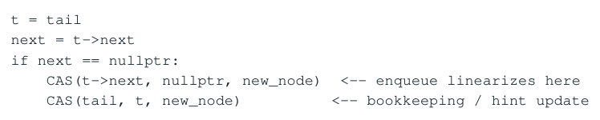

- ` t = tail `
- ` next = t->next `
- ` if next == nullptr: `
- ` CAS(t->next, nullptr, new_node) ← enqueue linearizes here `
- ` CAS(tail, t, new_node) ← bookkeeping / hint update `

</details>

一旦 old_tail-&gt;next CAS 成功，新节点已经沿 next chain 可达，即使 tail 仍停留在旧节点。因此 tail 不是 authoritative logical end，只是加速找到尾部的 hint。

<a id="pdf-page-020"></a>

<!-- source-pdf-page: 20 -->

*[原 PDF 第 20 页](./Topic_Lock_Free_Programming_CN.pdf#page=20)*

### 6.5 Tail Lagging 是合法 Intermediate State

**图示转写**

1. ` tail `
2. ` B `
3. ` C `
4. ` nullptr `
5. ` tail is behind actual last node C `

<details>
<summary>查看原图与完整文字转写</summary>

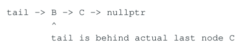

- ` tail → B → C → nullptr `
- ` tail is behind actual last node C `

</details>

P1 link C 成功后若被 deschedule，P2 看到 tail-&gt;next != nullptr，就可以帮助把 tail 推到 C。算法允许“结构已正确、metadata 暂时落后”的中间状态，只要该状态可识别、可恢复、可帮助。

### 6.6 Helping 与 Lock-Free Progress

核心思想

谁开始 operation 不一定必须由谁收尾。一个线程可以把 correctness-critical 结构修改完成后停下，其他线程观察到合法中间状态并完成 bookkeeping。这样 paused thread 不成为 system-wide progress dependency。

### 6.7 Dequeue 的 Linearization

**图示转写**

| 场景 / 部分 | 路径、状态或说明 |
| --- | --- |
| h = head | ` t = tail `；` next = h->next ` |
| if next == nullptr → empty | ` if h == t and next != nullptr → tail lagging, help tail `；` else: `；` value = next->value `；` CAS(head, h, next) ← dequeue linearizes here `；` retire(h) ` |

<details>
<summary>查看原图与完整文字转写</summary>

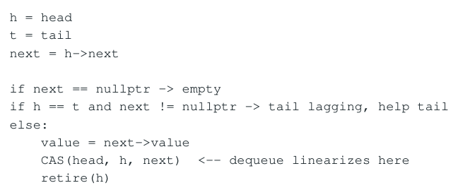

- ` h = head `
- ` t = tail `
- ` next = h->next `
- ` if next == nullptr → empty `
- ` if h == t and next != nullptr → tail lagging, help tail `
- ` else: `
- ` value = next->value `
- ` CAS(head, h, next) ← dequeue linearizes here `
- ` retire(h) `

</details>

head == tail 单独不能判断 empty，因为 tail 可能落后：head == tail 但 head-&gt;next != nullptr 表示已有 producer link 了新节点。稳定 empty 的关键观察是 next == nullptr。

### 6.8 Queue Snapshot 不是原子 Tuple

head、tail、next 是分多次 load 得到的 weak snapshot，算法靠 revalidation/retry/helping 维持 invariants，而不是一次原子读取整个 (head, tail, next)。这是 lock-free optimistic concurrency 的典型范式。

### 6.9 Queue 的 Publication

Producer 先 initialize new_node-&gt;value/next，然后 release CAS 把它接到 old_tail-&gt;next；consumer acquire 读取 h-&gt;next 后才能安全读 next-&gt;value。tail update 只是 hint，不必承担 payload publication，因此其 ordering 往往可以更弱。

### 6.10 Memory Reclamation 仍未消失

Michael-Scott 只解决结构同步和 progress，不自动解决 C++ raw pointer lifetime。另一个 consumer 可能仍持有 old head，所以不能 CAS 成功后立即 delete old_head；仍需要 Hazard/Epoch/RCU 或等价 scheme。

### 6.11 为什么 Linked MPMC 在 HFT Hot Path 往往不理想

链式 MPMC 同时付出 allocation/pool、pointer chasing、load-to-use dependency、ABA/reclamation、producer/consumer CAS contention。相比 contiguous bounded ring，cache locality、TLB、bounded memory 和 tail predictability 都更难控制。

<a id="pdf-page-021"></a>

<!-- source-pdf-page: 21 -->

*[原 PDF 第 21 页](./Topic_Lock_Free_Programming_CN.pdf#page=21)*

## 第 7 章 Bounded Ring Buffer 与 Per-Slot Sequence

本章目标

进入更贴近低延迟工程的 fixed-capacity ring。理解 logical position / physical slot、per-slot sequence、generation/wrap-around、 ownership handoff、backpressure，以及“CAS-based 不自动等于严格 lock-free”。

### 7.1 Logical Position 与 Physical Slot

```text
capacity = 8
logical positions: 0 1 2 ... 7 8 9 ...
physical slot:     p & (capacity - 1)

position 0, 8, 16 ... reuse the same physical slot
```

因此物理地址稳定并不等于逻辑对象相同；必须编码 generation。bounded ring 通过固定 storage 删除 malloc/free/reclamation， 却把 lifetime 问题转成了“这个 slot 当前属于哪一代”。

### 7.2 Per-Slot Sequence

```cpp
struct Slot {
    std::atomic<uint64_t> sequence;
    T data;
};

initial: slot[i].sequence = i
```

对 producer position p，sequence == p 表示该 generation 可写；写 payload 后 store sequence=p+1 表示 ready。consumer position p 期待 p+1，读完后 store p+N，把 slot 交给下一轮 producer。

### 7.3 一个 Slot 的完整生命周期

**图示转写**

```mermaid
stateDiagram-v2
    direction TB
    Free --> Writing: Producer claim, seq == p
    Writing --> Ready: Write payload; release seq = p+1
    Ready --> Reading: Consumer acquire observes p+1
    Reading --> Free: Consume; release seq = p+N
```

Free 的下一代为 p+N；sequence 同时表达 generation、ownership 与 publication。

<details>
<summary>查看原图与完整文字转写</summary>

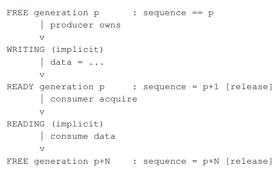

- ` FREE generation p : sequence == p `
- ` producer owns `
- ` WRITING (implicit) `
- ` data = ... `
- ` READY generation p : sequence = p+1 [release] `
- ` consumer acquire `
- ` READING (implicit) `
- ` consume data `
- ` FREE generation p+N : sequence = p+N [release] `

</details>

sequence 同时承担 state + generation + publication token。相比 bool ready，它能区分同一物理 slot 的上一轮与当前轮，避免 wrap-around 的 generation ambiguity。

### 7.4 Payload 为什么可以 Non-Atomic

position claim 成功后 producer 对该 generation 拥有唯一写 ownership；sequence release 发布普通 payload。consumer acquire ready sequence 后独占读取，完成后 release reuse token。普通 payload 不需要逐字段 atomic。

### 7.5 Reservation Atomics 与 Publication Atomics 职责不同

enqueue_pos/dequeue_pos 通常只分配唯一 logical position，因此很多实现可用 relaxed CAS；真正的 payload visibility 由 per-slot sequence release/acquire 完成。这是“atomic metadata 各司其职”的典型例子。

### 7.6 为什么不能简单 fetch_add 后再检查 Full

bounded queue 若先无条件 fetch_add claim position，之后才发现目标 slot 尚未被 consumer 释放，就难以安全回滚：后续 producers 可能已经取得更高 positions。因此很多 bounded algorithms 先观察 slot generation，再用 CAS 推进 reservation position。

<a id="pdf-page-022"></a>

<!-- source-pdf-page: 22 -->

*[原 PDF 第 22 页](./Topic_Lock_Free_Programming_CN.pdf#page=22)*

### 7.7 Sequence 比较的含义

| Producer/Consumer | 期望 sequence | 典型解释 |
| --- | --- | --- |
| Producer pos p | seq == p | 当前 generation free，可 claim/write |
| Producer | seq &lt; p | slot 仍属于旧 generation，可能 full |
| Producer | seq &gt; p | position snapshot 落后，刷新 |
| Consumer pos p | seq == p+1 | payload ready，可 read |
| Consumer | seq &lt; p+1 | producer 尚未 publish，可能 empty/hole |
| Consumer | seq &gt; p+1 | consumer snapshot 落后，刷新 |

### 7.8 Sequence Wrap-Around

有限 counter 最终都会 wrap；是否安全取决于 counter width、操作速率、最长 stale observer 时间和比较逻辑。32-bit 在数千万/ 上亿 ops/s 下可能很快回卷，64-bit 通常才有足够工程余量。不要把“无符号自然回绕”自动等同于算法正确。

### 7.9 Claim-Then-Publish 的 Progress Caveat

一个重要高级点：某些著名 bounded MPMC sequence queue 在工程中非常高效，却不一定满足严格 lock-free progress。若 producer 先 claim position 10，随后永久暂停在 publish 前，position 11 虽可被其他 producer 写好，但 FIFO consumer 可能无法越过未 ready 的 10。

**图示转写**

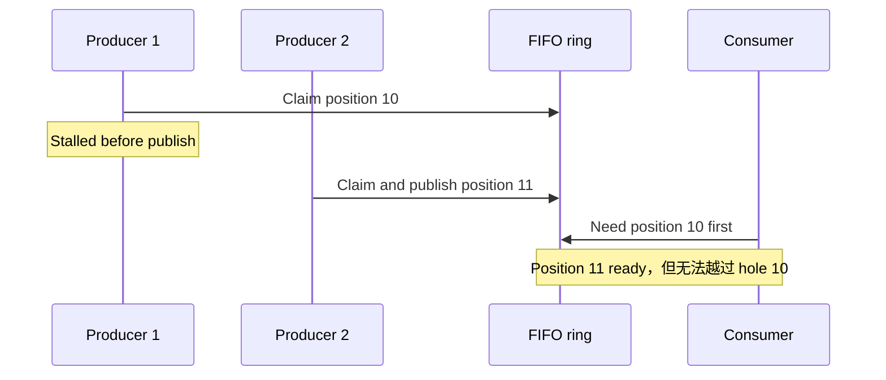

<details>
<summary>查看原图与完整文字转写</summary>

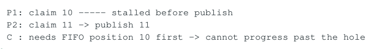

- ` P1: claim 10 stalled before publish `
- ` P2: claim 11 → publish 11 `
- ` C : needs FIFO position 10 first → cannot progress past the hole `

</details>

术语必须准确

uses atomics + CAS != formal lock-free。Progress guarantee 要分析“线程在任何中间状态停住后，其他线程是否能继续完成 operation”。Michael-Scott 的 tail repair 可以 helping；某个 producer 私有 payload 的写入通常无法由别人帮助完成。

### 7.10 Bounded Queue Full 不等于 Progress Failure

try_enqueue() 在 full 时立即返回 false，仍然完成了 operation；progress property 并不要求业务请求一定成功。若外层写成 while(!try_enqueue()) spin，则 wrapper 的 progress/latency 又是另一个问题。必须明确分析哪个 API。

### 7.11 Backpressure 是语义，不是小细节

| 事件语义 | 队列满时可能策略 |
| --- | --- |
| Market data / latest state | conflate、drop intermediate、overwrite with gap detection、snapshot recovery |
| Order / execution / regulatory event | lossless backpressure、reject/fail-fast、capacity reserve、recovery |
| Metrics / debug | drop / sample / per-thread buffer |

Unbounded queue 并没有消灭 backpressure，只是把它推迟到 memory exhaustion 和巨大 queueing latency。bounded capacity 让 overload 更早、更明确地暴露。

### 7.12 Queue Depth 本身就是 Latency

若 consumer service time 为 200ns/event，前面 5000 个 backlog 就意味着约 1ms 排队时间，即使每个 queue API 都只有几十纳秒。 交易系统必须同时监测 service time 与 queue depth，避免把 queueing pathology 错诊成 atomic micro-optimization 问题。

> **转换补充**：bounded queue 返回 full/empty 可以是一个已完成的操作；判断严格 lock-free 时仍须明确 API 语义。不能仅凭内部使用 CAS，或某次 try 操作很快返回，就推导整个 FIFO 抽象和外层重试 loop 的 progress。

<a id="pdf-page-023"></a>

<!-- source-pdf-page: 23 -->

*[原 PDF 第 23 页](./Topic_Lock_Free_Programming_CN.pdf#page=23)*

### 7.13 False Sharing、Slot Layout 与 Padding

enqueue_pos 与 dequeue_pos 分属 producer/consumer 写热点，通常应隔离 cache line。Adjacent slot sequences 也可能被不同 producers 写而 false-share，但把每个 8-byte slot 强行 pad 到 64 bytes 又会膨胀 working set/TLB 压力；layout 需要结合消息大小与并发度实测。

### 7.14 NUMA、Pre-touch 与 Huge Page

Ring algorithm correctness 与 NUMA 无关，但实际 handoff 每条消息都会迁移 slot cache line。跨 socket producer/consumer 会放大 remote coherence。大 ring 还要考虑 first-touch page placement、TLB、huge pages、pre-fault/prefill。算法、thread pinning 和 memory placement 必须作为一个系统 benchmark。

### 7.15 Disruptor-Style Sequence 与 Broadcast

Sequence 思想不仅用于 work queue，还可用于 one producer -&gt; many consumers 的 broadcast ring。每个 consumer 维护自己的 sequence，producer reuse frontier 受最慢 consumer 的 gating sequence 限制。Queue（一个 item 由一个 consumer 取走）与 broadcast（所有 subscriber 都看到）是不同业务语义，不能用同一个 MPMC 抽象糊在一起。

### 7.16 Multiple SPSC vs One MPMC

| 维度 | One MPMC | N x SPSC |
| --- | --- | --- |
| Producer contention | 共享 enqueue reservation | 每 producer 自己的 queue |
| Consumer logic | 简单 | 需要 poll/merge |
| Global FIFO | 容易定义 | 需额外 sequence/timestamp merge |
| Cache locality | 中等 | 通常更好 |
| Topology flexibility | 高 | 固定明确 |
| Tail predictability | 受 CAS/retry 影响 | 通常更稳定 |

<a id="pdf-page-024"></a>

<!-- source-pdf-page: 24 -->

*[原 PDF 第 24 页](./Topic_Lock_Free_Programming_CN.pdf#page=24)*

## 第 8 章 Low-Latency / HFT Engineering：不要追求“尽可能Lock-Free”

本章目标

把 mutex、spinlock、CAS、SPSC、single-owner、sharding、RCU/epoch 放在同一决策框架中。重点是 remove sharing、 bounded work、cache-line ownership 与 p99.9。

### 8.1 真正的优化优先级

**图示转写**

1. ` remove sharing `
2. ` → define single ownership `
3. ` → SPSC / explicit handoff `
4. ` → sharding / partition `
5. ` → immutable snapshot / RCU `
6. ` → specialized lock-free shared state `
7. ` → spinlock / mutex where appropriate `

<details>
<summary>查看原图与完整文字转写</summary>

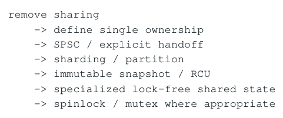

- ` remove sharing `
- ` → define single ownership `
- ` → SPSC / explicit handoff `
- ` → sharding / partition `
- ` → immutable snapshot / RCU `
- ` → specialized lock-free shared state `
- ` → spinlock / mutex where appropriate `

</details>

这不是一条绝对“快慢排名”，而是复杂度与共享程度的设计顺序。最重要问题不是“atomic 选 relaxed 还是 acq_rel”，而是“为什么多个线程必须直接修改同一份 mutable state”。

### 8.2 Mutex 的真实成本模型

Uncontended mutex 常有便宜 user-space fast path，并非每次都 syscall/context switch。低延迟真正担心的是 holder 被 deschedule/page-fault 后，所有等待者 latency 依赖 OS scheduler。对于 cold path、rare configuration、admin state，mutex 往往比复杂 lock-free 更正确、更可维护。

### 8.3 Spinlock 何时合理

Spinlock 通过持续占用 CPU 避免 sleep/wakeup，只适合 critical section 极短、holder 几乎不会被抢占、dedicated/pinned cores 的环境。持 spinlock 做 malloc、syscall、blocking I/O 是明显设计红旗；holder 被 deschedule 时，其他线程只会白烧 CPU。

### 8.4 Lock-Free 也可能输给短临界区

高 contention CAS loop 让多个 loser 重复计算、RMW、失败、retry，产生大量 wasted work 与 coherence traffic。一个短 serialized critical section 有时 throughput 反而更好。Lock-free 的主要购买价值是 progress/blocking independence，不是“永远最低平均延迟”。

### 8.5 Single Writer / Single Owner

**图示转写**

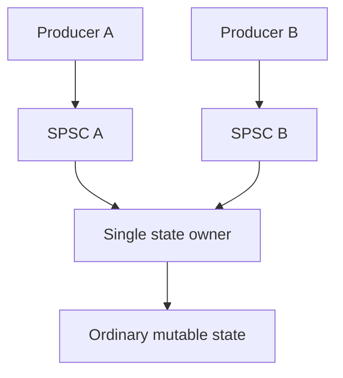

<details>
<summary>查看原图与完整文字转写</summary>

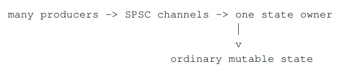

- ` many producers → SPSC channels → one state owner `
- ` ordinary mutable state `

</details>

若业务状态天然有 total order（Order FSM、Position、Book mutation、sequence handling），single owner 与 invariant 最匹配。 内部数据结构可以是普通 vector/map/plain fields，不再需要 CAS、ABA、reclamation 或 write-sharing。

### 8.6 Parallelize Across Objects, Not Inside One Object

当一个 owner 不够时，下一步通常是 partition/sharding，而不是让更多线程同时 mutate 同一 object。例如按 symbol/order/client/venue 把 state 固定到 worker，获得 N 个独立 single-owner domains。真正并行发生在 independent objects 之间。

### 8.7 Sharding 的代价

Cross-shard operation 需要 merge/aggregation/protocol；hot key 可能造成 load imbalance；动态 migration 会引入 ownership transfer、cache coldness 与 ordering/recovery 复杂度。因此 partition key 应从业务 dependency/invariant 推导，而不是只为 CPU 均匀。

<a id="pdf-page-025"></a>

<!-- source-pdf-page: 25 -->

*[原 PDF 第 25 页](./Topic_Lock_Free_Programming_CN.pdf#page=25)*

### 8.8 Read-Mostly State：RCU/Immutable Snapshot

Routing table、symbol metadata、client config、risk static limits 常 read-many/write-rare。让所有 reader 争 shared_mutex 或 shared_ptr refcount 都会产生共享 metadata traffic。更好的方向常是 writer 构建 immutable snapshot，atomic pointer release publish，reader acquire 后只读，旧版本 grace-period reclaim。

### 8.9 Atomic 最适合小型 Metadata

| 高效模式 | Atomic metadata | 普通数据 |
| --- | --- | --- |
| SPSC | write/read index | payload slots |
| Bounded ring | per-slot sequence | slot payload |
| RCU | current pointer/version | immutable snapshot |
| state transition | state/owner token | owner 内部完整状态 |

“everything atomic”通常意味着 ownership 模型不清晰。更优雅的并发协议往往只让少量 metadata atomic，把 bulk state 交给唯一 owner 或 immutable reader。

### 8.10 Cache-Line Ownership 是真实 Serialization Point

源码删除 mutex 后，多个 core 仍然必须串行取得同一 write-hot line 的 ownership。false sharing 可以 padding；true sharing 只能通过减少共享写、分片、local counter、batch aggregation 等架构手段处理。

### 8.11 Tail Latency 与 Retry Ratio

Lock-free 允许具体线程 starvation，因此 per-operation latency 不天然 bounded。应记录 CAS failures/success、retry distribution、 queue depth 与 p50/p99/p99.9/max。1M 成功对应 4M failed CAS 往往说明 architecture contention，而不是“LOCK CMPXCHG 还需要微优化”。

### 8.12 Bounded Work 比形式化标签更接近工程 Determinism

HFT 的“deterministic”通常指 bounded work、bounded memory、固定 ownership、受控 scheduling、无 surprise slow path，而不是每条 instruction 固定纳秒。一个严格 lock-free linked structure 可能比一个在固定 pinned workers 上使用的 bounded ring 更不稳定；形式 progress 与 engineering tail predictability 是不同目标。

### 8.13 Hot / Cold Path Separation

即使核心算法 lock-free，只要 hot path 中出现 logging mutex、malloc、timezone formatting、DB/network blocking call，端到端就不是低延迟。hot thread 常只做 bounded retire/publish，把 formatting、reclamation、metrics、persistence 移给 cold/background execution context，并显式定义 slow-consumer policy。

### 8.14 Queue Semantics 先于 Queue Library

选择通信 primitive 前先回答：这是 queue 还是 broadcast？每个 event 都必须处理吗？是否需要 global FIFO？full 时允许 drop/conflate/reject/backpressure？不同 symbol 是否可 independent reorder？业务语义放宽一点，可能直接把 MPMC 问题降成多个 SPSC 或 latest-state snapshot。

<a id="pdf-page-026"></a>

<!-- source-pdf-page: 26 -->

*[原 PDF 第 26 页](./Topic_Lock_Free_Programming_CN.pdf#page=26)*

### 8.15 决策树

**图示转写**

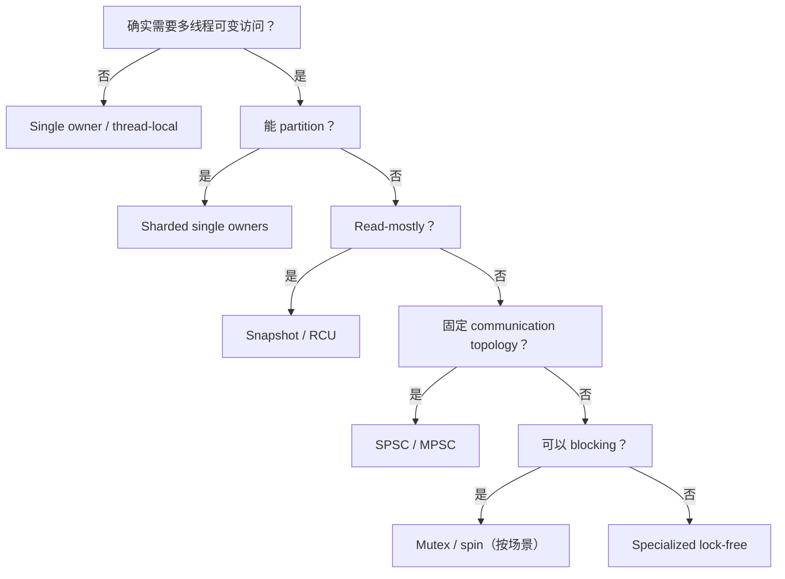

<details>
<summary>查看原图与完整文字转写</summary>

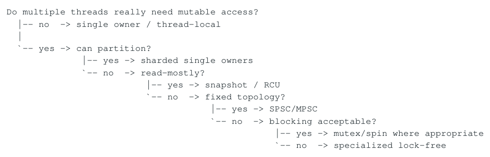

- ` Do multiple threads really need mutable access? `
- ` -- no → single owner / thread-local `
- `` `-- yes → can partition? ``
- ` -- yes → sharded single owners `
- `` `-- no → read-mostly? ``
- ` -- yes → snapshot / RCU `
- `` `-- no → fixed topology? ``
- ` -- yes → SPSC/MPSC `
- `` `-- no → blocking acceptable? ``
- ` -- yes → mutex/spin where appropriate `
- `` `-- no → specialized lock-free ``

</details>

### 8.16 选择表

| 场景 | 优先考虑 |
| --- | --- |
| 单线程内部 mutable state | 普通 non-atomic 数据 |
| 1 producer / 1 consumer | bounded SPSC |
| 多源 -&gt; 一个 owner | N x SPSC 或专用 MPSC |
| 可按 key 分区 | sharded single-owner |
| read-mostly config/reference data | immutable snapshot / RCU / epoch |
| 小型 ownership/state transition | CAS / atomic state machine |
| rare cold-path mutation | mutex |
| 极短临界区 + pinned holder | spinlock 可评估 |
| 真正 dynamic work pool | 成熟 MPMC concurrent queue |
| pointer-rich lock-free structure | 成熟库 + 明确 reclamation |

<a id="pdf-page-027"></a>

<!-- source-pdf-page: 27 -->

*[原 PDF 第 27 页](./Topic_Lock_Free_Programming_CN.pdf#page=27)*

## 第 9 章 Verification、Benchmark 与 Failure Modes

本章目标

建立“正确性证明 + controlled interleaving + real-topology profiling”的验证方法。知道 ASan/TSan 能发现什么、不能证明什么。

### 9.1 Correctness Review Checklist

写出 abstract sequential specification：stack/queue/state machine 的合法行为是什么？

为每个 API 标出 linearization point；若为空/失败操作，也要说明在什么观察点生效。

列出每个 ordinary payload 的 writer、publication carrier、matching acquire。

若存在 raw pointer，说明 protect/retire/reclaim contract 和 node reinsertion 规则。

构造 ABA/generation wrap/stalled-thread interleavings。

逐条说明 CAS failure 表示什么 progress；是否可能所有线程一起 livelock？

### 9.2 Controlled Interleaving 比“跑很久”更有价值

并发 bug 往往需要特定 timing。测试框架应允许在关键点 barrier/pause：例如 T1 读取 head 与 next 后暂停，T2 完成 remove/reinsert/reclaim 尝试，再恢复 T1；或 producer claim ring position 后暂停，观察 consumer progress。

### 9.3 ASan / TSan 的边界

| 工具 | 擅长 | 不能证明 |
| --- | --- | --- |
| ASan | heap UAF、buffer overflow 等 | live-object ABA、linearizability、progress |
| TSan | 未同步 conflicting accesses | atomic-only 逻辑 bug、ABA、错误抽象顺序 |
| UBSan | 部分未定义行为 | 并发算法完整正确性 |
| Stress test | 提高 rare interleaving 暴露概率 | “跑不挂”不等于证明 |

### 9.4 Linearizability Testing

记录 operation invocation、response、返回值以及必要 state，然后离线寻找是否存在一个满足 sequential specification 和 real-time ordering 的合法总序。无 crash、无 data race 仍可能 not linearizable。

### 9.5 Benchmark 必须匹配 Production Topology

并发结构性能高度依 producer/consumer 数量、core/socket、SMT、NUMA、message size、burst、queue depth 和 pinning。只在一个 core 上 tight-loop 测 API latency，无法代表真实 cross-core ownership handoff。

### 9.6 关注哪些指标

| 维度 | 建议指标 |
| --- | --- |
| Latency | p50/p90/p99/p99.9/max；enqueue-to-consume handoff |
| Contention | CAS success/failure、retry count、spin iterations |
| Queueing | depth/high-water mark、full/empty rate、consumer lag |
| CPU | cycles/op、instructions/op、Top-Down、branch misses |
| Memory/coherence | cache miss、HITM/coherence、remote NUMA、false sharing |
| Reclamation | retired count、batch size、reclaim pause、memory high-water |

<a id="pdf-page-028"></a>

<!-- source-pdf-page: 28 -->

*[原 PDF 第 28 页](./Topic_Lock_Free_Programming_CN.pdf#page=28)*

### 9.7 Performance Diagnosis 顺序

**图示转写**

1. ` business semantics / unnecessary work `
2. ` → ownership topology `
3. ` → queueing/backpressure `
4. ` → cache-line sharing / NUMA `
5. ` → algorithm & data layout `
6. ` → memory_order / instruction micro-tuning `

<details>
<summary>查看原图与完整文字转写</summary>

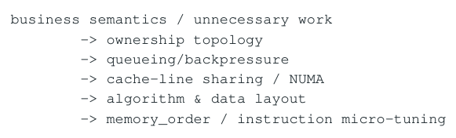

- ` business semantics / unnecessary work `
- ` → ownership topology `
- ` → queueing/backpressure `
- ` → cache-line sharing / NUMA `
- ` → algorithm & data layout `
- ` → memory_order / instruction micro-tuning `

</details>

x86 上 relaxed/acq_rel CAS 常都需要同一 locked RMW，真正成本往往是 same-line contention。不要花大量时间“把 acq_rel 改 relaxed”却忽略 16 个 cores 正在争同一个 counter。

### 9.8 常见 Failure Modes

CAS loop 内调用 blocking operation，导致“看起来 lock-free”的代码实际依赖锁。

pointer CAS 正确但对象已 free，形成 C++ UB；汇编层“似乎还能跑”不构成正确性。

所有 atomics 使用 seq_cst 仍无法修 ABA、lifetime 或错误 business invariant。

global MPMC queue 解决了拓扑方便，却制造 cache-line ownership hotspot 与 stale backlog。

EBR reader 在 epoch 内执行 syscall/page fault/长计算，reclamation 内存快速膨胀。

批量 reclaim 在某次 hot event 中一次释放大量节点，p99.9 出现周期性尖峰。

为了 metrics 每条消息 global atomic fetch_add，破坏原本无共享的数据路径。

<a id="pdf-page-029"></a>

<!-- source-pdf-page: 29 -->

*[原 PDF 第 29 页](./Topic_Lock_Free_Programming_CN.pdf#page=29)*

## 附录 A：术语、对照表、面试问答与复习清单

本章目标

把整个专题压缩成可以快速回忆、review 代码和回答 HFT/C++ 并发面试的问题集合。

### A.1 术语表

| 术语 | 定义 |
| --- | --- |
| Linearization point | 并发 operation 在抽象数据结构上被视为原子生效的瞬间 |
| Modification order | 每个 atomic object 自身所有 modification 的单一 total order |
| Synchronizes-with | 特定 release/acquire 等操作建立的跨线程同步关系 |
| Happens-before | 保证普通内存访问顺序/visibility 的核心关系 |
| Publication carrier | 代表“关联普通数据已经准备完成”的 atomic metadata |
| ABA | 值 A 经过变化后又回到 A，使 stale snapshot 可能被错误验证 |
| Retire | 逻辑删除但仍可能被旧 reader 引用 |
| Reclaim | 已经证明无旧 reader，可安全 free/reuse |
| Helping | 线程替其他操作完成可公开识别的剩余步骤 |
| Cache-line bouncing | 多个 cores 反复争同一 write-hot coherence line 的 ownership |
| Backpressure | 当 downstream capacity 不足时主动限制/拒绝/丢弃/合并上游工作 |

### A.2 memory_order 速查

| Order | 保证重点 | 典型用途 |
| --- | --- | --- |
| relaxed | atomicity + modification order；无额外跨对象同步 | counter/reservation/独立状态 |
| acquire | 获得观察到 release 之前的 effects | consume published pointer/sequence |
| release | 发布当前操作之前的 ordinary writes | ready/index/pointer publication |
| acq_rel | RMW 同时 acquire + release | ownership handoff / CAS state transition |
| seq_cst | 再增加所有 SC atomic 的全局 total order | 需要最强简单语义、调试/初版实现 |

### A.3 CAS Review Checklist

expected 表示什么 snapshot？失败更新 expected 后是否重新计算 desired？

successful CAS 是否真的是 linearization point，还是仅 reservation/bookkeeping？

失败 CAS 后是否马上 dereference 新 expected，从而需要 acquire？

CAS 比较的 value 是否足够代表 logical generation？是否存在 ABA？

expected 指向的 object 在整个 read/derive/CAS 窗口是否保持 alive？

contention 下 failed CAS / cache-line transfer / expensive recompute 是否可接受？

### A.4 Queue / Ring 选择问题

这是 work queue 还是 broadcast？一个 item 应被一个还是所有 consumers 看到？

Producer/consumer topology 能否固定成 SPSC 或 N x SPSC？

是否真的需要 global FIFO，还是 per-source ordering + merge 足够？

每个 event 是否 lossless？full 时可 drop/conflate/overwrite/reject 吗？

<a id="pdf-page-030"></a>

<!-- source-pdf-page: 30 -->

*[原 PDF 第 30 页](./Topic_Lock_Free_Programming_CN.pdf#page=30)*

capacity/burst/headroom 多大？queue depth 对 latency budget 意味着什么？

若使用 reservation-based MPMC，线程 claim 后停住是否产生不可帮助的 hole？

### A.5 高频面试问答

Q1. What does lock-free actually guarantee?

系统整体 progress，而不是每个线程 bounded progress。具体线程可以 starvation；这就是它比 wait-free 弱的地方。

Q2. Is lock-free always faster than mutex?

不是。Lock-free 是 progress property。高 contention 下 CAS retry 和 cache-line bouncing 可能比短临界区更贵；其主要价值是删除 blocking dependency。

Q3. Why can while(!CAS()) still be lock-free?

当前线程可能一直失败，但失败往往意味着另一个 operation 成功修改状态，因此系统整体仍 progress。具体算法仍需独立证明。

Q4. weak vs strong CAS?

weak 允许 spurious failure，适合 retry loop；strong 不允许。x86 上常生成相同 CMPXCHG，但这是实现事实而非语言保证。

Q5. Why does expected change after CAS failure?

它是 in/out 参数，失败时返回当前实际值，便于调用者基于新 snapshot 重算 desired。

Q6. Why can failed CAS be expensive?

它仍是 atomic RMW attempt；x86 常为 locked CMPXCHG，需要参与 coherence/ownership，竞争下会产生 bouncing/retry。

Q7. What is a linearization point?

operation 调用区间内被抽象为原子生效的概念瞬间。

Q8. What does relaxed guarantee?

仍有 atomicity 和该 atomic 的 modification order，但不为其他 ordinary data 建立 synchronizes-with/happens-before。

Q9. Why does atomic pointer not protect pointee?

atomic 只保护 pointer value。对象字段的 publication visibility 需要 release/acquire，lifetime 还需要 reclamation。

Q10. Can seq_cst solve ABA?

不能。ABA 是 generation/history validation 问题，seq_cst 只提供更强 ordering。

Q11. What is ABA?

观察 A，中间变成其他值后又回到 A，CAS 因当前 bits 相等而成功，但原 snapshot 的逻辑前提已经失效。

Q12. Hazard pointer vs epoch?

Hazard 精确保护 pointer、stalled thread 影响局部但 reader 开销高；epoch read path 轻但一个 stalled active thread 可拖延整批 reclaim。

Q13. retire vs reclaim?

retire 是逻辑移除但旧 reader 仍可能持有；reclaim 是已证明无人可再访问，可以 free/reuse。

Q14. Why dummy node in Michael-Scott queue?

消除大部分 empty/single-element 特例；head 始终指向 dummy，逻辑 front 是 head-&gt;next。

Q15. Why can tail lag?

tail 只是定位尾部的 hint；真正 enqueue commit 是 old_tail-&gt;next CAS，其他线程可 help tail catch up。

Q16. Why SPSC is so efficient?

每个 index 单 writer，普通 payload + release/acquire handoff，通常无 CAS 和多 writer ownership contention。

<a id="pdf-page-031"></a>

<!-- source-pdf-page: 31 -->

*[原 PDF 第 31 页](./Topic_Lock_Free_Programming_CN.pdf#page=31)*

Q17. Why per-slot sequence?

区分同一物理 slot 的不同 generation，同时编码 free/ready state 并作为 publication/ownership token。

Q18. Is CAS-based bounded MPMC automatically lock-free?

不是。若线程 reserve position 后停在 publish 前，FIFO hole 可能让其他线程无法完成；必须单独分析 progress。

Q19. Best optimization before lock-free?

减少共享：single owner、partition/shard、SPSC、immutable snapshot。硬件 cache-line ownership 在没有 mutex 时仍会序列化写。

Q20. How do you think about lock-free in HFT?

先按业务定义 ownership/topology，再决定同步。共享不可避免且 blocking dependency 不可接受时才选 lock-free，同时验证 linearizability、ordering、lifetime、progress，并测 contention/NUMA/p99.9。

### A.6 推荐实验

| 实验 | 目的 |
| --- | --- |
| 1/2/4/8 threads atomic fetch_add same counter | 观察 true sharing 与 scalability collapse |
| per-thread counters + aggregate | 验证 remove sharing 的收益 |
| CAS weak/strong on x86 assembly | 确认常见 lowering 是否相同 |
| SPSC same-core / cross-core / cross-NUMA | 量化 ownership handoff 与 topology |
| false-sharing pair vs padded pair | 观察 coherence granularity |
| Treiber controlled ABA interleaving | 验证 stale next / generation 问题 |
| EBR stalled reader | 观察 retired memory growth 与 reclaim progress |
| ring depth vs end-to-end latency | 验证 queue depth 就是 latency reservoir |
| MPMC vs N x SPSC under same workload | 量化 reservation contention 与 merge trade-off |

### A.7 最终复习清单：15 条必须记住

Atomic != Lock-Free。

Lock-Free != Wait-Free。

Lock-Free != Fast / Deterministic。

CAS = optimistic validate + conditional commit。

CAS compares current value, not history。

Successful CAS 常是 linearization point，但不自动构成 proof。

Release/Acquire 的核心是 publication / ownership transfer。

Atomic pointer != atomic pointee != lifetime protection。

Removed != reclaimable；需要 Live -&gt; Retired -&gt; Reclaimed。

ABA 与 UAF 相关但不同；seq_cst/strong CAS 都不能修 ABA。

Hazard protects pointers；Epoch/QSBR/RCU 保护时间/reader generation。

Michael-Scott 的核心是 next-link linearization + tail lagging + helping。

Per-slot sequence = generation + state + publication token。

Cache-line ownership 往往才是真正的硬件 serialization point。

低延迟最好的 lock-free 优化，往往是把 sharing 从 architecture 上删掉。

<a id="pdf-page-032"></a>

<!-- source-pdf-page: 32 -->

*[原 PDF 第 32 页](./Topic_Lock_Free_Programming_CN.pdf#page=32)*

### A.8 统一心智模型

**图示转写**

1. ` Business semantics / invariants `
2. ` Ownership topology `
3. ` Communication topology (SPSC/MPSC/broadcast/shard) `
4. ` Linearization + publication protocol `
5. ` Lifetime / reclamation / generation `
6. ` Progress guarantee `
7. ` Cache coherence / NUMA / retry / queueing `
8. ` Measure p50 / p99 / p99.9 / max and verify `

<details>
<summary>查看原图与完整文字转写</summary>

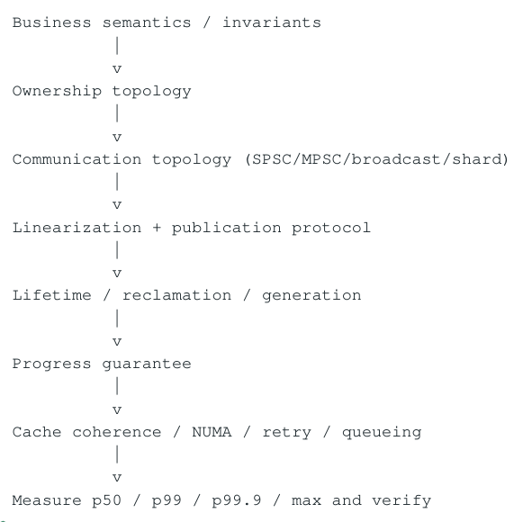

- ` Business semantics / invariants `
- ` Ownership topology `
- ` Communication topology (SPSC/MPSC/broadcast/shard) `
- ` Linearization + publication protocol `
- ` Lifetime / reclamation / generation `
- ` Progress guarantee `
- ` Cache coherence / NUMA / retry / queueing `
- ` Measure p50 / p99 / p99.9 / max and verify `

</details>

专题最终结论

真正理解 Lock-Free Programming 以后，往往不是“更多使用 CAS”，而是更清楚什么时候应该根本不共享。当 lock-free 确实必要时，你能明确说出它购买的 progress guarantee、它需要承担的 correctness proof，以及它在 cache coherence 和 tail latency 上的真实成本。

<a id="conversion-errata"></a>

## 转换补充与勘误

本节及正文中“转换补充 / 转换勘误”均为 2026-11-06 转换时新增；原 PDF 仍是原始内容与版式的对照。

- [原 PDF 第 16 页处的补充](#pdf-page-016)：Hazard Pointer 和 EBR 的片段是协议示意，省略了关键 memory-order / fence 与 thread-registration 细节，不能据此直接实现。

- [原 PDF 第 22 页处的补充](#pdf-page-022)：bounded queue 返回 full/empty 可以是一个已完成的操作；判断严格 lock-free 时仍须明确 API 语义。

### 适用边界

原文中的时延、cache/ROB 大小、PMU event、kernel 参数及 compiler lowering 均需要绑定具体平台。转写结构的覆盖校验不等同于对全部技术命题的逐条实测；复杂图的精确布局以随附原图为准。
