# Low-Latency System Design

> 来源：[Topic_Low_Latency_System_Design_CN.pdf](./Topic_Low_Latency_System_Design_CN.pdf)（43 页）。本文件按原文逐页转写；转换补充与勘误单独标明。

> 图示优先转为 Mermaid、表格或步骤；每图附原图和文字以便核对。代码保留原文逻辑与缩进，跨页片段及概念示例未宣称可以独立编译。

[返回目录](README.md) · [转换说明与校验](CONVERSION_NOTES.md) · [本文补充与勘误](#conversion-errata)

[原文目录](#pdf-page-003) · [第一章正文](#pdf-page-008)

<a id="pdf-page-001"></a>

<!-- source-pdf-page: 1 -->

*[原 PDF 第 1 页](./Topic_Low_Latency_System_Design_CN.pdf#page=1)*

## Low-Latency System Design

### C++ / CPU 深度学习 - 综合专题完整讲义

SLA · Critical Path · Ownership · Threading · Memory Layout · SPSC · Backpressure · NIC / Kernel Bypass · Recovery · HA · Tail Latency · HFT System Design

目标 建立一套从业务 SLA 出发，能够解释、设计、测量并验证低延迟交易系统的统一心智模型：把 CPU、Memory、 Concurrency、Network、Recovery 与 Overload 放到同一条端到端 critical path 上理解。

核心主线：Business Requirement → Latency / Throughput / Reliability SLA → Critical Path → Ownership → Thread Model → Memory Model → Communication → Network → Recovery → Overload Strategy → Measurement。

2026-08 · 详尽版

<a id="pdf-page-002"></a>

<!-- source-pdf-page: 2 -->

*[原 PDF 第 2 页](./Topic_Low_Latency_System_Design_CN.pdf#page=2)*

## 如何使用这份讲义

这份 PDF 不是 8 次聊天记录的简单拼接，而是按照“先定义系统目标，再建立 ownership 与 memory topology，再处理跨线程和网络边界，最后把 failure/overload 纳入设计”的顺序重新组织。阅读时建议始终把一个问题落回四个量：Work、 Waiting、WIP、Dependency。

最核心的方法 先明确 measurement boundary 和 percentile SLA；再画 critical path 与 state ownership；然后检查每个边界是否引入 queue、cross-core ownership transfer、NUMA、allocation 或 external dependency；最后用真实 burst、fault injection 和 wire-level timestamp 去证伪设计。

本文主要针对现代 Linux/C++ 低延迟系统，尤其是 market-data → book/state → pricing/strategy → risk → order gateway → exchange 这类路径。具体 NIC、CPU、kernel、Onload/DPDK 版本以及交易所协议细节会随平台变化， 因此具体数字必须绑定环境；本文重点是稳定的设计原则。

### 阅读路线

| 章节 | 主题 | 最终要回答的问题 |
| --- | --- | --- |
| 第 1 章 | First Principles / SLA / Critical Path | Latency 到底由什么组成？为什么 avg 很快仍可能是坏系统？ |
| 第 2 章 | Ownership / Thread Model | 谁拥有 mutable state？何时应该拆线程，何时应该 shard？ |
| 第 3 章 | Data Model / Memory Architecture | Owner 的 state 怎样布局，才能让 CPU 触碰最少且可预测的 cache lines/pages？ |
| 第 4 章 | Queues / Backpressure / Flow Control | 跨 ownership boundary 怎么传？Producer 比 Consumer 快时怎么办？ |
| 第 5 章 | Network → Application E2E | 从 wire 到 wire 中间到底有哪些 queue、copy、handoff 与 timestamp boundary？ |
| 第 6 章 | State Machine / Recovery / Reliability | 断线、gap、crash 后如何恢复可信状态，而不重复交易或丢状态？ |
| 第 7 章 | Overload / Tail-Latency Collapse | 为什么系统在最忙的时候会非线性失稳？怎样让 overload 形成负反馈？ |
| 第 8 章 | Full Trading System Design | 怎样把前七章收敛成一套 p99.9 &lt; 100us的完整设计与面试回答？ |

### 贯穿全书的七个问题

- 这个事件的 critical path 是什么？哪些步骤真正不可省？

- 哪些时间是在做 useful work，哪些时间是在等待别人、等待 queue、等待 scheduler 或等待 memory？

- 每个 hot mutable object 到底是谁唯一写？是否存在不必要的 multi-writer sharing？

- 每个 cross-thread/process/network boundary 为什么存在？它买来了 capacity、ownership 还是 failure isolation？

- 系统允许积累多少 WIP？Queue depth 换算成多少微秒的 latency debt？

- 当 input &gt; capacity、packet gap、TCP disconnect、process crash 时，系统如何以 bounded、可恢复的方式失败？

- 怎样用 E2E timestamp、queue timeline、burst replay、fault injection 和 counters 证明我的判断？

<a id="pdf-page-003"></a>

<!-- source-pdf-page: 3 -->

*[原 PDF 第 3 页](./Topic_Low_Latency_System_Design_CN.pdf#page=3)*

## 原文目录

- [如何使用这份讲义 2 阅读路线 2 贯穿全书的七个问题 2 目录](#pdf-page-003)（原页码 3）
- [第 1 章 First Principles：Latency Budget、Critical Path 与 Bounded Work](#pdf-page-008)（原页码 8）
- [1.1 Latency 的 Measurement Boundary](#pdf-page-008)（原页码 8）
- [1.2 Latency = Service Time + Queueing + Scheduling + Communication](#pdf-page-008)（原页码 8）
- [1.3 Throughput 与 Latency 是不同目标](#pdf-page-008)（原页码 8）
- [1.4 Average、p99、p99.9 与 Tail](#pdf-page-008)（原页码 8）
- [1.5 Bounded Work 与 Deterministic Latency](#pdf-page-009)（原页码 9）
- [1.6 Critical Path、Fast Path 与 Slow Path](#pdf-page-009)（原页码 9）
- [1.7 Latency Budget 与 Safety Margin](#pdf-page-009)（原页码 9）
- [1.8 Queueing、Little's Law 与 Headroom](#pdf-page-010)（原页码 10）
- [1.9 SLA 驱动 Architecture](#pdf-page-010)（原页码 10）
- [1.10 面试回答模板](#pdf-page-010)（原页码 10）
- [第 2 章 Ownership 与 Thread Model：先决定谁写 State，再决定线程](#pdf-page-011)（原页码 11）
- [2.1 Do Not Start With Threads - Start With Ownership](#pdf-page-011)（原页码 11）
- [2.2 Single-Thread Event Loop](#pdf-page-011)（原页码 11）
- [2.3 Single Writer 也是 State Consistency Model](#pdf-page-011)（原页码 11）
- [2.4 Horizontal Sharding](#pdf-page-011)（原页码 11）
- [2.5 Vertical Pipeline vs Horizontal Partition](#pdf-page-012)（原页码 12）
- [2.6 Lock-Free != Contention-Free](#pdf-page-012)（原页码 12）
- [2.7 SPSC 为什么特别适合 Low Latency](#pdf-page-012)（原页码 12）
- [2.8 Polling、Busy Spin 与 Blocking](#pdf-page-012)（原页码 12）
- [2.9 CPU Affinity、Isolation 与 SMT](#pdf-page-012)（原页码 12）
- [2.10 NUMA Ownership Alignment](#pdf-page-012)（原页码 12）
- [2.11 Immutable Shared State 与 Replication](#pdf-page-013)（原页码 13）
- [2.12 Global State 与 Hierarchical Budget](#pdf-page-013)（原页码 13）
- [2.13 Logical Shard 与 Physical Core](#pdf-page-013)（原页码 13）
- [2.14 Thread Model 设计流程](#pdf-page-013)（原页码 13）
- [2.15 面试回答模板](#pdf-page-013)（原页码 13）
- [第 3 章 Data Model 与 Memory Architecture：把 Ownership 变成 Cache Locality](#pdf-page-014)（原页码 14）
- [3.1 从 Memory Access Graph 看 Hot Path](#pdf-page-014)（原页码 14）
- [3.2 Hot / Cold State Split](#pdf-page-014)（原页码 14）
- [3.3 Working Set：Total Dataset != Hot Dataset](#pdf-page-014)（原页码 14）
- [3.4 AoS vs SoA](#pdf-page-014)（原页码 14）
- [3.5 Compact IDs、Dense Storage 与 Direct Indexing](#pdf-page-014)（原页码 14）

<a id="pdf-page-004"></a>

<!-- source-pdf-page: 4 -->

*[原 PDF 第 4 页](./Topic_Low_Latency_System_Design_CN.pdf#page=4)*

- [3.6 Normalization 与 Denormalization 不冲突](#pdf-page-015)（原页码 15）
- [3.7 Pointer Chasing 与 Serial Dependency](#pdf-page-015)（原页码 15）
- [3.8 Index-Based Packed Storage](#pdf-page-015)（原页码 15）
- [3.9 Order Book / L3 Data Structure Trade-off](#pdf-page-015)（原页码 15）
- [3.10 Flat Hash Map 不是“平均 O(1) 就完事”](#pdf-page-015)（原页码 15）
- [3.11 Small-N Principle](#pdf-page-015)（原页码 15）
- [3.12 Object Pool、Arena 与 Preallocation](#pdf-page-016)（原页码 16）
- [3.13 Stable Handle 与 Generation Counter](#pdf-page-016)（原页码 16）
- [3.14 False Sharing 与 Cache-Line Ownership](#pdf-page-016)（原页码 16）
- [3.15 Immutable / Versioned State](#pdf-page-016)（原页码 16）
- [3.16 Double Buffer](#pdf-page-016)（原页码 16）
- [3.17 Seqlock：概念正确不等于 C++ 写法合法](#pdf-page-016)（原页码 16）
- [3.18 Publication Boundary 才需要 Atomics](#pdf-page-016)（原页码 16）
- [3.19 Prefetch、MLP 与 TLB](#pdf-page-017)（原页码 17）
- [3.20 Memory Capacity Policy](#pdf-page-017)（原页码 17）
- [3.21 设计审查清单](#pdf-page-017)（原页码 17）
- [第 4 章 Messaging、Queues、Backpressure 与 Flow Control](#pdf-page-018)（原页码 18）
- [4.1 Queue 首先是 Ownership Transfer Protocol](#pdf-page-018)（原页码 18）
- [4.2 Release / Acquire Publication](#pdf-page-018)（原页码 18）
- [4.3 SPSC Ring 的基本结构](#pdf-page-018)（原页码 18）
- [4.4 Queue Primitive 很快 != System Latency 很低](#pdf-page-018)（原页码 18）
- [4.5 Copy vs Pointer](#pdf-page-018)（原页码 18）
- [4.6 Queue = Stored Latency](#pdf-page-018)（原页码 18）
- [4.7 Bounded Queue 与 Operational Watermark](#pdf-page-019)（原页码 19）
- [4.8 Event vs State 决定 Overflow Semantics](#pdf-page-019)（原页码 19）
- [4.9 Coalescing / Dirty-Set Pattern](#pdf-page-019)（原页码 19）
- [4.10 Overflow 策略没有统一答案](#pdf-page-019)（原页码 19）
- [4.11 Backpressure：压力必须有去处](#pdf-page-019)（原页码 19）
- [4.12 Watermark 与 Hysteresis](#pdf-page-020)（原页码 20）
- [4.13 Token Bucket 与 Leading-Edge + Trailing-Latest](#pdf-page-020)（原页码 20）
- [4.14 Multiple SPSC、Fairness 与 Bounded Poll](#pdf-page-020)（原页码 20）
- [4.15 Slow Consumer 与 Broadcast](#pdf-page-020)（原页码 20）
- [4.16 Durable Queue != Low-Latency Handoff Queue](#pdf-page-020)（原页码 20）
- [4.17 Ordering Strength](#pdf-page-020)（原页码 20）
- [4.18 Queue Sizing 与 Test](#pdf-page-020)（原页码 20）
- [4.19 面试回答模板](#pdf-page-020)（原页码 20）
- [第 5 章 Network → Application：从 Wire 到 Wire 的真实 Critical Path](#pdf-page-022)（原页码 22）
- [5.1 完整 E2E Path](#pdf-page-022)（原页码 22）
- [5.2 NIC RX Descriptor Ring 与 DMA](#pdf-page-022)（原页码 22）
- [5.3 Interrupt vs Polling](#pdf-page-022)（原页码 22）

<a id="pdf-page-005"></a>

<!-- source-pdf-page: 5 -->

*[原 PDF 第 5 页](./Topic_Low_Latency_System_Design_CN.pdf#page=5)*

- [5.4 Interrupt Moderation / Coalescing](#pdf-page-022)（原页码 22）
- [5.5 RSS、Flow Steering 与 IRQ Affinity](#pdf-page-022)（原页码 22）
- [5.6 Kernel Socket Path 与 Bufferbloat](#pdf-page-023)（原页码 23）
- [5.7 System Call 与 Opportunistic Batching](#pdf-page-023)（原页码 23）
- [5.8 Kernel Bypass 的真正目标](#pdf-page-023)（原页码 23）
- [5.9 Zero-Copy 的边界](#pdf-page-023)（原页码 23）
- [5.10 Protocol：FIX、SBE、ITCH、FIXP](#pdf-page-023)（原页码 23）
- [5.11 TCP vs UDP](#pdf-page-023)（原页码 23）
- [5.12 Multicast A/B Feed 与 Gap Recovery](#pdf-page-024)（原页码 24）
- [5.13 RX Thread Architecture Trade-off](#pdf-page-024)（原页码 24）
- [5.14 TX Path 与 send() 语义](#pdf-page-024)（原页码 24）
- [5.15 Encode Directly Into Final Buffer](#pdf-page-024)（原页码 24）
- [5.16 PTP、Hardware Timestamp 与 TSC](#pdf-page-024)（原页码 24）
- [5.17 NIC + CPU + Memory NUMA Triangle](#pdf-page-024)（原页码 24）
- [5.18 Microburst、PPS 与 Total Buffering Budget](#pdf-page-024)（原页码 24）
- [5.19 Network Diagnosis](#pdf-page-025)（原页码 25）
- [5.20 Network 设计清单](#pdf-page-025)（原页码 25）
- [第 6 章 State Machine、Recovery 与 Reliability：失败后重新获得 Truth](#pdf-page-026)（原页码 26）
- [6.1 Ambiguous Outcome 是核心 Failure](#pdf-page-026)（原页码 26）
- [6.2 “Exactly Once” 应拆成可实现 Primitive](#pdf-page-026)（原页码 26）
- [6.3 Order State Machine = State + Transition + Invariant](#pdf-page-026)（原页码 26）
- [6.4 Single Owner + Event Reducer](#pdf-page-026)（原页码 26）
- [6.5 Deterministic Replay](#pdf-page-026)（原页码 26）
- [6.6 Recovery 四层](#pdf-page-027)（原页码 27）
- [6.7 Stable Identity 与 Idempotency](#pdf-page-027)（原页码 27）
- [6.8 Acceptance Point 与 Durability](#pdf-page-027)（原页码 27）
- [6.9 WAL、Snapshot 与 Checkpoint](#pdf-page-027)（原页码 27）
- [6.10 RPO 与 RTO](#pdf-page-027)（原页码 27）
- [6.11 Market Data Gap Recovery](#pdf-page-027)（原页码 27）
- [6.12 TCP Disconnect after NewOrder](#pdf-page-028)（原页码 28）
- [6.13 FIX Session Recovery](#pdf-page-028)（原页码 28）
- [6.14 Duplicate、Out-of-Order 与 Late Event](#pdf-page-028)（原页码 28）
- [6.15 Tombstone 与 Dedup Horizon](#pdf-page-028)（原页码 28）
- [6.16 Canonical State 与 Projection](#pdf-page-028)（原页码 28）
- [6.17 HA：Single Active、Standby 与 Fencing](#pdf-page-028)（原页码 28）
- [6.18 Sync vs Async Replication](#pdf-page-028)（原页码 28）
- [6.19 Recovery Work 也必须 Bounded](#pdf-page-029)（原页码 29）
- [6.20 Recovery Testing](#pdf-page-029)（原页码 29）
- [6.21 面试回答模板](#pdf-page-029)（原页码 29）
- [第 7 章 Overload、Failure Mode 与 Tail-Latency Collapse](#pdf-page-030)（原页码 30）

<a id="pdf-page-006"></a>

<!-- source-pdf-page: 6 -->

*[原 PDF 第 6 页](./Topic_Low_Latency_System_Design_CN.pdf#page=6)*

- [7.1 为什么 Latency 会非线性爆炸](#pdf-page-030)（原页码 30）
- [7.2 Headroom = Recovery Ability](#pdf-page-030)（原页码 30）
- [7.3 Overload 的类型](#pdf-page-030)（原页码 30）
- [7.4 Working Set Expansion 与 Cache/TLB Feedback](#pdf-page-030)（原页码 30）
- [7.5 Page Fault / Allocation Slow Path](#pdf-page-030)（原页码 30）
- [7.6 Lock、CAS 与 Contention Amplification](#pdf-page-030)（原页码 30）
- [7.7 False Sharing 与 Background Interference](#pdf-page-031)（原页码 31）
- [7.8 Logging / Metrics / Retry Storm](#pdf-page-031)（原页码 31）
- [7.9 Stale Work 与 Catch-Up](#pdf-page-031)（原页码 31）
- [7.10 Admission Control 与 Reserved Capacity](#pdf-page-031)（原页码 31）
- [7.11 Priority 必须尊重 Causality](#pdf-page-031)（原页码 31）
- [7.12 Graceful Degradation State Machine](#pdf-page-031)（原页码 31）
- [7.13 Failure State 应作为 State 传播](#pdf-page-031)（原页码 31）
- [7.14 Capacity Curve 与 Knee Point](#pdf-page-032)（原页码 32）
- [7.15 Capacity 的更严格定义](#pdf-page-032)（原页码 32）
- [7.16 Compound Failures](#pdf-page-032)（原页码 32）
- [7.17 Tail Diagnostics](#pdf-page-032)（原页码 32）
- [7.18 Resilience Test](#pdf-page-032)（原页码 32）
- [7.19 面试回答模板](#pdf-page-032)（原页码 32）
- [第 8 章 Full HFT / Trading System Design：p99.9 &lt; 100us 综合推演](#pdf-page-033)（原页码 33）
- [8.1 Step 1 - Requirements / SLA](#pdf-page-033)（原页码 33）
- [8.2 Step 2 - Critical Path 与 Budget](#pdf-page-033)（原页码 33）
- [8.3 Step 3 - 先尝试 Run-to-Completion，再按 Capacity Shard](#pdf-page-033)（原页码 33）
- [8.4 推荐 Hybrid Topology](#pdf-page-033)（原页码 33）
- [8.5 Step 4 - Runtime State 编译成 Hot Representation](#pdf-page-034)（原页码 34）
- [8.6 Step 5 - Market Data Semantics 分层](#pdf-page-034)（原页码 34）
- [8.7 Step 6 - Pricing 与 Work Elimination](#pdf-page-034)（原页码 34）
- [8.8 Step 7 - Risk Architecture](#pdf-page-034)（原页码 34）
- [8.9 Step 8 - Gateway / Execution Session](#pdf-page-034)（原页码 34）
- [8.10 Step 9 - Network / NUMA](#pdf-page-034)（原页码 34）
- [8.11 Step 10 - Recovery / HA](#pdf-page-034)（原页码 34）
- [8.12 Step 11 - Overload State Machine](#pdf-page-034)（原页码 34）
- [8.13 Step 12 - E2E Measurement](#pdf-page-035)（原页码 35）
- [8.14 Queue Semantics 表](#pdf-page-035)（原页码 35）
- [8.15 Anti-Patterns](#pdf-page-035)（原页码 35）
- [8.16 Senior / Lead 面试完整回答](#pdf-page-036)（原页码 36）
- [8.17 最终统一模型](#pdf-page-036)（原页码 36）
- [附录 A 术语表与概念对照](#pdf-page-037)（原页码 37）
- [A.1 三个容易混淆的“Normalization”](#pdf-page-037)（原页码 37）
- [A.2 Progress Guarantee 与 Latency Guarantee](#pdf-page-038)（原页码 38）

<a id="pdf-page-007"></a>

<!-- source-pdf-page: 7 -->

*[原 PDF 第 7 页](./Topic_Low_Latency_System_Design_CN.pdf#page=7)*

- [附录 B Low-Latency Architecture Design Review Checklist](#pdf-page-039)（原页码 39）
- [B.1 Requirements](#pdf-page-039)（原页码 39）
- [B.2 Ownership / Threads](#pdf-page-039)（原页码 39）
- [B.3 Memory](#pdf-page-039)（原页码 39）
- [B.4 Queues / Flow Control](#pdf-page-039)（原页码 39）
- [B.5 Network](#pdf-page-039)（原页码 39）
- [B.6 Recovery / Overload](#pdf-page-039)（原页码 39）
- [附录 C 高频面试问答](#pdf-page-040)（原页码 40）
- [C.1 为什么一个单线程 event loop 可能比多线程更快？](#pdf-page-040)（原页码 40）
- [C.2 什么时候应该拆线程？](#pdf-page-040)（原页码 40）
- [C.3 为什么 SPSC 比 MPSC/MPMC 更适合严格 hot path？](#pdf-page-040)（原页码 40）
- [C.4 Queue 越大越安全吗？](#pdf-page-040)（原页码 40）
- [C.5 Producer 持续比 Consumer 快怎么办？](#pdf-page-040)（原页码 40）
- [C.6 Market Data queue 满了能不能 drop？](#pdf-page-040)（原页码 40）
- [C.7 Order queue 满了怎么办？](#pdf-page-040)（原页码 40）
- [C.8 为什么 lock-free 在高 load 仍可能慢？](#pdf-page-040)（原页码 40）
- [C.9 为什么 pointer chasing 即使全 L1 也可能慢？](#pdf-page-040)（原页码 40）
- [C.10 vector 与 vector 怎么选？](#pdf-page-040)（原页码 40）
- [C.11 naive C++ seqlock 为什么可能 UB？](#pdf-page-040)（原页码 40）
- [C.12 Kernel bypass 一定更快吗？](#pdf-page-041)（原页码 41）
- [C.13 send() 返回是不是 order 已经发到 exchange？](#pdf-page-041)（原页码 41）
- [C.14 UDP 为什么适合 market data？](#pdf-page-041)（原页码 41）
- [C.15 TCP disconnect 后 NewOrder 没 ACK 怎么办？](#pdf-page-041)（原页码 41）
- [C.16 Timeout 为什么不等于 Reject？](#pdf-page-041)（原页码 41）
- [C.17 Exactly-once 怎么回答？](#pdf-page-041)（原页码 41）
- [C.18 Active/Active 为什么难？](#pdf-page-041)（原页码 41）
- [C.19 为什么系统在高 load 下 latency 会突然 cliff？](#pdf-page-041)（原页码 41）
- [C.20 什么是 graceful degradation？](#pdf-page-041)（原页码 41）
- [附录 D 推荐实验与验证方法](#pdf-page-042)（原页码 42）
- [D.1 Queue / Backpressure 实验](#pdf-page-042)（原页码 42）
- [D.2 Memory / Layout 实验](#pdf-page-042)（原页码 42）
- [D.3 Network 实验](#pdf-page-042)（原页码 42）
- [D.4 Recovery / Fault Injection](#pdf-page-042)（原页码 42）
- [D.5 Capacity / Tail 实验](#pdf-page-042)（原页码 42）
- [附录 E 一页复习：Low-Latency System Design Mental Model](#pdf-page-043)（原页码 43）
- [E.1 五个核心量](#pdf-page-043)（原页码 43）
- [E.2 设计顺序](#pdf-page-043)（原页码 43）
- [E.3 最终检查](#pdf-page-043)（原页码 43）

<a id="pdf-page-008"></a>

<!-- source-pdf-page: 8 -->

*[原 PDF 第 8 页](./Topic_Low_Latency_System_Design_CN.pdf#page=8)*

## 第 1 章 First Principles：Latency Budget、Critical Path 与 Bounded Work

本章目标 先建立系统层最重要的等式：Latency = Work + Waiting。低延迟设计首先是 latency budget、critical path、 queueing 和 bounded work 问题，而不是从“去掉 malloc / 换 lock-free / 上 kernel bypass”开始。

### 1.1 Latency 的 Measurement Boundary

讨论任何“20us”“100us”之前，第一问必须是 from where to where?。同一个系统可以同时拥有 wire-to-wire、 app-in→app-out、component latency、network RTT 等多个数字；边界不同，数字不能直接比较。

| 边界 | 示例 | 包含 / 不包含 |
| --- | --- | --- |
| Wire / HW RX → HW TX | NIC 收到 market packet 到 NIC 发出order | 包含 ingress/egress queue、network stack/bypass、application；最接近tick-to-trade |
| App-in → App-out | onMarketData() 到 send()/offer() | 通常不含 NIC ring、kernel/socket queue、TX 真正出线时间 |
| Component | Book update、Pricing、Gateway encode | 适合定位，不代表 E2E |
| Round trip | Local TX → Exchange ACK RX | 还包含网络传播和交易所 processing |

面试习惯 如果面试官说“p99.9 &lt; 100us”，先确认是不是 hardware RX → hardware TX、steady-state 还是 burst、哪种 message type，以及是在什么 peak rate 下。

### 1.2 Latency = Service Time + Queueing + Scheduling + Communication

一个事件的 elapsed time 可以拆成 useful service time 与 waiting。对 low-latency system，尾部经常不是算法突然执行 100 倍指令，而是线程暂时停止前进、queue 产生 backlog、remote/cache dependency 变慢。

```text
Latency = ServiceTime
        + QueueingTime
        + SchedulingDelay
        + CommunicationDelay

More generally:
    T = T_work + T_wait
```

Service time 包括 decode、book update、pricing、risk、encode 等实际 CPU 工作；Waiting 包括 queue backlog、 lock、scheduler、interrupt、page fault、network buffering、remote service 等。

### 1.3 Throughput 与 Latency 是不同目标

高吞吐喜欢 batching、深 pipeline、资源高利用率；低 latency 更关心单个事件在目标 load 下的 p50/p99/p99.9 与可预测性。一个 batch system 可以每秒处理更多消息，但第一条消息为了等 batch fill 可能多等几十微秒。

关键 Low latency 不是“把 CPU 利用率降到最低”，也不是“把平均时间降到最低”。Busy-spin 线程 100% CPU 可能是故意用 CPU 换 wakeup latency；真正要看的是 useful throughput、queue/WIP 与 percentile latency。

### 1.4 Average、p99、p99.9 与 Tail

平均值会把 rare stalls 稀释。系统 A 平时 10us、偶尔 5ms，平均可能仍很好；系统 B 稳定 15-20us，通常更适合对 tail 敏感的交易路径。更危险的是 tail 往往与市场 burst 正相关：最重要的时刻恰好最慢。

| 指标 | 用途 | 陷阱 |
| --- | --- | --- |
| avg / mean | 整体消耗、capacity 粗看 | 无法表达长尾 |
| p50 | 典型 case | 看不到 rare stalls |

<a id="pdf-page-009"></a>

<!-- source-pdf-page: 9 -->

*[原 PDF 第 9 页](./Topic_Low_Latency_System_Design_CN.pdf#page=9)*

| 指标 | 用途 | 陷阱 |
| --- | --- | --- |
| p99 / p99.9 | 生产 tail SLA | 必须同时说明 sample rate 与时间窗口 |
| max | 发现极端异常 | 单个 outlier 易污染，需结合原因与exceedance count |

高事件率下“很高 percentile”并不罕见。1M events/s 时，p99.9 之外仍有约 1000 events/s；因此 percentile 要和 event rate 一起理解。

### 1.5 Bounded Work 与 Deterministic Latency

Deterministic 不等于每次执行完全相同，而是 work、waiting 与资源依赖有明确边界、variance 可控。固定最多 16 次循环是 bounded；“把 queue 全 drain 完”“一直 retry 到成功”“扫描直到找到”为 workload-dependent unbounded work。

| 模式 | 是否 bounded | 风险 |
| --- | --- | --- |
| for i in [0,16) | 是 | 上界明确 |
| while(queue.pop()) | 未必 | Producer 持续写时可能永不结束 |
| CAS until success | 单线程视角未必 | 高 contention 可无限 retry |
| malloc fallback when pool full | 否 | capacity failure 转成allocator/page-fault tail |
| process up to K items then rotate | 是 | 可控制 fairness 与 timer latency |

统一原则 Bounded Work + Bounded WIP + Bounded Failure Handling 是 deterministic low-latency system 的三层基础。

### 1.6 Critical Path、Fast Path 与 Slow Path

**图示转写**

1. ` Market Data `
2. ` → Decode `
3. ` → Book `
4. ` → Pricing / Strategy `
5. ` → Risk `
6. ` → Encode `
7. ` → NIC TX `

<details>
<summary>查看原图与完整文字转写</summary>

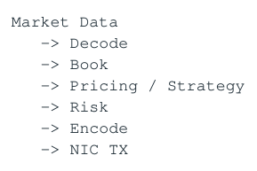

- ` Market Data `
- ` → Decode `
- ` → Book `
- ` → Pricing / Strategy `
- ` → Risk `
- ` → Encode `
- ` → NIC TX `

</details>

只有真正决定 order 发出的步骤属于关键路径。Logging、metrics formatting、DB persistence、GUI、reconciliation、 large snapshot 等通常应尽量移出 fast path。

| Fast Path | Slow / Control Path |
| --- | --- |
| common、latency-sensitive | rare / operational / recovery |
| bounded、preallocated | 可以有 allocation / locks / DB |
| owner-local、cache-friendly | 强调可维护、可恢复 |
| minimal syscall/synchronization | 可使用 Asio/thread pool/background work |

Fast/slow split 的本质不是“slow path 可以随便慢”，而是不要让 rare/unpredictable work 成为 steady-state E2E latency 的依赖。

### 1.7 Latency Budget 与 Safety Margin

如果目标是 HW RX → HW TX p99.9 &lt; 100us，可以先做 architecture budget，例如 ingress 8us、decode/book 10us、 strategy 20us、risk 5us、gateway 8us、egress 10us、handoff 15us、margin 20us。预算只是设计工具，最终 percentile 必须直接测 E2E。

<a id="pdf-page-010"></a>

<!-- source-pdf-page: 10 -->

*[原 PDF 第 10 页](./Topic_Low_Latency_System_Design_CN.pdf#page=10)*

重要统计边界 不能把各 component 的 p99.9 直接相加得到 E2E p99.9。不同 stage 的 outlier 可能相关或不相关； E2E percentile 需要端到端直接测，component metrics 只用于定位。

### 1.8 Queueing、Little's Law 与 Headroom

定义 arrival rate lambda、service rate mu。lambda &gt; mu 时 queue 必然增长；lambda &lt; mu 也不能保证低 latency， 因为 microburst 与 service-time variance 会造成短期 backlog。

```text
Little's Law:
    L = lambda * W
Therefore:
    W = L / lambda
Queue depth is stored work, therefore stored latency.
```

例如 1M events/s 时平均系统里有 100 个未完成事件，平均 residence time 的量级就是 100us。Queue 不创造 capacity，只能暂时吸收 burst。

Headroom 的更好理解是“恢复能力”：consumer 短暂停顿后，只有当 normal arrival 明显小于 sustainable service rate，才有 spare capacity 把 latency debt 快速还掉。

### 1.9 SLA 驱动 Architecture

在选 thread model 前至少明确：measurement boundary、percentile、steady/peak/burst throughput、 symbols/venues/clients 数量、message semantics、reliability/drop/coalesce/durability/recovery 要求。Market data latest-state 与 order/fill event 的可靠性不能混为一谈。

### 1.10 面试回答模板

回答 “I would first define the end-to-end latency boundary, percentile target, steady-state and burst throughput. Then I would identify the critical path and assign a latency budget. On the hot path, my main goal is not only minimizing average CPU work, but eliminating unpredictable waiting and unbounded work - queues, blocking, allocation, contention and scheduler dependencies.”

本章结论 • Latency = Work + Waiting；低延迟系统必须同时优化 useful work 和等待。

- Queue depth 是 stored latency；queue 只吸收短 burst，不创造 capacity。

- 平均 throughput 不能描述 microburst；低延迟需要 capacity headroom。

- Determinism 的重点是 bounded work、bounded WIP 与少外部依赖，而不是每次完全相同。

- Architecture 应从 SLA → critical path → latency budget → capacity 出发，而不是从某个技术 buzzword 出发。

<a id="pdf-page-011"></a>

<!-- source-pdf-page: 11 -->

*[原 PDF 第 11 页](./Topic_Low_Latency_System_Design_CN.pdf#page=11)*

## 第 2 章 Ownership 与 Thread Model：先决定谁写 State，再决定线程

本章目标 不要从“需要几个线程”开始，而要从 mutable state 的 ownership、data dependency、communication cost 与 capacity 开始。跨线程消息意味着 ownership/cache transfer，不是一条免费 function call。

### 2.1 Do Not Start With Threads - Start With Ownership

一个 hot mutable object 最理想的状态是有且只有一个 writer/owner。Owner 内部字段可以是普通 non-atomic memory；只有在 publish/ownership-transfer boundary 才需要 synchronization。这个原则比“把 mutex 换成 lock-free”更高一层，因为它从架构上消除了争用。

**图示转写**

| 输入 | 执行归属 | 动作 |
| --- | --- | --- |
| External events | Single Owner Core | 在 owner 上执行 state transitions |

<details>
<summary>查看原图与完整文字转写</summary>

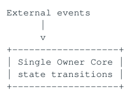

- ` External events `
- ` Single Owner Core `
- ` state transitions `

</details>

### 2.2 Single-Thread Event Loop

最短路径往往是一个 pinned owner core 直接 run-to-completion：RX → Decode → Book → Pricing → Risk → Encode → TX。优势是没有 application queue、没有 cross-core handoff、没有锁，且 state transition 天然按事件序列确定。

限制同样明确：单核 capacity ceiling，以及某个 handler 过长时的 head-of-line blocking。因此单线程不是信仰，而是“只要一核能满足 peak/burst capacity，就不要为没有的 throughput 问题引入 concurrency”。

### 2.3 Single Writer 也是 State Consistency Model

例如 Order、Position、Gateway Session 由 owner serially apply event。这样不仅省掉 atomic/mutex，也让 replay、 snapshot、invariant reasoning 更简单。多线程安全容器只能保证访问合法，并不能给出业务级 transition order。

### 2.4 Horizontal Sharding

当一个 core 不够时，优先问“能不能 shard state”，而不是“能不能四个线程一起 mutate 同一个 state”。常见 key 有 symbol、client、session、strategy。

**图示转写**

| 场景 / 部分 | 路径、状态或说明 |
| --- | --- |
| Router | ` Shard 0 Shard 1 Shard 2 `；` Core 2 Core 3 Core 4 ` |
| Each shard | ` Decode + Book + Strategy + Local Risk `；` one mutable-state owner ` |

<details>
<summary>查看原图与完整文字转写</summary>

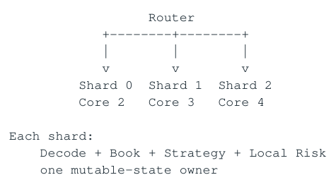

- ` Router `
- ` Shard 0 Shard 1 Shard 2 `
- ` Core 2 Core 3 Core 4 `
- ` Each shard: `
- ` Decode + Book + Strategy + Local Risk `
- ` one mutable-state owner `

</details>

Shard key 应与 dependency graph 对齐，而不只是 hash 均匀。跨 instrument strategy（例如两个 legs 推导 synthetic）会形成 cross-shard dependency；这时可能复制 read-mostly state、改变 shard key，或接受明确 message boundary。

<a id="pdf-page-012"></a>

<!-- source-pdf-page: 12 -->

*[原 PDF 第 12 页](./Topic_Low_Latency_System_Design_CN.pdf#page=12)*

### 2.5 Vertical Pipeline vs Horizontal Partition

| 模型 | 优点 | 代价 / 风险 |
| --- | --- | --- |
| Thread-per-stage | 阶段可 overlap，重 stage 可独立扩容 | 单事件仍串行；每 stage 增加 queue、handoff、cache transfer |
| Horizontal shard | 一个事件尽量在同 core；locality 强 | 需要合适 partition key；hot shard 与跨shard dependency |
| Hybrid | 网络/session 用 vertical boundary，业务 state 用 horizontal shard | 设计复杂，但常是现实最优 |

例如 2+2+4+1+1us 五阶段，单线程单事件约 10us；理想 pipeline 的 throughput 可由 4us bottleneck 决定，但每个 event 的 E2E 反而增加 queue/handoff。Pipeline 主要是 capacity technique，不是免费的 latency technique。

### 2.6 Lock-Free != Contention-Free

MPMC/MPSC 即使 lock-free，也可能多个 producer 在 tail/fetch_add/CAS 上竞争同一 cache line。Lock-free 描述 progress semantics，不等于 low latency。高 contention 下可以出现 cache-line bouncing、CAS retry 和 livelock-like useful-work collapse。

### 2.7 SPSC 为什么特别适合 Low Latency

SPSC 的主要优势来自 topology：一个 producer 拥有 write side，一个 consumer 拥有 read side，不需要多个 producer 协调 next slot。Producer/consumer indices 分离 cache line，并缓存对方进度，就可以把 coherence traffic 降到很低。

**图示转写**

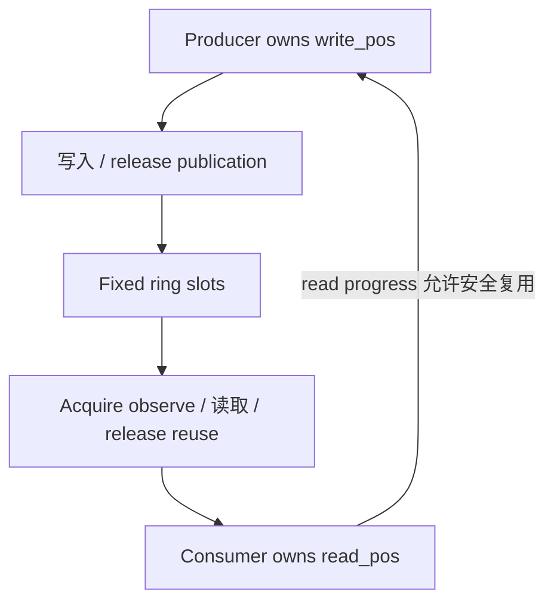

<details>
<summary>查看原图与完整文字转写</summary>

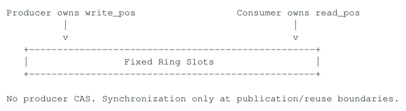

- ` Producer owns write_pos Consumer owns read_pos `
- ` Fixed Ring Slots `
- ` No producer CAS. Synchronization only at publication/reuse boundaries. `

</details>

如果 producer 数量固定，常可以用多个 per-producer SPSC 替代一个 MPSC；consumer 付出多 queue polling/fairness 成本，但 producer 之间不争一个 global tail。

### 2.8 Polling、Busy Spin 与 Blocking

Blocking 省 CPU，但引入 kernel/scheduler wakeup variance；busy spin 让 consumer 始终 awake，用 CPU/power 换更小 wakeup latency。Adaptive idle（spin→pause→yield→sleep）适合 latency 要求没那么严格的路径。

100% CPU 的含义 一个 pinned polling thread 100% CPU 不等于 overload。是否 overload 要看 queue、useful throughput、latency 与 progress；busy-spin 本身可能是正常设计。

### 2.9 CPU Affinity、Isolation 与 SMT

Affinity 避免 migration 造成 cache/TLB coldness，但不等于 isolation：IRQ、kernel thread、RCU work 仍可能打断 hot core。严格路径常把 hot thread 放在独立 physical core，并避免在同一 SMT sibling 上运行高负载线程，因为 frontend、execution resources、cache/TLB 仍共享。

### 2.10 NUMA Ownership Alignment

理想状态是 Business ownership、Thread ownership、Cache ownership 与 NUMA ownership 对齐。NIC、owner core、 owner-local memory 尽量在同一 NUMA node；否则每次 event 可能经过 remote memory/interconnect。

**图示转写**

1. ` NIC on NUMA 0 `
2. ` Core on NUMA 0 `

<details>
<summary>查看原图与完整文字转写</summary>

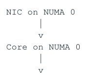

- ` NIC on NUMA 0 `
- ` Core on NUMA 0 `

</details>

<a id="pdf-page-013"></a>

<!-- source-pdf-page: 13 -->

*[原 PDF 第 13 页](./Topic_Low_Latency_System_Design_CN.pdf#page=13)*

```text
Hot shard memory on NUMA 0
```

### 2.11 Immutable Shared State 与 Replication

“Share immutable state; partition mutable state.” Reference/config metadata 可以通过 immutable snapshot 共享；频繁写的 mutable state 更适合 single owner。为了 locality，可以把 tick scale、route code、venue health 等 read-mostly state 复制到每 shard，本质是用 memory/consistency update complexity 换少一次 cross-core read。

### 2.12 Global State 与 Hierarchical Budget

每 order 都更新一个 global atomic exposure counter 会形成 hot cache line。更好的系统可能预分配 per-shard budget，局部 fast check，后台/低频汇总与 rebalance。只有真正需要 hard global invariant 的部分才支付 global coordination。

### 2.13 Logical Shard 与 Physical Core

可以定义 1024 logical shards 映射到 8 physical owner cores。这样保持 single ownership，同时为以后 hot-shard remap 提供粒度。Static mapping locality 好但可能 imbalance；dynamic migration load balance 好但带 ownership transfer/cache cold/recovery complexity。

### 2.14 Thread Model 设计流程

- 画出 critical path 和主要 mutable state。

- 为每个 hot state 指定唯一 owner。

- 识别真正 independent 的 events/tasks；不要把依赖链强行多线程化。

- 优先 horizontal sharding；只有 genuine CPU-heavy stage 或 network/session ownership 才引入 vertical boundary。

- 跨 owner 用最简单的 bounded message passing，拓扑允许时优先 SPSC。

- 将 CPU、NUMA、NIC 与 owner 对齐，并用 peak/burst load 验证。

设计审查指标 统计“一条 event 跨多少次 core”，以及“多少 hot mutable cache lines 被多个 cores 写”。对于严格 hot path，这两个数字都应尽量接近 0。

### 2.15 面试回答模板

回答 “I start from state ownership rather than thread count. I prefer a single writer for hot mutable state; if one core meets peak capacity I keep dependent stages on that core. When I need more capacity, I partition state horizontally and parallelize independent shards. I use queues only at real ownership boundaries, SPSC where the topology allows it, and introduce thread-per-stage or worker pools only for genuine capacity or isolation reasons.”

本章结论 • Ownership 是 concurrency architecture 的第一原则；thread-safe 不等于 low-latency。

- 单线程 event loop 同时提供 locality、serialization 与 deterministic state transitions。

- 扩容优先 shard 独立 state，而不是多个线程写同一 state。

- SPSC 的优势来自简单 ownership topology，不只是“lock-free”。

- CPU/SMT/NUMA/NIC placement 是 thread model 的组成部分。

<a id="pdf-page-014"></a>

<!-- source-pdf-page: 14 -->

*[原 PDF 第 14 页](./Topic_Low_Latency_System_Design_CN.pdf#page=14)*

## 第 3 章 Data Model 与 Memory Architecture：把Ownership 变成 Cache Locality

本章目标 Session 2 决定谁拥有 state；本章决定 owner 的 state 怎样表示，使 CPU 触碰尽量少、尽量连续、尽量可预测的 cache lines 与 TLB pages。Hot-path data model 首先是 memory-access graph，而不是 OO/domain purity。

### 3.1 从 Memory Access Graph 看 Hot Path

**图示转写**

1. ` Event `
2. ` → compact ID `
3. ` → owner/shard `
4. ` → owner-local hot state `
5. ` → bounded decision `

<details>
<summary>查看原图与完整文字转写</summary>

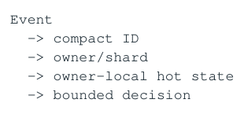

- ` Event `
- ` → compact ID `
- ` → owner/shard `
- ` → owner-local hot state `
- ` → bounded decision `

</details>

每个 pointer、hash lookup、cache miss、TLB miss、allocation 都是额外 dependency。目标不是“永远 L1 hit”，而是缩短 serial dependent memory chain、减小 working set、增加连续/独立访问，让 OoO/MLP 有机会隐藏 latency。

### 3.2 Hot / Cold State Split

不要为了业务对象完整性把所有字段塞进一个巨大 Order。每个事件频繁触碰的字段应紧凑；long symbol string、audit metadata、DB key、debug text 等 cold fields 放 side table。

| Hot fields | Cold fields |
| --- | --- |
| state / qty / leaves / price / side | long strings / descriptions |
| compact client/symbol/venue IDs | DB keys / audit text |
| route/risk/version | rare protocol metadata |

对象越大，同一 cache line/page 能容纳的 active records 越少，working set 越快从 L1/L2 漂到 LLC/DRAM。

### 3.3 Working Set：Total Dataset != Hot Dataset

“所有数据都能放进 L3”并不意味着飞快。L3 hit 仍比 L1/L2 慢，而且 pointer chain 的下一地址必须等待前一 load 返回。真正关心的是某个时间窗口内 owner 实际触碰的 hot working set，以及这些访问是否 independent。

### 3.4 AoS vs SoA

| 布局 | 适合 | 风险 |
| --- | --- | --- |
| AoS: array | 一次处理一个对象且会读取大部分 fields | 做 column scan/SIMD 时加载无关 fields |
| SoA: qty[], px[], state[] | 跨大量对象只读少数字段、vectorize/aggr egate | 单对象逻辑可能要触碰多个 arrays |
| Hybrid / blocked layout | 既需要单对象局部性又需要批量处理 | 实现更复杂 |

没有“低延迟一定 SoA”的规则。Layout 必须由 access pattern 驱动。

### 3.5 Compact IDs、Dense Storage 与 Direct Indexing

外部 string symbol/client/venue 在 ingress/control plane 解析成 compact integer ID。Hot path 用 array indexing：instrument[id]、client[id]、venue_state[id]。对于 bounded domain，这是比 hash/tree 更强的 locality 和 predictability。

```text
External:  "EURUSD" -> SymbolId 37
Hot path:  instruments[37]

Precompute at startup:
  tick_scale, multiplier, risk_profile, route_mask, owner_core
```

<a id="pdf-page-015"></a>

<!-- source-pdf-page: 15 -->

*[原 PDF 第 15 页](./Topic_Low_Latency_System_Design_CN.pdf#page=15)*

### 3.6 Normalization 与 Denormalization 不冲突

Market-data normalization 是把 venue-specific ITCH/SBE/FIX 等转换成 canonical internal schema/IDs；memory denormalization 是把常用 derived/reference fields 复制进 hot state，减少 pointer traversal。系统完全可以“入口 normalize，hot state denormalize”。

例子 VenueConfig → Instrument → TickScale 如果 hot path 每次走三层 pointer，可以在 startup 把 tickScale、 multiplier、routeCode 直接复制进 InstrumentHot。代价是 config 更新时需要 version/invalidation。

### 3.7 Pointer Chasing 与 Serial Dependency

```text
p = p->next;
p = p->next;
p = p->next;

Address of load N+1 depends on result of load N.
Even if every node hits L1, the chain exposes load-to-use latency.
```

Intrusive list 可以消除额外 node allocation，却不会消除 pointer dependency。CPU 的 OoO 只能重叠 independent misses，不能提前知道下一次 dependent load 的地址。

### 3.8 Index-Based Packed Storage

把 64-bit pointer 换成 32-bit index，并把 records 放在 packed array：next_index 指向 levels[next]。收益是更高 density、少 page、可能更好 prefetch/address calculation、stable handle；但 serial traversal 的 dependency chain 仍然存在，所以不是魔法。

### 3.9 Order Book / L3 Data Structure Trade-off

| 结构 | 优势 | 代价 / 适用条件 |
| --- | --- | --- |
| Dense price array | price→index O(1)、excellent locality | tick domain 必须 bounded/dense |
| Sorted vector | small-N 连续、binary/linear scan cache-friendly | insert/move O(N) |
| Flat/open-address hash | sparse price lookup、连续 buckets | probe length/load factor；必须 reserve，避免 rehash |
| Intrusive list | stable order queue、无额外 list-node allocation | pointer chasing；节点布局决定 locality |
| Packed index list | stable logical links + compact storage | 仍有 dependent traversal；slot lifecycle复杂 |

vector 连续、locality 好，但 relocation 会破坏外部地址；若固定 max capacity，可 reserve/array 并避免 move。 vector 保留对象地址稳定，但增加一层 indirection 和 scattered allocation。选择取决于 address stability、 level count、insert/delete 与 traversal pattern。

### 3.10 Flat Hash Map 不是“平均 O(1) 就完事”

Open addressing 通常比 node-based unordered_map 更 cache-friendly，但 probe length 受 load factor/clustering 影响；rehash 在 hot path 是 unbounded memory work。严格路径应预估 max capacity、reserve、 限制 load factor，并定义“超容量怎么办”。如果 key domain 本来就是 compact dense ID，array indexing 仍更直接。

### 3.11 Small-N Principle

Asymptotic complexity 不是全部。10-30 个元素的 contiguous linear scan 可能比 pointer tree/hash 更快，因为少 indirection、少 branch、少 cache miss。要从真实 N 和 access pattern 测 cycles/operation。

<a id="pdf-page-016"></a>

<!-- source-pdf-page: 16 -->

*[原 PDF 第 16 页](./Topic_Low_Latency_System_Design_CN.pdf#page=16)*

### 3.12 Object Pool、Arena 与 Preallocation

Pool 的目的不是“malloc 永远慢”，而是把 allocator arena refill、locks、mmap/page fault 等 variable dependencies 从 steady-state 搬到 startup，并提供 stable address/bounded capacity。Per-owner fixed-size pool 还能避免 allocator contention。

预分配后最好 pre-touch hot pages，确保 first-touch/page commitment 不在第一笔交易发生。Huge pages 可能降低 TLB pressure，但是否值得取决于 footprint、fragmentation、NUMA placement 与实际 counters。

### 3.13 Stable Handle 与 Generation Counter

Pool slot 重用会产生 stale handle / ABA-like logical bug。Handle = {index, generation}，读取时校验 slot generation，可以避免旧 reference 意外命中新对象。

### 3.14 False Sharing 与 Cache-Line Ownership

Per-core counters 即使逻辑独立，只要落在同一 64B cache line，两个 core 高频写仍会 invalidate/bounce。把 producer/consumer indices、per-thread counters、hot writable fields 分离 cache line。alignas(64) 是针对明确 ownership pattern 的工具，不是所有 struct 盲目 padding。

### 3.15 Immutable / Versioned State

Read-mostly config/reference state 很适合 off-thread 构建新 snapshot，然后 atomic pointer/version publish。 Readers 不需要锁；旧 snapshot 在 reader 生命周期结束后再 reclaim。RCU-like/epoch 模型用 memory 与 reclamation complexity 换极低 read-side coordination。

### 3.16 Double Buffer

```text
Buffer A = currently published
Buffer B = writer builds next snapshot

Writer completes B
    -> publish index/pointer to B
Readers consume B
A becomes inactive for next update
```

适合 snapshot 大小可控、copy/build bounded 的 state。Publication 要有正确 memory ordering，reader lifetime 必须保证 buffer 不会在仍读取时被覆盖。

### 3.17 Seqlock：概念正确不等于 C++ 写法合法

Seqlock 概念上是 writer 把 seq 置 odd、写 payload、再置 even；reader 读 seq → payload → seq，若 seq 变化或 odd 就 retry。它非常适合某些系统级 read-mostly snapshot，但有两个必须牢记的边界。

```text
Conceptual reader:
  s1 = seq.load(acquire)
  if (s1 is odd) retry
  read payload
  s2 = seq.load(acquire)
  if (s1 != s2) retry
```

C++ Data Race 警告 如果 payload 是普通 non-atomic C++ 对象，并且 writer 与 reader 并发读写，naive seqlock 在 C++ abstract machine 中仍然是 data race / undefined behavior。外层 acquire/release sequence counter 不会自动合法化 racing non-atomic payload。即使你看 x86 assembly “硬件上能工作”，编译器语义仍可能不允许。需要 atomic payload、形式上合法的 representation，或经过严格验证的 implementation-specific technique。

另外 seqlock reader 可能在高 write rate 下不断 retry，因此单 reader latency 不 bounded；如果 SLA 强调 p99.9 deterministic，必须把 retry probability 纳入设计。

### 3.18 Publication Boundary 才需要 Atomics

Session 2 的最大收益之一是：owner 内部普通 state 不需要每个 field 都 atomic。只在 ownership transfer / snapshot publication boundary 使用 acquire/release 等 synchronization。这样 correctness 语义清晰，coherence traffic 也更小。

<a id="pdf-page-017"></a>

<!-- source-pdf-page: 17 -->

*[原 PDF 第 17 页](./Topic_Low_Latency_System_Design_CN.pdf#page=17)*

### 3.19 Prefetch、MLP 与 TLB

Hardware prefetch 喜欢 linear/regular stride，不擅长 pointer chain。Software prefetch 只有在未来地址足够早可知、prefetch→use 之间有足够 independent work 时才可能有价值；否则只是额外 instruction/cache pollution。 Dense compact state 同时减少 pages 与 TLB pressure。

### 3.20 Memory Capacity Policy

在 strict hot path 中，max instruments/orders/subscriptions/levels 应有显式 capacity plan。超过 max 时优先 source-side prevention/admission control；若确实发生，应该 reject/slow-path/fail-safe，而不是 surprise heap growth。

### 3.21 设计审查清单

- 每个事件实际触碰哪些 fields、多少 cache lines、多少 pages？

- 访问是否 serial dependent？能否变成 direct index/contiguous access？

- 哪些 cache lines 被多个 cores 写？

- hot path 是否存在 allocation、rehash、page fault、address relocation？

- ID 是否可在 ingress 转成 compact integer？

- read-mostly state 如何 publish/reclaim？

- capacity 超限时是什么明确业务行为？

面试回答 “I design the hot-path data model from access patterns rather than domain-object purity. I separate hot and cold state, resolve external identifiers to compact IDs, keep owner-local mutable data dense and preallocated, avoid pointer-heavy graphs and hot-path rehash/allocation, and denormalize frequently-read derived fields where the consistency cost is manageable. For shared read-mostly state, I prefer immutable/versioned snapshots and keep synchronization at publication boundaries.”

本章结论 • Hot-path data model 是 memory-access graph；总 dataset 大小不如 hot working set 与 dependency 重要。

- Compact ID + dense owner-local storage 是最强的 predictable lookup 之一。

- Pointer chasing 即使 L1 hit 也可能 latency-bound；packed index 改善 density，但不能消除 true dependency。

- Pool/Preallocation 主要为了 bounded capacity、stable lifetime 与移除 variable allocator/page work。

- Seqlock 在 C++ 中必须同时满足 language memory model correctness 与 bounded-retry要求。

<a id="pdf-page-018"></a>

<!-- source-pdf-page: 18 -->

*[原 PDF 第 18 页](./Topic_Low_Latency_System_Design_CN.pdf#page=18)*

## 第 4 章 Messaging、Queues、Backpressure 与 Flow Control

本章目标 当两个 ownership domains 之间必须传数据时，queue 同时是 data transport、ownership-transfer protocol、 synchronization boundary、burst buffer 与 latency storage。真正困难的问题不是“怎么 push/pop”，而是 producer 比 consumer 快时怎样保持系统 bounded。

### 4.1 Queue 首先是 Ownership Transfer Protocol

Producer 在 publish 前拥有 slot/message；publish 后 consumer 才能读完整 payload。Consumer consume/release 后 slot ownership 再回到 producer。正确 queue 同时定义 ownership、ordering 与 visibility。

### 4.2 Release / Acquire Publication

逻辑要求是 payload stores 先于 publish 可见；consumer 看到 published sequence 后必须同时看到 payload 初始化完成。因此常见 publication 用 store-release，consumer 观察 publication 用 load-acquire。x86 上 acquire/release 往往映射为普通 load/store，但 C++ source semantics 仍必须写对，不能因为硬件 strong 就制造 language-level data race。

### 4.3 SPSC Ring 的基本结构

**图示转写**

| 场景 / 部分 | 路径、状态或说明 |
| --- | --- |
| capacity = power of two | ` slot = seq & (capacity - 1) ` |
| Producer owns write_seq | ` Consumer owns read_seq ` |
| Producer | ` check cached read progress `；` write payload `；` publish write_seq (release) ` |
| Consumer | ` observe write_seq (acquire) `；` read payload `；` publish read_seq ` |

<details>
<summary>查看原图与完整文字转写</summary>

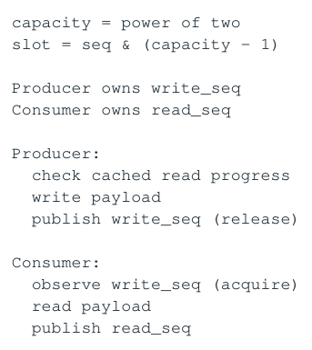

- ` capacity = power of two `
- ` slot = seq & (capacity - 1) `
- ` Producer owns write_seq `
- ` Consumer owns read_seq `
- ` Producer: `
- ` check cached read progress `
- ` write payload `
- ` publish write_seq (release) `
- ` Consumer: `
- ` observe write_seq (acquire) `
- ` read payload `
- ` publish read_seq `

</details>

producer/consumer progress counters 应避免落在同 cache line。双方可缓存对方 sequence，只在接近 full/empty 时 refresh，允许 conservative stale knowledge 来减少 shared-line read。

### 4.4 Queue Primitive 很快 != System Latency 很低

要区分三个数字：push/pop operation cost、message queueing latency、整个 E2E latency。一个 20ns push 的 ring 完全可能积累 2ms backlog。Microbenchmark “50M ops/s”不能证明 production p99.9。

### 4.5 Copy vs Pointer

几十 bytes fixed message 直接 copy 进 ring 常常非常好：lifetime 清楚、连续 memory、consumer 本地读。传 pointer 虽然看似 zero-copy，却引入 object lifetime、pool ownership、remote NUMA access、extra dependent load，甚至 shared_ptr reference count。Large buffers 才更常用 buffer-handle ownership transfer。

### 4.6 Queue = Stored Latency

如果 consumer 每条需要 2us，depth=100 就代表至少约 200us service debt。Queue capacity 应转换成“可以欠多少时间”，而不是只看 slot 数。

```text
Temporary burst sizing:
  Q_burst >= (lambda_peak - mu) * T_burst

Drain time after burst:
  T_drain ~= Q / (mu - lambda_normal)
```

<a id="pdf-page-019"></a>

<!-- source-pdf-page: 19 -->

*[原 PDF 第 19 页](./Topic_Low_Latency_System_Design_CN.pdf#page=19)*

如果 sustained lambda &gt; mu，无论 queue 是 1K、1M 还是 1B，最终都会满；更大的 queue 只是把 capacity deficit 隐藏得更久。

### 4.7 Bounded Queue 与 Operational Watermark

Bounded queue 给出 memory/WIP 上界，并强迫业务定义 overflow。物理 capacity 4096 不代表允许正常积累 4096；如果 SLA 对应 depth=64 就已经危险，可以在 64 进入 RED，把剩余 slot 当 emergency margin。

### 4.8 Event vs State 决定 Overflow Semantics

| 语义 | 例子 | 典型处理 |
| --- | --- | --- |
| Ordered event | New/Cancel/Fill、raw incremental MD | 一般不能 silent drop；需 reject before accept 或 gap/recovery |
| Latest state | BBO、GUI/metrics snapshot、derived quote | 可 overwrite/coalesce/skip old |
| Admission work | 未接受的新请求 | capacity 不足时可以明确 reject |

同样叫 market data，raw exchange delta 用于 book reconstruction 时是必须保序的 event stream；Book → Pricing 如果只关心 latest valid BBO，则可以转换成 state semantics。

### 4.9 Coalescing / Dirty-Set Pattern

**图示转写**

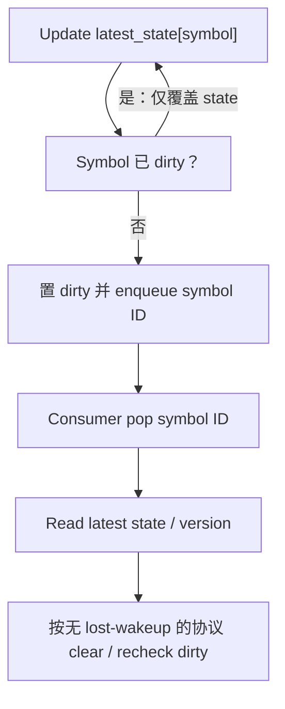

<details>
<summary>查看原图与完整文字转写</summary>

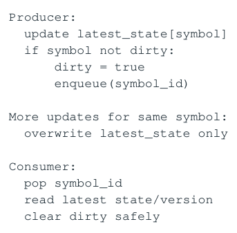

- ` Producer: `
- ` update latest_state[symbol] `
- ` if symbol not dirty: `
- ` dirty = true `
- ` enqueue(symbol_id) `
- ` More updates for same symbol: `
- ` overwrite latest_state only `
- ` Consumer: `
- ` pop symbol_id `
- ` read latest state/version `
- ` clear dirty safely `

</details>

它把“每个 event 都做 downstream work”变成“每个 dirty state 做一次 work”，可以让 100 次同 symbol burst 只触发一次 pricing。实现时最好使用 version/sequence 而不是脆弱的单 bool，以避免 clear/set race 丢 notification。

### 4.10 Overflow 策略没有统一答案

| 策略 | 适用场景 | 注意 |
| --- | --- | --- |
| Block / spin | 短 hiccup 且消息绝不能丢 | Producer latency 依赖 consumer progress，仍可能 unbounded |
| Drop oldest | 快速衰减的 state | 不适合有 causal history 的 event |
| Drop newest / reject | 新 admission | 在承诺前 reject 比 accepted 后丢安全 |
| Overwrite / coalesce | latest-state | 必须保证 consumer 不需要 intermediate transitions |
| Throttle / token bucket | 已知 downstream/venue rate | 控制长期 rate，允许短 burst |
| Fail-safe / disconnect | correctness 已无法保证 | 需要明确 state machine 与 ops semantics |

### 4.11 Backpressure：压力必须有去处

如果 consumer 跟不上，excess work 只能进入 queue/memory/disk、被 drop/reject，或让 upstream 减速；压力不会凭空消失。Passive backpressure 可以是 try_push 返回 Full；active backpressure 则在 queue age/depth 超 watermark 时提前 coalesce/throttle/reject。

> **转换补充**：coalescing 示例里的 “clear dirty safely” 是关键协议，不是普通 store 的替代说法。必须证明更新与清位竞争时不会丢唤醒，并证明 latest state 的一致读取与生命周期；图只表达业务流程。

<a id="pdf-page-020"></a>

<!-- source-pdf-page: 20 -->

*[原 PDF 第 20 页](./Topic_Low_Latency_System_Design_CN.pdf#page=20)*

不要等 physical full 才反应，因为那时 latency 可能早已超 SLA。比 full/not-full 更好的指标是 depth、oldest age 与 estimated drain time。

### 4.12 Watermark 与 Hysteresis

**图示转写**

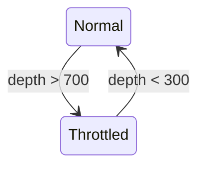

使用不同的 enter / exit 阈值形成 hysteresis，避免状态振荡。

<details>
<summary>查看原图与完整文字转写</summary>

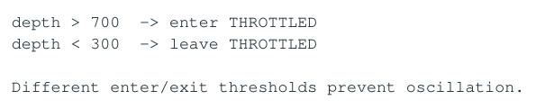

- ` depth > 700 → enter THROTTLED `
- ` depth < 300 → leave THROTTLED `
- ` Different enter/exit thresholds prevent oscillation. `

</details>

Flow control 本质是 control system；反应太慢会爆 queue，太激进会 throttle/unthrottle 抖动。Hysteresis、 smooth token-bucket rate 与 state machine 都用于形成稳定 feedback。

### 4.13 Token Bucket 与 Leading-Edge + Trailing-Latest

Token bucket 用 refill rate R 控制长期速率，用 capacity B 允许短 burst。Quote throttle 可以采用 leading-edge：第一条变化立即发；窗口内只保存 latest；窗口结束再发 trailing latest，从而同时保 first reaction latency 与 burst compression。

### 4.14 Multiple SPSC、Fairness 与 Bounded Poll

Gateway 可能消费多个 strategy SPSC。不能一直 drain Q0 until empty，否则 hot producer 可以 starvation 其他 queue/timers。常见做法是每 queue 最多处理 K 条再 rotation。Batch “处理已经存在的多条”与“主动等待 batch fill”要区分：前者通常更 latency-friendly。

### 4.15 Slow Consumer 与 Broadcast

Lossless multi-subscriber ring 若 slot 必须等所有 consumers 读完才复用，slowest consumer 会决定 retention， 甚至拖住 publisher。Trading subscriber、GUI、metrics 等应根据语义分 stream：核心 consumer 可 lossless， GUI/monitor 可以 latest-state/skip。

### 4.16 Durable Queue != Low-Latency Handoff Queue

SPSC/shared-memory ring 主要解决 transient ownership transfer；broker/journal/log 更强调 durability/replay。 不能把 ring 当 source-of-truth，也不能因为 durable broker 易用就把每个 5us hot handoff 都强制走远程持久化。 Fast delivery 与 recovery source 可以分路径。

### 4.17 Ordering Strength

SPSC 天然保 producer FIFO；MPSC 的 global order 要显式定义。如果业务只需要 per-session/per-owner order，就不要为了 debug 方便每条 event global fetch_add sequence，制造 atomic hotspot。系统 ordering 和 memory ordering 一样：更强的全序通常更贵。

### 4.18 Queue Sizing 与 Test

- 根据 peak-minus-service rate × burst duration 估 burst backlog。

- 再加入 consumer stall、jitter 与 emergency margin。

- 同时用 latency SLA 推导 operational max depth；物理 capacity 可以更大。

- 测试 burst from empty、near capacity、consumer stall 10/100us、producer 10x burst、recovery/drain time。

- 监控 current/max/p99 depth、oldest age、push failure/drop/reject、time above watermark。

### 4.19 面试回答模板

Producer 比 Consumer 快怎么办？ “First I distinguish a short burst from a sustained capacity deficit. A bounded queue can absorb a burst, but it cannot solve sustained lambda &gt; mu. For sustained overload I must reduce incoming work through throttling/admission/semantic coalescing, increase consumer capacity, or explicitly shed/reject work according to the business semantics. I size the operational watermark from latency, not only physical memory.”

<a id="pdf-page-021"></a>

<!-- source-pdf-page: 21 -->

*[原 PDF 第 21 页](./Topic_Low_Latency_System_Design_CN.pdf#page=21)*

本章结论 • Queue 是 ownership + ordering + visibility 的协议，也是 stored latency。

- SPSC 简单是因为 topology 简单；small message copy 往往优于复杂 shared pointer lifetime。

- Bounded queue 迫使 overload semantics 显式；更大的 queue 不等于更低风险。

- Event 与 latest-state 的不同语义决定 drop/coalesce/recovery 策略。

- 好的 backpressure 在 RED 前就降低 lambda；坏的系统让 backlog、retry、logging 一起增长。

<a id="pdf-page-022"></a>

<!-- source-pdf-page: 22 -->

*[原 PDF 第 22 页](./Topic_Low_Latency_System_Design_CN.pdf#page=22)*

## 第 5 章 Network → Application：从 Wire 到 Wire 的真实 Critical Path

本章目标 把前四章放回真实 NIC 路径：一条 packet 从 wire 进入，到 order 真正离开 NIC，中间经过哪些 RX/TX ring、 DMA、interrupt/poll、kernel/socket、copy、cross-core queue 与 timestamp boundary。App-in→app-out 不是完整系统 latency。

### 5.1 完整 E2E Path

**图示转写**

1. ` Exchange `
2. ` → Wire `
3. ` → NIC RX queue / descriptor `
4. ` → DMA to host memory `
5. ` → Kernel / accelerated / userspace path `
6. ` → Application RX poll `
7. ` → Decode / Book / Strategy / Risk `
8. ` → Encode / App TX `
9. ` → Kernel / bypass / TX descriptors `
10. ` → NIC TX queue `
11. ` → Wire `
12. ` → Exchange `

<details>
<summary>查看原图与完整文字转写</summary>

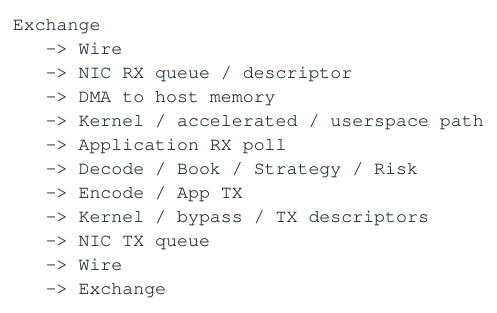

- ` Exchange `
- ` → Wire `
- ` → NIC RX queue / descriptor `
- ` → DMA to host memory `
- ` → Kernel / accelerated / userspace path `
- ` → Application RX poll `
- ` → Decode / Book / Strategy / Risk `
- ` → Encode / App TX `
- ` → Kernel / bypass / TX descriptors `
- ` → NIC TX queue `
- ` → Wire `
- ` → Exchange `

</details>

每一层都可能既有 work 又有 waiting。尤其 NIC ring、socket buffer、application queue、TX ring 全部都是 queue；如果只优化 parser，不知道 packet 在哪层等了 50us，E2E 仍然失败。

### 5.2 NIC RX Descriptor Ring 与 DMA

NIC 通常在 RX descriptor ring 中寻找 host buffers，通过 DMA 把 frame 写入内存并标记 descriptor complete。 DMA 避免 CPU 字节拷贝，但 DMA 完成不等于 application 立即处理；还需要 interrupt/polling、stack 与 scheduling。 RX ring 本身也是 WIP buffer，drain 不及时时会 fill/drop。

### 5.3 Interrupt vs Polling

| 模式 | 优势 | Tail 风险 |
| --- | --- | --- |
| Interrupt-driven | CPU efficient | interrupt entry/exit、scheduler/wakeup、coalescing jitter |
| Busy polling | 最小 wakeup dependency、predictable | 占 dedicated CPU/power，poll loop 自身必须 bounded |
| Hybrid/NAPI | 吞吐与 interrupt storm 折中 | 主要为 general networking；strict latency 仍需仔细配置 |

Hardware interrupt 不等于 user-process context switch，但它会抢占当前 core、执行 handler、污染 cache 并制造 tail。

### 5.4 Interrupt Moderation / Coalescing

NIC 为吞吐可能等多个 packets 再一次 interrupt，从而 amortize interrupt cost；第一条 packet 因等待 coalescing window 增加 latency。低延迟环境通常需要 benchmark 是否降低/关闭 moderation，而不是机械照抄配置。

### 5.5 RSS、Flow Steering 与 IRQ Affinity

RSS 按 flow tuple hash 选择 RX queue，让不同 flows 分散到 cores。理想 topology 是 flow→RXQ→owner core→owner state 对齐。一个 multicast flow 内包含所有 symbols 时，RSS 通常无法按 symbol shard，应用仍需要 minimal decode + dispatch。

如果还走 interrupt/NAPI path，要把 NIC queue IRQ 与 hot core placement 一起设计；只 taskset application 而让别的 NIC IRQ 打到同 core，tail 仍可能被 interrupt 破坏。

<a id="pdf-page-023"></a>

<!-- source-pdf-page: 23 -->

*[原 PDF 第 23 页](./Topic_Low_Latency_System_Design_CN.pdf#page=23)*

### 5.6 Kernel Socket Path 与 Bufferbloat

**图示转写**

1. ` NIC `
2. ` driver `
3. ` kernel stack `
4. ` socket RX buffer `
5. ` recv() `
6. ` app `
7. ` app `
8. ` send() `
9. ` socket TX buffer `
10. ` kernel `
11. ` driver `
12. ` NIC `

<details>
<summary>查看原图与完整文字转写</summary>

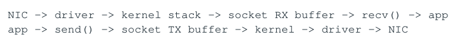

- ` NIC → driver → kernel stack → socket RX buffer → recv() → app `
- ` app → send() → socket TX buffer → kernel → driver → NIC `

</details>

Socket buffer 也是 queue。很大的 SO_RCVBUF 可以减少 drop，但当 app 跟不上时只是把更多 stale packet 留在 kernel。No drop 不等于 healthy；必须看 queue age/freshness。

### 5.7 System Call 与 Opportunistic Batching

recv/send 的 user/kernel transition、socket bookkeeping 是 per-call 固定成本。recvmmsg/sendmmsg 或 burst API 可以 amortize，但应区分“处理已经 available 的 batch”与“为了 batch 主动等待”。Latency-sensitive path 通常偏前者。

### 5.8 Kernel Bypass 的真正目标

Kernel bypass/acceleration 的目标不是一句“kernel 慢”，而是减少 generic network path 中的 syscall、 wakeup/scheduler、socket buffering、通用 metadata/copy。常见设计空间包括 socket-compatible acceleration（如 Onload 思路）、AF_XDP、DPDK/vendor userspace networking。

| 模式 | 典型优势 | 代价 |
| --- | --- | --- |
| 普通 sockets | 成熟、portable、运维简单 | 通用 stack/wakeup/queue 开销 |
| Socket acceleration / Onload-like | 保留 socket API，同时降低 data-path latency | vendor/runtime/ops 复杂度 |
| AF_XDP | Linux 集成 + userspace packet buffer | 仍需 driver/mode tuning |
| DPDK-style | 最大程度控制 RX/TX/mbuf/polling | 侵入性、CPU 占用、实现/运维复杂 |

是否值得由 latency budget 决定。如果 app 200us、network stack 5us，先优化 architecture；如果 total target 20us 而 stack 8us，network path 就是核心。

### 5.9 Zero-Copy 的边界

Zero-copy 不等于 zero-memory-cost。NIC DMA 写入的 line 仍需 CPU 读入 cache。Small packet/raw buffer 若被 business thread 持有很久，会占住 scarce RX buffers；快速 copy 32B compact event 后立刻归还 NIC buffer，可能比“零拷贝持有 128B buffer 50us”更好。目标是 minimal useful data movement + clear lifetime。

### 5.10 Protocol：FIX、SBE、ITCH、FIXP

| 协议/类型 | 特点 | 性能 / Recovery 关注 |
| --- | --- | --- |
| FIX | text/tag-value | delimiter scan、decimal parse；专用zero-allocation parser 仍可很快；session seq/recovery重要 |
| SBE | schema-driven binary | fixed offsets、低 parse cost、compact |
| ITCH-like | compact binary market feed | sequence/gap/snapshot/replay 是核心 |
| FIXP-like session | binary session/recoverability framework | ordering/recovery semantics 与encoding 同等重要 |

Hot parser 应尽量 single-pass、bounded、zero allocation，并只 materialize downstream 真正需要的 fields。外部 symbol/price 在这里 normalize 成 internal ID/fixed-point/ticks。

### 5.11 TCP vs UDP

TCP 提供 reliable ordered byte stream、flow/congestion control，但 packet loss 会造成 transport head-of-line blocking；UDP 不提供这些 guarantee，适合 multicast market data，但 gap/reorder/duplicate/recovery 都上移到 application。UDP 不是“天然快”、TCP 也不是“天然慢”，它们支付的复杂度位置不同。

<a id="pdf-page-024"></a>

<!-- source-pdf-page: 24 -->

*[原 PDF 第 24 页](./Topic_Low_Latency_System_Design_CN.pdf#page=24)*

### 5.12 Multicast A/B Feed 与 Gap Recovery

A/B redundant feeds 可以提供 path diversity 与 loss recovery：同 seq 两边都到时取先到者并 dedup；一边缺 packet 时另一边可能补上。若仍 gap，则 buffer future deltas、request replay；gap 太大或无法 catch up 时转 fresh snapshot。

### 5.13 RX Thread Architecture Trade-off

| 设计 | 优势 | 风险 |
| --- | --- | --- |
| Run-to-completion RX+Book+Strategy+TX | 最少 handoff、最佳 locality | business work过长会让 RX ring backlog |
| Dedicated RX + SPSC business | 持续 drain NIC、burst resilience | cross-core handoff + queue/cache transfer |
| RX dispatcher + shards | 单 feed 解析后按 symbol/client shard | dispatcher 本身可成 bottleneck |

选择依据是 peak burst 下单核是否仍能 bounded 地 poll RX，而不是“网络线程应该独立”这种固定规则。

### 5.14 TX Path 与 send() 语义

App send()/offer success 往往只表示 bytes 被 stack/queue 接受，不等于 NIC 已出线，更不等于 exchange 已接受 order。TX descriptor ring、socket send buffer、NIC scheduling 都可能继续积压。真正 wire-out 需要硬件 TX timestamp 或明确的 NIC completion/timestamp 语义。

### 5.15 Encode Directly Into Final Buffer

如果 API/NIC model 允许，可以 reserve TX-capable buffer，直接 encode protocol 到最终 buffer，再 publish descriptor，减少 business object→temp buffer→socket buffer 的重复 copy。Small header/payload 也可用 scatter-gather，但 descriptor/complexity 是否值得要 benchmark。

### 5.16 PTP、Hardware Timestamp 与 TSC

严格 wire-to-wire measurement 应尽量使用 NIC HW RX/TX timestamp，并知道 timestamp point。PTP 用于不同 devices/hosts 的 clock synchronization；单机 component timing 可用 low-overhead TSC，但必须理解 serialization、core/timebase 与 conversion。

```text
Example decomposition:
  HW_RX = 100
  APP_RX = 108
  APP_TX = 115
  HW_TX = 122

Ingress infrastructure = 8 us
App processing         = 7 us
Egress infrastructure = 7 us
Wire-to-wire           = 22 us
```

### 5.17 NIC + CPU + Memory NUMA Triangle

部署时要知道 NIC 挂在哪个 PCIe root/NUMA node。Hot network core 与 packet/state memory 尽量 colocate；否则 packet DMA/CPU load 可能跨 socket。SMT sibling 也会共享 frontend/execution/cache，busy polling 更容易造成 interference。

### 5.18 Microburst、PPS 与 Total Buffering Budget

Bandwidth（Gbps）不足以描述 small-packet workload，per-packet fixed overhead 常更关键。真实 market traffic 的 sub-ms microburst 可以在平均 pps 很低时瞬间填 RX ring。需要做 total queue inventory： switch/NIC/socket/app/business/TX 每层 capacity 加总后，对应多少毫秒 backlog？

Bufferbloat 如果 NIC 512 packets + socket 5000 + app 10000，在 1M packets/s 下理论可存约 15.5ms backlog。对 100us SLA，“几乎不丢包”可能只是把 overload 转成毫秒级 stale data。

<a id="pdf-page-025"></a>

<!-- source-pdf-page: 25 -->

*[原 PDF 第 25 页](./Topic_Low_Latency_System_Design_CN.pdf#page=25)*

### 5.19 Network Diagnosis

- HW RX→App RX 高：检查 RX ring、interrupt/coalescing、poll frequency、NUMA、socket backlog。

- App RX→Decision 高：检查 business queue、working set、cache/TLB、strategy work。

- Decision→HW TX 高：检查 gateway queue、venue throttle、socket/TX ring、TCP backpressure。

- 把 latency spike 与 pps、queue occupancy、IRQ、frequency、cache miss timeline 关联。

### 5.20 Network 设计清单

- Which NIC / NUMA node / RX queue / CPU owns the flow?

- Interrupt or polling? Ring size and operational watermark?

- Kernel socket / acceleration / userspace path 为什么满足 budget？

- 哪里发生 copy？Raw packet/buffer 的 lifetime 谁负责？

- TCP/UDP/session 的 ordering、loss、backpressure、recovery semantics 是什么？

- RX/TX timestamp 在哪里？Clock 是否同步到足够精度？

本章结论 • App-in→app-out 不是 wire-to-wire；send() success 也不是 packet 已出线。

- NIC/socket/app/TX buffer 全部是 queue，network latency 仍然首先是 Work + Waiting。

- Polling 用 CPU 换 wakeup predictability；kernel bypass 不会修复 application capacity/ownership 问题。

- Zero-copy 不是终极目标；buffer lifetime 与 minimal useful copy 更重要。

- NIC/CPU/memory/NUMA placement 与 timestamp boundary 都属于 software architecture。

<a id="pdf-page-026"></a>

<!-- source-pdf-page: 26 -->

*[原 PDF 第 26 页](./Topic_Low_Latency_System_Design_CN.pdf#page=26)*

## 第 6 章 State Machine、Recovery 与 Reliability：失败后重新获得 Truth

本章目标 Low latency 只解决“正常时多快”还不够。真正困难的是 network failure 造成的 ambiguity：我没有看到 ACK，并不证明 remote side 没执行。可靠系统需要 Identity、Ordering、Durability、Replay 与 Reconciliation。

### 6.1 Ambiguous Outcome 是核心 Failure

```text
Send NewOrder X
      |
      v
TCP disconnect before ACK

Possible remote realities:
  A) never received
  B) received, not processed
  C) accepted / working
  D) already filled

Local symptom is the same: no ACK observed.
```

因此 blind retry 对 non-idempotent side effect 很危险。Timeout/Disconnect 是本地 knowledge state，不是 remote business outcome。

### 6.2 “Exactly Once” 应拆成可实现 Primitive

网络本身很难在 crash/disconnect 下提供魔法 exactly-once side effect。常见工程组合是 stable identity + at-least-once delivery where appropriate + idempotent/deduplicated processing + durable enough state + reconciliation，最终实现 effectively-once business effect。

### 6.3 Order State Machine = State + Transition + Invariant

**图示转写**

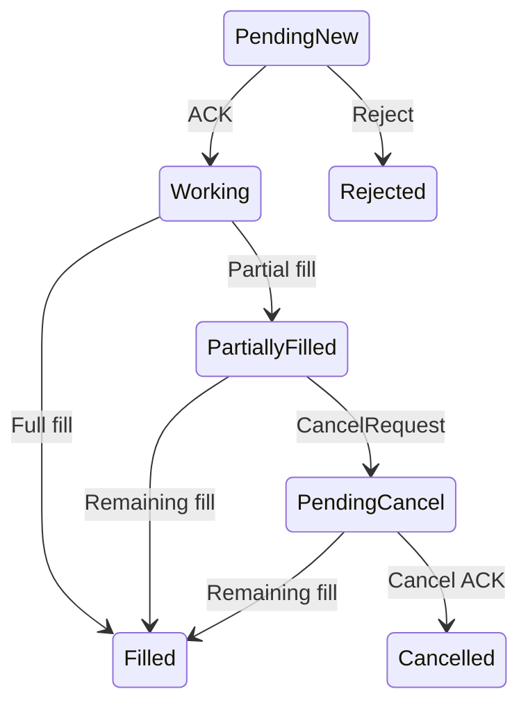

原图为简化状态机；pending cancel 时仍可能收到 fill，具体状态表达须遵循接入协议。

<details>
<summary>查看原图与完整文字转写</summary>

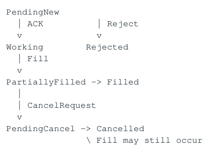

- ` PendingNew `
- ` ACK | Reject `
- ` Working Rejected `
- ` Fill `
- ` PartiallyFilled → Filled `
- ` CancelRequest `
- ` PendingCancel → Cancelled `
- ` Fill may still occur `

</details>

Order 不是一个 enum 就结束。还包括 cumQty、leavesQty、avgPx、exchangeOrderId、lastExec/version/pending action。关键 invariant 例如 cumQty + leavesQty = orderQty、Filled→leaves=0。

### 6.4 Single Owner + Event Reducer

把 ACK、Fill、CancelAck、Reject、Timeout 等全部 route 到同一 order/shard owner，顺序 apply。理想模型接近 NewState = Reduce(OldState, Event)，external effects 由另一层执行；这样 replay 时可以重建 state 而不会重复发送历史 orders。

### 6.5 Deterministic Replay

如果 same initial state + same ordered event stream 能得到 same final state，recovery/test 就非常强。要避免 reducer 依赖 wall clock、unrecorded randomness、remote DB call、thread race、unordered iteration order。需要时间时把 event timestamp 作为输入，而不是 replay 时重新读 now()。

> **转换补充**：订单状态图是简化示意，不是 FIX 或某交易所完整状态规范；pending cancel 与成交数量/订单状态可能是正交维度。重连后必须通过协议证据消除 Unknown，不能把未收到 ACK 等同于未成交。

<a id="pdf-page-027"></a>

<!-- source-pdf-page: 27 -->

*[原 PDF 第 27 页](./Topic_Low_Latency_System_Design_CN.pdf#page=27)*

### 6.6 Recovery 四层

| 层 | 解决什么 | 不能自动解决什么 |
| --- | --- | --- |
| Transport | TCP reconnect / link恢复 | 之前业务 side effect 是否执行 |
| Session | FIX/FIXP seq、resend/gap fill | canonical order/position一定可信 |
| Application | live orders/positions/risk/session state重建 | 外部 truth 与本地是否一致 |
| Reconciliation | 对比 venue/drop-copy/query/clearing truth | 需要 authority hierarchy 与人工策略 |

### 6.7 Stable Identity 与 Idempotency

NewOrder 本身不是 idempotent；通过 ClientId+ClOrdID/OrderId 等 stable identity，把 duplicate request 识别成同一个 logical command。ExecutionReport/Fill 也需要 ExecID 或 absolute CumQty/version 防止 replay double-count position。

Hot in-memory dedup map 很快，但 restart 后会忘记；如果 duplicate window 跨进程，需要 durable identity state，例如 journal/DB unique constraint 等。DB unique key 可以做最后防线，但 strict hot path 通常不每单同步 SELECT。

### 6.8 Acceptance Point 与 Durability

| Acceptance point | Latency | Crash semantics |
| --- | --- | --- |
| RAM queue/state | 最低 | process crash 可能丢 accepted work |
| local durable journal | 更高 | 单机 crash 后可恢复 |
| replicated durable commit | 更高 | RPO 更强，但 hot path依赖replica/network |

必须明确“什么时候向上游说 accepted”。Durability guarantee 本身就是 latency budget 的一部分。

### 6.9 WAL、Snapshot 与 Checkpoint

WAL 先记录可恢复 intent/event 再做 state transition；同步 fsync 每 event 可能过于昂贵，所以实际系统会根据 RPO/RTO 使用 replicated memory、broker、async journal 等不同机制。常用恢复模式是 latest snapshot + events after snapshot，避免从系统出生第一天重放。

### 6.10 RPO 与 RTO

RPO 表示 crash 后允许丢多少已接受 state；RTO 表示多久恢复。RPO=0 往往意味着更同步的 persistence/replication，从而增加 steady-state latency。Snapshot 更频繁会增加 runtime memory/I/O cost，但减少 replay tail 与 recovery time。

### 6.11 Market Data Gap Recovery

**图示转写**

1. ` Expected 104, received 105 `
2. ` → mark book RECOVERING/INVALID `
3. ` → try alternate A/B feed `
4. ` → request replay while buffering future deltas `
5. ` → if too far behind / buffer bounded limit reached: `
6. ` fresh snapshot `
7. ` merge subsequent deltas `
8. ` → only then mark VALID `

<details>
<summary>查看原图与完整文字转写</summary>

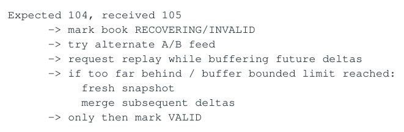

- ` Expected 104, received 105 `
- ` → mark book RECOVERING/INVALID `
- ` → try alternate A/B feed `
- ` → request replay while buffering future deltas `
- ` → if too far behind / buffer bounded limit reached: `
- ` fresh snapshot `
- ` merge subsequent deltas `
- ` → only then mark VALID `

</details>

Strategy 必须把 BookStatus/validity 当业务输入。Book invalid 时不能“继续用旧 book 试试”。Derived synthetic 依赖多个 books 时，validity 也要沿 dependency graph 传播。

<a id="pdf-page-028"></a>

<!-- source-pdf-page: 28 -->

*[原 PDF 第 28 页](./Topic_Low_Latency_System_Design_CN.pdf#page=28)*

### 6.12 TCP Disconnect after NewOrder

本地 PendingNew 没 ACK 时，不应直接变 Rejected，也不应盲目 resend。更正确的是进入 Unknown/PendingReconcile， 重连并恢复 session，再利用 resent ExecutionReport、OrderStatus/MassStatus、Drop Copy、venue query 等建立 authoritative state。

关键认知 Absence of acknowledgement is not evidence of non-execution. Timeout 只表示“我没观察到 response”，不是“对方没做”。Unknown state 应是一等状态，而不是被错误映射成 Rejected。

### 6.13 FIX Session Recovery

FIX 双方维护 sender/target sequence。重连后可通过 Logon、ResendRequest、SequenceReset/GapFill 等恢复 message stream continuity。SequenceReset 不是简单“把数字改一样”；错误跳过 message 会造成 business divergence。Daily session reset 还意味着 ID/sequence uniqueness 要包含 session/day namespace。

### 6.14 Duplicate、Out-of-Order 与 Late Event

State machine 必须允许协议上合法的顺序，例如 PendingNew 时 Fill 可能先于 NewAck；PendingCancel 时仍可能 Fill。 Terminal state 后 duplicate/late message 应 dedup/validate，而不是重新打开 order。Illegal transition 应触发 quarantine/reconcile，而不是静默改 state。

### 6.15 Tombstone 与 Dedup Horizon

Order Filled/Cancelled 后不能立刻完全忘记，因为 late replay/duplicate 仍可能到。可保留 compact tombstone：ID、 terminal state、last version、expiry。Retention 依据 protocol replay horizon/session lifecycle；历史详情迁移 cold store，避免 hot map 无限增长。

### 6.16 Canonical State 与 Projection

明确谁是 source-of-truth：OMS/order owner 是 canonical lifecycle；Gateway/Risk/GUI 可以是 event-driven projection。Projection 丢了可以从 canonical history 重建。不要让三个 subsystem 都认为自己是 master，然后 recovery 时不知道信谁。

### 6.17 HA：Single Active、Standby 与 Fencing

Stateful trading component 常优先 single active owner + warm/hot standby。Active/active 如果不是天然 shard ownership，会引入 duplicate order、shared sequence、global position 与 split brain。Failover 核心不是“备机起来了”，而是旧 owner 被 fencing、new owner catch-up/reconcile 后才获得 external side-effect 权限。

```text
Primary epoch 100  --failure-->  Standby promoted epoch 101
Old epoch 100 actions must be rejected / fenced.
A live process is not necessarily a safe active owner.
```

### 6.18 Sync vs Async Replication

| 模式 | 优势 | 风险 |
| --- | --- | --- |
| Sync replication | standby lag很小、RPO强 | primary latency依赖 replica/network progress |
| Async replication | steady-state快 | crash window/ambiguity，failover需reconcile |
| Async + bounded lag | 常见折中 | lag超阈值需degrade/stop risk |

Replication queue 也是 queue；更应该看 sequence/time lag，而不是只看 process alive。Standby readiness = state caught up + market valid + ref version correct + session recoverable。

<a id="pdf-page-029"></a>

<!-- source-pdf-page: 29 -->

*[原 PDF 第 29 页](./Topic_Low_Latency_System_Design_CN.pdf#page=29)*

### 6.19 Recovery Work 也必须 Bounded

Replay 与 live traffic 同时来时，recovery workload + live workload 可能超过 capacity。Future deltas buffer 必须有上限；catch-up rate &lt;= live rate 时必须 snapshot jump。Reconnect/recovery storm 也要 stagger/backoff， 避免 thundering herd 打爆 DB/venue。

### 6.20 Recovery Testing

- 在 journal 前、journal 后 send 前、send 后 ACK 前、ACK 后 persist 前分别 kill -9。

- 随机 duplicate / reorder / delay / drop protocol messages。

- 验证 Fill 不会 double-count、Timeout 不会错误变 Reject、Unknown 可以最终 reconcile。

- 测试 snapshot + replay、schema version、standby divergence/state hash。

- 将 recovery path 在测试里变成常态，而不是 production 才第一次走。

### 6.21 面试回答模板

TCP 断连未 ACK “I would not blindly resend because the outcome is ambiguous. I keep the order in an unknown/pending-reconciliation state, recover the transport and session sequence, then use the venue’s authoritative recovery mechanisms - resent execution reports, order status, mass status or drop copy - to establish the real state before taking another side effect.”

本章结论 • Remote side effect + network failure = ambiguity；Unknown 是合法 state，不要猜。

- Exactly-once 口号应拆成 stable identity、dedup/idempotency、durability、replay、reconciliation。

- Session recovery 解决 message continuity，不自动等于 business state可信。

- Snapshot + delta/event log 是通用 recovery pattern；Persist correctness state，重算 optimization cache。

- HA 必须有 single active ownership、fencing 与 readiness，而不是“启动两个进程”。

<a id="pdf-page-030"></a>

<!-- source-pdf-page: 30 -->

*[原 PDF 第 30 页](./Topic_Low_Latency_System_Design_CN.pdf#page=30)*

## 第 7 章 Overload、Failure Mode 与 Tail-Latency Collapse

本章目标 真正危险的 tail 往往不是“某条 instruction 慢”，而是系统进入 positive feedback：queue 增长 → working set/contention 增加 → service time 变慢 → effective capacity 降低 → queue 更快增长。设计目标是让 overload 产生 negative feedback 和 controlled degradation。

### 7.1 为什么 Latency 会非线性爆炸

当 lambda 接近 sustainable mu 时，queueing 对小的 load/jitter 变化极度敏感。更糟的是现实 mu 不是常数： working set、cache/TLB、CAS contention、logging/retry、thermal 都可能在高 load 时让 service rate 下降。

**图示转写**

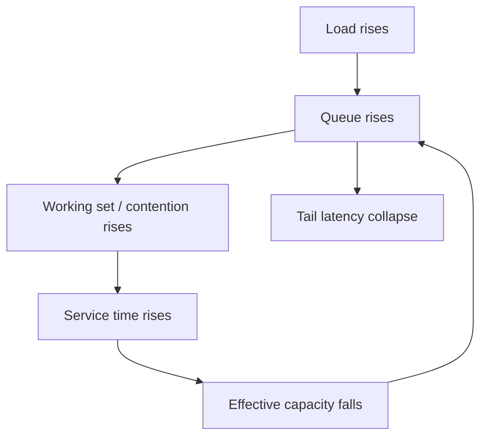

<details>
<summary>查看原图与完整文字转写</summary>

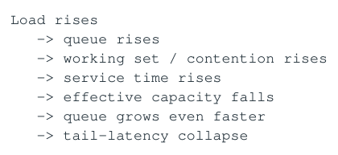

- ` Load rises `
- ` → queue rises `
- ` → working set / contention rises `
- ` → service time rises `
- ` → effective capacity falls `
- ` → queue grows even faster `
- ` → tail-latency collapse `

</details>

### 7.2 Headroom = Recovery Ability

低 steady utilization 不是浪费，而是为 burst/hiccup 购买 drain capacity。如果 normal lambda=950k/s、mu=1M/s，100us stall 积累约 95 events，净 drain 只有 50k/s，恢复约 1.9ms；同样 stall 在 50% utilization 下很快就还清。

### 7.3 Overload 的类型

| 类型 | 例子 | 主要反馈 |
| --- | --- | --- |
| Input overload | market/news burst | queue/WIP |
| Work amplification | 1 tick→hundreds client reprices | effective lambda放大 |
| Consumer stall | page fault/IRQ/scheduler | 瞬间积累 backlog |
| Resource contention | lock/CAS/false sharing | useful throughput下降 |
| Memory pressure | working set/TLB/allocator | cycles/event上升 |
| Recovery overload | replay/reconnect/status burst | failure path与live叠加 |

### 7.4 Working Set Expansion 与 Cache/TLB Feedback

平时 100 active symbols fit L2，新闻时 5000 symbols 同时 active，hot state 漂到 LLC/DRAM，TLB/page walks 增加；service time 上升后 queue 更大，active WIP 进一步增加，形成闭环。

### 7.5 Page Fault / Allocation Slow Path

Hot thread 首次触页会触发 page allocation/zeroing/page-table work。Pool exhausted 后 fallback malloc 更危险：最需要 predictable latency 时进入 allocator locks/mmap/page fault。Capacity failure 应显式 reject/degrade，而不是 hidden slow fallback。

### 7.6 Lock、CAS 与 Contention Amplification

Mutex 的 tail 不是 lock/unlock 指令成本，而是当前线程 latency 依赖 holder progress；holder 被 preempt 时形成 lock convoy。Lock-free MPMC 在高 load 下可能所有 cores retry 同一 CAS line，CPU 100% 但 useful progress 下降。

<a id="pdf-page-031"></a>

<!-- source-pdf-page: 31 -->

*[原 PDF 第 31 页](./Topic_Low_Latency_System_Design_CN.pdf#page=31)*

面试句 “Lock-free guarantees a progress property, not low latency. Under contention, failed CAS retries and cache-line ownership transfers can consume more CPU while useful throughput falls. I prefer eliminating contention through ownership/sharding first.”

### 7.7 False Sharing 与 Background Interference

Per-core counters 同 cache line 在 burst 时才可能明显 bounce。Background analytics/snapshot 即使在另一个 core，也会竞争 LLC、memory bandwidth、NUMA fabric；dedicated CPU affinity 并不能隔离所有 shared hardware resources。

### 7.8 Logging / Metrics / Retry Storm

Failure handling 最容易把小故障放大。Queue full 时每条 LOG_ERROR、timeout 时自动 retry、网络恢复后所有 session 同时 reconnect 都会增加 lambda。好的 failure handling 应减少 load：rate-limited log、bounded retry、 circuit breaker、staggered recovery。

**图示转写**

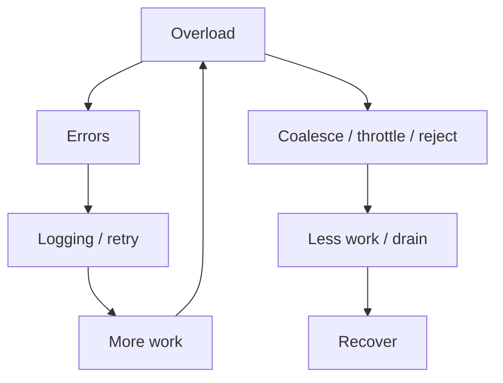

<details>
<summary>查看原图与完整文字转写</summary>

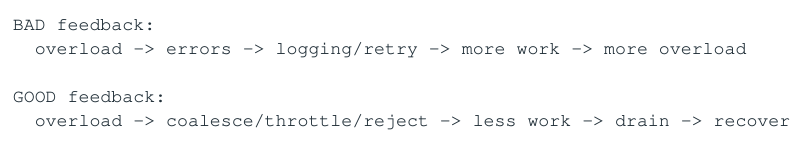

- ` BAD feedback: `
- ` overload → errors → logging/retry → more work → more overload `
- ` GOOD feedback: `
- ` overload → coalesce/throttle/reject → less work → drain → recover `

</details>

### 7.9 Stale Work 与 Catch-Up

对 fast-decaying state，旧 work 不仅无价值，还会推迟最新 work，使“新鲜消息也变旧”。如果 consumer 落后 1000 BBO updates，但只需 latest，coalescing/skip-to-latest 可以瞬间清掉 latency debt。

Catch-up 必须满足 mu_catchup &gt; lambda_live；否则数学上永远追不上，只能 snapshot jump、drop/coalesce、增加 capacity 或停止 intake。

### 7.10 Admission Control 与 Reserved Capacity

过载时首要目标是保护已经 accepted 的 work 与风险降低能力。New request 可以在 acceptance 前 reject；Fill 不可 silent drop；Cancel/Kill Switch 往往需要 reserved queue/pool/descriptors，避免普通 new order traffic 把救命 capacity 吃完。

### 7.11 Priority 必须尊重 Causality

Cancel 可以比普通 New 更高优先，但同一 order 的 New→Cancel 因果关系不能被非法 reorder。低延迟系统常用固定少量 priority classes + per-owner ordering，而不是昂贵的通用 heap priority queue。

### 7.12 Graceful Degradation State Machine

**图示转写**

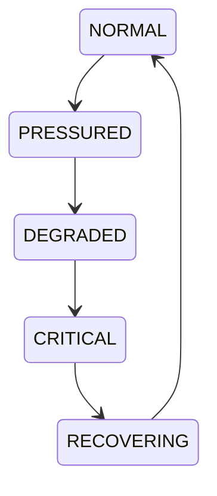

<details>
<summary>查看原图与完整文字转写</summary>

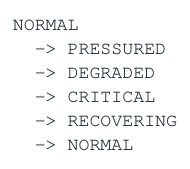

- ` NORMAL `
- ` → PRESSURED `
- ` → DEGRADED `
- ` → CRITICAL `
- ` → RECOVERING `
- ` → NORMAL `

</details>

YELLOW 可 aggressive coalesce/降低 quote frequency；RED 停低价值 subscription、新 admission reject； CRITICAL 可 NO_NEW_RISK/CANCEL_ONLY/disable strategy。进入/退出阈值要 hysteresis，避免 oscillation。

### 7.13 Failure State 应作为 State 传播

不要让每个 order 都尝试 send 才发现 venue down；Connectivity 一次 state transition 发布 VenueDown，所有 producers 本地 cheap lookup 后停止生成该 route。这样把 O(messages) 的 repeated failure 变成 O(state transitions) 的 adaptation。

<a id="pdf-page-032"></a>

<!-- source-pdf-page: 32 -->

*[原 PDF 第 32 页](./Topic_Low_Latency_System_Design_CN.pdf#page=32)*

### 7.14 Capacity Curve 与 Knee Point

不要只测“最大能跑多少”。应该画 latency vs offered load：500k→15us、700k→17us、800k→25us、850k→60us、 900k→300us。Latency 开始非线性上升的 knee 之前才是 safe operating region；实际运营点应留 margin。

### 7.15 Capacity 的更严格定义

定义 Sustainable workload at which the required latency percentile remains within SLA under realistic message mix, burstiness, background activity and recovery/failure conditions.

“microbenchmark 2M events/s”只是 primitive peak，不是 production safe capacity。还要测 long-running thermal steady state、background snapshot、real message mix、burst correlation。

### 7.16 Compound Failures

真正事故常是 market burst + venue disconnect + cancel storm + replay，而不是单一 failure。Capacity plan 必须包含 failure work。正常 90% CPU 再加 20% recovery load，数学上直接进入 unstable region。

### 7.17 Tail Diagnostics

- Which queue grew first? 通过时间顺序找 propagation source。

- Queue rises 时 service time/cycles per event 是否也上升？若是，系统内部正在退化。

- 是否伴随 LLC/TLB miss、IRQ/context switch/page fault、CAS retry、frequency drop？

- offered/accepted/completed throughput 是否出现“输入更多、有效输出反而更少”？

- Tail 是否集中在 top 1% market-rate windows？这比 whole-day percentile 更贴近业务。

### 7.18 Resilience Test

故意 pause consumer 10/50/100us/1ms，记录 max queue、peak p99.9、recovery-to-baseline time。一个稳定系统遭受小 perturbation 后应该自动 drain 并返回 baseline；如果 queue 永不归零，说明 headroom 或 workload model 已经失败。

### 7.19 面试回答模板

为什么高 load 下 latency 突然爆炸？ “Once arrival rate approaches sustainable service rate, queueing becomes nonlinear. In a real system the service rate can also fall under load because the working set expands, cache misses and contention rise, and error/retry paths activate. That creates positive feedback: queues grow, service time increases, effective capacity falls, and queues grow even faster. I design overload controls to create the opposite feedback - coalescing, throttling and rejecting excess admissions.”

本章结论 • Tail collapse 是 feedback problem；capacity mu 会随 load/working set/contention 下降。

- Queue 既是 symptom，也是 amplifier：存 latency debt、扩大 WIP/working set。

- Failure handling 必须减少 load，避免 logging/retry/reconnect storm。

- Graceful degradation 应先牺牲低价值 fidelity/throughput，保护 fills/cancels/risk/correctness。

- 真正 capacity 需要在 realistic burst + background + failure 下仍满足 percentile SLA。

<a id="pdf-page-033"></a>

<!-- source-pdf-page: 33 -->

*[原 PDF 第 33 页](./Topic_Low_Latency_System_Design_CN.pdf#page=33)*

## 第 8 章 Full HFT / Trading System Design：p99.9 &lt; 100us 综合推演

本章目标 把前七章收敛成一个完整面试题：“Design a low-latency market-data-to-order system with p99.9 &lt; 100us.” 不从 buzzword 开始，而从 requirements → budget → ownership → state/memory → queue semantics → network → recovery → overload → measurement 逐步推导。

### 8.1 Step 1 - Requirements / SLA

先确认：HW RX→HW TX 还是 app callback→send？p99.9 under what steady/peak/burst rate？多少 venues/symbols/clients/live orders？Raw MD 是否可 drop？Derived state 可否 coalesce？Accepted order durability/RPO/RTO/HA 是什么？

### 8.2 Step 2 - Critical Path 与 Budget

| Stage | Illustrative p99.9 budget |
| --- | --- |
| NIC → app visibility | 8 us |
| Feed decode + book | 10 us |
| Strategy / pricing | 20 us |
| Pre-trade risk | 5 us |
| Gateway / encode | 8 us |
| TX submission → wire | 10 us |
| queues / handoffs | 15 us |
| safety/jitter margin | 20 us |

预算是 architecture target，不是统计上可简单求和的 E2E percentile。真正验收必须直接测 HW RX→HW TX。

### 8.3 Step 3 - 先尝试 Run-to-Completion，再按 Capacity Shard

如果一个 core 在 peak burst 下能持续 drain，就把 dependent stages 放同 owner core，得到最少 handoff。单核不够时，优先按 symbol/client/session horizontal sharding，让每 shard 内仍 sequential/local。只有 feed draining、 fan-out、gateway session ownership 等真正需要时才引入 vertical boundary。

### 8.4 推荐 Hybrid Topology

**图示转写**

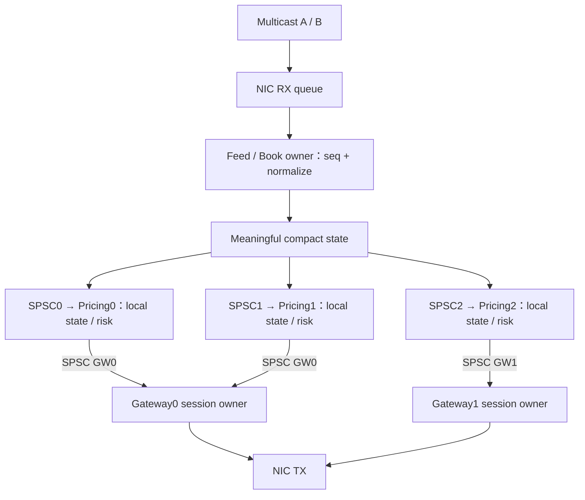

<details>
<summary>查看原图与完整文字转写</summary>

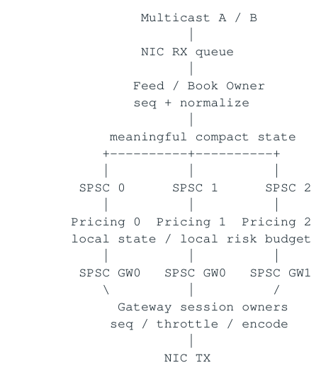

- ` Multicast A / B `
- ` NIC RX queue `
- ` Feed / Book Owner `
- ` seq + normalize `
- ` meaningful compact state `
- ` SPSC 0 SPSC 1 SPSC 2 `
- ` Pricing 0 Pricing 1 Pricing 2 `
- ` local state / local risk budget `
- ` SPSC GW0 SPSC GW0 SPSC GW1 `
- ` Gateway session owners `
- ` seq / throttle / encode `
- ` NIC TX `

</details>

<a id="pdf-page-034"></a>

<!-- source-pdf-page: 34 -->

*[原 PDF 第 34 页](./Topic_Low_Latency_System_Design_CN.pdf#page=34)*

Feed owner 独立的理由不是“模块化”，而是保护 NIC draining 不被 variable pricing fan-out 阻塞；Gateway owner 独立是因为 socket/session sequence/throttle/recovery 天然需要 single total order。

### 8.5 Step 4 - Runtime State 编译成 Hot Representation

Startup/control plane 负责 strings/config/DB validation、compact IDs、route/risk profile、dependency lists、 pool reserve/pre-touch。Hot path 只碰 dense arrays、fixed-point numbers、precomputed constants 与 owner-local pools。

### 8.6 Step 5 - Market Data Semantics 分层

Raw exchange incremental feed：sequence/gap-sensitive、不能 silent drop；Feed/Book reconstruct canonical truth。Book→Pricing：只发布 meaningful BBO/state/version，允许 latest-state coalescing。这样把 reliability 最强的语义留在 source-of-truth 层，把 downstream fan-out workload 大幅压缩。

### 8.7 Step 6 - Pricing 与 Work Elimination

预计算 symbol→subscribers contiguous list；只有 relevant market state 变化才 reprice；新 quote 与 last published 相同则不 publish；client throttle 使用 leading-edge + trailing-latest。系统级优化优先减少 work，不是把无意义 work 做快 20%。

### 8.8 Step 7 - Risk Architecture

静态 eligibility/route permission 在 control path prevalidate；hot shard 只做 bounded local checks。Global hard limit 如必须严格，可用 preallocated per-shard budgets 避免 per-order global atomic；后台 aggregate/rebalance。若业务要求每单强 global serialization，则明确接受其 handoff/capacity cost。

### 8.9 Step 8 - Gateway / Execution Session

每 external session 一个 owner：消费 per-producer SPSC、合并 scheduling、assign protocol sequence、 token-bucket throttle、encode directly into final TX-capable buffer、maintain heartbeat/session/recovery state。Accepted lifecycle event 不 silent drop；New admission 在 capacity red 前 reject；cancel/kill path保 reserved capacity。

### 8.10 Step 9 - Network / NUMA

把 NIC RX/TX queue、polling thread、hot memory 尽量放同 NUMA domain。根据 latency budget 选择 sockets/acceleration/DPDK-like path；busy polling 用 core 换 wakeup predictability。总 buffering budget 要按 latency age 设计，而不是只追求 no drop。

### 8.11 Step 10 - Recovery / HA

Market data用 A/B + sequence + replay + snapshot，book invalid时 strategy fail-closed。Order 用 stable identity/state machine；disconnect未 ACK → Unknown + reconcile。Snapshot/event tail 重建 correctness state。 HA 使用 single active ownership、standby replication、epoch/fencing、readiness gate；standby alive 不等于可安全交易。

### 8.12 Step 11 - Overload State Machine

正常→PRESSURED 时先 semantic coalesce/减 optional metrics；DEGRADED 降 quote frequency/stop low-value subscription；RED reject new admissions并保 cancels/fills；CRITICAL 可 CANCEL_ONLY/NO_NEW_RISK。所有 transition 有 hysteresis、metrics 与 recovery-to-normal 条件。

<a id="pdf-page-035"></a>

<!-- source-pdf-page: 35 -->

*[原 PDF 第 35 页](./Topic_Low_Latency_System_Design_CN.pdf#page=35)*

### 8.13 Step 12 - E2E Measurement

```text
T0 = hardware RX
T1 = app RX
T2 = decode/book done
T3 = strategy decision
T4 = gateway accepted
T5 = app TX submit
T6 = hardware TX

Primary SLA: T6 - T0
Diagnostics: stage deltas + queue age/depth
```

使用 burst-preserving replay、1x/2x/5x load、consumer stall、packet gap、venue disconnect、standby failover、 background snapshot 等组合测试。要找 latency-vs-load knee，并确认 burst 结束后系统能在 bounded 时间回 baseline。

### 8.14 Queue Semantics 表

| Edge | 语义 | Overflow / Recovery |
| --- | --- | --- |
| Exchange raw MD → Feed | ordered event | gap detect；A/B/replay/snapshot，不silent drop |
| Feed → Pricing | derived latest state | coalesce/dirty/version，skip stale intermediate |
| Pricing → Gateway New | business command before/at acceptance | bounded；pressure时reject admission |
| Cancel / Fill lifecycle | critical ordered event | reserved capacity；no silent drop |
| Metrics / GUI | observability state | sample/coalesce/drop old |
| Journal / audit | recovery/audit | 独立 durability path，不能由 debug queue 语义替代 |

### 8.15 Anti-Patterns

| Anti-pattern | 为什么危险 | 更好的问题 |
| --- | --- | --- |
| Global shared state + mutex/atomic | burst时 serialization/contention | 能否 single owner / shard / local budget？ |
| Unbounded queues | 把 capacity deficit 变成 stale latency/OOM | 最大 acceptable queue age 是多少？ |
| Pool full→malloc fallback | 最忙时进入最慢路径 | 超 capacity 的业务 policy 是什么？ |
| Lock-free everywhere | progress != low-tail；CAS bouncing | 能否消灭 sharing？ |
| Zero-copy everywhere | lifetime/remote access可能更贵 | minimal useful data movement 是什么？ |
| 只看 average / primitive benchmark | 看不到 queueing/tail/burst | E2E p99.9 under realistic load？ |
| Timeout→Reject | 把 unknown 当 known | authoritative state 如何 reconcile？ |
| 两个进程=HA | 可能 split brain/double side effect | 谁有 active ownership，如何 fence？ |

<a id="pdf-page-036"></a>

<!-- source-pdf-page: 36 -->

*[原 PDF 第 36 页](./Topic_Low_Latency_System_Design_CN.pdf#page=36)*

### 8.16 Senior / Lead 面试完整回答

完整回答 “I start from the end-to-end percentile SLA and workload rather than a particular technology. I identify the critical path, partition mutable state and assign single owners, then keep each event local to an owner for as long as possible. I scale primarily through independent shards and introduce cross-core queues only at real ownership or capacity boundaries. On the hot path I use compact preallocated state, direct indexing and bounded work. All queues are bounded and their overload semantics come from the business meaning of the data - raw ordered events may require recovery, while derived latest-state data can often be coalesced. I align hot threads, memory and NIC queues with NUMA topology, isolate unpredictable allocation, persistence and logging, and explicitly design failure states, replay and reconciliation. Finally I validate HW-RX-to-HW-TX latency with realistic bursts and failure injection, because a system that is fast only under average load is not a low-latency system.”

### 8.17 最终统一模型

```text
Low-Latency System Design
=
Clear SLA
+ Short Critical Path
+ Single Ownership
+ Partitioned Parallelism
+ Compact Local State
+ Bounded Communication / WIP
+ NIC / CPU / NUMA Alignment
+ Explicit Overload Semantics
+ Deterministic Recovery
+ End-to-End Measurement
```

本章结论 • Dependency 决定什么能并行；Ownership 决定什么不需要同步。

- Locality 决定 CPU 真正支付多少 memory/coherence cost。

- Bounded WIP 决定 queueing latency 是否可控。

- Recovery 决定 failure 后能否重新得到 authoritative state。

- Overload control 决定系统在市场最激烈的时候是稳定降级还是正反馈崩溃。

<a id="pdf-page-037"></a>

<!-- source-pdf-page: 37 -->

*[原 PDF 第 37 页](./Topic_Low_Latency_System_Design_CN.pdf#page=37)*

## 附录 A 术语表与概念对照

| 术语 | 本讲义中的含义 |
| --- | --- |
| Critical Path | 一个业务结果必须经过的不可省依赖链；off-path work 不应主导其 latency。 |
| Service Time | CPU 真正处理当前事件的 useful work 时间。 |
| Queueing Time | 事件在被 consumer 处理前等待的时间；queue depth 是latency debt。 |
| WIP | Work In Progress，系统内已进入但尚未完成的 work。 |
| Headroom | 在 burst/stall 后以 spare capacity drain backlog、恢复baseline 的能力。 |
| Single Writer / Owner | 某个 hot mutable state 只由一个执行上下文修改。 |
| Horizontal Sharding | 按 symbol/client/session 等 key 分 state，每 shard 内单owner。 |
| Vertical Pipeline | 按功能 stage 分线程，event 跨 stage queue 传递。 |
| SPSC | single-producer single-consumer queue；topology 简单，通常无需 producer CAS。 |
| Backpressure | downstream capacity不足的信息向 upstream 传播。 |
| Coalescing | 多个 stale/intermediate state updates 压缩成 latest useful state。 |
| Admission Control | 在业务承诺发生前根据 capacity 明确 reject/throttle。 |
| Semantic Compression | 在懂业务语义的层消除无需 downstream 处理的事件。 |
| Kernel Bypass | 减少 generic kernel networking syscall/wakeup/buffering path 的技术空间。 |
| Wire-to-Wire | 通常指 NIC HW RX → NIC HW TX 一类贴近线速边界的 E2E measurement。 |
| Idempotency | 同一 logical operation 重复应用不会重复产生 business effect。 |
| Reconciliation | 将本地 state 与 authoritative external truth 对比并修复ambiguity。 |
| RPO / RTO | 允许丢失的恢复点窗口 / 恢复到可服务状态的目标时间。 |
| Fencing | ownership 转移后确保旧 owner 无法继续产生 side effect。 |
| Positive Feedback | overload 触发更多 retry/logging/contention，进一步降低capacity。 |
| Graceful Degradation | 超过 capacity 时按优先级降低 fidelity/throughput，而不是无界积压。 |

### A.1 三个容易混淆的“Normalization”

| 概念 | 含义 |
| --- | --- |
| Database normalization | 消除冗余、拆表、维护关系范式；不是本专题重点。 |
| Market-data normalization | 把不同 venue 协议/字段统一成 canonical internal schema/IDs。 |
| Memory denormalization | 有意复制 frequently-read fields 到 hot state，换 locality/少 pointer traversal。 |

<a id="pdf-page-038"></a>

<!-- source-pdf-page: 38 -->

*[原 PDF 第 38 页](./Topic_Low_Latency_System_Design_CN.pdf#page=38)*

### A.2 Progress Guarantee 与 Latency Guarantee

| 概念 | 能保证什么 | 不能保证什么 |
| --- | --- | --- |
| Lock-free | 系统总体会有操作持续完成 | 某个线程 bounded latency、无contention |
| Wait-free | 单操作有 step bound（取决于算法定义） | 实际 cache/OS tail 自动很低 |
| Thread-safe | 并发访问语义正确 | locality、low tail、no queueing |
| Single owner | 业务 mutation serialized/local | 单核 capacity 一定够 |

<a id="pdf-page-039"></a>

<!-- source-pdf-page: 39 -->

*[原 PDF 第 39 页](./Topic_Low_Latency_System_Design_CN.pdf#page=39)*

## 附录 B Low-Latency Architecture Design Review Checklist

### B.1 Requirements

- E2E latency boundary 明确到哪里？HW RX/HW TX 还是 app boundary？

- SLA 是 p50/p99/p99.9/max 中哪一个？在什么 sustained/peak/burst load？

- Input 的 pps/message-size/message-mix 与 fan-out amplification 是什么？

- 哪些 streams 必须 lossless ordered，哪些可以 latest-state/coalesce？

- RPO/RTO/HA/readiness/failover 的业务要求是什么？

### B.2 Ownership / Threads

- 每个 hot mutable object 的 owner 是谁？是否存在 multi-writer hot lines？

- 为什么每个 thread boundary 存在？capacity / ownership / network / failure isolation？

- 如果一核不够，是否先尝试 horizontal shard？

- 一个 event 跨多少 core/process handoffs？

- CPU affinity、SMT sibling、IRQ、NUMA、NIC PCIe locality 是否明确？

### B.3 Memory

- Hot/cold fields 是否拆分？Hot working set 多大？

- 外部 strings 是否在 ingress 变 compact IDs？

- 有没有 pointer-heavy graphs、node-based containers、rehash、allocation？

- Pool capacity / slot reuse / generation / page pre-touch 是否有设计？

- Read-mostly shared state 如何 version/publish/reclaim？

- 如果使用 seqlock/RCU，C++ memory model 与 retry/reclamation 是否严格成立？

### B.4 Queues / Flow Control

- 每条 queue 的 producer、consumer、capacity、ordering、reliability、overflow semantics 是什么？

- Physical capacity 与 operational RED watermark 分别是多少？对应多少 us backlog？

- Queue age/drain time 是否监控？Producer 如何收到 backpressure？

- 能否 coalesce/overwrite latest-state？Critical events 是否有 reserved capacity？

- 多 queue polling 是否 bounded/fair？Timer/TX/heartbeat 会不会 starvation？

### B.5 Network

- RX/TX descriptor ring、socket buffer、app queue 的 total buffering budget 是多少？

- Interrupt/coalescing vs busy polling 的选择基于什么测量？

- Kernel bypass 是否真正占 latency budget，还是 premature optimization？

- Packet buffer 的 ownership/lifetime/copy boundary 是否清晰？

- HW timestamp point、PTP/TSC accuracy 是否优于 target SLA？

### B.6 Recovery / Overload

- TCP disconnect after side effect 时如何表示 Unknown？Authority 从哪里来？

- Stable IDs / dedup / tombstone / session seq / journal / snapshot 是否覆盖 crash/replay？

- Failover 如何 fence old owner？Standby readiness 如何判定？

- lambda &gt; mu 时如何 reduce lambda / increase mu / buffer / reject？

- Logging/retry/recovery 是否可能形成 positive feedback？

<a id="pdf-page-040"></a>

<!-- source-pdf-page: 40 -->

*[原 PDF 第 40 页](./Topic_Low_Latency_System_Design_CN.pdf#page=40)*

- Compound failure（burst + disconnect + replay）是否测过？

## 附录 C 高频面试问答

### C.1 为什么一个单线程 event loop 可能比多线程更快？

因为 critical path 本身串行时，多线程不能消除 dependency，反而增加 queue、cross-core cache transfer 与 synchronization。若单核 peak capacity 足够，single owner 可以同时获得 locality、deterministic transition 与最少 waiting。

### C.2 什么时候应该拆线程？

当一个 owner 在真实 peak/burst 下无法持续 drain，或存在天然独立 state shards、network/session ownership、 blocking/failure isolation 等明确理由。优先 partition independent state，而不是多线程写同一 state。

### C.3 为什么 SPSC 比 MPSC/MPMC 更适合严格 hot path？

SPSC 的 next-slot ownership 没有 producer contention，通常不需要 CAS；producer/consumer progress 可以隔离 cache line。MPSC/MPMC 更 flexible，但会支付 shared-tail coordination、cache-line bouncing 与负载下 tail。

### C.4 Queue 越大越安全吗？

不。更大 queue 能吸收更长 transient burst，但也允许更多 stale work 和 queueing latency。Queue size 要同时来自 burst model 与 latency budget，且 operational watermark 通常远小于 physical capacity。

### C.5 Producer 持续比 Consumer 快怎么办？

Queue 不能创造 capacity。长期 lambda&gt;mu 只能 reduce lambda（throttle/coalesce/reject）、increase mu（optimize/shard）、或显式 shed work；否则 backlog 必然增长。

### C.6 Market Data queue 满了能不能 drop？

Raw incremental feed 用于 book reconstruction 时不能 silent drop，应该 gap detect/recover；canonical book 后的 BBO/latest-state downstream 可以在 consumer semantics 允许时 coalesce/skip stale updates。

### C.7 Order queue 满了怎么办？

不要 silent drop accepted lifecycle events。最好在 acceptance 前做 admission/capacity check，压力大时 reject new risk，并保留 cancels/fills/kill-switch 的 reserved capacity。

### C.8 为什么 lock-free 在高 load 仍可能慢？

Progress guarantee 不等于 no contention。多个 cores CAS 同 cache line 会产生 coherence transfer 与 failed retries，CPU 利用率可以很高但 useful throughput下降。

### C.9 为什么 pointer chasing 即使全 L1 也可能慢？

下一 load 的地址依赖上一 load 返回值，形成 serial load-to-use chain，OoO/MLP 无法并行它。多条 independent chains 才可能暴露 memory-level parallelism。

### C.10 vector 与 vector 怎么选？

前者 contiguous/local，但 relocation 会破坏地址稳定；固定 reserve/array 可以缓解。后者地址稳定但增加 pointer indirection/scattered allocation。选择基于 address stability、capacity 与 access pattern。

### C.11 naive C++ seqlock 为什么可能 UB？

Outer acquire/release sequence 并不会使 concurrent non-atomic payload read/write 变合法；C++ abstract machine 仍认为是 data race。需要合法 atomic representation 或严格 implementation-specific technique。

<a id="pdf-page-041"></a>

<!-- source-pdf-page: 41 -->

*[原 PDF 第 41 页](./Topic_Low_Latency_System_Design_CN.pdf#page=41)*

### C.12 Kernel bypass 一定更快吗？

它主要移除 generic network path 的 syscall/wakeup/buffering overhead，但不能修复 application queueing、bad ownership 或 slow strategy。是否值得由 E2E latency budget 和实际 profile 决定。

### C.13 send() 返回是不是 order 已经发到 exchange？

通常不是。它往往只表示 bytes 被 local stack/queue 接受；之后还可能等待 socket/TX ring/NIC。更不代表 remote business acceptance。

### C.14 UDP 为什么适合 market data？

Multicast 与低 transport coupling 很合适，但 loss/reorder/duplicate/recovery 必须由 application sequence/snapshot/replay 处理。UDP 并不是自动低 latency。

### C.15 TCP disconnect 后 NewOrder 没 ACK 怎么办？

Outcome ambiguous，不 blind resend；进入 Unknown/PendingReconcile，恢复 session并用 resend/status/drop-copy/venue query 建立 authoritative state。

### C.16 Timeout 为什么不等于 Reject？

Timeout 只说明本地在期限内没观察到 response，不证明 remote 没执行。直接变 Rejected 可能导致 duplicate order 或错误 position。

### C.17 Exactly-once 怎么回答？

避免依赖 transport-level magic；使用 stable business identity、at-least-once where needed、dedup/idempotent state transition、durable state 与 reconciliation 实现 effectively-once effect。

### C.18 Active/Active 为什么难？

如果不是天然 shard ownership，两个 active owners 需要协调 external side effects、session seq、position/risk 并防 split brain；同步成本与 correctness complexity 很高。

### C.19 为什么系统在高 load 下 latency 会突然 cliff？

lambda 接近 mu 后 queueing 非线性；同时 working set、cache miss、CAS contention、logging/retry/thermal 会使 effective mu 下降，形成 positive feedback。

### C.20 什么是 graceful degradation？

超过 safe capacity 后有序牺牲低价值 work/fidelity，coalesce/throttle/reject new admission，保护 fills/cancels/risk/correctness，并在压力下降后有 hysteresis 地恢复。

<a id="pdf-page-042"></a>

<!-- source-pdf-page: 42 -->

*[原 PDF 第 42 页](./Topic_Low_Latency_System_Design_CN.pdf#page=42)*

## 附录 D 推荐实验与验证方法

### D.1 Queue / Backpressure 实验

- SPSC 单 core vs cross-core vs cross-NUMA：测 cycles/message 与 p99.9。

- 把 producer/consumer index 放同 cache line，再用 alignas(64) 分离，观察 coherence 与 tail。

- consumer 人为 stall 10us/100us/1ms，记录 queue depth、age、drain/recovery time。

- 同样 offered load 下，比较 unbounded queue、bounded reject、latest-state coalescing 的 E2E。

### D.2 Memory / Layout 实验

- unordered_map vs compact ID + array indexing。

- node-based list vs packed index storage；全部数据 warm L1/L2 时仍比较 dependent load chain。

- vector small-N linear scan vs map/hash；测 cycles/lookup 和 branch/cache counters。

- Pool pre-touch vs first-touch；观察 page faults 与 first-burst tail。

### D.3 Network 实验

- App RX→TX benchmark 与 HW RX→HW TX 同时测，拆 ingress/app/egress。

- Interrupt/coalescing vs busy poll；不同 RX ring/socket buffer 下测 queue age，而不只 drop count。

- Burst-preserving packet replay，比较均匀 1Mpps 与 100us microburst 的 p99.9。

- 跨 NUMA 放 NIC/core/memory，验证 remote placement tail。

### D.4 Recovery / Fault Injection

- NewOrder send 前后 kill process；重启后验证 Unknown/reconcile，不 duplicate order。

- MD 随机 drop/reorder/duplicate，验证 A/B/replay/snapshot 与 BookStatus。

- Standby 人为 lag，然后触发 failover，确认 not-ready replica 不被 promote。

- Recovery + live burst 同时发生，验证 bounded buffer 与 snapshot jump。

### D.5 Capacity / Tail 实验

- 画 offered load → p50/p99/p99.9 → completed throughput → queue age 曲线，找 knee。

- 做 1x/1.2x/1.5x/2x design rate；超过 capacity 时验证 controlled degradation，而不是 OOM。

- 长时间 soak 覆盖 thermal、periodic metrics/snapshot、reclamation 等 slow periodic events。

- 只看 top 1% market-rate windows 的 conditional p99.9，检查 tail 是否与业务最重要时刻相关。

<a id="pdf-page-043"></a>

<!-- source-pdf-page: 43 -->

*[原 PDF 第 43 页](./Topic_Low_Latency_System_Design_CN.pdf#page=43)*

## 附录 E 一页复习：Low-Latency System Design Mental Model

一句话 Low-latency system design 的本质，是控制 dependency、ownership、locality、work-in-progress 与不可预测性。

### E.1 五个核心量

| 量 | 你应该问什么 |
| --- | --- |
| Dependency | 哪些步骤/loads/state transitions 真正必须串行？ |
| Ownership | 谁唯一写 hot mutable state？能否用 partition 消灭 sharing？ |
| Locality | event 会触碰哪些 cache lines/pages/NUMA nodes？ |
| WIP | 系统最多欠多少 work？Queue depth 对应多少 us latency debt？ |
| Uncertainty | allocation、scheduler、network、recovery、retry 的边界是否明确？ |

### E.2 设计顺序

**图示转写**

1. ` Business Requirements `
2. ` → SLA / Measurement Boundary `
3. ` → Critical Path / Latency Budget `
4. ` → State Ownership `
5. ` → Sharding / Thread Topology `
6. ` → Hot Memory Representation `
7. ` → Bounded Queues / Backpressure `
8. ` → NIC / Network / NUMA `
9. ` → Recovery / HA / Reconciliation `
10. ` → Overload / Graceful Degradation `
11. ` → E2E Measurement / Fault Injection `

<details>
<summary>查看原图与完整文字转写</summary>

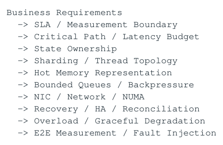

- ` Business Requirements `
- ` → SLA / Measurement Boundary `
- ` → Critical Path / Latency Budget `
- ` → State Ownership `
- ` → Sharding / Thread Topology `
- ` → Hot Memory Representation `
- ` → Bounded Queues / Backpressure `
- ` → NIC / Network / NUMA `
- ` → Recovery / HA / Reconciliation `
- ` → Overload / Graceful Degradation `
- ` → E2E Measurement / Fault Injection `

</details>

### E.3 最终检查

- 如果一个 boundary 没有明确“为什么存在”，考虑删除。

- 如果一个 queue 没有 capacity/overflow semantics，设计还没完成。

- 如果一个 shared hot field 有多个 writers，先重做 ownership，再谈 lock-free。

- 如果 timeout/disconnect 后你只能猜 remote state，recovery 还没完成。

- 如果系统只在平均 load 下快、burst 时 queue/retry 正反馈，它不是稳定的 low-latency system。

- 最终答案不是“用了哪些技术”，而是能解释每个 trade-off 如何服务 SLA、capacity 与 correctness。

最终公式 Low-Latency System = Clear SLA + Short Critical Path + Single Ownership + Partitioned Parallelism + Compact Local State + Bounded WIP + Network/NUMA Alignment + Explicit Failure/Overload Semantics + Deterministic Recovery + End-to-End Measurement

<a id="conversion-errata"></a>

## 转换补充与勘误

本节及正文中“转换补充 / 转换勘误”均为 2026-11-06 转换时新增；原 PDF 仍是原始内容与版式的对照。

- [原 PDF 第 19 页处的补充](#pdf-page-019)：coalescing 示例里的 “clear dirty safely” 是关键协议，不是普通 store 的替代说法。

- [原 PDF 第 26 页处的补充](#pdf-page-026)：订单状态图是简化示意，不是 FIX 或某交易所完整状态规范；pending cancel 与成交数量/订单状态可能是正交维度。

### 适用边界

原文中的时延、cache/ROB 大小、PMU event、kernel 参数及 compiler lowering 均需要绑定具体平台。转写结构的覆盖校验不等同于对全部技术命题的逐条实测；复杂图的精确布局以随附原图为准。
