# Memory Ordering & Atomics on x86

> 来源：[Topic_Memory_Ordering_Atomics_x86_CN.pdf](./Topic_Memory_Ordering_Atomics_x86_CN.pdf)（29 页）。本文件按原文逐页转写；转换补充与勘误单独标明。

> 图示优先转为 Mermaid、表格或步骤；每图附原图和文字以便核对。代码保留原文逻辑与缩进，跨页片段及概念示例未宣称可以独立编译。

[返回目录](README.md) · [转换说明与校验](CONVERSION_NOTES.md) · [本文补充与勘误](#conversion-errata)

[原文目录](#pdf-page-004) · [第一章正文](#pdf-page-006)

<a id="pdf-page-001"></a>

<!-- source-pdf-page: 1 -->

*[原 PDF 第 1 页](./Topic_Memory_Ordering_Atomics_x86_CN.pdf#page=1)*

C++ / CPU 深度学习 - Memory Ordering &amp; Atomic Synchronization

## Memory Ordering &amp; Atomic Synchronization

### C++ / CPU 深度学习 - x86 内存序、原子操作与同步实现

Store Buffer · Load Queue · x86 TSO · MESI/RFO · Fence · std::atomic · LOCK · XCHG · XADD · CMPXCHG · CAS

目标  从“C++ 有一个 memory_order 约束”继续下钻到：compiler 如何映射到 x86 指令，CPU 如何通过 Load/Store structures、cache-line ownership、coherence 与 locked/fence semantics 真正实现这些约束。

2026-08 · 详尽版

<a id="pdf-page-002"></a>

<!-- source-pdf-page: 2 -->

*[原 PDF 第 2 页](./Topic_Memory_Ordering_Atomics_x86_CN.pdf#page=2)*

C++ / CPU 深度学习 - Memory Ordering &amp; Atomic Synchronization

## 如何使用这份讲义

这份讲义不是 memory_order API 速查表，而是把本次讨论重新组织成一条从语言语义到硅片行为的因果链。重点不是背“acquire 比 relaxed 强”，而是能回答：为什么 x86 上 acquire 仍可能只是 MOV？为什么 seq_cst store 常见 XCHG？为什么 relaxed fetch_add 仍然会非常贵？

贯穿全书的核心不变量  Execute order、retire order 与 memory visibility/order 是三个不同维度。Store 可以已经 retire， 却仍停留在 store buffer；因此“in-order retire”并不能推出“跨核内存可见性也按 program order”。

阅读时始终把问题拆成四层：

- C++ 层：atomicity、happens-before、modification order、synchronizes-with、seq_cst total order 到底要求什么？

- Compiler/ISA 层：编译器需要生成 MOV、LOCKed RMW、XCHG 还是 MFENCE？哪些只是 compiler barrier？

- Microarchitecture 层：ROB、Load Queue、Store Buffer、memory disambiguation、store forwarding 怎样允许 CPU 激进执行？

- Coherence 层：写者如何通过 RFO/ownership/invalidation 使 cache line 的新值成为 coherent 可见状态？ 凡涉及“某代 Intel Core 内部具体哪个 cycle、哪个 buffer entry、多少 µops”等内容，本讲义会明确标成 implementation detail；ISA/C++ 只保证 observable semantics，不保证内部电路实现。

<a id="pdf-page-003"></a>

<!-- source-pdf-page: 3 -->

*[原 PDF 第 3 页](./Topic_Memory_Ordering_Atomics_x86_CN.pdf#page=3)*

C++ / CPU 深度学习 - Memory Ordering &amp; Atomic Synchronization 阅读路线

| 章节 | 主题 | 最终要回答的问题 |
| --- | --- | --- |
| 第 1 章 | 三个 order 与内存模型边界 | 为什么 retire in order 仍需要 memory ordering？ |
| 第 2 章 | Load Queue / Store Buffer | Store→Load 乱序到底是怎样发生的？ |
| 第 3 章 | Coherence / MESI / RFO | “globally visible”为什么不等于写回DRAM？ |
| 第 4 章 | x86 TSO 与 ARM 对照 | x86 到底天然保证了哪些顺序？ |
| 第 5 章 | C++ memory_order | relaxed/acquire/release/SC 各自建立什么语义？ |
| 第 6 章 | Fence | MFENCE 到底在等什么，为什么不是 flush cache？ |
| 第 7 章 | Atomic RMW / LOCK | LOCK 如何借助 ownership + coherence 实现不可分割 RMW？ |
| 第 8 章 | XCHG / XADD / CMPXCHG | 这些指令分别解决什么问题？ |
| 第 9 章 | seq_cst 在 x86 上的实现 | 为什么 SC store 常见 XCHG，而 SC load 仍可能是 MOV？ |
| 第 10 章 | CAS vs fetch_add | 为什么 CAS contention 往往比 fetch_add 更容易放大开销？ |
| 第 11 章 | 低延迟工程 | 怎样避免 coherence serialization 与 atomic hotspot？ |
| 第 12 章 | 实验、面试与复习 | 如何用 litmus/Godbolt/perf 验证，而不是背结论？ |

<a id="pdf-page-004"></a>

<!-- source-pdf-page: 4 -->

*[原 PDF 第 4 页](./Topic_Memory_Ordering_Atomics_x86_CN.pdf#page=4)*

## 原文目录

- C++ / CPU 深度学习 - Memory Ordering &amp; Atomic Synchronization
- [1. Memory Ordering 的真正问题](#pdf-page-006)
- [1.1 Program / Execution / Retirement / Memory order](#pdf-page-006)
- [1.2 Retire in order ≠ globally visible in order](#pdf-page-006)
- [1.3 四种 Load/Store ordering 如何读](#pdf-page-006)
- [1.4 “当前核”与“跨核观察”并不是二选一](#pdf-page-007)
- [2. Load Queue、Store Buffer 与 Memory Disambiguation](#pdf-page-008)
- [2.1 Store Buffer 为什么存在](#pdf-page-008)
- [2.2 Store→Load relaxation](#pdf-page-008)
- [2.3 Store-to-load forwarding](#pdf-page-008)
- [2.4 Load Queue / Store Queue](#pdf-page-008)
- [2.5 Memory disambiguation 与 replay](#pdf-page-009)
- [3. Cache Coherence、MESI 与 RFO](#pdf-page-010)
- [3.1 Coherence 解决什么](#pdf-page-010)
- [3.2 RFO 与 ownership](#pdf-page-010)
- [3.3 globally visible 的正确含义](#pdf-page-010)
- [3.4 Coherence ≠ memory ordering](#pdf-page-010)
- [4. x86 TSO 与 ARM 弱内存模型](#pdf-page-011)
- [4.1 x86 的四种基本 order](#pdf-page-011)
- [4.2 Store→Load litmus](#pdf-page-011)
- [4.3 Load→Load 为什么仍可内部 OoO](#pdf-page-011)
- [4.4 ARM 为什么需要 LDAR/STLR](#pdf-page-011)
- [5. C++ std::atomic 与 memory_order](#pdf-page-013)
- [5.1 atomicity 与 ordering 分离](#pdf-page-013)
- [5.2 relaxed](#pdf-page-013)
- [5.3 acquire / release](#pdf-page-013)
- [5.4 acq_rel](#pdf-page-013)
- [5.5 seq_cst](#pdf-page-013)
- [5.6 consume 的现实状态](#pdf-page-014)
- [5.7 x86/ARM lowering](#pdf-page-014)
- [6. Fence 到底如何工作](#pdf-page-015)
- [6.1 fence 不是 cache flush](#pdf-page-015)
- [6.2 MFENCE](#pdf-page-015)
- [6.3 LFENCE / SFENCE](#pdf-page-015)
- [6.4 atomic_thread_fence](#pdf-page-015)
- [6.5 compiler barrier vs CPU barrier](#pdf-page-015)
- [7. Atomic RMW 与 LOCK](#pdf-page-017)
- [7.1 普通 atomic load/store 不等于 LOCK](#pdf-page-017)
- [7.2 LOCKed RMW 的 atomicity](#pdf-page-017)
- [7.3 cache locking vs bus locking](#pdf-page-017)
- [7.4 locked instruction 的 ordering](#pdf-page-017)
- [7.5 split lock](#pdf-page-017)
- [8. XCHG、XADD、CMPXCHG](#pdf-page-019)
- [8.1 memory XCHG 隐含 LOCK](#pdf-page-019)
- [8.2 LOCK XADD](#pdf-page-019)
- [8.3 LOCK CMPXCHG / CAS](#pdf-page-019)
- [8.4 failure CAS 也不是普通 load](#pdf-page-019)

<a id="pdf-page-005"></a>

<!-- source-pdf-page: 5 -->

*[原 PDF 第 5 页](./Topic_Memory_Ordering_Atomics_x86_CN.pdf#page=5)*

- C++ / CPU 深度学习 - Memory Ordering &amp; Atomic Synchronization
- [9. seq_cst 在 x86 上如何落地](#pdf-page-020)
- [9.1 SC total order](#pdf-page-020)
- [9.2 为什么要堵 Store→Load](#pdf-page-020)
- [9.3 XCHG + MOV mapping](#pdf-page-020)
- [9.4 MFENCE alternative](#pdf-page-020)
- [9.5 locked operations 的 total order](#pdf-page-020)
- [10. CAS 与 fetch_add 的性能模型](#pdf-page-021)
- [10.1 conditional vs unconditional RMW](#pdf-page-021)
- [10.2 contention / cache-line bouncing](#pdf-page-021)
- [10.3 CAS retry storm](#pdf-page-021)
- [10.4 TTAS](#pdf-page-021)
- [10.5 什么时候该用哪个](#pdf-page-022)
- [11. Low-Latency / HFT Engineering](#pdf-page-023)
- [11.1 single-writer ownership](#pdf-page-023)
- [11.2 sharded/per-core counters](#pdf-page-023)
- [11.3 false sharing](#pdf-page-023)
- [11.4 publish/consume patterns](#pdf-page-023)
- [11.5 deterministic tail latency](#pdf-page-024)
- [12. 实验、常见误区与面试题](#pdf-page-025)
- [12.1 Godbolt 实验](#pdf-page-025)
- [12.2 Store Buffering litmus](#pdf-page-025)
- [12.3 perf 观察 contention](#pdf-page-025)
- [12.4 高频误区](#pdf-page-025)
- [12.5 面试回答模板](#pdf-page-026)
- [A. 附录](#pdf-page-027)
- [A.1 术语表](#pdf-page-027)
- [A.2 C++→x86 典型映射表](#pdf-page-028)
- [A.3 复习清单](#pdf-page-028)
- [A.4 参考资料](#pdf-page-028)

<a id="pdf-page-006"></a>

<!-- source-pdf-page: 6 -->

*[原 PDF 第 6 页](./Topic_Memory_Ordering_Atomics_x86_CN.pdf#page=6)*

C++ / CPU 深度学习 - Memory Ordering &amp; Atomic Synchronization

## 第 1 章 Memory Ordering 的真正问题

本章目标  把“CPU 会乱序”从模糊口号拆成 program order、execution/completion、retirement 与 observable memory order。

### 1.1 四种 order 必须分开

现代 OoO CPU 可以让 younger instruction 先执行甚至先完成，但 architectural state 仍通过 ROB 按 program order retire。 真正容易混淆的是：memory operation 的“完成/retire”和“对整个 coherent system 可见”不是同一个时刻。

| Order | 问的是什么 | 典型性质 |
| --- | --- | --- |
| Program order | 机器指令在程序中的先后 | 静态顺序 |
| Execution / completion order | µop 实际何时 issue/execute/result ready | 可以 OoO / speculative |
| Retirement order | 何时正式提交 architectural state | 现代 OoO core 通常 in-order |
| Memory order / visibility | loads/stores 允许产生什么共享内存可观察结果 | 由 ISA memory model + fences/locked ops约束 |

**图示转写**

| 层次 | 原图含义 |
| --- | --- |
| Program order | Store X → Load Y |
| Execution | Address generation / load 可重叠 |
| Retirement | Store X → Load Y |
| Visibility | Load Y 完成时，Store X 仍可能留在 Store Buffer |

<details>
<summary>查看原图与完整文字转写</summary>

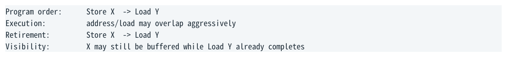

- ` Program order: Store X → Load Y `
- ` Execution: address/load may overlap aggressively `
- ` Retirement: Store X → Load Y `
- ` Visibility: X may still be buffered while Load Y already completes `

</details>

关键  “Execute out of order, retire in order”并没有解决共享内存顺序问题，因为 retire 的 store 可以只是把 architectural responsibility 交给 store subsystem；它未必已经成为 globally visible。

### 1.2 Retired Store 为什么还能没发生完“ ”

普通 x86 store 常可在数据/地址进入 store subsystem 后 retire，而真正取得 cache-line write ownership、处理 coherence 并更新 L1 的过程可以继续在后台进行。这正是 Store Buffer 能隐藏写延迟的意义。

**图示转写**

| 场景 / 部分 | 路径、状态或说明 |
| --- | --- |
| store x = 1 | ` Store Buffer entry → RFO / ownership / L1 update `；` instruction can retire earlier ` |
| 部分 2 | ` Younger independent load y can continue. ` |

<details>
<summary>查看原图与完整文字转写</summary>

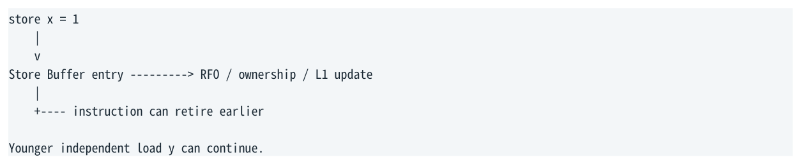

- ` store x = 1 `
- ` Store Buffer entry → RFO / ownership / L1 update `
- ` instruction can retire earlier `
- ` Younger independent load y can continue. `

</details>

因此，下面两个命题完全可以同时为真：

- ROB 看起来一切按 program order retire。

- 另一个 core 此刻仍然无法观察到更早 store 的新值。

### 1.3 四种 Load/Store ordering 怎么读

箭头左边和右边描述的是“当前处理器 program order 中的两个 memory operations”。所谓允许/禁止 reorder，讨论的是 ISA 最终允许什么 architectural observable behavior，而不是 execution unit 内部有没有提前发起第二个访问。

<a id="pdf-page-007"></a>

<!-- source-pdf-page: 7 -->

*[原 PDF 第 7 页](./Topic_Memory_Ordering_Atomics_x86_CN.pdf#page=7)*

C++ / CPU 深度学习 - Memory Ordering &amp; Atomic Synchronization

| Program order | x86 WB memory 的简化结论 | 直觉 |
| --- | --- | --- |
| Load → Load | 不允许 architectural reorder | 后一个 load 可 speculative 执行，但不能留下违规 observable result |
| Load → Store | 不允许 architectural reorder | 后一个 store 不能在 memory-order semantics 上越过 older load |
| Store → Store | 不允许 architectural reorder | 同一 producer 的 stores 保持发布顺序 |
| Store → Load | 允许（不同地址等条件下） | older store 可滞留 Store Buffer，younger load 继续 |

不要误读  Load→Load 不是“所有核都以同样顺序看到 x、y”；它是当前 core 的两个 loads 的 ordering constraint。 Store→Store 则天然更强调该 core 的 stores 如何被 coherent observers 看见。四者仍属于同一个 memory model。

### 1.4 为什么 Store→Load 看起来特别跨核“ ”

因为 Store Buffer 把“当前核已经继续往前跑”和“别人仍看不到 store”直接分离了。Load→Load 的约束更容易从 reader 自身理解；Store→Load 则同时暴露本核进度与跨核 visibility，所以跨核感最强。

**图示转写**

| Core 0 | Core 1 |
| --- | --- |
| x = 1 进入本核 Store Buffer | y = 1 进入本核 Store Buffer |
| load y → 0 | load x → 0 |
| 稍后 store drain / coherence-visible | 稍后 store drain / coherence-visible |

x86 TSO 的 Store Buffering 测试允许 r0 = 0 且 r1 = 0（这是硬件模型；C++ 实验应使用 atomics 避免 data race）。

<details>
<summary>查看原图与完整文字转写</summary>

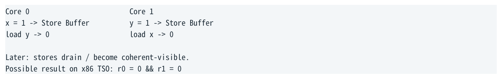

- ` Core 0 Core 1 `
- ` x = 1 → Store Buffer y = 1 → Store Buffer `
- ` load y → 0 load x → 0 `
- ` Later: stores drain / become coherent-visible. `
- ` Possible result on x86 TSO: r0 = 0 && r1 = 0 `

</details>

<a id="pdf-page-008"></a>

<!-- source-pdf-page: 8 -->

*[原 PDF 第 8 页](./Topic_Memory_Ordering_Atomics_x86_CN.pdf#page=8)*

C++ / CPU 深度学习 - Memory Ordering &amp; Atomic Synchronization

## 第 2 章 Load Queue、Store Buffer 与 Memory Disambiguation

本章目标  理解 memory subsystem 为什么既要激进并行，又必须能够检测依赖错误并 replay。

### 2.1 Store Buffer 为什么存在

如果每条 store 都必须等到 cache-line ownership、invalidation 与 L1 update 完整结束后，pipeline 才允许继续，写 miss 或 line bouncing 会频繁让前端/ROB 停顿。Store Buffer 的核心价值是 decouple retirement/execution progress from store visibility。

**图示转写**

- ` Store address/data ready `
- ` Store Buffer `
- ` pending stores `
  - ` obtain ownership / RFO `
  - ` update cache `
  - ` become globally visible `

<details>
<summary>查看原图与完整文字转写</summary>

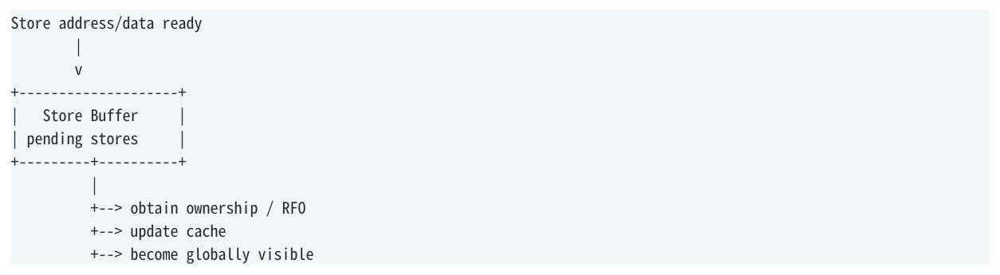

- ` Store address/data ready `
- ` Store Buffer `
- ` pending stores `
- ` → obtain ownership / RFO `
- ` → update cache `
- ` → become globally visible `

</details>

Store Buffer 也需要维护 program-order/alias/forwarding 等状态。其容量有限；当大量 store 无法 drain，buffer 满了会反过来形成 backend pressure。

### 2.2 Store→Load relaxation 的最小模型

x86 TSO 的经典抽象是：每个 core 有一个 FIFO store buffer。Load 先查询本 core 更早、同地址的 pending store；如果没有 alias，就可以从 coherent cache hierarchy 读取。这已经足以解释 Store Buffering litmus。

**图示转写**

| 操作 | 路径 / 时机 |
| --- | --- |
| Store X = 1 | 先进入 Store Buffer；稍后进入 cache / coherence |
| Load Y | 与 X 不同地址，不能从 X 的 entry forwarding；可现在从 cache 读取 Y |

<details>
<summary>查看原图与完整文字转写</summary>

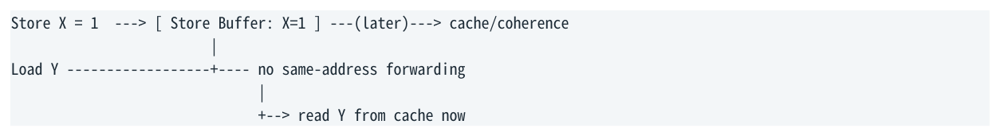

- ` Store X = 1 → [ Store Buffer: X=1 ] (later)→ cache/coherence `
- ` Load Y + no same-address forwarding `
- ` → read Y from cache now `

</details>

这里“Store→Load reorder”最准确的说法是：older store 尚未 globally visible，而 younger independent load 已经完成， 从系统观察效果上等价于 load 越过了 store。它不要求 load 在 ROB 中先于 store retire。

### 2.3 Store-to-Load Forwarding

如果后面的 load 与更早 pending store 是同一地址，CPU 不能读到旧 cache 值。常见机制是直接从 store buffer/store queue 把新数据 forward 给 load。

**图示转写**

| 操作 | 数据路径 |
| --- | --- |
| store x = 10 | 进入 Store Buffer |
| 随后 load x | 从同地址 Store Buffer entry forwarding 得到 10 |

<details>
<summary>查看原图与完整文字转写</summary>

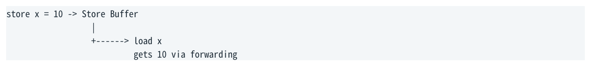

- ` store x = 10 → Store Buffer `
- ` → load x `
- ` gets 10 via forwarding `

</details>

Forwarding 有地址/大小/对齐等条件；复杂 partial overlap 可能造成 forwarding failure 或额外 penalty。性能分析中“store 后立刻 load”不能只看 L1 latency。

### 2.4 Load Queue / Load Buffer 做什么

Load Queue 并不是 Store Buffer 的完全对称版本。它主要追踪 in-flight/outstanding/speculative loads：地址、完成状态、依赖与 ordering violation 检测等。不同厂商会用不同内部组织，术语也可能是 Load Buffer / Load Queue。

<a id="pdf-page-009"></a>

<!-- source-pdf-page: 9 -->

*[原 PDF 第 9 页](./Topic_Memory_Ordering_Atomics_x86_CN.pdf#page=9)*

C++ / CPU 深度学习 - Memory Ordering &amp; Atomic Synchronization

- 支持多个 independent cache misses outstanding，形成 MLP。

- 记录 younger load 是否在 older store 地址尚未知时提前执行。

- 在 coherence invalidation、memory dependency 解析等条件变化后判断是否需要 replay。

### 2.5 Memory Disambiguation 与 Replay

代码 `*p = 1; r = *q;` 的关键问题是 CPU 一开始未必知道 p 与 q 是否 alias。若等到所有 older store 地址完全解析再执行 load， 会损失大量 ILP；因此处理器可能预测“不会 alias”并提前 load。

**图示转写**

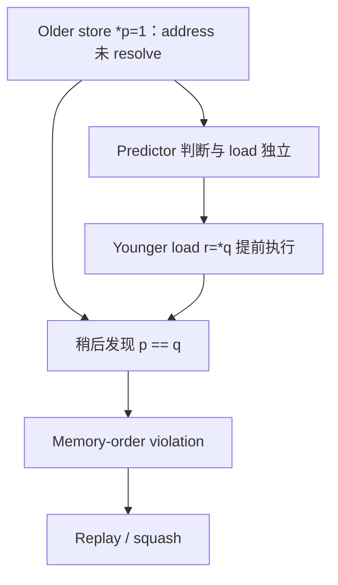

<details>
<summary>查看原图与完整文字转写</summary>

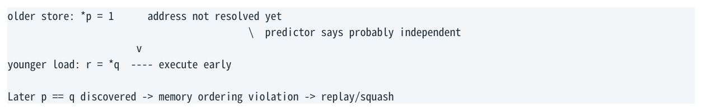

- ` older store: *p = 1 address not resolved yet `
- ` predictor says probably independent `
- ` younger load: r = *q execute early `
- ` Later p == q discovered → memory ordering violation → replay/squash `

</details>

统一视角  Register renaming 解决寄存器 name dependency；memory disambiguation 则是在地址未知时推测内存依赖。 两者都服务于 OoO，但 memory speculation 猜错需要 replay。

<a id="pdf-page-010"></a>

<!-- source-pdf-page: 10 -->

*[原 PDF 第 10 页](./Topic_Memory_Ordering_Atomics_x86_CN.pdf#page=10)*

C++ / CPU 深度学习 - Memory Ordering &amp; Atomic Synchronization

## 第 3 章 Cache Coherence、MESI 与 RFO

本章目标  把“store 变得可见”拆成 cache-line ownership、invalidation 与 coherent serialization，而不是误解成写回 DRAM。

### 3.1 Coherence 解的是 same-location consistency

MESI/MOESI 一类协议的核心任务是管理某条 cache line 在多个 core cache 中的副本和写 ownership，保证同一 memory location 的修改不会让不同 core 永久维持互相矛盾的版本。

但 coherence 与 memory ordering 不同：coherence 主要回答“同一个 location 的 value/version 如何一致”，memory ordering 回答“不同 memory operations 之间允许什么顺序”。

### 3.2 RFO：我要这条 line 的写 ownership

假设 Core0 与 Core1 都以 Shared 状态缓存 x 所在 cache line，Core0 要写 x。它必须发起 ownership 请求（常用直觉称 RFO），使其他 sharers 的副本失效，并让自己得到 Exclusive/Modified 权限。

**图示转写**

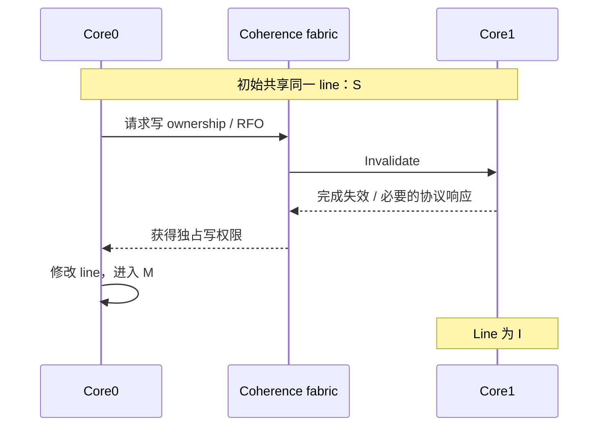

<details>
<summary>查看原图与完整文字转写</summary>

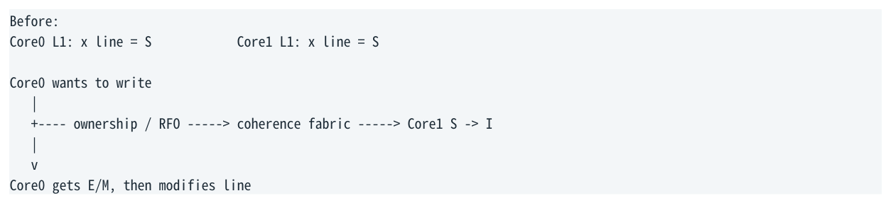

- ` Before: `
- ` Core0 L1: x line = S Core1 L1: x line = S `
- ` Core0 wants to write `
- ` ownership / RFO → coherence fabric → Core1 S → I `
- ` Core0 gets E/M, then modifies line `

</details>

普通 store 和 locked RMW 都需要写 ownership；区别不在于“LOCK 才需要 M state”，而在于 locked RMW 还要保证 read-modify-write 作为不可分割的 atomic transaction。

### 3.3 Globally Visible 不等于 DRAM

在 WB cacheable memory 中，一个 store 达到共享内存语义所需的 visibility point，通常依赖 coherent cache state，而不是必须一路 write-back 到 DRAM。只要 coherence 已保证其他 core 不再合法读取旧副本，并能按协议获得新值，就可以满足我们讨论的可见性。

常见错误  “MFENCE 把 store 刷到 DRAM”“atomic 一定直接写内存”都是错误的 mental model。现代 CPU 的共享内存一致性主要发生在 cache/coherence domain。

### 3.4 Coherence ≠ Memory Ordering

例如 producer 写两个不同 cache lines：`data = 42; flag = 1;`。Coherence 分别保证 data 与 flag 自己的版本一致； 但“reader 若看到 flag=1，是否一定看到 data=42”需要 memory model / release-acquire 之类的 ordering 规则来回答。

```text
Coherence:          order/version for DATA location
                    order/version for FLAG location
Memory ordering:    relationship between DATA store and FLAG store/load
```

<a id="pdf-page-011"></a>

<!-- source-pdf-page: 11 -->

*[原 PDF 第 11 页](./Topic_Memory_Ordering_Atomics_x86_CN.pdf#page=11)*

C++ / CPU 深度学习 - Memory Ordering &amp; Atomic Synchronization

## 第 4 章 x86 TSO 与 ARM 弱内存模型

本章目标  知道哪些约束来自 x86 本身，哪些需要 compiler/ISA 额外指令；避免把微架构 OoO 与架构 memory reordering 混为一谈。

### 4.1 x86 TSO 的实用简化

对普通 WB cacheable memory，可以用下面这张表作为第一近似。精确边界仍要看 Intel/AMD architecture manuals、 memory type、特殊指令与 I/O。

| Program order | x86 是否允许 architectural reorder | 备注 |
| --- | --- | --- |
| Load → Load | 否 | 两个 load 可内部 speculative/OoO，但最终不能留下违规结果 |
| Load → Store | 否 | younger store 的 architectural memory effect 不能越过 older load |
| Store → Store | 否 | 同一 core 的 stores 按 program order 对observers 发布 |
| Store → Load | 是 | 典型由 store buffer 引入；same-address forwarding 等情况例外 |

### 4.2 Store Buffering Litmus

```text
Initially: x = y = 0
Core 0:                  Core 1:
x = 1                    y = 1
r0 = y                   r1 = x
x86 permits: r0 = 0 && r1 = 0
```

两个 store 分别进入各自 store buffer；两个 younger loads 在对方 store 尚未可见时读取旧值。之后两个 store 再 drain。这是“retire in order 仍不足以提供 SC”的最经典例子。

### 4.3 Load→Load：为什么内部先完成仍不算架构乱序“ ”

假设 `r1=x; r2=y;`，x miss 而 y L1 hit。OoO engine 完全可能让 y 的 load uop 更早拿到数据。x86 的 Load→Load guarantee 约束的是最终 observable architectural result；如果 speculation 后来被证明不允许，CPU 必须 replay/squash，而不是要求第二个 load 永远不得提前进入执行单元。

与 retire 的相似点  Load→Load ordering 与 in-order retirement 都属于“内部可以激进，但不能违反 architectural semantics”的约束。不过它们约束对象不同：retire 管 instruction commit；memory ordering 管 memory observation。

### 4.4 ARM 为什么更经常看见 LDAR / STLR

高性能 ARM 的 architectural memory model 比 x86 TSO 更弱，普通 LDR/STR 给硬件更多重排自由。因此 C++ acquire/release 更容易直接映射到专门的 acquire/release 指令，如 LDAR/STLR，或其他 barrier/ordered forms。

<a id="pdf-page-012"></a>

<!-- source-pdf-page: 12 -->

*[原 PDF 第 12 页](./Topic_Memory_Ordering_Atomics_x86_CN.pdf#page=12)*

C++ / CPU 深度学习 - Memory Ordering &amp; Atomic Synchronization

| C++ operation | 典型 x86-64 | 典型 AArch64（概念） |
| --- | --- | --- |
| load(relaxed) | MOV | LDR |
| load(acquire) | MOV | LDAR |
| store(relaxed) | MOV | STR |
| store(release) | MOV | STLR |

这解释了为什么“x86 汇编看起来一样”绝不意味着 C++ relaxed/acquire/release 语义相同：compiler ordering 与跨平台语义仍然不同。

<a id="pdf-page-013"></a>

<!-- source-pdf-page: 13 -->

*[原 PDF 第 13 页](./Topic_Memory_Ordering_Atomics_x86_CN.pdf#page=13)*

C++ / CPU 深度学习 - Memory Ordering &amp; Atomic Synchronization

## 第 5 章 C++ std::atomic 与 memory_order

本章目标  把 atomicity 与 ordering 拆开；理解每个 memory_order 到底对哪些其他内存访问施加约束。

### 5.1 Atomicity 与 Ordering 是两个正交问题

`std::atomic` 先保证对象访问满足 C++ atomic semantics；`memory_order` 再描述该 atomic operation 与其他 memory operations 的 ordering/synchronization 强度。

```text
Atomicity question:
Can two threads tear / lose a read-modify-write update?

Ordering question:
What can operations before/after this atomic be observed to do?
```

最重要的反例  `fetch_add(relaxed)` 仍可能编译成 `lock xadd`。relaxed 只放松跨操作 ordering，不允许 RMW 自身失去 atomicity。

### 5.2 memory_order_relaxed

Relaxed 保证该 atomic 自身的 atomicity，并参与该 atomic object 的 modification order，但不建立一般的 cross-object ordering/happens-before。它适合“只需要一个原子计数值、不用它发布其他数据”的场景。

```text
counter.fetch_add(1, relaxed);  // atomic increment
// But this does NOT publish unrelated non-atomic data by itself.
```

### 5.3 Release / Acquire

Release 的核心是发布：release operation 之前的相关 memory effects 不能在 C++ abstract machine 中跑到 release 之后。 Acquire 的核心是获取：acquire 之后的操作不能在语义上越到 acquire 之前。

```text
Producer                              Consumer
data = 42;                             if (ready.load(acquire))
ready.store(true, release);                use(data);
release store --reads-from/synchronizes-with--> acquire load
                => happens-before for prior data
```

关键条件是 consumer acquire load 需要读到相应 release sequence/value 才建立同步关系；“用了 acquire/release”并不自动让任意两个线程同步。

### 5.4 acq_rel

通常用于 RMW：既作为 acquire 获取前任发布的状态，又作为 release 发布自己之前的状态。x86 上 locked RMW 本身已经很强，因此 relaxed/acquire/acq_rel/seq_cst 的 RMW 可能生成相同核心 locked instruction；C++ 语义仍不同。

### 5.5 seq_cst

Sequential consistency 除 acquire/release 类约束外，还要求所有 seq_cst operations/fences 能纳入一个所有线程一致的 single total order。它不是“每一条指令都完全停住 CPU”，而是实现必须共同构造出这个 SC order。

SC 的本质  SC 是全局语义约束；实现可以把成本放在 SC store、SC fence 或 RMW 上，而不要求每个 SC load 都生成昂贵

<a id="pdf-page-014"></a>

<!-- source-pdf-page: 14 -->

*[原 PDF 第 14 页](./Topic_Memory_Ordering_Atomics_x86_CN.pdf#page=14)*

C++ / CPU 深度学习 - Memory Ordering &amp; Atomic Synchronization

fence。

### 5.6 memory_order_consume

Consume 原本试图只沿 dependency chain 提供比 acquire 更弱的 ordering，但编译器长期难以稳定利用这种语义，实际实现常按 acquire 处理。现代 C++ 生态中不应把它当 low-latency 优化的主要武器；使用前应检查具体标准版本和工具链。

### 5.7 典型 x86 lowering

| C++（典型 lock-free scalar） | 常见 x86 | 为什么 |
| --- | --- | --- |
| load(relaxed) | mov | 普通 atomic load + x86 已够 |
| load(acquire) | mov | x86 load ordering 足够，compiler 仍受acquire 语义约束 |
| load(seq_cst) | mov（常见） | SC order 可由整个 mapping 共同实现 |
| store(relaxed) | mov | 普通 atomic store |
| store(release) | mov | x86 Store→Store 已够强 |
| store(seq_cst) | xchg 或 mov+mfence（实现选择） | 需要堵住关键 Store→Load 弱点并参与 SC order |
| fetch_add(relaxed/SC) | lock xadd（常见） | RMW atomicity 本身就需要 locked operation |
| compare_exchange | lock cmpxchg（常见） | conditional atomic RMW |

以上是主流 compiler 对常见标量原子的典型策略，不是 C++ 标准规定的固定汇编。非 lock-free 类型、特殊 alignment、不同 ABI/compiler/version 都可能不同。

<a id="pdf-page-015"></a>

<!-- source-pdf-page: 15 -->

*[原 PDF 第 15 页](./Topic_Memory_Ordering_Atomics_x86_CN.pdf#page=15)*

C++ / CPU 深度学习 - Memory Ordering &amp; Atomic Synchronization

## 第 6 章 Fence 到底如何工作

本章目标  从“有一道屏障”继续下钻：它约束的是 memory pipeline 的可观察先后，而不是把所有 cache 写回 DRAM。

### 6.1 Fence 不是 Flush Cache

Fence 的本质是 ordering point。它不意味着 flush L1/L2/L3，也不意味着写回 DRAM，更不表示向所有 CPU 广播“暂停”。对共享 WB memory，正确问题是：older accesses 在 architectural definition 所要求的 visibility/order 条件满足前，哪些 younger accesses 不能越过去？

### 6.2 MFENCE

Intel 对 MFENCE 的 architectural 定义是：它之前 program-order 中的 loads/stores 必须在后续 loads/stores 之前达到规定的 globally-visible ordering。

**图示转写**

1. ` older loads/stores `
2. ` MFENCE `
3. ` younger loads/stores `

<details>
<summary>查看原图与完整文字转写</summary>

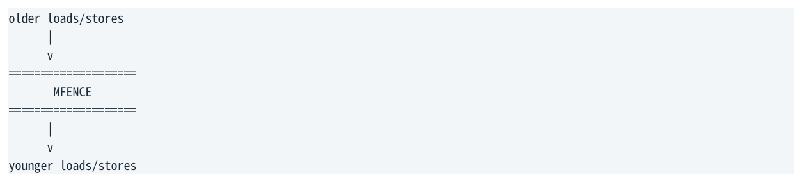

- ` older loads/stores `
- ` MFENCE `
- ` younger loads/stores `

</details>

实用微架构 mental model：MFENCE 必须等待 older stores 达到所需 visibility point，并阻止 younger memory operations 产生越过它的 architectural effect；在很多 Intel 实现上，这意味着需要等待相关 Store Buffer 工作推进/排空到足够程度。但“精确等哪些内部 queue bit”属于微架构实现，不是 ISA 保证。

### 6.3 MFENCE 与 ROB：CPU 是不是全部停住？“ ”

不应该简单理解成整个 pipeline 绝对不执行任何 younger non-memory work。MFENCE 是 memory-ordering/serializing operation，不等同于 CPUID 那种完整 instruction-stream serialization。CPU 可以有内部 speculation/准备工作，但不能让最终 memory semantics 穿过 barrier。

区分  “不能跨 fence 产生可观察 memory effect” ≠ “所有后续 µop 一律不能进入任何 execution stage”。Architectural rule 比微架构 implementation 更重要。

### 6.4 LFENCE / SFENCE

SFENCE 主要约束 store side，尤其对 streaming/non-temporal stores 等场景重要；普通 WB release store 在 x86 上通常不需要 SFENCE。LFENCE 的历史定位是 load ordering，现代 Intel 还赋予它更强的 execution-ordering 用途（例如 speculation control）；不要机械写成“acquire = LFENCE”。

### 6.5 std::atomic_thread_fence

C++ fence 是语言层原语。`atomic_thread_fence(acquire/release)` 在 x86 普通 WB 情况下可能不需要硬件 fence，只需 compiler 保持相应重排限制；`seq_cst` fence 常需要 MFENCE 或等价的 locked operation。

而且 fence 本身不会凭空建立线程间通信：通常仍要通过 atomic reads-from / release sequence 等关系把两个线程连接起来。

<a id="pdf-page-016"></a>

<!-- source-pdf-page: 16 -->

*[原 PDF 第 16 页](./Topic_Memory_Ordering_Atomics_x86_CN.pdf#page=16)*

C++ / CPU 深度学习 - Memory Ordering &amp; Atomic Synchronization

### 6.6 Compiler barrier vs CPU barrier

| 层次 | 阻止谁重排 | 典型例子 |
| --- | --- | --- |
| Compiler ordering | 编译器优化器 | C++ acquire/release semantics、compiler barrier |
| CPU/ISA ordering | 硬件 architectural memory order | MFENCE、locked instruction、ARM DMB/LDAR/STLR |
| 两者都需要 | 源代码语义最终跨编译器+CPU 成立 | C++ atomics/fences 的正确 lowering |

<a id="pdf-page-017"></a>

<!-- source-pdf-page: 17 -->

*[原 PDF 第 17 页](./Topic_Memory_Ordering_Atomics_x86_CN.pdf#page=17)*

C++ / CPU 深度学习 - Memory Ordering &amp; Atomic Synchronization

## 第 7 章 Atomic RMW 与 LOCK

本章目标  理解“原子”真正昂贵的部分：独占 cache-line ownership、coherence serialization 与强 ordering，而不是 ALU 加法本身。

### 7.1 普通 atomic load/store 不等于 LOCK

对常见对齐且 lock-free 的 32/64-bit scalar atomic，load/store 可以利用 x86 自身提供的原子 load/store 能力，典型就是 MOV。RMW 不同：read + modify + write 必须整体不可分割，所以通常需要 locked instruction。

### 7.2 LOCK XADD 的概念路径

```text
Core0 executes: lock xadd [x], reg

1. Request write ownership for x cache line
2. Invalidate competing sharers as required
3. Obtain exclusive/modified ownership
4. Atomically read old x
5. Compute new x
6. Write new x
7. Complete the locked operation with strong ordering
```

这不是 Intel 对某一代 core 内部 pipeline 电路的逐 cycle 描述，而是把 architectural requirements 映射到 coherence/ownership 的正确 mental model。

### 7.3 LOCK 不等于“锁整个 bus”

现代 Intel 对 cacheable、正常落在 cache line 中的 locked access，通常依靠 cache coherency/cache locking，而不是 assert 全局 bus lock。真正 bus lock 更多与不可 cache、跨 cache-line / split-lock 等特殊情况相关。

```text
Normal cached locked RMW:
  target cache line ownership + coherence serialization

Bad split/misaligned case:
  may require much heavier system-wide locking behavior
```

### 7.4 Locked instruction 还提供强 ordering

Intel x86 memory model 规定 loads/stores 不与 earlier/later locked instruction 发生 architectural reordering；所有处理器也同意 locked instructions 的单一执行顺序。这使 locked operations 同时成为 atomicity primitive 与强 ordering anchor。

**图示转写**

1. ` older memory operations `
2. ` LOCKED RMW `
3. ` younger memory operations `

<details>
<summary>查看原图与完整文字转写</summary>

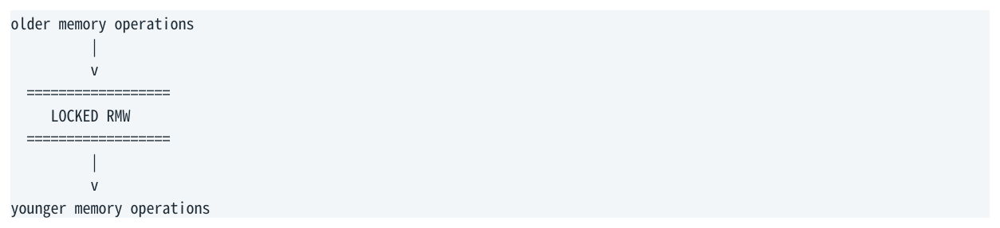

- ` older memory operations `
- ` LOCKED RMW `
- ` younger memory operations `

</details>

### 7.5 M state 不是 LOCK 本身

普通 store 也要取得写 ownership/M state。Locked RMW 的额外要求是：从读取旧值到写回新值的整个逻辑操作必须不可分割，竞争 core 不能在 architectural memory order 中插入一个破坏 RMW 的修改。

<a id="pdf-page-018"></a>

<!-- source-pdf-page: 18 -->

*[原 PDF 第 18 页](./Topic_Memory_Ordering_Atomics_x86_CN.pdf#page=18)*

C++ / CPU 深度学习 - Memory Ordering &amp; Atomic Synchronization

### 7.6 Split Lock

如果 locked operand 跨 cache-line boundary，cache-line-based coherence 很难只锁住一个 line 完成整个 atomic transaction，可能退化到极昂贵的 bus-lock-like 行为。现代 Intel 提供 split-lock detection。低延迟代码应确保原子对象自然对齐且不跨 line。

<a id="pdf-page-019"></a>

<!-- source-pdf-page: 19 -->

*[原 PDF 第 19 页](./Topic_Memory_Ordering_Atomics_x86_CN.pdf#page=19)*

C++ / CPU 深度学习 - Memory Ordering &amp; Atomic Synchronization

## 第 8 章 XCHG、XADD、CMPXCHG

本章目标  分别理解 unconditional exchange、arithmetic RMW 与 conditional RMW 在 x86 上的实现语义。

### 8.1 Memory XCHG：隐含 LOCK semantics

`xchg reg, [mem]` 只要涉及 memory operand，就自动按 locked semantics 执行；不需要额外写 LOCK prefix。它天然是 atomic exchange + strong ordering，因此常被 compiler 用作 SC store 的实现选择。

```asm
xchg eax, [x]

atomic {
    tmp = [x];
    [x] = eax;
    eax = tmp;
}
```

### 8.2 LOCK XADD：unconditional arithmetic RMW

`lock xadd [x], eax` 会原子地交换“旧值返回到寄存器、内存写入旧值+增量”。`fetch_add` 很自然映射到它。无论 relaxed 还是 seq_cst，RMW atomicity 需求都可能让底层指令相同。

### 8.3 LOCK CMPXCHG：conditional RMW / CAS

CMPXCHG 先比较 memory 与 expected register；相等才写 desired，否则把当前 memory value 返回到 expected。加 LOCK 后，整个 compare/conditional-write 形成 atomic RMW。

```text
if ([x] == expected) {
    [x] = desired;
    success = true;
} else {
    expected = [x];
    success = false;
}
// The comparison/update is atomic with respect to competitors.
```

### 8.4 失败 CAS 也不是普通 Load

一个常见误区是“CAS fail 没写，所以成本≈load”。实际上 lock cmpxchg 仍属于 locked RMW class，需要满足 atomicity 和 strong ordering，并会参与 cache coherence。失败可能没有改变 abstract value，但硬件工作远不等于普通 load。

性能后果  在高 contention 的 spin/CAS loop 中，大量失败尝试会消耗 coherence/ownership/serialization 资源，却没有推进共享状态，形成 CAS storm。

<a id="pdf-page-020"></a>

<!-- source-pdf-page: 20 -->

*[原 PDF 第 20 页](./Topic_Memory_Ordering_Atomics_x86_CN.pdf#page=20)*

C++ / CPU 深度学习 - Memory Ordering &amp; Atomic Synchronization

## 第 9 章 seq_cst 在 x86 上如何落地

本章目标  从 Store Buffering litmus 推导：为什么 x86 最需要修补 Store→Load，并如何用 locked operation/MFENCE 构造 C++ SC total order。

### 9.1 SC total order 是所有“ SC operations 的共同约束”

C++ 要求所有 seq_cst operations/fences 存在一个与各线程规则兼容的 single total order。实现不需要给每个 SC operation 都插一个全栅栏；它只需保证整个 generated instruction set 不允许构造违反 SC 的结果。

### 9.2 x86 最大的洞：Store→Load

```text
Core0: x.store(1, seq_cst);   r0 = y.load(seq_cst);
Core1: y.store(1, seq_cst);   r1 = x.load(seq_cst);
SC forbids: r0 = 0 && r1 = 0
But plain MOV stores + MOV loads on x86 TSO could create that result
through two store buffers.
```

因此 SC implementation 必须在关键位置堵住 Store→Load relaxation。

### 9.3 为什么 SC store 常见 XCHG，而 SC load 仍是 MOV

一种经典 mapping 是把 SC store 变成 locked XCHG，使其同时具备写入、强 ordering 与 locked total-order anchor；SC load 则利用 x86 本身已经较强的 load ordering，仍可用 MOV。两者组合满足 SC，而不是“SC load 自己必须昂贵”。

```text
SC store:   xchg  [x], eax      // implicit LOCK
SC load:    mov   eax, [x]
The expensive ordering can be concentrated on the store side.
```

### 9.4 另一种思路：MOV + MFENCE

Compiler 也可以选择普通 store 再通过 MFENCE 等手段堵住 Store→Load，具体 lowering 是 compiler/version/optimization choice。C++ 标准只约束 observable semantics。

### 9.5 Locked instructions 的 total order 为什么重要

Intel 定义所有处理器同意 locked instructions 的单一执行顺序，而且普通 loads/stores 不与 locked instructions architectural reorder。这给 compiler 一个非常强的“全局排序锚点”，正适合构造 seq_cst 的 total-order requirement。

<a id="pdf-page-021"></a>

<!-- source-pdf-page: 21 -->

*[原 PDF 第 21 页](./Topic_Memory_Ordering_Atomics_x86_CN.pdf#page=21)*

C++ / CPU 深度学习 - Memory Ordering &amp; Atomic Synchronization

## 第 10 章 CAS 与 fetch_add 的性能模型

本章目标  不仅比较语义，还从 coherence ownership、retry 与 useful progress 分析 contention 下的扩展性。

### 10.1 Conditional vs Unconditional RMW

| 性质 | fetch_add | CAS / compare_exchange |
| --- | --- | --- |
| x86 常见指令 | lock xadd | lock cmpxchg |
| 是否一定修改值 | 是（执行的 RMW 会产生 arithmetic update） | 只有 expected 匹配才更新 |
| 可能失败吗 | 没有 CAS 式逻辑失败 | 有 |
| 典型用途 | counter/sequence/ticket/reference count | state transition/pointer/lock-free algorithm/lock acquisition |
| contention 特征 | 所有有效 updates 被 serialise | 有效 update + failed attempts 都可能消耗资源 |

### 10.2 Cache-Line Bouncing 是两者的共同底层瓶颈

多个 cores 对同一 atomic cache line 做 RMW 时，只有一个 core 能在某时刻持有满足写入需求的 ownership。line 会在 cores 之间迁移：

**图示转写**

1. ` Core0 M(x) `
2. ` Core3 M(x) `
3. ` Core1 M(x) `
4. ` Core7 M(x) `
5. ` ... `
6. ` Each transfer may involve: `
7. ` ownership request + invalidation + cache-to-cache transfer + serialization `

<details>
<summary>查看原图与完整文字转写</summary>

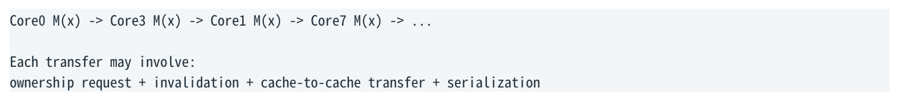

- ` Core0 M(x) → Core3 M(x) → Core1 M(x) → Core7 M(x) → ... `
- ` Each transfer may involve: `
- ` ownership request + invalidation + cache-to-cache transfer + serialization `

</details>

因此真正昂贵的不是 ADD 或 compare 本身，而是 ownership migration 与 coherence serialization。

### 10.3 CAS Retry Storm

如果用 CAS loop 实现 increment，多线程可以同时基于同一个旧值计算 desired，但最终只有一个成功，其余失败后重试。

**图示转写**

| 时间顺序 | Core0 | Core1 |
| --- | --- | --- |
| 读取 | reads 10 | reads 10 |
| 首次 CAS | 10 → 11 succeeds | 10 → 11 fails |
| 重试 | 已完成 | 11 → 12 succeeds |

Useful updates = 2；locked CAS attempts = 3。

<details>
<summary>查看原图与完整文字转写</summary>

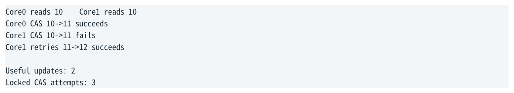

- ` Core0 reads 10 Core1 reads 10 `
- ` Core0 CAS 10->11 succeeds `
- ` Core1 CAS 10->11 fails `
- ` Core1 retries 11->12 succeeds `
- ` Useful updates: 2 `
- ` Locked CAS attempts: 3 `

</details>

高 contention 下失败比例上升，造成大量“没有状态进展但仍很重”的 locked attempts。

### 10.4 fetch_add 没有 Retry Storm，但仍然 Serialized

`fetch_add` 每个 RMW 都能产生一个唯一旧值并推进 counter，因此不存在 CAS 式失败重试；但所有 updates 仍必须在同一个 cache line 上串行化。它是“serializes useful updates”，不是“变成可并行”。

一句话  fetch_add serializes useful updates; CAS can serialize both useful updates and failed attempts.

<a id="pdf-page-022"></a>

<!-- source-pdf-page: 22 -->

*[原 PDF 第 22 页](./Topic_Memory_Ordering_Atomics_x86_CN.pdf#page=22)*

C++ / CPU 深度学习 - Memory Ordering &amp; Atomic Synchronization

### 10.5 Test-and-Test-and-Set (TTAS)

spin lock 不应让所有 waiter 持续做 CAS/RMW。一个经典策略是：先用 relaxed/ordinary atomic load 在 Shared 状态下轮询， 只有看到可能 unlocked 时才尝试 CAS。

```text
while (lock.load(relaxed)) {
    pause();
}
expected = false;
if (!lock.compare_exchange_weak(expected, true, acquire)) {
    retry;
}
```

Shared read-only spinning 仍消耗 core/interconnect resources，但通常比所有 waiter 持续争夺 M ownership 好。进一步高 contention 时可考虑 ticket/MCS 等排队锁。

### 10.6 strong vs weak CAS

C++ `compare_exchange_weak` 允许 spurious failure，适合本来就有 retry loop 的场景；`strong` 不允许这种额外的伪失败。x86 CMPXCHG 本身一般没有 LL/SC 那种自然的 spurious-failure 需求，所以二者可能生成相似代码；跨架构仍应按语义选用。

<a id="pdf-page-023"></a>

<!-- source-pdf-page: 23 -->

*[原 PDF 第 23 页](./Topic_Memory_Ordering_Atomics_x86_CN.pdf#page=23)*

C++ / CPU 深度学习 - Memory Ordering &amp; Atomic Synchronization

## 第 11 章 Low-Latency / HFT Engineering

本章目标  把 memory model 变成设计约束：减少共享写 ownership 转移，比“把 memory_order 换 relaxed”更可能带来数量级收益。

### 11.1 Single-Writer Ownership

如果可以设计成一个线程拥有某块 mutable state，其他线程通过 message passing / SPSC / snapshots 消费，就能从根源减少多个 cores 对同一 cache line 反复抢 M ownership。

**图示转写**

| 场景 / 部分 | 路径、状态或说明 |
| --- | --- |
| Bad hotspot | ` Core0/Core1/Core2/Core3 → atomic shared state ` |
| Better ownership | ` Producer owns mutable state `；` → SPSC / versioned snapshot / per-consumer channel ` |

<details>
<summary>查看原图与完整文字转写</summary>

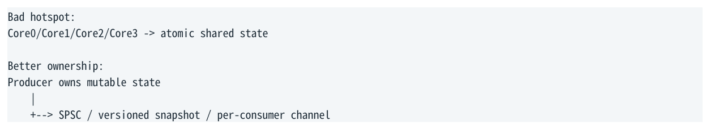

- ` Bad hotspot: `
- ` Core0/Core1/Core2/Core3 → atomic shared state `
- ` Better ownership: `
- ` Producer owns mutable state `
- ` → SPSC / versioned snapshot / per-consumer channel `

</details>

### 11.2 Per-Thread / Per-Core Counter

全局 `fetch_add(relaxed)` 仍然是 coherence hotspot。若业务允许 eventual aggregation，可以让每线程本地累加，再周期性汇总。

**图示转写**

| 设计 | 访问 / 聚合关系 |
| --- | --- |
| Global atomic counter | 所有 cores → 同一 line → ownership ping-pong |
| Sharded counters | Core0→c0；Core1→c1；Core2→c2；cold path aggregate |

<details>
<summary>查看原图与完整文字转写</summary>

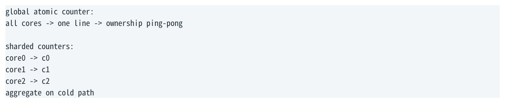

- ` global atomic counter: `
- ` all cores → one line → ownership ping-pong `
- ` sharded counters: `
- ` core0 → c0 `
- ` core1 → c1 `
- ` core2 → c2 `
- ` aggregate on cold path `

</details>

### 11.3 False Sharing 与 Atomic Hotspot

即便两个线程修改的是不同变量，只要落在同一 cache line，coherence 按 line 粒度工作，仍会造成 ownership bouncing。原子对象/高频写字段的 layout、padding 与 `hardware_destructive_interference_size` 思维因此很重要。

### 11.4 Publish/Consume：Release-Acquire 往往比 SC 更贴合需求

很多生产者-消费者模式真正需要的是“先写 payload，再发布 ready；consumer 看到 ready 后读取 payload”。这对应 release/acquire，而不是天然要求所有 atomics 的 global SC total order。

**图示转写**

| 场景 / 部分 | 路径、状态或说明 |
| --- | --- |
| Producer | ` payload = ...; // ordinary writes `；` ready.store(1, release); // publish ` |
| Consumer | ` if (ready.load(acquire)) // acquire publication `；` consume(payload); ` |

<details>
<summary>查看原图与完整文字转写</summary>

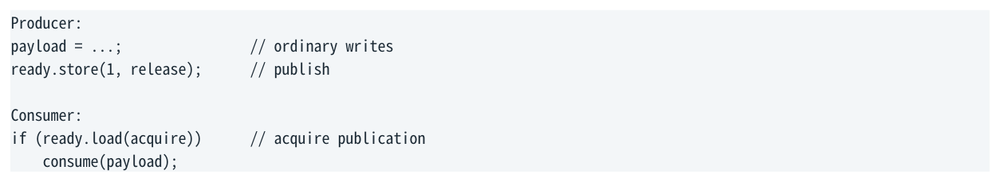

- ` Producer: `
- ` payload = ...; // ordinary writes `
- ` ready.store(1, release); // publish `
- ` Consumer: `
- ` if (ready.load(acquire)) // acquire publication `
- ` consume(payload); `

</details>

在 x86 上这往往仍是 MOV/MOV；在 ARM 上会映射到更显式的 ordered load/store。选择 memory order 应来自 invariants，不应只是为了“汇编看起来少一条 fence”。

<a id="pdf-page-024"></a>

<!-- source-pdf-page: 24 -->

*[原 PDF 第 24 页](./Topic_Memory_Ordering_Atomics_x86_CN.pdf#page=24)*

C++ / CPU 深度学习 - Memory Ordering &amp; Atomic Synchronization

### 11.5 Tail Latency：平均成本不是全部

一个 uncontended atomic RMW 可能很快，但 line 若位于 sibling/core/remote NUMA/socket，或者突然出现竞争、 preemption、SMT 干扰，tail 可以明显放大。低延迟系统需要同时问：

- cache line 通常由谁拥有？ownership 会不会频繁迁移？

- 是否存在多个 writers？是否能转成 single-writer？

- atomic 在 hot path 的次数是否与消息/订单数量线性增长？

- 是否有 CAS retry loop，失败概率如何随 contention 增长？

- 是否跨 NUMA/socket？是否会形成远端 coherence traffic？

### 11.6 Memory Order 优化的正确顺序

1. 先证明算法的 synchronization invariant 与 happens-before 需求。

2. 再确认 atomic 对象是否真需要共享写；能否改 ownership/dataflow。

3. 再检查 cache-line layout 与 contention。

4. 最后才讨论 seq_cst 是否能安全降为 acquire/release/relaxed。

5. 用 benchmark/perf 验证；不要把“少一个 fence”当成自动更快。

<a id="pdf-page-025"></a>

<!-- source-pdf-page: 25 -->

*[原 PDF 第 25 页](./Topic_Memory_Ordering_Atomics_x86_CN.pdf#page=25)*

C++ / CPU 深度学习 - Memory Ordering &amp; Atomic Synchronization

## 第 12 章 实验、常见误区与面试题

本章目标  把理论转化为可以在 Godbolt、litmus 与 perf 上验证的实验，并形成准确的面试表达。

### 12.1 Godbolt：先看 compiler 实际 lowering

```cpp
#include <atomic>
std::atomic<int> x{0};

int lr() { return x.load(std::memory_order_relaxed); }
int la() { return x.load(std::memory_order_acquire); }
int ls() { return x.load(std::memory_order_seq_cst); }

void sr(int v) { x.store(v, std::memory_order_relaxed); }
void sre(int v){ x.store(v, std::memory_order_release); }
void ssc(int v){ x.store(v, std::memory_order_seq_cst); }

int fa(){ return x.fetch_add(1, std::memory_order_relaxed); }
```

在 x86-64 与 AArch64 分别编译，观察 relaxed/acquire/release/SC 的差异。务必使用优化构建并指定 compiler/version/target；不要从 -O0 汇编推 production hot path。

### 12.2 Store Buffering Litmus

可以写两个 pinned threads 反复执行 SB pattern，统计 `0/0` 是否出现。实验需要非常小心：compiler ordering、start barrier、cache state、统计方法都可能污染结果。更专业地可使用 herd/litmus 工具理解 architectural allowed outcomes。

### 12.3 perf：观察 Atomic Contention 的间接证据

没有一个 universal counter 叫“CAS 太多”。通常需要组合证据：cycles/op、LLC/cache-to-cache、HITM 相关事件（具体 PMU 依 CPU）、lock instruction counts、backend stalls、NUMA placement，再配合 controlled benchmark。

方法论  先提出可证伪预测：如果瓶颈是 shared RMW line bouncing，那么把 counter sharding 到 per-thread 后，cycles/op 与 coherence-related counters 应明显下降；若没有下降，原假设需要重审。

### 12.4 高频误区

| 误区 | 正确理解 |
| --- | --- |
| “retire 有序，所以 memory 也有序” | store retire 后仍可在 store buffer，visibility 是另一层 |
| “Store→Load 是 load 先 retire” | 不需要；关键是 store 尚未 globally visible 而 younger load 已完成 |
| “Load→Load 不乱序 = 第二个 load 不能先执行” | 内部可以 speculative/OoO；架构结果不能违规 |
| “coherence 就是 memory ordering” | coherence 管 same-location consistency；ordering 管多个 operations关系 |
| “MFENCE 把 cache flush 到 DRAM” | 它建立 ordering/visibility constraint，不是一般 cache flush |
| “atomic 都是 LOCK” | 常见 scalar atomic load/store 可只是 MOV；RMW 才常见 LOCK |
| “relaxed 就没有 LOCK” | RMW atomicity 仍可能要求 lock xadd/cmpxchg |

<a id="pdf-page-026"></a>

<!-- source-pdf-page: 26 -->

*[原 PDF 第 26 页](./Topic_Memory_Ordering_Atomics_x86_CN.pdf#page=26)*

C++ / CPU 深度学习 - Memory Ordering &amp; Atomic Synchronization

| 误区 | 正确理解 |
| --- | --- |
| “失败 CAS 就像 load” | 仍是 locked RMW class，可能很重 |
| “LOCK = 锁总线” | cacheable normal line 通常依靠 cache/coherence locking；特殊 split lock 更重 |
| “seq_cst 每条操作都有 mfence” | SC 是全局 mapping；SC load 常仍是 MOV |

### 12.5 面试回答：x86 Store→Load 是什么

推荐表达  It does not require the younger load to retire before the older store. The older store may already have retired into the store buffer but is not yet globally visible, while an independent younger load can execute and complete. The observable behavior is therefore equivalent to the load passing the store.

### 12.6 面试回答：为什么 relaxed fetch_add 仍然贵

推荐表达  Relaxed weakens ordering with respect to other memory operations; it does not weaken the atomicity of the read-modify-write itself. On x86 a fetch_add commonly still uses LOCK XADD, so contended cores must serialize cache-line ownership and can suffer cache-line bouncing.

### 12.7 面试回答：为什么 seq_cst store 比 release store 更可能重

推荐表达  x86 already provides the ordering needed by a release store, so a normal MOV is often sufficient. Sequential consistency additionally participates in a global SC order and must close x86's Store-to-Load relaxation; compilers commonly use a locked XCHG or an equivalent strong-ordering sequence for an SC store.

<a id="pdf-page-027"></a>

<!-- source-pdf-page: 27 -->

*[原 PDF 第 27 页](./Topic_Memory_Ordering_Atomics_x86_CN.pdf#page=27)*

C++ / CPU 深度学习 - Memory Ordering &amp; Atomic Synchronization

## 附录 A 速查与复习

本章目标  把全书压缩为可用于复习、设计评审与面试的几张表。

### A.1 术语表

| 术语 | 一句话 |
| --- | --- |
| Store Buffer | 让 store retirement/progress 与真正 coherent visibility 解耦的有限结构 |
| Load Queue / Load Buffer | 追踪 in-flight/speculative loads 与 ordering/replay 信息 |
| Store forwarding | younger same-address load 从 pending store 获取新值 |
| Memory disambiguation | 预测 older store 与 younger load 是否 alias |
| RFO / ownership request | 取得 cache line 写权限并使竞争副本失效 |
| Coherence | 维护 same-location/cache-line 版本与 ownership 一致性 |
| TSO | x86 的较强 memory model；主要允许 Store→Load relaxation |
| Fence | 建立 memory ordering point，不等价于 flush DRAM |
| LOCKed RMW | atomic read-modify-write + strong ordering |
| XCHG(mem) | 隐式 locked atomic exchange |
| XADD | 返回旧值并写入 old+delta 的 RMW |
| CMPXCHG | 比较 expected 后条件写入 desired 的 RMW/CAS |
| SC total order | 所有 seq_cst operations/fences 共享的单一全局顺序 |

<a id="pdf-page-028"></a>

<!-- source-pdf-page: 28 -->

*[原 PDF 第 28 页](./Topic_Memory_Ordering_Atomics_x86_CN.pdf#page=28)*

C++ / CPU 深度学习 - Memory Ordering &amp; Atomic Synchronization

### A.2 C++ → x86 典型映射

| 操作 | 典型 x86-64 | 关键原因 |
| --- | --- | --- |
| atomic load relaxed/acquire | MOV | x86 load ordering 足够 |
| atomic store relaxed/release | MOV | x86 store-store ordering 足够 |
| atomic load seq_cst | MOV（常见） | 整个 SC mapping 共同提供 total order |
| atomic store seq_cst | XCHG 或 MOV+MFENCE | 需要更强 Store→Load/SC ordering |
| exchange | XCHG | memory XCHG implicit LOCK |
| fetch_add | LOCK XADD | unconditional atomic RMW |
| compare_exchange | LOCK CMPXCHG | conditional atomic RMW |
| seq_cst fence | MFENCE 或等价 locked op | full memory ordering point |

### A.3 最终心智模型

**图示转写**

| 场景 / 部分 | 路径、状态或说明 |
| --- | --- |
| C++ memory model | ` Compiler lowering `；` MOV / XCHG / LOCK XADD / LOCK CMPXCHG / MFENCE `；` CPU core + `；` ROB: in-order retirement `；` Load Queue: speculative loads / replay `；` Store Buffer: pending stores / forwarding `；` memory-order constraints / fences `；` L1 / cache line state `；` coherence / RFO / invalidate `；` other cores / caches ` |
| Retire order != memory visibility order. | ` Atomicity != ordering. `；` Coherence != memory consistency/order. ` |

<details>
<summary>查看原图与完整文字转写</summary>

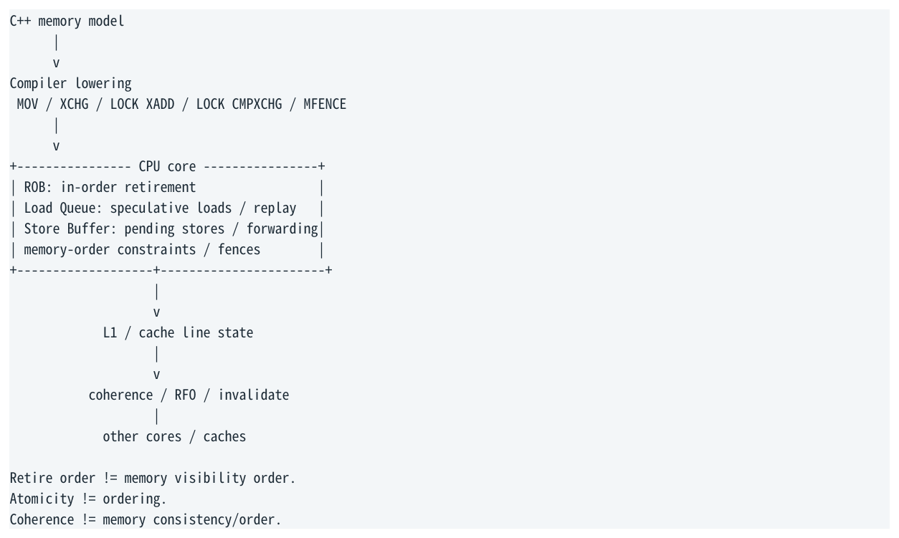

- ` C++ memory model `
- ` Compiler lowering `
- ` MOV / XCHG / LOCK XADD / LOCK CMPXCHG / MFENCE `
- ` CPU core + `
- ` ROB: in-order retirement `
- ` Load Queue: speculative loads / replay `
- ` Store Buffer: pending stores / forwarding `
- ` memory-order constraints / fences `
- ` L1 / cache line state `
- ` coherence / RFO / invalidate `
- ` other cores / caches `
- ` Retire order != memory visibility order. `
- ` Atomicity != ordering. `
- ` Coherence != memory consistency/order. `

</details>

### A.4 复习清单

- 能否解释为什么 Store→Load reordering 不等于 load 先 retire？

- 能否解释 Load→Load ordering 与“第二个 load speculative 先完成”为什么不矛盾？

- 能否说清 Store Buffer、Load Queue、Store forwarding、memory disambiguation 各自职责？

- 能否解释 RFO、M ownership 与 globally visible 为什么不等于 DRAM？

- 能否区分 coherence 与 memory ordering？

- 能否从 first principles 推导为什么 x86 release/acquire 经常只是 MOV？

> **转换补充**：表内 x86 指令是常见 lowering，不是标准保证。尤其 `fetch_add` 的旧值未使用时可生成 `LOCK ADD`，旧值使用时常见 `LOCK XADD`；bitwise RMW 也须按返回值用途和 target 检查实际代码。`std::atomic<T>` 是否 lock-free 还取决于 T、对齐与实现。参见 [GCC atomic builtins](https://gcc.gnu.org/onlinedocs/gcc/_005f_005fatomic-Builtins.html)。

<a id="pdf-page-029"></a>

<!-- source-pdf-page: 29 -->

*[原 PDF 第 29 页](./Topic_Memory_Ordering_Atomics_x86_CN.pdf#page=29)*

C++ / CPU 深度学习 - Memory Ordering &amp; Atomic Synchronization

- 能否解释为什么 seq_cst store 常见 XCHG，而 SC load 仍可能是 MOV？

- 能否解释 MFENCE 为什么不是 cache flush？

- 能否解释 LOCK 为什么现代 CPU 通常不是全局 bus lock？

- 能否解释 relaxed fetch_add 为什么仍需要 locked RMW？

- 能否比较 CAS 与 fetch_add 在 high contention 下的 failure mode？

- 看到 shared atomic hotspot 时，能否优先考虑 ownership/sharding，而不是只改 memory_order？

### A.5 参考资料与边界

本讲义以 C++ memory model、Intel 64/IA-32 architectural memory ordering、主流 x86-64 compiler lowering 以及现代 coherent cache 的通用模型为基础。具体 Intel/AMD generation 的 µop 分解、Store Buffer 数量、fence latency、cache-to-cache latency 与 PMU event 名称必须绑定具体 CPU 验证。

- Intel® 64 and IA-32 Architectures Software Developer’s Manual, Vol. 3A - Multiple-Processor Management / Memory Ordering / Locked Instructions.

- Intel® 64 and IA-32 Architectures Software Developer’s Manual, Vol. 2 - MFENCE, LOCK, XCHG, XADD, CMPXCHG instruction semantics.

- Intel® 64 and IA-32 Architectures Optimization Reference Manual - memory subsystem, stores, cache/coherence performance guidance.

- C++ standard atomic/memory-order model; cppreference std::memory_order / std::atomic as practical API reference.

- ARM Architecture Reference Manual / AArch64 memory ordering documentation for acquire/release and barrier semantics.

- uops.info / Compiler Explorer / perf for microarchitecture-specific verification.

最后一句话  现代 CPU 允许内部执行尽可能激进；ROB 保证 precise retirement；Store Buffer 与 speculative loads 继续隐藏内存延迟；coherence 管 ownership；而 atomics、locked operations 与 fences 在这些机制之上施加足够的 architectural ordering，使多个 cores 最终只能观察到语言/ISA 允许的结果。

End of Notes

<a id="conversion-errata"></a>

## 转换补充与勘误

本节及正文中“转换补充 / 转换勘误”均为 2026-11-06 转换时新增；原 PDF 仍是原始内容与版式的对照。

- [原 PDF 第 28 页处的补充](#pdf-page-028)：表内 x86 指令是常见 lowering，不是标准保证。

### 适用边界

原文中的时延、cache/ROB 大小、PMU event、kernel 参数及 compiler lowering 均需要绑定具体平台。转写结构的覆盖校验不等同于对全部技术命题的逐条实测；复杂图的精确布局以随附原图为准。
