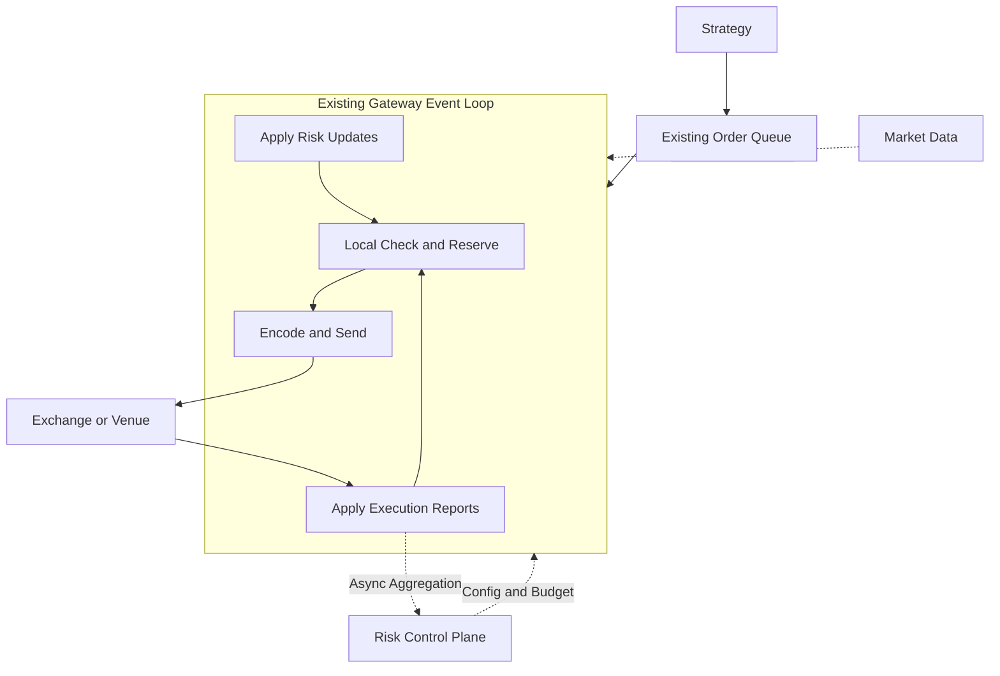
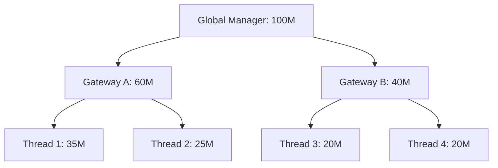
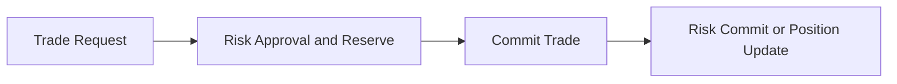

# Pre-Trade Risk / Risk Gateway：低延迟架构与一致性设计

> 面向 Senior C++ / HFT Systems Design 面试。本文讨论通用架构与工程取舍，不代表任何特定公司的内部实现。文中的 2 ms FX flow、额度及延迟数字均为示例，不是性能基准。

## 1. 核心设计原则

- **Check-and-Reserve, not Check-Only**：批准订单时立即占用风险容量。
- **Worst-Case Exposure, not Current Position**：考虑所有仍可能成交的订单。
- **Replicate Information, Partition Ownership**：信息可以订阅复制，但可消费的硬额度必须拥有明确的所有权。
- **Localize Decisions, Batch Coordination**：把高频决策留在本地，把低频协调移到 control plane。
- **Logical Component ≠ Process ≠ Thread**：风险模块可以嵌入已有 Gateway 的事件循环，不必引入额外线程、队列或 RPC。
- **Correctness before Latency**：首先明确风险 invariant，再选择线程模型、通信方式与优化手段。

## 2. Risk Domain 基础

| 概念 | 含义 |
|---|---|
| Position | 已成交交易产生的净持仓或各币种/产品的数量状态 |
| Exposure | 按风险模型衡量的敞口，例如币种、名义金额、市值、delta、scenario loss 等 |
| Working Order | 仍有可能成交的订单，包括部分未确认订单 |
| Reservation | 为潜在成交保留的风险容量 |
| Risk Limit | 允许的风险上限或上下界 |
| Available Capacity | 根据模型及已占用容量计算的可用额度 |

Position 可以因成交、冲正、到期等事件改变；即使数量不变，按基准币种或市场价格计算的 Exposure 也会变化。FX 交易涉及两条货币腿，例如买 EUR/USD 会增加 EUR 并减少 USD；远期交易还需要考虑价值日、期限、估值、净额等模型因素。

不能把不同风险度量直接混为一谈。Gross notional、net currency exposure、counterparty credit、portfolio margin 各自有独立的计算规则。

### 2.1 常见 Pre-Trade Risk Checks

| 类型 | 检查 |
|---|---|
| Stateless / Reference | Max Order Quantity、字段合法性、交易权限、Instrument Restriction |
| Market-dependent | Price Collar、Reference Price、FX Rate、Market Data Staleness |
| Stateful | Position Limit、Open Order Limit、Credit Limit、Gross Notional、Exposure |
| Time-dependent | Order Rate Limit、交易时段 |
| Cross-domain | Firm/Desk/Portfolio Limits、Self-Trade Prevention、Global Kill Switch |

Rate limit 可以基于 token bucket 或 sliding window，必须明确统计所有请求还是实际放行请求。Daily Loss、Greeks、VaR 等通常需要独立风险计算支持，不一定适合直接在每笔订单路径重新计算。

## 3. Worst-Case Position 与 Risk Reservation

令 P 为已成交的带符号净持仓，B 为仍可能成交的买单剩余数量总和，S 为仍可能成交的卖单剩余数量总和。

$$
P_{max}=P+B,\qquad P_{min}=P-S
$$

若 long / short limit 分别为正数 $L_l,L_s$，要求：

$$
P+B\le L_l,\qquad P-S\ge -L_s
$$

例如 P=70, B=20, long limit=100。新 Buy 20 会使 worst-case long position 达到 110，应拒绝。不能用 working sell 抵消 working buy，因为成交结果不一定对称。

这是单产品数量模型；金额、价格变动、跨资产净额与非线性风险需要单独建模。动态限额下调或市场重估本身也可能导致既有风险超限，不能宣称 admission control 能保证任何时候市场风险均不超限。

### 3.1 Order Lifecycle

以 Buy 为例：

| Event | Position | Reserved Buy |
|---|---:|---:|
| Risk accepted | 不变 | +Q |
| Venue ACK | 不变 | 不变 |
| Fill q | +q | -q |
| Cancel request | 不变 | 不变 |
| Cancel ACK | 不变 | -remaining |
| Venue reject | 不变 | -remaining |
| Cancel reject | 不变 | 不变 |
| Timeout / unknown | 不变（按已知信息） | 保留潜在成交部分 |

Fill 的关键 invariant：

$$
(P+q)+(B-q)=P+B
$$

也就是同一数量模型下，成交把 reservation 转为 position，并不增加 worst-case long endpoint。卖单对应 short endpoint；成交可能改变另一方向 endpoint。

注意事项：

- 已发送未 ACK 的订单仍可能成交。
- Cancel request 不等于 Cancel ACK；不能提前释放 reservation。
- Replace 按 venue 协议处理：原子 replace 与 cancel+new 不同，必须覆盖两者可能同时存在的风险。
- 通过 order ID、execution ID、session sequence、CumQty 等处理重复与乱序；支持 bust/correction，不能盲目以 CumQty 永远递增为假设。
- 只有确定订单未发布、未发送或剩余部分不会成交时，才释放对应 reservation。

### 3.2 单线程示例（固定限额）

```cpp
#include <cstdint>

enum class Side { Buy, Sell };

struct PositionRisk {
    std::int64_t position{};
    std::int64_t pendingBuy{};
    std::int64_t pendingSell{};
    std::int64_t maxLong{};
    std::int64_t maxShort{};

    bool checkAndReserve(Side side, std::int64_t qty) noexcept {
        if (qty <= 0) return false;
        // __int128 is a GCC/Clang extension; alternatively use checked arithmetic.
        using Wide = __int128;
        const Wide hi = Wide(position) + pendingBuy
                      + (side == Side::Buy ? qty : 0);
        const Wide lo = Wide(position) - pendingSell
                      - (side == Side::Sell ? qty : 0);
        if (hi > maxLong || lo < -Wide(maxShort))
            return false;

        // Assume pending quantities and their updates fit int64_t;
        // in production validate bounds independently.
        if (side == Side::Buy) pendingBuy += qty;
        else pendingSell += qty;
        return true;
    }
};
```

假设 valid Side、非负限额及 pending 数量，所有操作由同一 owner 执行，且 pending 更新不溢出。时间 O(1)，辅助空间 O(1)。代码为教学示例，未实现 per-order tracking、reconciliation 或动态限额超限后的 reduce-only 策略。

## 4. Concurrency: Atomic 不等于 Transaction

### 4.1 TOCTOU Race

```cpp
if (used.load() + qty <= limit) {
    used.fetch_add(qty);
    return true;
}
```

两个线程均看到 used=70, limit=100，各 reserve 20，最后 usage=110。即使 seq_cst 也无法把 load/check/fetch_add 合并成单一事务。

单个共享计数器可以使用 CAS：

```cpp
#include <atomic>
#include <cstdint>

bool reserve(std::atomic<std::int64_t>& used,
             std::int64_t limit, std::int64_t qty) noexcept {
    if (qty <= 0 || limit < 0) return false;
    auto old = used.load(std::memory_order_relaxed);
    for (;;) {
        if (old < 0 || old > limit || qty > limit - old)
            return false;
        if (used.compare_exchange_weak(old, old + qty,
                std::memory_order_relaxed,
                std::memory_order_relaxed))
            return true;
    }
}
```

前提：固定 limit，独立数值计数器，正确的 release 协议，不承担其他数据的 publication。Relaxed 足够保证该计数器的原子 RMW；如果用于发布订单数据，需要另外的同步协议。

CAS loop 不是 wait-free；底层 atomic 是否 lock-free 取决于类型与平台。竞争下可能发生 cache-line ownership transfer、RFO、CAS retries 和 tail latency 放大。

### 4.2 多字段一致性

Fill 前 P=70, B=30；Fill 20 后 P=90, B=10。

- 先增加 P：中间读到 90+30=120，可能错误拒单。
- 先减少 B：中间读到 70+10=80，可能错误放行。

独立 atomic 字段即使 seq_cst 也不保证一致的业务快照。Instrument、Strategy、Desk、Portfolio、Firm 多维额度的逐项 CAS 也需要处理 partial reservation、rollback 和 crash recovery。

若采用保守的 staged reservation，可以保证各维不超限，但可能产生暂时错误拒单；并非所有场景都要求跨维线性化，但必须明确承诺的语义。

### 4.3 并发模型选择

| 机制 | 适用场景 | Trade-off |
|---|---|---|
| Mutex | 复杂共享事务，竞争较低 | contention、blocking、tail latency |
| CAS | 独立计数器 | retry、true sharing |
| Wide CAS | 可编码为少量固定字段的状态 | 平台、位宽限制 |
| Seqlock | 一致读取快照 | reader retry；C++ 中不能用普通非原子并发访问规避 data race |
| Immutable Snapshot / RCU | read-mostly 配置 | reclamation、版本管理 |
| Single Writer | 复杂 mutable risk state | 单 owner 吞吐瓶颈、可能需要 handoff |
| Sharded Single Writer | 可分解的复杂风险状态 | 跨 shard 协调、负载不均 |
| Budget Partitioning | 可保守分解的硬限制 | fragmentation、rebalancing |

Single Writer 可以让所有 check 使用一致的状态，先计算 delta 并完成所有检查，然后提交 reservation。Commit 路径应预分配、无异常、无外部可见中间状态。Single Writer 不自动提供 crash atomicity。

## 5. Risk Information vs Risk State

| 数据 | Ownership / 更新方式 |
|---|---|
| Limits、Permission、Reference Data | 订阅、版本化 immutable snapshot |
| Market Price、FX Rate | Pub/Sub、local cache、staleness control |
| Global Exposure / Dashboard | 异步聚合，不能单独用于硬额度判断 |
| Local Position Contribution | 由订单 owner 处理执行事件 |
| Local Working Orders / Reservation | single writer、同步更新 |
| Local Budget Grant | 独占使用权，通过明确的 allocation protocol 获得 |

复杂的只读信息可以通过 RCU 发布指针；需要保证 acquire/release publication 和旧版本的安全回收（QSBR/EBR/hazard pointers 等）。仅用 atomic pointer swap 不足以保证生命周期。双缓冲也需要保证 writer 不覆盖尚有 reader 的 buffer。

对于已有 event loop，直接由 owner poll subscription 并更新本地数据往往更简单。每笔订单应使用模型允许的配置版本与有效价格。不要让另一订阅线程无保护地写入正在使用的 mutable risk state。

## 6. Risk Gateway Architecture: 逻辑边界与部署边界

Pre-Trade Risk 是逻辑模块，并非必须独立的线程或 process。



| Integration | Runtime placement | Trade-off |
|---|---|---|
| Embedded risk function | 已有 gateway thread | 最少额外 handoff；共享该线程的 CPU 预算 |
| Risk-aware queue | producer 或 consumer | 复用已有 queue；需要明确 ownership 和 enqueue failure 语义 |
| Dedicated risk stage | 独立线程 + queues | 计算隔离、吞吐扩展；增加 queueing 和 handoff |
| Central risk service | 独立 process | 集中管理复杂状态；额外 IPC/RPC、超时与依赖 |

Functional boundary、execution boundary、state ownership boundary 是三个独立的设计决策。

### 6.1 Embedded Engine

```cpp
void Gateway::run() {
    while (running()) {
        pollRiskUpdates(/* bounded batch */);
        pollExecutionReports(/* bounded batch */);
        pollOrderRequests(/* bounded batch */);
        pollMarketData(/* bounded batch */);
    }
}

void Gateway::onNewOrder(const Order& order) {
    auto result = risk_.checkAndReserve(order);
    if (!result.accepted()) {
        reject(order, result);
        return;
    }

    // Model the send outcome explicitly:
    // NOT_SENT -> release; SENT/UNKNOWN -> retain until resolved.
    handleSendOutcome(order, session_.send(order));
}
```

复用原来的 gateway event loop、SPSC queue 或 Aeron subscription。不必为了 Risk Check 额外增加一个 risk thread。风险模块可以是一个 C++ object/library 和一组可内联的 check functions。

Execution reports、control messages、cancel requests 和 new orders 都需要 bounded polling/fair scheduling，避免 starvation。跨 stream 的到达顺序不是天然确定的；记录实际消费顺序或采用统一 sequencer 才能可靠 replay。

### 6.2 Producer-side vs Consumer-side Queue Check

| | Producer-side | Consumer-side |
|---|---|---|
| 时机 | enqueue 前 | dequeue 后 / send 前 |
| 无效订单占用 queue | 不会 | 可能 |
| State owner | producer/shard | gateway |
| 排队期间配置改变 | 可能需要最终复核 | 更接近发送时的状态 |
| Fill / Cancel | 可能需额外反馈 | 通常直接 |
| 强制检查不被绕过 | 需要保证所有生产者与出口 | 最终出口通常更容易保证 |

```cpp
bool RiskAwareQueue::tryPush(const Order& order) {
    if (!risk_.checkAndReserve(order).accepted())
        return false;
    if (!queue_.try_push(order)) {
        // Only when the enqueue contract guarantees no publication.
        risk_.releaseUnsentReservation(order);
        return false;
    }
    return true;
}
```

Producer 必须拥有对应额度，并收到生命周期反馈；queue 必须有明确的成功/失败契约。Producer early check 与 Gateway authoritative check 可以共存，但同一风险额度不可重复 reserve；若两层各自控制不同限制则分别记账。授权 token 必须绑定订单/版本/所有权，防止重复消费和绕过。

## 7. Distributed Risk: Subscribe + Local Check 何时不安全？

Global limit=100M，已使用 80M。Gateway A/B 都收到相同 snapshot，各 reserve 15M，最终风险达到 110M。

这是 distributed TOCTOU，不是简单的通信延迟问题。即使 Aeron IPC、shared memory、RDMA 或 multicast 把传播延迟降得极低，也不能用纯订阅保证多个独立 writer 不会消费同一份额度。

可选方案：

1. Centralized atomic check-and-reserve / sequenced risk owner。
2. 按风险约束划分 exclusive budget（escrow / credit partitioning）。
3. 对无法分解的约束进行强协调、采用可证明的保守上界，或拒绝无法安全判断的订单。

## 8. Hierarchical Risk Budget: Firm -> Gateway -> Thread



令 $L$ 为全局额度，$B_i$ 为 gateway 额度，$b_{ij}$ 为 thread 额度，$u_{ij}$ 为已占用量。

$$
\sum_i B_i\le L,\qquad
\sum_j b_{ij}\le B_i,\qquad
u_{ij}\le b_{ij}
$$

推出：

$$
\sum_i\sum_j u_{ij}\le L
$$

前提是风险度量可加总或有可加总的保守上界，并且所有尚存风险及 in-flight grants 都被计入，额度不能重复分配。如果父层也直接消费额度，必须计入父层使用量。市场重估或限额下调需要单独处理。

每个 thread 内嵌一个 single-writer risk engine；thread-local 指独占状态，不必使用 C++ thread_local keyword。预留、释放及本地额度修改只能由 owner 执行。避免 false sharing，NUMA-local 分配。

### 8.1 Per-thread Credit Example

```cpp
class LocalCredit {
    std::int64_t budget_;
    std::int64_t used_{0};
public:
    explicit LocalCredit(std::int64_t budget) noexcept
        : budget_(budget) {} // require budget >= 0

    bool reserve(std::int64_t amount) noexcept {
        if (amount <= 0 || used_ > budget_
            || amount > budget_ - used_)
            return false;
        used_ += amount;
        return true;
    }

    bool release(std::int64_t amount) noexcept {
        if (amount < 0 || amount > used_) return false;
        used_ -= amount;
        return true;
    }

    std::int64_t available() const noexcept {
        return budget_ - used_;
    }
};
```

Release 必须经过订单 ID、生命周期及幂等检查。成交时是否释放 credit 取决于模型；若 credit 同时覆盖实际持仓，fill 是 reservation 到 actual exposure 的转移，并非直接释放。

### 8.2 Fragmentation 与 Refill

100M 分成 4 个 25M，使用量分别为 23、5、10、15M。全局可用 47M，但 T1 只有 2M；新订单需要 10M 时仍需拒绝或等待安全 grant。

类似 per-thread memory allocator / per-core token pool：

- 按 chunk 分配，例如 5M 一次 grant。
- 低水位时异步请求，高水位为 refill target。
- 本地额度足够：fast path，普通 load/check/store。
- 不足：reject 或有明确等待/重试语义的 slow path。
- 防止 duplicate outstanding requests；grant ID/epoch、重试幂等。
- 根据实际消耗速度、burst 和 refill RTT 调整 chunk；chunk 越大协调越少，但 fragmentation 越严重。

5M / 10K = 500 次同等额度消耗的理想示例，不代表真实交易吞吐或一定能持续 500 笔。

### 8.3 Safe Transfer / Rebalance

1. Manager 请求旧 owner 归还未占用额度。
2. 旧 owner 在事件序列中降低可用额度，保证不影响已存在的风险覆盖。
3. 旧 owner ACK，持久化/可恢复的 ledger 确认归还。
4. Manager 才能向新 owner 发出 grant。
5. 新 owner 按唯一 grant ID 和有效 epoch 生效。

消息重复、乱序、timeout 和 crash 必须能恢复；in-flight grant 要从全局未分配量扣除。网络断开或 lease timeout 本身不证明额度可以回收。Fencing 必须在实际订单发送权限上生效，并覆盖旧 owner 已发送但仍可能成交的订单。只在内存里增加 epoch 并不能阻止旧进程继续交易。

### 8.4 哪些风险可以分片？

| Risk metric | 分片难度 |
|---|---|
| Gross Notional / Open Order Count | 较容易（非负可加总） |
| Credit | 取决于净额、抵押和估值模型 |
| Long/Short Position | 分方向预算并计入初始持仓 |
| Currency Exposure | 多维方向约束 |
| Rate Limit | 需要正确处理时间窗口/突发额度 |
| Portfolio Net Exposure | 分片可能损失净额收益 |
| Margin / VaR / Correlation | 通常不能直接加总，需要保守上界或其他协调 |

例如 A=+100M, B=-90M，净敞口为 10M，绝对敞口合计为 190M。保守的 gross 上界安全但可能非常浪费额度。对于非线性风险，不能直接声称 sum(local risk) 是 global risk 的上界。

## 9. Synchronous RPC vs Local Risk Check

不能绝对化：架构由 latency budget、风险模型和一致性需求共同决定。

| | Client-facing FX flow（示例 2 ms） | Microsecond-sensitive HFT |
|---|---|---|
| Priority | 业务完整性、风险准确性、延迟 SLA | 低且可预测的尾延迟 |
| Risk Operation | 集中式 RPC 可合理 | 优先本地 check/reserve |
| Complex State | 集中拥有可能更简单 | 预计算、分片、保守预算 |
| Trade-off | IPC、queueing、故障依赖 | 额度碎片、分布式管理 |

假设 risk RPC 消耗 100 us，2 ms budget 中占 5%；200 us budget 中占 50%；20 us budget 中无法容纳。数字仅用于比较。RPC 可能是同机 Aeron/shared-memory request-response，也可能是跨机器网络调用；不能把所有 RPC 等同于 TCP、syscall 或 context switch。

需要测量端到端 p50/p99/p99.9、各阶段 queueing、RPC service time、负载与 burst；不能简单相加各阶段的 p99 当作整体 p99。

### 9.1 Trade Capture 中的 Risk Operation

判断是否属于 Pre-Trade，依据是**风险操作是否发生在交易承诺之前，并能阻止交易承诺**，不是 process 的名称。



- Pre-trade：审批/占用额度失败则交易不得承诺。
- Post-trade：已经成交，更新 exposure、position 或 credit。
- Hybrid：reserve -> commit trade -> convert reservation / reconcile。

对于订单市场，送达 venue 之前的订单 admission 就需要执行适用的 pre-order controls，不能等成交承诺后才检查。

### 9.2 RPC 事务正确性

错误做法：RPC getAvailableCredit -> 本地判断 -> execute。并发下依然可能 TOCTOU。

更好的逻辑接口（示例）：

```cpp
auto result = riskService.checkAndReserve(
    tradeId, clientId, riskDelta);
```

Risk Service 内部确保检查与占用原子化，但跨服务仍有事务边界：

| Failure | Required handling |
|---|---|
| RPC timeout | Unknown outcome；按同一 idempotency key 查询/重试 |
| Duplicate RPC | 不可重复 reserve / commit |
| Reserve success, trade failed | 确认没有产生义务后释放 |
| Trade committed, risk update failed | 重试并恢复，不能假装交易未发生 |
| Crash before/after send | 结合 journal、session、venue state 对账 |
| Concurrent limits update | 定义 version / effective sequence 和超限策略 |

Reserve/commit/release 可以实现为有幂等键的状态机。不要把网络 timeout 当作操作失败，也不要笼统承诺跨服务 exactly-once。

## 10. Hybrid Risk Architecture

- Local admission: quantity、price collar、permission、local position/credit，嵌入现有 execution loop。
- Central transactional risk: 共享 counterparty credit、难以分片的复杂约束，在预算允许且协议安全时同步协调。
- Async portfolio risk: Greeks、PnL、VaR、stress/scenario、聚合与报表，发布估值系数或可证明的保守风险 bounds。

Gateway 可基于预计算系数做 incremental check，但 marginal approximation 不天然等于 hard bound。若市场变化、非线性项或模型误差使上界失效，需暂停、刷新或协调。异步 global exposure 可用于监控，不可单独授权硬额度消费。

## 11. Performance Engineering

| 技术 | 应用 |
|---|---|
| Data layout | 紧凑 integer IDs、dense arrays 或 sparse compact tables；避免字符串 hash 和 pointer chasing |
| Cache | hot/cold 字段分离、避免 true/false sharing |
| NUMA / Affinity | owner core 与内存同节点、减少迁移 |
| SPSC / Aeron | 复用已有通信路径，明确消息 publication 与 backpressure |
| Preallocation | order/reservation table、避免 hot path allocation |
| Fixed-point | 明确货币精度、舍入方向、checked arithmetic |
| RCU / QSBR | 只读配置发布及安全回收 |
| Batching | 摊薄 IPC/调度成本，但增加排队时间 |
| Prefetch / SIMD | 适合有规律的批量访问与风险计算，需 benchmark |
| Observability | p50/p99/p99.9、queue depth、reject reason、CAS retries、budget fragmentation |

单核理想吞吐约为 1 / average service time，例如 500 ns -> 2M events/s。真实负载还受 fills、updates、cache misses、queueing 和 network 影响，不能将此值作为承诺。

State sharding key 应由 invariant 决定，而不是仅由负载均衡决定。Single writer 不意味着整个系统只能有一个线程；一个线程也可以拥有多个独立的风险分片。

## 12. Failure Modes / Recovery

| Failure | Safety policy |
|---|---|
| Price/FX stale | 按策略拒绝相关新增风险或使用批准的保守估值 |
| Risk subscription gap | 检测 sequence，恢复 snapshot + incremental |
| Execution report gap | 保留潜在风险，暂停受影响交易，恢复并对账 |
| Queue full | 新订单限流/拒绝；关键事件不得静默丢失 |
| Exchange disconnect | 不释放未确认终止的订单 |
| Central manager unavailable | 仅在仍有效、可安全使用的本地额度内运行 |
| Gateway crash | 恢复 reservation、position、orders，再允许交易 |
| Split brain | Fencing、session/egress ownership、额度不重复 |
| Kill switch | 明确传播、ACK、失联处理及取消未完成订单策略 |

恢复流程：consistent snapshot -> sequenced journal replay -> venue/drop-copy/open order reconciliation -> verify invariants -> enable trading。

Async audit log 不等于 durable journal。若发送订单后 journal 丢失，必须能从 venue/session 或其他可靠来源恢复潜在风险。单线程也无法使本地写入与外部发送天然具备原子性。

动态下调限额可能产生 existing breach；阻止进一步恶化，按政策允许经过验证的 risk-reducing orders，必要时撤单。Cancel 应尽可能保持可用；reduce-only 本身也需验证最坏成交结果。

## 13. Interview Preparation

| Question | Key reasoning |
|---|---|
| Design a low-latency pre-trade risk gateway | requirements -> invariant -> ownership -> placement -> failure |
| Why isn't seq_cst sufficient? | independent atomics vs logical transaction |
| How to enforce a global limit without RPC per order? | exclusive hierarchical budget and conservative aggregation |
| What if a thread exhausts its budget? | proactive chunk refill, reject/slow path, fragmentation |
| Can risk be integrated into existing gateway? | logical module vs runtime boundary, reuse queue/event loop |
| What if cancel ACK or RPC times out? | unknown outcomes, retain reservation, reconciliation |
| How to handle limit changes? | version/effective sequence, in-flight orders, reduce-only |
| How to optimize complex risk checks? | precompute, compact state, incremental check with valid bounds |
| How to prove correctness after failover? | fencing, durable ledger, replay, authoritative venue reconciliation |
| When would you choose RPC? | SLA, complexity, contention, throughput, failure model |

### 13.1 Suggested English Answer

> Pre-trade risk is a logical component, not necessarily a separate execution unit. For microsecond-sensitive order paths, I would embed the risk engine into the existing gateway event loop, subscribe to risk configuration and market data asynchronously, and maintain transactionally consistent, single-writer risk state.
>
> For decomposable hard limits, I would partition risk capacity across gateways and execution threads, with asynchronous chunk-based allocation and rebalancing. This avoids per-order distributed coordination and shared atomic contention, at the cost of budget fragmentation and more complex recovery.
>
> However, for a client-facing FX workflow with a millisecond-level latency budget, centralized transactional risk operations via RPC may be an appropriate choice, especially if risk state is complex and difficult to partition. The architecture should be driven by risk invariants, latency requirements, ownership, and failure semantics—not by a blanket preference for lock-free or distributed designs.

### 13.2 Coding & Test Checklist

- Implement position risk checker and order lifecycle tracker.
- Implement atomic credit reservation; explain linearization point and memory ordering.
- Implement multi-dimensional single-writer risk engine.
- Implement per-thread budget with grant/revoke state machine.
- Test partial fills, duplicate reports, cancel/fill races, replace, unknown send status.
- Property-test invariants across randomized event sequences; differential test against a simple serialized reference model.
- Test duplicate/reordered grants, process restart, lost ACK, stale epoch, failover and limit decrease.
- Benchmark hot-path latency under burst, skewed shard load, queue saturation and refill activity.
- Separate admission safety, liveness, utilization and performance; report limitations explicitly.

## 14. Summary

**Replicate risk information. Partition risk capacity. Own mutable state. Embed checks where appropriate. Coordinate only when needed.**

Centralized RPC, embedded risk checks, single-writer sharding and hierarchical budgets are complementary design choices rather than mutually exclusive architectures. The fundamental question is which state must be consistent, who owns it, when an order consumes risk, and what happens when communication or execution fails.

## Further reading

- [SEC Market Access Rule FAQ](https://www.sec.gov/rules-regulations/staff-guidance/trading-markets-frequently-asked-questions/divisionsmarketregfaq-0) — regulatory context for applicable US broker-dealers; not a universal rule for all markets.
- [CME Group Pre-Trade Risk Management](https://www.cmegroup.com/solutions/market-access/globex/trade-on-globex/pre-trade-risk-management.html) — exchange risk management examples.
- [Aeron documentation](https://aeron.io/docs/) — IPC and messaging architecture.
- [Linux RCU documentation](https://docs.kernel.org/RCU/) — read-mostly synchronization concepts (kernel API not directly interchangeable with C++ user-space RCU).
